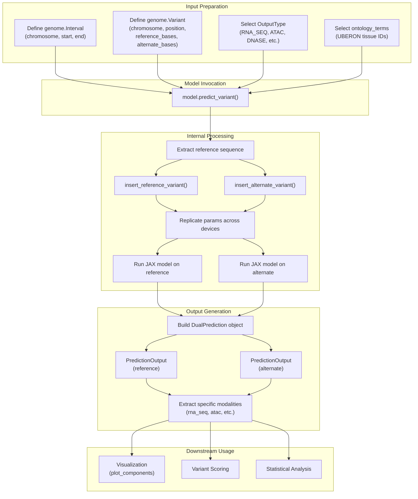

<!-- source: DeepWiki mcp.deepwiki.com · repo google-deepmind/alphagenome_research · page 4.1 DNA Model API · fetched 2026-10-26 -->

# DNA Model API

<details>
<summary>Relevant source files</summary>

The following files were used as context for generating this wiki page:

- [README.md](README.md)
- [src/alphagenome_research/model/__init__.py](src/alphagenome_research/model/__init__.py)

</details>


## Purpose and Scope

This document describes the high-level DNA Model API provided by the `dna_model` module, which serves as the primary interface for interacting with AlphaGenome models. The DNA Model class wraps the underlying JAX implementation and provides convenient methods for loading models, making predictions, and scoring variants. 

For information about downloading and distributing model weights, see [Model Weights and Distribution](#2.3). For details about the underlying core model architecture and JAX implementation, see parent section [Model Architecture](#4). For evaluation workflows using the DNA Model, see [Variant Evaluation Examples](#5.3).

## Overview

The DNA Model API is implemented in [src/alphagenome_research/model/dna_model.py]() and provides a Pythonic interface that abstracts away low-level details of the JAX model, checkpoint loading, and data preparation. It is designed for researchers who want to:

- Load pre-trained AlphaGenome models from Kaggle or HuggingFace
- Make predictions on genomic intervals
- Score the effect of genetic variants
- Perform in silico mutagenesis (ISM)
- Extract predictions for specific output modalities

The class handles model parameter replication across devices, checkpoint restoration with Orbax, and organism-specific metadata management.

**Sources:** [README.md:79-138](), [src/alphagenome_research/model/__init__.py]()

## DNA Model Class Architecture

The following diagram shows the relationship between the DNA Model class and its dependencies:

```mermaid
graph TB
    subgraph "Factory Methods"
        CreateKaggle["create_from_kaggle()"]
        CreateHF["create_from_huggingface()"]
        CreateFromPath["create_from_checkpoint_path()"]
    end
    
    subgraph "DNA Model Class"
        DNAModel["DNAModel"]
        Constructor["__init__()"]
        PredictVariant["predict_variant()"]
        PredictInterval["predict_interval()"]
        ExtractPred["extract_predictions()"]
    end
    
    subgraph "Dependencies"
        CheckpointMgr["orbax.checkpoint<br/>CheckpointManager"]
        HaikuTransform["dm_haiku.transform"]
        MetadataLib["metadata_lib"]
        OrganismData["OrganismData"]
        JAXModel["AlphaGenome JAX Model"]
    end
    
    subgraph "Input Types"
        Interval["genome.Interval"]
        Variant["genome.Variant"]
        OutputType["OutputType enum"]
        OntologyTerms["ontology_terms: list"]
    end
    
    subgraph "Output Types"
        PredOutput["PredictionOutput"]
        DualPred["DualPrediction"]
        ReferenceOut["reference: PredictionOutput"]
        AlternateOut["alternate: PredictionOutput"]
    end
    
    CreateKaggle --> Constructor
    CreateHF --> Constructor
    CreateFromPath --> Constructor
    
    Constructor --> CheckpointMgr
    Constructor --> MetadataLib
    MetadataLib --> OrganismData
    Constructor --> HaikuTransform
    HaikuTransform --> JAXModel
    
    DNAModel --> PredictVariant
    DNAModel --> PredictInterval
    DNAModel --> ExtractPred
    
    Interval --> PredictVariant
    Variant --> PredictVariant
    OutputType --> PredictVariant
    OntologyTerms --> PredictVariant
    
    PredictVariant --> DualPred
    PredictInterval --> PredOutput
    
    DualPred --> ReferenceOut
    DualPred --> AlternateOut
```



**Sources:** [README.md:88-95](), [README.md:106-138]()

## Factory Methods for Model Loading

The DNA Model class provides three factory methods for loading pre-trained models:

| Method | Purpose | Parameters | Returns |
|--------|---------|------------|---------|
| `create_from_kaggle()` | Load from Kaggle Model Hub | `model_name: str` | `DNAModel` |
| `create_from_huggingface()` | Load from HuggingFace Hub | `model_name: str` | `DNAModel` |
| `create_from_checkpoint_path()` | Load from local checkpoint | `checkpoint_path: str`, `organism: str` | `DNAModel` |

### Loading from Kaggle

```python
from alphagenome_research.model import dna_model

model = dna_model.create_from_kaggle('all_folds')
```

This method uses the `kagglehub` library to download model weights from the [Kaggle Models repository](https://www.kaggle.com/models/google/alphagenome). It automatically handles authentication and caching of downloaded weights.

### Loading from HuggingFace

```python
from alphagenome_research.model import dna_model

model = dna_model.create_from_huggingface('all_folds')
```

This method uses the `huggingface_hub` library to download model weights from the [HuggingFace Collections](https://huggingface.co/collections/google/alphagenome). It requires accepting the model terms.

### Loading from Local Checkpoint

```python
from alphagenome_research.model import dna_model

model = dna_model.create_from_checkpoint_path(
    checkpoint_path='/path/to/checkpoint',
    organism='human'
)
```

This method loads a model directly from an Orbax checkpoint on the local filesystem, useful for custom-trained models or when weights are already downloaded.

**Sources:** [README.md:88-95]()

## Prediction Workflow

The following diagram illustrates the complete prediction workflow from input preparation through output extraction:



**Sources:** [README.md:106-138]()

## Core API Methods

### predict_variant()

The `predict_variant()` method generates predictions for both reference and alternate alleles of a variant:

**Method Signature:**
```python
def predict_variant(
    self,
    interval: genome.Interval,
    variant: genome.Variant,
    ontology_terms: list[str],
    requested_outputs: list[OutputType],
) -> DualPrediction
```

**Parameters:**

| Parameter | Type | Description |
|-----------|------|-------------|
| `interval` | `genome.Interval` | Genomic region to analyze (chromosome, start, end coordinates) |
| `variant` | `genome.Variant` | Variant specification (chromosome, position, ref bases, alt bases) |
| `ontology_terms` | `list[str]` | List of UBERON or other ontology identifiers for tissue/cell type context |
| `requested_outputs` | `list[OutputType]` | List of output modalities to compute (RNA_SEQ, ATAC, DNASE, etc.) |

**Returns:**

A `DualPrediction` object containing:
- `reference`: `PredictionOutput` for the reference allele
- `alternate`: `PredictionOutput` for the alternate allele

Each `PredictionOutput` contains predictions for the requested output types as attributes (e.g., `.rna_seq`, `.atac`, `.dnase`).

**Example:**
```python
outputs = model.predict_variant(
    interval=genome.Interval(chromosome='chr22', start=35677410, end=36725986),
    variant=genome.Variant(
        chromosome='chr22',
        position=36201698,
        reference_bases='A',
        alternate_bases='C',
    ),
    ontology_terms=['UBERON:0001157'],  # Brain tissue
    requested_outputs=[dna_model.OutputType.RNA_SEQ],
)

# Access outputs
ref_rna = outputs.reference.rna_seq
alt_rna = outputs.alternate.rna_seq
```

**Sources:** [README.md:106-138]()

### predict_interval()

The `predict_interval()` method generates predictions for a genomic interval without variant modification:

**Method Signature:**
```python
def predict_interval(
    self,
    interval: genome.Interval,
    ontology_terms: list[str],
    requested_outputs: list[OutputType],
) -> PredictionOutput
```

This method is useful for analyzing reference genome regions without considering variants.

**Sources:** [README.md:106-138]()

### extract_predictions()

The `extract_predictions()` method processes raw model outputs into structured prediction objects:

**Method Signature:**
```python
def extract_predictions(
    self,
    model_output: dict,
    requested_outputs: list[OutputType],
) -> PredictionOutput
```

This method is typically used internally by `predict_variant()` and `predict_interval()`, but can be called directly when working with custom model invocations.

**Sources:** [README.md:106-138]()

## Output Types

The `OutputType` enumeration defines the available output modalities:

| Output Type | Description | Biological Signal |
|-------------|-------------|-------------------|
| `RNA_SEQ` | RNA sequencing predictions | Gene expression levels |
| `ATAC` | ATAC-seq predictions | Chromatin accessibility |
| `DNASE` | DNase-seq predictions | DNA accessibility |
| `CHIP_TF` | ChIP-seq transcription factor | TF binding sites |
| `SPLICE_DONOR` | Splice donor site | 5' splice sites |
| `SPLICE_ACCEPTOR` | Splice acceptor site | 3' splice sites |
| `CONTACT_MAP` | Hi-C contact maps | 3D genome organization |
| `CAGE` | CAGE predictions | TSS activity |

Each output type corresponds to a specific genomic modality predicted by the AlphaGenome model. The predictions are returned as structured objects with genomic interval information and prediction values.

**Sources:** [README.md:119-121]()

## Data Types and Structures

### genome.Interval

Represents a genomic region:

```python
genome.Interval(
    chromosome='chr22',  # Chromosome identifier
    start=35677410,      # Start position (0-based)
    end=36725986,        # End position (exclusive)
)
```

The interval should typically span the model's receptive field (up to 1 million base pairs) to capture long-range regulatory context.

### genome.Variant

Represents a genetic variant:

```python
genome.Variant(
    chromosome='chr22',      # Chromosome identifier
    position=36201698,       # Variant position (0-based)
    reference_bases='A',     # Reference allele
    alternate_bases='C',     # Alternate allele
)
```

Supports SNVs (single nucleotide variants), insertions, and deletions. The variant must be located within the specified interval.

**Sources:** [README.md:108-114]()

## Model Configuration

### Organism Metadata

The DNA Model uses organism-specific metadata loaded via `metadata_lib.load()`. This metadata includes:

- Genome assembly information
- Chromosome sizes
- Feature annotations
- Ontology mappings for tissue/cell types

The metadata is automatically loaded when using factory methods, but must be specified when using `create_from_checkpoint_path()`.

### Mixed Precision

The model uses `haiku.mixed_precision` to optimize computation on accelerators. This is configured automatically during model construction and does not require user intervention.

### Device Replication

Model parameters are automatically replicated across available JAX devices (GPUs/TPUs) for efficient inference. The DNA Model handles device sharding transparently.

**Sources:** [README.md:66-76]()

## Usage Patterns

### Basic Variant Prediction

```python
from alphagenome_research.model import dna_model
from alphagenome.data import genome

model = dna_model.create_from_kaggle('all_folds')

outputs = model.predict_variant(
    interval=genome.Interval(chromosome='chr22', start=35677410, end=36725986),
    variant=genome.Variant(
        chromosome='chr22',
        position=36201698,
        reference_bases='A',
        alternate_bases='C',
    ),
    ontology_terms=['UBERON:0001157'],
    requested_outputs=[dna_model.OutputType.RNA_SEQ],
)
```

### Multi-Modal Prediction

```python
outputs = model.predict_variant(
    interval=interval,
    variant=variant,
    ontology_terms=['UBERON:0001157'],
    requested_outputs=[
        dna_model.OutputType.RNA_SEQ,
        dna_model.OutputType.ATAC,
        dna_model.OutputType.DNASE,
        dna_model.OutputType.SPLICE_DONOR,
    ],
)

# Access different modalities
rna_ref = outputs.reference.rna_seq
rna_alt = outputs.alternate.rna_seq
atac_ref = outputs.reference.atac
atac_alt = outputs.alternate.atac
```

### Tissue-Specific Analysis

```python
# Multiple tissue contexts
tissues = [
    'UBERON:0001157',  # Brain
    'UBERON:0000948',  # Heart
    'UBERON:0002107',  # Liver
]

outputs = model.predict_variant(
    interval=interval,
    variant=variant,
    ontology_terms=tissues,
    requested_outputs=[dna_model.OutputType.RNA_SEQ],
)
```

**Sources:** [README.md:97-138]()

## Integration with Visualization

The DNA Model outputs are compatible with the `alphagenome.visualization.plot_components` module:

```python
from alphagenome.visualization import plot_components
import matplotlib.pyplot as plt

outputs = model.predict_variant(...)

plot_components.plot(
    [
        plot_components.OverlaidTracks(
            tdata={
                'REF': outputs.reference.rna_seq,
                'ALT': outputs.alternate.rna_seq,
            },
            colors={'REF': 'dimgrey', 'ALT': 'red'},
        ),
    ],
    interval=outputs.reference.rna_seq.interval.resize(2**15),
    annotations=[plot_components.VariantAnnotation([variant], alpha=0.8)],
)
plt.show()
```

**Sources:** [README.md:123-138]()

## Hardware Requirements

Running the DNA Model requires significant computational resources:

- **Recommended GPU**: NVIDIA H100 or equivalent
- **GPU Requirements**: CUDA and cuDNN must be correctly installed with JAX GPU support
- **Receptive Field**: Up to 1 million base pairs per prediction
- **Memory**: Varies based on interval size and requested outputs

For production workloads, consider using the [AlphaGenome API](https://deepmind.google.com/science/alphagenome) which provides hosted inference without requiring local hardware.

**Sources:** [README.md:66-76]()

## Error Handling

The DNA Model performs validation on inputs:

- Interval coordinates must be valid for the specified chromosome
- Variant position must fall within the specified interval
- Ontology terms must exist in the organism metadata
- Output types must be supported by the loaded model

Invalid inputs raise appropriate exceptions with descriptive error messages.

## Performance Considerations

### Batch Processing

For processing multiple variants, consider batching predictions:

```python
variants = [variant1, variant2, variant3, ...]

# Process in batches to optimize GPU utilization
for variant in variants:
    outputs = model.predict_variant(
        interval=interval,
        variant=variant,
        ontology_terms=tissues,
        requested_outputs=output_types,
    )
    # Process outputs...
```

### JIT Compilation

The underlying JAX model uses JIT (Just-In-Time) compilation. The first prediction may be slower due to compilation overhead, but subsequent predictions with similar shapes are cached and execute faster.

### Memory Management

Large genomic intervals and multiple output types increase memory requirements. Consider:

- Processing intervals in chunks for very long sequences
- Requesting only necessary output types
- Clearing intermediate results when processing many variants

**Sources:** [README.md:66-76]()

---

