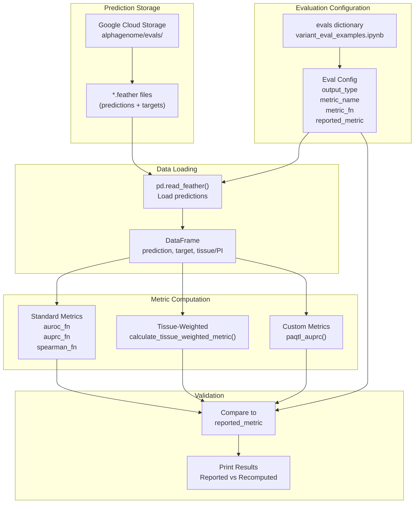
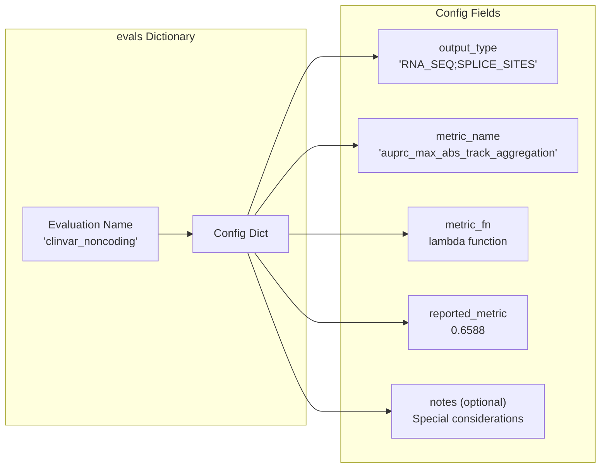
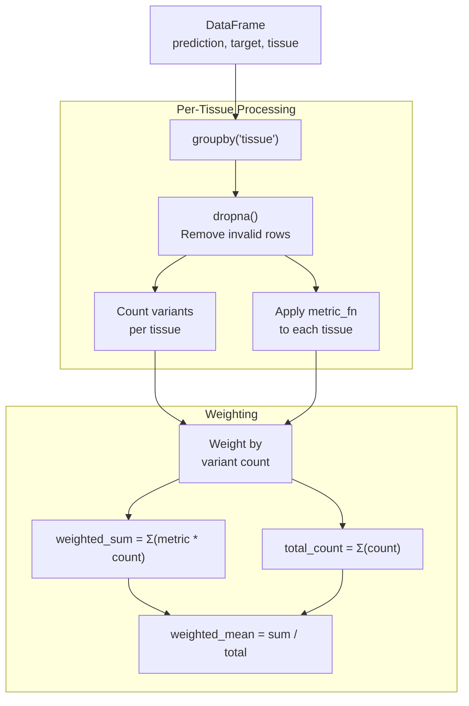
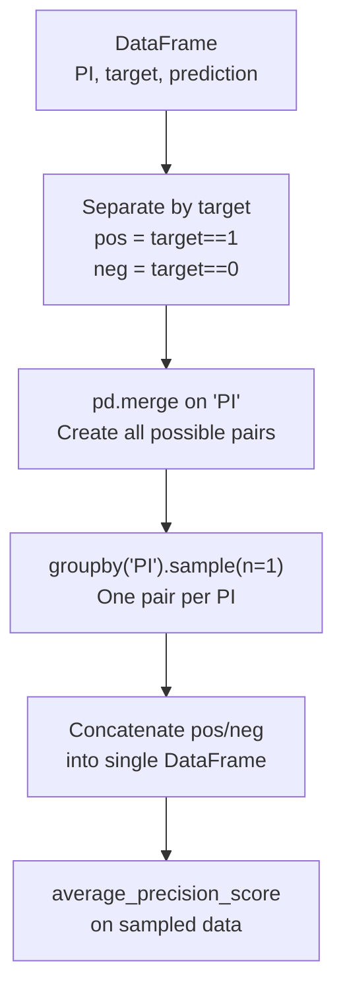
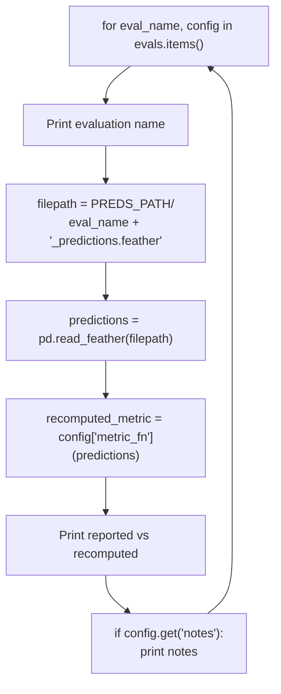
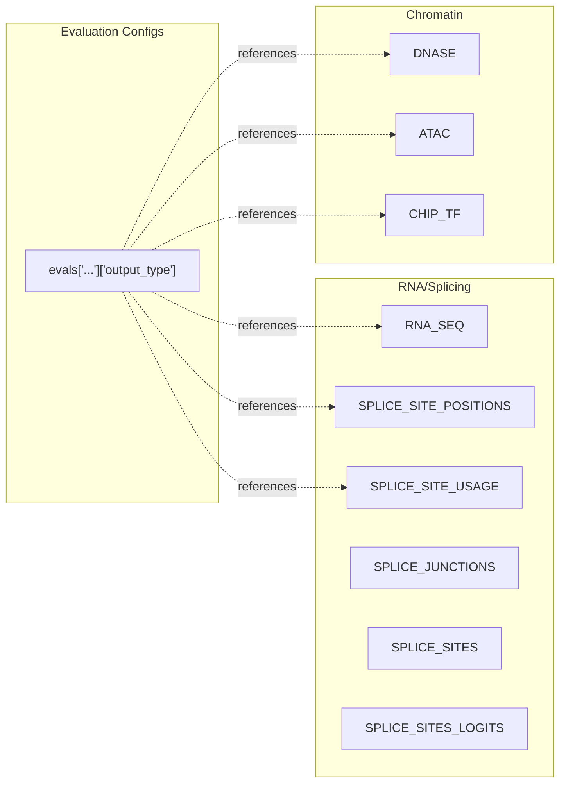
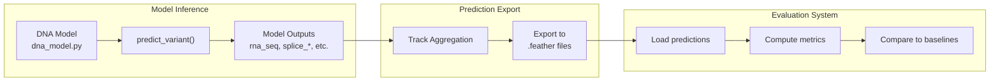

<!-- source: DeepWiki mcp.deepwiki.com · repo google-deepmind/alphagenome_research · page 5 Evaluation System · fetched 2026-10-26 -->

# Evaluation System

<details>
<summary>Relevant source files</summary>

The following files were used as context for generating this wiki page:

- [README.md](README.md)
- [colabs/variant_eval_examples.ipynb](colabs/variant_eval_examples.ipynb)

</details>


## Purpose and Scope

The Evaluation System provides a comprehensive framework for benchmarking AlphaGenome model predictions against established genomic datasets. It supports evaluation across multiple biological modalities (gene expression, splicing, chromatin accessibility, transcription factor binding) and implements both standard machine learning metrics (AUROC, AUPRC, Pearson R) and domain-specific aggregation strategies (tissue-weighted means, paQTL 1:1 matching).

For detailed documentation on specific components:
- For low-level metric implementations, see [Regression Metrics](#5.1)
- For track prediction evaluation workflows, see [Track Prediction Evaluation](#5.2)
- For practical examples and benchmark reproduction, see [Variant Evaluation Examples](#5.3)

**Sources:** [colabs/variant_eval_examples.ipynb:1-480](), [README.md:1-334]()

## System Architecture

The evaluation system operates as a pipeline that loads pre-computed predictions, applies configurable metric functions, and validates results against reported baselines.



**Evaluation Pipeline Flow**

The system retrieves predictions from cloud storage, applies the appropriate metric function defined in the evaluation configuration, and validates against published benchmarks.

**Sources:** [colabs/variant_eval_examples.ipynb:206-353](), [colabs/variant_eval_examples.ipynb:356-477]()

## Evaluation Datasets and Benchmarks

The system supports evaluation across 21 distinct benchmarks spanning multiple biological domains:

| Evaluation Name | Output Type | Metric | Biological Domain |
|----------------|-------------|--------|-------------------|
| `clinvar_splice_site_region` | SPLICE_SITE_USAGE, RNA_SEQ, SPLICE_JUNCTIONS | AUPRC | Splicing variants |
| `clinvar_noncoding` | RNA_SEQ, SPLICE_SITE_POSITIONS | AUPRC | Non-coding variants |
| `clinvar_missense` | SPLICE_SITE_USAGE, RNA_SEQ | AUPRC | Missense variants |
| `sqtl_variant_causality_gene_human` | RNA_SEQ, SPLICE_JUNCTIONS | Tissue-weighted AUPRC | Splicing QTLs |
| `mfass_splicing` | SPLICE_SITES_LOGITS, SPLICE_JUNCTIONS | AUPRC | MFASS assay |
| `eqtl_variant_borzoi_sign_human` | RNA_SEQ | Tissue-weighted AUROC | Expression QTLs |
| `eqtl_variant_catalogue_causality_gene_balanced_human` | RNA_SEQ | Tissue-weighted AUROC | Expression QTLs |
| `eqtl_variant_borzoi_coefficient_human` | RNA_SEQ | Tissue-weighted Spearman R | Expression QTLs |
| `enhancer_gene_linking_e2g` | RNA_SEQ | AUPRC | Enhancer-gene links |
| `paqtl_variant_causality_human` | RNA_SEQ | paQTL AUPRC | Polyadenylation QTLs |
| `caqtl_african_variant_causality_human` | DNASE | AUPRC | Chromatin accessibility |
| `caqtl_european_variant_causality_human` | DNASE | AUPRC | Chromatin accessibility |
| `dsqtl_yoruba_variant_causality_human` | DNASE | AUPRC | DNase QTLs |
| `caqtl_african_variant_coefficient_human` | DNASE | Pearson R | Chromatin accessibility |
| `caqtl_european_variant_coefficient_human` | DNASE | Pearson R | Chromatin accessibility |
| `dsqtl_yoruba_variant_coefficient_human` | DNASE | Pearson R | DNase QTLs |
| `caqtl_microglia_variant_coefficient_human` | DNASE | Pearson R | Cell-type specific |
| `caqtl_smc_variant_coefficient_human` | ATAC | Pearson R | ATAC-seq QTLs |
| `bqtl_spi1_variant_coefficient_human` | CHIP_TF | Pearson R | TF binding QTLs |
| `bqtl_spi1_variant_causality_human` | CHIP_TF | AUPRC | TF binding QTLs |

**Sources:** [colabs/variant_eval_examples.ipynb:206-336](), [README.md:231-290]()

## Evaluation Configuration Structure

Each evaluation is defined by a configuration dictionary mapping evaluation names to their specifications:



**Configuration Structure**

Each entry in the `evals` dictionary specifies the output modalities to evaluate, the metric computation function, and the expected baseline value.

**Example Configuration:**

```python
'clinvar_noncoding': {
    'output_type': 'RNA_SEQ;SPLICE_SITE_POSITIONS;...',
    'metric_name': 'auprc_max_abs_track_aggregation',
    'metric_fn': lambda x: metrics.average_precision_score(x['target'], x['prediction']),
    'reported_metric': 0.6588,
}
```

**Sources:** [colabs/variant_eval_examples.ipynb:208-336]()

## Metric Functions

The system provides three categories of metric functions:

### Standard Metrics

Implemented as simple function wrappers around scikit-learn and scipy:

| Function | Implementation | Purpose |
|----------|---------------|---------|
| `auroc_fn` | `roc_auc_score` | Binary classification performance |
| `auprc_fn` | `average_precision_score` | Precision-recall balance |
| `spearman_fn` | `lambda y_true, y_pred: spearmanr(y_true, y_pred)[0]` | Rank correlation |

**Sources:** [colabs/variant_eval_examples.ipynb:184-187]()

### Tissue-Weighted Metrics

The `calculate_tissue_weighted_metric()` function aggregates per-tissue metrics into a single weighted mean:



**Tissue-Weighted Aggregation**

Metrics are computed independently per tissue, then averaged with weights proportional to the number of variants in each tissue.

**Usage:**
```python
functools.partial(
    calculate_tissue_weighted_metric, 
    metric_fn=auprc_fn
)
```

**Sources:** [colabs/variant_eval_examples.ipynb:63-148]()

### Specialized Metrics

#### paQTL AUPRC with 1:1 Matching

The `paqtl_auprc()` function implements controlled 1:1 matching between positive and negative examples:



**paQTL 1:1 Matching Strategy**

This metric ensures balanced evaluation by sampling exactly one positive-negative pair per polyadenylation interval (PI).

The matching logic:
1. Split data by `target` (0 vs 1)
2. Merge on `PI` to find all valid pairs
3. Sample one pair per `PI` (controlled randomness with `SEED=0`)
4. Compute AUPRC on the balanced sample

**Sources:** [colabs/variant_eval_examples.ipynb:151-182](), [colabs/variant_eval_examples.ipynb:267-272]()

## Evaluation Execution

The main evaluation loop iterates through all configured evaluations:



**Evaluation Loop**

The system loads each prediction file from GCS storage, applies the configured metric function, and compares results to baselines.

**Execution Code:**
```python
for eval_name, c in evals.items():
    filepath = os.path.join(PREDS_PATH, eval_name + '_predictions.feather')
    predictions = pd.read_feather(filepath)
    recomputed_metric = c['metric_fn'](predictions)
    print(f"  Reported:   {c['reported_metric']}")
    print(f"  Recomputed: {recomputed_metric:.4f}")
```

**Sources:** [colabs/variant_eval_examples.ipynb:356-369]()

## Prediction Data Format

Prediction files stored as Feather format contain the following columns:

| Column | Type | Description |
|--------|------|-------------|
| `prediction` | float | Model's predicted score for variant effect |
| `target` | int/float | Ground truth label or value |
| `tissue` | str (optional) | Tissue/cell type identifier for grouped metrics |
| `PI` | str (optional) | Polyadenylation interval ID for paQTL matching |

The exact schema varies by evaluation type:
- **Classification tasks**: `target` ∈ {0, 1}, binary labels
- **Regression tasks**: `target` ∈ ℝ, continuous values
- **Tissue-specific**: Includes `tissue` column for stratification
- **paQTL**: Includes `PI` column for controlled matching

**Sources:** [colabs/variant_eval_examples.ipynb:91-101](), [colabs/variant_eval_examples.ipynb:151-182]()

## Output Types and Modalities

The evaluation system supports predictions across AlphaGenome's diverse output modalities:



**Output Type Mapping**

Each evaluation specifies which model output tracks are used, corresponding to bundle types defined in the core system.

**Examples:**
- `'RNA_SEQ'` - Gene expression predictions
- `'SPLICE_SITE_USAGE;SPLICE_JUNCTIONS;SPLICE_SITES'` - Combined splicing outputs
- `'DNASE'` - DNase hypersensitivity
- `'CHIP_TF'` - Transcription factor binding

**Sources:** [colabs/variant_eval_examples.ipynb:213-335]()

## Validation and Quality Checks

The system implements several validation mechanisms:

### Input Validation

```python
required_cols = [prediction_col, target_col, tissue_col]
if not all(col in predictions_df.columns for col in required_cols):
    raise ValueError(f"DataFrame must contain columns: {required_cols}")
```

**Sources:** [colabs/variant_eval_examples.ipynb:91-93]()

### Data Cleaning

- Drop rows with NaN values: `clean_group = group_df.dropna(subset=[target_col, prediction_col])`
- Skip tissues with <2 variants (insufficient for correlation metrics)
- Validate finite metric values: `if not np.isfinite(metric_value): continue`

**Sources:** [colabs/variant_eval_examples.ipynb:100-119]()

### Error Handling

```python
try:
    metric_value = metric_fn(clean_group[target_col], clean_group[prediction_col])
except ValueError as e:
    # Catches single-class errors for AUROC/AUPRC
    print(f"Could not calculate metric for tissue {tissue_name}: {e}")
    continue
```

**Sources:** [colabs/variant_eval_examples.ipynb:110-130]()

## Special Considerations

### Sign Ambiguity in Correlation Metrics

Some evaluations note that correlation sign depends on REF/ALT allele labeling:

```python
'notes': 'The sign of the correlation flips depending on which allele is labelled REF vs. ALT.'
```

This affects:
- `dsqtl_yoruba_variant_coefficient_human` (expected: 0.8323, observed: -0.8323)
- `caqtl_microglia_variant_coefficient_human` (expected: 0.6357, observed: -0.6354)

**Sources:** [colabs/variant_eval_examples.ipynb:308-316]()

### Stochastic Metrics

The paQTL evaluation involves random sampling:

```python
'notes': 'The reported metric is from many permutations, here we just do 1 resample.'
```

The single-sample recomputation (0.6288) closely approximates the multi-permutation reported value (0.6294).

**Sources:** [colabs/variant_eval_examples.ipynb:267-272]()

## Relationship to Core Model

The evaluation system operates on predictions generated by the AlphaGenome model but is architecturally independent:



**Model-to-Evaluation Pipeline**

Predictions are generated via the DNA Model API, aggregated to variant-level scores, exported to Feather format, and consumed by the evaluation framework.

**Sources:** [colabs/variant_eval_examples.ipynb:1-480](), [README.md:99-138]()

---

