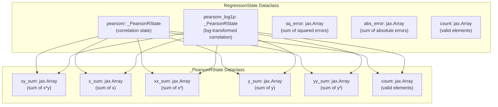
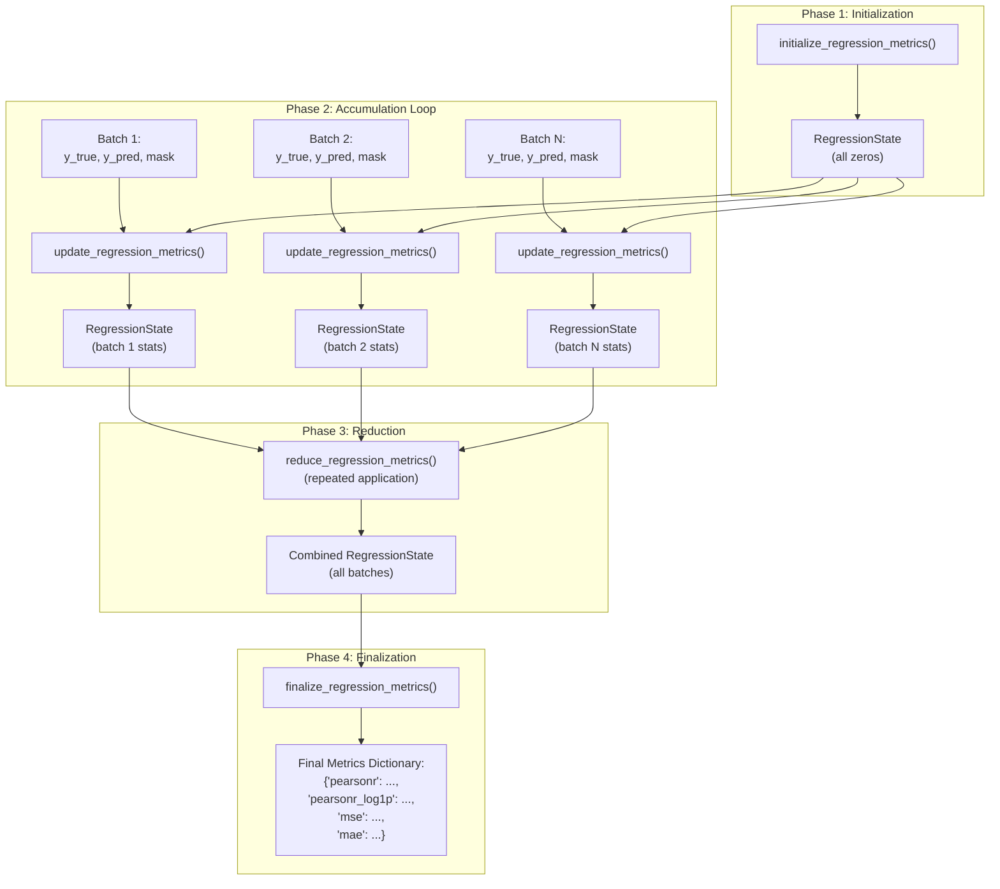
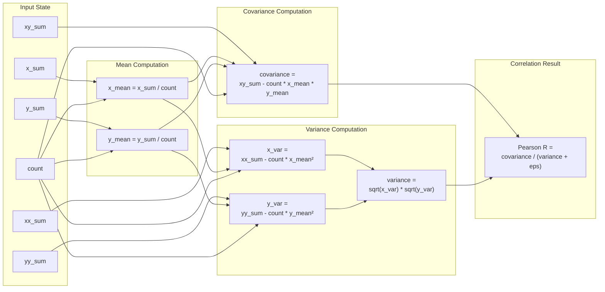
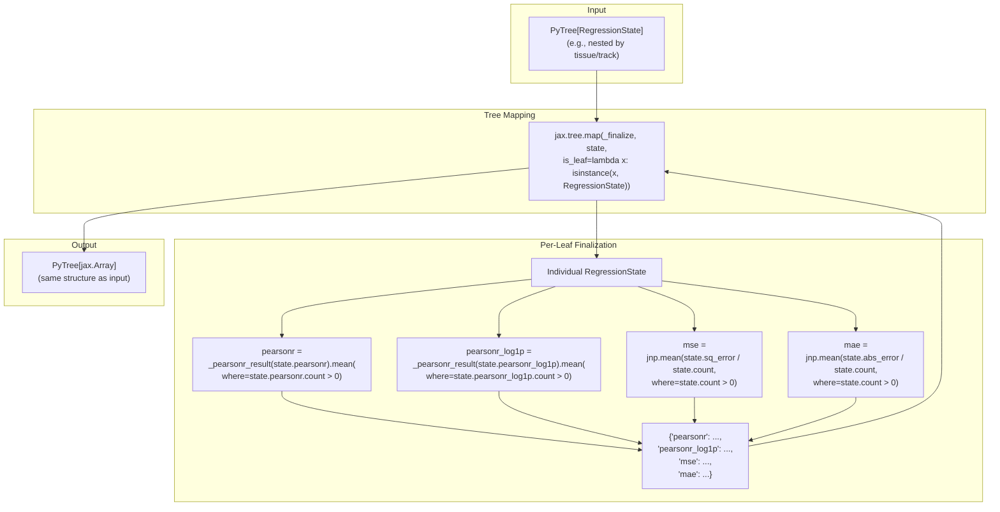

<!-- source: DeepWiki mcp.deepwiki.com · repo google-deepmind/alphagenome_research · page 5.1 Regression Metrics · fetched 2026-10-26 -->

# Regression Metrics

<details>
<summary>Relevant source files</summary>

The following files were used as context for generating this wiki page:

- [src/alphagenome_research/evals/regression_metrics.py](src/alphagenome_research/evals/regression_metrics.py)

</details>


## Purpose and Scope

This document covers the regression metrics computation system in AlphaGenome Research, which provides an incremental accumulator-based framework for computing correlation and error metrics on model predictions. The system implements Pearson R correlation, Mean Squared Error (MSE), and Mean Absolute Error (MAE) calculations with support for masked computation and distributed aggregation.

For information about using these metrics in model evaluation pipelines, see [Track Prediction Evaluation](#5.2). For examples of applying these metrics to benchmark datasets, see [Variant Evaluation Examples](#5.3).

**Sources:** [src/alphagenome_research/evals/regression_metrics.py:1-205]()

---

## Overview

The regression metrics system uses a state accumulator pattern to enable incremental metric computation across batches and devices. Instead of materializing all predictions and targets in memory, the system accumulates sufficient statistics that can be combined and finalized into metric values.

The core components are:

| Component | Purpose | Key Methods |
|-----------|---------|-------------|
| `_PearsonRState` | Accumulates statistics for Pearson R correlation | `__add__` for combining states |
| `RegressionState` | Top-level accumulator for all regression metrics | `__add__` for combining states |
| `initialize_regression_metrics()` | Creates zero-initialized state | Returns `RegressionState` |
| `update_regression_metrics()` | Accumulates statistics from predictions and targets | Returns `RegressionState` |
| `reduce_regression_metrics()` | Combines metrics across devices/batches | Returns combined `RegressionState` |
| `finalize_regression_metrics()` | Computes final metric values from accumulated state | Returns dictionary of metrics |

**Sources:** [src/alphagenome_research/evals/regression_metrics.py:26-182]()

---

## State Accumulator Architecture

The metrics system uses a hierarchical dataclass structure built with `chex.dataclass` for JAX compatibility. The architecture enables PyTree operations and automatic device replication.



**State Accumulator Dataclass Hierarchy**

Both dataclasses implement `__add__` methods that enable combining states using `jax.tree.map`:

- **`_PearsonRState.__add__`**: Combines two Pearson R states element-wise [line 37-38]()
- **`RegressionState.__add__`**: Combines two regression states element-wise [line 96-101]()

This design allows states from different batches or devices to be merged through simple addition operations on the PyTree structure.

**Sources:** [src/alphagenome_research/evals/regression_metrics.py:26-101]()

---

## Metric Computation Pipeline

The metric computation follows a three-phase workflow: initialization, accumulation, and finalization. This pattern supports both single-device and distributed evaluation scenarios.



**Metric Computation Workflow**

### Initialization Phase

The `initialize_regression_metrics()` function creates a zero-initialized `RegressionState`:

- Calls `_pearsonr_initialize()` twice for standard and log1p Pearson R states
- Initializes scalar zero arrays for `sq_error`, `abs_error`, and `count`
- Returns a `RegressionState` with shape `()` (scalar) arrays using NumPy

**Sources:** [src/alphagenome_research/evals/regression_metrics.py:104-112]()

### Accumulation Phase

The `update_regression_metrics()` function processes predictions and targets for a single batch:

**Input Parameters:**
- `y_true`: Ground truth targets as `jax.Array`
- `y_pred`: Model predictions as `jax.Array`
- `mask`: Optional `jax.Array` indicating valid positions (supports masked computation)

**Computation Steps:**
1. Casts inputs to `float32` for numerical stability
2. Calls `_pearsonr_update()` for standard Pearson R (axes `-2, -3`)
3. Calls `_pearsonr_update()` with `log1p` transformation
4. Computes squared error: `(y_true - y_pred)²`
5. Computes absolute error: `|y_true - y_pred|`
6. Counts valid elements based on mask

All reductions use `axis=(-2, -3)` which corresponds to the sequence and track dimensions in genomic predictions. The `where=mask` parameter excludes masked positions from computation.

**Sources:** [src/alphagenome_research/evals/regression_metrics.py:115-142]()

### Reduction Phase

The `reduce_regression_metrics()` function combines states from multiple batches or devices:

```python
def reduce_regression_metrics(
    previous_metrics: PyTree[RegressionState],
    current_metrics: PyTree[RegressionState],
) -> RegressionState:
  return jax.tree.map(
      lambda x, y: x + y,
      previous_metrics,
      current_metrics,
      is_leaf=lambda x: isinstance(x, RegressionState),
  )
```

This function uses `jax.tree.map` with a custom `is_leaf` predicate to handle PyTree structures containing `RegressionState` objects. The leaf identification ensures that the addition operation is applied at the `RegressionState` level rather than descending into its fields.

**Sources:** [src/alphagenome_research/evals/regression_metrics.py:171-181]()

---

## Pearson R Correlation Computation

The Pearson R correlation coefficient is computed using Welford's online algorithm adapted for batch processing. The implementation separates state accumulation from result computation for efficiency.

### Pearson R State Management

The `_PearsonRState` dataclass maintains five sufficient statistics:

| Statistic | Formula | Purpose |
|-----------|---------|---------|
| `xy_sum` | Σ(x·y) | Cross-product sum |
| `x_sum` | Σ(x) | Predictor sum |
| `xx_sum` | Σ(x²) | Predictor sum of squares |
| `y_sum` | Σ(y) | Target sum |
| `yy_sum` | Σ(y²) | Target sum of squares |
| `count` | N | Number of valid elements |

**Sources:** [src/alphagenome_research/evals/regression_metrics.py:26-50]()

### State Update

The `_pearsonr_update()` function computes these statistics for a batch:

```python
def _pearsonr_update(
    x: jax.Array,
    y: jax.Array,
    axis: Sequence[int] | int | None = None,
    mask: jax.Array | None = None,
) -> _PearsonRState:
```

**Key Implementation Details:**
- Converts mask to boolean type for safe indexing
- Uses `jnp.sum(..., where=mask)` for masked reduction
- Forces `dtype=jnp.float32` for numerical stability
- Supports arbitrary reduction axes

**Sources:** [src/alphagenome_research/evals/regression_metrics.py:53-69]()

### Correlation Coefficient Calculation

The `_pearsonr_result()` function computes the final Pearson R value from accumulated state:



**Pearson R Calculation Flow**

The function adds a small epsilon (`jnp.finfo(variance.dtype).eps`) to the denominator to prevent division by zero in degenerate cases where all predictions or targets are constant.

**Sources:** [src/alphagenome_research/evals/regression_metrics.py:72-83]()

---

## Regression Metric Calculations

The `RegressionState` dataclass tracks four distinct metrics simultaneously:

### Standard Pearson R

Computes correlation between predictions and targets in the original scale:

```
r = Σ[(x - x̄)(y - ȳ)] / [σₓ σᵧ √N]
```

This metric is sensitive to the absolute scale of predictions and targets.

### Log-Transformed Pearson R

Computes correlation after `log1p` transformation:

```
r_log = Pearson(log(1 + x), log(1 + y))
```

The `log1p` transformation (`log(1 + x)`) is used to:
- Handle zero values gracefully (log(0) is undefined)
- Reduce the impact of outliers with large values
- Better capture correlation in count-based genomic data (e.g., read counts)

**Sources:** [src/alphagenome_research/evals/regression_metrics.py:124-126]()

### Mean Squared Error (MSE)

Accumulates squared prediction errors:

```
MSE = (1/N) Σ(y_true - y_pred)²
```

The accumulator stores `sq_error = Σ(y_true - y_pred)²` and divides by count during finalization.

**Sources:** [src/alphagenome_research/evals/regression_metrics.py:127-132]()

### Mean Absolute Error (MAE)

Accumulates absolute prediction errors:

```
MAE = (1/N) Σ|y_true - y_pred|
```

The accumulator stores `abs_error = Σ|y_true - y_pred|` and divides by count during finalization.

**Sources:** [src/alphagenome_research/evals/regression_metrics.py:133-138]()

---

## Metric Finalization and Aggregation

The `finalize_regression_metrics()` function converts accumulated state into final metric values. This function supports PyTree structures, enabling hierarchical metric organization (e.g., per-tissue or per-track metrics).

### Finalization Process



**Metric Finalization Pipeline**

### Implementation Details

The inner `_finalize()` function [lines 150-164]() processes a single `RegressionState`:

1. **Pearson R Finalization**: Calls `_pearsonr_result()` and computes mean over valid elements (where count > 0)
2. **Pearson R log1p Finalization**: Same process for log-transformed state
3. **MSE Finalization**: Divides accumulated squared error by count, averages over valid elements
4. **MAE Finalization**: Divides accumulated absolute error by count, averages over valid elements

The `where=state.count > 0` guards prevent NaN values when no valid samples exist in a particular group.

### PyTree Support

The `jax.tree.map()` call with `is_leaf=lambda x: isinstance(x, RegressionState)` enables finalization of nested metric structures. For example, if metrics are organized by tissue type:

```
{
  'tissue_1': RegressionState(...),
  'tissue_2': RegressionState(...),
  ...
}
```

The function will produce:

```
{
  'tissue_1': {'pearsonr': ..., 'pearsonr_log1p': ..., 'mse': ..., 'mae': ...},
  'tissue_2': {'pearsonr': ..., 'pearsonr_log1p': ..., 'mse': ..., 'mae': ...},
  ...
}
```

This design supports the tissue-weighted metrics described in the evaluation pipeline.

**Sources:** [src/alphagenome_research/evals/regression_metrics.py:145-168]()

---

## Utility Functions

### Sequence Length Cropping

The `crop_sequence_length()` function centers and crops arrays along the sequence dimension:

```python
@typing.jaxtyped
def crop_sequence_length(
    x: Float[ArrayLike, '... S D'], *, target_length: int
) -> Float[ArrayLike, '... {target_length} D']:
```

**Purpose**: Align prediction and target sequence lengths when they differ due to model receptive field effects.

**Algorithm:**
1. Validates that input length ≥ target length
2. If lengths match, returns input unchanged
3. Otherwise, computes symmetric trim amounts: `ltrim` and `rtrim`
4. Centers the crop by taking `target_length` elements from the middle
5. Uses slice indexing along `sequence_axis = -2`

**Example:**
- Input shape: `(batch=4, sequence=1024, channels=256)`
- Target length: `896`
- Trim amounts: `ltrim=64`, `rtrim=64`
- Output shape: `(batch=4, sequence=896, channels=256)`

This function uses `jaxtyping` annotations to enforce shape constraints at runtime when typeguard is enabled.

**Sources:** [src/alphagenome_research/evals/regression_metrics.py:184-204]()

---

## Summary

The regression metrics system provides:

- **Incremental Computation**: Accumulator pattern enables batch-wise processing without full materialization
- **Distributed Support**: PyTree-based design with `__add__` methods enables cross-device aggregation
- **Masked Computation**: All metric calculations respect optional masks for handling invalid positions
- **Multiple Metrics**: Simultaneous computation of Pearson R, Pearson R log1p, MSE, and MAE
- **Hierarchical Organization**: PyTree support enables per-tissue, per-track, or arbitrary nested metric structures
- **Numerical Stability**: Float32 casting and epsilon guards prevent overflow and division by zero

The system is used throughout the evaluation pipeline to assess model performance on regulatory genomic predictions across diverse modalities and tissue types.

**Sources:** [src/alphagenome_research/evals/regression_metrics.py:1-205]()

---

