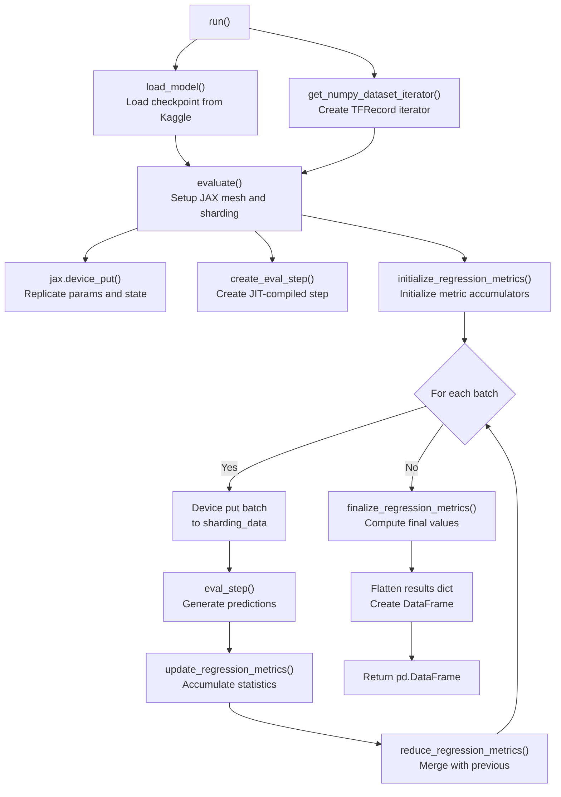
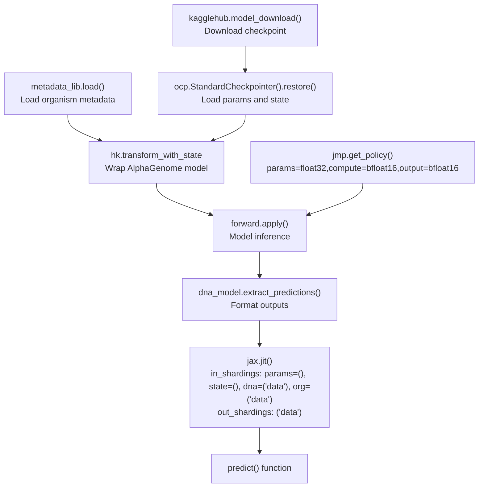
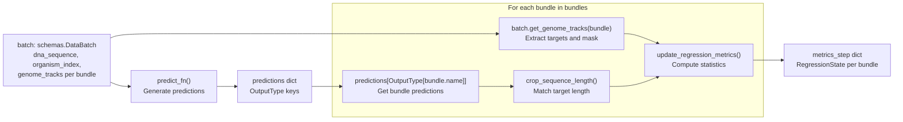
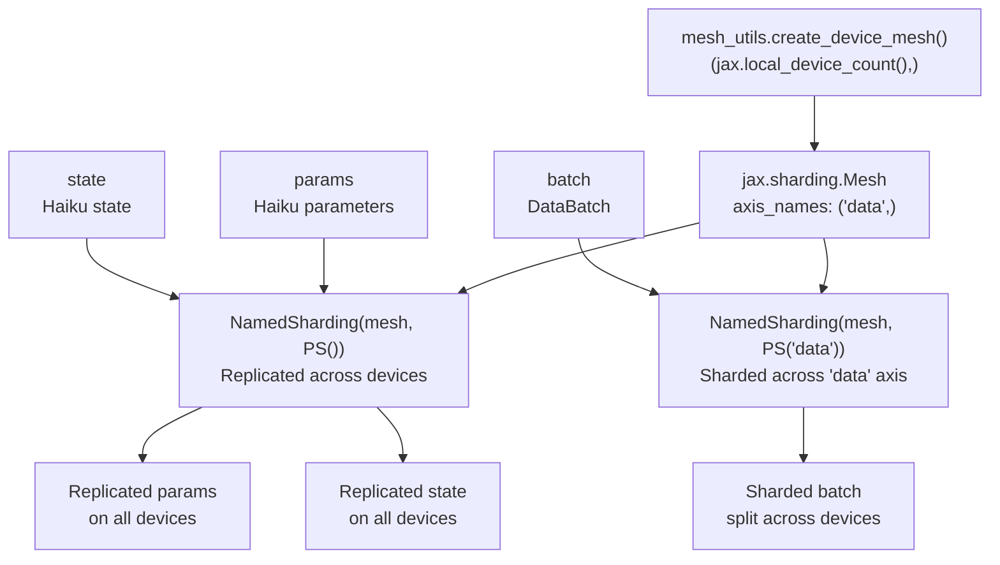
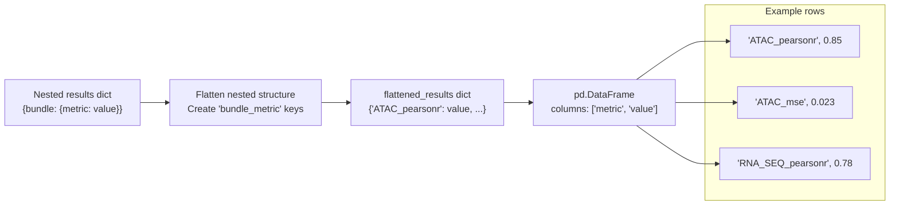
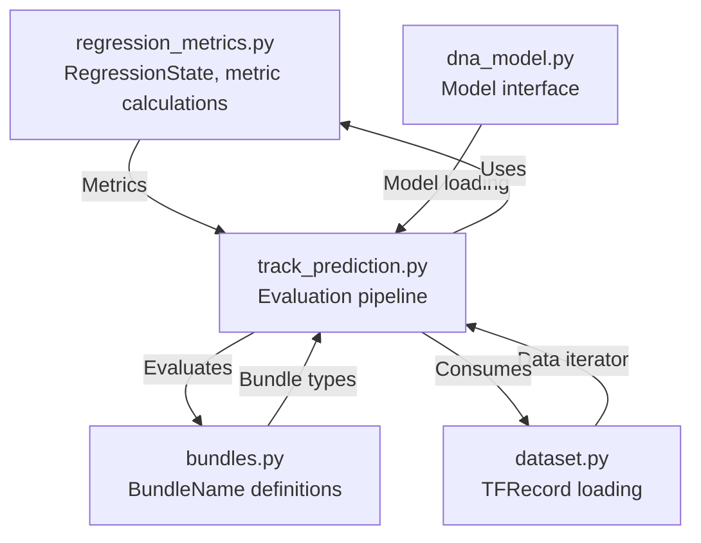

<!-- source: DeepWiki mcp.deepwiki.com · repo google-deepmind/alphagenome_research · page 5.2 Track Prediction Evaluation · fetched 2026-10-26 -->

# Track Prediction Evaluation

<details>
<summary>Relevant source files</summary>

The following files were used as context for generating this wiki page:

- [src/alphagenome_research/evals/regression_metrics.py](src/alphagenome_research/evals/regression_metrics.py)
- [src/alphagenome_research/evals/track_prediction.py](src/alphagenome_research/evals/track_prediction.py)

</details>


## Purpose and Scope

This document describes the track prediction evaluation pipeline in the AlphaGenome Research codebase, which assesses model performance on predicting genomic output tracks (e.g., ATAC-seq, DNase-seq, RNA-seq, ChIP-seq). The evaluation system measures how accurately the AlphaGenome model can predict experimental genome-wide measurements across multiple genomic assays.

For details on the underlying metric calculations (Pearson R, MSE, MAE), see [Regression Metrics](#5.1). For practical examples of evaluating the model on specific variant datasets (CAGI, GTEx, ClinVar), see [Variant Evaluation Examples](#5.3).

The track prediction evaluation pipeline is implemented in [src/alphagenome_research/evals/track_prediction.py]() and uses metrics from [src/alphagenome_research/evals/regression_metrics.py]().

---

## Evaluation Pipeline Architecture

The track prediction evaluation system follows a multi-stage pipeline that loads model checkpoints, sets up JAX device sharding, iterates through evaluation datasets, computes predictions, and accumulates regression metrics.

**Evaluation Pipeline Flow**



**Sources:** [src/alphagenome_research/evals/track_prediction.py:173-197]()

---

## Model Loading

The `load_model()` function retrieves model checkpoints from Kaggle, restores parameters and state, and constructs a JIT-compiled prediction function with proper sharding specifications.

### Load Model Function Signature

[src/alphagenome_research/evals/track_prediction.py:67-96]()

| Component | Type | Description |
|-----------|------|-------------|
| `model_version` | `dna_model.ModelVersion` | Specifies which fold to load (default: FOLD_0) |
| **Returns** | | |
| `params` | `hk.Params` | Haiku model parameters |
| `state` | `hk.State` | Haiku model state |
| `predict_fn` | `PredictFn` | JIT-compiled prediction function |

### Prediction Function Architecture



**Sources:** [src/alphagenome_research/evals/track_prediction.py:67-96]()

The prediction function applies mixed precision policy (`params=float32, compute=bfloat16, output=bfloat16`) to the `model_lib.AlphaGenome` class for efficient computation while maintaining numerical stability.

---

## Evaluation Step Construction

The `create_eval_step()` function generates a JIT-compiled function that processes a single batch, computes predictions for all evaluation bundles, and updates regression metrics.

### Eval Step Data Flow



**Sources:** [src/alphagenome_research/evals/track_prediction.py:99-124]()

### Bundle Evaluation Logic

For each bundle in `_EVAL_BUNDLES`, the eval step:

1. **Extracts ground truth targets**: `batch.get_genome_tracks(bundle)` returns targets and mask
2. **Retrieves predictions**: `predictions[dna_output.OutputType[bundle.name]]` maps bundle to output type
3. **Crops predictions**: `regression_metrics.crop_sequence_length()` matches prediction length to target length
4. **Updates metrics**: `regression_metrics.update_regression_metrics()` accumulates statistics into `RegressionState`

The function is JIT-compiled with input sharding `PS('data')` for the batch and output sharding `PS()` for replicated metrics.

**Sources:** [src/alphagenome_research/evals/track_prediction.py:104-122]()

---

## Evaluation Bundles

The evaluation pipeline processes a fixed set of genomic assay types defined in `_EVAL_BUNDLES`:

| Bundle Name | Output Type | Description |
|-------------|-------------|-------------|
| `ATAC` | Chromatin accessibility | ATAC-seq peaks |
| `CAGE` | Transcription start sites | CAGE signal |
| `CHIP_HISTONE` | Histone modifications | ChIP-seq for histones |
| `CHIP_TF` | Transcription factor binding | ChIP-seq for TFs |
| `DNASE` | Open chromatin | DNase-seq signal |
| `PROCAP` | Nascent transcription | PRO-cap/GRO-seq |
| `RNA_SEQ` | Gene expression | RNA-seq coverage |

**Sources:** [src/alphagenome_research/evals/track_prediction.py:56-64]()

The evaluation uses the validation subset (`fold_intervals.Subset.VALID`) by default, as specified in `_SUBSET`.

**Sources:** [src/alphagenome_research/evals/track_prediction.py:54]()

---

## Evaluation Loop and Metrics Accumulation

The `evaluate()` function orchestrates the complete evaluation process, managing JAX device mesh setup, parameter replication, batch iteration, and metric reduction.

### JAX Sharding Configuration



**Sources:** [src/alphagenome_research/evals/track_prediction.py:136-143]()

### Metrics Accumulation Process

The evaluation loop maintains a running accumulation of `RegressionState` for each bundle:

1. **Initialize metrics**: Create empty `RegressionState` for each bundle in `_EVAL_BUNDLES`
   ```python
   metrics = {b.name: regression_metrics.initialize_regression_metrics() for b in bundles}
   ```

2. **For each batch**:
   - Shard batch across devices using `jax.device_put(batch, sharding_data)`
   - Execute `eval_step(params, state, batch)` to get per-bundle `RegressionState`
   - Transfer metrics back to host with `jax.device_get(step_metrics)`
   - Reduce into accumulated metrics with `regression_metrics.reduce_regression_metrics()`

3. **Finalize metrics**: Compute final statistics with `regression_metrics.finalize_regression_metrics()`

**Sources:** [src/alphagenome_research/evals/track_prediction.py:146-170]()

### Logging During Evaluation

The evaluation loop logs intermediate metrics every `_LOG_FREQUENCY=5` steps using `finalize_regression_metrics()` on the current accumulated state. This provides progress feedback without finalizing the actual metrics.

**Sources:** [src/alphagenome_research/evals/track_prediction.py:55](), [src/alphagenome_research/evals/track_prediction.py:154-158]()

---

## Main Evaluation Function

The `run()` function provides the top-level interface for executing track prediction experiments, coordinating model loading, dataset iteration, and evaluation.

### Function Signature

```python
def run(
    organism: dna_model.Organism = dna_model.Organism.HOMO_SAPIENS,
    model_version: dna_model.ModelVersion = dna_model.ModelVersion.FOLD_0,
) -> pd.DataFrame
```

| Parameter | Type | Default | Description |
|-----------|------|---------|-------------|
| `organism` | `dna_model.Organism` | `HOMO_SAPIENS` | Target organism for evaluation |
| `model_version` | `dna_model.ModelVersion` | `FOLD_0` | Model fold to evaluate |
| **Returns** | `pd.DataFrame` | | Results with 'metric' and 'value' columns |

**Sources:** [src/alphagenome_research/evals/track_prediction.py:173-196]()

### Dataset Iterator Configuration

The dataset iterator is configured with:

- `batch_size=jax.local_device_count()`: Batch size matches number of local devices for efficient sharding
- `organism`: Specifies which organism's data to load
- `model_version`: Determines which data fold to use
- `bundles=_EVAL_BUNDLES`: Loads data for all evaluation bundles
- `subset=_SUBSET`: Uses validation subset for evaluation

**Sources:** [src/alphagenome_research/evals/track_prediction.py:180-186]()

---

## Results Format and Output

The evaluation results are returned as a flattened `pandas.DataFrame` with one row per metric per bundle.

### Result Flattening Process



**Sources:** [src/alphagenome_research/evals/track_prediction.py:188-196]()

### Metrics Per Bundle

For each bundle, the following metrics are computed and logged:

| Metric Key | Description | Source |
|------------|-------------|--------|
| `{bundle}_pearsonr` | Pearson correlation coefficient | `RegressionState.pearsonr` |
| `{bundle}_pearsonr_log1p` | Pearson R on log1p-transformed values | `RegressionState.pearsonr_log1p` |
| `{bundle}_mse` | Mean squared error | `RegressionState.sq_error / count` |
| `{bundle}_mae` | Mean absolute error | `RegressionState.abs_error / count` |

**Sources:** [src/alphagenome_research/evals/regression_metrics.py:145-164]()

---

## TensorFlow GPU Configuration

The track prediction script hides local GPUs from TensorFlow to prevent conflicts with JAX device management:

```python
tf.config.set_visible_devices([], 'GPU')
```

This configuration is applied in the `__main__` block before running the evaluation. TensorFlow is only used for TFRecord data loading, not for computation.

**Sources:** [src/alphagenome_research/evals/track_prediction.py:200-202]()

---

## Type Definitions

The module defines a `PredictFn` type alias for prediction functions:

```python
PredictFn = Callable[
    [hk.Params, hk.State, jax.Array, jax.Array],
    PyTree[jax.Array],
]
```

This type signature indicates that prediction functions take:
- Haiku parameters (`hk.Params`)
- Haiku state (`hk.State`)
- DNA sequence array (`jax.Array`)
- Organism index array (`jax.Array`)

And return a PyTree of JAX arrays containing predictions.

**Sources:** [src/alphagenome_research/evals/track_prediction.py:44-52]()

---

## Integration with Evaluation System

The track prediction evaluation integrates with the broader evaluation system:



**Sources:** [src/alphagenome_research/evals/track_prediction.py:1-40]()

This evaluation pipeline serves as the foundation for benchmarking AlphaGenome model performance on genomic track prediction tasks, providing quantitative metrics for model quality assessment across multiple genomic assays and organisms.

---

