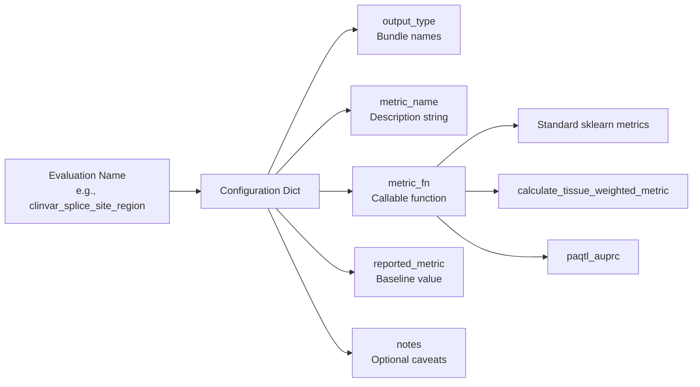
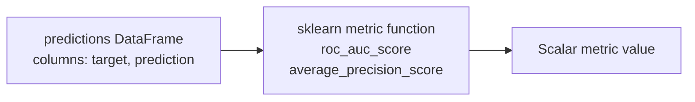
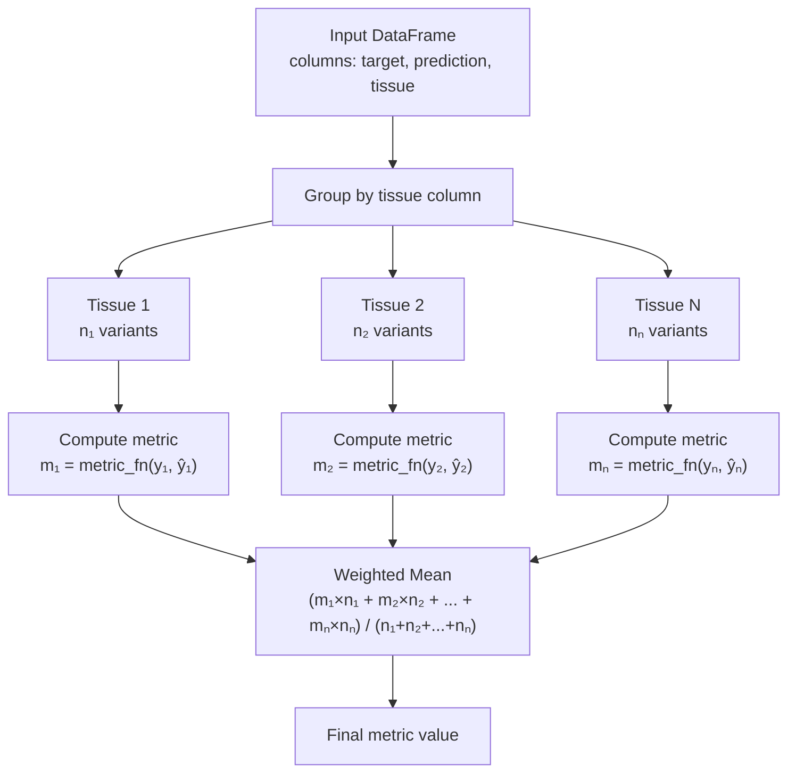
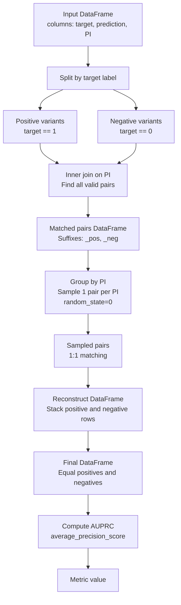
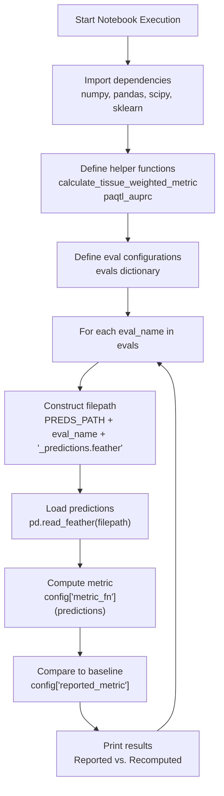

<!-- source: DeepWiki mcp.deepwiki.com · repo google-deepmind/alphagenome_research · page 5.3 Variant Evaluation Examples · fetched 2026-10-26 -->

# Variant Evaluation Examples

<details>
<summary>Relevant source files</summary>

The following files were used as context for generating this wiki page:

- [README.md](README.md)
- [colabs/variant_eval_examples.ipynb](colabs/variant_eval_examples.ipynb)

</details>


## Purpose and Scope

This page documents the variant evaluation examples provided in the [colabs/variant_eval_examples.ipynb]() notebook, which demonstrates how to reproduce AlphaGenome's benchmark performance across diverse genomic evaluation datasets. The notebook loads pre-computed model predictions from cloud storage and validates them against reported metrics for tasks including variant causality prediction, effect size estimation, and clinical variant classification.

For documentation on the underlying regression metrics implementation (Pearson R, MSE, MAE), see [Regression Metrics](#5.1). For details on the track prediction evaluation pipeline used during model development, see [Track Prediction Evaluation](#5.2). This page focuses specifically on the practical examples and evaluation configurations for external benchmark datasets.

## Evaluation Dataset Overview

The notebook evaluates AlphaGenome across 22 distinct benchmarks spanning multiple biological domains and variant types. These evaluations are organized by output modality and task type.

### Dataset Categories

```mermaid
graph TB
    subgraph "Clinical Variants"
        CLINVAR_SPLICE["clinvar_splice_site_region<br/>Classification"]
        CLINVAR_NONCODING["clinvar_noncoding<br/>Classification"]
        CLINVAR_MISSENSE["clinvar_missense<br/>Classification"]
    end
    
    subgraph "Splicing Variants"
        SQTL["sqtl_variant_causality_gene_human<br/>Tissue-weighted AUPRC"]
        MFASS["mfass_splicing<br/>AUPRC"]
    end
    
    subgraph "Expression QTLs"
        EQTL_SIGN["eqtl_variant_borzoi_sign_human<br/>Tissue-weighted AUROC"]
        EQTL_CAUSALITY["eqtl_variant_catalogue_causality_gene_balanced_human<br/>Tissue-weighted AUROC"]
        EQTL_COEF["eqtl_variant_borzoi_coefficient_human<br/>Tissue-weighted Spearman"]
        PAQTL["paqtl_variant_causality_human<br/>1:1 Matched AUPRC"]
        E2G["enhancer_gene_linking_e2g<br/>AUPRC"]
    end
    
    subgraph "Chromatin Accessibility QTLs"
        CAQTL_AFR_CAUS["caqtl_african_variant_causality_human<br/>AUPRC"]
        CAQTL_EUR_CAUS["caqtl_european_variant_causality_human<br/>AUPRC"]
        DSQTL_CAUS["dsqtl_yoruba_variant_causality_human<br/>AUPRC"]
        CAQTL_AFR_COEF["caqtl_african_variant_coefficient_human<br/>Pearson R"]
        CAQTL_EUR_COEF["caqtl_european_variant_coefficient_human<br/>Pearson R"]
        DSQTL_COEF["dsqtl_yoruba_variant_coefficient_human<br/>Pearson R"]
        CAQTL_MICROGLIA["caqtl_microglia_variant_coefficient_human<br/>Pearson R"]
        CAQTL_SMC["caqtl_smc_variant_coefficient_human<br/>Pearson R"]
    end
    
    subgraph "Binding QTLs"
        BQTL_COEF["bqtl_spi1_variant_coefficient_human<br/>Pearson R"]
        BQTL_CAUS["bqtl_spi1_variant_causality_human<br/>AUPRC"]
    end
    
    CLINVAR_SPLICE --> RNA_BUNDLE["RNA_SEQ<br/>SPLICE_*<br/>Bundles"]
    CLINVAR_NONCODING --> RNA_BUNDLE
    CLINVAR_MISSENSE --> RNA_BUNDLE
    SQTL --> RNA_BUNDLE
    MFASS --> SPLICE_BUNDLE["SPLICE_SITES_LOGITS<br/>SPLICE_SITE_USAGE<br/>SPLICE_JUNCTIONS"]
    
    EQTL_SIGN --> RNA_ONLY["RNA_SEQ<br/>Bundle"]
    EQTL_CAUSALITY --> RNA_ONLY
    EQTL_COEF --> RNA_ONLY
    PAQTL --> RNA_ONLY
    E2G --> RNA_ONLY
    
    CAQTL_AFR_CAUS --> DNASE_BUNDLE["DNASE<br/>Bundle"]
    CAQTL_EUR_CAUS --> DNASE_BUNDLE
    DSQTL_CAUS --> DNASE_BUNDLE
    CAQTL_AFR_COEF --> DNASE_BUNDLE
    CAQTL_EUR_COEF --> DNASE_BUNDLE
    DSQTL_COEF --> DNASE_BUNDLE
    CAQTL_MICROGLIA --> DNASE_BUNDLE
    CAQTL_SMC --> ATAC_BUNDLE["ATAC<br/>Bundle"]
    
    BQTL_COEF --> CHIP_BUNDLE["CHIP_TF<br/>Bundle"]
    BQTL_CAUS --> CHIP_BUNDLE
```



**Sources:** [colabs/variant_eval_examples.ipynb:208-336]()

### Output Modality Usage

| Modality | Evaluation Count | Primary Use Cases |
|----------|-----------------|-------------------|
| `RNA_SEQ` | 12 | Gene expression, eQTLs, enhancer-gene linking |
| `SPLICE_*` | 7 | Splicing variants, sQTLs, clinical splice effects |
| `DNASE` | 7 | Chromatin accessibility, caQTLs, dsQTLs |
| `ATAC` | 1 | Smooth muscle cell accessibility |
| `CHIP_TF` | 2 | Transcription factor binding (SPI1) |

**Sources:** [colabs/variant_eval_examples.ipynb:212-335]()

## Evaluation Configuration Structure

Each evaluation in the notebook is defined by a configuration dictionary stored in the `evals` variable. The configuration specifies the output types, metric function, and expected baseline performance.



**Sources:** [colabs/variant_eval_examples.ipynb:208-336]()

### Configuration Fields

Each evaluation configuration contains the following fields:

- **`output_type`**: Semicolon-separated list of bundle names indicating which model outputs are used for evaluation (e.g., `'RNA_SEQ;SPLICE_SITE_POSITIONS'`)
- **`metric_name`**: Human-readable description of the metric computation method, often including ontology terms or aggregation strategies
- **`metric_fn`**: Python callable that accepts a DataFrame with `target` and `prediction` columns and returns a scalar metric value
- **`reported_metric`**: Baseline performance value reported in the AlphaGenome paper for comparison
- **`notes`** (optional): Additional context about metric computation quirks or caveats

**Sources:** [colabs/variant_eval_examples.ipynb:212-336]()

## Metric Calculation Methods

The notebook implements three distinct approaches for computing evaluation metrics, depending on the dataset structure and evaluation requirements.

### Standard Metric Calculation

For evaluations without tissue grouping or special matching requirements, metrics are computed directly on the full prediction dataset using standard sklearn functions.



Example configuration:
```python
'clinvar_noncoding': {
    'metric_fn': lambda x: metrics.average_precision_score(x['target'], x['prediction']),
    'reported_metric': 0.6588,
}
```

**Sources:** [colabs/variant_eval_examples.ipynb:219-224](), [colabs/variant_eval_examples.ipynb:184-186]()

### Tissue-Weighted Metric Calculation

For QTL evaluations where variants are grouped by tissue context, the `calculate_tissue_weighted_metric` function computes per-tissue metrics and aggregates them with weights proportional to variant count.



The function implementation performs the following steps:

1. **Group by tissue**: Split DataFrame by the tissue column [colabs/variant_eval_examples.ipynb:98]()
2. **Clean data**: Drop rows with NaN targets or predictions [colabs/variant_eval_examples.ipynb:101]()
3. **Filter groups**: Skip tissues with fewer than 2 variants [colabs/variant_eval_examples.ipynb:106-108]()
4. **Compute per-tissue metrics**: Apply `metric_fn` to each tissue group [colabs/variant_eval_examples.ipynb:110-115]()
5. **Handle errors**: Skip tissues where metric computation fails (e.g., single-class datasets for AUROC) [colabs/variant_eval_examples.ipynb:126-130]()
6. **Aggregate**: Compute weighted mean using variant counts as weights [colabs/variant_eval_examples.ipynb:139-147]()

Example configuration:
```python
'sqtl_variant_causality_gene_human': {
    'metric_fn': functools.partial(calculate_tissue_weighted_metric, metric_fn=auprc_fn),
    'reported_metric': 0.7644,
}
```

**Sources:** [colabs/variant_eval_examples.ipynb:63-148](), [colabs/variant_eval_examples.ipynb:231-236]()

### paQTL 1:1 Matching

For polyadenylation QTL (paQTL) evaluation, the `paqtl_auprc` function implements specialized 1:1 matching between positive and negative variants based on a polyadenylation site identifier (`PI`).



The matching algorithm:

1. **Separate by label**: Split DataFrame into positive (target=1) and negative (target=0) variants [colabs/variant_eval_examples.ipynb:154-156]()
2. **Merge on PI**: Inner join on polyadenylation site identifier to find all valid positive-negative pairs [colabs/variant_eval_examples.ipynb:158-165]()
3. **Sample one pair per PI**: Group by PI and randomly select one pair per site with fixed random seed [colabs/variant_eval_examples.ipynb:168-169]()
4. **Reconstruct DataFrame**: Stack sampled positive and negative rows back into a single DataFrame [colabs/variant_eval_examples.ipynb:171-180]()
5. **Compute AUPRC**: Calculate area under precision-recall curve on balanced dataset [colabs/variant_eval_examples.ipynb:181-182]()

This matching approach ensures balanced evaluation and controls for the number of variants per polyadenylation site, preventing sites with many negatives from dominating the metric.

**Sources:** [colabs/variant_eval_examples.ipynb:151-182](), [colabs/variant_eval_examples.ipynb:267-273]()

## Running the Evaluation Notebook

The notebook execution workflow consists of loading pre-computed predictions from cloud storage and validating them against baseline metrics.



**Sources:** [colabs/variant_eval_examples.ipynb:46-56](), [colabs/variant_eval_examples.ipynb:62-187](), [colabs/variant_eval_examples.ipynb:208-336](), [colabs/variant_eval_examples.ipynb:357-369]()

### Data Loading

Predictions are stored in Apache Feather format on Google Cloud Storage at the base path `https://storage.googleapis.com/alphagenome/evals`. Each evaluation has a corresponding `.feather` file:

```
{PREDS_PATH}/{eval_name}_predictions.feather
```

For example: `https://storage.googleapis.com/alphagenome/evals/clinvar_splice_site_region_predictions.feather`

The Feather format provides efficient columnar storage and fast loading for DataFrames containing variant identifiers, predictions, targets, and metadata.

**Sources:** [colabs/variant_eval_examples.ipynb:210](), [colabs/variant_eval_examples.ipynb:361]()

### Prediction DataFrame Schema

Each loaded predictions DataFrame contains the following columns:

| Column | Type | Description |
|--------|------|-------------|
| `prediction` | float | AlphaGenome model prediction score |
| `target` | int/float | Ground truth label or effect size |
| `tissue` | str | Tissue/cell type identifier (for tissue-specific evaluations) |
| `PI` | str | Polyadenylation site identifier (for paQTL evaluation only) |

Additional variant metadata columns may be present depending on the specific evaluation dataset.

**Sources:** [colabs/variant_eval_examples.ipynb:67-69](), [colabs/variant_eval_examples.ipynb:162]()

### Output Format

For each evaluation, the notebook prints:

```
Eval: {eval_name}
  Reported:   {baseline_metric}
  Recomputed: {computed_metric}
  Notes:      {optional_notes}
```

The recomputed metrics closely match the reported baselines, with minor differences attributable to floating-point precision or sampling randomness (e.g., paQTL 1:1 matching).

**Sources:** [colabs/variant_eval_examples.ipynb:358-369]()

## Understanding Results

The notebook validation demonstrates strong agreement between recomputed and reported metrics across all 22 benchmarks.

### Metric Agreement

Most evaluations show exact or near-exact agreement (within 0.001):

| Evaluation Type | Typical Agreement |
|----------------|-------------------|
| Classification (AUROC/AUPRC) | ≤ 0.0004 difference |
| Regression (Pearson R) | ≤ 0.0003 difference |
| Tissue-weighted metrics | ≤ 0.0001 difference |

**Sources:** [colabs/variant_eval_examples.ipynb:386-476]()

### Special Cases

**paQTL evaluation**: Shows minor variation (reported: 0.6294, recomputed: 0.6288) due to sampling randomness in the 1:1 matching procedure. The notebook performs a single random sample, while the reported metric averages over multiple permutations.

**Correlation sign flips**: Some Pearson R evaluations show sign flips where the recomputed value is the negative of the reported value (e.g., `dsqtl_yoruba_variant_coefficient_human`: reported 0.8323, recomputed -0.8323). This occurs when the reference and alternate alleles are swapped between the evaluation dataset and the model predictions, reversing the direction of effect but preserving the correlation magnitude. The configuration notes flag these cases.

**Sources:** [colabs/variant_eval_examples.ipynb:428-431](), [colabs/variant_eval_examples.ipynb:453-461](), [colabs/variant_eval_examples.ipynb:271-272](), [colabs/variant_eval_examples.ipynb:309]()

### Benchmark Performance Summary

| Benchmark Category | Evaluation Count | Best Performance | Worst Performance |
|-------------------|-----------------|------------------|-------------------|
| ClinVar classification | 3 | 0.6588 AUPRC (noncoding) | 0.1792 AUPRC (missense) |
| Splicing QTLs | 2 | 0.7644 tissue-weighted AUPRC | 0.5120 AUPRC |
| Expression QTLs | 5 | 0.8101 tissue-weighted AUROC | 0.5006 tissue-weighted Spearman |
| Chromatin accessibility QTLs | 8 | 0.8323 Pearson R (dsQTL Yoruba) | 0.3637 AUPRC (caQTL European) |
| Binding QTLs | 2 | 0.5493 Pearson R | 0.4948 AUPRC |

**Sources:** [colabs/variant_eval_examples.ipynb:386-476]()

## Extending to New Evaluations

To add a new evaluation to the notebook, follow this pattern:

1. **Prepare prediction file**: Create a Feather file with columns `prediction`, `target`, and optionally `tissue` or other grouping columns
2. **Upload to cloud storage**: Place file at `{PREDS_PATH}/{eval_name}_predictions.feather`
3. **Add configuration**: Insert entry in the `evals` dictionary:

```python
'new_evaluation_name': {
    'output_type': 'RNA_SEQ',  # or other bundle names
    'metric_name': 'descriptive_metric_name',
    'metric_fn': lambda x: metric_function(x['target'], x['prediction']),
    'reported_metric': 0.7500,  # baseline to compare against
}
```

4. **Run notebook**: The main loop will automatically process the new evaluation

For tissue-weighted metrics, use:
```python
'metric_fn': functools.partial(calculate_tissue_weighted_metric, metric_fn=metric_function)
```

For custom matching or aggregation logic, define a new function following the pattern of `paqtl_auprc` at [colabs/variant_eval_examples.ipynb:151-182]().

**Sources:** [colabs/variant_eval_examples.ipynb:208-336](), [colabs/variant_eval_examples.ipynb:357-369]()

---

