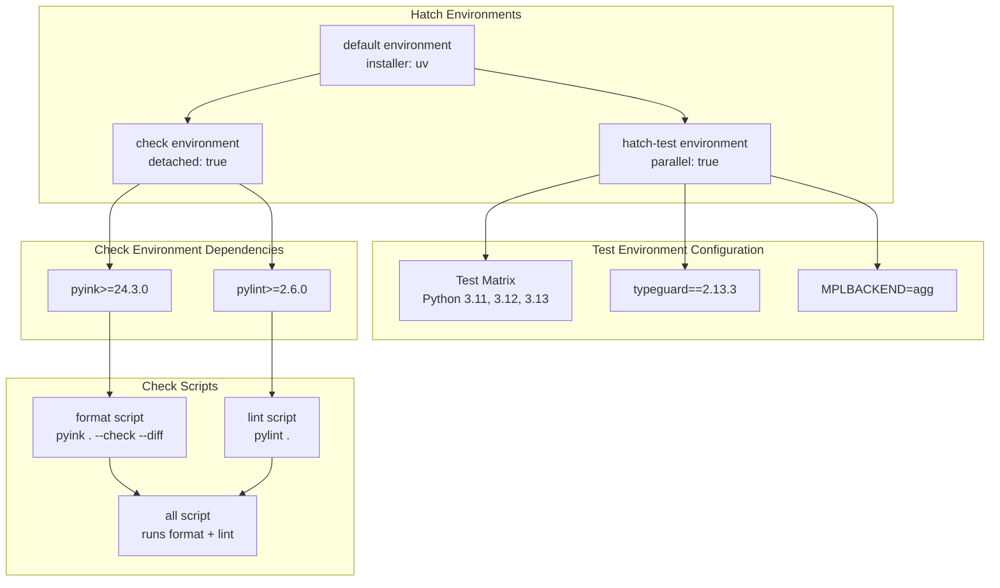
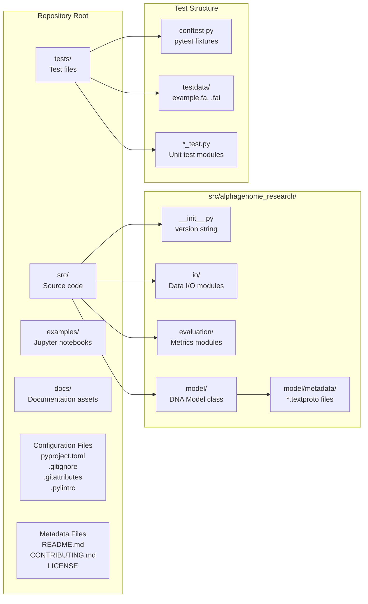
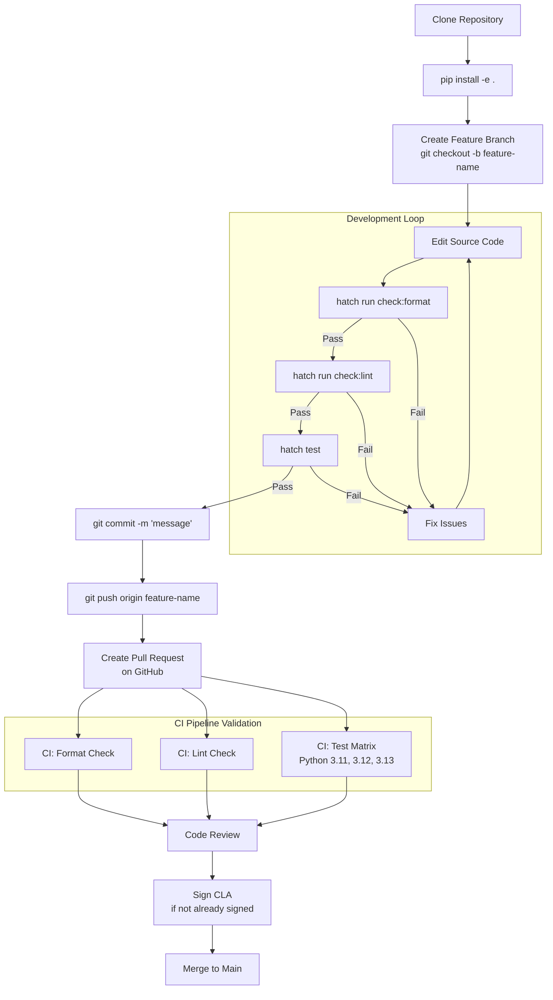
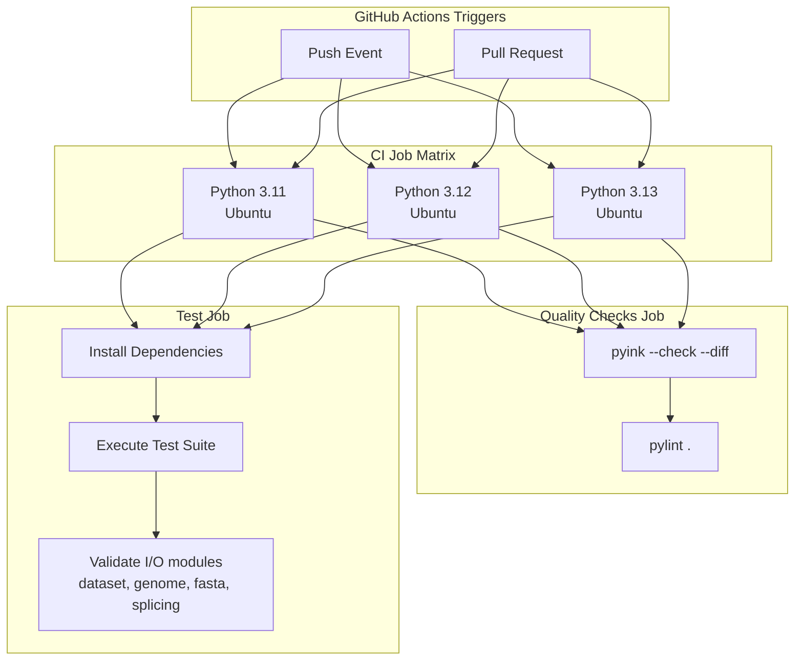

<!-- source: DeepWiki mcp.deepwiki.com · repo google-deepmind/alphagenome_research · page 6 Development Guide · fetched 2026-10-26 -->

# Development Guide

<details>
<summary>Relevant source files</summary>

The following files were used as context for generating this wiki page:

- [CONTRIBUTING.md](CONTRIBUTING.md)
- [pyproject.toml](pyproject.toml)

</details>


## Purpose and Scope

This page provides a comprehensive guide for developers contributing to the AlphaGenome Research codebase. It covers development environment setup, testing infrastructure, code quality standards, and the contribution workflow. 

For detailed information on specific topics:
- Contribution process and CLA requirements: see [Contributing Guidelines](#6.1)
- Package configuration and dependency management: see [Build and Package Configuration](#6.2)
- Test suite organization and execution: see [Testing Infrastructure](#6.3)
- Code quality tools and CI/CD pipelines: see [Code Quality and CI/CD](#6.4)

This guide assumes you have basic familiarity with Python development, Git, and GitHub workflows.

---

## Development Environment Setup

### Initial Installation

Clone the repository and install in editable mode:

```bash
git clone https://github.com/google-deepmind/alphagenome_research.git
cd alphagenome_research
pip install -e .
```

The `-e` flag installs the package in editable mode, allowing you to modify the source code and immediately see changes without reinstalling.

### Python Version Requirements

The project supports Python 3.11, 3.12, and 3.13 as defined in [pyproject.toml:87](). The CI pipeline tests all three versions in a matrix configuration to ensure compatibility.

### Development Dependencies

The core dependencies are managed in [pyproject.toml:33-54]() and include:

| Dependency | Purpose |
|------------|---------|
| `jax` | Core computation framework |
| `dm-haiku` | Neural network library |
| `tensorflow` | Data loading pipeline |
| `orbax` | Model checkpoint management |
| `pyfaidx` | FASTA file operations |
| `pyranges` | Genomic interval operations |
| `anndata` | Single-cell data structures |
| `kagglehub` | Model weight distribution |
| `huggingface_hub` | Model weight distribution |

For development-specific tools, install the `dev` optional dependencies:

```bash
pip install -e ".[dev]"
```

This installs `hatch` for environment and build management.

**Sources:** [pyproject.toml:1-111]()

---

## Hatch Environment Management

The project uses Hatch for environment management and task execution. Hatch is configured in [pyproject.toml:66-103]() with three primary environments:

### Environment Structure



**Sources:** [pyproject.toml:66-103]()

### Common Development Commands

| Command | Purpose |
|---------|---------|
| `hatch test` | Run tests for current Python version |
| `hatch test --all` | Run tests across all Python versions (3.11, 3.12, 3.13) |
| `hatch run check:format` | Check code formatting with pyink |
| `hatch run check:lint` | Run pylint code quality checks |
| `hatch run check:all` | Run all code quality checks |

The `check` environment is detached (no dependencies installed) as defined in [pyproject.toml:95](), making quality checks faster by not installing the full dependency tree.

**Sources:** [pyproject.toml:76-103]()

---

## Repository Structure

### Directory Layout



**Sources:** [pyproject.toml:69-74]()

The package excludes test files and examples from distribution as specified in [pyproject.toml:71](), but includes metadata textproto files as package data in [pyproject.toml:74]().

---

## Development Workflow

### Typical Development Cycle



**Sources:** [CONTRIBUTING.md:1-29](), [pyproject.toml:89-103]()

### Pre-commit Checks

Before committing code, run local quality checks:

```bash
# Check formatting
hatch run check:format

# Check linting
hatch run check:lint

# Run all checks
hatch run check:all

# Run tests
hatch test
```

These commands mirror the CI pipeline checks and help catch issues early.

**Sources:** [pyproject.toml:97-103]()

---

## Code Quality Standards

### Formatting: pyink

The project uses `pyink` (Google's fork of Black) for code formatting with the following configuration from [pyproject.toml:105-111]():

| Setting | Value | Description |
|---------|-------|-------------|
| `line-length` | 80 | Maximum line length |
| `pyink-indentation` | 2 | Use 2-space indentation |
| `pyink-use-majority-quotes` | true | Use most common quote style in file |
| `unstable` | true | Enable unstable features |

The formatter enforces Google's Python style guide conventions. Run formatting checks with:

```bash
hatch run check:format
```

**Sources:** [pyproject.toml:105-111]()

### Linting: pylint

The project uses `pylint` for static code analysis, configured in `.pylintrc` (not shown in provided files). Run linting with:

```bash
hatch run check:lint
```

According to the architecture diagrams, the `.pylintrc` follows Google's style guide with 150+ disabled checks for research code flexibility.

**Sources:** [pyproject.toml:92](), [pyproject.toml:99]()

### Type Checking

Runtime type validation is performed using `typeguard==2.13.3`, included as a test dependency in [pyproject.toml:78](). This helps catch type errors during test execution.

**Sources:** [pyproject.toml:78]()

---

## Testing Infrastructure

### Test Execution

Run tests using Hatch:

```bash
# Test current Python version
hatch test

# Test all supported Python versions
hatch test --all
```

The test matrix is defined in [pyproject.toml:85-87]() and includes Python 3.11, 3.12, and 3.13. Tests run in parallel mode as enabled in [pyproject.toml:79]().

### Test Environment Configuration

The test environment sets `MPLBACKEND=agg` in [pyproject.toml:83]() to prevent matplotlib from requiring a display during testing.

### Test File Organization

Test files follow the pattern `*_test.py` and are excluded from the distributed package in [pyproject.toml:71](). Test data is stored in the `testdata/` directory, which includes example FASTA files (`example.fa`, `example.fa.fai`) for I/O validation.

**Sources:** [pyproject.toml:76-87]()

For detailed information on test fixtures, test data, and test module organization, see [Testing Infrastructure](#6.3).

---

## Contribution Process

### Contributor License Agreement (CLA)

All contributions require a signed Contributor License Agreement. From [CONTRIBUTING.md:6-16]():

> Contributions to this project must be accompanied by a Contributor License Agreement. You (or your employer) retain the copyright to your contribution, this simply gives us permission to use and redistribute your contributions as part of the project.

Visit https://cla.developers.google.com/ to sign the CLA. Once signed for any Google project, it typically applies to all future Google open-source contributions.

**Sources:** [CONTRIBUTING.md:6-16]()

### Scope of Contributions

The project has a limited scope for contributions as stated in [CONTRIBUTING.md:3-4]():

> We welcome small patches related to bug fixes and documentation, but we do not plan to make any major changes to this repository.

Appropriate contributions include:
- Bug fixes
- Documentation improvements
- Test coverage enhancements
- Code quality improvements

Major feature additions or architectural changes are not currently accepted.

**Sources:** [CONTRIBUTING.md:1-4]()

### Pull Request Process

```mermaid
flowchart LR
    FORK["Fork Repository"]
    CLONE["Clone Fork"]
    BRANCH["Create Branch"]
    CHANGE["Make Changes"]
    LOCAL_TEST["Run Local Tests<br/>hatch test"]
    LOCAL_CHECK["Run Quality Checks<br/>hatch run check:all"]
    COMMIT["Commit Changes"]
    PUSH["Push to Fork"]
    PR["Create Pull Request"]
    
    subgraph "Review Process"
        AUTO_CI["Automated CI Checks"]
        REVIEWER["Maintainer Review"]
        CHANGES["Request Changes"]
        APPROVE["Approve PR"]
    end
    
    MERGE["Merge to Main"]
    
    FORK --> CLONE
    CLONE --> BRANCH
    BRANCH --> CHANGE
    CHANGE --> LOCAL_TEST
    LOCAL_TEST --> LOCAL_CHECK
    LOCAL_CHECK --> COMMIT
    COMMIT --> PUSH
    PUSH --> PR
    
    PR --> AUTO_CI
    AUTO_CI --> REVIEWER
    REVIEWER --> CHANGES
    REVIEWER --> APPROVE
    CHANGES --> CHANGE
    APPROVE --> MERGE
```



**Sources:** [CONTRIBUTING.md:18-23]()

All submissions, including those from project members, require code review through GitHub pull requests as stated in [CONTRIBUTING.md:18-23](). Consult GitHub's pull request documentation for the mechanics of creating and managing pull requests.

**Sources:** [CONTRIBUTING.md:18-23]()

### Community Guidelines

The project follows Google's Open Source Community Guidelines as referenced in [CONTRIBUTING.md:25-28](). These guidelines promote respectful, inclusive collaboration and are available at https://opensource.google/conduct/.

**Sources:** [CONTRIBUTING.md:25-28]()

---

## CI/CD Pipeline

### GitHub Actions Workflow

The CI pipeline is defined in `.github/workflows/presubmit_checks.yml` (not shown in provided files). Based on the architecture diagrams, it:

1. Triggers on push and pull request events
2. Runs a test matrix across Python 3.11, 3.12, and 3.13 on Ubuntu
3. Executes quality checks via `hatch run check:all`
4. Runs the test suite via `hatch test`

### CI Environment Mapping



**Sources:** Based on architecture Diagram 5 and [pyproject.toml:85-103]()

The pipeline ensures all code changes meet quality standards and pass tests across supported Python versions before merging.

---

## Package Metadata and Distribution

### Package Information

The package is configured with the following metadata in [pyproject.toml:6-32]():

| Field | Value |
|-------|-------|
| Name | `alphagenome_research` |
| Python Requirement | `>=3.11` |
| License | Apache 2.0 |
| Development Status | Beta |
| Authors | Google LLC |
| Contact | alphagenome@google.com |

The package is classified as:
- Development Status: 4 - Beta
- Intended Audience: Science/Research
- Topic: Scientific/Engineering :: Artificial Intelligence

**Sources:** [pyproject.toml:6-32]()

### Build System

The project uses `hatchling` as the build backend, configured in [pyproject.toml:1-3]():

```toml
[build-system]
build-backend = 'hatchling.build'
requires = ['hatchling']
```

The version is dynamically determined from `src/alphagenome_research/__init__.py` as specified in [pyproject.toml:63-64]().

**Sources:** [pyproject.toml:1-4](), [pyproject.toml:63-64]()

### Project URLs

The package links to the following resources in [pyproject.toml:56-58]():

- **Repository**: https://github.com/google-deepmind/alphagenome_research
- **Documentation**: https://www.alphagenomedocs.com/

**Sources:** [pyproject.toml:56-58]()

---

## Summary

The AlphaGenome Research development infrastructure emphasizes:

1. **Modern Python tooling**: Hatch for environment management, pyink for formatting, pylint for quality
2. **Multi-version support**: CI testing across Python 3.11, 3.12, and 3.13
3. **Quality enforcement**: Automated checks before merge, mirrored in local development commands
4. **Focused contributions**: Bug fixes and documentation welcome; major changes not planned
5. **Standard workflows**: CLA requirement, code review via pull requests, Google community guidelines

For detailed information on specific development topics, refer to the sub-pages:
- [Contributing Guidelines](#6.1)
- [Build and Package Configuration](#6.2)
- [Testing Infrastructure](#6.3)
- [Code Quality and CI/CD](#6.4)

---

