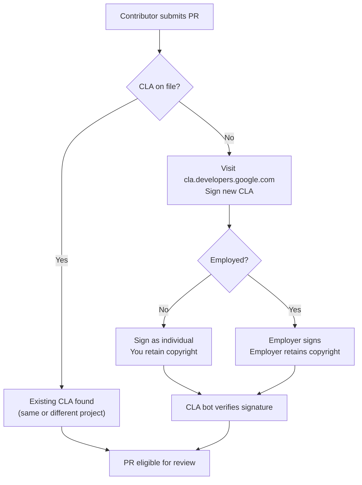
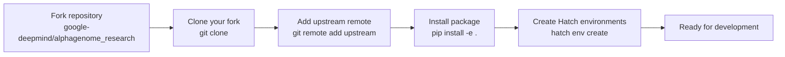
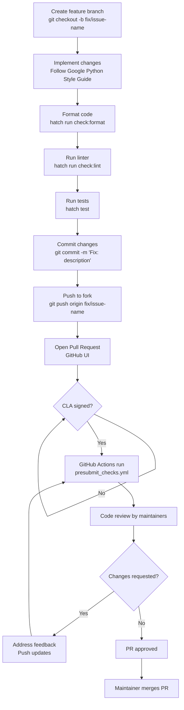
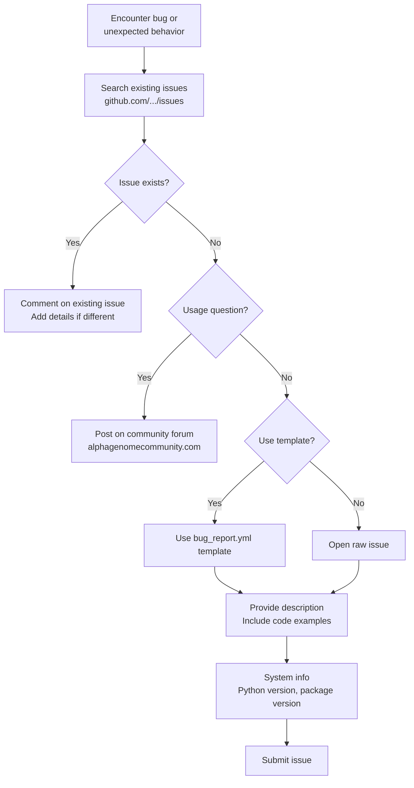
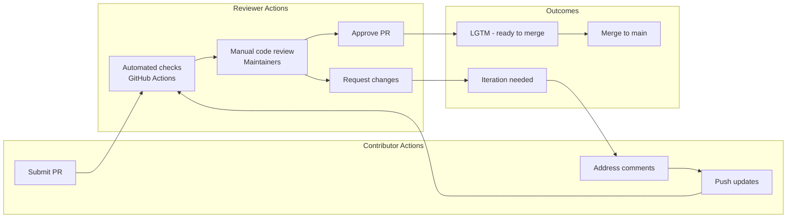
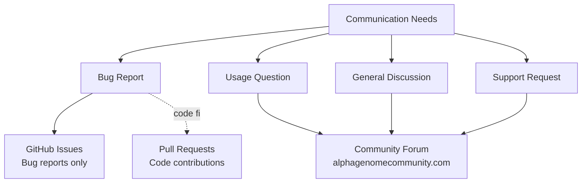

<!-- source: DeepWiki mcp.deepwiki.com · repo google-deepmind/alphagenome_research · page 6.1 Contributing Guidelines · fetched 2026-10-26 -->

# Contributing Guidelines

<details>
<summary>Relevant source files</summary>

The following files were used as context for generating this wiki page:

- [.github/ISSUE_TEMPLATE/bug_report.yml](.github/ISSUE_TEMPLATE/bug_report.yml)
- [.github/ISSUE_TEMPLATE/config.yml](.github/ISSUE_TEMPLATE/config.yml)
- [CONTRIBUTING.md](CONTRIBUTING.md)

</details>


## Purpose and Scope

This document describes the contribution process for the AlphaGenome Research repository, including Contributor License Agreement (CLA) requirements, code review procedures, bug reporting workflows, and community standards. For information about setting up your development environment, see [Build and Package Configuration](#6.2). For details on running tests and quality checks before submitting contributions, see [Testing Infrastructure](#6.3) and [Code Quality and CI/CD](#6.4).

---

## Contribution Scope and Policy

The AlphaGenome Research repository accepts contributions with limited scope:

| Contribution Type | Status | Notes |
|------------------|--------|-------|
| Bug fixes | ✅ Accepted | Small patches addressing specific issues |
| Documentation improvements | ✅ Accepted | Clarifications, corrections, examples |
| Feature requests | ❌ Not accepted | Repository is for research release |
| Major refactoring | ❌ Not accepted | Codebase stability is prioritized |
| New model architectures | ❌ Not accepted | Research code frozen at publication |

As stated in [CONTRIBUTING.md:3-4](), the project welcomes "small patches related to bug fixes and documentation, but we do not plan to make any major changes to this repository."

**Sources:** [CONTRIBUTING.md:1-4]()

---

## Contributor License Agreement (CLA)

All contributions require a signed Contributor License Agreement. This protects both contributors and the project.

### CLA Process Flow



**CLA Properties:**

- **Reusable**: A CLA signed for any Google project applies to all Google projects ([CONTRIBUTING.md:14-16]())
- **Copyright Retention**: Contributors (or their employers) retain copyright to their work ([CONTRIBUTING.md:9-10]())
- **Permission Grant**: Gives the project permission to use and redistribute contributions ([CONTRIBUTING.md:10-11]())
- **One-time**: Generally only needs to be signed once per legal entity

**CLA URL**: https://cla.developers.google.com/

**Sources:** [CONTRIBUTING.md:6-16]()

---

## Development Setup

Before contributing code, set up a local development environment:

### Prerequisites

1. Python 3.11, 3.12, or 3.13 (versions tested in CI)
2. Git for version control
3. Hatch for environment management (see [Build and Package Configuration](#6.2))

### Repository Setup



### Environment Verification

After setup, verify your environment can run quality checks and tests (see [Code Quality and CI/CD](#6.4)):

```bash
# Run all quality checks
hatch run check:all

# Run test suite
hatch test
```

**Sources:** Derived from architecture diagrams (Diagram 5: Development and Testing Infrastructure)

---

## Code Contribution Process

### Submission Workflow



### Pre-Submission Checklist

Before opening a pull request, ensure:

- [ ] Code follows Google Python Style Guide (enforced by `.pylintrc`)
- [ ] Code is formatted with `pyink` (80 characters, 2-space indent)
- [ ] All existing tests pass: `hatch test`
- [ ] Linting passes: `hatch run check:lint`
- [ ] Type checking passes (if applicable)
- [ ] New functionality includes tests
- [ ] Documentation is updated (docstrings, README, etc.)

### GitHub Actions CI Pipeline

Every push triggers [.github/workflows/presubmit_checks.yml](), which runs:

1. **Test Matrix**: Python 3.11, 3.12, 3.13 on Ubuntu
2. **Quality Checks**: `hatch run check:all`
3. **Unit Tests**: `hatch test`

Pull requests cannot be merged until all checks pass.

**Sources:** [CONTRIBUTING.md:18-23](), architecture diagrams (Diagram 5: Development and Testing Infrastructure)

---

## Bug Reporting

### Issue Templates

The repository provides structured issue templates to ensure bug reports contain necessary information.



### Bug Report Template Fields

The [.github/ISSUE_TEMPLATE/bug_report.yml]() template requires:

| Field | Description | Required |
|-------|-------------|----------|
| Description | Concise bug description with markdown formatting and code blocks | ✅ Yes |
| System Info | Output of `import alphagenome_research; alphagenome_research.__version__` plus Python version | ✅ Yes |

### Before Reporting

1. **Search existing issues**: [.github/ISSUE_TEMPLATE/bug_report.yml:17-18]()
2. **Consider community forum**: For usage questions, use https://www.alphagenomecommunity.com/ ([.github/ISSUE_TEMPLATE/bug_report.yml:20-21]())
3. **Choose template**: Use structured template or raw report ([.github/ISSUE_TEMPLATE/bug_report.yml:23]())

### Issue Labels

Bug reports are automatically labeled with `bug` ([.github/ISSUE_TEMPLATE/bug_report.yml:5-6]()).

**Sources:** [.github/ISSUE_TEMPLATE/bug_report.yml:1-52](), [.github/ISSUE_TEMPLATE/config.yml:1-6]()

---

## Code Review Process

### Review Requirements

All submissions require review before merging, including submissions by project members ([CONTRIBUTING.md:20-21]()).

### Review Workflow



### Review Criteria

Reviewers evaluate:

- **Scope**: Does the change fit within accepted contribution types?
- **Quality**: Does code meet style guide standards?
- **Testing**: Are changes adequately tested?
- **Documentation**: Are docstrings and comments clear?
- **Compatibility**: Does the change maintain backward compatibility?
- **CI Status**: Do all automated checks pass?

### GitHub Pull Request Platform

Reviews use standard GitHub pull request features ([CONTRIBUTING.md:21-23]()):

- Inline code comments
- Review summaries (Approve, Request Changes, Comment)
- Suggested changes
- Review threads

**Sources:** [CONTRIBUTING.md:18-23]()

---

## Community Standards

### Code of Conduct

The AlphaGenome Research project follows [Google's Open Source Community Guidelines](https://opensource.google/conduct/) ([CONTRIBUTING.md:25-28]()).

### Key Principles

| Principle | Description |
|-----------|-------------|
| **Be respectful** | Value diverse perspectives and experiences |
| **Be welcoming** | Foster an inclusive environment |
| **Be considerate** | Understand impact of actions on others |
| **Be collaborative** | Work together constructively |
| **Be responsible** | Own your words and actions |

### Communication Channels



### Community Resources

- **Community Forum**: https://www.alphagenomecommunity.com/ ([.github/ISSUE_TEMPLATE/config.yml:4]())
- **Issue Tracker**: https://github.com/google-deepmind/alphagenome_research/issues
- **Documentation**: See [Overview](#1) and subsequent sections

### Enforcement

Violations of community guidelines may result in:

1. Warning from maintainers
2. Temporary interaction restrictions
3. Permanent ban from the project

**Sources:** [CONTRIBUTING.md:25-28](), [.github/ISSUE_TEMPLATE/config.yml:3-5]()

---

## Summary Checklist

Before contributing, ensure you have:

- [ ] Read and understood the contribution scope limitations
- [ ] Signed the Contributor License Agreement at https://cla.developers.google.com/
- [ ] Set up your development environment with Hatch (see [Build and Package Configuration](#6.2))
- [ ] Verified quality checks pass locally (see [Code Quality and CI/CD](#6.4))
- [ ] Verified tests pass locally (see [Testing Infrastructure](#6.3))
- [ ] Searched for existing issues before reporting bugs
- [ ] Read Google's Open Source Community Guidelines
- [ ] Prepared a clear, focused pull request addressing a specific bug or documentation issue

**Sources:** [CONTRIBUTING.md:1-29]()

---

