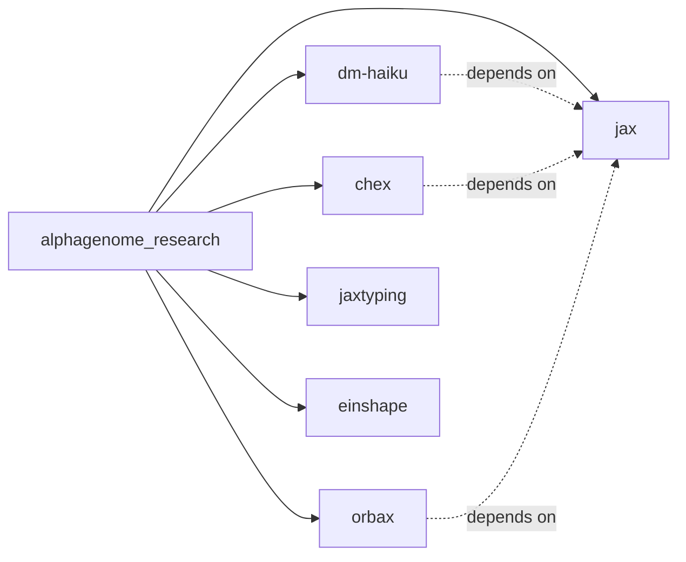
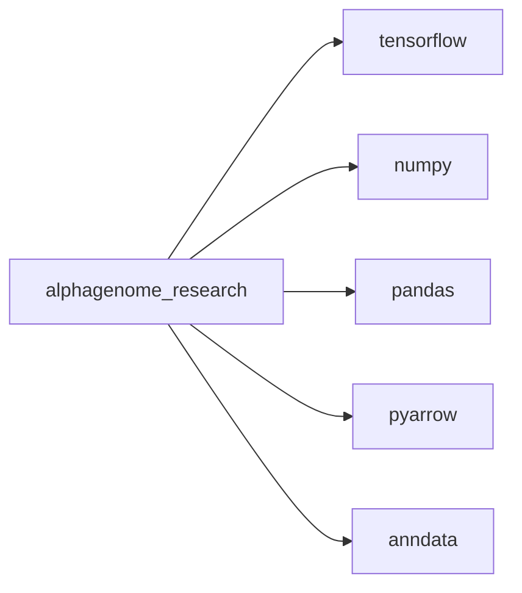
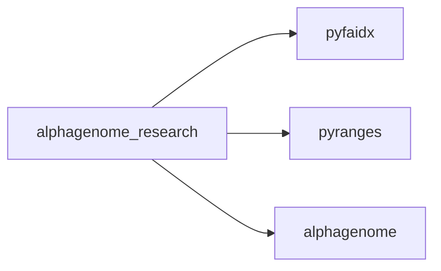
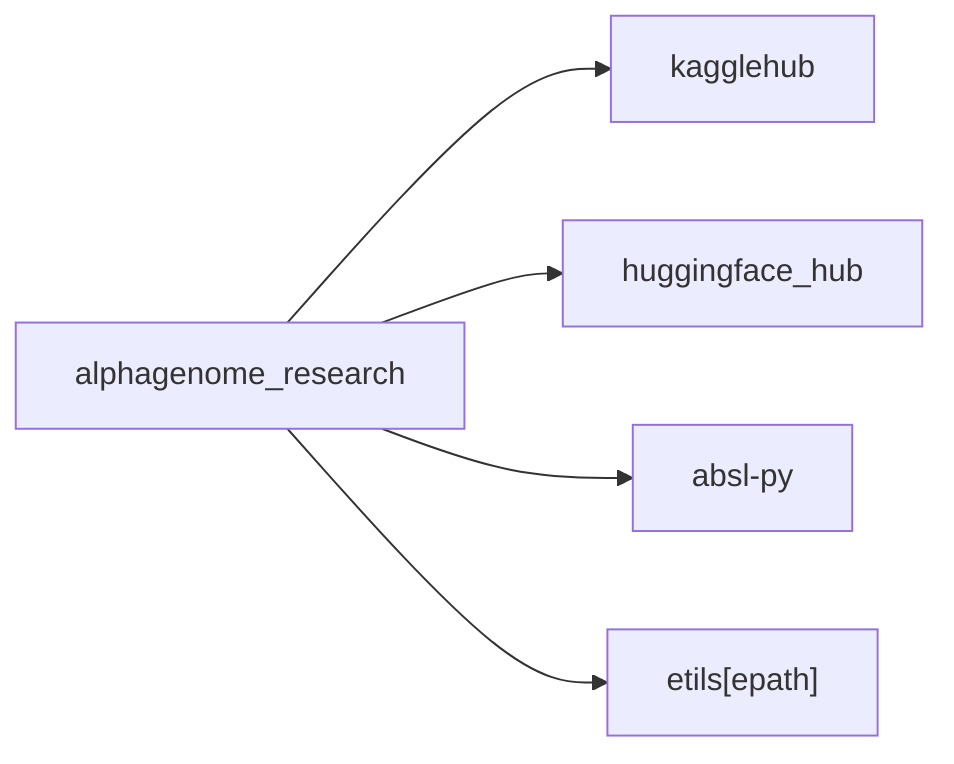
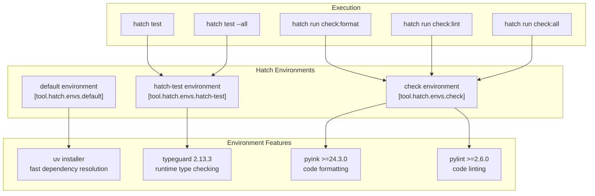
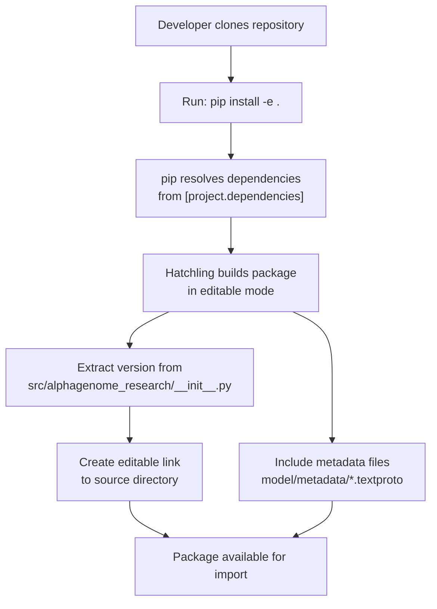
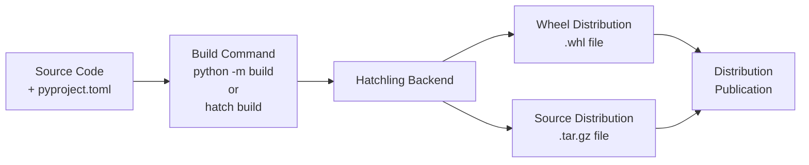
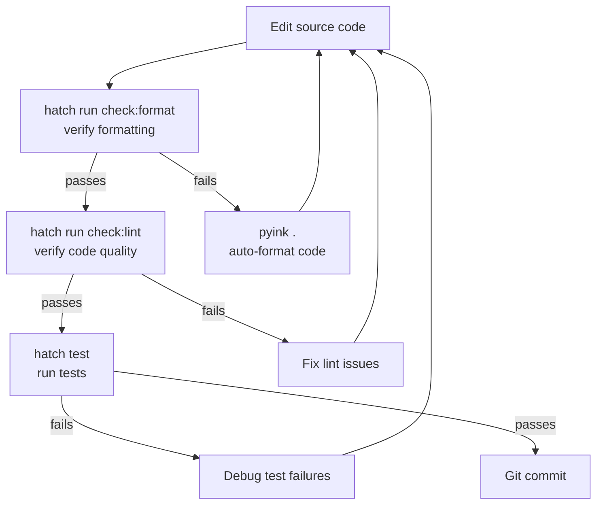

<!-- source: DeepWiki mcp.deepwiki.com · repo google-deepmind/alphagenome_research · page 6.2 Build and Package Configuration · fetched 2026-10-26 -->

# Build and Package Configuration

<details>
<summary>Relevant source files</summary>

The following files were used as context for generating this wiki page:

- [.gitattributes](.gitattributes)
- [.gitignore](.gitignore)
- [pyproject.toml](pyproject.toml)

</details>


## Purpose and Scope

This document provides comprehensive documentation for the AlphaGenome Research package build system, configuration, and environment management. It covers the `pyproject.toml` configuration, the Hatchling build backend, dependency management, and Hatch environment setup for development and testing workflows.

For information about the testing infrastructure and test execution, see [Testing Infrastructure](#6.3). For code quality tools and CI/CD workflows, see [Code Quality and CI/CD](#6.4). For general contribution procedures, see [Contributing Guidelines](#6.1).

**Sources:** [pyproject.toml:1-111]()

## Package Metadata and Structure

The AlphaGenome Research package is defined as `alphagenome_research` with metadata specified in [pyproject.toml:6-32](). The package follows modern Python packaging standards with dynamic versioning extracted from the source code.

### Core Package Attributes

| Attribute | Value | Line Reference |
|-----------|-------|----------------|
| Package Name | `alphagenome_research` | [pyproject.toml:7]() |
| Python Version | `>=3.11` | [pyproject.toml:12]() |
| License | Apache Software License | [pyproject.toml:11]() |
| Development Status | Beta (4) | [pyproject.toml:23]() |
| Version Source | `src/alphagenome_research/__init__.py` | [pyproject.toml:64]() |

The package targets Python 3.11, 3.12, and 3.13 as specified in the classifier list at [pyproject.toml:28-30]().

### Project URLs and Contact

The package maintains two primary external URLs:
- **Repository**: `https://github.com/google-deepmind/alphagenome_research` [pyproject.toml:57]()
- **Documentation**: `https://www.alphagenomedocs.com/` [pyproject.toml:58]()

The project contact email is `alphagenome@google.com` [pyproject.toml:15]().

**Sources:** [pyproject.toml:6-32](), [pyproject.toml:56-58]()

## Build System Configuration

The package uses **Hatchling** as its build backend, a modern, extensible Python build system that is part of the Hatch project.

### Build Backend Declaration

```toml
[build-system]
build-backend = 'hatchling.build'
requires = ['hatchling']
```

This minimal configuration at [pyproject.toml:1-3]() declares Hatchling as the PEP 517 build backend. When users run `pip install` or when the package is built for distribution, pip uses Hatchling to construct the wheel and source distributions.

### Version Management

The package version is dynamically determined from the source code rather than being hardcoded in `pyproject.toml`. The version extraction configuration is:

```toml
[tool.hatch.version]
path = 'src/alphagenome_research/__init__.py'
```

This configuration at [pyproject.toml:63-64]() tells Hatchling to read the `__version__` attribute from the specified module file.

### Package Discovery

The setuptools configuration at [pyproject.toml:69-74]() specifies which files to include and exclude:

- **Include**: `README.md`, `LICENSE` [pyproject.toml:70]()
- **Exclude**: All test files (`*_test.py`) and the `examples` directory [pyproject.toml:71]()

The package data configuration includes metadata files:
```toml
[tool.setuptools.package-data]
alphagenome_research = ["model/metadata/*.textproto"]
```

This ensures that model metadata protocol buffer text files are included in the distribution [pyproject.toml:73-74]().

**Sources:** [pyproject.toml:1-3](), [pyproject.toml:63-64](), [pyproject.toml:69-74]()

## Dependency Management

### Production Dependencies

The package declares 19 production dependencies in alphabetical order (maintained with `keep-sorted` markers) at [pyproject.toml:33-54](). These dependencies are categorized as follows:

#### Core Machine Learning Framework


**JAX Ecosystem Dependencies:**
- `jax` [pyproject.toml:43]() - Core JAX library for array computation
- `dm-haiku` [pyproject.toml:39]() - Neural network library built on JAX
- `chex` [pyproject.toml:38]() - Testing and assertion utilities for JAX
- `orbax` [pyproject.toml:47]() - Checkpoint management for JAX models
- `jaxtyping` [pyproject.toml:44]() - Type annotations for JAX arrays
- `einshape` [pyproject.toml:40]() - Einstein notation tensor reshaping

#### Data Processing and I/O


**Data Handling Dependencies:**
- `tensorflow` [pyproject.toml:52]() - Used for TFRecord dataset loading (tf.data API)
- `numpy` [pyproject.toml:46]() - Array operations and data manipulation
- `pandas` [pyproject.toml:48]() - DataFrame operations for metadata and results
- `pyarrow` [pyproject.toml:49]() - High-performance data interchange format
- `anndata` [pyproject.toml:37]() - Annotated data matrices for genomics

#### Genomics-Specific Libraries


**Genomic Data Dependencies:**
- `pyfaidx` [pyproject.toml:50]() - FASTA file indexing and sequence extraction
- `pyranges` [pyproject.toml:51]() - Genomic interval operations
- `alphagenome` [pyproject.toml:36]() - Core AlphaGenome model implementation

#### Model Distribution and Utilities


**Infrastructure Dependencies:**
- `kagglehub` [pyproject.toml:45]() - Download models from Kaggle
- `huggingface_hub` [pyproject.toml:42]() - Download models from HuggingFace
- `absl-py` [pyproject.toml:35]() - Google's Python common libraries (flags, logging)
- `etils[epath]` [pyproject.toml:41]() - Path utilities with GCS support

### Development Dependencies

The optional development dependencies are declared at [pyproject.toml:60-61]():

```toml
[project.optional-dependencies]
dev = [ 'hatch' ]
```

The `dev` extra installs the Hatch project manager for local development workflows. Users can install with: `pip install -e .[dev]`

**Sources:** [pyproject.toml:33-54](), [pyproject.toml:60-61]()

## Hatch Environment Configuration

Hatch provides isolated virtual environments for different development tasks. The AlphaGenome Research package defines three primary environments:

### Environment Architecture



### Default Environment

The default environment configuration at [pyproject.toml:66-67]() uses the `uv` installer for fast dependency resolution:

```toml
[tool.hatch.envs.default]
installer = 'uv'
```

The `uv` installer is a high-performance Python package installer written in Rust, providing significantly faster environment creation and dependency resolution compared to pip.

### Test Environment (hatch-test)

The test environment is configured at [pyproject.toml:76-87]() with the following characteristics:

**Key Configuration:**
- **Extra Dependencies**: `typeguard==2.13.3` [pyproject.toml:78]() for runtime type checking
- **Parallel Execution**: `parallel = true` [pyproject.toml:79]() enables concurrent test execution
- **Default Arguments**: `default-args = []` [pyproject.toml:77]() clears Hatch's default test arguments
- **Environment Variable**: `MPLBACKEND = 'agg'` [pyproject.toml:83]() sets matplotlib to non-interactive backend

**Python Version Matrix:**

The test environment defines a matrix to run tests across multiple Python versions at [pyproject.toml:85-87]():

```toml
[[tool.hatch.envs.hatch-test.matrix]]
python = ['3.13', '3.12', '3.11']
```

This configuration enables running `hatch test --all` to execute the test suite on Python 3.11, 3.12, and 3.13 in parallel.

### Check Environment

The check environment at [pyproject.toml:89-103]() is **detached** (does not install project dependencies) and provides code quality tools:

**Dependencies:**
- `pyink>=24.3.0` [pyproject.toml:91]() - Google-style Python formatter
- `pylint>=2.6.0` [pyproject.toml:92]() - Static code analysis

**Scripts:**

The environment defines three executable scripts at [pyproject.toml:97-103]():

| Script Command | Action | Purpose |
|----------------|--------|---------|
| `hatch run check:format` | `pyink . --check --diff` | Verify code formatting without changes |
| `hatch run check:lint` | `pylint .` | Run static code analysis |
| `hatch run check:all` | Runs both format and lint | Execute all quality checks |

The `detached = true` setting at [pyproject.toml:95]() means this environment does not install the project's dependencies, making it lighter and faster for quick formatting/linting checks.

**Sources:** [pyproject.toml:66-67](), [pyproject.toml:76-87](), [pyproject.toml:89-103]()

## Code Formatting Configuration

### Pyink Configuration

The package uses **pyink**, a Google-flavored fork of Black, configured at [pyproject.toml:105-111]():

```toml
[tool.pyink]
line-length = 80
unstable = true
pyink-indentation = 2
pyink-use-majority-quotes = true
```

**Configuration Options:**

| Option | Value | Purpose |
|--------|-------|---------|
| `line-length` | 80 | Maximum line length following Google style guide |
| `unstable` | true | Enable experimental formatting features |
| `pyink-indentation` | 2 | Use 2-space indentation (Google convention) |
| `pyink-use-majority-quotes` | true | Automatically standardize quote style |

This configuration enforces Google's Python style guide conventions, which differ from the standard Black formatter in indentation depth (2 spaces vs 4) and line length (80 vs 88).

**Sources:** [pyproject.toml:105-111]()

## Git Configuration

### Repository Exclusions

The `.gitignore` file at [.gitignore:1-25]() excludes standard Python build artifacts and caches:

**Excluded Patterns:**
- Python bytecode: `__pycache__/`, `*.py[cod]`, `*$py.class` [.gitignore:2-4]()
- Build outputs: `build/`, `dist/`, `*.egg-info/`, `*.egg` [.gitignore:8-23]()
- Development: `develop-eggs/`, `.eggs/`, `.installed.cfg` [.gitignore:9-22]()

### Git Attributes

The `.gitattributes` file at [.gitattributes:1-2]() configures repository language statistics:

```
*.ipynb linguist-documentation
```

This marks all Jupyter notebook files (`*.ipynb`) as documentation rather than code, which:
1. Excludes notebooks from GitHub's language statistics
2. Prevents notebooks from dominating the repository's detected programming language
3. Focuses language statistics on the Python source code

**Sources:** [.gitignore:1-25](), [.gitattributes:1-2]()

## Build and Installation Workflow

### Development Installation Process



**Installation Steps:**

1. Clone the repository from GitHub
2. Execute `pip install -e .` in the repository root
3. Pip reads [pyproject.toml:1-3]() to identify Hatchling as the build backend
4. Hatchling resolves all dependencies from [pyproject.toml:33-54]()
5. Version is extracted from `src/alphagenome_research/__init__.py` per [pyproject.toml:64]()
6. Package metadata files are included per [pyproject.toml:73-74]()
7. An editable installation is created, linking to the source directory
8. The package is available for import as `alphagenome_research`

### Distribution Build Process



**Build Outputs:**

1. **Wheel (`.whl`)**: Binary distribution format containing:
   - Compiled Python modules
   - Package metadata
   - Model metadata textproto files [pyproject.toml:73-74]()
   - `README.md` and `LICENSE` [pyproject.toml:70]()

2. **Source Distribution (`.tar.gz`)**: Contains:
   - All source code (excluding tests and examples per [pyproject.toml:71]())
   - `pyproject.toml` configuration
   - Documentation files

**Sources:** [pyproject.toml:1-111]()

## Environment Usage Examples

### Running Tests Across Python Versions

To execute the test suite on all supported Python versions:

```bash
# Run tests on Python 3.11, 3.12, and 3.13
hatch test --all
```

This command leverages the matrix configuration at [pyproject.toml:85-87]() to create three separate test environments and run tests in parallel (enabled by [pyproject.toml:79]()).

### Code Quality Checks

Execute formatting and linting checks without modifying files:

```bash
# Check code formatting
hatch run check:format

# Run static analysis
hatch run check:lint

# Execute all quality checks
hatch run check:all
```

These commands use the detached check environment defined at [pyproject.toml:89-103](), which only installs `pyink` and `pylint` without the full project dependencies.

### Development Workflow Integration



**Sources:** [pyproject.toml:76-103]()

---

This page documents the complete build and package configuration for AlphaGenome Research. For details on how these configurations integrate with the CI/CD pipeline and automated quality checks, see [Code Quality and CI/CD](#6.4). For test execution and test suite organization, see [Testing Infrastructure](#6.3).

---

