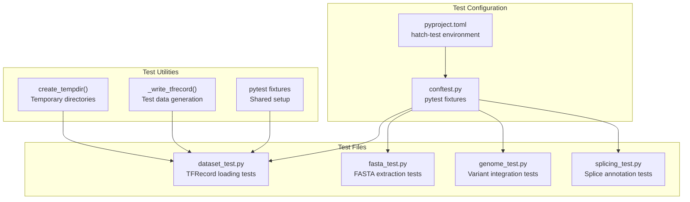
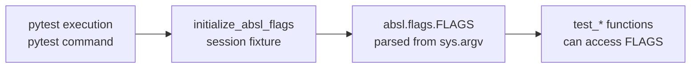
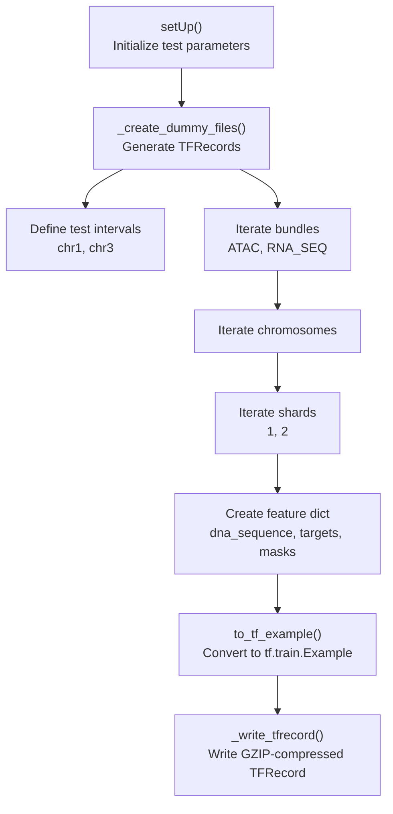
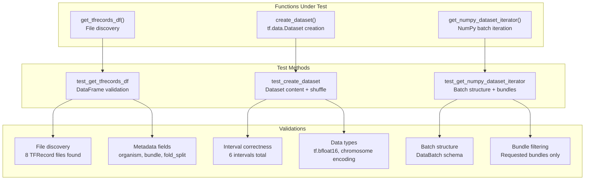

<!-- source: DeepWiki mcp.deepwiki.com · repo google-deepmind/alphagenome_research · page 6.3 Testing Infrastructure · fetched 2026-10-26 -->

# Testing Infrastructure

<details>
<summary>Relevant source files</summary>

The following files were used as context for generating this wiki page:

- [conftest.py](conftest.py)
- [pyproject.toml](pyproject.toml)
- [src/alphagenome_research/io/dataset_test.py](src/alphagenome_research/io/dataset_test.py)

</details>


## Purpose and Scope

This document describes the testing infrastructure for the AlphaGenome Research codebase, including test organization, execution workflows, and the integration of pytest with absl testing frameworks. It covers test suite structure, fixtures, data generation utilities, and commands for running tests.

For information about code quality checks and linting, see [Code Quality and CI/CD](#6.4). For build configuration details, see [Build and Package Configuration](#6.2).

---

## Test Suite Organization

The AlphaGenome Research test suite uses pytest as the test runner with integration for absl testing utilities. All test files follow the naming convention `*_test.py` and are located alongside their corresponding source modules.

### Test File Structure



**Sources:** [conftest.py:1-28](), [pyproject.toml:76-88](), [src/alphagenome_research/io/dataset_test.py:1-255]()

---

## Test Execution with Hatch

The project uses Hatch for test environment management and execution. The test environment is configured in `pyproject.toml` with support for multiple Python versions and parallel execution.

### Test Environment Configuration

| Configuration Key | Value | Description |
|------------------|-------|-------------|
| **Environment** | `hatch-test` | Default test environment name |
| **Python Versions** | 3.11, 3.12, 3.13 | Supported Python versions for testing |
| **Parallel Execution** | `true` | Tests run in parallel when possible |
| **Extra Dependencies** | `typeguard==2.13.3` | Runtime type checking for tests |
| **Environment Variables** | `MPLBACKEND=agg` | Non-interactive matplotlib backend |

**Configuration Details:**

[pyproject.toml:76-88]() defines the test matrix:

```toml
[tool.hatch.envs.hatch-test]
default-args = []
extra-dependencies=['typeguard==2.13.3']
parallel = true

[tool.hatch.envs.hatch-test.env-vars]
MPLBACKEND = 'agg'

[[tool.hatch.envs.hatch-test.matrix]]
python = ['3.13', '3.12', '3.11']
```

### Running Tests

```bash
# Run tests on the default Python version
hatch test

# Run tests on all supported Python versions
hatch test --all

# Run specific test file
hatch test tests/io/dataset_test.py

# Run tests with verbose output
hatch test -- -v

# Run specific test by name
hatch test -- -k test_get_tfrecords_df
```

**Sources:** [pyproject.toml:76-88]()

---

## Pytest and Absl Integration

The test suite uses `absltest` from the Google Abseil library, which requires special initialization when running under pytest. The [conftest.py:1-28]() file provides this integration.

### Flag Initialization Fixture



The `initialize_absl_flags` fixture [conftest.py:23-27]() is a session-scoped, auto-use fixture that:

1. **Runs once per test session** - Session scope ensures flags are initialized before any tests run
2. **Automatically applied** - The `autouse=True` parameter means it runs without explicit declaration
3. **Parses command-line flags** - Uses `known_only=True` to parse only recognized absl flags from `sys.argv`

This allows test files to use `absltest.TestCase` or `absltest.parameterized.TestCase` base classes seamlessly under pytest.

**Sources:** [conftest.py:15-27]()

---

## Test Base Classes and Utilities

### Test Case Base Classes

The test suite uses two primary base classes from `absltest`:

| Base Class | Use Case | Example |
|-----------|----------|---------|
| `absltest.TestCase` | Standard unit tests | Simple validation tests |
| `absltest.parameterized.TestCase` | Parameterized tests | Testing multiple input combinations |

Example from [src/alphagenome_research/io/dataset_test.py:68-69]():

```python
class LoadDataTest(parameterized.TestCase):
```

### Parameterized Testing

Parameterized tests allow running the same test logic with different inputs:

[src/alphagenome_research/io/dataset_test.py:162-163]() demonstrates parameter decoration:

```python
@parameterized.parameters(True, False)
def test_create_dataset(self, shuffle_dataset: bool):
```

This generates two test cases: one with `shuffle_dataset=True` and one with `shuffle_dataset=False`.

**Sources:** [src/alphagenome_research/io/dataset_test.py:16-27](), [src/alphagenome_research/io/dataset_test.py:68-69](), [src/alphagenome_research/io/dataset_test.py:162-163]()

---

## Test Data Generation

Tests that require file I/O or complex data structures include utilities for generating test data. The dataset test file demonstrates comprehensive test data generation patterns.

### TFRecord Test Data Generation



### Test Data Creation Functions

The [src/alphagenome_research/io/dataset_test.py:30-66]() section defines helper functions:

| Function | Purpose | Key Details |
|----------|---------|-------------|
| `_bytes_feature()` | Create bytes feature | Handles string and tensor serialization |
| `_int64_feature()` | Create int64 feature | For integer values |
| `to_tf_example()` | Convert dict to Example | Supports int, str, and ndarray types |
| `_write_tfrecord()` | Write TFRecord file | Uses GZIP compression |

### Test Interval Structure

[src/alphagenome_research/io/dataset_test.py:76-107]() defines a nested interval structure:

```python
self._intervals = {
    'chr1': {
        '1': [  # Shard 1
            genome.Interval(start=10, end=42, chromosome='chr1'),
            genome.Interval(start=100, end=132, chromosome='chr1'),
        ],
        '2': [  # Shard 2
            genome.Interval(start=200, end=232, chromosome='chr1'),
        ],
    },
    'chr3': {
        '1': [...],
        '2': [...],
    },
}
```

This structure simulates multi-chromosome, multi-shard TFRecord organization matching production data layout.

**Sources:** [src/alphagenome_research/io/dataset_test.py:30-66](), [src/alphagenome_research/io/dataset_test.py:70-116](), [src/alphagenome_research/io/dataset_test.py:117-151]()

---

## Test Method Patterns

### Setup and Teardown

Tests use `setUp()` for initialization [src/alphagenome_research/io/dataset_test.py:70-115]():

```python
def setUp(self):
    super().setUp()
    self.tmpdir = self.create_tempdir().full_path
    self._num_channels = 7
    self._seq_len = int(2**5)
    # ... other initialization
    self._create_dummy_files()
```

The `create_tempdir()` method from `absltest.TestCase` creates a temporary directory that is automatically cleaned up after the test.

### Assertion Patterns

Common assertion patterns used in tests:

| Assertion | Purpose | Example Usage |
|-----------|---------|---------------|
| `assertLen(collection, expected)` | Check collection length | `self.assertLen(df, 8)` |
| `assertSameElements(a, b)` | Check set equality | `self.assertSameElements(df.organism, ['HOMO_SAPIENS'])` |
| `assertIn(item, collection)` | Check membership | `self.assertIn('atac', data_atac)` |
| `assertEqual(a, b)` | Check equality | `self.assertEqual(data_atac['atac'].dtype, tf.bfloat16)` |
| `assertIsInstance(obj, cls)` | Check type | `self.assertIsInstance(batch, schemas.DataBatch)` |
| `assertRaises(exc)` | Check exception | `with self.assertRaises(StopIteration)` |

### Subtests for Multiple Validations

[src/alphagenome_research/io/dataset_test.py:219-221]() demonstrates using subtests for clear error reporting:

```python
with self.subTest('Dataset length is correct'):
    with self.assertRaises(StopIteration):
        next(ds_iterator)
```

**Sources:** [src/alphagenome_research/io/dataset_test.py:70-115](), [src/alphagenome_research/io/dataset_test.py:152-221]()

---

## Testing Dataset Loading Pipeline

The dataset test file provides comprehensive coverage of the data loading pipeline, demonstrating how to test complex multi-file, multi-format data systems.

### Test Coverage Map



### Test: TFRecord Discovery

[src/alphagenome_research/io/dataset_test.py:152-160]() validates file discovery:

```python
def test_get_tfrecords_df(self):
    df = dataset.get_tfrecords_df(path=self.tmpdir)
    self.assertLen(df, 8)  # 2 bundles × 2 chromosomes × 2 shards
    self.assertSameElements(df.organism, ['HOMO_SAPIENS'])
    self.assertSameElements(df.bundle, ['ATAC', 'RNA_SEQ'])
    self.assertSameElements(df.fold_split, ['FOLD_0'])
    self.assertSameElements(df.subset, ['TRAIN'])
    self.assertSameElements(df.chromosome, ['chr1', 'chr3'])
    self.assertSameElements(df.shard, [1, 2])
```

### Test: Dataset Creation and Shuffling

[src/alphagenome_research/io/dataset_test.py:162-221]() validates dataset creation with optional shuffling:

Key validations:
- **Bundle alignment**: Both bundles return data for the same genomic intervals
- **Data type preservation**: TFRecords written as `bfloat16` remain `bfloat16`
- **Interval coverage**: All 6 intervals appear exactly once
- **Dataset exhaustion**: StopIteration raised after all data consumed

### Test: NumPy Iterator with Bundle Filtering

[src/alphagenome_research/io/dataset_test.py:223-250]() validates the NumPy iterator interface:

```python
@parameterized.parameters(
    ([bundles.BundleName.ATAC],),
    ([bundles.BundleName.ATAC, bundles.BundleName.RNA_SEQ],),
)
def test_get_numpy_dataset_iterator(self, requested_bundles):
```

This parameterized test verifies:
- Single-bundle requests return only requested bundle
- Multi-bundle requests return all requested bundles
- Batches conform to `DataBatch` schema
- Metadata includes interval information
- Batch count matches expected value (6 intervals ÷ 2 batch_size = 3 batches)

**Sources:** [src/alphagenome_research/io/dataset_test.py:152-250]()

---

## Type Checking in Tests

The test environment includes `typeguard==2.13.3` [pyproject.toml:78]() for runtime type validation. This provides additional safety by verifying that function arguments and return values match their type annotations during test execution.

### Benefits of Runtime Type Checking

- **Early error detection**: Type mismatches caught during tests rather than production
- **Annotation validation**: Ensures type hints accurately reflect actual usage
- **Integration testing**: Validates type correctness across module boundaries

**Sources:** [pyproject.toml:78]()

---

## Test Exclusion from Package

Test files are explicitly excluded from the package distribution [pyproject.toml:70-71]():

```toml
[tool.setuptools.packages.find]
include = ['README.md', 'LICENSE']
exclude = ['*_test.py', 'examples']
```

This ensures that test code is not included in the distributed package, reducing package size and avoiding unnecessary dependencies for end users.

**Sources:** [pyproject.toml:69-74]()

---

## Writing New Tests

### Test File Template

When adding new tests, follow this structure:

1. **Imports**: Include necessary testing libraries and modules under test
2. **Helper functions**: Define data generation or utility functions
3. **Test class**: Inherit from `absltest.TestCase` or `parameterized.TestCase`
4. **setUp method**: Initialize test fixtures and temporary data
5. **Test methods**: Name with `test_` prefix, use descriptive names
6. **Assertions**: Use absltest assertion methods for clear error messages

### Example Test Structure

```python
from absl.testing import absltest
from absl.testing import parameterized

class MyModuleTest(parameterized.TestCase):
    
    def setUp(self):
        super().setUp()
        self.tmpdir = self.create_tempdir().full_path
        # Initialize test data
    
    def test_basic_functionality(self):
        # Arrange
        # Act
        # Assert
        
    @parameterized.parameters(
        (value1,),
        (value2,),
    )
    def test_parameterized(self, param):
        # Test logic using param

if __name__ == '__main__':
    absltest.main()
```

### Best Practices

- **Use temporary directories**: Call `self.create_tempdir()` for file I/O tests
- **Clean test data**: Temporary directories are automatically cleaned up
- **Test edge cases**: Include parameterized tests for boundary conditions
- **Verify cleanup**: Use subtests to verify dataset exhaustion and proper iteration
- **Match production structure**: Generate test data matching production file layouts

**Sources:** [src/alphagenome_research/io/dataset_test.py:1-255]()

---

## Summary

The AlphaGenome Research testing infrastructure provides:

- **Integrated test framework**: pytest with absl testing utilities
- **Multi-version support**: Tests run on Python 3.11, 3.12, and 3.13
- **Parallel execution**: Faster test runs with parallel test execution
- **Type safety**: Runtime type checking with typeguard
- **Test data utilities**: Comprehensive helpers for generating TFRecords and genomic data
- **Clean test isolation**: Automatic temporary directory management

For executing tests as part of the CI/CD pipeline, see [Code Quality and CI/CD](#6.4).

---

