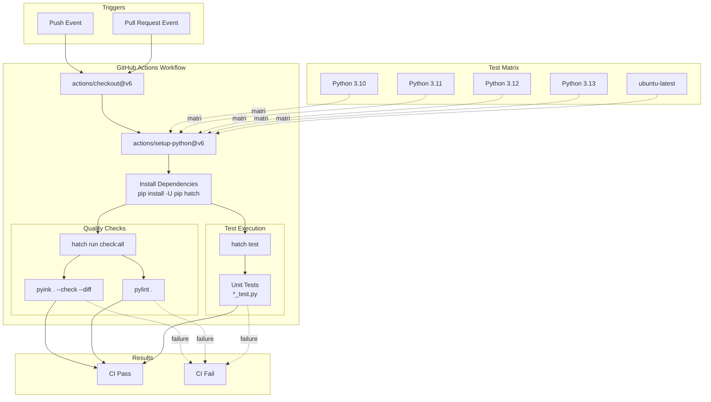
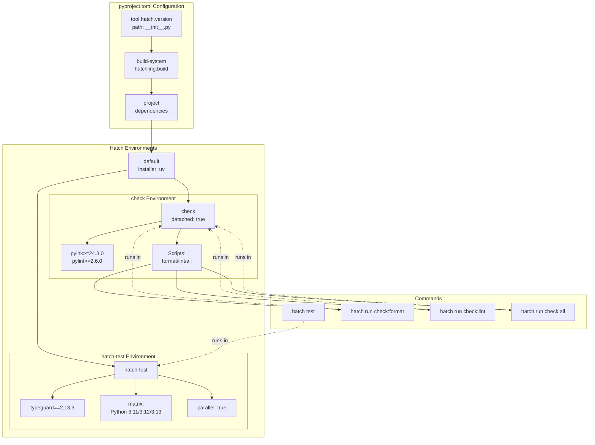
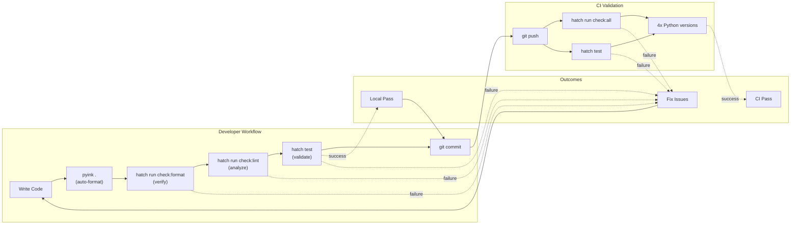

<!-- source: DeepWiki mcp.deepwiki.com · repo google-deepmind/alphagenome_research · page 6.4 Code Quality and CI/CD · fetched 2026-10-26 -->

# Code Quality and CI/CD

<details>
<summary>Relevant source files</summary>

The following files were used as context for generating this wiki page:

- [.github/workflows/presubmit_checks.yml](.github/workflows/presubmit_checks.yml)
- [.pylintrc](.pylintrc)
- [pyproject.toml](pyproject.toml)

</details>


This document describes the code quality standards and continuous integration/continuous deployment (CI/CD) infrastructure for the AlphaGenome Research repository. It covers the automated checks that run on every push and pull request, the code formatting and linting tools used to maintain consistency, and the development workflow for running quality checks locally.

For information about the testing infrastructure and test suite organization, see [Testing Infrastructure](#6.3). For general contribution guidelines and code review processes, see [Contributing Guidelines](#6.1).

---

## Purpose and Scope

The AlphaGenome Research project enforces code quality through:
- **Static analysis** via Pylint with Google Python style guide
- **Automatic formatting** via pyink
- **Continuous integration** via GitHub Actions
- **Multi-version testing** across Python 3.10-3.13
- **Build configuration** via Hatch and pyproject.toml

All quality checks run automatically on every push and pull request, ensuring consistent code standards across the codebase.

---

## Code Quality Standards

### Pylint Configuration

The project uses Pylint for static code analysis, configured via [.pylintrc:1-459](). The configuration is based on Google's Python style guide with repository-specific modifications.

**Key Configuration Parameters:**

| Setting | Value | Purpose |
|---------|-------|---------|
| Max Line Length | 80 characters | [.pylintrc:283]() |
| Indentation | 2 spaces | [.pylintrc:311]() |
| Minimum Python Version | 3.10 | [.pylintrc:41]() |
| Parallel Jobs | 4 | [.pylintrc:29]() |
| Ignored Paths | `third_party`, `./src/alphagenome/protos` | [.pylintrc:14-15]() |

**Disabled Checks:**

The configuration disables over 150 Pylint checks to accommodate modern Python practices and framework-specific patterns. Notable disabled checks include:

- `no-member`, `no-name-in-module`: Disabled due to false positives with dynamic imports
- `not-callable`: Disabled for JAX JIT compatibility [.pylintrc:123]()
- `not-an-iterable`: Disabled for dataclass compatibility [.pylintrc:122]()
- `too-many-*`: All complexity metrics disabled [.pylintrc:144-155]()
- `missing-function-docstring`, `missing-module-docstring`: Docstring requirements relaxed [.pylintrc:108-109]()

**Naming Conventions:**

```text
Functions:  snake_case or CamelCase (for test methods)
Variables:  snake_case
Constants:  UPPER_CASE or snake_case
Classes:    CamelCase
Modules:    snake_case
```

Sources: [.pylintrc:1-459]()

---

### Code Formatting with pyink

The project uses pyink (Google's fork of Black) for automatic code formatting, configured in [pyproject.toml:105-111]().

**Formatter Configuration:**

```toml
line-length = 80
unstable = true
pyink-indentation = 2
pyink-use-majority-quotes = true
```

**Formatting Rules:**

| Rule | Setting | Reference |
|------|---------|-----------|
| Line Length | 80 characters | [pyproject.toml:107]() |
| Indentation | 2 spaces | [pyproject.toml:109]() |
| Quote Style | Majority quotes (consistent within file) | [pyproject.toml:110]() |
| Unstable Features | Enabled | [pyproject.toml:108]() |

The formatter runs in check mode during CI to verify compliance without modifying files. Developers can run it locally to auto-format code before committing.

Sources: [pyproject.toml:105-111]()

---

### Style Guide Compliance

The codebase follows the [Google Python Style Guide](https://google.github.io/styleguide/pyguide.html) with the specific adaptations defined in `.pylintrc`. Key style requirements:

- **Imports**: No wildcards, organized alphabetically
- **Docstrings**: Required for public APIs (10+ lines) [.pylintrc:249]()
- **Logging**: Use `absl.logging` or `tensorflow.io.logging` [.pylintrc:359]()
- **Type Hints**: Enforced at runtime via typeguard in tests [pyproject.toml:78]()
- **Good Names**: `main`, `_` accepted as short variable names [.pylintrc:197]()

Sources: [.pylintrc:1-9](), [.pylintrc:194-250]()

---

## CI/CD Pipeline

### GitHub Actions Workflow

The continuous integration pipeline is defined in [.github/workflows/presubmit_checks.yml:1-38](). It runs on every push and pull request to validate code quality and functionality.

**CI/CD Pipeline Architecture**



Sources: [.github/workflows/presubmit_checks.yml:1-38]()

---

### Test Matrix Configuration

The CI pipeline uses a matrix strategy to test across multiple Python versions simultaneously.

**Matrix Strategy:**

```yaml
strategy:
  fail-fast: false
  matrix:
    python-version: ["3.10", "3.11", "3.12", "3.13"]
    os: [ubuntu-latest]
```

**Configuration Details:**

| Parameter | Value | Purpose |
|-----------|-------|---------|
| `fail-fast` | `false` | Continue testing all versions even if one fails [.github/workflows/presubmit_checks.yml:21]() |
| Python Versions | 3.10, 3.11, 3.12, 3.13 | Test compatibility across supported versions [.github/workflows/presubmit_checks.yml:23]() |
| Operating System | ubuntu-latest | Linux-only testing [.github/workflows/presubmit_checks.yml:24]() |

This matrix creates 4 parallel jobs, each testing a different Python version on Ubuntu.

Sources: [.github/workflows/presubmit_checks.yml:19-24]()

---

### Pipeline Steps

**Step-by-Step Execution:**

1. **Checkout Code** [.github/workflows/presubmit_checks.yml:26]()
   - Uses `actions/checkout@v6`
   - Clones repository at commit being tested

2. **Setup Python** [.github/workflows/presubmit_checks.yml:27-30]()
   - Uses `actions/setup-python@v6`
   - Installs Python version from matrix

3. **Install Hatch** [.github/workflows/presubmit_checks.yml:31-33]()
   - Upgrades pip to latest version
   - Installs Hatch build tool

4. **Run Quality Checks** [.github/workflows/presubmit_checks.yml:34-35]()
   - Executes `hatch run check:all`
   - Runs both formatting check and linting

5. **Run Unit Tests** [.github/workflows/presubmit_checks.yml:36-37]()
   - Executes `hatch test`
   - Runs all `*_test.py` files

Sources: [.github/workflows/presubmit_checks.yml:25-37]()

---

## Hatch Environment Structure

Hatch manages multiple isolated environments for different development tasks. The configuration defines specialized environments for testing and quality checks.

**Hatch Environments and Scripts**



Sources: [pyproject.toml:66-103]()

---

### Test Environment

The `hatch-test` environment is configured for running the test suite with runtime type checking.

**Configuration:**

```toml
[tool.hatch.envs.hatch-test]
default-args = []
extra-dependencies=['typeguard==2.13.3']
parallel = true
```

**Features:**

- **Typeguard Integration**: Enforces runtime type checking [pyproject.toml:78]()
- **Parallel Execution**: Tests run concurrently when possible [pyproject.toml:79]()
- **Environment Variable**: `MPLBACKEND=agg` for headless plotting [pyproject.toml:83]()
- **Python Matrix**: Tests across 3.11, 3.12, 3.13 [pyproject.toml:87]()

**Usage:**

```bash
# Run tests on current Python version
hatch test

# Run tests on all matrix versions
hatch test --all
```

Sources: [pyproject.toml:76-87]()

---

### Check Environment

The `check` environment is a detached environment dedicated to code quality tools, isolated from the project's runtime dependencies.

**Configuration:**

```toml
[tool.hatch.envs.check]
dependencies = [
  'pyink>=24.3.0',
  'pylint>=2.6.0',
]
detached = true
```

**Scripts:**

| Script | Command | Purpose |
|--------|---------|---------|
| `format` | `pyink . --check --diff` | Verify code formatting [pyproject.toml:98]() |
| `lint` | `pylint .` | Run static analysis [pyproject.toml:99]() |
| `all` | Runs both format and lint | Complete quality check [pyproject.toml:100-103]() |

**Detached Environment:**

The `detached = true` setting [pyproject.toml:95]() means this environment does not install the project's dependencies. This ensures:
- Faster environment creation
- No dependency conflicts with linting tools
- Pure static analysis without runtime context

**Usage:**

```bash
# Run formatting check
hatch run check:format

# Run linting
hatch run check:lint

# Run all quality checks (used in CI)
hatch run check:all
```

Sources: [pyproject.toml:89-103]()

---

## Development Workflow

### Local Quality Checks

Developers should run quality checks locally before pushing to avoid CI failures.

**Recommended Pre-commit Workflow:**

```bash
# 1. Format code automatically
pyink .

# 2. Verify formatting (what CI runs)
hatch run check:format

# 3. Run linting
hatch run check:lint

# 4. Run tests
hatch test

# 5. (Optional) Run all quality checks
hatch run check:all
```

**Quality Check Execution Flow**



Sources: [pyproject.toml:89-103](), [.github/workflows/presubmit_checks.yml:34-37]()

---

### Common Quality Issues and Fixes

**Formatting Issues:**

If `hatch run check:format` fails, run `pyink .` without `--check` to auto-fix formatting:

```bash
# Fix formatting automatically
pyink .

# Verify fix
hatch run check:format
```

**Linting Issues:**

Pylint failures typically require manual fixes. Common issues:

1. **Line Too Long**: Break lines at 80 characters
2. **Import Order**: Organize imports alphabetically
3. **Undefined Variable**: Check for typos or missing imports
4. **Unused Import/Variable**: Remove or prefix with underscore

For legitimate exceptions, use inline comments:

```python
# pylint: disable=line-too-long
very_long_url = "https://example.com/very/long/path..."
```

**Test Failures:**

Address test failures before committing. Use `hatch test` locally to debug issues before pushing.

Sources: [.pylintrc:64-170](), [pyproject.toml:97-103]()

---

## Build Configuration

### Package Metadata

The project metadata is defined in [pyproject.toml:6-32]().

**Core Metadata:**

| Field | Value |
|-------|-------|
| Name | `alphagenome_research` |
| Build Backend | `hatchling.build` [pyproject.toml:2]() |
| Python Requirement | `>=3.11` [pyproject.toml:12]() |
| License | Apache 2.0 [pyproject.toml:11]() |
| Development Status | Beta [pyproject.toml:23]() |

**Supported Python Versions:**

- Python 3.11 (minimum) [pyproject.toml:28]()
- Python 3.12 [pyproject.toml:29]()
- Python 3.13 [pyproject.toml:30]()

Note: CI tests on Python 3.10 as well [.github/workflows/presubmit_checks.yml:23](), but the package requires 3.11+.

Sources: [pyproject.toml:1-32]()

---

### Dependencies

**Runtime Dependencies:**

The project has 15 core dependencies defined in [pyproject.toml:33-54]():

| Category | Dependencies |
|----------|-------------|
| JAX Stack | `jax`, `dm-haiku`, `chex`, `jaxtyping`, `einshape` |
| ML Frameworks | `tensorflow`, `orbax` |
| Data Formats | `pyfaidx`, `pyranges`, `anndata`, `pandas`, `pyarrow` |
| Utilities | `absl-py`, `numpy` |
| Model Distribution | `kagglehub`, `huggingface_hub` |
| File I/O | `etils[epath]` |

**Development Dependencies:**

Optional `dev` group [pyproject.toml:61]():
- `hatch`: Build and environment management

Sources: [pyproject.toml:33-61]()

---

### Version Management

The package version is dynamically determined from the source code:

```toml
[tool.hatch.version]
path = 'src/alphagenome_research/__init__.py'
```

Version is read from `__version__` variable in [pyproject.toml:64](). This ensures a single source of truth for version information.

Sources: [pyproject.toml:63-64]()

---

### Package Data

The build includes non-Python files for model metadata:

```toml
[tool.setuptools.package-data]
alphagenome_research = ["model/metadata/*.textproto"]
```

This ensures model metadata files are included in the distribution package [pyproject.toml:73-74]().

Sources: [pyproject.toml:69-74]()

---

## Summary

The AlphaGenome Research project maintains code quality through:

1. **Automated CI/CD**: GitHub Actions runs checks on all pushes/PRs across 4 Python versions
2. **Style Enforcement**: Pylint with Google style guide and pyink formatter (80-char, 2-space)
3. **Environment Management**: Hatch provides isolated environments for testing and quality checks
4. **Type Safety**: Runtime type checking via typeguard in test environment
5. **Parallel Testing**: Tests run concurrently across Python 3.11-3.13

**Key Commands:**

```bash
# Quality checks (what CI runs)
hatch run check:all

# Run tests
hatch test

# Format code
pyink .
```

All quality checks must pass before code can be merged, ensuring consistent code quality across the repository.

Sources: [.github/workflows/presubmit_checks.yml:1-38](), [.pylintrc:1-459](), [pyproject.toml:1-111]()

---

