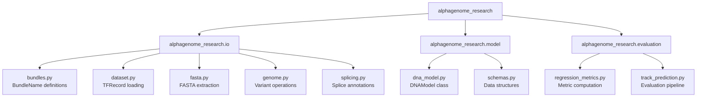
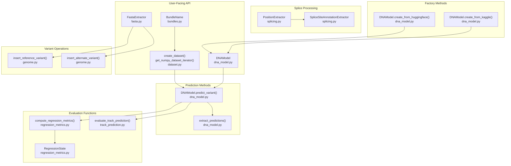
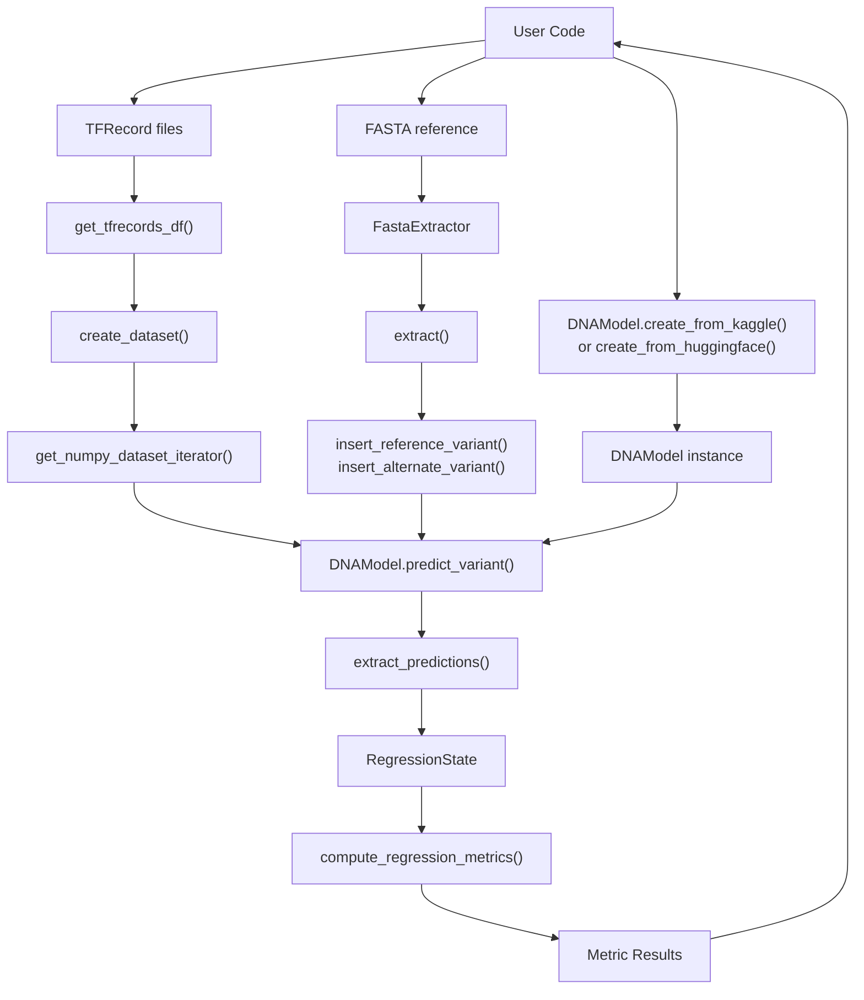

<!-- source: DeepWiki mcp.deepwiki.com · repo google-deepmind/alphagenome_research · page 7 API Reference · fetched 2026-10-26 -->

# API Reference

<details>
<summary>Relevant source files</summary>

The following files were used as context for generating this wiki page:

- [src/alphagenome_research/__init__.py](src/alphagenome_research/__init__.py)
- [src/alphagenome_research/io/__init__.py](src/alphagenome_research/io/__init__.py)
- [src/alphagenome_research/model/__init__.py](src/alphagenome_research/model/__init__.py)

</details>


## Purpose and Scope

This page provides a comprehensive reference for the public API of the `alphagenome_research` package. It documents the primary modules, classes, and functions available for loading genomic data, performing model inference, and evaluating predictions.

For detailed documentation of specific modules:
- I/O operations (data loading, FASTA extraction, variant handling): See [I/O Module Reference](#7.1)
- Evaluation metrics and track prediction: See [Evaluation Module Reference](#7.2)
- DNA Model usage patterns: See [DNA Model API](#4.1)

**Sources:** [src/alphagenome_research/__init__.py:1-18]()

## Package Structure

The `alphagenome_research` package is organized into three primary modules, each containing specialized functionality:



**Module Descriptions:**

| Module | Purpose | Key Components |
|--------|---------|----------------|
| `alphagenome_research.io` | Data input/output operations | Bundle definitions, TFRecord loading, FASTA extraction, variant integration |
| `alphagenome_research.model` | Model inference and data structures | `DNAModel` class, prediction schemas |
| `alphagenome_research.evaluation` | Performance evaluation | Regression metrics, track prediction evaluation |

**Sources:** [src/alphagenome_research/io/__init__.py:1-16](), [src/alphagenome_research/model/__init__.py:1-16]()

## Core API Classes and Functions

The following diagram maps the primary API components to their code locations, showing the relationships between user-facing classes and internal implementations:



**Sources:** Referenced files across `src/alphagenome_research/io/`, `src/alphagenome_research/model/`, and `src/alphagenome_research/evaluation/`

## Common Import Patterns

### Basic Model Loading and Inference

```python
from alphagenome_research.model import dna_model

# Load model from Kaggle
model = dna_model.DNAModel.create_from_kaggle(
    handle="google/alphagenome/jax/arabidopsis_thaliana/1"
)

# Or from HuggingFace
model = dna_model.DNAModel.create_from_huggingface(
    repo_id="google-deepmind/alphagenome-arabidopsis_thaliana"
)
```

### Data Loading

```python
from alphagenome_research.io import bundles
from alphagenome_research.io import dataset

# Define bundle type
bundle_name = bundles.BundleName.ATAC

# Create dataset iterator
tfrecords_df = dataset.get_tfrecords_df(gcs_path)
ds = dataset.create_dataset(tfrecords_df, bundle_name)
iterator = dataset.get_numpy_dataset_iterator(ds)
```

### FASTA Operations

```python
from alphagenome_research.io import fasta
from alphagenome_research.io import genome

# Extract reference sequence
extractor = fasta.FastaExtractor(fasta_path)
sequence = extractor.extract(chromosome, start, end)

# Insert variant
ref_sequence = genome.insert_reference_variant(
    sequence, variant_position, ref_allele
)
alt_sequence = genome.insert_alternate_variant(
    sequence, variant_position, alt_allele
)
```

### Evaluation Metrics

```python
from alphagenome_research.evaluation import regression_metrics

# Accumulate predictions
state = regression_metrics.RegressionState()
state = state.update(predictions, targets, mask)

# Compute metrics
metrics = regression_metrics.compute_regression_metrics(state)
pearson_r = metrics['pearson_r']
mse = metrics['mse']
```

**Sources:** Pattern examples derived from typical usage shown in notebook examples

## API Organization by Functionality

The following table provides a quick reference for locating specific functionality within the API:

| Functionality | Primary Module | Key Classes/Functions | Reference Page |
|---------------|----------------|----------------------|----------------|
| Bundle type definitions | `io.bundles` | `BundleName` enum | [7.1](#7.1) |
| TFRecord dataset loading | `io.dataset` | `create_dataset()`, `get_numpy_dataset_iterator()` | [7.1](#7.1) |
| FASTA file handling | `io.fasta` | `FastaExtractor` | [7.1](#7.1) |
| Variant integration | `io.genome` | `insert_reference_variant()`, `insert_alternate_variant()` | [7.1](#7.1) |
| Splice site processing | `io.splicing` | `PositionExtractor`, `SpliceSiteAnnotationExtractor` | [7.1](#7.1) |
| Model loading and inference | `model.dna_model` | `DNAModel`, factory methods | [4.1](#4.1) |
| Data structures | `model.schemas` | Prediction schemas, data batch definitions | [7.1](#7.1) |
| Regression metrics | `evaluation.regression_metrics` | `RegressionState`, `compute_regression_metrics()` | [7.2](#7.2) |
| Track prediction evaluation | `evaluation.track_prediction` | `evaluate_track_prediction()` | [7.2](#7.2) |

**Sources:** Functionality mapping based on module organization

## Data Flow Through API Components

This diagram illustrates how data flows through the major API components during a typical prediction workflow:



**Sources:** Data flow patterns synthesized from system architecture diagrams

## Version Information

The package version is defined in the root `__init__.py` file:

- **Current Version:** `0.0.1` ([src/alphagenome_research/__init__.py:17]())

Version information can be accessed programmatically:

```python
import alphagenome_research
print(alphagenome_research.__version__)  # Outputs: '0.0.1'
```

**Sources:** [src/alphagenome_research/__init__.py:17]()

## API Stability and Compatibility

The `alphagenome_research` package follows semantic versioning principles:

- **Major version (0)**: API is in initial development; breaking changes may occur
- **Minor version (0)**: Feature additions that maintain backward compatibility
- **Patch version (1)**: Bug fixes and minor improvements

Users should expect the public API to stabilize as the package matures toward version 1.0.0. Until then, pin to specific versions in production environments.

**Sources:** Version format from [src/alphagenome_research/__init__.py:17]()

## Detailed Module References

For comprehensive documentation of individual modules, classes, and functions:

- **I/O Module Reference ([7.1](#7.1))**: Complete documentation of data loading, FASTA operations, variant handling, and splice site processing
- **Evaluation Module Reference ([7.2](#7.2))**: Detailed coverage of regression metrics, track prediction evaluation, and performance analysis functions

These sub-pages provide method signatures, parameter descriptions, return types, and usage examples for all public API components.

**Sources:** Sub-page organization based on TOC structure

---

