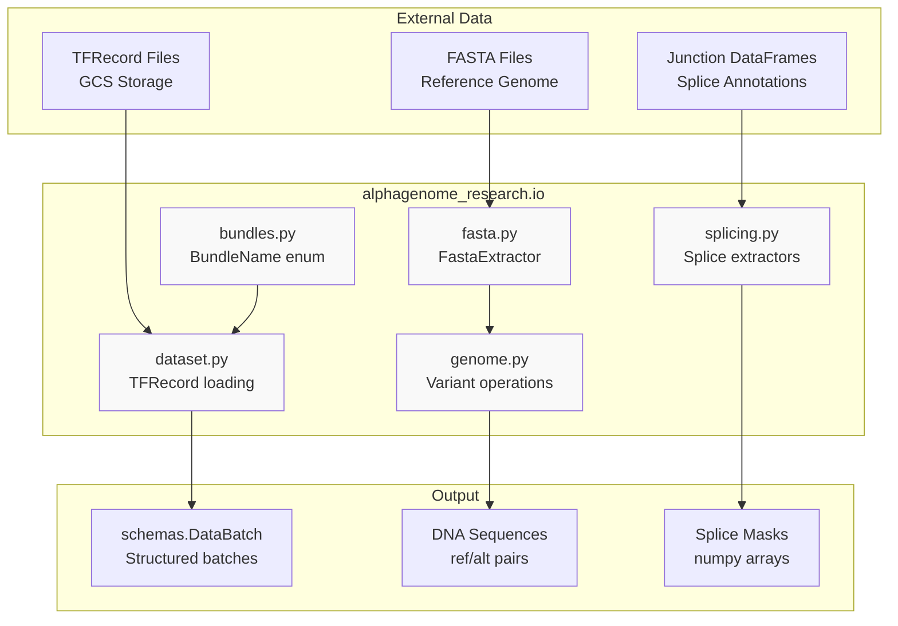
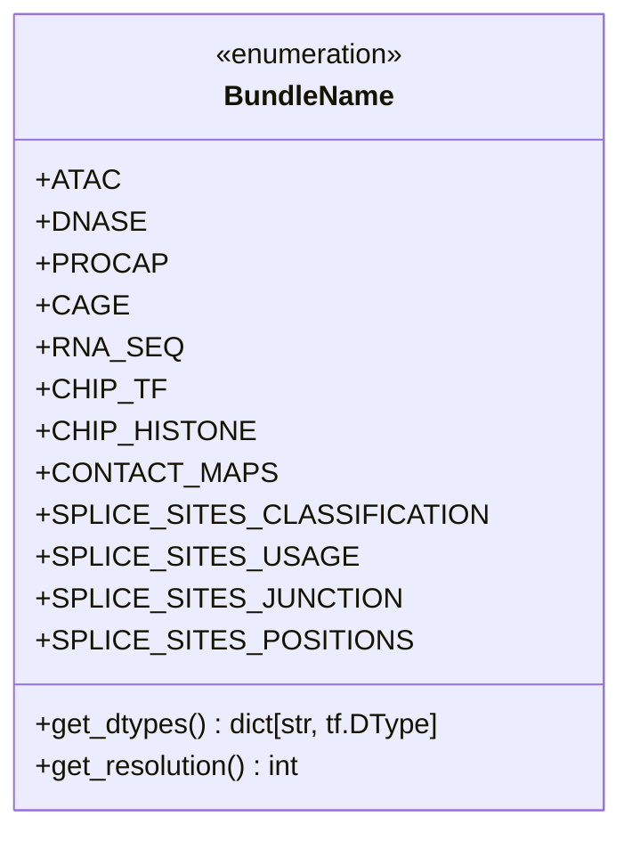
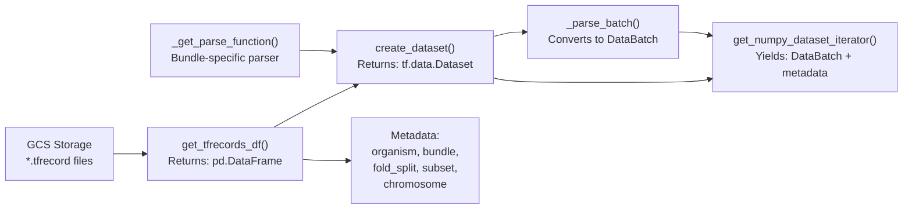
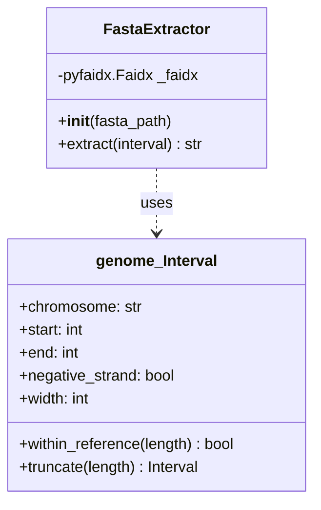
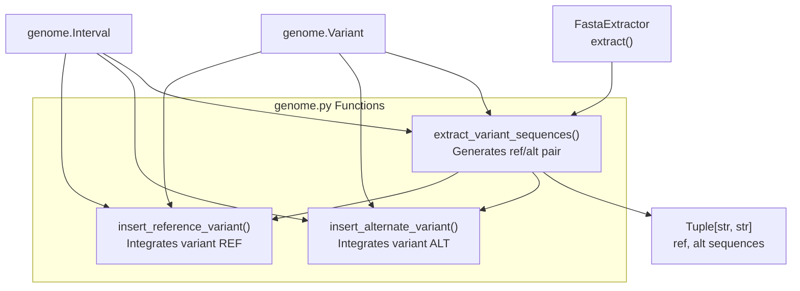
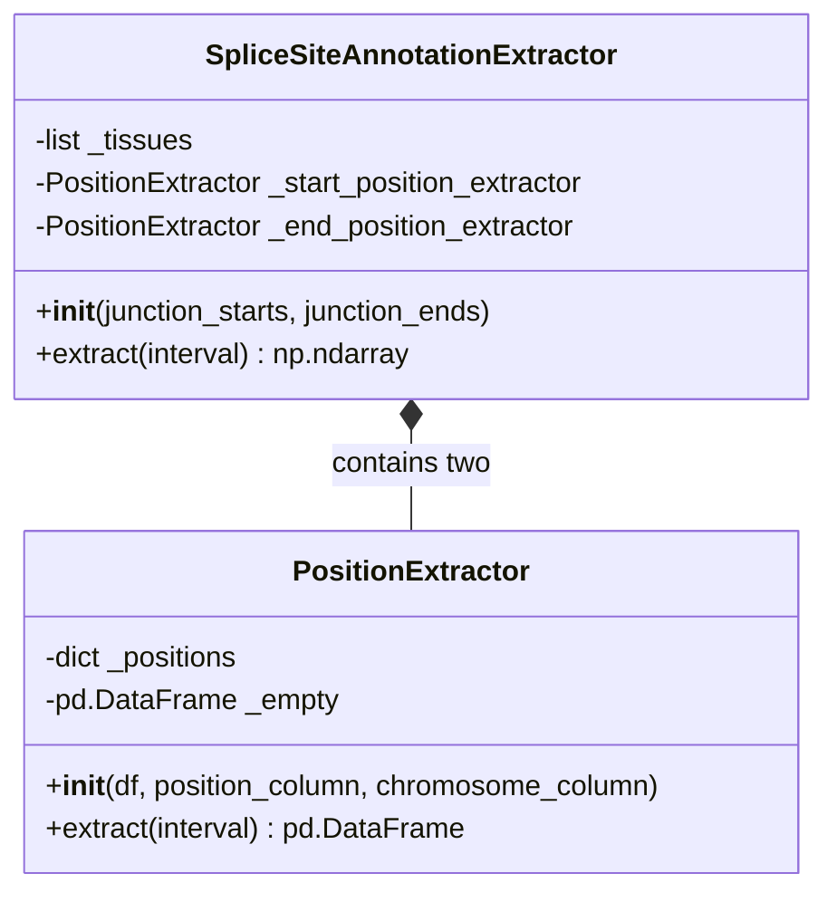

<!-- source: DeepWiki mcp.deepwiki.com · repo google-deepmind/alphagenome_research · page 7.1 I/O Module Reference · fetched 2026-10-26 -->

# I/O Module Reference

<details>
<summary>Relevant source files</summary>

The following files were used as context for generating this wiki page:

- [src/alphagenome_research/io/bundles.py](src/alphagenome_research/io/bundles.py)
- [src/alphagenome_research/io/dataset.py](src/alphagenome_research/io/dataset.py)
- [src/alphagenome_research/io/fasta.py](src/alphagenome_research/io/fasta.py)
- [src/alphagenome_research/io/genome.py](src/alphagenome_research/io/genome.py)
- [src/alphagenome_research/io/splicing.py](src/alphagenome_research/io/splicing.py)

</details>


## Purpose and Scope

This document provides detailed API reference documentation for the `alphagenome_research.io` module, which handles all data input/output operations for the AlphaGenome Research system. The module consists of five primary components:

- **Bundle definitions**: Data type specifications for different genomic output modalities
- **TFRecord dataset loading**: Functions for discovering, parsing, and iterating over training data
- **FASTA file operations**: Sequence extraction from reference genome files
- **Variant integration**: Functions for inserting variants into reference sequences
- **Splice site processing**: Extractors for handling splice junction annotations

For information about using these I/O operations in the context of model evaluation, see [Evaluation System](#5). For practical usage examples in notebooks, see [Quick Start Tutorial](#2.2).

---

## Module Overview

The I/O module provides a layered architecture for genomic data access, from low-level file parsing to high-level batch iterators.



**Sources:** [src/alphagenome_research/io/bundles.py](), [src/alphagenome_research/io/dataset.py](), [src/alphagenome_research/io/fasta.py](), [src/alphagenome_research/io/genome.py](), [src/alphagenome_research/io/splicing.py]()

---

## Bundle Definitions

### BundleName Enum

The `BundleName` enumeration defines all supported genomic output modalities with their associated data types and resolutions.

**Location:** [src/alphagenome_research/io/bundles.py:21-36]()



**Sources:** [src/alphagenome_research/io/bundles.py:21-92]()

### Bundle Data Types

Each bundle specifies the TensorFlow dtypes for its data fields. The following table summarizes the key/dtype mappings:

| Bundle Name | Keys | DTypes | Mask Included |
|------------|------|--------|---------------|
| `ATAC` | `atac`, `atac_mask` | `tf.bfloat16`, `tf.bool` | Yes |
| `DNASE` | `dnase`, `dnase_mask` | `tf.bfloat16`, `tf.bool` | Yes |
| `PROCAP` | `procap`, `procap_mask` | `tf.bfloat16`, `tf.bool` | Yes |
| `CAGE` | `cage`, `cage_mask` | `tf.bfloat16`, `tf.bool` | Yes |
| `RNA_SEQ` | `rna_seq`, `rna_seq_mask`, `rna_seq_strand` | `tf.bfloat16`, `tf.bool`, `tf.int32` | Yes |
| `CHIP_TF` | `chip_tf`, `chip_tf_mask` | `tf.float32`, `tf.bool` | Yes |
| `CHIP_HISTONE` | `chip_histone`, `chip_histone_mask` | `tf.float32`, `tf.bool` | Yes |
| `CONTACT_MAPS` | `contact_maps` | `tf.float32` | No |
| `SPLICE_SITES_CLASSIFICATION` | `splice_sites` | `tf.bool` | No |
| `SPLICE_SITES_USAGE` | `splice_site_usage` | `tf.float16` | No |
| `SPLICE_SITES_JUNCTION` | `splice_junctions` | `tf.float32` | No |
| `SPLICE_SITES_POSITIONS` | `splice_site_positions` | `tf.int32` | No |

**Implementation:** [src/alphagenome_research/io/bundles.py:37-69]()

**Sources:** [src/alphagenome_research/io/bundles.py:37-69]()

### Bundle Resolutions

Different bundles operate at different genomic resolutions:

| Resolution (bp) | Bundles |
|----------------|---------|
| 1 | ATAC, DNASE, PROCAP, CAGE, RNA_SEQ, all splice bundles |
| 128 | CHIP_TF, CHIP_HISTONE |
| 2,048 | CONTACT_MAPS |

**Implementation:** [src/alphagenome_research/io/bundles.py:71-91]()

**Sources:** [src/alphagenome_research/io/bundles.py:71-91]()

---

## TFRecord Dataset Loading

The dataset loading system provides functions to discover, parse, and iterate over TFRecord files stored in Google Cloud Storage.

### Data Flow Pipeline



**Sources:** [src/alphagenome_research/io/dataset.py:61-256]()

### get_tfrecords_df()

Discovers TFRecord files matching specified criteria and returns metadata as a pandas DataFrame.

**Signature:** [src/alphagenome_research/io/dataset.py:61-68]()

```python
def get_tfrecords_df(
    *,
    organism: dna_model.Organism | None = None,
    bundle: bundles_lib.BundleName | None = None,
    fold_split: dna_model.ModelVersion | None = None,
    subset: fold_intervals.Subset | None = None,
    chromosome: str | None = None,
    path: str | os.PathLike[str] | None = None,
) -> pd.DataFrame
```

**Parameters:**
- `organism`: Filter by organism (e.g., `HOMO_SAPIENS`). If `None`, returns all organisms.
- `bundle`: Filter by bundle type. If `None`, returns all bundles.
- `fold_split`: Filter by fold split (e.g., `FOLD_0`). If `None`, returns all fold splits.
- `subset`: Filter by subset (e.g., `VALID`, `TRAIN`). If `None`, returns all subsets.
- `chromosome`: Filter by chromosome name. If `None`, returns all chromosomes.
- `path`: Custom path to TFRecord files. Defaults to `gs:///alphagenome-datasets/v1/train/`.

**Returns:** DataFrame with columns: `organism`, `bundle`, `fold_split`, `subset`, `chromosome`, `shard`, `num_shards`, `path`.

**Implementation Details:**
- Constructs glob pattern: `{fold_split}/{organism}/{subset}/{bundle}/data_{chromosome}_*-*.gz.tfrecord`
- Parses filenames using regex: [src/alphagenome_research/io/dataset.py:56-58]()
- Default path constant: [src/alphagenome_research/io/dataset.py:43]()

**Sources:** [src/alphagenome_research/io/dataset.py:61-118]()

### create_dataset()

Creates a `tf.data.Dataset` from TFRecord files for specified parameters.

**Signature:** [src/alphagenome_research/io/dataset.py:160-167]()

```python
def create_dataset(
    *,
    organism: dna_model.Organism,
    fold_split: dna_model.ModelVersion,
    subset: fold_intervals.Subset,
    bundles: Sequence[bundles_lib.BundleName] | None = None,
    path: str | os.PathLike[str] | None = None,
) -> tf.data.Dataset
```

**Parameters:**
- `organism`: Required. The organism to load (e.g., `HOMO_SAPIENS`).
- `fold_split`: Required. The fold split (e.g., `FOLD_0`).
- `subset`: Required. The subset (e.g., `VALID`, `TRAIN`).
- `bundles`: Optional list of bundles to load. If `None`, all bundles are loaded.
- `path`: Optional custom path to TFRecord files.

**Returns:** A `tf.data.Dataset` that yields dictionaries (or tuples of dictionaries if multiple bundles).

**Implementation:**
1. Calls `get_tfrecords_df()` for each bundle [src/alphagenome_research/io/dataset.py:178-188]()
2. Validates consistent number of files per bundle [src/alphagenome_research/io/dataset.py:190-194]()
3. Creates per-bundle datasets using `_get_tfrecords_dataset()` [src/alphagenome_research/io/dataset.py:196-205]()
4. Zips datasets across bundles [src/alphagenome_research/io/dataset.py:208]()

**Sources:** [src/alphagenome_research/io/dataset.py:160-208]()

### get_numpy_dataset_iterator()

High-level function that returns an iterator yielding numpy batches as `DataBatch` objects with metadata.

**Signature:** [src/alphagenome_research/io/dataset.py:235-243]()

```python
def get_numpy_dataset_iterator(
    *,
    batch_size: int,
    organism: dna_model.Organism = dna_model.Organism.HOMO_SAPIENS,
    model_version: dna_model.ModelVersion = dna_model.ModelVersion.FOLD_0,
    subset: fold_intervals.Subset = fold_intervals.Subset.VALID,
    bundles: Sequence[bundles_lib.BundleName] | None = None,
    path: str | os.PathLike[str] | None = None,
) -> Iterator[tuple[schemas.DataBatch, BatchMetadata]]
```

**Parameters:**
- `batch_size`: Required. Number of examples per batch.
- `organism`: Organism to load. Defaults to `HOMO_SAPIENS`.
- `model_version`: Fold split to load. Defaults to `FOLD_0`.
- `subset`: Subset to load. Defaults to `VALID`.
- `bundles`: Optional list of bundles. If `None`, all bundles are loaded.
- `path`: Optional custom path.

**Returns:** Iterator yielding tuples of `(DataBatch, metadata_dict)` where:
- `DataBatch` has fields: `organism_index`, `dna_sequence`, bundle-specific data and masks
- `metadata_dict` has keys: `interval/chromosome`, `interval/start`, `interval/end`

**Type Definition:** [src/alphagenome_research/io/dataset.py:45]()

**Sources:** [src/alphagenome_research/io/dataset.py:235-256]()

### Internal Functions

#### _get_parse_function()

Creates a bundle-specific parsing function for TFRecord examples.

**Location:** [src/alphagenome_research/io/dataset.py:121-139]()

**Feature Specifications:**
- DNA sequence: [src/alphagenome_research/io/dataset.py:48-50]()
- Interval metadata: [src/alphagenome_research/io/dataset.py:51-55]()
- Bundle-specific fields: Generated dynamically from `BundleName.get_dtypes()`

**Sources:** [src/alphagenome_research/io/dataset.py:121-139]()

#### _get_tfrecords_dataset()

Creates a `tf.data.Dataset` from a sequence of TFRecord file paths.

**Location:** [src/alphagenome_research/io/dataset.py:142-157]()

**Implementation:**
- Uses `TFRecordDataset` with GZIP compression
- Applies parsing with `AUTOTUNE` parallelism
- Concatenates multiple file datasets

**Sources:** [src/alphagenome_research/io/dataset.py:142-157]()

#### _parse_batch()

Converts raw dataset elements into structured `DataBatch` and metadata.

**Location:** [src/alphagenome_research/io/dataset.py:211-232]()

**Processing:**
1. Merges data from multiple bundles [src/alphagenome_research/io/dataset.py:224]()
2. Creates `organism_index` array [src/alphagenome_research/io/dataset.py:225]()
3. Separates interval metadata [src/alphagenome_research/io/dataset.py:226-230]()
4. Constructs `DataBatch` object [src/alphagenome_research/io/dataset.py:231]()

**Sources:** [src/alphagenome_research/io/dataset.py:211-232]()

---

## FASTA File Operations

### FastaExtractor Class

The `FastaExtractor` class provides efficient sequence extraction from FASTA reference genome files.



**Sources:** [src/alphagenome_research/io/fasta.py:26-70]()

### Constructor

**Signature:** [src/alphagenome_research/io/fasta.py:29]()

```python
def __init__(self, fasta_path: str | os.PathLike[str])
```

**Parameters:**
- `fasta_path`: Path to FASTA file. Supports local paths and remote URLs via `fsspec`.

**Implementation:**
- Uses `pyfaidx.Faidx` with configuration: [src/alphagenome_research/io/fasta.py:30-36]()
  - `as_raw=True`: Returns raw strings
  - `mutable=False`: Read-only access
  - `build_index=False`: Expects existing `.fai` index
  - `sequence_always_upper=True`: Uppercase output

**Sources:** [src/alphagenome_research/io/fasta.py:29-36]()

### extract()

Extracts DNA sequence for a given genomic interval.

**Signature:** [src/alphagenome_research/io/fasta.py:38]()

```python
def extract(self, interval: genome.Interval) -> str
```

**Parameters:**
- `interval`: Genomic interval specifying chromosome, start, end, and strand.

**Returns:** DNA sequence as uppercase string with 'N' padding for out-of-bounds regions.

**Behavior:**

1. **Chromosome validation:** [src/alphagenome_research/io/fasta.py:47-48]()
   - Raises `ValueError` if chromosome not found in index

2. **Bounds checking:** [src/alphagenome_research/io/fasta.py:52-53]()
   - Raises `ValueError` if interval fully out of bounds
   - Allows partial overlaps

3. **Sequence extraction:**
   - **Within bounds:** Direct fetch [src/alphagenome_research/io/fasta.py:54-57]()
   - **Partial overlap:** Add 'N' padding and truncate [src/alphagenome_research/io/fasta.py:58-65]()

4. **Strand handling:** [src/alphagenome_research/io/fasta.py:67-70]()
   - Negative strand: Reverse complement using translation table [src/alphagenome_research/io/fasta.py:23]()
   - Translation: `ATCGN` → `TAGCN`

**Sources:** [src/alphagenome_research/io/fasta.py:38-70]()

---

## Variant and Genome Operations

The `genome.py` module provides functions for integrating variants into reference sequences.

### Function Overview



**Sources:** [src/alphagenome_research/io/genome.py:21-129]()

### insert_reference_variant()

Replaces mismatched reference bases in a sequence with the variant's REF allele.

**Signature:** [src/alphagenome_research/io/genome.py:21-25]()

```python
def insert_reference_variant(
    sequence: str,
    interval: genome.Interval,
    variant: genome.Variant,
) -> str
```

**Parameters:**
- `sequence`: Reference genome DNA sequence
- `interval`: Interval from which the sequence was extracted
- `variant`: Variant with `reference_bases` to integrate

**Returns:** Sequence with variant REF integrated (same length as input).

**Algorithm:**
1. Check overlap: [src/alphagenome_research/io/genome.py:37-38]()
2. Calculate relative positions within interval: [src/alphagenome_research/io/genome.py:41-42]()
3. Clip variant bases to interval boundaries: [src/alphagenome_research/io/genome.py:45-47]()
4. Splice variant into sequence: [src/alphagenome_research/io/genome.py:49-53]()

**Use Case:** Ensures sequence matches variant REF when reference genome may differ.

**Sources:** [src/alphagenome_research/io/genome.py:21-53]()

### insert_alternate_variant()

Replaces reference sequence with the variant's ALT allele, potentially changing sequence length.

**Signature:** [src/alphagenome_research/io/genome.py:56-58]()

```python
def insert_alternate_variant(
    sequence: str, 
    interval: genome.Interval, 
    variant: genome.Variant
) -> str
```

**Parameters:**
- `sequence`: Reference genome DNA sequence
- `interval`: Interval corresponding to reference sequence
- `variant`: Variant with `alternate_bases` to integrate

**Returns:** DNA sequence with integrated variant ALT. **Length may differ from input.**

**Algorithm:**
1. Check overlap (including insertions): [src/alphagenome_research/io/genome.py:70-74]()
2. Split variant if extending beyond interval: [src/alphagenome_research/io/genome.py:76-84]()
3. Calculate relative positions: [src/alphagenome_research/io/genome.py:86-87]()
4. Splice alternate bases into sequence: [src/alphagenome_research/io/genome.py:88-92]()

**Important:** Unlike `insert_reference_variant()`, this function can return sequences of different lengths due to insertions/deletions.

**Sources:** [src/alphagenome_research/io/genome.py:56-92]()

### extract_variant_sequences()

High-level function that extracts interval and generates both reference and alternate sequences.

**Signature:** [src/alphagenome_research/io/genome.py:95-99]()

```python
def extract_variant_sequences(
    interval: genome.Interval,
    variant: genome.Variant,
    extractor: fasta.FastaExtractor,
) -> tuple[str, str]
```

**Parameters:**
- `interval`: Interval of interest
- `variant`: Variant to insert
- `extractor`: `FastaExtractor` for sequence extraction

**Returns:** Tuple of `(reference_sequence, alternate_sequence)`.

**Algorithm:**
1. Calculate extended interval for deletions: [src/alphagenome_research/io/genome.py:113-119]()
   - Extension: `len(REF) - len(ALT)` if positive
2. Extract sequence from extended interval: [src/alphagenome_research/io/genome.py:121]()
3. Insert reference variant and truncate: [src/alphagenome_research/io/genome.py:122-125]()
4. Insert alternate variant and truncate: [src/alphagenome_research/io/genome.py:126-128]()

**Truncation:** Both sequences are truncated to original `interval.width` to maintain consistent length.

**Sources:** [src/alphagenome_research/io/genome.py:95-129]()

---

## Splice Site Processing

The `splicing.py` module provides extractors for processing splice junction annotations.

### Class Architecture



**Sources:** [src/alphagenome_research/io/splicing.py:22-153]()

### PositionExtractor Class

Efficiently queries positions within genomic intervals using pre-indexed DataFrames.

**Location:** [src/alphagenome_research/io/splicing.py:22-59]()

#### Constructor

**Signature:** [src/alphagenome_research/io/splicing.py:34-39]()

```python
def __init__(
    self,
    df: pd.DataFrame,
    position_column: str,
    chromosome_column: str = 'Chromosome',
)
```

**Parameters:**
- `df`: DataFrame containing position data
- `position_column`: Column name for 0-based positions
- `chromosome_column`: Column name for chromosomes (default: `'Chromosome'`)

**Implementation:**
- Groups DataFrame by chromosome [src/alphagenome_research/io/splicing.py:47-50]()
- Caches position arrays per chromosome for fast lookup
- Stores empty DataFrame template [src/alphagenome_research/io/splicing.py:52]()

**Sources:** [src/alphagenome_research/io/splicing.py:34-52]()

#### extract()

Extracts rows with positions within the semi-open interval `[start, end)`.

**Signature:** [src/alphagenome_research/io/splicing.py:54]()

```python
def extract(self, interval: genome.Interval) -> pd.DataFrame
```

**Parameters:**
- `interval`: Genomic interval with `chromosome`, `start`, `end` attributes

**Returns:** DataFrame subset with positions in `[interval.start, interval.end)`.

**Algorithm:** [src/alphagenome_research/io/splicing.py:55-59]()
- Returns empty DataFrame if chromosome not found
- Otherwise filters: `(position >= start) & (position < end)`

**Note:** Does not consider strand information.

**Sources:** [src/alphagenome_research/io/splicing.py:54-59]()

### SpliceSiteAnnotationExtractor Class

Generates binary splice site masks for donor/acceptor sites on both strands.

**Location:** [src/alphagenome_research/io/splicing.py:62-153]()

#### Constructor

**Signature:** [src/alphagenome_research/io/splicing.py:65-69]()

```python
def __init__(
    self,
    junction_starts: pd.DataFrame,
    junction_ends: pd.DataFrame,
)
```

**Parameters:**
- `junction_starts`: DataFrame with columns: `Chromosome`, `Start`, `Strand`, and optional tissue columns
  - `Start`: 0-based position of first nucleotide of intron
- `junction_ends`: DataFrame with columns: `Chromosome`, `End`, `Strand`, and optional tissue columns
  - `End`: 1-based position of last nucleotide of intron

**Initialization:**
1. Validates tissue columns match between starts and ends [src/alphagenome_research/io/splicing.py:82-89]()
2. Adjusts start positions for donor sites: [src/alphagenome_research/io/splicing.py:91-96]()
   - `Start` moved back by 1 to label last nucleotide of exon
   - `End` unchanged (first nucleotide of next exon)
3. Creates two `PositionExtractor` instances [src/alphagenome_research/io/splicing.py:98-99]()

**Sources:** [src/alphagenome_research/io/splicing.py:65-99]()

#### extract()

Generates a binary splice site mask array for the given interval.

**Signature:** [src/alphagenome_research/io/splicing.py:101]()

```python
def extract(self, interval: genome.Interval) -> np.ndarray
```

**Parameters:**
- `interval`: Genomic interval

**Returns:** Binary array of shape `(interval.width, 5)` with columns:
- Column 0: Donor sites, forward strand
- Column 1: Acceptor sites, forward strand  
- Column 2: Donor sites, reverse strand
- Column 3: Acceptor sites, reverse strand
- Column 4: Non-splice-site positions

**Algorithm:**

1. **Extract junction positions:** [src/alphagenome_research/io/splicing.py:103-111]()
   - Query both start and end position extractors
   - Filter by relevant columns

2. **Separate by strand:** [src/alphagenome_research/io/splicing.py:113-116]()
   - Donors forward: Starts with strand `'+'`
   - Acceptors forward: Ends with strand `'+'`
   - Donors reverse: Ends with strand `'-'`
   - Acceptors reverse: Starts with strand `'-'`

3. **Calculate indices:** [src/alphagenome_research/io/splicing.py:118-121]()
   - Convert genomic positions to 0-based interval indices
   - Cast to `np.int32`

4. **Handle tissue data:** [src/alphagenome_research/io/splicing.py:123-132]()
   - If tissues present: Extract theta values as numpy arrays
   - If no tissues: Use boolean `True`

5. **Handle negative strand intervals:** [src/alphagenome_research/io/splicing.py:134-144]()
   - Swap forward/reverse arrays
   - Flip indices: `width - 1 - index`

6. **Populate binary mask:** [src/alphagenome_research/io/splicing.py:146-152]()
   - Initialize zeros array
   - Set positions where `theta > 0`
   - Column 4 set to logical NOT of any site

**Sources:** [src/alphagenome_research/io/splicing.py:101-153]()

---

## Complete Module Reference Table

| Component | Module | Primary Classes/Functions | Key Purpose |
|-----------|--------|---------------------------|-------------|
| Bundle Definitions | `bundles.py` | `BundleName` enum | Define data types and resolutions |
| TFRecord Loading | `dataset.py` | `get_tfrecords_df()`, `create_dataset()`, `get_numpy_dataset_iterator()` | Load training data from GCS |
| FASTA Operations | `fasta.py` | `FastaExtractor` | Extract reference sequences |
| Variant Integration | `genome.py` | `insert_reference_variant()`, `insert_alternate_variant()`, `extract_variant_sequences()` | Apply variants to sequences |
| Splice Processing | `splicing.py` | `PositionExtractor`, `SpliceSiteAnnotationExtractor` | Generate splice site masks |

**Sources:** All modules in [src/alphagenome_research/io/]()

---

## Type Definitions

### BatchMetadata

**Definition:** [src/alphagenome_research/io/dataset.py:45]()

```python
BatchMetadata = Mapping[str, Any]
```

Metadata dictionary with keys:
- `interval/chromosome`: Array of chromosome names
- `interval/start`: Array of interval start positions
- `interval/end`: Array of interval end positions

### DataBatch

Defined in `alphagenome_research.model.schemas` (see [API Reference](#7) for details).

Contains fields:
- `organism_index`: Array of organism indices
- `dna_sequence`: DNA sequences in one-hot encoding
- Bundle-specific data fields (e.g., `atac`, `rna_seq`)
- Bundle-specific mask fields (e.g., `atac_mask`, `rna_seq_mask`)

---

## Usage Patterns

### Pattern 1: Loading Evaluation Data

```python
from alphagenome_research.io import dataset, bundles

iterator = dataset.get_numpy_dataset_iterator(
    batch_size=32,
    organism=dna_model.Organism.HOMO_SAPIENS,
    model_version=dna_model.ModelVersion.FOLD_0,
    subset=fold_intervals.Subset.VALID,
    bundles=[bundles.BundleName.ATAC, bundles.BundleName.RNA_SEQ]
)

for batch, metadata in iterator:
    # batch.atac: (32, 131072) bfloat16
    # batch.rna_seq: (32, 131072) bfloat16
    # metadata['interval/chromosome']: (32,) chromosome names
    pass
```

**Sources:** [src/alphagenome_research/io/dataset.py:235-256]()

### Pattern 2: Extracting Variant Sequences

```python
from alphagenome_research.io import fasta, genome
from alphagenome.data import genome as genome_lib

extractor = fasta.FastaExtractor('reference.fa')
interval = genome_lib.Interval('chr1', 1000, 132072, '+')
variant = genome_lib.Variant('chr1', 66000, 'A', 'T')

ref_seq, alt_seq = genome.extract_variant_sequences(
    interval, variant, extractor
)
# ref_seq: 131072 bp with REF allele
# alt_seq: 131072 bp with ALT allele
```

**Sources:** [src/alphagenome_research/io/genome.py:95-129](), [src/alphagenome_research/io/fasta.py:38-70]()

### Pattern 3: Processing Splice Junctions

```python
from alphagenome_research.io import splicing
import pandas as pd

# Load junction data
starts_df = pd.read_csv('junction_starts.csv')  
ends_df = pd.read_csv('junction_ends.csv')

extractor = splicing.SpliceSiteAnnotationExtractor(starts_df, ends_df)
interval = genome_lib.Interval('chr1', 1000, 132072, '+')

splice_mask = extractor.extract(interval)
# splice_mask: (131072, 5) boolean array
# [:, 0]: donor forward, [:, 1]: acceptor forward
# [:, 2]: donor reverse, [:, 3]: acceptor reverse  
# [:, 4]: non-splice sites
```

**Sources:** [src/alphagenome_research/io/splicing.py:62-153]()

---

