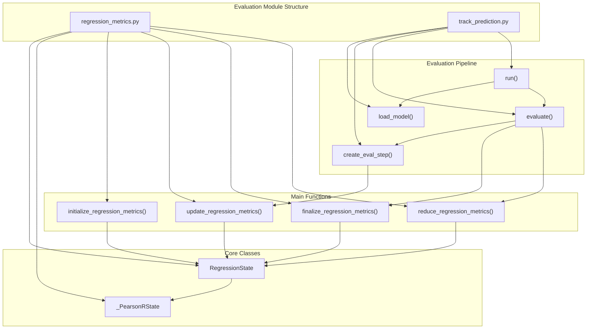
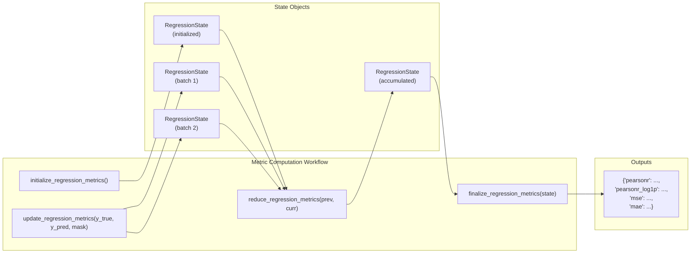
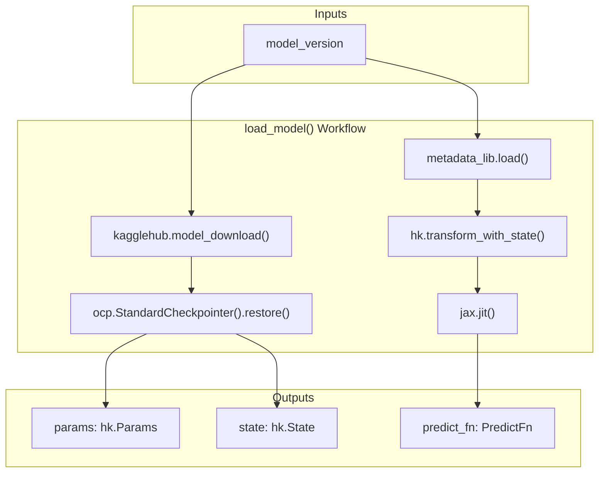
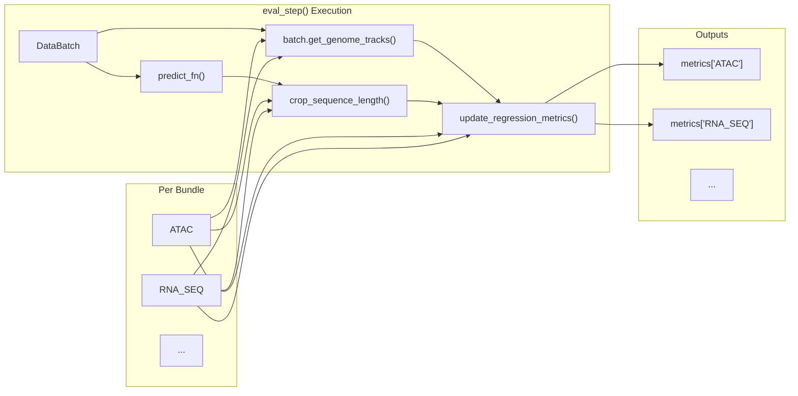
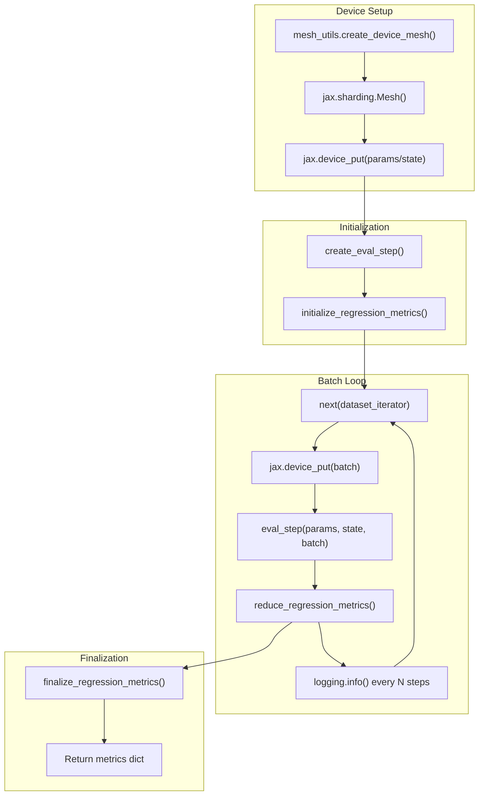

<!-- source: DeepWiki mcp.deepwiki.com · repo google-deepmind/alphagenome_research · page 7.2 Evaluation Module Reference · fetched 2026-10-26 -->

# Evaluation Module Reference

<details>
<summary>Relevant source files</summary>

The following files were used as context for generating this wiki page:

- [src/alphagenome_research/evals/regression_metrics.py](src/alphagenome_research/evals/regression_metrics.py)
- [src/alphagenome_research/evals/track_prediction.py](src/alphagenome_research/evals/track_prediction.py)

</details>


This page provides detailed API documentation for the `alphagenome_research.evals` module, which implements regression metrics computation and track prediction evaluation. This module enables quantitative assessment of AlphaGenome model performance across various genomic output modalities.

For conceptual explanations of the evaluation framework and benchmarking procedures, see [Evaluation System](#5). For example usage with benchmark datasets, see [Variant Evaluation Examples](#5.3). For higher-level evaluation workflows, see [Track Prediction Evaluation](#5.2) and [Regression Metrics](#5.1).

## Module Overview

The evaluation module consists of two primary components:

| Component | Module | Purpose |
|-----------|--------|---------|
| Regression Metrics | `regression_metrics.py` | Accumulator-based metric computation for Pearson R, MSE, MAE |
| Track Prediction | `track_prediction.py` | Full evaluation pipeline for genomic track predictions |



**Sources:** [src/alphagenome_research/evals/regression_metrics.py:1-205](), [src/alphagenome_research/evals/track_prediction.py:1-203]()

## Regression Metrics API

The regression metrics module implements an accumulator pattern for efficient, incremental computation of statistical metrics across large datasets.

### Data Structures

#### `_PearsonRState`

Internal dataclass for accumulating Pearson correlation statistics. This class is decorated with `@chex.dataclass` for immutability and JAX compatibility.

**Attributes:**

| Attribute | Type | Description |
|-----------|------|-------------|
| `xy_sum` | `jax.Array` | Sum of element-wise products x*y |
| `x_sum` | `jax.Array` | Sum of x values |
| `xx_sum` | `jax.Array` | Sum of squared x values |
| `y_sum` | `jax.Array` | Sum of y values |
| `yy_sum` | `jax.Array` | Sum of squared y values |
| `count` | `jax.Array` | Number of valid elements |

**Methods:**

- `__add__(other: _PearsonRState) -> _PearsonRState`: Combines two states by element-wise addition using `jax.tree.map`.

**Sources:** [src/alphagenome_research/evals/regression_metrics.py:26-38]()

#### `RegressionState`

Public dataclass for accumulating all regression statistics. Supports incremental updates and combination across batches or devices.

**Attributes:**

| Attribute | Type | Description |
|-----------|------|-------------|
| `pearsonr` | `_PearsonRState` | Pearson R correlation state |
| `pearsonr_log1p` | `_PearsonRState` | Pearson R on log1p-transformed values |
| `sq_error` | `jax.Array` | Accumulated squared error |
| `abs_error` | `jax.Array` | Accumulated absolute error |
| `count` | `jax.Array` | Total number of elements |

**Methods:**

- `__add__(other: RegressionState) -> RegressionState`: Combines two states using tree mapping.

**Sources:** [src/alphagenome_research/evals/regression_metrics.py:86-101]()

### Core Functions



**Sources:** [src/alphagenome_research/evals/regression_metrics.py:104-181]()

#### `initialize_regression_metrics()`

Creates a new `RegressionState` with all accumulators initialized to zero.

**Returns:** `RegressionState` with zero-initialized numpy arrays.

**Implementation:** Calls `_pearsonr_initialize()` for correlation states and sets error/count to `np.zeros(())`.

**Sources:** [src/alphagenome_research/evals/regression_metrics.py:104-112]()

#### `update_regression_metrics(y_true, y_pred, mask=None)`

Computes regression statistics for a single batch and returns the corresponding state.

**Parameters:**

| Parameter | Type | Description |
|-----------|------|-------------|
| `y_true` | `jax.Array` | Ground truth values |
| `y_pred` | `jax.Array` | Predicted values |
| `mask` | `jax.Array \| None` | Optional boolean mask for valid elements |

**Returns:** `RegressionState` containing accumulated statistics for the batch.

**Behavior:**
- Converts inputs to `float32` for numerical stability
- Accumulates statistics along axes `-2` and `-3` (sequence and spatial dimensions)
- Applies mask if provided using `jnp.sum(..., where=mask)`
- Computes both standard and log1p-transformed Pearson correlations

**Sources:** [src/alphagenome_research/evals/regression_metrics.py:115-142]()

#### `finalize_regression_metrics(state)`

Computes final metric values from accumulated state.

**Parameters:**

| Parameter | Type | Description |
|-----------|------|-------------|
| `state` | `PyTree[RegressionState]` | Accumulated regression state(s) |

**Returns:** `PyTree[jax.Array]` with structure matching input, containing metric dictionaries.

**Output Structure:**
```python
{
    'pearsonr': float,        # Mean Pearson R across valid positions
    'pearsonr_log1p': float,  # Mean Pearson R on log1p-transformed values
    'mse': float,             # Mean squared error
    'mae': float              # Mean absolute error
}
```

**Implementation Details:**
- Uses `_pearsonr_result()` to compute correlation from accumulated sums
- Computes means only where `count > 0` to avoid division by zero
- Supports arbitrary PyTree structures via `jax.tree.map` with custom `is_leaf` predicate

**Sources:** [src/alphagenome_research/evals/regression_metrics.py:145-168]()

#### `reduce_regression_metrics(previous_metrics, current_metrics)`

Combines two regression states by element-wise addition.

**Parameters:**

| Parameter | Type | Description |
|-----------|------|-------------|
| `previous_metrics` | `PyTree[RegressionState]` | Previously accumulated state |
| `current_metrics` | `PyTree[RegressionState]` | New state to add |

**Returns:** `RegressionState` containing combined statistics.

**Usage:** Typically used to accumulate metrics across batches or reduce across devices.

**Sources:** [src/alphagenome_research/evals/regression_metrics.py:171-181]()

### Helper Functions

#### `crop_sequence_length(x, target_length)`

Crops an array to a target length along the sequence dimension (axis -2) by symmetrically trimming both ends.

**Parameters:**

| Parameter | Type | Description |
|-----------|------|-------------|
| `x` | `Float[ArrayLike, '... S D']` | Input array |
| `target_length` | `int` | Desired sequence length |

**Returns:** `Float[ArrayLike, '... {target_length} D']` - Cropped array.

**Behavior:**
- Raises `ValueError` if input is shorter than target length
- Returns input unchanged if lengths match
- Symmetrically trims from both ends when cropping is needed
- Calculates `ltrim = (current_length - target_length) // 2`

**Usage:** Used in track prediction to align model outputs with ground truth targets when sequence lengths differ.

**Sources:** [src/alphagenome_research/evals/regression_metrics.py:184-204]()

### Internal Implementation

#### `_pearsonr_initialize()`

Initializes a `_PearsonRState` with zero-valued numpy arrays.

**Sources:** [src/alphagenome_research/evals/regression_metrics.py:41-50]()

#### `_pearsonr_update(x, y, axis=None, mask=None)`

Constructs a `_PearsonRState` by computing sufficient statistics for Pearson correlation.

**Parameters:**
- `x`, `y`: Arrays to correlate
- `axis`: Axes along which to sum (default: None)
- `mask`: Optional boolean mask

**Implementation:** Computes all sums needed for the Pearson R formula in a single pass, using `dtype=jnp.float32` for numerical stability.

**Sources:** [src/alphagenome_research/evals/regression_metrics.py:53-69]()

#### `_pearsonr_result(state)`

Computes Pearson R correlation coefficient from accumulated state.

**Formula:**
```
r = covariance / (std_x * std_y)
```

where:
- `covariance = xy_sum - count * x_mean * y_mean`
- `std_x = sqrt(xx_sum - count * x_mean^2)`
- `std_y = sqrt(yy_sum - count * y_mean^2)`

**Numerical Stability:** Adds machine epsilon to denominator to avoid division by zero.

**Sources:** [src/alphagenome_research/evals/regression_metrics.py:72-83]()

## Track Prediction API

The track prediction module provides a complete evaluation pipeline for assessing AlphaGenome performance on genomic track outputs.

### Type Definitions

#### `PredictFn`

Type alias for the model prediction function signature:

```python
PredictFn = Callable[
    [hk.Params, hk.State, jax.Array, jax.Array],
    PyTree[jax.Array],
]
```

**Parameters:**
1. `hk.Params`: Haiku model parameters
2. `hk.State`: Haiku model state
3. `jax.Array`: DNA sequence input
4. `jax.Array`: Organism index

**Returns:** `PyTree[jax.Array]` containing predictions for all output types.

**Sources:** [src/alphagenome_research/evals/track_prediction.py:44-52]()

### Configuration Constants

| Constant | Value | Description |
|----------|-------|-------------|
| `_SUBSET` | `fold_intervals.Subset.VALID` | Evaluation on validation set |
| `_LOG_FREQUENCY` | `5` | Log metrics every 5 batches |
| `_EVAL_BUNDLES` | List of 7 bundle types | Output modalities to evaluate |

**Evaluated Bundles:**
- `ATAC`: ATAC-seq accessibility
- `CAGE`: CAGE transcription start sites
- `CHIP_HISTONE`: Histone ChIP-seq
- `CHIP_TF`: Transcription factor ChIP-seq
- `DNASE`: DNase-seq accessibility
- `PROCAP`: PRO-cap transcription
- `RNA_SEQ`: RNA-seq expression

**Sources:** [src/alphagenome_research/evals/track_prediction.py:54-64]()

### Model Loading

#### `load_model(model_version)`

Loads AlphaGenome model weights, state, and creates a JIT-compiled prediction function.

**Parameters:**

| Parameter | Type | Default | Description |
|-----------|------|---------|-------------|
| `model_version` | `dna_model.ModelVersion` | `FOLD_0` | Model fold identifier |

**Returns:** Tuple of `(params, state, predict_fn)` where:
- `params`: Haiku parameters (frozen weights)
- `state`: Haiku state (batch norm statistics, etc.)
- `predict_fn`: JIT-compiled prediction function



**Implementation Details:**

1. **Model Download:** Fetches weights from Kaggle using path pattern `google/alphagenome/jax/{model_version.name.lower()}`
2. **Checkpoint Restoration:** Uses Orbax `StandardCheckpointer` to load params and state
3. **Metadata Loading:** Loads organism-specific metadata for all organisms
4. **Transform Creation:** Wraps `model_lib.AlphaGenome` with `hk.transform_with_state`
5. **Mixed Precision:** Applies `params=float32,compute=bfloat16,output=bfloat16` policy
6. **JIT Compilation:** Compiles predict function with input/output sharding specs:
   - Params/state: Replicated (`PS()`)
   - DNA sequence/organism index: Sharded on `'data'` axis (`PS('data')`)
   - Predictions: Sharded on `'data'` axis (`PS('data')`)

**Sources:** [src/alphagenome_research/evals/track_prediction.py:67-96]()

### Evaluation Pipeline

#### `create_eval_step(predict_fn, bundles)`

Creates a JIT-compiled evaluation step function for a single batch.

**Parameters:**

| Parameter | Type | Description |
|-----------|------|-------------|
| `predict_fn` | `PredictFn` | Model prediction function |
| `bundles` | `Sequence[bundles_lib.BundleName]` | Output types to evaluate |

**Returns:** JIT-compiled function `eval_step(params, state, batch) -> dict[str, RegressionState]`.

**Evaluation Step Logic:**



**Per-Bundle Processing:**
1. Extract ground truth targets and mask using `batch.get_genome_tracks(bundle)`
2. Get predictions from model output using `predictions[dna_output.OutputType[bundle.name]]`
3. Crop predictions to match target sequence length
4. Compute metrics using `update_regression_metrics(targets_true, targets_pred, mask)`

**Sharding Specification:**
- Input params/state: Replicated (`PS()`)
- Input batch: Sharded on `'data'` axis (`PS('data')`)
- Output metrics: Replicated (`PS()`)

**Sources:** [src/alphagenome_research/evals/track_prediction.py:99-124]()

#### `evaluate(params, state, predict_fn, bundles, dataset_iterator)`

Runs full evaluation loop over a dataset, accumulating metrics across batches.

**Parameters:**

| Parameter | Type | Description |
|-----------|------|-------------|
| `params` | `hk.Params` | Model parameters |
| `state` | `hk.State` | Model state |
| `predict_fn` | `PredictFn` | Prediction function |
| `bundles` | `Sequence[BundleName]` | Bundles to evaluate |
| `dataset_iterator` | `Iterator[tuple[DataBatch, BatchMetadata]]` | Data source |

**Returns:** Dictionary mapping bundle names to finalized metrics.

**Evaluation Workflow:**



**Key Implementation Details:**

1. **Mesh Setup:**
   - Creates 1D device mesh with all local devices
   - Names axis `'data'` for data parallelism
   - Creates sharding specs for replication (`PS()`) and data sharding (`PS('data')`)

2. **Parameter Distribution:**
   - Replicates params and state across all devices using `jax.device_put()`
   - Ensures each device has a full copy for parallel inference

3. **Batch Processing:**
   - Shards each batch across devices on the `'data'` axis
   - Executes `eval_step` within mesh context
   - Retrieves metrics back to host using `jax.device_get()`

4. **Metric Accumulation:**
   - Initializes metrics dict with one entry per bundle
   - Calls `reduce_regression_metrics()` to accumulate each batch's statistics
   - Logs intermediate results every `_LOG_FREQUENCY` batches

5. **Finalization:**
   - Converts accumulated states to final metric values
   - Returns dictionary mapping bundle names to metric dicts

**Sources:** [src/alphagenome_research/evals/track_prediction.py:127-170]()

#### `run(organism, model_version)`

High-level entry point that orchestrates the complete evaluation experiment.

**Parameters:**

| Parameter | Type | Default | Description |
|-----------|------|---------|-------------|
| `organism` | `dna_model.Organism` | `HOMO_SAPIENS` | Target organism |
| `model_version` | `dna_model.ModelVersion` | `FOLD_0` | Model fold |

**Returns:** `pd.DataFrame` with columns `['metric', 'value']` containing flattened results.

**Execution Flow:**

1. Load model using `load_model(model_version)`
2. Create dataset iterator with:
   - Batch size = number of local devices
   - Specified organism and model version
   - All bundles in `_EVAL_BUNDLES`
   - Validation subset (`_SUBSET`)
3. Run evaluation using `evaluate()`
4. Flatten nested results into `{bundle}_{metric}` keys
5. Convert to pandas DataFrame for easy analysis

**Output Format:**
```
metric                    value
ATAC_pearsonr            0.xyz
ATAC_pearsonr_log1p      0.xyz
ATAC_mse                 0.xyz
ATAC_mae                 0.xyz
RNA_SEQ_pearsonr         0.xyz
...
```

**Sources:** [src/alphagenome_research/evals/track_prediction.py:173-196]()

## Usage Patterns

### Incremental Metric Computation

```python
# Initialize state
state = initialize_regression_metrics()

# Accumulate across batches
for batch in batches:
    y_true, y_pred, mask = get_batch_data(batch)
    batch_state = update_regression_metrics(y_true, y_pred, mask)
    state = reduce_regression_metrics(state, batch_state)

# Compute final metrics
metrics = finalize_regression_metrics(state)
```

**Sources:** [src/alphagenome_research/evals/regression_metrics.py:104-181]()

### Distributed Evaluation

The evaluation pipeline automatically handles device parallelism:

```python
# Data is automatically sharded across devices
mesh = jax.sharding.Mesh(devices, axis_names=('data',))
batch = jax.device_put(batch, sharding_data)

# Each device processes its shard
with jax.set_mesh(mesh):
    step_metrics = eval_step(params, state, batch)

# Metrics are automatically reduced
metrics = jax.device_get(step_metrics)
```

**Sources:** [src/alphagenome_research/evals/track_prediction.py:136-168]()

### Custom Bundle Evaluation

```python
# Evaluate specific bundles only
custom_bundles = [
    bundles_lib.BundleName.ATAC,
    bundles_lib.BundleName.RNA_SEQ,
]

eval_step = create_eval_step(predict_fn, custom_bundles)
metrics = evaluate(params, state, predict_fn, custom_bundles, iterator)
```

**Sources:** [src/alphagenome_research/evals/track_prediction.py:99-124]()

### Sequence Length Alignment

When model output length differs from target length:

```python
# Model outputs 1536 positions, targets have 1280
predictions = model(sequence)  # Shape: [..., 1536, D]
targets = batch.targets        # Shape: [..., 1280, D]

# Crop predictions to match
predictions = crop_sequence_length(predictions, target_length=1280)
# Shape: [..., 1280, D]
```

**Sources:** [src/alphagenome_research/evals/regression_metrics.py:184-204](), [src/alphagenome_research/evals/track_prediction.py:116-118]()