# Page: Overview

# Overview

<details>
<summary>Relevant source files</summary>

The following files were used as context for generating this wiki page:

- [LICENSE](LICENSE)
- [README.md](README.md)
- [src/alphagenome_research/__init__.py](src/alphagenome_research/__init__.py)

</details>


This document provides a high-level introduction to the AlphaGenome Research repository, its architecture, and core components. For detailed installation instructions, see [Installation](#2.1). For model usage examples, see [Quick Start Tutorial](#2.2). For information about specific subsystems, refer to the [Data I/O System](#3), [Model Architecture](#4), and [Evaluation System](#5) sections.

## Purpose and Scope

AlphaGenome Research is a research codebase that implements a unified DNA sequence model for regulatory variant-effect prediction. The model analyzes DNA sequences of up to 1 million base pairs and generates single base-pair resolution predictions across multiple genomic modalities, including:

- Gene expression (RNA-seq)
- Splicing patterns (splice acceptor/donor sites)
- Chromatin features (ATAC-seq, DNase-seq, ChIP-seq)
- Spatial genome organization (contact maps)

This repository provides the JAX implementation of the AlphaGenome model, a high-level Python API for variant scoring, dataset loaders for training data, and evaluation tools for benchmarking against public datasets.

**Sources:** [README.md:13-18](), [README.md:19-28]()

## Repository Structure

The repository is organized into the following primary modules:

| Module | Purpose | Key Files |
|--------|---------|-----------|
| **I/O System** | Data loading and genomic file operations | `dataset.py`, `bundles.py`, `fasta.py`, `genome.py`, `splicing.py` |
| **Model** | Core AlphaGenome implementation and API | `dna_model.py`, `schemas.py` |
| **Evaluation** | Metrics and benchmarking tools | `regression_metrics.py`, `track_prediction.py` |
| **Examples** | Jupyter notebooks demonstrating usage | `quick_start.ipynb`, `variant_eval_examples.ipynb` |

**Sources:** [README.md:19-28](), Diagram 1 from system architecture

## High-Level Architecture

### Component Organization

The following diagram shows how the major Python modules relate to each other within the `alphagenome_research` package:

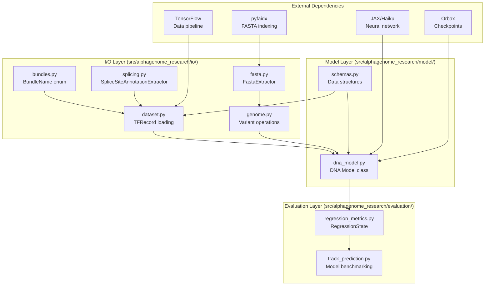

**Sources:** [README.md:19-28](), Diagram 1 from system architecture

### Code Entity Mapping

The following diagram maps high-level concepts to specific code entities:

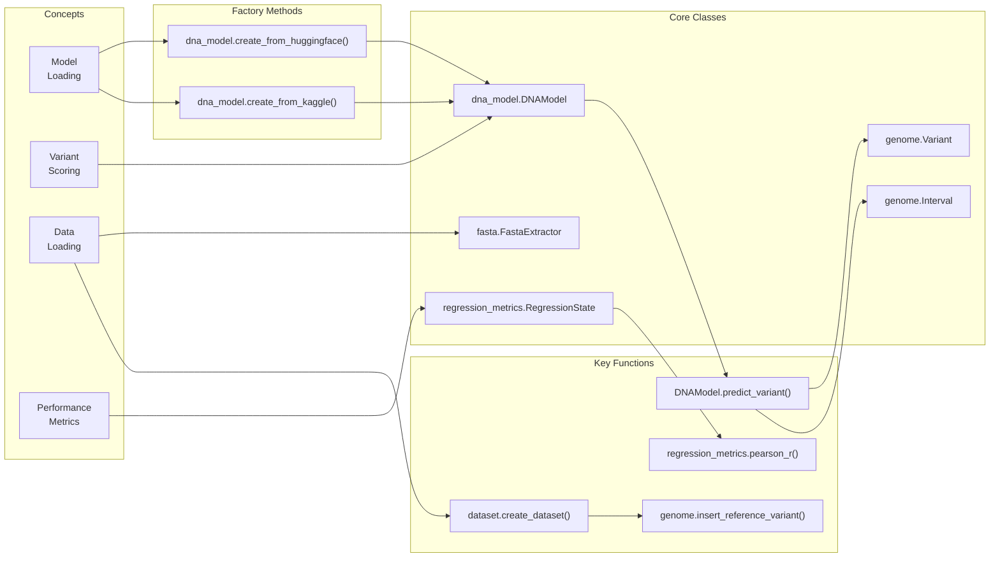

**Sources:** [README.md:80-138](), Diagram 3 from system architecture

## Data Flow

### External Data Sources to Model Predictions

The system processes data from multiple external sources through a multi-stage pipeline:

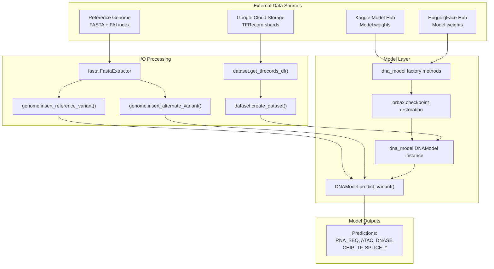

**Sources:** [README.md:97-138](), Diagram 2 and Diagram 3 from system architecture

## Core Components

### DNA Model Class

The `DNAModel` class in [src/alphagenome_research/model/dna_model.py]() provides the primary user-facing API for model inference. It wraps the underlying JAX implementation and provides:

- **Factory methods** for loading from Kaggle (`create_from_kaggle`) or HuggingFace (`create_from_huggingface`)
- **Variant prediction** via `predict_variant()` method
- **Output processing** for extracting predictions across different genomic modalities

**Sources:** [README.md:79-82](), [README.md:84-95]()

### Data I/O System

The I/O layer handles multiple genomic file formats:

| Component | File | Purpose |
|-----------|------|---------|
| TFRecord loader | `dataset.py` | Reads training data from TensorFlow record files |
| Bundle definitions | `bundles.py` | Defines `BundleName` enum for output types (ATAC, RNA_SEQ, etc.) |
| FASTA extraction | `fasta.py` | Extracts reference genome sequences using `FastaExtractor` class |
| Variant operations | `genome.py` | Provides `Interval` and `Variant` classes, plus variant insertion functions |
| Splice annotations | `splicing.py` | Processes splice junction data via `SpliceSiteAnnotationExtractor` |

**Sources:** Diagram 1 and Diagram 2 from system architecture

### Evaluation Framework

The evaluation layer supports benchmarking against multiple datasets:

- **RegressionState** ([regression_metrics.py]()): Accumulates statistics for computing Pearson R, MSE, MAE
- **Track prediction** ([track_prediction.py]()): Orchestrates model evaluation across genomic intervals
- **Specialized metrics**: AUROC, AUPRC, tissue-weighted aggregations

**Sources:** Diagram 4 from system architecture, [README.md:27-28]()

## Model Distribution

Pre-trained model weights are distributed through two platforms:

| Platform | Access Method | Factory Function |
|----------|---------------|------------------|
| Kaggle | [kaggle.com/models/google/alphagenome](https://www.kaggle.com/models/google/alphagenome) | `dna_model.create_from_kaggle('all_folds')` |
| HuggingFace | [huggingface.co/collections/google/alphagenome](https://huggingface.co/collections/google/alphagenome) | `dna_model.create_from_huggingface('all_folds')` |

Both require accepting non-commercial model terms. Model weights are stored as Orbax checkpoints and include organism metadata required for inference.

**Sources:** [README.md:54-64](), [README.md:87-95](), Diagram 3 from system architecture

## System Requirements

### Hardware Requirements

| Operation | Recommended Hardware |
|-----------|---------------------|
| **Inference** | NVIDIA H100 GPU or equivalent |
| **Training** | TPU v3 or higher |

The model requires proper CUDA, cuDNN, and JAX installation for GPU acceleration.

**Sources:** [README.md:65-76]()

### Software Dependencies

The system depends on the following major libraries:

| Category | Libraries |
|----------|-----------|
| **Deep Learning** | JAX, dm-haiku, TensorFlow |
| **Genomics** | pyfaidx, pyranges, anndata |
| **Model Distribution** | kagglehub, huggingface_hub |
| **Checkpointing** | orbax |
| **Scientific Computing** | numpy, pandas, chex |

Complete dependency specifications are in [pyproject.toml]().

**Sources:** [README.md:163-183]()

## Usage Workflow

The typical user workflow follows this pattern:

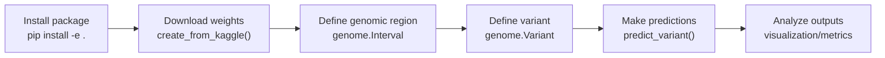

**Example code pattern:**

```python
from alphagenome_research.model import dna_model
from alphagenome.data import genome

# Load model
model = dna_model.create_from_kaggle('all_folds')

# Define interval and variant
interval = genome.Interval(chromosome='chr22', start=35677410, end=36725986)
variant = genome.Variant(chromosome='chr22', position=36201698, 
                         reference_bases='A', alternate_bases='C')

# Predict
outputs = model.predict_variant(interval=interval, variant=variant,
                                 ontology_terms=['UBERON:0001157'],
                                 requested_outputs=[dna_model.OutputType.RNA_SEQ])
```

**Sources:** [README.md:97-138]()

## Licensing

The repository uses multiple licenses for different components:

| Component | License | Details |
|-----------|---------|---------|
| Software code | Apache 2.0 | [LICENSE]() file |
| Model weights | Non-commercial terms | Kaggle/HuggingFace distribution |
| Documentation/examples | CC-BY 4.0 | Code examples and guides |
| Research materials | CC-BY-NC 4.0 | General materials |

Training and evaluation datasets have separate licensing terms detailed in the README.

**Sources:** [README.md:186-215](), [LICENSE:1-203]()

## Development Infrastructure

The repository uses modern Python development tools:

| Tool | Purpose | Configuration |
|------|---------|---------------|
| **Hatch** | Environment management | [pyproject.toml]() |
| **Pylint** | Code quality | `.pylintrc` (Google style guide) |
| **pyink** | Code formatting | 80-char, 2-space indentation |
| **GitHub Actions** | CI/CD | `presubmit_checks.yml` |
| **pytest** | Testing | `conftest.py` for test configuration |

The CI pipeline runs quality checks and tests on Python 3.11, 3.12, and 3.13.

**Sources:** [README.md:5](), Diagram 5 from system architecture

## Related Documentation

For detailed information on specific subsystems:

- Installation and setup: [Installation](#2.1)
- First-time usage: [Quick Start Tutorial](#2.2)
- Model weights: [Model Weights and Distribution](#2.3)
- Data loading: [Data I/O System](#3)
- Model API: [DNA Model API](#4.1)
- Performance benchmarking: [Evaluation System](#5)
- Contributing: [Contributing Guidelines](#6.1)
- API reference: [API Reference](#7)

**Sources:** Table of contents provided in the task description

---

# Page: Getting Started

# Getting Started

<details>
<summary>Relevant source files</summary>

The following files were used as context for generating this wiki page:

- [README.md](README.md)
- [pyproject.toml](pyproject.toml)

</details>


This page provides an overview of the initial setup process for the AlphaGenome Research codebase, covering installation, model weight acquisition, and basic usage patterns. For detailed installation instructions, see [Installation](#2.1). For a comprehensive tutorial with examples, see [Quick Start Tutorial](#2.2). For information about model distribution platforms and licensing, see [Model Weights and Distribution](#2.3).

## Prerequisites

Before installing the AlphaGenome Research package, ensure your system meets the following requirements:

| Requirement | Specification |
|-------------|---------------|
| Python Version | ≥ 3.11 (3.11, 3.12, 3.13 supported) |
| Operating System | Linux (Ubuntu recommended) |
| Inference Hardware | NVIDIA H100 GPU (minimum recommended) |
| Training Hardware | TPU v3 or higher |
| CUDA/cuDNN | Required for GPU acceleration |
| JAX | Must be correctly configured for GPU/TPU |

The package requires a functional JAX installation with proper CUDA/cuDNN configuration for GPU workloads. Refer to the [JAX installation documentation](https://docs.jax.dev/en/latest/installation.html#nvidia-gpu) for GPU setup guidance.

**Important**: Using a Python virtual environment is strongly recommended to prevent dependency conflicts with your system Python installation.

Sources: [README.md:38-75](), [pyproject.toml:12-32]()

## Installation Overview

The AlphaGenome Research package is installed via `pip` in development mode. The basic installation workflow is:

```bash
# Clone the repository
git clone https://github.com/google-deepmind/alphagenome_research.git

# Install in development mode
pip install -e ./alphagenome_research
```

This installs the `alphagenome_research` package along with all required dependencies, including:

- `jax` - Core numerical computation framework
- `dm-haiku` - Neural network library
- `tensorflow` - Dataset loading and preprocessing
- `orbax` - Checkpoint management
- `alphagenome` - AlphaGenome API package
- `pyfaidx` - FASTA file parsing
- `pyranges` - Genomic interval operations
- `kagglehub` and `huggingface_hub` - Model weight distribution

For detailed dependency specifications and optional development dependencies, see [Installation](#2.1).

Sources: [README.md:44-52](), [pyproject.toml:33-54]()

## Model Weights

Pre-trained AlphaGenome model weights are distributed via two platforms:

1. **Kaggle Models**: [https://www.kaggle.com/models/google/alphagenome](https://www.kaggle.com/models/google/alphagenome)
2. **Hugging Face**: [https://huggingface.co/collections/google/alphagenome](https://huggingface.co/collections/google/alphagenome)

Both platforms require accepting the non-commercial [model terms](https://deepmind.google.com/science/alphagenome/model-terms). Access requests are processed immediately upon acceptance.

The package provides factory methods in `dna_model` for automatic weight download and model instantiation. See [Model Weights and Distribution](#2.3) for detailed information about weight formats, versioning, and loading procedures.

Sources: [README.md:54-64](), [README.md:88-95]()

## Basic Usage Pattern

### Getting Started Workflow

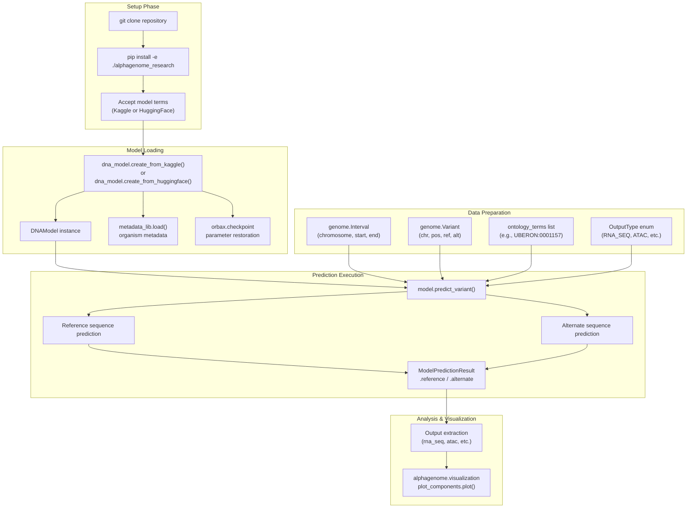

Sources: [README.md:77-138]()

### Core Components and Data Flow

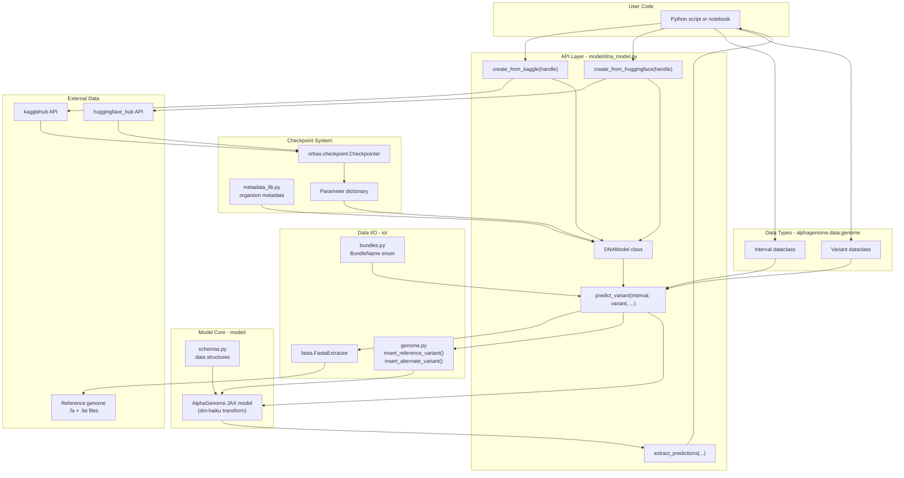

Sources: [README.md:80-95](), [README.md:100-138]()

## Minimal Working Example

The following example demonstrates the complete workflow from model loading to variant prediction:

```python
from alphagenome.data import genome
from alphagenome_research.model import dna_model

# Step 1: Load model from Kaggle (or use create_from_huggingface)
model = dna_model.create_from_kaggle('all_folds')

# Step 2: Define genomic interval and variant
interval = genome.Interval(
    chromosome='chr22',
    start=35677410,
    end=36725986
)

variant = genome.Variant(
    chromosome='chr22',
    position=36201698,
    reference_bases='A',
    alternate_bases='C'
)

# Step 3: Generate predictions
outputs = model.predict_variant(
    interval=interval,
    variant=variant,
    ontology_terms=['UBERON:0001157'],  # Tissue/cell type
    requested_outputs=[dna_model.OutputType.RNA_SEQ]
)

# Step 4: Access results
reference_predictions = outputs.reference.rna_seq  # Reference allele
alternate_predictions = outputs.alternate.rna_seq  # Alternate allele
```

This pattern forms the foundation for all AlphaGenome Research workflows. The `DNAModel` class encapsulates model parameters, checkpoint restoration, and prediction logic, providing a high-level interface that abstracts JAX-specific details.

Sources: [README.md:100-122]()

## Component Initialization Sequence

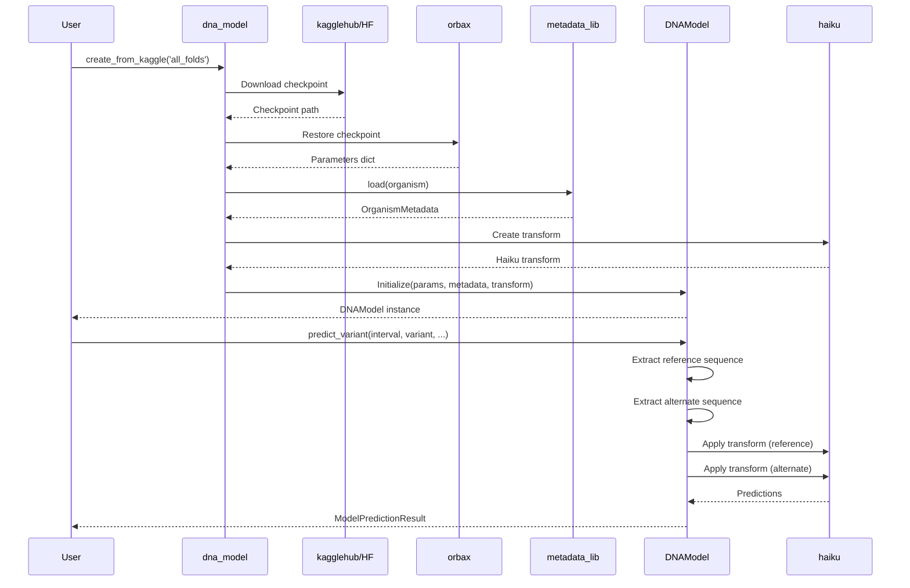

Sources: [README.md:87-95]()

## Environment Configuration

The package uses Hatch for environment management and supports multiple Python versions through test matrices. The `pyproject.toml` configuration defines three primary environments:

| Environment | Purpose | Key Tools |
|-------------|---------|-----------|
| `default` | Development and general usage | Standard dependencies |
| `hatch-test` | Running test suite | `typeguard==2.13.3` for runtime type checking |
| `check` | Code quality validation | `pyink` (formatting), `pylint` (linting) |

For development workflows, including running tests and code quality checks, see [Development Guide](#6).

Sources: [pyproject.toml:66-103]()

## Next Steps

After completing the basic setup:

1. **Try the Quick Start Tutorial**: See [Quick Start Tutorial](#2.2) for a walkthrough of the `quick_start.ipynb` notebook
2. **Explore Evaluation Examples**: See [Variant Evaluation Examples](#5.3) for the `variant_eval_examples.ipynb` notebook covering CAGI, GTEx, and ClinVar datasets
3. **Understand the Data Layer**: See [Data I/O System](#3) for information about TFRecord loading, FASTA operations, and data bundles
4. **Learn the Model API**: See [DNA Model API](#4.1) for comprehensive documentation of the `DNAModel` class interface
5. **Review Evaluation Metrics**: See [Evaluation System](#5) for details on performance metrics and benchmarking

For questions or issues, consult:
- **Documentation**: [https://www.alphagenomedocs.com/](https://www.alphagenomedocs.com/)
- **Community Forum**: [https://www.alphagenomecommunity.com](https://www.alphagenomecommunity.com)
- **GitHub Issues**: Bug reports and feature requests
- **Contributing Guidelines**: See [Contributing Guidelines](#6.1) for development contributions

Sources: [README.md:7-11]()

---

# Page: Installation

# Installation

<details>
<summary>Relevant source files</summary>

The following files were used as context for generating this wiki page:

- [.gitignore](.gitignore)
- [README.md](README.md)
- [pyproject.toml](pyproject.toml)

</details>


This document provides detailed instructions for installing the `alphagenome_research` package, including system requirements, dependency management, and model weight acquisition. For information about using the installed package, see [Quick Start Tutorial](#2.2). For details on model weight distribution platforms and licensing, see [Model Weights and Distribution](#2.3).

---

## Purpose and Scope

This page covers:
- Python version requirements and virtual environment setup
- Package installation via pip from the GitHub repository
- Dependency specifications defined in `pyproject.toml`
- Hardware requirements for model inference and training
- Model weight download procedures from Kaggle and HuggingFace

This page does not cover API usage, model loading, or prediction workflows, which are documented in subsequent sections.

---

## Installation Flow

The following diagram illustrates the complete installation process from repository cloning to model readiness:

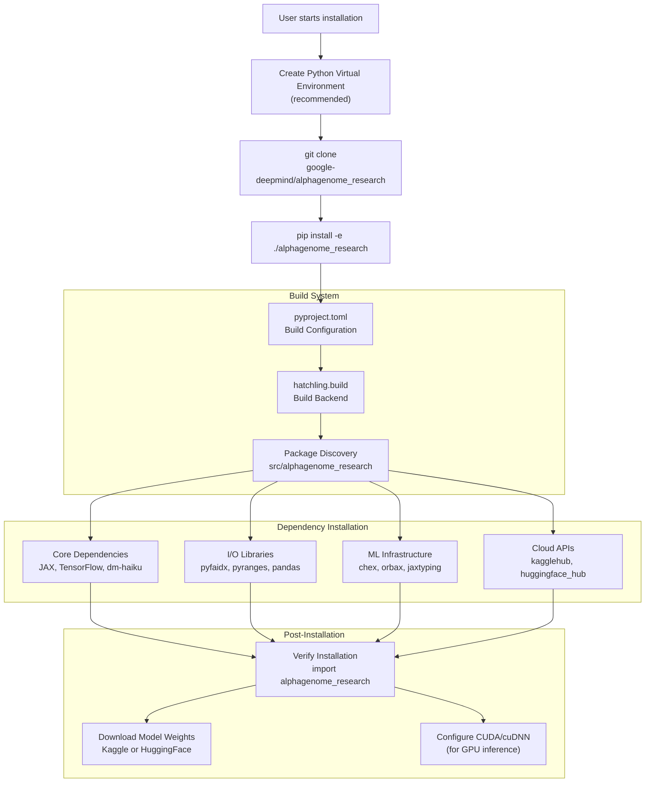

**Sources:** [README.md:33-53](), [pyproject.toml:1-54]()

---

## System Requirements

### Python Version

The package requires Python 3.11 or higher. This is specified in the build configuration:

| Requirement | Value | Location |
|------------|-------|----------|
| Minimum Python | 3.11 | [pyproject.toml:12]() |
| Tested Versions | 3.11, 3.12, 3.13 | [pyproject.toml:87]() |
| Build Backend | hatchling | [pyproject.toml:2-3]() |

**Sources:** [pyproject.toml:12](), [pyproject.toml:87]()

### Virtual Environment Setup

A Python virtual environment is strongly recommended to prevent dependency conflicts. The installation process assumes isolation from the system Python environment:

```bash
# Create virtual environment
python3 -m venv alphagenome_env

# Activate (Linux/macOS)
source alphagenome_env/bin/activate

# Activate (Windows)
alphagenome_env\Scripts\activate
```

**Sources:** [README.md:37-40]()

---

## Package Installation

### Repository Cloning and Installation

The package is installed in development mode using pip:

```bash
git clone https://github.com/google-deepmind/alphagenome_research.git
pip install -e ./alphagenome_research
```

The `-e` flag installs in [editable/development mode](https://setuptools.pypa.io/en/latest/userguide/development_mode.html), allowing local modifications to be reflected immediately without reinstallation.

**Sources:** [README.md:44-52]()

### Build System Configuration

The following diagram shows the relationship between build configuration files and the installed package structure:

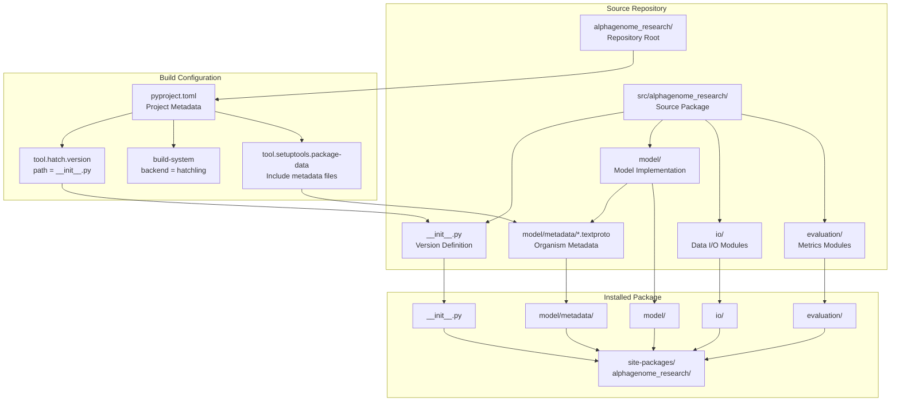

**Sources:** [pyproject.toml:1-74](), [pyproject.toml:64]()

---

## Dependencies

### Core Dependencies

The package depends on multiple libraries spanning machine learning, genomic data processing, and cloud APIs. Dependencies are specified in the `dependencies` array:

```mermaid
graph TB
    subgraph "JAX Ecosystem"
        JAX["jax<br/>Numerical Computation"]
        HAIKU["dm-haiku<br/>Neural Network Library"]
        CHEX["chex<br/>Testing Utilities"]
        ORBAX["orbax<br/>Checkpoint Management"]
        JAXTYPING["jaxtyping<br/>Type Annotations"]
    end
    
    subgraph "TensorFlow Ecosystem"
        TF["tensorflow<br/>Data Loading (tf.data)"]
    end
    
    subgraph "Genomic I/O"
        PYFAIDX["pyfaidx<br/>FASTA File Reading"]
        PYRANGES["pyranges<br/>Genomic Interval Operations"]
        ANNDATA["anndata<br/>Annotated Data Matrices"]
    end
    
    subgraph "Data Processing"
        NUMPY["numpy<br/>Array Operations"]
        PANDAS["pandas<br/>Tabular Data"]
        PYARROW["pyarrow<br/>Columnar Data Format"]
    end
    
    subgraph "Cloud Distribution"
        KAGGLE["kagglehub<br/>Kaggle Model Download"]
        HF["huggingface_hub<br/>HuggingFace Model Download"]
    end
    
    subgraph "Infrastructure"
        ABSL["absl-py<br/>Application Framework"]
        ETILS["etils[epath]<br/>Path Utilities"]
        EINSHAPE["einshape<br/>Tensor Shape Manipulation"]
        ALPHAGENOME["alphagenome<br/>Public API"]
    end
    
    PKG["alphagenome_research"]
    
    PKG --> JAX
    PKG --> HAIKU
    PKG --> CHEX
    PKG --> ORBAX
    PKG --> JAXTYPING
    PKG --> TF
    PKG --> PYFAIDX
    PKG --> PYRANGES
    PKG --> ANNDATA
    PKG --> NUMPY
    PKG --> PANDAS
    PKG --> PYARROW
    PKG --> KAGGLE
    PKG --> HF
    PKG --> ABSL
    PKG --> ETILS
    PKG --> EINSHAPE
    PKG --> ALPHAGENOME
```

**Sources:** [pyproject.toml:33-54](), [README.md:163-183]()

### Dependency Categories

| Category | Libraries | Purpose |
|----------|-----------|---------|
| ML Framework | `jax`, `dm-haiku`, `chex` | Neural network implementation and testing |
| Data Loading | `tensorflow` | TFRecord dataset loading via `tf.data` |
| Genomic I/O | `pyfaidx`, `pyranges`, `anndata` | FASTA extraction, interval operations, matrix annotations |
| Checkpointing | `orbax` | Model weight restoration |
| Cloud APIs | `kagglehub`, `huggingface_hub` | Model weight download |
| Data Processing | `numpy`, `pandas`, `pyarrow` | Numerical and tabular operations |
| Utilities | `absl-py`, `etils`, `einshape`, `jaxtyping` | Framework, paths, shapes, types |
| Public API | `alphagenome` | High-level genome analysis interface |

**Sources:** [pyproject.toml:33-54]()

### Development Dependencies

Additional dependencies for testing and code quality are defined in separate Hatch environments:

| Environment | Dependencies | Purpose |
|-------------|--------------|---------|
| `hatch-test` | `typeguard==2.13.3` | Runtime type checking during tests |
| `check` | `pyink>=24.3.0`, `pylint>=2.6.0` | Code formatting and linting |

**Sources:** [pyproject.toml:76-103]()

---

## Hardware Requirements

### Inference Requirements

The following diagram shows the recommended hardware configuration for model inference:

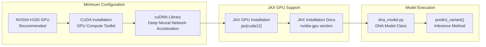

**Inference hardware specifications:**
- **Recommended GPU:** NVIDIA H100 (as specified in [README.md:67-68]())
- **CUDA/cuDNN:** Properly configured (see [JAX Installation Documentation](https://docs.jax.dev/en/latest/installation.html#nvidia-gpu))
- **Minimum:** The model may run on lower-end GPUs but performance is not guaranteed

**Sources:** [README.md:66-71]()

### Training Requirements

Training is not supported in this research release package. The original model was trained on:
- **Hardware:** Tensor Processing Units (TPUs) v3 or higher
- **Reference:** [README.md:73-75]()

**Sources:** [README.md:73-75]()

---

## Model Weights

### Download Platforms

Model weights are distributed separately from the package and must be downloaded from one of two platforms:

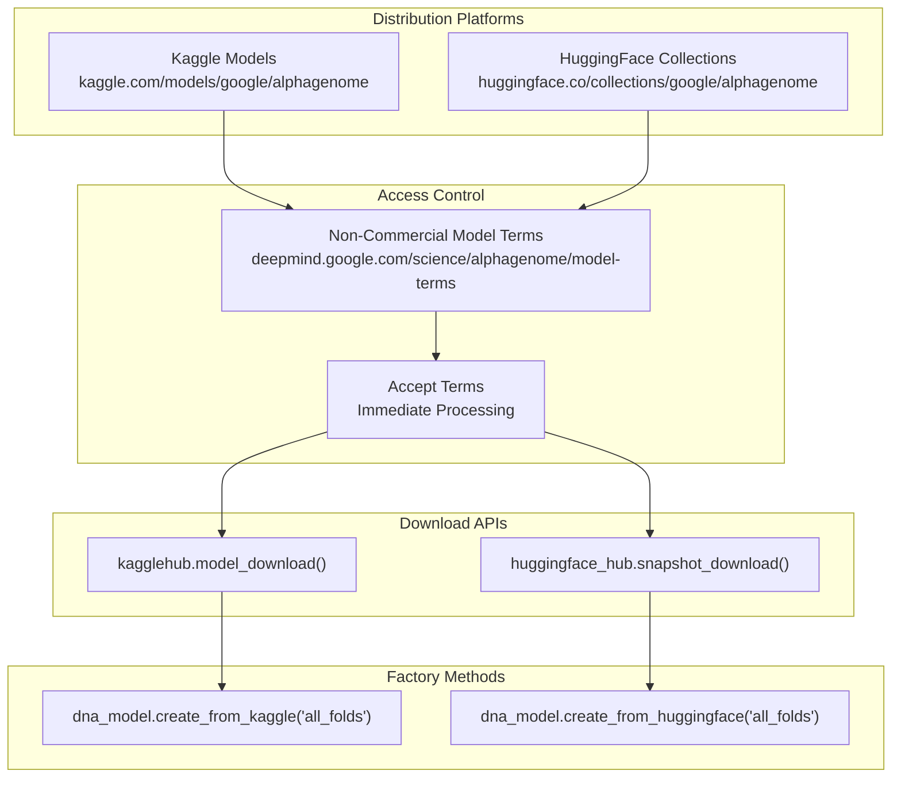

**Download requirements:**
1. Accept the non-commercial model terms at the distribution platform
2. Requests are processed immediately upon acceptance
3. Use factory methods from `dna_model` module for automatic download

**Sources:** [README.md:54-63](), [README.md:87-95]()

### Weight Loading Factory Methods

Two factory methods abstract the weight download and model initialization process:

| Method | Platform | Code Location |
|--------|----------|---------------|
| `create_from_kaggle()` | Kaggle | model/dna_model.py |
| `create_from_huggingface()` | HuggingFace | model/dna_model.py |

Both methods:
- Download weights from the respective platform
- Load organism metadata
- Restore checkpoint parameters using Orbax
- Initialize the Haiku neural network transform
- Return a `DnaModel` instance ready for inference

**Sources:** [README.md:87-95]()

---

## Installation Verification

### Package Import Test

After installation, verify the package is correctly installed:

```python
import alphagenome_research
print(alphagenome_research.__version__)
```

The version is dynamically extracted from [src/alphagenome_research/__init__.py]() as configured in [pyproject.toml:64]().

**Sources:** [pyproject.toml:64]()

### Dependency Verification

The installation process will fail if dependencies cannot be satisfied. Critical dependencies can be verified individually:

```python
import jax
import tensorflow as tf
import haiku as hk
import pyfaidx
import pyranges as pr
```

**Sources:** [pyproject.toml:33-54]()

---

## Common Installation Issues

### Python Version Mismatch

**Symptom:** `pip install` fails with "Requires-Python" error  
**Cause:** Python version < 3.11  
**Resolution:** Upgrade to Python 3.11, 3.12, or 3.13

**Sources:** [pyproject.toml:12]()

### JAX CUDA Configuration

**Symptom:** Model runs on CPU instead of GPU  
**Cause:** JAX not configured for CUDA  
**Resolution:** Follow [JAX NVIDIA GPU installation guide](https://docs.jax.dev/en/latest/installation.html#nvidia-gpu)

**Sources:** [README.md:69-71]()

### Model Weight Access Denied

**Symptom:** Weight download fails with authentication error  
**Cause:** Model terms not accepted on distribution platform  
**Resolution:** Visit platform URL and accept non-commercial terms

**Sources:** [README.md:61-63]()

---

## Next Steps

After successful installation:
1. Review [Quick Start Tutorial](#2.2) for basic usage examples
2. Download model weights via [Model Weights and Distribution](#2.3)
3. Explore the [DNA Model API](#4.1) for prediction interfaces
4. Run example notebooks for evaluation workflows

**Sources:** [README.md:7-11]()

---

# Page: Quick Start Tutorial

# Quick Start Tutorial

<details>
<summary>Relevant source files</summary>

The following files were used as context for generating this wiki page:

- [README.md](README.md)
- [colabs/quick_start.ipynb](colabs/quick_start.ipynb)

</details>


## Purpose and Scope

This page walks through the basic workflow for loading the AlphaGenome model and making predictions using the high-level DNA Model API. It demonstrates the core functionality needed to get started with variant effect prediction on genomic sequences.

For detailed installation instructions, see [Installation](#2.1). For information about downloading and managing model weights, see [Model Weights and Distribution](#2.3). For comprehensive API documentation, see [DNA Model API](#4.1). For advanced evaluation examples and benchmarking, see [Variant Evaluation Examples](#5.3).

**Sources:** [README.md:77-138]()

---

## Model Loading Workflow

The `DNAModel` class provides two factory methods for loading pre-trained model weights: `create_from_kaggle()` and `create_from_huggingface()`. Both methods handle checkpoint restoration, metadata loading, and model initialization automatically.

### Factory Methods

The following code demonstrates loading a model from Kaggle:

```python
from alphagenome_research.model import dna_model

# Load model from Kaggle
model = dna_model.create_from_kaggle('all_folds')

# Alternative: Load from HuggingFace
model = dna_model.create_from_huggingface('all_folds')
```

The `'all_folds'` parameter specifies which model checkpoint to load. Both methods require that you have accepted the non-commercial model terms and configured authentication for the respective platform.

### Model Loading Architecture

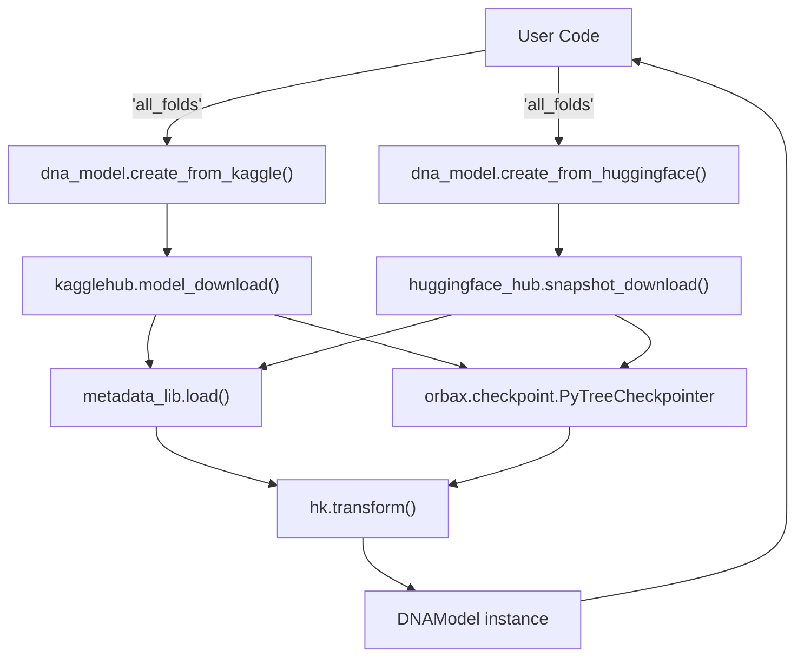

**Sources:** [README.md:87-95](), [model/dna_model.py]()

---

## Basic Variant Prediction

The core workflow involves three main steps:
1. Define a genomic interval and variant
2. Request specific output modalities
3. Execute prediction and retrieve results

### Defining Genomic Coordinates

The `genome.Interval` and `genome.Variant` classes define genomic locations and variants:

```python
from alphagenome.data import genome

# Define a genomic interval (region to analyze)
interval = genome.Interval(
    chromosome='chr22',
    start=35677410,
    end=36725986
)

# Define a variant within that interval
variant = genome.Variant(
    chromosome='chr22',
    position=36201698,
    reference_bases='A',
    alternate_bases='C'
)
```

The interval specifies the region of DNA to analyze (up to 1 million base pairs). The variant specifies a single nucleotide change within that region.

**Sources:** [README.md:108-114]()

### Making Predictions

The `predict_variant()` method generates predictions for both reference and alternate sequences:

```python
outputs = model.predict_variant(
    interval=interval,
    variant=variant,
    ontology_terms=['UBERON:0001157'],
    requested_outputs=[dna_model.OutputType.RNA_SEQ],
)
```

| Parameter | Type | Description |
|-----------|------|-------------|
| `interval` | `genome.Interval` | Genomic region to analyze |
| `variant` | `genome.Variant` | Variant to evaluate |
| `ontology_terms` | `list[str]` | Tissue/cell-type ontology identifiers |
| `requested_outputs` | `list[OutputType]` | Output modalities (RNA_SEQ, ATAC, DNASE, etc.) |

**Sources:** [README.md:116-121]()

### Prediction Workflow

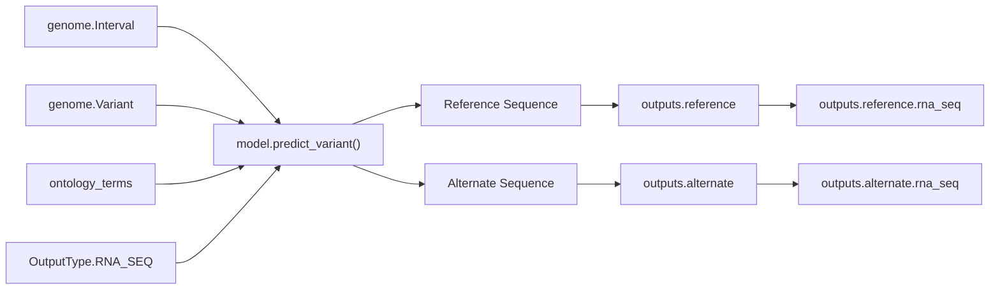

**Sources:** [README.md:116-121]()

---

## Understanding Model Outputs

The `predict_variant()` method returns a structure containing predictions for both reference and alternate sequences. Each prediction includes the requested output modalities.

### Output Structure

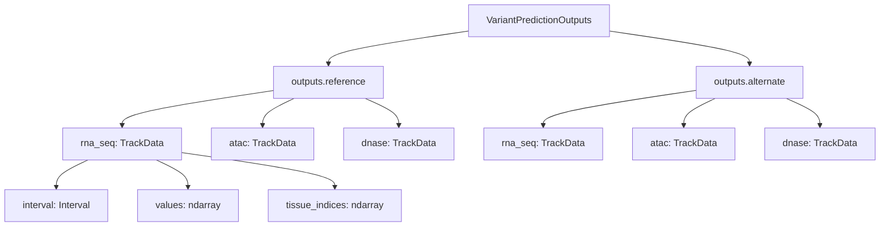

Each output modality (e.g., `rna_seq`, `atac`, `dnase`) contains:
- `interval`: Genomic coordinates of the prediction
- `values`: NumPy array of predicted values at single base-pair resolution
- `tissue_indices`: Array mapping predictions to tissue/cell-type indices

**Sources:** [README.md:122-137]()

### Accessing Predictions

```python
# Access reference predictions
ref_rna_seq = outputs.reference.rna_seq
alt_rna_seq = outputs.alternate.rna_seq

# Access prediction values (NumPy arrays)
ref_values = outputs.reference.rna_seq.values
alt_values = outputs.alternate.rna_seq.values

# Access genomic interval
prediction_interval = outputs.reference.rna_seq.interval
```

The prediction arrays have single base-pair resolution, with values corresponding to predicted activity levels for the specified modality.

**Sources:** [README.md:127-129]()

---

## Visualizing Results

The AlphaGenome package includes visualization utilities for plotting predictions:

```python
from alphagenome.visualization import plot_components
import matplotlib.pyplot as plt

plot_components.plot(
    [
        plot_components.OverlaidTracks(
            tdata={
                'REF': outputs.reference.rna_seq,
                'ALT': outputs.alternate.rna_seq,
            },
            colors={'REF': 'dimgrey', 'ALT': 'red'},
        ),
    ],
    interval=outputs.reference.rna_seq.interval.resize(2**15),
    annotations=[plot_components.VariantAnnotation([variant], alpha=0.8)],
)
plt.show()
```

This creates an overlaid plot showing reference and alternate predictions, with the variant position annotated as a vertical line.

**Sources:** [README.md:123-137]()

---

## Available Output Types

The `dna_model.OutputType` enumeration defines the available prediction modalities:

| OutputType | Description |
|------------|-------------|
| `RNA_SEQ` | Gene expression predictions |
| `ATAC` | ATAC-seq chromatin accessibility |
| `DNASE` | DNase-seq chromatin accessibility |
| `CHIP_TF` | Transcription factor ChIP-seq binding |
| `SPLICE_DONOR` | Splice donor site predictions |
| `SPLICE_ACCEPTOR` | Splice acceptor site predictions |
| `SPLICE_JUNCTION` | Splice junction predictions |

You can request multiple output types in a single prediction:

```python
outputs = model.predict_variant(
    interval=interval,
    variant=variant,
    ontology_terms=['UBERON:0001157'],
    requested_outputs=[
        dna_model.OutputType.RNA_SEQ,
        dna_model.OutputType.ATAC,
        dna_model.OutputType.SPLICE_DONOR,
    ],
)
```

**Sources:** [README.md:120](), [model/dna_model.py]()

---

## Complete Example

Here is the complete example from the Quick Start section:

```python
from alphagenome.data import genome
from alphagenome.visualization import plot_components
from alphagenome_research.model import dna_model
import matplotlib.pyplot as plt

# Load model
model = dna_model.create_from_kaggle('all_folds')

# Define genomic coordinates
interval = genome.Interval(chromosome='chr22', start=35677410, end=36725986)
variant = genome.Variant(
    chromosome='chr22',
    position=36201698,
    reference_bases='A',
    alternate_bases='C',
)

# Make prediction
outputs = model.predict_variant(
    interval=interval,
    variant=variant,
    ontology_terms=['UBERON:0001157'],
    requested_outputs=[dna_model.OutputType.RNA_SEQ],
)

# Visualize results
plot_components.plot(
    [
        plot_components.OverlaidTracks(
            tdata={
                'REF': outputs.reference.rna_seq,
                'ALT': outputs.alternate.rna_seq,
            },
            colors={'REF': 'dimgrey', 'ALT': 'red'},
        ),
    ],
    interval=outputs.reference.rna_seq.interval.resize(2**15),
    annotations=[plot_components.VariantAnnotation([variant], alpha=0.8)],
)
plt.show()
```

**Sources:** [README.md:100-138]()

---

## Data Flow Summary

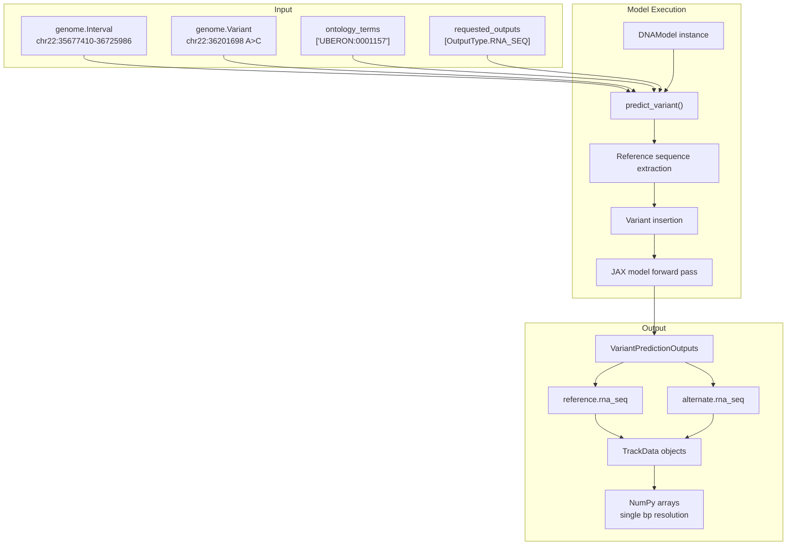

**Sources:** [README.md:100-138]()

---

## Next Steps

After completing this quick start tutorial, you can:

- **Explore advanced evaluation examples**: See [Variant Evaluation Examples](#5.3) for benchmarking on CAGI, GTEx, ClinVar, and other datasets
- **Understand the full API**: See [DNA Model API](#4.1) for comprehensive documentation of all available methods
- **Work with TFRecord datasets**: See [TFRecord Dataset Loading](#3.2) for loading training data
- **Implement custom metrics**: See [Regression Metrics](#5.1) for evaluation capabilities
- **Process multiple variants**: Use batch prediction methods for efficient large-scale variant scoring

**Sources:** [README.md:77-138]()

---

# Page: Model Weights and Distribution

# Model Weights and Distribution

<details>
<summary>Relevant source files</summary>

The following files were used as context for generating this wiki page:

- [LICENSE](LICENSE)
- [README.md](README.md)

</details>


This page documents how to obtain and load pre-trained AlphaGenome model weights. It covers the two distribution platforms (Kaggle and HuggingFace), licensing requirements, available model variants, and the factory methods provided for model instantiation. For information on using the loaded model for inference, see [DNA Model API](#4.1). For details on the model architecture itself, see [Model Architecture](#4).

## Distribution Platforms

AlphaGenome model weights are distributed through two platforms, both requiring acceptance of non-commercial license terms before access is granted.

### Platform Overview

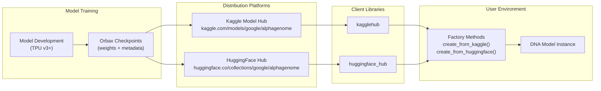

**Distribution Architecture**

Sources: [README.md:54-64](), [README.md:87-95]()

| Platform | URL | Client Library | Access Control |
|----------|-----|----------------|----------------|
| Kaggle | `kaggle.com/models/google/alphagenome` | `kagglehub` | Immediate upon terms acceptance |
| HuggingFace | `huggingface.co/collections/google/alphagenome` | `huggingface_hub` | Immediate upon terms acceptance |

Both platforms host identical model weights and require users to accept the model terms at `deepmind.google.com/science/alphagenome/model-terms` before downloading.

Sources: [README.md:56-63]()

## Model Variants

The AlphaGenome model weights are available in the following variant:

| Variant Name | Description | Use Case |
|--------------|-------------|----------|
| `all_folds` | Ensemble model trained across all cross-validation folds | Primary variant for general use and variant effect prediction |

When calling factory methods, the variant name is passed as a string argument:

```python
model = dna_model.create_from_kaggle('all_folds')
```

Sources: [README.md:91-94]()

## Licensing and Terms

### Software License vs. Model License

The AlphaGenome repository uses a dual licensing structure:

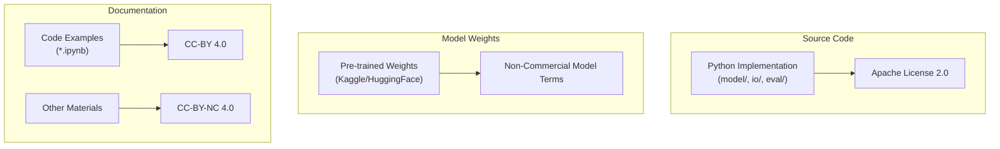

**Licensing Structure**

Sources: [README.md:186-212](), [LICENSE:1-203]()

### Key Licensing Points

| Component | License | Usage Rights |
|-----------|---------|--------------|
| Source code (`.py` files) | Apache 2.0 | Commercial and non-commercial use permitted |
| Model weights | Non-commercial terms | Non-commercial research only |
| Code examples and documentation | CC-BY 4.0 | Attribution required, commercial use permitted |
| Training/evaluation data | Various (see data-specific licenses) | Varies by dataset |

The model weights are subject to separate terms accessible at `deepmind.google.com/science/alphagenome/model-terms`. Users must accept these terms through the Kaggle or HuggingFace platform before downloading.

Sources: [README.md:190-195]()

## Loading Model Weights

### Factory Methods

The `dna_model` module provides two factory methods for loading pre-trained models:

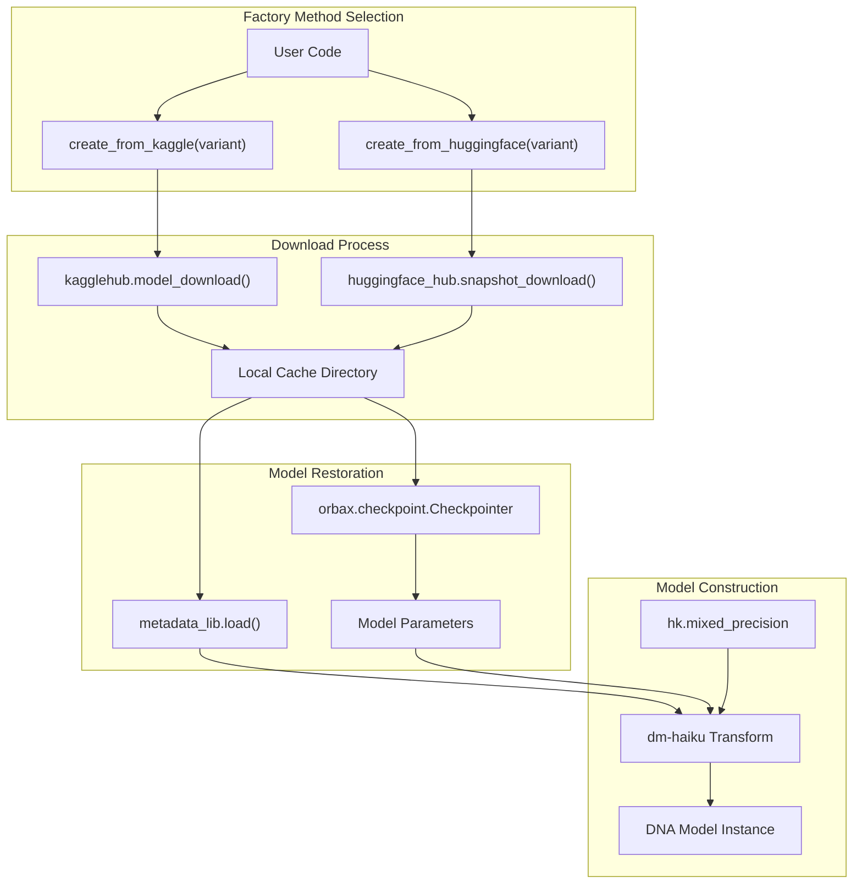

**Model Loading Pipeline**

Sources: [README.md:87-95]()

### Usage Examples

#### Loading from Kaggle

```python
from alphagenome_research.model import dna_model

# Download and load model from Kaggle
model = dna_model.create_from_kaggle('all_folds')
```

The `create_from_kaggle()` method:
1. Uses `kagglehub.model_download()` to fetch weights
2. Caches weights locally to avoid repeated downloads
3. Loads organism metadata
4. Restores checkpoint using Orbax
5. Constructs the DNA Model instance

Sources: [README.md:90-91]()

#### Loading from HuggingFace

```python
from alphagenome_research.model import dna_model

# Download and load model from HuggingFace
model = dna_model.create_from_huggingface('all_folds')
```

The `create_from_huggingface()` method follows the same restoration process but uses `huggingface_hub.snapshot_download()` for fetching weights.

Sources: [README.md:93-94]()

### Download Behavior

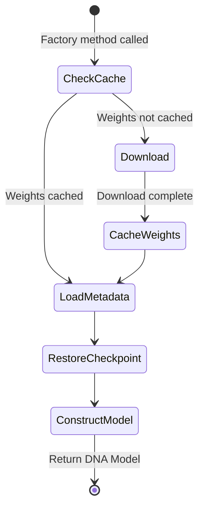

**Model Loading State Machine**

Both factory methods implement caching to avoid redundant downloads:
- First invocation downloads weights to a local cache directory
- Subsequent invocations reuse cached weights
- Cache location is managed by the respective platform's client library

Sources: [README.md:87-95]()

## Storage Format

### Orbax Checkpoint Structure

Model weights are stored using the Orbax checkpointing format:

| Component | Format | Description |
|-----------|--------|-------------|
| Parameters | Orbax checkpoint | Neural network weights and biases |
| Metadata | JSON/Protocol Buffer | Organism-specific configuration (sequence length, output tracks, etc.) |
| Configuration | Structured data | Haiku transform configuration, precision settings |

The checkpoint restoration process uses `orbax.checkpoint.Checkpointer` to deserialize the saved parameters into JAX arrays compatible with the model's Haiku transform.

Sources: [README.md:176]()

### Required Dependencies

Loading model weights requires the following dependencies (automatically installed via `pip install`):

| Dependency | Purpose |
|------------|---------|
| `kagglehub` | Download weights from Kaggle |
| `huggingface_hub` | Download weights from HuggingFace |
| `orbax` | Checkpoint restoration |
| `dm-haiku` | Neural network framework |
| `jax` | Array computation backend |

Sources: [README.md:163-183]()

## Hardware Requirements

Model inference requires substantial computational resources:

| Configuration | Recommended Hardware | Use Case |
|---------------|---------------------|----------|
| Inference | NVIDIA H100 GPU (minimum) | Variant effect prediction |
| Training | TPU v3 or higher | Model development (not covered in research release) |

The model requires proper CUDA, cuDNN, and JAX installation. Refer to the JAX installation documentation at `docs.jax.dev/en/latest/installation.html#nvidia-gpu` for GPU setup.

Sources: [README.md:66-75]()

## Access Control and Request Processing

Both Kaggle and HuggingFace implement immediate access upon terms acceptance:

```mermaid
sequenceDiagram
    participant User
    participant Platform as "Kaggle/HuggingFace"
    participant Terms as "Model Terms Server"
    participant Storage as "Weight Storage"
    
    User->>Platform: Request model access
    Platform->>Terms: Display terms
    User->>Terms: Accept terms
    Terms->>Platform: Grant access token
    Platform->>Storage: Authorize download
    Storage->>User: Stream checkpoint files
    User->>User: Cache locally
```

**Access Control Flow**

Requests are processed immediately upon acceptance—no manual review or waiting period is required.

Sources: [README.md:61-63]()

---

# Page: Data I/O System

# Data I/O System

<details>
<summary>Relevant source files</summary>

The following files were used as context for generating this wiki page:

- [README.md](README.md)
- [src/alphagenome_research/io/__init__.py](src/alphagenome_research/io/__init__.py)

</details>


## Purpose and Scope

The Data I/O System provides the foundational layer for loading, processing, and transforming genomic data used by AlphaGenome. This system handles multiple genomic file formats including TFRecords, FASTA files, and splice junction annotations, converting them into structured data representations suitable for model inference and evaluation.

This document covers the data input pipeline from raw files to structured `DataBatch` objects. For information about model inference using these data structures, see [Model Architecture](#4). For evaluation pipelines that consume these data structures, see [Evaluation System](#5).

## System Overview

The Data I/O System consists of five primary components located in `src/alphagenome_research/io/`:

| Component | Primary Module | Purpose |
|-----------|---------------|---------|
| Bundle Definitions | `bundles.py` | Defines enumeration types for genomic output modalities (ATAC, RNA-seq, ChIP-seq, etc.) |
| TFRecord Loading | `dataset.py` | Discovers and loads training/evaluation data from TFRecord files |
| FASTA Operations | `fasta.py` | Extracts reference genome sequences from indexed FASTA files |
| Variant Integration | `genome.py` | Applies reference and alternate variants to genomic sequences |
| Splice Annotations | `splicing.py` | Processes splice junction annotations and filters by genomic positions |

**Sources:** [README.md:1-334](), Diagram 1, Diagram 2

## Architecture Overview

```mermaid
graph TB
    subgraph "External Storage"
        GCS["Google Cloud Storage<br/>TFRecord Shards"]
        FASTA["Reference Genome<br/>.fa + .fai files"]
        ANNOT["Splice Junction<br/>Annotations"]
    end
    
    subgraph "Discovery Layer"
        GETDF["get_tfrecords_df()<br/>dataset.py"]
        FAIDX["pyfaidx Index<br/>FASTA indexing"]
    end
    
    subgraph "Loading Layer"
        CREATEDATASET["create_dataset()<br/>tf.data.Dataset"]
        FASTAEXT["FastaExtractor<br/>fasta.py"]
        SPLICEEXT["SpliceSiteAnnotationExtractor<br/>splicing.py"]
    end
    
    subgraph "Transformation Layer"
        ITERATOR["get_numpy_dataset_iterator()<br/>NumPy conversion"]
        VARIANTINS["insert_reference_variant()<br/>insert_alternate_variant()<br/>genome.py"]
        POSEXT["PositionExtractor<br/>splicing.py"]
    end
    
    subgraph "Output Layer"
        DATABATCH["DataBatch<br/>schemas.py"]
        BUNDLES["BundleName enum<br/>bundles.py"]
    end
    
    GCS --> GETDF
    GETDF --> CREATEDATASET
    CREATEDATASET --> ITERATOR
    
    FASTA --> FAIDX
    FAIDX --> FASTAEXT
    FASTAEXT --> VARIANTINS
    
    ANNOT --> SPLICEEXT
    SPLICEEXT --> POSEXT
    
    ITERATOR --> DATABATCH
    VARIANTINS --> DATABATCH
    POSEXT --> DATABATCH
    BUNDLES --> DATABATCH
    
    DATABATCH --> MODEL["Model Inference"]
```

**Sources:** Diagram 1, Diagram 2, [README.md:26-27]()

## Bundle System

The bundle system defines typed enumerations for different genomic output modalities that AlphaGenome can predict. Each bundle type corresponds to a specific biological assay or genomic feature.

### Bundle Types

The `BundleName` enumeration in `bundles.py` defines the following output modalities:

| Bundle Name | Description | Use Case |
|-------------|-------------|----------|
| `ATAC` | ATAC-seq chromatin accessibility | Open chromatin regions |
| `DNASE` | DNase-seq hypersensitivity | Regulatory element identification |
| `RNA_SEQ` | RNA-seq gene expression | Transcription levels |
| `CHIP_TF` | ChIP-seq transcription factor binding | TF binding sites |
| `SPLICE_ACCEPTOR` | Splice acceptor site predictions | RNA splicing analysis |
| `SPLICE_DONOR` | Splice donor site predictions | RNA splicing analysis |

Each bundle type has associated metadata defining:
- Expected output dimensions
- Data normalization parameters
- Tissue/cell type ontology mappings
- Target value encodings

**Sources:** [README.md:16-17](), Diagram 1, Diagram 4

## TFRecord Dataset Pipeline

The TFRecord loading system provides efficient batch loading of pre-processed genomic data from Google Cloud Storage.

### File Discovery and Dataset Creation

```mermaid
flowchart TD
    START["TFRecord Files<br/>gs://bucket/path/*.tfrecord"]
    
    GETDF["get_tfrecords_df()<br/>Returns: pd.DataFrame<br/>Columns: path, split, chromosome"]
    
    FILTER["Filter by:<br/>- split (train/val/test)<br/>- organism<br/>- chromosomes"]
    
    CREATE["create_dataset()<br/>Args: file_paths, bundle_names<br/>Returns: tf.data.Dataset"]
    
    PARSE["Parse TFRecord Features:<br/>- sequence (DNA)<br/>- targets (ground truth)<br/>- metadata (interval, mask)"]
    
    BATCH["Batch Operations:<br/>- tf.data.Dataset.batch()<br/>- Prefetching<br/>- Shuffling (optional)"]
    
    ITERATOR["get_numpy_dataset_iterator()<br/>Converts: tf.Tensor → np.ndarray<br/>Returns: Iterator[dict]"]
    
    OUTPUT["Batched NumPy Arrays<br/>{sequence, targets, intervals}"]
    
    START --> GETDF
    GETDF --> FILTER
    FILTER --> CREATE
    CREATE --> PARSE
    PARSE --> BATCH
    BATCH --> ITERATOR
    ITERATOR --> OUTPUT
```

### Key Functions

The `dataset.py` module provides three primary functions:

1. **`get_tfrecords_df(base_path: str) -> pd.DataFrame`**
   - Discovers TFRecord files at the specified GCS path
   - Returns DataFrame with file metadata including split assignments and chromosome coverage
   - Used for filtering datasets before loading

2. **`create_dataset(file_paths: Sequence[str], bundle_names: Sequence[str]) -> tf.data.Dataset`**
   - Creates TensorFlow Dataset from TFRecord files
   - Parses bundle-specific features according to `BundleName` specifications
   - Handles interleaved reading from multiple shards

3. **`get_numpy_dataset_iterator(dataset: tf.data.Dataset) -> Iterator[Dict[str, np.ndarray]]`**
   - Converts TensorFlow tensors to NumPy arrays
   - Returns iterator yielding batched dictionaries
   - Provides JAX/NumPy-compatible data for model inference

**Sources:** Diagram 2, [README.md:26]()

## FASTA File Operations

The FASTA extraction system provides efficient random access to reference genome sequences using indexed FASTA files.

### FastaExtractor Class

```mermaid
classDiagram
    class FastaExtractor {
        +fasta_path: str
        +faidx: pyfaidx.Fasta
        +__init__(fasta_path: str)
        +extract(chromosome: str, start: int, end: int) str
        +extract_interval(interval: Interval) str
        +get_sequence_length(chromosome: str) int
    }
    
    class pyfaidx_Fasta {
        <<external>>
        +fetch(chromosome, start, end) str
        +index: dict
    }
    
    class Interval {
        +chromosome: str
        +start: int
        +end: int
    }
    
    FastaExtractor --> pyfaidx_Fasta
    FastaExtractor ..> Interval
```

### Usage Pattern

The `FastaExtractor` class in `fasta.py` wraps the `pyfaidx` library to provide:

- **Indexed Access**: Uses `.fai` index files for O(1) sequence retrieval
- **Interval-Based Extraction**: Extracts sequences by genomic coordinates
- **Validation**: Checks chromosome names and coordinate bounds
- **Memory Efficiency**: Loads only requested sequence regions, not entire chromosomes

The extractor is used extensively in variant integration workflows where reference sequences must be retrieved before applying variant transformations.

**Sources:** Diagram 2, [README.md:179]()

## Variant Integration System

The variant integration system applies genetic variants to reference sequences, enabling variant effect prediction through reference-alternate comparisons.

### Variant Insertion Functions

```mermaid
flowchart LR
    subgraph "Input"
        REF_SEQ["Reference Sequence<br/>from FastaExtractor"]
        VARIANT["Variant Object<br/>chromosome, position<br/>ref_bases, alt_bases"]
        INTERVAL["Genomic Interval<br/>start, end coordinates"]
    end
    
    subgraph "genome.py Functions"
        INSERT_REF["insert_reference_variant()<br/>Validates ref matches<br/>Returns unchanged sequence"]
        INSERT_ALT["insert_alternate_variant()<br/>Substitutes alt bases<br/>Returns modified sequence"]
    end
    
    subgraph "Output"
        REF_OUT["Reference Sequence<br/>for model prediction"]
        ALT_OUT["Alternate Sequence<br/>for model prediction"]
    end
    
    REF_SEQ --> INSERT_REF
    VARIANT --> INSERT_REF
    INTERVAL --> INSERT_REF
    INSERT_REF --> REF_OUT
    
    REF_SEQ --> INSERT_ALT
    VARIANT --> INSERT_ALT
    INTERVAL --> INSERT_ALT
    INSERT_ALT --> ALT_OUT
```

### Key Components

The `genome.py` module defines:

1. **`Variant` dataclass**
   - Fields: `chromosome`, `position`, `reference_bases`, `alternate_bases`
   - Represents a single nucleotide variant (SNV) or indel
   - Used throughout evaluation pipelines

2. **`Interval` dataclass**
   - Fields: `chromosome`, `start`, `end`
   - Defines genomic coordinate ranges
   - Zero-based, half-open intervals [start, end)

3. **`insert_reference_variant(sequence: str, variant: Variant, interval: Interval) -> str`**
   - Validates that variant position falls within interval
   - Checks reference bases match the sequence
   - Returns original sequence (validation step)

4. **`insert_alternate_variant(sequence: str, variant: Variant, interval: Interval) -> str`**
   - Substitutes reference bases with alternate bases at variant position
   - Handles SNVs and indels
   - Returns modified sequence for alternate prediction

This dual-prediction approach enables effect size calculation by comparing reference and alternate model outputs.

**Sources:** Diagram 2, [README.md:100-138]()

## Splice Site Annotation System

The splice annotation system processes splice junction data and filters annotations by genomic position ranges.

### Two-Stage Extraction Pipeline

```mermaid
flowchart TB
    subgraph "Stage 1: Annotation Loading"
        ANNOT_FILE["Splice Junction File<br/>(BED/GTF format)"]
        SPLICE_EXT["SpliceSiteAnnotationExtractor<br/>splicing.py"]
        PYRANGES["PyRanges DataFrame<br/>Columns: Chromosome, Start, End<br/>Strand, SiteType"]
    end
    
    subgraph "Stage 2: Position Filtering"
        POS_EXT["PositionExtractor<br/>splicing.py"]
        QUERY_INT["Query Interval<br/>chromosome, start, end"]
        OVERLAP["PyRanges.overlap()<br/>Find intersecting annotations"]
        FILTERED["Filtered Annotations<br/>Within query interval"]
    end
    
    subgraph "Integration"
        DATABATCH["DataBatch.splice_annotations<br/>schemas.py"]
    end
    
    ANNOT_FILE --> SPLICE_EXT
    SPLICE_EXT --> PYRANGES
    
    PYRANGES --> POS_EXT
    QUERY_INT --> POS_EXT
    POS_EXT --> OVERLAP
    OVERLAP --> FILTERED
    
    FILTERED --> DATABATCH
```

### SpliceSiteAnnotationExtractor

The `SpliceSiteAnnotationExtractor` class in `splicing.py` provides:

- **Annotation Parsing**: Reads splice junction annotations from standard formats
- **Data Structures**: Converts to `PyRanges` for efficient interval operations
- **Site Type Classification**: Distinguishes donor sites, acceptor sites, and exon boundaries
- **Strand Information**: Preserves strand directionality for splice site prediction

### PositionExtractor

The `PositionExtractor` class filters annotations by genomic intervals:

- **Interval Queries**: Accepts `Interval` objects for position-based filtering
- **Efficient Lookup**: Uses interval tree data structures for O(log n) queries
- **Batch Processing**: Can filter multiple intervals in parallel
- **Integration**: Outputs annotations synchronized with sequence windows

This system enables splice site prediction by providing ground truth annotations for training and evaluation.

**Sources:** Diagram 2, [README.md:180]()

## Data Flow Integration

### Complete Pipeline Example

```mermaid
sequenceDiagram
    participant User
    participant dataset as "dataset.py"
    participant fasta as "fasta.py"
    participant genome as "genome.py"
    participant splicing as "splicing.py"
    participant schemas as "schemas.py"
    
    User->>dataset: get_tfrecords_df(base_path)
    dataset-->>User: DataFrame with file paths
    
    User->>dataset: create_dataset(file_paths, bundles)
    dataset-->>User: tf.data.Dataset
    
    User->>dataset: get_numpy_dataset_iterator(dataset)
    dataset-->>User: Iterator
    
    loop For each batch
        User->>fasta: FastaExtractor.extract_interval(interval)
        fasta-->>User: reference_sequence
        
        User->>genome: insert_reference_variant(seq, variant, interval)
        genome-->>User: validated_reference
        
        User->>genome: insert_alternate_variant(seq, variant, interval)
        genome-->>User: alternate_sequence
        
        User->>splicing: PositionExtractor.extract(interval)
        splicing-->>User: splice_annotations
        
        User->>schemas: DataBatch(sequences, targets, annotations)
        schemas-->>User: structured_batch
    end
```

### DataBatch Structure

The final output of the Data I/O System is a `DataBatch` object defined in `schemas.py`:

```
DataBatch:
  - sequence: np.ndarray          # DNA sequence (one-hot encoded)
  - targets: Dict[str, np.ndarray] # Ground truth per bundle
  - masks: Dict[str, np.ndarray]   # Valid positions per bundle
  - interval: Interval             # Genomic coordinates
  - metadata: Dict[str, Any]       # Additional context
  - splice_annotations: Optional   # Splice junction data
```

This structured format ensures type safety and consistent data representation across the codebase.

**Sources:** Diagram 1, Diagram 2, [README.md:100-138]()

## File Organization

The I/O system is organized within `src/alphagenome_research/io/`:

```
io/
├── __init__.py           # Package initialization
├── bundles.py           # Bundle type definitions
├── dataset.py           # TFRecord loading and iteration
├── fasta.py             # FASTA extraction utilities
├── genome.py            # Variant integration functions
├── splicing.py          # Splice annotation processing
└── schemas.py           # Data structure definitions
```

Supporting test files in `src/alphagenome_research/io/`:

```
io/
├── dataset_test.py      # TFRecord pipeline tests
├── fasta_test.py        # FASTA extraction tests
├── genome_test.py       # Variant insertion tests
└── splicing_test.py     # Splice annotation tests
```

**Sources:** Diagram 5, [src/alphagenome_research/io/__init__.py:1-16]()

## Dependencies

The Data I/O System relies on the following external libraries:

| Library | Purpose | Key Usage |
|---------|---------|-----------|
| `tensorflow` | TFRecord dataset loading | `tf.data.Dataset` creation and parsing |
| `pyfaidx` | FASTA file indexing | Fast random access to reference genome |
| `pyranges` | Genomic interval operations | Splice annotation filtering |
| `pandas` | Tabular data manipulation | TFRecord file discovery |
| `numpy` | Array operations | Data batch representation |

These dependencies are specified in `pyproject.toml` and automatically installed during package setup.

**Sources:** [README.md:163-183](), Diagram 5

## Usage in Model Inference

The Data I/O System integrates with the model layer through a standardized interface. Example workflow from `quick_start.ipynb`:

1. **Load Model Weights**: Use factory methods to initialize model
2. **Extract Reference Sequence**: Use `FastaExtractor` to retrieve genomic region
3. **Apply Variant**: Use `genome.py` functions to create reference/alternate sequences
4. **Structure Data**: Package into format expected by model
5. **Run Inference**: Pass to `model.predict_variant()`

This separation of concerns allows the I/O layer to evolve independently while maintaining a stable interface for model consumption.

**Sources:** [README.md:77-138](), Diagram 3

---

# Page: Bundle Definitions

# Bundle Definitions

<details>
<summary>Relevant source files</summary>

The following files were used as context for generating this wiki page:

- [src/alphagenome_research/io/bundles.py](src/alphagenome_research/io/bundles.py)

</details>


## Purpose and Scope

This document describes the bundle system in AlphaGenome Research, which defines standardized data types for different genomic output modalities. A bundle represents a specific type of genomic data (e.g., ATAC-seq accessibility, RNA-seq expression, splice site annotations) along with its associated TensorFlow data types and spatial resolution. Bundles serve as the fundamental abstraction layer between raw TFRecord data and the model's input/output interface.

For information about loading bundle data from TFRecords, see [TFRecord Dataset Loading](#3.2). For splice-specific bundle processing, see [Splice Site Annotations](#3.5).

## Overview

The bundle system provides three core capabilities:

1. **Type definitions**: Maps each bundle to its constituent fields and TensorFlow dtypes
2. **Resolution specification**: Defines the base-pair resolution for each modality
3. **Standardized interface**: Ensures consistent data handling across the pipeline

Sources: [src/alphagenome_research/io/bundles.py:15-16]()

## BundleName Enumeration

The `BundleName` enum defines all supported genomic data modalities as enumeration values. Each enum member represents a distinct output track type that the AlphaGenome model can predict.

```mermaid
graph TD
    BundleName["BundleName (enum.Enum)"]
    
    subgraph "Accessibility Bundles"
        ATAC["ATAC = 'atac'"]
        DNASE["DNASE = 'dnase'"]
    end
    
    subgraph "Transcription Bundles"
        PROCAP["PROCAP = 'procap'"]
        CAGE["CAGE = 'cage'"]
        RNA_SEQ["RNA_SEQ = 'rna_seq'"]
    end
    
    subgraph "Chromatin Bundles"
        CHIP_TF["CHIP_TF = 'chip_tf'"]
        CHIP_HISTONE["CHIP_HISTONE = 'chip_histone'"]
    end
    
    subgraph "Structural Bundles"
        CONTACT_MAPS["CONTACT_MAPS = 'contact_maps'"]
    end
    
    subgraph "Splicing Bundles"
        SPLICE_CLASS["SPLICE_SITES_CLASSIFICATION = 'splice_sites'"]
        SPLICE_USAGE["SPLICE_SITES_USAGE = 'splice_site_usage'"]
        SPLICE_JUNC["SPLICE_SITES_JUNCTION = 'splice_junctions'"]
        SPLICE_POS["SPLICE_SITES_POSITIONS = 'splice_site_positions'"]
    end
    
    BundleName --> ATAC
    BundleName --> DNASE
    BundleName --> PROCAP
    BundleName --> CAGE
    BundleName --> RNA_SEQ
    BundleName --> CHIP_TF
    BundleName --> CHIP_HISTONE
    BundleName --> CONTACT_MAPS
    BundleName --> SPLICE_CLASS
    BundleName --> SPLICE_USAGE
    BundleName --> SPLICE_JUNC
    BundleName --> SPLICE_POS
```

Sources: [src/alphagenome_research/io/bundles.py:21-36]()

### Complete Bundle Listing

| Bundle Name | String Value | Biological Modality |
|-------------|--------------|---------------------|
| `ATAC` | `'atac'` | ATAC-seq chromatin accessibility |
| `DNASE` | `'dnase'` | DNase-seq chromatin accessibility |
| `PROCAP` | `'procap'` | PRO-cap nascent transcription |
| `CAGE` | `'cage'` | CAGE transcription start sites |
| `RNA_SEQ` | `'rna_seq'` | RNA-seq gene expression |
| `CHIP_TF` | `'chip_tf'` | ChIP-seq transcription factor binding |
| `CHIP_HISTONE` | `'chip_histone'` | ChIP-seq histone modifications |
| `CONTACT_MAPS` | `'contact_maps'` | Hi-C/Micro-C chromatin contacts |
| `SPLICE_SITES_CLASSIFICATION` | `'splice_sites'` | Splice site binary classification |
| `SPLICE_SITES_USAGE` | `'splice_site_usage'` | Splice site usage quantification |
| `SPLICE_SITES_JUNCTION` | `'splice_junctions'` | Splice junction read counts |
| `SPLICE_SITES_POSITIONS` | `'splice_site_positions'` | Splice site genomic positions |

Sources: [src/alphagenome_research/io/bundles.py:21-36]()

## Data Type Specification

The `get_dtypes()` method returns a dictionary mapping field names to TensorFlow dtypes for each bundle. This defines the expected data structure when parsing TFRecords or constructing model inputs/outputs.

```mermaid
graph LR
    subgraph "get_dtypes Method"
        METHOD["get_dtypes()"]
    end
    
    subgraph "Return Type"
        DICT["dict[str, tf.DType]"]
    end
    
    subgraph "Field Types"
        DATA["Data Field<br/>(tf.bfloat16/tf.float32/tf.float16)"]
        MASK["Mask Field<br/>(tf.bool)"]
        STRAND["Strand Field<br/>(tf.int32)"]
        POSITION["Position Field<br/>(tf.int32)"]
    end
    
    METHOD --> DICT
    DICT --> DATA
    DICT --> MASK
    DICT --> STRAND
    DICT --> POSITION
```

Sources: [src/alphagenome_research/io/bundles.py:37-69]()

### Bundle Field Mappings

**Accessibility and Transcription Bundles** (Base-Pair Resolution):

| Bundle | Fields | Data Type | Mask Type |
|--------|--------|-----------|-----------|
| `ATAC` | `atac`, `atac_mask` | `tf.bfloat16` | `tf.bool` |
| `DNASE` | `dnase`, `dnase_mask` | `tf.bfloat16` | `tf.bool` |
| `PROCAP` | `procap`, `procap_mask` | `tf.bfloat16` | `tf.bool` |
| `CAGE` | `cage`, `cage_mask` | `tf.bfloat16` | `tf.bool` |
| `RNA_SEQ` | `rna_seq`, `rna_seq_mask`, `rna_seq_strand` | `tf.bfloat16` | `tf.bool`, `tf.int32` |

**ChIP Bundles** (128 bp Resolution):

| Bundle | Fields | Data Type | Mask Type |
|--------|--------|-----------|-----------|
| `CHIP_TF` | `chip_tf`, `chip_tf_mask` | `tf.float32` | `tf.bool` |
| `CHIP_HISTONE` | `chip_histone`, `chip_histone_mask` | `tf.float32` | `tf.bool` |

**Structural Bundles**:

| Bundle | Fields | Data Type | Notes |
|--------|--------|-----------|-------|
| `CONTACT_MAPS` | `contact_maps` | `tf.float32` | No mask field (2048 bp resolution) |

**Splicing Bundles**:

| Bundle | Fields | Data Type | Purpose |
|--------|--------|-----------|---------|
| `SPLICE_SITES_CLASSIFICATION` | `splice_sites` | `tf.bool` | Binary classification |
| `SPLICE_SITES_USAGE` | `splice_site_usage` | `tf.float16` | Usage quantification |
| `SPLICE_SITES_JUNCTION` | `splice_junctions` | `tf.float32` | Junction read counts |
| `SPLICE_SITES_POSITIONS` | `splice_site_positions` | `tf.int32` | Genomic coordinates |

Sources: [src/alphagenome_research/io/bundles.py:39-67]()

### Special Field Semantics

**Mask Fields**: Most bundles include a corresponding mask field (e.g., `atac_mask`, `dnase_mask`) of type `tf.bool`. These masks indicate which positions have valid data versus missing/unavailable measurements. Masks enable the model to handle incomplete data gracefully during training and evaluation.

**Strand Field**: The `RNA_SEQ` bundle uniquely includes a `rna_seq_strand` field of type `tf.int32`, encoding strand-specific expression information. This allows the model to distinguish between forward and reverse strand transcription.

**No Mask Bundles**: `CONTACT_MAPS` and all splicing bundles lack mask fields, indicating these modalities have different data availability semantics.

Sources: [src/alphagenome_research/io/bundles.py:40-67]()

## Resolution Specification

The `get_resolution()` method returns the base-pair resolution at which each bundle operates. This defines the spatial granularity of predictions and determines how sequence positions map to output indices.

```mermaid
graph TD
    subgraph "Resolution Categories"
        BP1["1 bp Resolution"]
        BP128["128 bp Resolution"]
        BP2048["2048 bp Resolution"]
    end
    
    subgraph "1 bp Bundles"
        BP1 --> ATAC["ATAC"]
        BP1 --> DNASE["DNASE"]
        BP1 --> PROCAP["PROCAP"]
        BP1 --> CAGE["CAGE"]
        BP1 --> RNA_SEQ["RNA_SEQ"]
        BP1 --> SPLICE_ALL["SPLICE_SITES_*<br/>(all 4 variants)"]
    end
    
    subgraph "128 bp Bundles"
        BP128 --> CHIP_TF["CHIP_TF"]
        BP128 --> CHIP_HISTONE["CHIP_HISTONE"]
    end
    
    subgraph "2048 bp Bundles"
        BP2048 --> CONTACT_MAPS["CONTACT_MAPS"]
    end
```

Sources: [src/alphagenome_research/io/bundles.py:71-91]()

### Resolution Table

| Resolution | Bundles | Use Case |
|------------|---------|----------|
| **1 bp** | `ATAC`, `DNASE`, `PROCAP`, `CAGE`, `RNA_SEQ`, all `SPLICE_SITES_*` | High-resolution predictions at single base-pair granularity |
| **128 bp** | `CHIP_TF`, `CHIP_HISTONE` | ChIP-seq peaks, where binding events span broader regions |
| **2048 bp** | `CONTACT_MAPS` | Chromatin interaction matrices, where contacts occur at kilobase scale |

Sources: [src/alphagenome_research/io/bundles.py:71-91]()

### Resolution Implications

The resolution value directly affects:

1. **Output dimensionality**: A 1 Mbp sequence produces 1,000,000 output positions at 1 bp resolution, but only 7,812 positions at 128 bp resolution, and 488 positions at 2048 bp resolution.

2. **Memory requirements**: Higher resolution bundles require proportionally more memory for storing predictions and targets.

3. **Biological interpretation**: Resolution matches the natural scale of the assayed phenomenon (e.g., single-bp precision for accessibility, broader bins for chromatin contacts).

Sources: [src/alphagenome_research/io/bundles.py:71-91]()

## Bundle Method Interface

The `BundleName` enum provides two primary methods for querying bundle properties:

```mermaid
classDiagram
    class BundleName {
        <<enumeration>>
        +ATAC
        +DNASE
        +PROCAP
        +CAGE
        +RNA_SEQ
        +CHIP_TF
        +CHIP_HISTONE
        +CONTACT_MAPS
        +SPLICE_SITES_CLASSIFICATION
        +SPLICE_SITES_USAGE
        +SPLICE_SITES_JUNCTION
        +SPLICE_SITES_POSITIONS
        +get_dtypes() dict~str, tf.DType~
        +get_resolution() int
    }
    
    class TensorFlowDType {
        <<tensorflow>>
        tf.bfloat16
        tf.float32
        tf.float16
        tf.bool
        tf.int32
    }
    
    class Resolution {
        <<int>>
        1
        128
        2048
    }
    
    BundleName --> TensorFlowDType : returns
    BundleName --> Resolution : returns
```

Sources: [src/alphagenome_research/io/bundles.py:37-91]()

### Method Usage Patterns

**Querying dtypes**:
```python
# Example usage (not actual code from repo)
bundle = BundleName.ATAC
dtypes = bundle.get_dtypes()
# Returns: {'atac': tf.bfloat16, 'atac_mask': tf.bool}
```

**Querying resolution**:
```python
# Example usage (not actual code from repo)
bundle = BundleName.CHIP_TF
resolution = bundle.get_resolution()
# Returns: 128
```

Sources: [src/alphagenome_research/io/bundles.py:37-91]()

## Bundle Categories by Biological Function

Bundles can be grouped into functional categories based on their biological assays:

### Chromatin Accessibility
- `ATAC`: Assay for Transposase-Accessible Chromatin sequencing
- `DNASE`: DNase I hypersensitivity sequencing

Both operate at 1 bp resolution with `tf.bfloat16` data and boolean masks.

### Nascent Transcription
- `PROCAP`: Precision Run-On and Capping assay
- `CAGE`: Cap Analysis of Gene Expression

Both capture transcription initiation events at 1 bp resolution.

### Steady-State Expression
- `RNA_SEQ`: RNA sequencing with strand information

Unique in having three fields: expression values, mask, and strand orientation.

### Protein-DNA Interactions
- `CHIP_TF`: Transcription factor ChIP-seq
- `CHIP_HISTONE`: Histone modification ChIP-seq

Both operate at 128 bp resolution with `tf.float32` precision, reflecting the broader spatial distribution of chromatin immunoprecipitation signals.

### Chromatin Architecture
- `CONTACT_MAPS`: Hi-C/Micro-C contact matrices

Operates at 2048 bp resolution without a mask field, capturing long-range chromatin interactions.

### Splicing Annotations
- `SPLICE_SITES_CLASSIFICATION`: Binary splice site presence
- `SPLICE_SITES_USAGE`: Quantitative splice site usage
- `SPLICE_SITES_JUNCTION`: Junction-level read counts
- `SPLICE_SITES_POSITIONS`: Genomic coordinates of splice sites

All operate at 1 bp resolution with varying data types to capture different aspects of RNA splicing.

Sources: [src/alphagenome_research/io/bundles.py:21-91]()

## Integration with Data Pipeline

Bundles integrate with the broader AlphaGenome data pipeline through several key interfaces:

```mermaid
graph TB
    subgraph "Bundle System"
        BUNDLE_ENUM["BundleName enum"]
        GET_DTYPES["get_dtypes()"]
        GET_RES["get_resolution()"]
    end
    
    subgraph "TFRecord Loading"
        DATASET["dataset.py<br/>TFRecord parser"]
        PARSE["parse_example()"]
    end
    
    subgraph "Evaluation"
        EVAL_CONFIG["Evaluation configs"]
        METRICS["Metric calculation"]
    end
    
    subgraph "Model I/O"
        MODEL_IN["Model inputs"]
        MODEL_OUT["Model outputs"]
    end
    
    BUNDLE_ENUM --> GET_DTYPES
    BUNDLE_ENUM --> GET_RES
    
    GET_DTYPES --> PARSE
    PARSE --> DATASET
    
    BUNDLE_ENUM --> EVAL_CONFIG
    EVAL_CONFIG --> METRICS
    
    DATASET --> MODEL_IN
    MODEL_OUT --> METRICS
    
    GET_RES --> MODEL_OUT
```

Sources: [src/alphagenome_research/io/bundles.py:1-92]()

### Usage in Dataset Loading

The TFRecord dataset loader uses `get_dtypes()` to construct the feature specification for parsing serialized examples. This ensures type-safe deserialization from disk to memory. See [TFRecord Dataset Loading](#3.2) for implementation details.

### Usage in Evaluation

The evaluation system queries bundle resolutions to correctly align predictions with ground truth targets at the appropriate spatial scale. Different metrics may apply to different bundle categories (e.g., regression metrics for continuous bundles, classification metrics for binary bundles). See [Regression Metrics](#5.1) and [Track Prediction Evaluation](#5.2) for details.

### Usage in Model Outputs

The model produces outputs for each bundle at the specified resolution. A 1 Mbp input sequence generates output arrays sized according to each bundle's resolution: 1,000,000 elements for 1 bp bundles, 7,812 elements for 128 bp bundles, and 488 elements for 2048 bp bundles.

Sources: [src/alphagenome_research/io/bundles.py:71-91]()

## Implementation Details

The bundle system is implemented as a single Python enum class with match-case statements for method dispatch. This design provides:

1. **Type safety**: Enumeration prevents invalid bundle names
2. **Exhaustive matching**: Python's match-case ensures all bundles are handled
3. **Centralized definition**: Single source of truth for bundle properties
4. **Easy extension**: New bundles require adding one enum member and updating two match-case blocks

The implementation raises `ValueError` for unknown bundle names, ensuring fail-fast behavior if an unrecognized bundle is encountered.

Sources: [src/alphagenome_research/io/bundles.py:68-69](), [src/alphagenome_research/io/bundles.py:90-91]()

---

# Page: TFRecord Dataset Loading

# TFRecord Dataset Loading

<details>
<summary>Relevant source files</summary>

The following files were used as context for generating this wiki page:

- [README.md](README.md)
- [src/alphagenome_research/io/dataset.py](src/alphagenome_research/io/dataset.py)
- [src/alphagenome_research/io/dataset_test.py](src/alphagenome_research/io/dataset_test.py)

</details>


## Purpose and Scope

This document describes the TFRecord dataset loading system, which provides functions to discover, load, and iterate over AlphaGenome training data stored in TFRecord files on Google Cloud Storage. The system handles file discovery, parsing, batching, and conversion to structured data formats for model training and evaluation.

For information about the data type definitions (bundles) that determine what fields are loaded, see [Bundle Definitions](#3.1). For information about how these datasets are used in model evaluation, see [Track Prediction Evaluation](#5.2).

---

## System Architecture

The TFRecord loading system consists of three main layers: file discovery, dataset creation, and batch iteration.

```mermaid
graph TB
    subgraph "File Discovery Layer"
        GCS["GCS Storage<br/>gs://alphagenome-datasets/v1/train/"]
        GLOB["glob patterns<br/>{fold}/{organism}/{subset}/{bundle}/"]
        REGEX["_FILENAME_REGEX<br/>data_chr_shard-numshards.gz.tfrecord"]
    end
    
    subgraph "Dataset Creation Layer"
        GETDF["get_tfrecords_df()<br/>Returns pd.DataFrame"]
        PARSER["_get_parse_function()<br/>Bundle-specific parser"]
        TFDS["_get_tfrecords_dataset()<br/>tf.data.TFRecordDataset"]
        CREATE["create_dataset()<br/>Zip across bundles"]
    end
    
    subgraph "Batch Iteration Layer"
        BATCH["Batching<br/>drop_remainder=True"]
        PARSE["_parse_batch()<br/>Merge + structure"]
        NUMPY["get_numpy_dataset_iterator()<br/>Yields DataBatch"]
    end
    
    subgraph "Output"
        DATABATCH["schemas.DataBatch<br/>organism_index, dna_sequence, targets"]
        METADATA["BatchMetadata<br/>interval/chromosome/start/end"]
    end
    
    GCS --> GLOB
    GLOB --> REGEX
    REGEX --> GETDF
    
    GETDF --> CREATE
    PARSER --> TFDS
    TFDS --> CREATE
    
    CREATE --> BATCH
    BATCH --> PARSE
    PARSE --> NUMPY
    
    NUMPY --> DATABATCH
    NUMPY --> METADATA
```

**Sources:** [src/alphagenome_research/io/dataset.py:1-256]()

---

## File Organization and Discovery

### Directory Structure

TFRecord files are organized in a hierarchical directory structure on Google Cloud Storage:

```
gs://alphagenome-datasets/v1/train/
├── {fold_split}/              # e.g., FOLD_0, FOLD_1, all_folds
│   └── {organism}/            # e.g., HOMO_SAPIENS, MUS_MUSCULUS
│       └── {subset}/          # e.g., TRAIN, VALID, TEST
│           └── {bundle}/      # e.g., ATAC, RNA_SEQ, DNASE
│               └── data_{chromosome}_{shard}-{num_shards}.gz.tfrecord
```

**Sources:** [src/alphagenome_research/io/dataset.py:56-92]()

### File Naming Convention

TFRecord filenames follow this pattern:
- `data_chr22_0-10.gz.tfrecord` - Chromosome chr22, shard 0 of 10 total shards
- `data_chr1_5-20.gz.tfrecord` - Chromosome chr1, shard 5 of 20 total shards

The filename regex pattern extracts:
- `chr` - Chromosome identifier
- `shard` - Current shard number (0-indexed)
- `num_shards` - Total number of shards

**Sources:** [src/alphagenome_research/io/dataset.py:56-58]()

### get_tfrecords_df Function

```mermaid
graph LR
    subgraph "Input Parameters"
        ORG["organism<br/>dna_model.Organism"]
        BUNDLE["bundle<br/>bundles_lib.BundleName"]
        FOLD["fold_split<br/>dna_model.ModelVersion"]
        SUBSET["subset<br/>fold_intervals.Subset"]
        CHR["chromosome<br/>str"]
        PATH["path<br/>str or PathLike"]
    end
    
    subgraph "Processing"
        PATTERN["Build glob pattern<br/>{fold}/{org}/{subset}/{bundle}/data_{chr}_*"]
        GLOB["epath.Path.glob()"]
        PARSE["_parse_path()<br/>Extract metadata from filename"]
    end
    
    subgraph "Output"
        DF["pd.DataFrame<br/>columns: organism, bundle, fold_split,<br/>subset, chromosome, shard, num_shards, path"]
    end
    
    ORG --> PATTERN
    BUNDLE --> PATTERN
    FOLD --> PATTERN
    SUBSET --> PATTERN
    CHR --> PATTERN
    PATH --> GLOB
    
    PATTERN --> GLOB
    GLOB --> PARSE
    PARSE --> DF
```

The `get_tfrecords_df()` function returns a DataFrame with one row per TFRecord file, containing:

| Column | Type | Description |
|--------|------|-------------|
| organism | str | Organism name (e.g., "HOMO_SAPIENS") |
| bundle | str | Bundle name (e.g., "ATAC", "RNA_SEQ") |
| fold_split | str | Fold split name (e.g., "FOLD_0") |
| subset | str | Subset name (e.g., "TRAIN", "VALID") |
| chromosome | str | Chromosome identifier (e.g., "chr1") |
| shard | int | Shard number (0-indexed) |
| num_shards | int | Total number of shards |
| path | str | Full path to the TFRecord file |

**Sources:** [src/alphagenome_research/io/dataset.py:61-119]()

---

## TFRecord Parsing

### Feature Specifications

The system defines three categories of feature specifications used by TensorFlow's `parse_single_example`:

```mermaid
graph TB
    subgraph "Feature Specifications"
        DNA["_DNA_SEQUENCE_FEATURE_SPEC<br/>dna_sequence: tf.string"]
        INTERVAL["_INTERVAL_FEATURE_SPEC<br/>interval/chromosome: tf.string<br/>interval/start: tf.int64<br/>interval/end: tf.int64"]
        BUNDLE["Bundle-specific features<br/>From bundle.get_dtypes()"]
    end
    
    subgraph "Parsing Process"
        MERGE["Merge specs<br/>| operator"]
        PARSE["tf.io.parse_single_example()"]
        DESERIALIZE["tf.io.parse_tensor()<br/>Deserialize byte strings"]
    end
    
    subgraph "Output Types"
        DNASEQ["dna_sequence<br/>tf.float32"]
        TARGETS["Bundle targets<br/>tf.bfloat16"]
        MASKS["Bundle masks<br/>bool"]
        STRAND["rna_seq_strand<br/>tf.int32 (RNA only)"]
    end
    
    DNA --> MERGE
    INTERVAL --> MERGE
    BUNDLE --> MERGE
    
    MERGE --> PARSE
    PARSE --> DESERIALIZE
    
    DESERIALIZE --> DNASEQ
    DESERIALIZE --> TARGETS
    DESERIALIZE --> MASKS
    DESERIALIZE --> STRAND
```

**Fixed Features:**
- `dna_sequence` - Serialized tensor (shape: `[seq_len, 4]`, dtype: `float32`)
- `interval/chromosome` - String chromosome identifier
- `interval/start` - Int64 start position
- `interval/end` - Int64 end position

**Bundle-Specific Features:**
Determined dynamically via `bundle.get_dtypes()`, typically includes:
- `{bundle_name}` - Target values (e.g., `atac`, `rna_seq`)
- `{bundle_name}_mask` - Boolean mask indicating valid channels
- Additional fields like `rna_seq_strand` for RNA-seq data

**Sources:** [src/alphagenome_research/io/dataset.py:47-139]()

### Parse Function Creation

The `_get_parse_function()` creates a closure that:

1. Defines the complete feature specification by merging DNA, interval, and bundle-specific specs
2. Returns a parsing function that deserializes TFRecord proto examples
3. Converts serialized tensors back to their proper dtypes

```python
def _get_parse_function(bundle: bundles_lib.BundleName):
  feature_spec = (
      _DNA_SEQUENCE_FEATURE_SPEC
      | _INTERVAL_FEATURE_SPEC
      | {key: tf.io.FixedLenFeature([], tf.string) 
         for key in bundle.get_dtypes().keys()}
  )
  output_dtypes = bundle.get_dtypes() | {'dna_sequence': _DNA_SEQUENCE_DTYPE}
  
  def _parse(proto):
    example = tf.io.parse_single_example(proto, feature_spec)
    for key, dtype in output_dtypes.items():
      example[key] = tf.io.parse_tensor(example[key], dtype)
    return example
  
  return _parse
```

**Sources:** [src/alphagenome_research/io/dataset.py:121-139]()

---

## Dataset Creation Pipeline

### create_dataset Function

The `create_dataset()` function orchestrates the complete dataset creation process:

```mermaid
graph TB
    subgraph "Input"
        PARAMS["Parameters:<br/>organism, fold_split, subset,<br/>bundles, path"]
    end
    
    subgraph "Per-Bundle Processing"
        GETDF1["get_tfrecords_df()<br/>Bundle 1 files"]
        GETDF2["get_tfrecords_df()<br/>Bundle 2 files"]
        GETDFN["get_tfrecords_df()<br/>Bundle N files"]
        
        SORT1["Sort by shard"]
        SORT2["Sort by shard"]
        SORTN["Sort by shard"]
        
        DS1["_get_tfrecords_dataset()<br/>tf.data.TFRecordDataset"]
        DS2["_get_tfrecords_dataset()<br/>tf.data.TFRecordDataset"]
        DSN["_get_tfrecords_dataset()<br/>tf.data.TFRecordDataset"]
    end
    
    subgraph "Combining"
        CONCAT["Concatenate shards<br/>within bundle"]
        ZIP["tf.data.Dataset.zip()<br/>across bundles"]
    end
    
    subgraph "Output"
        TFDS["tf.data.Dataset<br/>Tuple of bundle dicts"]
    end
    
    PARAMS --> GETDF1
    PARAMS --> GETDF2
    PARAMS --> GETDFN
    
    GETDF1 --> SORT1
    GETDF2 --> SORT2
    GETDFN --> SORTN
    
    SORT1 --> DS1
    SORT2 --> DS2
    SORTN --> DSN
    
    DS1 --> CONCAT
    DS2 --> CONCAT
    DSN --> CONCAT
    
    CONCAT --> ZIP
    ZIP --> TFDS
```

**Key Steps:**

1. **File Discovery**: Call `get_tfrecords_df()` for each bundle to get file paths
2. **Validation**: Ensure all bundles have the same number of files
3. **Sorting**: Sort files by shard number to ensure deterministic ordering
4. **Dataset Creation**: Create `tf.data.TFRecordDataset` for each bundle
5. **Concatenation**: Within each bundle, concatenate datasets from all shards
6. **Zipping**: Zip datasets across bundles so each element is a tuple

**Sources:** [src/alphagenome_research/io/dataset.py:160-208]()

### _get_tfrecords_dataset Function

Creates a dataset from a sequence of TFRecord file paths:

```python
def _get_tfrecords_dataset(
    paths: Sequence[str | os.PathLike[str]], 
    bundle: bundles_lib.BundleName
) -> tf.data.Dataset:
  parser = _get_parse_function(bundle)
  
  def _get(p):
    ds = tf.data.TFRecordDataset(p, compression_type='GZIP')
    ds = ds.map(parser, num_parallel_calls=tf.data.AUTOTUNE)
    return ds
  
  ds = _get(paths[0])
  for p in paths[1:]:
    ds_next = _get(p)
    ds = ds.concatenate(ds_next)
  return ds
```

Features:
- Uses GZIP compression for TFRecord files
- Parallel parsing with `tf.data.AUTOTUNE`
- Sequential concatenation of shards

**Sources:** [src/alphagenome_research/io/dataset.py:142-157]()

---

## Batch Processing and Iteration

### Batch Structure

After zipping datasets across bundles, each element is a tuple of dictionaries (one per bundle). The `_parse_batch()` function merges these into a structured format:

```mermaid
graph TB
    subgraph "Input: Raw Element"
        TUPLE["Tuple of bundle dicts<br/>(bundle1_dict, bundle2_dict, ...)"]
    end
    
    subgraph "Processing"
        MERGE["Merge dictionaries<br/>functools.reduce with | operator"]
        EXTRACT["Extract interval metadata<br/>interval/chromosome, start, end"]
        ORGIDX["Create organism_index<br/>np.full(batch_size, index)"]
    end
    
    subgraph "Output"
        BATCH["schemas.DataBatch<br/>organism_index, dna_sequence,<br/>bundle-specific targets and masks"]
        META["BatchMetadata<br/>interval/chromosome, start, end"]
    end
    
    TUPLE --> MERGE
    MERGE --> EXTRACT
    MERGE --> ORGIDX
    
    EXTRACT --> META
    ORGIDX --> BATCH
    MERGE --> BATCH
```

**Merging Logic:**
```python
if bundles is None:
  bundles = list(bundles_lib.BundleName)
if len(bundles) == 1:
  element = (element,)  # Wrap single bundle in tuple

merged_data = functools.reduce(lambda x, y: x | y, element)
```

**Sources:** [src/alphagenome_research/io/dataset.py:211-232]()

### get_numpy_dataset_iterator Function

The primary interface for consuming dataset batches:

```mermaid
graph TB
    subgraph "Input Parameters"
        SIZE["batch_size: int"]
        ORG["organism: dna_model.Organism"]
        VERSION["model_version: dna_model.ModelVersion"]
        SUB["subset: fold_intervals.Subset"]
        BUND["bundles: Sequence[BundleName]"]
        PTH["path: str | PathLike"]
    end
    
    subgraph "Processing"
        CREATE["create_dataset()<br/>Create tf.data.Dataset"]
        CONVERT["convert_to_organism_index()<br/>Map organism to integer"]
        BATCH["ds.batch(batch_size,<br/>drop_remainder=True)"]
        PREFETCH["ds.prefetch(tf.data.AUTOTUNE)"]
        NUMPY["ds.as_numpy_iterator()"]
        PARSE["_parse_batch()<br/>Structure output"]
    end
    
    subgraph "Output: Iterator"
        YIELD["Yields tuple:<br/>(schemas.DataBatch, BatchMetadata)"]
    end
    
    SIZE --> BATCH
    ORG --> CREATE
    ORG --> CONVERT
    VERSION --> CREATE
    SUB --> CREATE
    BUND --> CREATE
    PTH --> CREATE
    
    CREATE --> BATCH
    CONVERT --> PARSE
    BATCH --> PREFETCH
    PREFETCH --> NUMPY
    NUMPY --> PARSE
    PARSE --> YIELD
```

**Configuration:**
- `drop_remainder=True` - Ensures all batches are the same size
- `prefetch(tf.data.AUTOTUNE)` - Overlaps data loading with computation
- Returns iterator yielding `(DataBatch, BatchMetadata)` tuples

**Sources:** [src/alphagenome_research/io/dataset.py:235-255]()

---

## Data Structures

### schemas.DataBatch

The primary output structure containing:

| Field | Type | Description |
|-------|------|-------------|
| `organism_index` | `np.ndarray[int32]` | Integer index of organism, shape `[batch_size]` |
| `dna_sequence` | `np.ndarray[float32]` | One-hot encoded DNA sequence, shape `[batch_size, seq_len, 4]` |
| Bundle fields | Various | Bundle-specific target arrays (e.g., `atac`, `rna_seq`) |
| Mask fields | `np.ndarray[bool]` | Bundle-specific masks (e.g., `atac_mask`, `rna_seq_mask`) |
| Auxiliary fields | Various | Additional bundle-specific metadata (e.g., `rna_seq_strand`) |

**Sources:** [src/alphagenome_research/io/dataset.py:216-232](), [src/alphagenome_research/model/schemas.py]()

### BatchMetadata

A dictionary containing genomic interval information for each example in the batch:

| Key | Type | Description |
|-----|------|-------------|
| `interval/chromosome` | `np.ndarray[str]` | Chromosome identifier, shape `[batch_size]` |
| `interval/start` | `np.ndarray[int64]` | Start position (0-indexed), shape `[batch_size]` |
| `interval/end` | `np.ndarray[int64]` | End position (exclusive), shape `[batch_size]` |

**Sources:** [src/alphagenome_research/io/dataset.py:45](), [src/alphagenome_research/io/dataset.py:226-230]()

---

## Usage Examples

### Basic Dataset Loading

```python
from alphagenome.data import fold_intervals
from alphagenome.models import dna_model
from alphagenome_research.io import bundles, dataset

# Create iterator for validation set
iterator = dataset.get_numpy_dataset_iterator(
    batch_size=8,
    organism=dna_model.Organism.HOMO_SAPIENS,
    model_version=dna_model.ModelVersion.FOLD_0,
    subset=fold_intervals.Subset.VALID,
    bundles=[bundles.BundleName.ATAC, bundles.BundleName.RNA_SEQ],
)

# Iterate over batches
for batch, metadata in iterator:
    # batch.dna_sequence: [8, seq_len, 4]
    # batch.atac: [8, seq_len, num_channels]
    # batch.rna_seq: [8, seq_len, num_channels]
    # metadata['interval/chromosome']: [8]
    process_batch(batch, metadata)
```

**Sources:** [src/alphagenome_research/io/dataset.py:235-255]()

### File Discovery

```python
import pandas as pd
from alphagenome.models import dna_model
from alphagenome_research.io import bundles, dataset

# Get metadata for all TFRecord files
df = dataset.get_tfrecords_df(
    organism=dna_model.Organism.HOMO_SAPIENS,
    bundle=bundles.BundleName.ATAC,
    fold_split=dna_model.ModelVersion.FOLD_0,
)

# Filter to specific chromosome
chr22_files = df[df['chromosome'] == 'chr22']
print(f"Found {len(chr22_files)} shards for chr22")
```

**Sources:** [src/alphagenome_research/io/dataset.py:61-119]()

### Custom Dataset Creation

```python
from alphagenome.data import fold_intervals
from alphagenome.models import dna_model
from alphagenome_research.io import bundles, dataset
import tensorflow as tf

# Create TensorFlow dataset
ds = dataset.create_dataset(
    organism=dna_model.Organism.HOMO_SAPIENS,
    fold_split=dna_model.ModelVersion.FOLD_0,
    subset=fold_intervals.Subset.TRAIN,
    bundles=[bundles.BundleName.ATAC],
)

# Apply custom transformations
ds = ds.shuffle(buffer_size=1000)
ds = ds.batch(16)
ds = ds.prefetch(tf.data.AUTOTUNE)

# Iterate with TensorFlow
for element in ds:
    # element is a tuple of dictionaries (one per bundle)
    process_tf_element(element)
```

**Sources:** [src/alphagenome_research/io/dataset.py:160-208]()

---

## Implementation Details

### Default Storage Path

The default path points to Google Cloud Storage:
```python
_DEFAULT_PATH = 'gs:///alphagenome-datasets/v1/train/'
```

Users can override this by providing a custom `path` parameter to any loading function.

**Sources:** [src/alphagenome_research/io/dataset.py:43]()

### Compression

All TFRecord files use GZIP compression:
```python
tf.data.TFRecordDataset(p, compression_type='GZIP')
```

**Sources:** [src/alphagenome_research/io/dataset.py:149]()

### Parallelism and Performance

The system uses TensorFlow's `AUTOTUNE` for automatic parallelism tuning:
- Parsing: `ds.map(parser, num_parallel_calls=tf.data.AUTOTUNE)`
- Prefetching: `ds.prefetch(tf.data.AUTOTUNE)`

**Sources:** [src/alphagenome_research/io/dataset.py:150](), [src/alphagenome_research/io/dataset.py:253]()

### Deterministic Ordering

Files are sorted by shard number before concatenation to ensure deterministic ordering across runs:
```python
dft = df[df['bundle'] == bundle].sort_values('shard')
```

**Sources:** [src/alphagenome_research/io/dataset.py:198]()

---

## Testing

The test suite (`dataset_test.py`) validates:

1. **File Discovery**: `test_get_tfrecords_df()` verifies correct parsing of directory structure
2. **Dataset Creation**: `test_create_dataset()` ensures proper concatenation and zipping
3. **Batch Iteration**: `test_get_numpy_dataset_iterator()` validates output structure
4. **Shuffling**: Tests that shuffling doesn't break the pipeline
5. **Multi-Bundle Loading**: Tests both single and multi-bundle scenarios

The tests create synthetic TFRecord files in a temporary directory with the proper structure and validate that all components correctly handle them.

**Sources:** [src/alphagenome_research/io/dataset_test.py:1-255]()

---

# Page: FASTA File Operations

# FASTA File Operations

<details>
<summary>Relevant source files</summary>

The following files were used as context for generating this wiki page:

- [src/alphagenome_research/io/fasta.py](src/alphagenome_research/io/fasta.py)
- [src/alphagenome_research/io/fasta_test.py](src/alphagenome_research/io/fasta_test.py)
- [src/alphagenome_research/io/testdata/example.fa](src/alphagenome_research/io/testdata/example.fa)
- [src/alphagenome_research/io/testdata/example.fa.fai](src/alphagenome_research/io/testdata/example.fa.fai)

</details>


## Purpose and Scope

This document covers the FASTA file operations module, which provides functionality for extracting DNA sequences from reference genome FASTA files. The module is implemented in the `FastaExtractor` class and serves as a critical component in the Data I/O layer for accessing genomic reference sequences.

For variant integration operations that use extracted sequences, see [Variant and Genome Operations](#3.4). For broader context on the data loading pipeline, see [Data I/O System](#3).

**Sources:** [src/alphagenome_research/io/fasta.py:1-71]()

## FastaExtractor Class

The `FastaExtractor` class provides a high-level interface for extracting sequences from indexed FASTA files using the `pyfaidx` library underneath.

### Class Architecture

```mermaid
graph TB
    subgraph "External Dependencies"
        PYFAIDX["pyfaidx.Faidx"]
        FSSPEC["fsspec.open"]
        GENOME["genome.Interval"]
    end
    
    subgraph "FastaExtractor Class"
        INIT["__init__(fasta_path)"]
        EXTRACT["extract(interval)"]
        FAIDX_INST["_faidx: Faidx instance"]
        TRANS_TABLE["_REVERSE_COMPLEMENT_TRANSLATION"]
    end
    
    subgraph "Internal Operations"
        VALIDATE["Chromosome validation"]
        BOUNDS["Bounds checking"]
        FETCH["Sequence fetching"]
        PAD["N-padding"]
        REVCOMP["Reverse complement"]
    end
    
    FSSPEC --> INIT
    PYFAIDX --> INIT
    INIT --> FAIDX_INST
    
    GENOME --> EXTRACT
    FAIDX_INST --> EXTRACT
    
    EXTRACT --> VALIDATE
    EXTRACT --> BOUNDS
    EXTRACT --> FETCH
    EXTRACT --> PAD
    EXTRACT --> REVCOMP
    
    TRANS_TABLE --> REVCOMP
```

**Sources:** [src/alphagenome_research/io/fasta.py:26-71]()

### Initialization

The `FastaExtractor` is initialized with a path to a FASTA file:

```python
FastaExtractor(fasta_path: str | os.PathLike[str])
```

The constructor creates a `pyfaidx.Faidx` instance with the following configuration parameters:

| Parameter | Value | Purpose |
|-----------|-------|---------|
| `as_raw` | `True` | Returns sequences as raw strings without formatting |
| `mutable` | `False` | Prevents modification of the underlying file |
| `build_index` | `False` | Expects pre-existing `.fai` index file |
| `sequence_always_upper` | `True` | Returns sequences in uppercase |

The FASTA file path is opened through `fsspec.open()`, enabling support for both local and remote file systems.

**Sources:** [src/alphagenome_research/io/fasta.py:29-36]()

## Sequence Extraction

The core functionality is provided by the `extract()` method, which retrieves DNA sequences for specified genomic intervals.

### Extract Method Signature

```python
def extract(interval: genome.Interval) -> str
```

The method accepts a `genome.Interval` object and returns the corresponding DNA sequence as a string.

**Sources:** [src/alphagenome_research/io/fasta.py:38-70]()

### Extraction Workflow

```mermaid
flowchart TD
    START["extract(interval)"]
    VALIDATE_CHR{"Chromosome in<br/>FASTA index?"}
    ERROR_CHR["Raise ValueError:<br/>'Chromosome not found'"]
    
    CHECK_BOUNDS{"Interval fully<br/>out of bounds?"}
    ERROR_BOUNDS["Raise ValueError:<br/>'Interval fully out of bounds'"]
    
    CHECK_WITHIN{"within_reference<br/>(chromosome_length)?"}
    
    DIRECT["Direct fetch:<br/>_faidx.fetch(chr, start+1, end)"]
    
    PADDING["Calculate start/end padding<br/>with 'N' characters"]
    TRUNCATE["truncate(chromosome_length)"]
    PADDED_FETCH["Fetch trimmed interval<br/>+ add padding"]
    
    CHECK_STRAND{"negative_strand?"}
    REVCOMP["Apply reverse complement<br/>translate + reverse"]
    
    RETURN["Return sequence"]
    
    START --> VALIDATE_CHR
    VALIDATE_CHR -->|No| ERROR_CHR
    VALIDATE_CHR -->|Yes| CHECK_BOUNDS
    
    CHECK_BOUNDS -->|Yes| ERROR_BOUNDS
    CHECK_BOUNDS -->|No| CHECK_WITHIN
    
    CHECK_WITHIN -->|Yes| DIRECT
    CHECK_WITHIN -->|No| PADDING
    
    PADDING --> TRUNCATE
    TRUNCATE --> PADDED_FETCH
    
    DIRECT --> CHECK_STRAND
    PADDED_FETCH --> CHECK_STRAND
    
    CHECK_STRAND -->|Yes| REVCOMP
    CHECK_STRAND -->|No| RETURN
    REVCOMP --> RETURN
```

**Sources:** [src/alphagenome_research/io/fasta.py:38-70]()

### Handling Out-of-Bounds Intervals

The extractor implements intelligent handling for intervals that extend beyond chromosome boundaries:

1. **Fully out-of-bounds**: If `interval.start >= chromosome_length` or `interval.end < 0`, a `ValueError` is raised.

2. **Partially out-of-bounds**: The sequence is padded with `'N'` characters:
   - **Start padding**: `'N' * max(-interval.start, 0)`
   - **End padding**: `'N' * max(interval.end - chromosome_length, 0)`
   - The valid portion is fetched using `interval.truncate(chromosome_length)`

**Example from tests:**
- `chr1:-10-1` returns `'NNNNNNNNNNT'` (10 N's + 1 valid base)
- `chr1:50-55:.` returns `'ANNNN'` (1 valid base + 4 N's, chromosome length = 51)

**Sources:** [src/alphagenome_research/io/fasta.py:52-65](), [src/alphagenome_research/io/fasta_test.py:34-36]()

### Strand Handling

The extractor supports both positive and negative strand extraction:

- **Positive strand** (`.` or `+`): Returns sequence as-is
- **Negative strand** (`-`): Applies reverse complement transformation

The reverse complement is computed using a translation table:

```python
_REVERSE_COMPLEMENT_TRANSLATION = str.maketrans('ATCGN', 'TAGCN')
```

The transformation: `sequence.translate(table)[::-1]`

**Test examples:**
- `chr1:0-9:+` → `'TAATATGCT'`
- `chr1:0-9:-` → `'AGCATATTA'` (reverse complement)

**Sources:** [src/alphagenome_research/io/fasta.py:23-70](), [src/alphagenome_research/io/fasta_test.py:31-32]()

## Coordinate System

The `FastaExtractor` handles the coordinate system conversion between:

- **Interval coordinates**: 0-based, half-open `[start, end)`
- **FASTA coordinates**: 1-based, closed `[start, end]`

The conversion is applied in the fetch call: `interval.start + 1` converts to 1-based indexing.

**Sources:** [src/alphagenome_research/io/fasta.py:56-64]()

## Error Handling

The extractor validates inputs and raises informative errors:

### Invalid Chromosome

```python
if (chromosome := self._faidx.index.get(interval.chromosome)) is None:
    raise ValueError(f'Chromosome "{interval.chromosome}" not found.')
```

**Test case:** Attempting to extract from non-existent chromosome `'foo'` raises `ValueError`.

**Sources:** [src/alphagenome_research/io/fasta.py:47-48](), [src/alphagenome_research/io/fasta_test.py:48-51]()

### Fully Out-of-Bounds Interval

```python
if interval.start >= chromosome_length or interval.end < 0:
    raise ValueError(f'Interval fully out of bounds. {interval=}')
```

**Test case:** `chr1:100-1000` (chromosome length = 51) raises `ValueError`.

**Sources:** [src/alphagenome_research/io/fasta.py:52-53](), [src/alphagenome_research/io/fasta_test.py:43-46]()

## Usage Patterns

### Basic Extraction

```python
from alphagenome.data import genome
from alphagenome_research.io import fasta

extractor = fasta.FastaExtractor('/path/to/reference.fa')
interval = genome.Interval('chr1', 1000, 2000)
sequence = extractor.extract(interval)
```

### Extraction with Strand Specification

```python
# Positive strand
interval_pos = genome.Interval.from_str('chr1:1000-2000:+')
seq_pos = extractor.extract(interval_pos)

# Negative strand (reverse complement)
interval_neg = genome.Interval.from_str('chr1:1000-2000:-')
seq_neg = extractor.extract(interval_neg)
```

**Sources:** [src/alphagenome_research/io/fasta_test.py:38-41]()

## Test Data

The module includes test data demonstrating its functionality:

### Test FASTA File Structure

| Chromosome | Length | Sequence |
|------------|--------|----------|
| `chr1` | 51 | `TAATATGCTATATATGATACAGATACAGATACAGATACAGATACAAAAAAA` |
| `chr2` | 78 | `GATACAGATACA...` (repeating GATACA motif) |

The corresponding `.fai` index file contains:
```
chr1    51    6    51    52
chr2    78    64   78    79
```

**Sources:** [src/alphagenome_research/io/testdata/example.fa:1-5](), [src/alphagenome_research/io/testdata/example.fa.fai:1-3]()

## Integration with AlphaGenome Pipeline

The `FastaExtractor` is used by variant integration operations to retrieve reference sequences before applying variant modifications:

```mermaid
graph LR
    FASTA["Reference FASTA<br/>(e.g., hg38.fa)"]
    EXTRACTOR["FastaExtractor"]
    INTERVAL["genome.Interval"]
    SEQUENCE["DNA sequence<br/>(str)"]
    VARIANT_OPS["Variant Integration<br/>(genome.py)"]
    
    FASTA --> EXTRACTOR
    INTERVAL --> EXTRACTOR
    EXTRACTOR --> SEQUENCE
    SEQUENCE --> VARIANT_OPS
```

The extracted sequences are then modified by `insert_reference_variant()` and `insert_alternate_variant()` functions to create variant-specific sequences for model prediction.

**Sources:** [src/alphagenome_research/io/fasta.py:1-71]()

## Dependencies

The `FastaExtractor` relies on the following external libraries:

| Library | Purpose |
|---------|---------|
| `pyfaidx` | Indexed FASTA file access |
| `fsspec` | Filesystem abstraction for local/remote files |
| `alphagenome.data.genome` | `Interval` data structure |

**Sources:** [src/alphagenome_research/io/fasta.py:17-21]()

## Performance Considerations

1. **Index Requirement**: The extractor expects a pre-existing `.fai` index file (`build_index=False`). This index must be generated beforehand using tools like `samtools faidx`.

2. **Immutable Access**: The `mutable=False` parameter ensures thread-safe read-only access to FASTA files.

3. **Memory Efficiency**: Sequences are fetched on-demand rather than loading entire chromosomes into memory.

**Sources:** [src/alphagenome_research/io/fasta.py:30-35]()

---

# Page: Variant and Genome Operations

# Variant and Genome Operations

<details>
<summary>Relevant source files</summary>

The following files were used as context for generating this wiki page:

- [src/alphagenome_research/io/genome.py](src/alphagenome_research/io/genome.py)
- [src/alphagenome_research/io/genome_test.py](src/alphagenome_research/io/genome_test.py)

</details>


## Purpose and Scope

This document covers the variant integration functionality provided by the `genome.py` module in the Data I/O layer. This module provides utilities for integrating genetic variants into genomic sequences, enabling the generation of both reference and alternate sequence representations.

The core functionality allows you to:
- Insert reference variant bases into genomic sequences (correcting mismatches with the reference genome)
- Insert alternate variant bases to generate mutated sequences
- Extract paired reference/alternate sequences for variant effect prediction

For extracting sequences from FASTA files, see [FASTA File Operations](#3.3). For using these sequences with the model, see [DNA Model API](#4.1).

**Sources**: [src/alphagenome_research/io/genome.py:1-130]()

## Architecture Overview

The variant operations module serves as a transformation layer that bridges FASTA sequence extraction and model inference. It operates on genomic intervals and variants to produce sequences suitable for variant effect prediction.

```mermaid
graph TB
    subgraph "Input Data"
        FASTA["FastaExtractor<br/>(FASTA sequences)"]
        INTERVAL["genome.Interval<br/>(chr, start, end)"]
        VARIANT["genome.Variant<br/>(chr, pos, ref, alt)"]
    end
    
    subgraph "Variant Operations Module<br/>genome.py"
        EXTRACT["extract_variant_sequences"]
        INSERT_REF["insert_reference_variant"]
        INSERT_ALT["insert_alternate_variant"]
    end
    
    subgraph "Output"
        REF_SEQ["Reference Sequence<br/>(corrected if needed)"]
        ALT_SEQ["Alternate Sequence<br/>(with variant applied)"]
    end
    
    subgraph "Downstream Consumers"
        MODEL["DNA Model<br/>predict_variant"]
        EVAL["Variant Evaluation<br/>Scoring"]
    end
    
    FASTA --> EXTRACT
    INTERVAL --> EXTRACT
    VARIANT --> EXTRACT
    
    EXTRACT --> INSERT_REF
    EXTRACT --> INSERT_ALT
    
    INSERT_REF --> REF_SEQ
    INSERT_ALT --> ALT_SEQ
    
    REF_SEQ --> MODEL
    ALT_SEQ --> MODEL
    MODEL --> EVAL
```

**Sources**: [src/alphagenome_research/io/genome.py:15-130]()

## Core Data Types

The variant operations module relies on two primary data structures from the `alphagenome.data.genome` module:

| Type | Description | Key Attributes |
|------|-------------|----------------|
| `genome.Interval` | Genomic interval representing a region of interest | `chromosome`, `start`, `end`, `width` |
| `genome.Variant` | Genetic variant with reference and alternate alleles | `chromosome`, `start`, `end`, `reference_bases`, `alternate_bases` |

These types are imported from the core AlphaGenome data module and provide methods for overlap detection, splitting, and boundary operations.

**Sources**: [src/alphagenome_research/io/genome.py:17-19]()

## Variant Insertion Functions

### insert_reference_variant

The `insert_reference_variant` function replaces portions of a reference genome sequence with the variant's reference bases. This is useful when the reference genome sequence does not match the variant's expected reference allele.

```mermaid
flowchart LR
    subgraph "Input"
        SEQ["sequence<br/>'AAAA'"]
        INT["interval<br/>chr2:0-4"]
        VAR["variant<br/>chr2:2 G→''<br/>(REF='GGG')"]
    end
    
    subgraph "Processing<br/>insert_reference_variant"
        CHECK["Check variant<br/>overlaps interval"]
        CALC["Calculate relative<br/>positions"]
        CLIP["Clip variant REF<br/>to interval bounds"]
        REPLACE["Replace sequence<br/>slice with REF"]
    end
    
    subgraph "Output"
        OUT["'AGGG'<br/>(corrected)"]
    end
    
    SEQ --> CHECK
    INT --> CHECK
    VAR --> CHECK
    
    CHECK --> CALC
    CALC --> CLIP
    CLIP --> REPLACE
    REPLACE --> OUT
```

**Function signature**: [src/alphagenome_research/io/genome.py:21-53]()

**Key behaviors**:
- Returns the original sequence unchanged if the variant does not overlap the interval
- Calculates relative positions within the interval boundaries [src/alphagenome_research/io/genome.py:41-42]()
- Clips variant reference bases to fit within the interval [src/alphagenome_research/io/genome.py:45-47]()
- Preserves the original sequence length [src/alphagenome_research/io/genome.py:49-53]()

**Sources**: [src/alphagenome_research/io/genome.py:21-53](), [src/alphagenome_research/io/genome_test.py:89-143]()

### insert_alternate_variant

The `insert_alternate_variant` function replaces reference genome sequence with the variant's alternate allele, producing the mutated sequence. Unlike `insert_reference_variant`, this function may change the sequence length due to insertions or deletions.

```mermaid
flowchart TB
    subgraph "Input Examples"
        SNP["SNP<br/>chr1:3 A→G<br/>seq='AAAA'"]
        INS["Insertion<br/>chr2:2 A→GGGG<br/>seq='AAAA'"]
        DEL["Deletion<br/>chr3:2 AA→''<br/>seq='AAAA'"]
    end
    
    subgraph "insert_alternate_variant Processing"
        OVERLAP_CHECK["Check variant overlaps<br/>or touches interval"]
        SPLIT_END["Split variant if<br/>extends past interval.end"]
        SPLIT_START["Split variant if<br/>starts before interval.start"]
        CALC_POS["Calculate relative<br/>start and end"]
        SPLICE["seq[:start] + ALT + seq[end:]"]
    end
    
    subgraph "Output Examples"
        SNP_OUT["'AAGA'<br/>(length=4)"]
        INS_OUT["'AGGGGAA'<br/>(length=7)"]
        DEL_OUT["'AA'<br/>(length=2)"]
    end
    
    SNP --> OVERLAP_CHECK
    INS --> OVERLAP_CHECK
    DEL --> OVERLAP_CHECK
    
    OVERLAP_CHECK --> SPLIT_END
    SPLIT_END --> SPLIT_START
    SPLIT_START --> CALC_POS
    CALC_POS --> SPLICE
    
    SPLICE --> SNP_OUT
    SPLICE --> INS_OUT
    SPLICE --> DEL_OUT
```

**Function signature**: [src/alphagenome_research/io/genome.py:56-92]()

**Key behaviors**:
- Handles variants that extend beyond interval boundaries by splitting them [src/alphagenome_research/io/genome.py:76-84]()
- Supports insertions (empty reference bases) that touch the interval [src/alphagenome_research/io/genome.py:72-73]()
- Output sequence length varies based on variant type (SNP=same, insertion=longer, deletion=shorter) [src/alphagenome_research/io/genome.py:88-92]()
- Returns original sequence if no overlap exists [src/alphagenome_research/io/genome.py:70-74]()

**Sources**: [src/alphagenome_research/io/genome.py:56-92](), [src/alphagenome_research/io/genome_test.py:26-87]()

## Sequence Extraction with Variants

### extract_variant_sequences

The `extract_variant_sequences` function provides a high-level interface for generating paired reference and alternate sequences. It handles FASTA extraction and applies both variant insertion functions to produce sequences of consistent length.

```mermaid
graph TB
    subgraph "Inputs"
        INTERVAL["interval: genome.Interval<br/>(target region)"]
        VARIANT["variant: genome.Variant<br/>(mutation to apply)"]
        EXTRACTOR["extractor: FastaExtractor<br/>(FASTA reader)"]
    end
    
    subgraph "Length Calculation"
        CALC_DEL["Calculate deletion length<br/>len(REF) - len(ALT)"]
        EXTEND["Extend interval by<br/>deletion length"]
        NOTE["Extended interval ensures<br/>output length matches<br/>original interval"]
    end
    
    subgraph "Sequence Extraction"
        EXTRACT_FASTA["extractor.extract(<br/>extended_interval)"]
    end
    
    subgraph "Variant Application"
        APPLY_REF["insert_reference_variant<br/>(correct mismatches)"]
        APPLY_ALT["insert_alternate_variant<br/>(apply mutation)"]
        TRIM["Trim both sequences to<br/>original interval.width"]
    end
    
    subgraph "Outputs"
        REF["reference_sequence<br/>(length = interval.width)"]
        ALT["alternate_sequence<br/>(length = interval.width)"]
    end
    
    INTERVAL --> CALC_DEL
    VARIANT --> CALC_DEL
    
    CALC_DEL --> EXTEND
    EXTEND --> EXTRACT_FASTA
    EXTRACTOR --> EXTRACT_FASTA
    
    EXTRACT_FASTA --> APPLY_REF
    EXTRACT_FASTA --> APPLY_ALT
    
    APPLY_REF --> TRIM
    APPLY_ALT --> TRIM
    
    TRIM --> REF
    TRIM --> ALT
```

**Function signature**: [src/alphagenome_research/io/genome.py:95-129]()

**Key implementation details**:

1. **Deletion handling**: Extends the interval to compensate for sequence shrinkage [src/alphagenome_research/io/genome.py:111-119]()
   ```
   extended_length = max(0, len(REF) - len(ALT))
   extended_interval = interval.boundary_shift(end_offset=extended_length)
   ```

2. **Sequence extraction**: Uses `FastaExtractor` to retrieve the base sequence [src/alphagenome_research/io/genome.py:121]()

3. **Dual insertion**: Applies both reference and alternate variants [src/alphagenome_research/io/genome.py:122-129]()

4. **Length normalization**: Trims both outputs to the original interval width [src/alphagenome_research/io/genome.py:123-128]()

**Sources**: [src/alphagenome_research/io/genome.py:95-129](), [src/alphagenome_research/io/genome_test.py:145-207]()

## Edge Case Handling

The variant operations module handles numerous edge cases through careful position calculation and boundary checking:

| Edge Case | Handling Mechanism | Example |
|-----------|-------------------|---------|
| Variant does not overlap interval | Return original sequence unchanged | Different chromosomes [src/alphagenome_research/io/genome_test.py:70-75]() |
| Variant partially overlaps at start | Clip variant bases to interval bounds | [src/alphagenome_research/io/genome_test.py:112-117]() |
| Variant partially overlaps at end | Clip or split variant as needed | [src/alphagenome_research/io/genome_test.py:119-124]() |
| Insertion with empty reference | Check alternate overlap for pure insertions | [src/alphagenome_research/io/genome.py:72-73]() |
| Variant extends past interval.end | Split variant at interval boundary | [src/alphagenome_research/io/genome.py:76-79]() |
| Variant starts before interval.start | Split variant at interval start | [src/alphagenome_research/io/genome.py:81-84]() |

### Overlap Detection Logic

```mermaid
flowchart TD
    START["Variant and Interval"]
    
    CHR_CHECK{"Same<br/>chromosome?"}
    REF_OVERLAP{"Reference bases<br/>overlap interval?"}
    ALT_OVERLAP{"Alternate bases<br/>overlap interval?<br/>(insertions)"}
    
    PROCESS["Process variant<br/>insertion"]
    SKIP["Return original<br/>sequence"]
    
    START --> CHR_CHECK
    CHR_CHECK -->|No| SKIP
    CHR_CHECK -->|Yes| REF_OVERLAP
    
    REF_OVERLAP -->|Yes| PROCESS
    REF_OVERLAP -->|No| ALT_OVERLAP
    
    ALT_OVERLAP -->|Yes| PROCESS
    ALT_OVERLAP -->|No| SKIP
```

**Sources**: [src/alphagenome_research/io/genome.py:37-38,70-74](), [src/alphagenome_research/io/genome_test.py:26-143]()

## Integration with Model Inference

The variant operations module integrates directly with the DNA Model's prediction workflow. The typical usage pattern:

```mermaid
sequenceDiagram
    participant User
    participant FastaExtractor
    participant genome.extract_variant_sequences
    participant DNAModel
    
    User->>FastaExtractor: Initialize with FASTA path
    User->>genome.extract_variant_sequences: (interval, variant, extractor)
    
    genome.extract_variant_sequences->>FastaExtractor: extract(extended_interval)
    FastaExtractor-->>genome.extract_variant_sequences: base_sequence
    
    genome.extract_variant_sequences->>genome.extract_variant_sequences: insert_reference_variant()
    genome.extract_variant_sequences->>genome.extract_variant_sequences: insert_alternate_variant()
    
    genome.extract_variant_sequences-->>User: (ref_seq, alt_seq)
    
    User->>DNAModel: predict(ref_seq)
    DNAModel-->>User: ref_predictions
    
    User->>DNAModel: predict(alt_seq)
    DNAModel-->>User: alt_predictions
    
    User->>User: Calculate effect = alt - ref
```

**Sources**: [src/alphagenome_research/io/genome.py:95-129]()

## Test Coverage

The module includes comprehensive test coverage for all variant types and edge cases:

| Test Category | Test Cases | File Reference |
|--------------|------------|----------------|
| `insert_alternate_variant` | Modification, Insertion, Deletion, No overlap, Overlap start/end, Different chromosomes | [src/alphagenome_research/io/genome_test.py:26-87]() |
| `insert_reference_variant` | Normal, Modified reference, No overlap, Overlap start/end, Different chromosomes | [src/alphagenome_research/io/genome_test.py:89-143]() |
| `extract_variant_sequences` | Normal, Modified reference, Insertion, Deletion, No overlap | [src/alphagenome_research/io/genome_test.py:145-207]() |

All tests use parameterized test cases with named scenarios to ensure comprehensive coverage of genomic variant types and position edge cases.

**Sources**: [src/alphagenome_research/io/genome_test.py:1-212]()

---

# Page: Splice Site Annotations

# Splice Site Annotations

<details>
<summary>Relevant source files</summary>

The following files were used as context for generating this wiki page:

- [src/alphagenome_research/io/splicing.py](src/alphagenome_research/io/splicing.py)
- [src/alphagenome_research/io/splicing_test.py](src/alphagenome_research/io/splicing_test.py)

</details>


## Purpose and Scope

This document describes the splice site annotation system in AlphaGenome Research, which processes splice junction data and generates binary masks indicating donor and acceptor sites within genomic intervals. The system is part of the Data I/O layer and provides critical input features for splice-related model predictions.

For general data loading mechanisms, see [TFRecord Dataset Loading](#3.2). For information about genomic interval operations with sequences, see [FASTA File Operations](#3.3).

**Sources:** [src/alphagenome_research/io/splicing.py:1-154]()

## System Overview

The splice site annotation system consists of two primary extractors that work together to identify splice sites within genomic intervals:

```mermaid
graph TB
    subgraph "Input Data"
        JSTART["junction_starts<br/>DataFrame"]
        JEND["junction_ends<br/>DataFrame"]
        INTERVAL["genome.Interval<br/>(chromosome, start, end, strand)"]
    end
    
    subgraph "PositionExtractor"
        PE_START["PositionExtractor<br/>(junction_starts, 'Start')"]
        PE_END["PositionExtractor<br/>(junction_ends, 'End')"]
        INDEXING["Chromosome-based<br/>Position Indexing"]
    end
    
    subgraph "SpliceSiteAnnotationExtractor"
        EXTRACT["extract(interval)"]
        FILTER["Filter by<br/>[start, end)"]
        STRAND_SPLIT["Split by<br/>Strand (+/-)"]
        COORD_XFORM["Coordinate<br/>Transformation"]
        MASK_GEN["Binary Mask<br/>Generation"]
    end
    
    subgraph "Output"
        BINARY_MASK["splice_sites<br/>ndarray(width, 5)<br/>[donor_fw, accept_fw,<br/>donor_rw, accept_rw, none]"]
    end
    
    JSTART --> PE_START
    JEND --> PE_END
    PE_START --> INDEXING
    PE_END --> INDEXING
    
    INTERVAL --> EXTRACT
    INDEXING --> FILTER
    FILTER --> STRAND_SPLIT
    STRAND_SPLIT --> COORD_XFORM
    COORD_XFORM --> MASK_GEN
    MASK_GEN --> BINARY_MASK
```

**Sources:** [src/alphagenome_research/io/splicing.py:22-153]()

## PositionExtractor Class

The `PositionExtractor` class provides efficient position-based filtering for genomic intervals. Unlike interval-based extraction, this extractor focuses on single positions within semi-open intervals.

### Initialization and Data Structure

```mermaid
graph LR
    subgraph "Input"
        DF["pd.DataFrame<br/>(position_column,<br/>chromosome_column)"]
    end
    
    subgraph "Internal Storage"
        GROUPBY["groupby(chromosome_column)"]
        DICT["_positions dict<br/>{chromosome: (dataframe, positions_array)}"]
        EMPTY["_empty<br/>(empty DataFrame)"]
    end
    
    subgraph "Query"
        INTERVAL["genome.Interval"]
        LOOKUP["Chromosome Lookup"]
        MASK["Position Masking<br/>(position >= start) &<br/>(position < end)"]
        RESULT["Filtered DataFrame"]
    end
    
    DF --> GROUPBY
    GROUPBY --> DICT
    DF --> EMPTY
    
    INTERVAL --> LOOKUP
    DICT --> LOOKUP
    LOOKUP --> MASK
    MASK --> RESULT
    EMPTY --> RESULT
```

### Key Implementation Details

| Component | Description |
|-----------|-------------|
| **Interval Semantics** | Semi-open interval [start, end) |
| **Position Matching** | `position >= interval.start` AND `position < interval.end` |
| **Chromosome Indexing** | Pre-grouped by chromosome for O(1) lookup |
| **Empty Chromosome Handling** | Returns `self._empty` (empty DataFrame slice) |

The `extract` method performs filtering in constant time per chromosome:

```
extract(interval: genome.Interval) -> pd.DataFrame:
  1. Lookup chromosome in _positions dict
  2. If not found, return empty DataFrame
  3. Apply position mask: (position >= start) & (position < end)
  4. Return filtered rows
```

**Sources:** [src/alphagenome_research/io/splicing.py:22-60](), [src/alphagenome_research/io/splicing_test.py:100-112]()

## SpliceSiteAnnotationExtractor Class

The `SpliceSiteAnnotationExtractor` generates binary masks indicating the locations of splice donor and acceptor sites within genomic intervals, accounting for strand directionality and optional tissue-specific expression.

### Initialization

```python
SpliceSiteAnnotationExtractor(
    junction_starts: pd.DataFrame,  # Columns: Chromosome, Start, Strand, [tissues...]
    junction_ends: pd.DataFrame      # Columns: Chromosome, End, Strand, [tissues...]
)
```

#### Junction DataFrame Schema

| Column | Type | Description |
|--------|------|-------------|
| `Chromosome` | str | Chromosome identifier (e.g., "chr1") |
| `Start` | int | 0-based position of first nucleotide of intron |
| `End` | int | 1-based position of last nucleotide of intron |
| `Strand` | str | '+' (forward) or '-' (reverse) |
| `[Tissue_*]` | float | Optional tissue-specific expression values |

**Sources:** [src/alphagenome_research/io/splicing.py:62-100]()

## Coordinate System and Splice Site Definition

The system uses a specific coordinate transformation to convert intron boundaries to exon boundaries:

### Intron to Exon Boundary Mapping

```mermaid
graph TB
    subgraph "Intron Coordinates (Input)"
        INTRON_START["Start (0-based)<br/>First nucleotide of intron"]
        INTRON_END["End (1-based)<br/>Last nucleotide of intron"]
    end
    
    subgraph "Transformation (Line 96)"
        DONOR_XFORM["DONOR = Start - 1<br/>(last nucleotide of exon)"]
        ACCEPTOR_XFORM["ACCEPTOR = End<br/>(first nucleotide of next exon)"]
    end
    
    subgraph "Splice Site Labels"
        DONOR["DONOR Site<br/>(exon/intron boundary)"]
        ACCEPTOR["ACCEPTOR Site<br/>(intron/exon boundary)"]
    end
    
    INTRON_START --> DONOR_XFORM
    INTRON_END --> ACCEPTOR_XFORM
    DONOR_XFORM --> DONOR
    ACCEPTOR_XFORM --> ACCEPTOR
```

The transformation logic at [src/alphagenome_research/io/splicing.py:91-96]() adjusts junction start positions:

```python
# Junctions describe intron intervals as [Start, End). Start point to the
# first nucleotide of the intron and End point to the first nucleotide of
# the next exon. We label DONOR the last nucleotide of the exon before the
# intron (so we move Start back by 1) and ACCEPTOR the first nucleotide of
# the exon after the intron (so End are not moved).
junction_starts.update(junction_starts['Start'] - 1)
```

**Sources:** [src/alphagenome_research/io/splicing.py:91-99]()

## Binary Mask Generation

The `extract` method generates a 5-channel binary mask with dimensions `(interval.width, 5)`:

### Mask Channel Definitions

| Channel | Index | Description |
|---------|-------|-------------|
| Donor (Forward) | 0 | Donor sites on forward strand |
| Acceptor (Forward) | 1 | Acceptor sites on forward strand |
| Donor (Reverse) | 2 | Donor sites on reverse strand |
| Acceptor (Reverse) | 3 | Acceptor sites on reverse strand |
| None | 4 | Positions without splice sites |

### Extraction Pipeline

```mermaid
graph TB
    subgraph "Step 1: Extract Junctions"
        EXTRACT_START["_start_position_extractor.extract(interval)"]
        EXTRACT_END["_end_position_extractor.extract(interval)"]
    end
    
    subgraph "Step 2: Strand Separation (Lines 113-116)"
        FW_DONOR["donors_fw<br/>(Strand == '+')"]
        FW_ACCEPT["accept_fw<br/>(Strand == '+')"]
        RV_DONOR["donors_rw<br/>(Strand == '-')<br/>(from ends)"]
        RV_ACCEPT["accept_rw<br/>(Strand == '-')<br/>(from starts)"]
    end
    
    subgraph "Step 3: Index Calculation (Lines 118-121)"
        IDX_CALC["donor_idx_fw = Start - interval.start<br/>accept_idx_fw = End - interval.start<br/>donor_idx_rw = End - interval.start<br/>accept_idx_rw = Start - interval.start"]
    end
    
    subgraph "Step 4: Strand Reversal (Lines 134-144)"
        NEGATIVE_CHECK{"interval.negative_strand?"}
        SWAP["Swap fw/rw arrays"]
        FLIP["Flip indices:<br/>idx = width - 1 - idx"]
    end
    
    subgraph "Step 5: Mask Creation (Lines 146-151)"
        ZEROS["np.zeros((width, 5), dtype=bool)"]
        ASSIGN["Assign True at indices<br/>where theta > 0"]
        NONE_CHANNEL["Channel 4 = NOT(any(0:4))"]
    end
    
    EXTRACT_START --> FW_ACCEPT
    EXTRACT_START --> RV_ACCEPT
    EXTRACT_END --> FW_DONOR
    EXTRACT_END --> RV_DONOR
    
    FW_DONOR --> IDX_CALC
    FW_ACCEPT --> IDX_CALC
    RV_DONOR --> IDX_CALC
    RV_ACCEPT --> IDX_CALC
    
    IDX_CALC --> NEGATIVE_CHECK
    NEGATIVE_CHECK -->|Yes| SWAP
    NEGATIVE_CHECK -->|No| ZEROS
    SWAP --> FLIP
    FLIP --> ZEROS
    
    ZEROS --> ASSIGN
    ASSIGN --> NONE_CHANNEL
```

**Sources:** [src/alphagenome_research/io/splicing.py:101-153]()

## Strand-Aware Processing

The extractor handles forward and reverse strand intervals differently to ensure the model sees data in a consistent orientation:

### Forward Strand ('+' or None)

For forward strand intervals:
- Donor sites from `junction_starts` (Strand == '+') → Channel 0
- Acceptor sites from `junction_ends` (Strand == '+') → Channel 1
- Donor sites from `junction_ends` (Strand == '-') → Channel 2
- Acceptor sites from `junction_starts` (Strand == '-') → Channel 3

### Reverse Strand ('-')

When `interval.negative_strand == True` ([src/alphagenome_research/io/splicing.py:134-144]()):

1. **Array Swapping**: Forward/reverse arrays are swapped because the model sees the reverse complement as forward strand
2. **Index Flipping**: All indices are flipped using `interval.width - 1 - idx` to account for sequence reversal

```mermaid
graph LR
    subgraph "Original Strand Assignments"
        FW_D["donors_fw (+ strand)"]
        FW_A["accept_fw (+ strand)"]
        RV_D["donors_rw (- strand)"]
        RV_A["accept_rw (- strand)"]
    end
    
    subgraph "After Swap"
        FW_D_NEW["donors_fw ← donors_rw"]
        FW_A_NEW["accept_fw ← accept_rw"]
        RV_D_NEW["donors_rw ← donors_fw"]
        RV_A_NEW["accept_rw ← accept_fw"]
    end
    
    subgraph "After Index Flip"
        FLIP_FORMULA["idx_new = (width - 1) - idx_old"]
    end
    
    FW_D --> FW_D_NEW
    FW_A --> FW_A_NEW
    RV_D --> RV_D_NEW
    RV_A --> RV_A_NEW
    
    FW_D_NEW --> FLIP_FORMULA
    FW_A_NEW --> FLIP_FORMULA
    RV_D_NEW --> FLIP_FORMULA
    RV_A_NEW --> FLIP_FORMULA
```

**Sources:** [src/alphagenome_research/io/splicing.py:134-144](), [src/alphagenome_research/io/splicing_test.py:70-78]()

## Tissue-Specific Annotations

The extractor supports optional tissue-specific expression data, allowing for tissue-aware splice site predictions.

### Tissue Column Handling

```mermaid
graph TB
    subgraph "Initialization"
        STARTS["junction_starts columns"]
        ENDS["junction_ends columns"]
        EXTRACT_TISSUES["Extract non-standard columns<br/>(exclude Chromosome, Strand, Start/End)"]
        VALIDATE["Validate tissue columns match"]
    end
    
    subgraph "Extraction (Lines 123-132)"
        HAS_TISSUES{"Tissues present?"}
        THETA_ARRAY["theta = DataFrame[tissues].to_numpy()"]
        THETA_TRUE["theta = True<br/>(all tissues active)"]
    end
    
    subgraph "Mask Assignment (Lines 147-150)"
        ANY_POSITIVE["np.any(theta > 0)<br/>per position"]
        SET_TRUE["Set mask[idx] = True"]
    end
    
    STARTS --> EXTRACT_TISSUES
    ENDS --> EXTRACT_TISSUES
    EXTRACT_TISSUES --> VALIDATE
    
    VALIDATE --> HAS_TISSUES
    HAS_TISSUES -->|Yes| THETA_ARRAY
    HAS_TISSUES -->|No| THETA_TRUE
    
    THETA_ARRAY --> ANY_POSITIVE
    THETA_TRUE --> SET_TRUE
    ANY_POSITIVE --> SET_TRUE
```

### Tissue Validation

The constructor validates that junction starts and ends have matching tissue columns ([src/alphagenome_research/io/splicing.py:82-89]()):

```python
self._tissues = [
    c for c in junction_starts if c not in ['Chromosome', 'Strand', 'Start']
]
ends_tissues = [
    c for c in junction_ends if c not in ['Chromosome', 'Strand', 'End']
]
if self._tissues != ends_tissues:
    raise ValueError('Tissues mismatch:', self._tissues, ends_tissues)
```

**Sources:** [src/alphagenome_research/io/splicing.py:82-89](), [src/alphagenome_research/io/splicing.py:123-132](), [src/alphagenome_research/io/splicing_test.py:44-48]()

## Usage Patterns

### Basic Splice Site Extraction

```python
import pandas as pd
from alphagenome.data import genome
from alphagenome_research.io import splicing

# Prepare junction data
junction_starts = pd.DataFrame({
    'Chromosome': ['chr1', 'chr1'],
    'Start': [1000, 2000],  # 0-based, first nucleotide of intron
    'Strand': ['+', '+']
})

junction_ends = pd.DataFrame({
    'Chromosome': ['chr1', 'chr1'],
    'End': [1500, 2500],    # 1-based, last nucleotide of intron
    'Strand': ['+', '+']
})

# Create extractor
extractor = splicing.SpliceSiteAnnotationExtractor(
    junction_starts, junction_ends
)

# Extract for genomic interval
interval = genome.Interval('chr1', 900, 3000, '+')
splice_mask = extractor.extract(interval)

# Result shape: (2100, 5)
# Channels: [donor_fw, accept_fw, donor_rw, accept_rw, none]
```

### Tissue-Specific Extraction

```python
# Add tissue expression data
junction_starts['Brain'] = [10.5, 8.2]
junction_starts['Liver'] = [2.1, 15.6]

junction_ends['Brain'] = [10.5, 8.2]
junction_ends['Liver'] = [2.1, 15.6]

extractor = splicing.SpliceSiteAnnotationExtractor(
    junction_starts, junction_ends
)

# Extraction uses tissue data for thresholding
splice_mask = extractor.extract(interval)
```

**Sources:** [src/alphagenome_research/io/splicing.py:34-60](), [src/alphagenome_research/io/splicing.py:65-100](), [src/alphagenome_research/io/splicing_test.py:26-81]()

## Integration with Data Pipeline

The splice site annotation system integrates with other Data I/O components:

```mermaid
graph TB
    subgraph "Annotation Sources"
        GTF["GTF/GFF Files<br/>(gene annotations)"]
        PROCESS["scripts/process_gtf.py"]
    end
    
    subgraph "Processed Data"
        JUNC_DF["Junction DataFrames<br/>(starts, ends)"]
    end
    
    subgraph "Splice Extraction"
        EXTRACTOR["SpliceSiteAnnotationExtractor"]
    end
    
    subgraph "Genomic Context"
        INTERVAL["genome.Interval<br/>(from dataset or FASTA)"]
        SEQUENCE["DNA Sequence<br/>(from FastaExtractor)"]
    end
    
    subgraph "Model Input"
        DATABATCH["DataBatch<br/>(combined features)"]
        MODEL["AlphaGenome Model"]
    end
    
    GTF --> PROCESS
    PROCESS --> JUNC_DF
    JUNC_DF --> EXTRACTOR
    
    INTERVAL --> EXTRACTOR
    EXTRACTOR --> DATABATCH
    SEQUENCE --> DATABATCH
    
    DATABATCH --> MODEL
```

The `SpliceSiteAnnotationExtractor` produces binary masks that are combined with other genomic features (sequences, variants, chromatin accessibility) to form complete model inputs. The extractor is typically instantiated once with pre-processed junction data, then used repeatedly to extract splice site annotations for different genomic intervals during model inference or evaluation.

**Sources:** [src/alphagenome_research/io/splicing.py:1-154]()

---

# Page: Model Architecture

# Model Architecture

<details>
<summary>Relevant source files</summary>

The following files were used as context for generating this wiki page:

- [README.md](README.md)
- [src/alphagenome_research/model/__init__.py](src/alphagenome_research/model/__init__.py)

</details>


## Purpose and Scope

This document describes the AlphaGenome model architecture, including the JAX-based implementation, neural network components, data structures, and prediction pipeline. It covers the core model design, how DNA sequences are processed, and the various output modalities the model produces.

For information about the high-level DNA Model API for making predictions and scoring variants, see [DNA Model API](#4.1). For details on how the model is loaded from distribution platforms, see [Model Weights and Distribution](#2.3). For evaluation metrics and benchmarking, see [Evaluation System](#5).

## Overview

AlphaGenome is a unified DNA sequence model designed to predict regulatory variant effects across multiple genomic modalities. The model architecture is implemented in JAX and uses dm-haiku for neural network construction. It can process DNA sequences of up to 1 million base pairs and produces single base-pair resolution predictions for:

- Gene expression (RNA-seq)
- Splicing patterns (donor/acceptor sites)
- Chromatin accessibility (ATAC-seq, DNase-seq)
- Transcription factor binding (ChIP-seq)
- Chromatin contact maps

The architecture follows a three-layer design pattern:

1. **Core Model Layer**: JAX/Haiku neural network implementation
2. **Wrapper Layer**: DNA Model class providing high-level inference API
3. **Data Integration Layer**: Schemas and type definitions for inputs/outputs

Sources: [README.md:13-17](), [README.md:21-22]()

## System Architecture

```mermaid
graph TB
    subgraph "External Inputs"
        DNA["DNA Sequence<br/>(up to 1M bp)"]
        VAR["Variant Information<br/>genome.Variant"]
        ONTO["Ontology Terms<br/>(tissue/cell types)"]
        WEIGHTS["Model Weights<br/>(Orbax checkpoints)"]
    end
    
    subgraph "DNA Model Wrapper"
        FACTORY["Factory Methods<br/>create_from_kaggle()<br/>create_from_huggingface()"]
        DNAMODEL["DNA Model Class<br/>model/dna_model.py"]
        PREDICTOR["Prediction Methods<br/>predict_variant()<br/>predict_sequence()"]
    end
    
    subgraph "Core Model Implementation"
        HAIKU["Haiku Transform<br/>hk.transform()"]
        JAXCORE["AlphaGenome Core<br/>JAX Neural Network"]
        PRECISION["Mixed Precision<br/>hk.mixed_precision.set_policy()"]
        PARAMS["Model Parameters<br/>(replicated on devices)"]
    end
    
    subgraph "Data Structures"
        SCHEMAS["schemas.py<br/>Type Definitions"]
        BUNDLES["bundles.py<br/>BundleName enums"]
        DATABATCH["DataBatch<br/>Input Structure"]
        OUTPUTS["Model Outputs<br/>Multi-modal predictions"]
    end
    
    subgraph "Output Processing"
        EXTRACT["extract_predictions()<br/>Post-processing"]
        VARIANTOUT["VariantPrediction<br/>reference + alternate"]
        MODALITY["Output Modalities<br/>rna_seq, atac, dnase<br/>chip_tf, splice_*"]
    end
    
    WEIGHTS --> FACTORY
    FACTORY --> DNAMODEL
    
    DNA --> DNAMODEL
    VAR --> DNAMODEL
    ONTO --> DNAMODEL
    
    DNAMODEL --> PREDICTOR
    PREDICTOR --> HAIKU
    
    HAIKU --> JAXCORE
    PRECISION --> JAXCORE
    PARAMS --> JAXCORE
    
    SCHEMAS --> DATABATCH
    BUNDLES --> SCHEMAS
    DATABATCH --> JAXCORE
    
    JAXCORE --> OUTPUTS
    OUTPUTS --> EXTRACT
    
    EXTRACT --> VARIANTOUT
    VARIANTOUT --> MODALITY
    
    style JAXCORE fill:#f9f9f9
    style DNAMODEL fill:#f9f9f9
    style DATABATCH fill:#f9f9f9
```

**Figure 1: AlphaGenome Model Architecture Components**

This diagram shows how external inputs flow through the model layers. The DNA Model wrapper provides factory methods for loading weights and high-level prediction methods. The core JAX implementation uses Haiku transforms with mixed precision support. Data structures defined in schemas.py ensure type safety throughout the pipeline.

Sources: [README.md:80-95](), [README.md:100-138]()

## Core Components

### JAX and Haiku Implementation

The AlphaGenome model is implemented using JAX, a high-performance numerical computing library with automatic differentiation and XLA compilation. The neural network architecture is constructed using dm-haiku (Haiku), which provides a functional programming interface for building neural networks in JAX.

Key characteristics of the JAX/Haiku implementation:

| Component | Technology | Purpose |
|-----------|-----------|---------|
| Computation Framework | JAX | Automatic differentiation, JIT compilation, device parallelism |
| Neural Network Library | dm-haiku | Functional neural network construction and parameter management |
| Checkpoint Format | Orbax | Model weight serialization and restoration |
| Precision Policy | hk.mixed_precision | Mixed precision training and inference for efficiency |
| Device Support | CUDA/TPU | GPU acceleration (H100+) and TPU training (v3+) |

The Haiku `transform()` function converts stateful neural network code into pure functions that separate parameter initialization from forward pass computation. This functional approach enables efficient JAX transformations like `jit` (just-in-time compilation) and `pmap` (parallel map across devices).

Sources: [README.md:21-22](), [README.md:67-75](), [README.md:170]()

### Mixed Precision Support

The model supports mixed precision computation to optimize memory usage and inference speed. Mixed precision uses lower-precision (e.g., float16 or bfloat16) for most computations while maintaining critical operations in float32 for numerical stability.

The Haiku mixed precision policy (`hk.mixed_precision.set_policy()`) configures:
- Compute precision for layer operations
- Parameter storage precision
- Output precision for activations

This is particularly important for running on H100 GPUs and TPU accelerators where lower precision arithmetic provides significant performance benefits.

Sources: [README.md:67-71]()

### Data Structures and Schemas

The model uses strongly-typed data structures defined in `schemas.py` to ensure type safety and clear interfaces between components. These schemas define:

1. **Input Structures**: Format for DNA sequences, intervals, variants, and ontology terms
2. **Internal Representations**: Intermediate data formats used during model computation
3. **Output Structures**: Multi-modal prediction results with associated metadata

The `bundles.py` module defines the `BundleName` enumeration, which categorizes different output modalities:

- `ATAC`: ATAC-seq chromatin accessibility
- `DNASE`: DNase-seq chromatin accessibility  
- `RNA_SEQ`: Gene expression levels
- `CHIP_TF`: Transcription factor binding
- `SPLICE_DONOR`, `SPLICE_ACCEPTOR`, `SPLICE_POLYA`: Splicing predictions

Sources: [README.md:26]()

## Model Prediction Pipeline

```mermaid
flowchart TD
    subgraph "Input Preparation"
        INTERVAL["Genomic Interval<br/>genome.Interval"]
        VARIANT["Variant Specification<br/>genome.Variant"]
        TISSUE["Ontology Terms<br/>List[str]"]
        REQOUT["Requested Outputs<br/>List[OutputType]"]
    end
    
    subgraph "Sequence Extraction"
        FASTA["Reference Genome<br/>FASTA file"]
        REFSEQ["Reference Sequence<br/>extract + pad"]
        ALTSEQ["Alternate Sequence<br/>insert variant"]
    end
    
    subgraph "Input Encoding"
        ENCODE["One-hot Encoding<br/>A, C, G, T"]
        CONTEXT["Context Integration<br/>tissue embeddings"]
        BATCH["DataBatch Construction<br/>structured input"]
    end
    
    subgraph "Model Inference"
        PARAMS["Model Parameters<br/>(device-replicated)"]
        FORWARD["Forward Pass<br/>JAX JIT compiled"]
        JITFN["Core Model Function<br/>Haiku transformed"]
    end
    
    subgraph "Output Generation"
        RAWOUT["Raw Predictions<br/>(per-modality)"]
        REFPRED["Reference Predictions<br/>all modalities"]
        ALTPRED["Alternate Predictions<br/>all modalities"]
    end
    
    subgraph "Post-processing"
        EXTRACT["extract_predictions()"]
        FILTER["Filter by requested outputs"]
        STRUCTURE["VariantPrediction<br/>{reference, alternate}"]
    end
    
    INTERVAL --> REFSEQ
    INTERVAL --> ALTSEQ
    VARIANT --> ALTSEQ
    FASTA --> REFSEQ
    FASTA --> ALTSEQ
    TISSUE --> CONTEXT
    REQOUT --> FILTER
    
    REFSEQ --> ENCODE
    ALTSEQ --> ENCODE
    ENCODE --> BATCH
    CONTEXT --> BATCH
    
    BATCH --> FORWARD
    PARAMS --> FORWARD
    FORWARD --> JITFN
    
    JITFN --> RAWOUT
    RAWOUT --> REFPRED
    RAWOUT --> ALTPRED
    
    REFPRED --> EXTRACT
    ALTPRED --> EXTRACT
    EXTRACT --> FILTER
    FILTER --> STRUCTURE
    
    style JITFN fill:#f9f9f9
    style BATCH fill:#f9f9f9
    style STRUCTURE fill:#f9f9f9
```

**Figure 2: Model Prediction Pipeline Data Flow**

This diagram illustrates the end-to-end prediction pipeline from input preparation through output generation. The model performs dual predictions on both reference and alternate sequences, enabling variant effect quantification by comparing the outputs.

Sources: [README.md:100-138]()

### Prediction Methods

The DNA Model class provides several prediction methods:

| Method | Purpose | Inputs | Outputs |
|--------|---------|--------|---------|
| `predict_variant()` | Predict effect of a variant | Interval, Variant, Ontology terms, Output types | VariantPrediction (ref + alt) |
| `predict_sequence()` | Predict on sequence without variant | DNA sequence, Ontology terms, Output types | Model predictions |
| `score_variant()` | Compute variant effect score | Same as predict_variant | Numerical scores per modality |

The `predict_variant()` method is the primary interface, demonstrated in the quick start example:

```python
outputs = model.predict_variant(
    interval=interval,
    variant=variant,
    ontology_terms=['UBERON:0001157'],
    requested_outputs=[dna_model.OutputType.RNA_SEQ],
)
```

This returns a `VariantPrediction` object containing both reference and alternate predictions, allowing comparison to assess variant impact.

Sources: [README.md:97-138]()

## Output Modalities

The model produces predictions across multiple genomic modalities, each corresponding to different types of experimental data:

```mermaid
graph LR
    subgraph "Model Core"
        CORE["AlphaGenome<br/>JAX Model"]
    end
    
    subgraph "Output Heads"
        RNA["RNA_SEQ Head<br/>Gene expression"]
        ATAC["ATAC Head<br/>Chromatin accessibility"]
        DNASE["DNase Head<br/>Chromatin accessibility"]
        CHIP["CHIP_TF Head<br/>TF binding"]
        SD["SPLICE_DONOR Head<br/>Splice donor sites"]
        SA["SPLICE_ACCEPTOR Head<br/>Splice acceptor sites"]
        SP["SPLICE_POLYA Head<br/>PolyA sites"]
    end
    
    subgraph "Prediction Outputs"
        RNASEQ["RNA-seq Tracks<br/>Base-pair resolution"]
        ATACSEQ["ATAC-seq Tracks<br/>Accessibility scores"]
        DNASESEQ["DNase-seq Tracks<br/>Accessibility scores"]
        TFBIND["TF Binding Tracks<br/>Per-factor scores"]
        DONOR["Donor Probabilities<br/>Splice site strength"]
        ACCEPTOR["Acceptor Probabilities<br/>Splice site strength"]
        POLYA["PolyA Probabilities<br/>Cleavage sites"]
    end
    
    CORE --> RNA
    CORE --> ATAC
    CORE --> DNASE
    CORE --> CHIP
    CORE --> SD
    CORE --> SA
    CORE --> SP
    
    RNA --> RNASEQ
    ATAC --> ATACSEQ
    DNASE --> DNASESEQ
    CHIP --> TFBIND
    SD --> DONOR
    SA --> ACCEPTOR
    SP --> POLYA
    
    style CORE fill:#f9f9f9
```

**Figure 3: Model Output Modalities**

Each output head produces predictions at single base-pair resolution across the input sequence window. The model can simultaneously predict across all modalities or be configured to output specific subsets.

### Modality Characteristics

| Modality | Resolution | Output Type | Use Case |
|----------|-----------|-------------|----------|
| RNA_SEQ | Per base | Continuous expression levels | Gene expression prediction, eQTL analysis |
| ATAC | Per base | Continuous accessibility scores | Chromatin state, regulatory element identification |
| DNASE | Per base | Continuous accessibility scores | Open chromatin regions, enhancer prediction |
| CHIP_TF | Per base, per TF | Continuous binding scores | Transcription factor binding sites |
| SPLICE_DONOR | Per base | Probability [0,1] | Donor splice site prediction, sQTL analysis |
| SPLICE_ACCEPTOR | Per base | Probability [0,1] | Acceptor splice site prediction |
| SPLICE_POLYA | Per base | Probability [0,1] | Polyadenylation site prediction |

Sources: [README.md:13-17]()

## Device Management and Parallelism

The model supports execution across multiple accelerators for efficient inference:

```mermaid
graph TB
    subgraph "Model Parameters"
        CKPT["Checkpoint File<br/>Orbax format"]
        RESTORE["orbax.checkpoint.restore()"]
        PARAMS["Parameter Pytree"]
    end
    
    subgraph "Device Management"
        DEVICES["JAX Devices<br/>jax.devices()"]
        REPLICATE["Parameter Replication<br/>jax.device_put_replicated()"]
        SHARDING["Device Sharding<br/>(optional)"]
    end
    
    subgraph "Execution"
        PMAP["Parallel Map<br/>jax.pmap()"]
        JIT["JIT Compilation<br/>jax.jit()"]
        BATCH_PROCESS["Batch Processing<br/>across devices"]
    end
    
    subgraph "Hardware Support"
        GPU["NVIDIA GPUs<br/>(H100 recommended)"]
        TPU["TPUs<br/>(v3+ for training)"]
        CPU["CPU Fallback<br/>(limited performance)"]
    end
    
    CKPT --> RESTORE
    RESTORE --> PARAMS
    
    DEVICES --> REPLICATE
    PARAMS --> REPLICATE
    REPLICATE --> PMAP
    REPLICATE --> SHARDING
    
    PMAP --> JIT
    JIT --> BATCH_PROCESS
    
    BATCH_PROCESS --> GPU
    BATCH_PROCESS --> TPU
    BATCH_PROCESS --> CPU
    
    style PARAMS fill:#f9f9f9
    style BATCH_PROCESS fill:#f9f9f9
```

**Figure 4: Device Management and Parallelism**

The model parameters are replicated across available devices for parallel batch processing. JAX's `pmap` transformation enables data parallelism, where different examples in a batch are processed on different devices. JIT compilation optimizes the computation graph for the target hardware.

### Hardware Requirements

**Inference Requirements:**
- Minimum: NVIDIA H100 GPU with CUDA and cuDNN support
- Recommended: Multi-GPU setup for batch processing
- JAX installation with GPU support required

**Training Requirements:**
- Minimum: TPU v3 or higher
- Configuration for large-scale distributed training

The model leverages JAX's device abstraction to automatically utilize available accelerators. Users must ensure proper JAX installation with GPU/TPU support as documented in the [JAX installation guide](https://docs.jax.dev/en/latest/installation.html#nvidia-gpu).

Sources: [README.md:67-75]()

## Integration with Data I/O System

The model architecture integrates with the Data I/O system (see [Data I/O System](#3)) through well-defined interfaces:

```mermaid
graph LR
    subgraph "Data I/O Layer"
        DATASET["dataset.py<br/>TFRecord Loader"]
        GENOME["genome.py<br/>Variant Integration"]
        FASTA["fasta.py<br/>FastaExtractor"]
        BUNDLES["bundles.py<br/>BundleName"]
    end
    
    subgraph "Data Transformation"
        EXTRACT["Sequence Extraction"]
        VARIANT_INS["insert_reference_variant()<br/>insert_alternate_variant()"]
        BATCH_BUILD["DataBatch Construction"]
    end
    
    subgraph "Model Layer"
        SCHEMAS["schemas.py<br/>Type Definitions"]
        DNAMODEL["DNA Model Class"]
        CORE["AlphaGenome Core<br/>JAX Model"]
    end
    
    subgraph "Output Layer"
        PREDICTIONS["Multi-modal Predictions"]
        METRICS["Evaluation Metrics"]
    end
    
    DATASET --> BATCH_BUILD
    FASTA --> EXTRACT
    GENOME --> VARIANT_INS
    BUNDLES --> SCHEMAS
    
    EXTRACT --> VARIANT_INS
    VARIANT_INS --> BATCH_BUILD
    
    BATCH_BUILD --> DNAMODEL
    SCHEMAS --> DNAMODEL
    DNAMODEL --> CORE
    
    CORE --> PREDICTIONS
    PREDICTIONS --> METRICS
    
    style CORE fill:#f9f9f9
    style BATCH_BUILD fill:#f9f9f9
```

**Figure 5: Model Integration with Data I/O**

The Data I/O layer provides sequence extraction and variant integration functions that produce properly formatted inputs for the model. The `DataBatch` structure, defined in schemas, ensures type consistency between data loading and model inference. Bundle definitions from `bundles.py` specify which output modalities to generate.

Sources: [README.md:26]()

## Model Loading and Initialization

The DNA Model class provides factory methods that abstract the complexity of loading model weights and initializing the JAX computational graph:

### Factory Method Flow

```mermaid
flowchart TD
    USER["User Code"]
    
    subgraph "Factory Methods"
        KAGGLE["create_from_kaggle(model_id)"]
        HF["create_from_huggingface(model_id)"]
    end
    
    subgraph "Weight Download"
        KAGGLE_API["kagglehub.model_download()"]
        HF_API["huggingface_hub.snapshot_download()"]
        CACHE["Local Cache<br/>(~/.cache/)"]
    end
    
    subgraph "Model Construction"
        META["metadata_lib.load()<br/>Organism metadata"]
        RESTORE["orbax.checkpoint.restore()<br/>Parameter restoration"]
        HAIKU_INIT["hk.transform()<br/>Create pure functions"]
        PRECISION_SET["hk.mixed_precision.set_policy()"]
    end
    
    subgraph "DNA Model Instance"
        INSTANCE["DNA Model Object<br/>Ready for inference"]
        PARAMS_STORED["Parameters<br/>(device-replicated)"]
        PREDICT_FN["Prediction Functions<br/>(JIT-compiled)"]
    end
    
    USER --> KAGGLE
    USER --> HF
    
    KAGGLE --> KAGGLE_API
    HF --> HF_API
    
    KAGGLE_API --> CACHE
    HF_API --> CACHE
    
    CACHE --> META
    CACHE --> RESTORE
    
    META --> HAIKU_INIT
    RESTORE --> PARAMS_STORED
    PRECISION_SET --> HAIKU_INIT
    
    HAIKU_INIT --> PREDICT_FN
    PARAMS_STORED --> INSTANCE
    PREDICT_FN --> INSTANCE
    
    INSTANCE --> USER
    
    style INSTANCE fill:#f9f9f9
    style HAIKU_INIT fill:#f9f9f9
```

**Figure 6: Model Loading and Initialization Flow**

The factory methods handle:
1. Downloading weights from Kaggle or HuggingFace (requires acceptance of model terms)
2. Loading organism-specific metadata for proper configuration
3. Restoring checkpoint parameters using Orbax
4. Initializing the Haiku transform with mixed precision policies
5. Creating JIT-compiled prediction functions
6. Replicating parameters across available devices

Example usage:

```python
# Load from Kaggle
model = dna_model.create_from_kaggle('all_folds')

# Load from HuggingFace
model = dna_model.create_from_huggingface('all_folds')
```

Both methods return a fully initialized DNA Model instance ready for making predictions.

Sources: [README.md:54-63](), [README.md:84-95](), [README.md:171-176]()

## Summary

The AlphaGenome model architecture consists of:

1. **JAX/Haiku Core**: Functional neural network implementation with automatic differentiation and JIT compilation
2. **DNA Model Wrapper**: High-level API abstracting model complexity and providing intuitive prediction methods
3. **Type-Safe Data Structures**: Schemas ensuring consistency across data loading, model inference, and output processing
4. **Multi-Modal Output Heads**: Simultaneous predictions across RNA-seq, chromatin accessibility, TF binding, and splicing
5. **Device Management**: Support for multi-GPU and TPU execution with parameter replication and batch parallelism
6. **Distribution Infrastructure**: Factory methods for loading weights from Kaggle and HuggingFace

The architecture emphasizes:
- **Reproducibility**: Versioned checkpoints and metadata
- **Efficiency**: Mixed precision, JIT compilation, device parallelism
- **Usability**: Clean API separating low-level JAX operations from high-level prediction interface
- **Scalability**: Support for large sequences (up to 1M bp) and batch processing

For detailed information on using the DNA Model API, see [DNA Model API](#4.1). For evaluation workflows and metrics, see [Evaluation System](#5).

Sources: [README.md:13-31](), [README.md:67-75]()

---

# Page: DNA Model API

# DNA Model API

<details>
<summary>Relevant source files</summary>

The following files were used as context for generating this wiki page:

- [README.md](README.md)
- [src/alphagenome_research/model/__init__.py](src/alphagenome_research/model/__init__.py)

</details>


## Purpose and Scope

This document describes the high-level DNA Model API provided by the `dna_model` module, which serves as the primary interface for interacting with AlphaGenome models. The DNA Model class wraps the underlying JAX implementation and provides convenient methods for loading models, making predictions, and scoring variants. 

For information about downloading and distributing model weights, see [Model Weights and Distribution](#2.3). For details about the underlying core model architecture and JAX implementation, see parent section [Model Architecture](#4). For evaluation workflows using the DNA Model, see [Variant Evaluation Examples](#5.3).

## Overview

The DNA Model API is implemented in [src/alphagenome_research/model/dna_model.py]() and provides a Pythonic interface that abstracts away low-level details of the JAX model, checkpoint loading, and data preparation. It is designed for researchers who want to:

- Load pre-trained AlphaGenome models from Kaggle or HuggingFace
- Make predictions on genomic intervals
- Score the effect of genetic variants
- Perform in silico mutagenesis (ISM)
- Extract predictions for specific output modalities

The class handles model parameter replication across devices, checkpoint restoration with Orbax, and organism-specific metadata management.

**Sources:** [README.md:79-138](), [src/alphagenome_research/model/__init__.py]()

## DNA Model Class Architecture

The following diagram shows the relationship between the DNA Model class and its dependencies:

```mermaid
graph TB
    subgraph "Factory Methods"
        CreateKaggle["create_from_kaggle()"]
        CreateHF["create_from_huggingface()"]
        CreateFromPath["create_from_checkpoint_path()"]
    end
    
    subgraph "DNA Model Class"
        DNAModel["DNAModel"]
        Constructor["__init__()"]
        PredictVariant["predict_variant()"]
        PredictInterval["predict_interval()"]
        ExtractPred["extract_predictions()"]
    end
    
    subgraph "Dependencies"
        CheckpointMgr["orbax.checkpoint<br/>CheckpointManager"]
        HaikuTransform["dm_haiku.transform"]
        MetadataLib["metadata_lib"]
        OrganismData["OrganismData"]
        JAXModel["AlphaGenome JAX Model"]
    end
    
    subgraph "Input Types"
        Interval["genome.Interval"]
        Variant["genome.Variant"]
        OutputType["OutputType enum"]
        OntologyTerms["ontology_terms: list"]
    end
    
    subgraph "Output Types"
        PredOutput["PredictionOutput"]
        DualPred["DualPrediction"]
        ReferenceOut["reference: PredictionOutput"]
        AlternateOut["alternate: PredictionOutput"]
    end
    
    CreateKaggle --> Constructor
    CreateHF --> Constructor
    CreateFromPath --> Constructor
    
    Constructor --> CheckpointMgr
    Constructor --> MetadataLib
    MetadataLib --> OrganismData
    Constructor --> HaikuTransform
    HaikuTransform --> JAXModel
    
    DNAModel --> PredictVariant
    DNAModel --> PredictInterval
    DNAModel --> ExtractPred
    
    Interval --> PredictVariant
    Variant --> PredictVariant
    OutputType --> PredictVariant
    OntologyTerms --> PredictVariant
    
    PredictVariant --> DualPred
    PredictInterval --> PredOutput
    
    DualPred --> ReferenceOut
    DualPred --> AlternateOut
```

**Sources:** [README.md:88-95](), [README.md:106-138]()

## Factory Methods for Model Loading

The DNA Model class provides three factory methods for loading pre-trained models:

| Method | Purpose | Parameters | Returns |
|--------|---------|------------|---------|
| `create_from_kaggle()` | Load from Kaggle Model Hub | `model_name: str` | `DNAModel` |
| `create_from_huggingface()` | Load from HuggingFace Hub | `model_name: str` | `DNAModel` |
| `create_from_checkpoint_path()` | Load from local checkpoint | `checkpoint_path: str`, `organism: str` | `DNAModel` |

### Loading from Kaggle

```python
from alphagenome_research.model import dna_model

model = dna_model.create_from_kaggle('all_folds')
```

This method uses the `kagglehub` library to download model weights from the [Kaggle Models repository](https://www.kaggle.com/models/google/alphagenome). It automatically handles authentication and caching of downloaded weights.

### Loading from HuggingFace

```python
from alphagenome_research.model import dna_model

model = dna_model.create_from_huggingface('all_folds')
```

This method uses the `huggingface_hub` library to download model weights from the [HuggingFace Collections](https://huggingface.co/collections/google/alphagenome). It requires accepting the model terms.

### Loading from Local Checkpoint

```python
from alphagenome_research.model import dna_model

model = dna_model.create_from_checkpoint_path(
    checkpoint_path='/path/to/checkpoint',
    organism='human'
)
```

This method loads a model directly from an Orbax checkpoint on the local filesystem, useful for custom-trained models or when weights are already downloaded.

**Sources:** [README.md:88-95]()

## Prediction Workflow

The following diagram illustrates the complete prediction workflow from input preparation through output extraction:

```mermaid
flowchart TD
    subgraph "Input Preparation"
        DefineInterval["Define genome.Interval<br/>(chromosome, start, end)"]
        DefineVariant["Define genome.Variant<br/>(chromosome, position,<br/>reference_bases, alternate_bases)"]
        SelectOutputs["Select OutputType<br/>(RNA_SEQ, ATAC, DNASE, etc.)"]
        SelectOntology["Select ontology_terms<br/>(UBERON tissue IDs)"]
    end
    
    subgraph "Model Invocation"
        CallPredict["model.predict_variant()"]
    end
    
    subgraph "Internal Processing"
        ExtractSeq["Extract reference sequence"]
        InsertRef["insert_reference_variant()"]
        InsertAlt["insert_alternate_variant()"]
        RunRefModel["Run JAX model on reference"]
        RunAltModel["Run JAX model on alternate"]
        DeviceReplicate["Replicate params across devices"]
    end
    
    subgraph "Output Generation"
        BuildDualPred["Build DualPrediction object"]
        RefOutput["PredictionOutput<br/>(reference)"]
        AltOutput["PredictionOutput<br/>(alternate)"]
        ExtractModality["Extract specific modalities<br/>(rna_seq, atac, etc.)"]
    end
    
    subgraph "Downstream Usage"
        Visualize["Visualization<br/>(plot_components)"]
        Scoring["Variant Scoring"]
        Analysis["Statistical Analysis"]
    end
    
    DefineInterval --> CallPredict
    DefineVariant --> CallPredict
    SelectOutputs --> CallPredict
    SelectOntology --> CallPredict
    
    CallPredict --> ExtractSeq
    ExtractSeq --> InsertRef
    ExtractSeq --> InsertAlt
    
    InsertRef --> DeviceReplicate
    InsertAlt --> DeviceReplicate
    DeviceReplicate --> RunRefModel
    DeviceReplicate --> RunAltModel
    
    RunRefModel --> BuildDualPred
    RunAltModel --> BuildDualPred
    
    BuildDualPred --> RefOutput
    BuildDualPred --> AltOutput
    
    RefOutput --> ExtractModality
    AltOutput --> ExtractModality
    
    ExtractModality --> Visualize
    ExtractModality --> Scoring
    ExtractModality --> Analysis
```

**Sources:** [README.md:106-138]()

## Core API Methods

### predict_variant()

The `predict_variant()` method generates predictions for both reference and alternate alleles of a variant:

**Method Signature:**
```python
def predict_variant(
    self,
    interval: genome.Interval,
    variant: genome.Variant,
    ontology_terms: list[str],
    requested_outputs: list[OutputType],
) -> DualPrediction
```

**Parameters:**

| Parameter | Type | Description |
|-----------|------|-------------|
| `interval` | `genome.Interval` | Genomic region to analyze (chromosome, start, end coordinates) |
| `variant` | `genome.Variant` | Variant specification (chromosome, position, ref bases, alt bases) |
| `ontology_terms` | `list[str]` | List of UBERON or other ontology identifiers for tissue/cell type context |
| `requested_outputs` | `list[OutputType]` | List of output modalities to compute (RNA_SEQ, ATAC, DNASE, etc.) |

**Returns:**

A `DualPrediction` object containing:
- `reference`: `PredictionOutput` for the reference allele
- `alternate`: `PredictionOutput` for the alternate allele

Each `PredictionOutput` contains predictions for the requested output types as attributes (e.g., `.rna_seq`, `.atac`, `.dnase`).

**Example:**
```python
outputs = model.predict_variant(
    interval=genome.Interval(chromosome='chr22', start=35677410, end=36725986),
    variant=genome.Variant(
        chromosome='chr22',
        position=36201698,
        reference_bases='A',
        alternate_bases='C',
    ),
    ontology_terms=['UBERON:0001157'],  # Brain tissue
    requested_outputs=[dna_model.OutputType.RNA_SEQ],
)

# Access outputs
ref_rna = outputs.reference.rna_seq
alt_rna = outputs.alternate.rna_seq
```

**Sources:** [README.md:106-138]()

### predict_interval()

The `predict_interval()` method generates predictions for a genomic interval without variant modification:

**Method Signature:**
```python
def predict_interval(
    self,
    interval: genome.Interval,
    ontology_terms: list[str],
    requested_outputs: list[OutputType],
) -> PredictionOutput
```

This method is useful for analyzing reference genome regions without considering variants.

**Sources:** [README.md:106-138]()

### extract_predictions()

The `extract_predictions()` method processes raw model outputs into structured prediction objects:

**Method Signature:**
```python
def extract_predictions(
    self,
    model_output: dict,
    requested_outputs: list[OutputType],
) -> PredictionOutput
```

This method is typically used internally by `predict_variant()` and `predict_interval()`, but can be called directly when working with custom model invocations.

**Sources:** [README.md:106-138]()

## Output Types

The `OutputType` enumeration defines the available output modalities:

| Output Type | Description | Biological Signal |
|-------------|-------------|-------------------|
| `RNA_SEQ` | RNA sequencing predictions | Gene expression levels |
| `ATAC` | ATAC-seq predictions | Chromatin accessibility |
| `DNASE` | DNase-seq predictions | DNA accessibility |
| `CHIP_TF` | ChIP-seq transcription factor | TF binding sites |
| `SPLICE_DONOR` | Splice donor site | 5' splice sites |
| `SPLICE_ACCEPTOR` | Splice acceptor site | 3' splice sites |
| `CONTACT_MAP` | Hi-C contact maps | 3D genome organization |
| `CAGE` | CAGE predictions | TSS activity |

Each output type corresponds to a specific genomic modality predicted by the AlphaGenome model. The predictions are returned as structured objects with genomic interval information and prediction values.

**Sources:** [README.md:119-121]()

## Data Types and Structures

### genome.Interval

Represents a genomic region:

```python
genome.Interval(
    chromosome='chr22',  # Chromosome identifier
    start=35677410,      # Start position (0-based)
    end=36725986,        # End position (exclusive)
)
```

The interval should typically span the model's receptive field (up to 1 million base pairs) to capture long-range regulatory context.

### genome.Variant

Represents a genetic variant:

```python
genome.Variant(
    chromosome='chr22',      # Chromosome identifier
    position=36201698,       # Variant position (0-based)
    reference_bases='A',     # Reference allele
    alternate_bases='C',     # Alternate allele
)
```

Supports SNVs (single nucleotide variants), insertions, and deletions. The variant must be located within the specified interval.

**Sources:** [README.md:108-114]()

## Model Configuration

### Organism Metadata

The DNA Model uses organism-specific metadata loaded via `metadata_lib.load()`. This metadata includes:

- Genome assembly information
- Chromosome sizes
- Feature annotations
- Ontology mappings for tissue/cell types

The metadata is automatically loaded when using factory methods, but must be specified when using `create_from_checkpoint_path()`.

### Mixed Precision

The model uses `haiku.mixed_precision` to optimize computation on accelerators. This is configured automatically during model construction and does not require user intervention.

### Device Replication

Model parameters are automatically replicated across available JAX devices (GPUs/TPUs) for efficient inference. The DNA Model handles device sharding transparently.

**Sources:** [README.md:66-76]()

## Usage Patterns

### Basic Variant Prediction

```python
from alphagenome_research.model import dna_model
from alphagenome.data import genome

model = dna_model.create_from_kaggle('all_folds')

outputs = model.predict_variant(
    interval=genome.Interval(chromosome='chr22', start=35677410, end=36725986),
    variant=genome.Variant(
        chromosome='chr22',
        position=36201698,
        reference_bases='A',
        alternate_bases='C',
    ),
    ontology_terms=['UBERON:0001157'],
    requested_outputs=[dna_model.OutputType.RNA_SEQ],
)
```

### Multi-Modal Prediction

```python
outputs = model.predict_variant(
    interval=interval,
    variant=variant,
    ontology_terms=['UBERON:0001157'],
    requested_outputs=[
        dna_model.OutputType.RNA_SEQ,
        dna_model.OutputType.ATAC,
        dna_model.OutputType.DNASE,
        dna_model.OutputType.SPLICE_DONOR,
    ],
)

# Access different modalities
rna_ref = outputs.reference.rna_seq
rna_alt = outputs.alternate.rna_seq
atac_ref = outputs.reference.atac
atac_alt = outputs.alternate.atac
```

### Tissue-Specific Analysis

```python
# Multiple tissue contexts
tissues = [
    'UBERON:0001157',  # Brain
    'UBERON:0000948',  # Heart
    'UBERON:0002107',  # Liver
]

outputs = model.predict_variant(
    interval=interval,
    variant=variant,
    ontology_terms=tissues,
    requested_outputs=[dna_model.OutputType.RNA_SEQ],
)
```

**Sources:** [README.md:97-138]()

## Integration with Visualization

The DNA Model outputs are compatible with the `alphagenome.visualization.plot_components` module:

```python
from alphagenome.visualization import plot_components
import matplotlib.pyplot as plt

outputs = model.predict_variant(...)

plot_components.plot(
    [
        plot_components.OverlaidTracks(
            tdata={
                'REF': outputs.reference.rna_seq,
                'ALT': outputs.alternate.rna_seq,
            },
            colors={'REF': 'dimgrey', 'ALT': 'red'},
        ),
    ],
    interval=outputs.reference.rna_seq.interval.resize(2**15),
    annotations=[plot_components.VariantAnnotation([variant], alpha=0.8)],
)
plt.show()
```

**Sources:** [README.md:123-138]()

## Hardware Requirements

Running the DNA Model requires significant computational resources:

- **Recommended GPU**: NVIDIA H100 or equivalent
- **GPU Requirements**: CUDA and cuDNN must be correctly installed with JAX GPU support
- **Receptive Field**: Up to 1 million base pairs per prediction
- **Memory**: Varies based on interval size and requested outputs

For production workloads, consider using the [AlphaGenome API](https://deepmind.google.com/science/alphagenome) which provides hosted inference without requiring local hardware.

**Sources:** [README.md:66-76]()

## Error Handling

The DNA Model performs validation on inputs:

- Interval coordinates must be valid for the specified chromosome
- Variant position must fall within the specified interval
- Ontology terms must exist in the organism metadata
- Output types must be supported by the loaded model

Invalid inputs raise appropriate exceptions with descriptive error messages.

## Performance Considerations

### Batch Processing

For processing multiple variants, consider batching predictions:

```python
variants = [variant1, variant2, variant3, ...]

# Process in batches to optimize GPU utilization
for variant in variants:
    outputs = model.predict_variant(
        interval=interval,
        variant=variant,
        ontology_terms=tissues,
        requested_outputs=output_types,
    )
    # Process outputs...
```

### JIT Compilation

The underlying JAX model uses JIT (Just-In-Time) compilation. The first prediction may be slower due to compilation overhead, but subsequent predictions with similar shapes are cached and execute faster.

### Memory Management

Large genomic intervals and multiple output types increase memory requirements. Consider:

- Processing intervals in chunks for very long sequences
- Requesting only necessary output types
- Clearing intermediate results when processing many variants

**Sources:** [README.md:66-76]()

---

# Page: Evaluation System

# Evaluation System

<details>
<summary>Relevant source files</summary>

The following files were used as context for generating this wiki page:

- [README.md](README.md)
- [colabs/variant_eval_examples.ipynb](colabs/variant_eval_examples.ipynb)

</details>


## Purpose and Scope

The Evaluation System provides a comprehensive framework for benchmarking AlphaGenome model predictions against established genomic datasets. It supports evaluation across multiple biological modalities (gene expression, splicing, chromatin accessibility, transcription factor binding) and implements both standard machine learning metrics (AUROC, AUPRC, Pearson R) and domain-specific aggregation strategies (tissue-weighted means, paQTL 1:1 matching).

For detailed documentation on specific components:
- For low-level metric implementations, see [Regression Metrics](#5.1)
- For track prediction evaluation workflows, see [Track Prediction Evaluation](#5.2)
- For practical examples and benchmark reproduction, see [Variant Evaluation Examples](#5.3)

**Sources:** [colabs/variant_eval_examples.ipynb:1-480](), [README.md:1-334]()

## System Architecture

The evaluation system operates as a pipeline that loads pre-computed predictions, applies configurable metric functions, and validates results against reported baselines.

```mermaid
graph TB
    subgraph "Prediction Storage"
        GCS["Google Cloud Storage<br/>alphagenome/evals/"]
        FEATHER["*.feather files<br/>(predictions + targets)"]
    end
    
    subgraph "Evaluation Configuration"
        EVALS["evals dictionary<br/>variant_eval_examples.ipynb"]
        CONFIG["Eval Config<br/>output_type<br/>metric_name<br/>metric_fn<br/>reported_metric"]
    end
    
    subgraph "Data Loading"
        LOAD["pd.read_feather()<br/>Load predictions"]
        DF["DataFrame<br/>prediction, target, tissue/PI"]
    end
    
    subgraph "Metric Computation"
        STANDARD["Standard Metrics<br/>auroc_fn<br/>auprc_fn<br/>spearman_fn"]
        WEIGHTED["Tissue-Weighted<br/>calculate_tissue_weighted_metric()"]
        CUSTOM["Custom Metrics<br/>paqtl_auprc()"]
    end
    
    subgraph "Validation"
        COMPARE["Compare to<br/>reported_metric"]
        RESULT["Print Results<br/>Reported vs Recomputed"]
    end
    
    GCS --> FEATHER
    FEATHER --> LOAD
    LOAD --> DF
    
    EVALS --> CONFIG
    CONFIG --> LOAD
    
    DF --> STANDARD
    DF --> WEIGHTED
    DF --> CUSTOM
    
    STANDARD --> COMPARE
    WEIGHTED --> COMPARE
    CUSTOM --> COMPARE
    
    CONFIG --> COMPARE
    COMPARE --> RESULT
```

**Evaluation Pipeline Flow**

The system retrieves predictions from cloud storage, applies the appropriate metric function defined in the evaluation configuration, and validates against published benchmarks.

**Sources:** [colabs/variant_eval_examples.ipynb:206-353](), [colabs/variant_eval_examples.ipynb:356-477]()

## Evaluation Datasets and Benchmarks

The system supports evaluation across 21 distinct benchmarks spanning multiple biological domains:

| Evaluation Name | Output Type | Metric | Biological Domain |
|----------------|-------------|--------|-------------------|
| `clinvar_splice_site_region` | SPLICE_SITE_USAGE, RNA_SEQ, SPLICE_JUNCTIONS | AUPRC | Splicing variants |
| `clinvar_noncoding` | RNA_SEQ, SPLICE_SITE_POSITIONS | AUPRC | Non-coding variants |
| `clinvar_missense` | SPLICE_SITE_USAGE, RNA_SEQ | AUPRC | Missense variants |
| `sqtl_variant_causality_gene_human` | RNA_SEQ, SPLICE_JUNCTIONS | Tissue-weighted AUPRC | Splicing QTLs |
| `mfass_splicing` | SPLICE_SITES_LOGITS, SPLICE_JUNCTIONS | AUPRC | MFASS assay |
| `eqtl_variant_borzoi_sign_human` | RNA_SEQ | Tissue-weighted AUROC | Expression QTLs |
| `eqtl_variant_catalogue_causality_gene_balanced_human` | RNA_SEQ | Tissue-weighted AUROC | Expression QTLs |
| `eqtl_variant_borzoi_coefficient_human` | RNA_SEQ | Tissue-weighted Spearman R | Expression QTLs |
| `enhancer_gene_linking_e2g` | RNA_SEQ | AUPRC | Enhancer-gene links |
| `paqtl_variant_causality_human` | RNA_SEQ | paQTL AUPRC | Polyadenylation QTLs |
| `caqtl_african_variant_causality_human` | DNASE | AUPRC | Chromatin accessibility |
| `caqtl_european_variant_causality_human` | DNASE | AUPRC | Chromatin accessibility |
| `dsqtl_yoruba_variant_causality_human` | DNASE | AUPRC | DNase QTLs |
| `caqtl_african_variant_coefficient_human` | DNASE | Pearson R | Chromatin accessibility |
| `caqtl_european_variant_coefficient_human` | DNASE | Pearson R | Chromatin accessibility |
| `dsqtl_yoruba_variant_coefficient_human` | DNASE | Pearson R | DNase QTLs |
| `caqtl_microglia_variant_coefficient_human` | DNASE | Pearson R | Cell-type specific |
| `caqtl_smc_variant_coefficient_human` | ATAC | Pearson R | ATAC-seq QTLs |
| `bqtl_spi1_variant_coefficient_human` | CHIP_TF | Pearson R | TF binding QTLs |
| `bqtl_spi1_variant_causality_human` | CHIP_TF | AUPRC | TF binding QTLs |

**Sources:** [colabs/variant_eval_examples.ipynb:206-336](), [README.md:231-290]()

## Evaluation Configuration Structure

Each evaluation is defined by a configuration dictionary mapping evaluation names to their specifications:

```mermaid
graph LR
    subgraph "evals Dictionary"
        KEY["Evaluation Name<br/>'clinvar_noncoding'"]
        VALUE["Config Dict"]
    end
    
    subgraph "Config Fields"
        OUTPUT["output_type<br/>'RNA_SEQ;SPLICE_SITES'"]
        METRIC["metric_name<br/>'auprc_max_abs_track_aggregation'"]
        FUNC["metric_fn<br/>lambda function"]
        REPORTED["reported_metric<br/>0.6588"]
        NOTES["notes (optional)<br/>Special considerations"]
    end
    
    KEY --> VALUE
    VALUE --> OUTPUT
    VALUE --> METRIC
    VALUE --> FUNC
    VALUE --> REPORTED
    VALUE --> NOTES
```

**Configuration Structure**

Each entry in the `evals` dictionary specifies the output modalities to evaluate, the metric computation function, and the expected baseline value.

**Example Configuration:**

```python
'clinvar_noncoding': {
    'output_type': 'RNA_SEQ;SPLICE_SITE_POSITIONS;...',
    'metric_name': 'auprc_max_abs_track_aggregation',
    'metric_fn': lambda x: metrics.average_precision_score(x['target'], x['prediction']),
    'reported_metric': 0.6588,
}
```

**Sources:** [colabs/variant_eval_examples.ipynb:208-336]()

## Metric Functions

The system provides three categories of metric functions:

### Standard Metrics

Implemented as simple function wrappers around scikit-learn and scipy:

| Function | Implementation | Purpose |
|----------|---------------|---------|
| `auroc_fn` | `roc_auc_score` | Binary classification performance |
| `auprc_fn` | `average_precision_score` | Precision-recall balance |
| `spearman_fn` | `lambda y_true, y_pred: spearmanr(y_true, y_pred)[0]` | Rank correlation |

**Sources:** [colabs/variant_eval_examples.ipynb:184-187]()

### Tissue-Weighted Metrics

The `calculate_tissue_weighted_metric()` function aggregates per-tissue metrics into a single weighted mean:

```mermaid
graph TB
    INPUT["DataFrame<br/>prediction, target, tissue"]
    
    subgraph "Per-Tissue Processing"
        GROUP["groupby('tissue')"]
        CLEAN["dropna()<br/>Remove invalid rows"]
        COUNT["Count variants<br/>per tissue"]
        COMPUTE["Apply metric_fn<br/>to each tissue"]
    end
    
    subgraph "Weighting"
        WEIGHT["Weight by<br/>variant count"]
        SUM["weighted_sum = Σ(metric * count)"]
        TOTAL["total_count = Σ(count)"]
        MEAN["weighted_mean = sum / total"]
    end
    
    INPUT --> GROUP
    GROUP --> CLEAN
    CLEAN --> COUNT
    CLEAN --> COMPUTE
    COUNT --> WEIGHT
    COMPUTE --> WEIGHT
    WEIGHT --> SUM
    WEIGHT --> TOTAL
    SUM --> MEAN
    TOTAL --> MEAN
```

**Tissue-Weighted Aggregation**

Metrics are computed independently per tissue, then averaged with weights proportional to the number of variants in each tissue.

**Usage:**
```python
functools.partial(
    calculate_tissue_weighted_metric, 
    metric_fn=auprc_fn
)
```

**Sources:** [colabs/variant_eval_examples.ipynb:63-148]()

### Specialized Metrics

#### paQTL AUPRC with 1:1 Matching

The `paqtl_auprc()` function implements controlled 1:1 matching between positive and negative examples:

```mermaid
graph TB
    INPUT["DataFrame<br/>PI, target, prediction"]
    
    SEPARATE["Separate by target<br/>pos = target==1<br/>neg = target==0"]
    
    MERGE["pd.merge on 'PI'<br/>Create all possible pairs"]
    
    SAMPLE["groupby('PI').sample(n=1)<br/>One pair per PI"]
    
    CONCAT["Concatenate pos/neg<br/>into single DataFrame"]
    
    AUPRC["average_precision_score<br/>on sampled data"]
    
    INPUT --> SEPARATE
    SEPARATE --> MERGE
    MERGE --> SAMPLE
    SAMPLE --> CONCAT
    CONCAT --> AUPRC
```

**paQTL 1:1 Matching Strategy**

This metric ensures balanced evaluation by sampling exactly one positive-negative pair per polyadenylation interval (PI).

The matching logic:
1. Split data by `target` (0 vs 1)
2. Merge on `PI` to find all valid pairs
3. Sample one pair per `PI` (controlled randomness with `SEED=0`)
4. Compute AUPRC on the balanced sample

**Sources:** [colabs/variant_eval_examples.ipynb:151-182](), [colabs/variant_eval_examples.ipynb:267-272]()

## Evaluation Execution

The main evaluation loop iterates through all configured evaluations:

```mermaid
graph TD
    START["for eval_name, config in evals.items()"]
    
    PRINT_NAME["Print evaluation name"]
    
    BUILD_PATH["filepath = PREDS_PATH/<br/>eval_name + '_predictions.feather'"]
    
    LOAD["predictions = pd.read_feather(filepath)"]
    
    COMPUTE["recomputed_metric = config['metric_fn'](predictions)"]
    
    DISPLAY["Print reported vs recomputed"]
    
    CHECK_NOTES["if config.get('notes'):<br/>print notes"]
    
    START --> PRINT_NAME
    PRINT_NAME --> BUILD_PATH
    BUILD_PATH --> LOAD
    LOAD --> COMPUTE
    COMPUTE --> DISPLAY
    DISPLAY --> CHECK_NOTES
    CHECK_NOTES --> START
```

**Evaluation Loop**

The system loads each prediction file from GCS storage, applies the configured metric function, and compares results to baselines.

**Execution Code:**
```python
for eval_name, c in evals.items():
    filepath = os.path.join(PREDS_PATH, eval_name + '_predictions.feather')
    predictions = pd.read_feather(filepath)
    recomputed_metric = c['metric_fn'](predictions)
    print(f"  Reported:   {c['reported_metric']}")
    print(f"  Recomputed: {recomputed_metric:.4f}")
```

**Sources:** [colabs/variant_eval_examples.ipynb:356-369]()

## Prediction Data Format

Prediction files stored as Feather format contain the following columns:

| Column | Type | Description |
|--------|------|-------------|
| `prediction` | float | Model's predicted score for variant effect |
| `target` | int/float | Ground truth label or value |
| `tissue` | str (optional) | Tissue/cell type identifier for grouped metrics |
| `PI` | str (optional) | Polyadenylation interval ID for paQTL matching |

The exact schema varies by evaluation type:
- **Classification tasks**: `target` ∈ {0, 1}, binary labels
- **Regression tasks**: `target` ∈ ℝ, continuous values
- **Tissue-specific**: Includes `tissue` column for stratification
- **paQTL**: Includes `PI` column for controlled matching

**Sources:** [colabs/variant_eval_examples.ipynb:91-101](), [colabs/variant_eval_examples.ipynb:151-182]()

## Output Types and Modalities

The evaluation system supports predictions across AlphaGenome's diverse output modalities:

```mermaid
graph LR
    subgraph "RNA/Splicing"
        RNA["RNA_SEQ"]
        SPLICE_POS["SPLICE_SITE_POSITIONS"]
        SPLICE_USE["SPLICE_SITE_USAGE"]
        SPLICE_JUNC["SPLICE_JUNCTIONS"]
        SPLICE_SITES["SPLICE_SITES"]
        SPLICE_LOGITS["SPLICE_SITES_LOGITS"]
    end
    
    subgraph "Chromatin"
        DNASE["DNASE"]
        ATAC["ATAC"]
        CHIP["CHIP_TF"]
    end
    
    subgraph "Evaluation Configs"
        EVALS["evals['...']['output_type']"]
    end
    
    EVALS -.references.-> RNA
    EVALS -.references.-> SPLICE_POS
    EVALS -.references.-> SPLICE_USE
    EVALS -.references.-> DNASE
    EVALS -.references.-> ATAC
    EVALS -.references.-> CHIP
```

**Output Type Mapping**

Each evaluation specifies which model output tracks are used, corresponding to bundle types defined in the core system.

**Examples:**
- `'RNA_SEQ'` - Gene expression predictions
- `'SPLICE_SITE_USAGE;SPLICE_JUNCTIONS;SPLICE_SITES'` - Combined splicing outputs
- `'DNASE'` - DNase hypersensitivity
- `'CHIP_TF'` - Transcription factor binding

**Sources:** [colabs/variant_eval_examples.ipynb:213-335]()

## Validation and Quality Checks

The system implements several validation mechanisms:

### Input Validation

```python
required_cols = [prediction_col, target_col, tissue_col]
if not all(col in predictions_df.columns for col in required_cols):
    raise ValueError(f"DataFrame must contain columns: {required_cols}")
```

**Sources:** [colabs/variant_eval_examples.ipynb:91-93]()

### Data Cleaning

- Drop rows with NaN values: `clean_group = group_df.dropna(subset=[target_col, prediction_col])`
- Skip tissues with <2 variants (insufficient for correlation metrics)
- Validate finite metric values: `if not np.isfinite(metric_value): continue`

**Sources:** [colabs/variant_eval_examples.ipynb:100-119]()

### Error Handling

```python
try:
    metric_value = metric_fn(clean_group[target_col], clean_group[prediction_col])
except ValueError as e:
    # Catches single-class errors for AUROC/AUPRC
    print(f"Could not calculate metric for tissue {tissue_name}: {e}")
    continue
```

**Sources:** [colabs/variant_eval_examples.ipynb:110-130]()

## Special Considerations

### Sign Ambiguity in Correlation Metrics

Some evaluations note that correlation sign depends on REF/ALT allele labeling:

```python
'notes': 'The sign of the correlation flips depending on which allele is labelled REF vs. ALT.'
```

This affects:
- `dsqtl_yoruba_variant_coefficient_human` (expected: 0.8323, observed: -0.8323)
- `caqtl_microglia_variant_coefficient_human` (expected: 0.6357, observed: -0.6354)

**Sources:** [colabs/variant_eval_examples.ipynb:308-316]()

### Stochastic Metrics

The paQTL evaluation involves random sampling:

```python
'notes': 'The reported metric is from many permutations, here we just do 1 resample.'
```

The single-sample recomputation (0.6288) closely approximates the multi-permutation reported value (0.6294).

**Sources:** [colabs/variant_eval_examples.ipynb:267-272]()

## Relationship to Core Model

The evaluation system operates on predictions generated by the AlphaGenome model but is architecturally independent:

```mermaid
graph LR
    subgraph "Model Inference"
        MODEL["DNA Model<br/>dna_model.py"]
        PREDICT["predict_variant()"]
        OUTPUT["Model Outputs<br/>rna_seq, splice_*, etc."]
    end
    
    subgraph "Prediction Export"
        AGGREGATE["Track Aggregation"]
        FEATHER["Export to<br/>.feather files"]
    end
    
    subgraph "Evaluation System"
        LOAD["Load predictions"]
        METRICS["Compute metrics"]
        VALIDATE["Compare to baselines"]
    end
    
    MODEL --> PREDICT
    PREDICT --> OUTPUT
    OUTPUT --> AGGREGATE
    AGGREGATE --> FEATHER
    FEATHER --> LOAD
    LOAD --> METRICS
    METRICS --> VALIDATE
```

**Model-to-Evaluation Pipeline**

Predictions are generated via the DNA Model API, aggregated to variant-level scores, exported to Feather format, and consumed by the evaluation framework.

**Sources:** [colabs/variant_eval_examples.ipynb:1-480](), [README.md:99-138]()

---

# Page: Regression Metrics

# Regression Metrics

<details>
<summary>Relevant source files</summary>

The following files were used as context for generating this wiki page:

- [src/alphagenome_research/evals/regression_metrics.py](src/alphagenome_research/evals/regression_metrics.py)

</details>


## Purpose and Scope

This document covers the regression metrics computation system in AlphaGenome Research, which provides an incremental accumulator-based framework for computing correlation and error metrics on model predictions. The system implements Pearson R correlation, Mean Squared Error (MSE), and Mean Absolute Error (MAE) calculations with support for masked computation and distributed aggregation.

For information about using these metrics in model evaluation pipelines, see [Track Prediction Evaluation](#5.2). For examples of applying these metrics to benchmark datasets, see [Variant Evaluation Examples](#5.3).

**Sources:** [src/alphagenome_research/evals/regression_metrics.py:1-205]()

---

## Overview

The regression metrics system uses a state accumulator pattern to enable incremental metric computation across batches and devices. Instead of materializing all predictions and targets in memory, the system accumulates sufficient statistics that can be combined and finalized into metric values.

The core components are:

| Component | Purpose | Key Methods |
|-----------|---------|-------------|
| `_PearsonRState` | Accumulates statistics for Pearson R correlation | `__add__` for combining states |
| `RegressionState` | Top-level accumulator for all regression metrics | `__add__` for combining states |
| `initialize_regression_metrics()` | Creates zero-initialized state | Returns `RegressionState` |
| `update_regression_metrics()` | Accumulates statistics from predictions and targets | Returns `RegressionState` |
| `reduce_regression_metrics()` | Combines metrics across devices/batches | Returns combined `RegressionState` |
| `finalize_regression_metrics()` | Computes final metric values from accumulated state | Returns dictionary of metrics |

**Sources:** [src/alphagenome_research/evals/regression_metrics.py:26-182]()

---

## State Accumulator Architecture

The metrics system uses a hierarchical dataclass structure built with `chex.dataclass` for JAX compatibility. The architecture enables PyTree operations and automatic device replication.

```mermaid
graph TD
    subgraph "_PearsonRState Dataclass"
        PRXY["xy_sum: jax.Array<br/>(sum of x*y)"]
        PRX["x_sum: jax.Array<br/>(sum of x)"]
        PRXX["xx_sum: jax.Array<br/>(sum of x²)"]
        PRY["y_sum: jax.Array<br/>(sum of y)"]
        PRYY["yy_sum: jax.Array<br/>(sum of y²)"]
        PRCOUNT["count: jax.Array<br/>(valid elements)"]
    end
    
    subgraph "RegressionState Dataclass"
        PEARSONR["pearsonr: _PearsonRState<br/>(correlation state)"]
        PEARSONRLOG["pearsonr_log1p: _PearsonRState<br/>(log-transformed correlation)"]
        SQERR["sq_error: jax.Array<br/>(sum of squared errors)"]
        ABSERR["abs_error: jax.Array<br/>(sum of absolute errors)"]
        RSCOUNT["count: jax.Array<br/>(valid elements)"]
    end
    
    PEARSONR --> PRXY
    PEARSONR --> PRX
    PEARSONR --> PRXX
    PEARSONR --> PRY
    PEARSONR --> PRYY
    PEARSONR --> PRCOUNT
    
    PEARSONRLOG --> PRXY
    PEARSONRLOG --> PRX
    PEARSONRLOG --> PRXX
    PEARSONRLOG --> PRY
    PEARSONRLOG --> PRYY
    PEARSONRLOG --> PRCOUNT
```

**State Accumulator Dataclass Hierarchy**

Both dataclasses implement `__add__` methods that enable combining states using `jax.tree.map`:

- **`_PearsonRState.__add__`**: Combines two Pearson R states element-wise [line 37-38]()
- **`RegressionState.__add__`**: Combines two regression states element-wise [line 96-101]()

This design allows states from different batches or devices to be merged through simple addition operations on the PyTree structure.

**Sources:** [src/alphagenome_research/evals/regression_metrics.py:26-101]()

---

## Metric Computation Pipeline

The metric computation follows a three-phase workflow: initialization, accumulation, and finalization. This pattern supports both single-device and distributed evaluation scenarios.

```mermaid
flowchart TB
    subgraph "Phase 1: Initialization"
        INIT["initialize_regression_metrics()"]
        INIT_STATE["RegressionState<br/>(all zeros)"]
        INIT --> INIT_STATE
    end
    
    subgraph "Phase 2: Accumulation Loop"
        BATCH1["Batch 1:<br/>y_true, y_pred, mask"]
        BATCH2["Batch 2:<br/>y_true, y_pred, mask"]
        BATCHN["Batch N:<br/>y_true, y_pred, mask"]
        
        UPDATE1["update_regression_metrics()"]
        UPDATE2["update_regression_metrics()"]
        UPDATEN["update_regression_metrics()"]
        
        STATE1["RegressionState<br/>(batch 1 stats)"]
        STATE2["RegressionState<br/>(batch 2 stats)"]
        STATEN["RegressionState<br/>(batch N stats)"]
        
        BATCH1 --> UPDATE1
        BATCH2 --> UPDATE2
        BATCHN --> UPDATEN
        
        UPDATE1 --> STATE1
        UPDATE2 --> STATE2
        UPDATEN --> STATEN
    end
    
    subgraph "Phase 3: Reduction"
        REDUCE["reduce_regression_metrics()<br/>(repeated application)"]
        COMBINED["Combined RegressionState<br/>(all batches)"]
        
        STATE1 --> REDUCE
        STATE2 --> REDUCE
        STATEN --> REDUCE
        REDUCE --> COMBINED
    end
    
    subgraph "Phase 4: Finalization"
        FINALIZE["finalize_regression_metrics()"]
        METRICS["Final Metrics Dictionary:<br/>{'pearsonr': ...,<br/>'pearsonr_log1p': ...,<br/>'mse': ...,<br/>'mae': ...}"]
        
        COMBINED --> FINALIZE
        FINALIZE --> METRICS
    end
    
    INIT_STATE --> UPDATE1
    INIT_STATE --> UPDATE2
    INIT_STATE --> UPDATEN
```

**Metric Computation Workflow**

### Initialization Phase

The `initialize_regression_metrics()` function creates a zero-initialized `RegressionState`:

- Calls `_pearsonr_initialize()` twice for standard and log1p Pearson R states
- Initializes scalar zero arrays for `sq_error`, `abs_error`, and `count`
- Returns a `RegressionState` with shape `()` (scalar) arrays using NumPy

**Sources:** [src/alphagenome_research/evals/regression_metrics.py:104-112]()

### Accumulation Phase

The `update_regression_metrics()` function processes predictions and targets for a single batch:

**Input Parameters:**
- `y_true`: Ground truth targets as `jax.Array`
- `y_pred`: Model predictions as `jax.Array`
- `mask`: Optional `jax.Array` indicating valid positions (supports masked computation)

**Computation Steps:**
1. Casts inputs to `float32` for numerical stability
2. Calls `_pearsonr_update()` for standard Pearson R (axes `-2, -3`)
3. Calls `_pearsonr_update()` with `log1p` transformation
4. Computes squared error: `(y_true - y_pred)²`
5. Computes absolute error: `|y_true - y_pred|`
6. Counts valid elements based on mask

All reductions use `axis=(-2, -3)` which corresponds to the sequence and track dimensions in genomic predictions. The `where=mask` parameter excludes masked positions from computation.

**Sources:** [src/alphagenome_research/evals/regression_metrics.py:115-142]()

### Reduction Phase

The `reduce_regression_metrics()` function combines states from multiple batches or devices:

```python
def reduce_regression_metrics(
    previous_metrics: PyTree[RegressionState],
    current_metrics: PyTree[RegressionState],
) -> RegressionState:
  return jax.tree.map(
      lambda x, y: x + y,
      previous_metrics,
      current_metrics,
      is_leaf=lambda x: isinstance(x, RegressionState),
  )
```

This function uses `jax.tree.map` with a custom `is_leaf` predicate to handle PyTree structures containing `RegressionState` objects. The leaf identification ensures that the addition operation is applied at the `RegressionState` level rather than descending into its fields.

**Sources:** [src/alphagenome_research/evals/regression_metrics.py:171-181]()

---

## Pearson R Correlation Computation

The Pearson R correlation coefficient is computed using Welford's online algorithm adapted for batch processing. The implementation separates state accumulation from result computation for efficiency.

### Pearson R State Management

The `_PearsonRState` dataclass maintains five sufficient statistics:

| Statistic | Formula | Purpose |
|-----------|---------|---------|
| `xy_sum` | Σ(x·y) | Cross-product sum |
| `x_sum` | Σ(x) | Predictor sum |
| `xx_sum` | Σ(x²) | Predictor sum of squares |
| `y_sum` | Σ(y) | Target sum |
| `yy_sum` | Σ(y²) | Target sum of squares |
| `count` | N | Number of valid elements |

**Sources:** [src/alphagenome_research/evals/regression_metrics.py:26-50]()

### State Update

The `_pearsonr_update()` function computes these statistics for a batch:

```python
def _pearsonr_update(
    x: jax.Array,
    y: jax.Array,
    axis: Sequence[int] | int | None = None,
    mask: jax.Array | None = None,
) -> _PearsonRState:
```

**Key Implementation Details:**
- Converts mask to boolean type for safe indexing
- Uses `jnp.sum(..., where=mask)` for masked reduction
- Forces `dtype=jnp.float32` for numerical stability
- Supports arbitrary reduction axes

**Sources:** [src/alphagenome_research/evals/regression_metrics.py:53-69]()

### Correlation Coefficient Calculation

The `_pearsonr_result()` function computes the final Pearson R value from accumulated state:

```mermaid
flowchart LR
    subgraph "Input State"
        XYSUM["xy_sum"]
        XSUM["x_sum"]
        XXSUM["xx_sum"]
        YSUM["y_sum"]
        YYSUM["yy_sum"]
        COUNT["count"]
    end
    
    subgraph "Mean Computation"
        XMEAN["x_mean = x_sum / count"]
        YMEAN["y_mean = y_sum / count"]
    end
    
    subgraph "Covariance Computation"
        COV["covariance =<br/>xy_sum - count * x_mean * y_mean"]
    end
    
    subgraph "Variance Computation"
        XVAR["x_var =<br/>xx_sum - count * x_mean²"]
        YVAR["y_var =<br/>yy_sum - count * y_mean²"]
        VAR["variance =<br/>sqrt(x_var) * sqrt(y_var)"]
    end
    
    subgraph "Correlation Result"
        PEARSON["Pearson R =<br/>covariance / (variance + eps)"]
    end
    
    XSUM --> XMEAN
    YSUM --> YMEAN
    COUNT --> XMEAN
    COUNT --> YMEAN
    
    XYSUM --> COV
    XMEAN --> COV
    YMEAN --> COV
    COUNT --> COV
    
    XXSUM --> XVAR
    XMEAN --> XVAR
    COUNT --> XVAR
    
    YYSUM --> YVAR
    YMEAN --> YVAR
    COUNT --> YVAR
    
    XVAR --> VAR
    YVAR --> VAR
    
    COV --> PEARSON
    VAR --> PEARSON
```

**Pearson R Calculation Flow**

The function adds a small epsilon (`jnp.finfo(variance.dtype).eps`) to the denominator to prevent division by zero in degenerate cases where all predictions or targets are constant.

**Sources:** [src/alphagenome_research/evals/regression_metrics.py:72-83]()

---

## Regression Metric Calculations

The `RegressionState` dataclass tracks four distinct metrics simultaneously:

### Standard Pearson R

Computes correlation between predictions and targets in the original scale:

```
r = Σ[(x - x̄)(y - ȳ)] / [σₓ σᵧ √N]
```

This metric is sensitive to the absolute scale of predictions and targets.

### Log-Transformed Pearson R

Computes correlation after `log1p` transformation:

```
r_log = Pearson(log(1 + x), log(1 + y))
```

The `log1p` transformation (`log(1 + x)`) is used to:
- Handle zero values gracefully (log(0) is undefined)
- Reduce the impact of outliers with large values
- Better capture correlation in count-based genomic data (e.g., read counts)

**Sources:** [src/alphagenome_research/evals/regression_metrics.py:124-126]()

### Mean Squared Error (MSE)

Accumulates squared prediction errors:

```
MSE = (1/N) Σ(y_true - y_pred)²
```

The accumulator stores `sq_error = Σ(y_true - y_pred)²` and divides by count during finalization.

**Sources:** [src/alphagenome_research/evals/regression_metrics.py:127-132]()

### Mean Absolute Error (MAE)

Accumulates absolute prediction errors:

```
MAE = (1/N) Σ|y_true - y_pred|
```

The accumulator stores `abs_error = Σ|y_true - y_pred|` and divides by count during finalization.

**Sources:** [src/alphagenome_research/evals/regression_metrics.py:133-138]()

---

## Metric Finalization and Aggregation

The `finalize_regression_metrics()` function converts accumulated state into final metric values. This function supports PyTree structures, enabling hierarchical metric organization (e.g., per-tissue or per-track metrics).

### Finalization Process

```mermaid
flowchart TD
    subgraph "Input"
        STATETREE["PyTree[RegressionState]<br/>(e.g., nested by tissue/track)"]
    end
    
    subgraph "Tree Mapping"
        TREEMAP["jax.tree.map(_finalize, state,<br/>is_leaf=lambda x: isinstance(x, RegressionState))"]
    end
    
    subgraph "Per-Leaf Finalization"
        LEAFSTATE["Individual RegressionState"]
        
        PEARSONR_CALC["pearsonr =<br/>_pearsonr_result(state.pearsonr).mean(<br/>where=state.pearsonr.count > 0)"]
        
        PEARSONRLOG_CALC["pearsonr_log1p =<br/>_pearsonr_result(state.pearsonr_log1p).mean(<br/>where=state.pearsonr_log1p.count > 0)"]
        
        MSE_CALC["mse =<br/>jnp.mean(state.sq_error / state.count,<br/>where=state.count > 0)"]
        
        MAE_CALC["mae =<br/>jnp.mean(state.abs_error / state.count,<br/>where=state.count > 0)"]
        
        DICT["{'pearsonr': ...,<br/>'pearsonr_log1p': ...,<br/>'mse': ...,<br/>'mae': ...}"]
    end
    
    subgraph "Output"
        RESULTTREE["PyTree[jax.Array]<br/>(same structure as input)"]
    end
    
    STATETREE --> TREEMAP
    TREEMAP --> LEAFSTATE
    
    LEAFSTATE --> PEARSONR_CALC
    LEAFSTATE --> PEARSONRLOG_CALC
    LEAFSTATE --> MSE_CALC
    LEAFSTATE --> MAE_CALC
    
    PEARSONR_CALC --> DICT
    PEARSONRLOG_CALC --> DICT
    MSE_CALC --> DICT
    MAE_CALC --> DICT
    
    DICT --> TREEMAP
    TREEMAP --> RESULTTREE
```

**Metric Finalization Pipeline**

### Implementation Details

The inner `_finalize()` function [lines 150-164]() processes a single `RegressionState`:

1. **Pearson R Finalization**: Calls `_pearsonr_result()` and computes mean over valid elements (where count > 0)
2. **Pearson R log1p Finalization**: Same process for log-transformed state
3. **MSE Finalization**: Divides accumulated squared error by count, averages over valid elements
4. **MAE Finalization**: Divides accumulated absolute error by count, averages over valid elements

The `where=state.count > 0` guards prevent NaN values when no valid samples exist in a particular group.

### PyTree Support

The `jax.tree.map()` call with `is_leaf=lambda x: isinstance(x, RegressionState)` enables finalization of nested metric structures. For example, if metrics are organized by tissue type:

```
{
  'tissue_1': RegressionState(...),
  'tissue_2': RegressionState(...),
  ...
}
```

The function will produce:

```
{
  'tissue_1': {'pearsonr': ..., 'pearsonr_log1p': ..., 'mse': ..., 'mae': ...},
  'tissue_2': {'pearsonr': ..., 'pearsonr_log1p': ..., 'mse': ..., 'mae': ...},
  ...
}
```

This design supports the tissue-weighted metrics described in the evaluation pipeline.

**Sources:** [src/alphagenome_research/evals/regression_metrics.py:145-168]()

---

## Utility Functions

### Sequence Length Cropping

The `crop_sequence_length()` function centers and crops arrays along the sequence dimension:

```python
@typing.jaxtyped
def crop_sequence_length(
    x: Float[ArrayLike, '... S D'], *, target_length: int
) -> Float[ArrayLike, '... {target_length} D']:
```

**Purpose**: Align prediction and target sequence lengths when they differ due to model receptive field effects.

**Algorithm:**
1. Validates that input length ≥ target length
2. If lengths match, returns input unchanged
3. Otherwise, computes symmetric trim amounts: `ltrim` and `rtrim`
4. Centers the crop by taking `target_length` elements from the middle
5. Uses slice indexing along `sequence_axis = -2`

**Example:**
- Input shape: `(batch=4, sequence=1024, channels=256)`
- Target length: `896`
- Trim amounts: `ltrim=64`, `rtrim=64`
- Output shape: `(batch=4, sequence=896, channels=256)`

This function uses `jaxtyping` annotations to enforce shape constraints at runtime when typeguard is enabled.

**Sources:** [src/alphagenome_research/evals/regression_metrics.py:184-204]()

---

## Summary

The regression metrics system provides:

- **Incremental Computation**: Accumulator pattern enables batch-wise processing without full materialization
- **Distributed Support**: PyTree-based design with `__add__` methods enables cross-device aggregation
- **Masked Computation**: All metric calculations respect optional masks for handling invalid positions
- **Multiple Metrics**: Simultaneous computation of Pearson R, Pearson R log1p, MSE, and MAE
- **Hierarchical Organization**: PyTree support enables per-tissue, per-track, or arbitrary nested metric structures
- **Numerical Stability**: Float32 casting and epsilon guards prevent overflow and division by zero

The system is used throughout the evaluation pipeline to assess model performance on regulatory genomic predictions across diverse modalities and tissue types.

**Sources:** [src/alphagenome_research/evals/regression_metrics.py:1-205]()

---

# Page: Track Prediction Evaluation

# Track Prediction Evaluation

<details>
<summary>Relevant source files</summary>

The following files were used as context for generating this wiki page:

- [src/alphagenome_research/evals/regression_metrics.py](src/alphagenome_research/evals/regression_metrics.py)
- [src/alphagenome_research/evals/track_prediction.py](src/alphagenome_research/evals/track_prediction.py)

</details>


## Purpose and Scope

This document describes the track prediction evaluation pipeline in the AlphaGenome Research codebase, which assesses model performance on predicting genomic output tracks (e.g., ATAC-seq, DNase-seq, RNA-seq, ChIP-seq). The evaluation system measures how accurately the AlphaGenome model can predict experimental genome-wide measurements across multiple genomic assays.

For details on the underlying metric calculations (Pearson R, MSE, MAE), see [Regression Metrics](#5.1). For practical examples of evaluating the model on specific variant datasets (CAGI, GTEx, ClinVar), see [Variant Evaluation Examples](#5.3).

The track prediction evaluation pipeline is implemented in [src/alphagenome_research/evals/track_prediction.py]() and uses metrics from [src/alphagenome_research/evals/regression_metrics.py]().

---

## Evaluation Pipeline Architecture

The track prediction evaluation system follows a multi-stage pipeline that loads model checkpoints, sets up JAX device sharding, iterates through evaluation datasets, computes predictions, and accumulates regression metrics.

**Evaluation Pipeline Flow**

```mermaid
flowchart TD
    START["run()"]
    LOAD["load_model()<br/>Load checkpoint from Kaggle"]
    ITERATOR["get_numpy_dataset_iterator()<br/>Create TFRecord iterator"]
    SETUP["evaluate()<br/>Setup JAX mesh and sharding"]
    REPLICATE["jax.device_put()<br/>Replicate params and state"]
    EVALSTEP["create_eval_step()<br/>Create JIT-compiled step"]
    INIT["initialize_regression_metrics()<br/>Initialize metric accumulators"]
    
    LOOP_START{"For each batch"}
    BATCH["Device put batch<br/>to sharding_data"]
    PREDICT["eval_step()<br/>Generate predictions"]
    UPDATE["update_regression_metrics()<br/>Accumulate statistics"]
    REDUCE["reduce_regression_metrics()<br/>Merge with previous"]
    
    FINALIZE["finalize_regression_metrics()<br/>Compute final values"]
    FLATTEN["Flatten results dict<br/>Create DataFrame"]
    END["Return pd.DataFrame"]
    
    START --> LOAD
    START --> ITERATOR
    LOAD --> SETUP
    ITERATOR --> SETUP
    SETUP --> REPLICATE
    SETUP --> EVALSTEP
    SETUP --> INIT
    
    INIT --> LOOP_START
    LOOP_START -->|Yes| BATCH
    BATCH --> PREDICT
    PREDICT --> UPDATE
    UPDATE --> REDUCE
    REDUCE --> LOOP_START
    
    LOOP_START -->|No| FINALIZE
    FINALIZE --> FLATTEN
    FLATTEN --> END
```

**Sources:** [src/alphagenome_research/evals/track_prediction.py:173-197]()

---

## Model Loading

The `load_model()` function retrieves model checkpoints from Kaggle, restores parameters and state, and constructs a JIT-compiled prediction function with proper sharding specifications.

### Load Model Function Signature

[src/alphagenome_research/evals/track_prediction.py:67-96]()

| Component | Type | Description |
|-----------|------|-------------|
| `model_version` | `dna_model.ModelVersion` | Specifies which fold to load (default: FOLD_0) |
| **Returns** | | |
| `params` | `hk.Params` | Haiku model parameters |
| `state` | `hk.State` | Haiku model state |
| `predict_fn` | `PredictFn` | JIT-compiled prediction function |

### Prediction Function Architecture

```mermaid
graph TB
    CHECKPOINT["kagglehub.model_download()<br/>Download checkpoint"]
    RESTORE["ocp.StandardCheckpointer().restore()<br/>Load params and state"]
    METADATA["metadata_lib.load()<br/>Load organism metadata"]
    
    TRANSFORM["hk.transform_with_state<br/>Wrap AlphaGenome model"]
    POLICY["jmp.get_policy()<br/>params=float32,compute=bfloat16,output=bfloat16"]
    FORWARD["forward.apply()<br/>Model inference"]
    EXTRACT["dna_model.extract_predictions()<br/>Format outputs"]
    
    JIT["jax.jit()<br/>in_shardings: params=(), state=(), dna=('data'), org=('data')<br/>out_shardings: ('data')"]
    
    CHECKPOINT --> RESTORE
    METADATA --> TRANSFORM
    RESTORE --> TRANSFORM
    TRANSFORM --> FORWARD
    POLICY --> FORWARD
    FORWARD --> EXTRACT
    EXTRACT --> JIT
    JIT --> PREDICTFN["predict() function"]
```

**Sources:** [src/alphagenome_research/evals/track_prediction.py:67-96]()

The prediction function applies mixed precision policy (`params=float32, compute=bfloat16, output=bfloat16`) to the `model_lib.AlphaGenome` class for efficient computation while maintaining numerical stability.

---

## Evaluation Step Construction

The `create_eval_step()` function generates a JIT-compiled function that processes a single batch, computes predictions for all evaluation bundles, and updates regression metrics.

### Eval Step Data Flow

```mermaid
flowchart LR
    INPUT_BATCH["batch: schemas.DataBatch<br/>dna_sequence, organism_index,<br/>genome_tracks per bundle"]
    PREDICT["predict_fn()<br/>Generate predictions"]
    PREDICTIONS["predictions dict<br/>OutputType keys"]
    
    subgraph "For each bundle in bundles"
        GETTARGETS["batch.get_genome_tracks(bundle)<br/>Extract targets and mask"]
        GETPRED["predictions[OutputType[bundle.name]]<br/>Get bundle predictions"]
        CROP["crop_sequence_length()<br/>Match target length"]
        UPDATE["update_regression_metrics()<br/>Compute statistics"]
    end
    
    METRICS["metrics_step dict<br/>RegressionState per bundle"]
    
    INPUT_BATCH --> PREDICT
    PREDICT --> PREDICTIONS
    
    INPUT_BATCH --> GETTARGETS
    PREDICTIONS --> GETPRED
    GETPRED --> CROP
    GETTARGETS --> UPDATE
    CROP --> UPDATE
    UPDATE --> METRICS
```

**Sources:** [src/alphagenome_research/evals/track_prediction.py:99-124]()

### Bundle Evaluation Logic

For each bundle in `_EVAL_BUNDLES`, the eval step:

1. **Extracts ground truth targets**: `batch.get_genome_tracks(bundle)` returns targets and mask
2. **Retrieves predictions**: `predictions[dna_output.OutputType[bundle.name]]` maps bundle to output type
3. **Crops predictions**: `regression_metrics.crop_sequence_length()` matches prediction length to target length
4. **Updates metrics**: `regression_metrics.update_regression_metrics()` accumulates statistics into `RegressionState`

The function is JIT-compiled with input sharding `PS('data')` for the batch and output sharding `PS()` for replicated metrics.

**Sources:** [src/alphagenome_research/evals/track_prediction.py:104-122]()

---

## Evaluation Bundles

The evaluation pipeline processes a fixed set of genomic assay types defined in `_EVAL_BUNDLES`:

| Bundle Name | Output Type | Description |
|-------------|-------------|-------------|
| `ATAC` | Chromatin accessibility | ATAC-seq peaks |
| `CAGE` | Transcription start sites | CAGE signal |
| `CHIP_HISTONE` | Histone modifications | ChIP-seq for histones |
| `CHIP_TF` | Transcription factor binding | ChIP-seq for TFs |
| `DNASE` | Open chromatin | DNase-seq signal |
| `PROCAP` | Nascent transcription | PRO-cap/GRO-seq |
| `RNA_SEQ` | Gene expression | RNA-seq coverage |

**Sources:** [src/alphagenome_research/evals/track_prediction.py:56-64]()

The evaluation uses the validation subset (`fold_intervals.Subset.VALID`) by default, as specified in `_SUBSET`.

**Sources:** [src/alphagenome_research/evals/track_prediction.py:54]()

---

## Evaluation Loop and Metrics Accumulation

The `evaluate()` function orchestrates the complete evaluation process, managing JAX device mesh setup, parameter replication, batch iteration, and metric reduction.

### JAX Sharding Configuration

```mermaid
graph TB
    DEVICES["mesh_utils.create_device_mesh()<br/>(jax.local_device_count(),)"]
    MESH["jax.sharding.Mesh<br/>axis_names: ('data',)"]
    SHARD_REP["NamedSharding(mesh, PS())<br/>Replicated across devices"]
    SHARD_DATA["NamedSharding(mesh, PS('data'))<br/>Sharded across 'data' axis"]
    
    DEVICES --> MESH
    MESH --> SHARD_REP
    MESH --> SHARD_DATA
    
    PARAMS["params<br/>Haiku parameters"]
    STATE["state<br/>Haiku state"]
    BATCH["batch<br/>DataBatch"]
    
    PARAMS --> SHARD_REP
    STATE --> SHARD_REP
    BATCH --> SHARD_DATA
    
    REP_PARAMS["Replicated params<br/>on all devices"]
    REP_STATE["Replicated state<br/>on all devices"]
    SHARD_BATCH["Sharded batch<br/>split across devices"]
    
    SHARD_REP --> REP_PARAMS
    SHARD_REP --> REP_STATE
    SHARD_DATA --> SHARD_BATCH
```

**Sources:** [src/alphagenome_research/evals/track_prediction.py:136-143]()

### Metrics Accumulation Process

The evaluation loop maintains a running accumulation of `RegressionState` for each bundle:

1. **Initialize metrics**: Create empty `RegressionState` for each bundle in `_EVAL_BUNDLES`
   ```python
   metrics = {b.name: regression_metrics.initialize_regression_metrics() for b in bundles}
   ```

2. **For each batch**:
   - Shard batch across devices using `jax.device_put(batch, sharding_data)`
   - Execute `eval_step(params, state, batch)` to get per-bundle `RegressionState`
   - Transfer metrics back to host with `jax.device_get(step_metrics)`
   - Reduce into accumulated metrics with `regression_metrics.reduce_regression_metrics()`

3. **Finalize metrics**: Compute final statistics with `regression_metrics.finalize_regression_metrics()`

**Sources:** [src/alphagenome_research/evals/track_prediction.py:146-170]()

### Logging During Evaluation

The evaluation loop logs intermediate metrics every `_LOG_FREQUENCY=5` steps using `finalize_regression_metrics()` on the current accumulated state. This provides progress feedback without finalizing the actual metrics.

**Sources:** [src/alphagenome_research/evals/track_prediction.py:55](), [src/alphagenome_research/evals/track_prediction.py:154-158]()

---

## Main Evaluation Function

The `run()` function provides the top-level interface for executing track prediction experiments, coordinating model loading, dataset iteration, and evaluation.

### Function Signature

```python
def run(
    organism: dna_model.Organism = dna_model.Organism.HOMO_SAPIENS,
    model_version: dna_model.ModelVersion = dna_model.ModelVersion.FOLD_0,
) -> pd.DataFrame
```

| Parameter | Type | Default | Description |
|-----------|------|---------|-------------|
| `organism` | `dna_model.Organism` | `HOMO_SAPIENS` | Target organism for evaluation |
| `model_version` | `dna_model.ModelVersion` | `FOLD_0` | Model fold to evaluate |
| **Returns** | `pd.DataFrame` | | Results with 'metric' and 'value' columns |

**Sources:** [src/alphagenome_research/evals/track_prediction.py:173-196]()

### Dataset Iterator Configuration

The dataset iterator is configured with:

- `batch_size=jax.local_device_count()`: Batch size matches number of local devices for efficient sharding
- `organism`: Specifies which organism's data to load
- `model_version`: Determines which data fold to use
- `bundles=_EVAL_BUNDLES`: Loads data for all evaluation bundles
- `subset=_SUBSET`: Uses validation subset for evaluation

**Sources:** [src/alphagenome_research/evals/track_prediction.py:180-186]()

---

## Results Format and Output

The evaluation results are returned as a flattened `pandas.DataFrame` with one row per metric per bundle.

### Result Flattening Process

```mermaid
flowchart LR
    NESTED["Nested results dict<br/>{bundle: {metric: value}}"]
    FLATTEN["Flatten nested structure<br/>Create 'bundle_metric' keys"]
    DICT["flattened_results dict<br/>{'ATAC_pearsonr': value, ...}"]
    DF["pd.DataFrame<br/>columns: ['metric', 'value']"]
    
    NESTED --> FLATTEN
    FLATTEN --> DICT
    DICT --> DF
    
    subgraph "Example rows"
        ROW1["'ATAC_pearsonr', 0.85"]
        ROW2["'ATAC_mse', 0.023"]
        ROW3["'RNA_SEQ_pearsonr', 0.78"]
    end
    
    DF --> ROW1
    DF --> ROW2
    DF --> ROW3
```

**Sources:** [src/alphagenome_research/evals/track_prediction.py:188-196]()

### Metrics Per Bundle

For each bundle, the following metrics are computed and logged:

| Metric Key | Description | Source |
|------------|-------------|--------|
| `{bundle}_pearsonr` | Pearson correlation coefficient | `RegressionState.pearsonr` |
| `{bundle}_pearsonr_log1p` | Pearson R on log1p-transformed values | `RegressionState.pearsonr_log1p` |
| `{bundle}_mse` | Mean squared error | `RegressionState.sq_error / count` |
| `{bundle}_mae` | Mean absolute error | `RegressionState.abs_error / count` |

**Sources:** [src/alphagenome_research/evals/regression_metrics.py:145-164]()

---

## TensorFlow GPU Configuration

The track prediction script hides local GPUs from TensorFlow to prevent conflicts with JAX device management:

```python
tf.config.set_visible_devices([], 'GPU')
```

This configuration is applied in the `__main__` block before running the evaluation. TensorFlow is only used for TFRecord data loading, not for computation.

**Sources:** [src/alphagenome_research/evals/track_prediction.py:200-202]()

---

## Type Definitions

The module defines a `PredictFn` type alias for prediction functions:

```python
PredictFn = Callable[
    [hk.Params, hk.State, jax.Array, jax.Array],
    PyTree[jax.Array],
]
```

This type signature indicates that prediction functions take:
- Haiku parameters (`hk.Params`)
- Haiku state (`hk.State`)
- DNA sequence array (`jax.Array`)
- Organism index array (`jax.Array`)

And return a PyTree of JAX arrays containing predictions.

**Sources:** [src/alphagenome_research/evals/track_prediction.py:44-52]()

---

## Integration with Evaluation System

The track prediction evaluation integrates with the broader evaluation system:

```mermaid
graph TB
    REGMETRICS["regression_metrics.py<br/>RegressionState, metric calculations"]
    TRACKPRED["track_prediction.py<br/>Evaluation pipeline"]
    BUNDLES["bundles.py<br/>BundleName definitions"]
    DATASET["dataset.py<br/>TFRecord loading"]
    DNAMODEL["dna_model.py<br/>Model interface"]
    
    REGMETRICS -->|"Metrics"| TRACKPRED
    BUNDLES -->|"Bundle types"| TRACKPRED
    DATASET -->|"Data iterator"| TRACKPRED
    DNAMODEL -->|"Model loading"| TRACKPRED
    
    TRACKPRED -->|"Uses"| REGMETRICS
    TRACKPRED -->|"Evaluates"| BUNDLES
    TRACKPRED -->|"Consumes"| DATASET
```

**Sources:** [src/alphagenome_research/evals/track_prediction.py:1-40]()

This evaluation pipeline serves as the foundation for benchmarking AlphaGenome model performance on genomic track prediction tasks, providing quantitative metrics for model quality assessment across multiple genomic assays and organisms.

---

# Page: Variant Evaluation Examples

# Variant Evaluation Examples

<details>
<summary>Relevant source files</summary>

The following files were used as context for generating this wiki page:

- [README.md](README.md)
- [colabs/variant_eval_examples.ipynb](colabs/variant_eval_examples.ipynb)

</details>


## Purpose and Scope

This page documents the variant evaluation examples provided in the [colabs/variant_eval_examples.ipynb]() notebook, which demonstrates how to reproduce AlphaGenome's benchmark performance across diverse genomic evaluation datasets. The notebook loads pre-computed model predictions from cloud storage and validates them against reported metrics for tasks including variant causality prediction, effect size estimation, and clinical variant classification.

For documentation on the underlying regression metrics implementation (Pearson R, MSE, MAE), see [Regression Metrics](#5.1). For details on the track prediction evaluation pipeline used during model development, see [Track Prediction Evaluation](#5.2). This page focuses specifically on the practical examples and evaluation configurations for external benchmark datasets.

## Evaluation Dataset Overview

The notebook evaluates AlphaGenome across 22 distinct benchmarks spanning multiple biological domains and variant types. These evaluations are organized by output modality and task type.

### Dataset Categories

```mermaid
graph TB
    subgraph "Clinical Variants"
        CLINVAR_SPLICE["clinvar_splice_site_region<br/>Classification"]
        CLINVAR_NONCODING["clinvar_noncoding<br/>Classification"]
        CLINVAR_MISSENSE["clinvar_missense<br/>Classification"]
    end
    
    subgraph "Splicing Variants"
        SQTL["sqtl_variant_causality_gene_human<br/>Tissue-weighted AUPRC"]
        MFASS["mfass_splicing<br/>AUPRC"]
    end
    
    subgraph "Expression QTLs"
        EQTL_SIGN["eqtl_variant_borzoi_sign_human<br/>Tissue-weighted AUROC"]
        EQTL_CAUSALITY["eqtl_variant_catalogue_causality_gene_balanced_human<br/>Tissue-weighted AUROC"]
        EQTL_COEF["eqtl_variant_borzoi_coefficient_human<br/>Tissue-weighted Spearman"]
        PAQTL["paqtl_variant_causality_human<br/>1:1 Matched AUPRC"]
        E2G["enhancer_gene_linking_e2g<br/>AUPRC"]
    end
    
    subgraph "Chromatin Accessibility QTLs"
        CAQTL_AFR_CAUS["caqtl_african_variant_causality_human<br/>AUPRC"]
        CAQTL_EUR_CAUS["caqtl_european_variant_causality_human<br/>AUPRC"]
        DSQTL_CAUS["dsqtl_yoruba_variant_causality_human<br/>AUPRC"]
        CAQTL_AFR_COEF["caqtl_african_variant_coefficient_human<br/>Pearson R"]
        CAQTL_EUR_COEF["caqtl_european_variant_coefficient_human<br/>Pearson R"]
        DSQTL_COEF["dsqtl_yoruba_variant_coefficient_human<br/>Pearson R"]
        CAQTL_MICROGLIA["caqtl_microglia_variant_coefficient_human<br/>Pearson R"]
        CAQTL_SMC["caqtl_smc_variant_coefficient_human<br/>Pearson R"]
    end
    
    subgraph "Binding QTLs"
        BQTL_COEF["bqtl_spi1_variant_coefficient_human<br/>Pearson R"]
        BQTL_CAUS["bqtl_spi1_variant_causality_human<br/>AUPRC"]
    end
    
    CLINVAR_SPLICE --> RNA_BUNDLE["RNA_SEQ<br/>SPLICE_*<br/>Bundles"]
    CLINVAR_NONCODING --> RNA_BUNDLE
    CLINVAR_MISSENSE --> RNA_BUNDLE
    SQTL --> RNA_BUNDLE
    MFASS --> SPLICE_BUNDLE["SPLICE_SITES_LOGITS<br/>SPLICE_SITE_USAGE<br/>SPLICE_JUNCTIONS"]
    
    EQTL_SIGN --> RNA_ONLY["RNA_SEQ<br/>Bundle"]
    EQTL_CAUSALITY --> RNA_ONLY
    EQTL_COEF --> RNA_ONLY
    PAQTL --> RNA_ONLY
    E2G --> RNA_ONLY
    
    CAQTL_AFR_CAUS --> DNASE_BUNDLE["DNASE<br/>Bundle"]
    CAQTL_EUR_CAUS --> DNASE_BUNDLE
    DSQTL_CAUS --> DNASE_BUNDLE
    CAQTL_AFR_COEF --> DNASE_BUNDLE
    CAQTL_EUR_COEF --> DNASE_BUNDLE
    DSQTL_COEF --> DNASE_BUNDLE
    CAQTL_MICROGLIA --> DNASE_BUNDLE
    CAQTL_SMC --> ATAC_BUNDLE["ATAC<br/>Bundle"]
    
    BQTL_COEF --> CHIP_BUNDLE["CHIP_TF<br/>Bundle"]
    BQTL_CAUS --> CHIP_BUNDLE
```

**Sources:** [colabs/variant_eval_examples.ipynb:208-336]()

### Output Modality Usage

| Modality | Evaluation Count | Primary Use Cases |
|----------|-----------------|-------------------|
| `RNA_SEQ` | 12 | Gene expression, eQTLs, enhancer-gene linking |
| `SPLICE_*` | 7 | Splicing variants, sQTLs, clinical splice effects |
| `DNASE` | 7 | Chromatin accessibility, caQTLs, dsQTLs |
| `ATAC` | 1 | Smooth muscle cell accessibility |
| `CHIP_TF` | 2 | Transcription factor binding (SPI1) |

**Sources:** [colabs/variant_eval_examples.ipynb:212-335]()

## Evaluation Configuration Structure

Each evaluation in the notebook is defined by a configuration dictionary stored in the `evals` variable. The configuration specifies the output types, metric function, and expected baseline performance.

```mermaid
graph LR
    EVAL_NAME["Evaluation Name<br/>e.g., clinvar_splice_site_region"]
    CONFIG["Configuration Dict"]
    OUTPUT_TYPE["output_type<br/>Bundle names"]
    METRIC_NAME["metric_name<br/>Description string"]
    METRIC_FN["metric_fn<br/>Callable function"]
    REPORTED["reported_metric<br/>Baseline value"]
    NOTES["notes<br/>Optional caveats"]
    
    EVAL_NAME --> CONFIG
    CONFIG --> OUTPUT_TYPE
    CONFIG --> METRIC_NAME
    CONFIG --> METRIC_FN
    CONFIG --> REPORTED
    CONFIG --> NOTES
    
    METRIC_FN --> STANDARD["Standard sklearn metrics"]
    METRIC_FN --> TISSUE_WEIGHTED["calculate_tissue_weighted_metric"]
    METRIC_FN --> PAQTL["paqtl_auprc"]
```

**Sources:** [colabs/variant_eval_examples.ipynb:208-336]()

### Configuration Fields

Each evaluation configuration contains the following fields:

- **`output_type`**: Semicolon-separated list of bundle names indicating which model outputs are used for evaluation (e.g., `'RNA_SEQ;SPLICE_SITE_POSITIONS'`)
- **`metric_name`**: Human-readable description of the metric computation method, often including ontology terms or aggregation strategies
- **`metric_fn`**: Python callable that accepts a DataFrame with `target` and `prediction` columns and returns a scalar metric value
- **`reported_metric`**: Baseline performance value reported in the AlphaGenome paper for comparison
- **`notes`** (optional): Additional context about metric computation quirks or caveats

**Sources:** [colabs/variant_eval_examples.ipynb:212-336]()

## Metric Calculation Methods

The notebook implements three distinct approaches for computing evaluation metrics, depending on the dataset structure and evaluation requirements.

### Standard Metric Calculation

For evaluations without tissue grouping or special matching requirements, metrics are computed directly on the full prediction dataset using standard sklearn functions.

```mermaid
graph LR
    PREDICTIONS["predictions DataFrame<br/>columns: target, prediction"]
    METRIC_FN["sklearn metric function<br/>roc_auc_score<br/>average_precision_score"]
    RESULT["Scalar metric value"]
    
    PREDICTIONS --> METRIC_FN
    METRIC_FN --> RESULT
```

Example configuration:
```python
'clinvar_noncoding': {
    'metric_fn': lambda x: metrics.average_precision_score(x['target'], x['prediction']),
    'reported_metric': 0.6588,
}
```

**Sources:** [colabs/variant_eval_examples.ipynb:219-224](), [colabs/variant_eval_examples.ipynb:184-186]()

### Tissue-Weighted Metric Calculation

For QTL evaluations where variants are grouped by tissue context, the `calculate_tissue_weighted_metric` function computes per-tissue metrics and aggregates them with weights proportional to variant count.

```mermaid
graph TB
    INPUT["Input DataFrame<br/>columns: target, prediction, tissue"]
    GROUP["Group by tissue column"]
    
    TISSUE1["Tissue 1<br/>n₁ variants"]
    TISSUE2["Tissue 2<br/>n₂ variants"]
    TISSUEN["Tissue N<br/>nₙ variants"]
    
    METRIC1["Compute metric<br/>m₁ = metric_fn(y₁, ŷ₁)"]
    METRIC2["Compute metric<br/>m₂ = metric_fn(y₂, ŷ₂)"]
    METRICN["Compute metric<br/>mₙ = metric_fn(yₙ, ŷₙ)"]
    
    WEIGHTED["Weighted Mean<br/>(m₁×n₁ + m₂×n₂ + ... + mₙ×nₙ) / (n₁+n₂+...+nₙ)"]
    RESULT["Final metric value"]
    
    INPUT --> GROUP
    GROUP --> TISSUE1
    GROUP --> TISSUE2
    GROUP --> TISSUEN
    
    TISSUE1 --> METRIC1
    TISSUE2 --> METRIC2
    TISSUEN --> METRICN
    
    METRIC1 --> WEIGHTED
    METRIC2 --> WEIGHTED
    METRICN --> WEIGHTED
    
    WEIGHTED --> RESULT
```

The function implementation performs the following steps:

1. **Group by tissue**: Split DataFrame by the tissue column [colabs/variant_eval_examples.ipynb:98]()
2. **Clean data**: Drop rows with NaN targets or predictions [colabs/variant_eval_examples.ipynb:101]()
3. **Filter groups**: Skip tissues with fewer than 2 variants [colabs/variant_eval_examples.ipynb:106-108]()
4. **Compute per-tissue metrics**: Apply `metric_fn` to each tissue group [colabs/variant_eval_examples.ipynb:110-115]()
5. **Handle errors**: Skip tissues where metric computation fails (e.g., single-class datasets for AUROC) [colabs/variant_eval_examples.ipynb:126-130]()
6. **Aggregate**: Compute weighted mean using variant counts as weights [colabs/variant_eval_examples.ipynb:139-147]()

Example configuration:
```python
'sqtl_variant_causality_gene_human': {
    'metric_fn': functools.partial(calculate_tissue_weighted_metric, metric_fn=auprc_fn),
    'reported_metric': 0.7644,
}
```

**Sources:** [colabs/variant_eval_examples.ipynb:63-148](), [colabs/variant_eval_examples.ipynb:231-236]()

### paQTL 1:1 Matching

For polyadenylation QTL (paQTL) evaluation, the `paqtl_auprc` function implements specialized 1:1 matching between positive and negative variants based on a polyadenylation site identifier (`PI`).

```mermaid
graph TB
    INPUT["Input DataFrame<br/>columns: target, prediction, PI"]
    SPLIT["Split by target label"]
    
    POSITIVES["Positive variants<br/>target == 1"]
    NEGATIVES["Negative variants<br/>target == 0"]
    
    MERGE["Inner join on PI<br/>Find all valid pairs"]
    MATCHED["Matched pairs DataFrame<br/>Suffixes: _pos, _neg"]
    
    SAMPLE["Group by PI<br/>Sample 1 pair per PI<br/>random_state=0"]
    SAMPLED["Sampled pairs<br/>1:1 matching"]
    
    RECONSTRUCT["Reconstruct DataFrame<br/>Stack positive and negative rows"]
    FINAL["Final DataFrame<br/>Equal positives and negatives"]
    
    AUPRC["Compute AUPRC<br/>average_precision_score"]
    RESULT["Metric value"]
    
    INPUT --> SPLIT
    SPLIT --> POSITIVES
    SPLIT --> NEGATIVES
    
    POSITIVES --> MERGE
    NEGATIVES --> MERGE
    MERGE --> MATCHED
    MATCHED --> SAMPLE
    SAMPLE --> SAMPLED
    SAMPLED --> RECONSTRUCT
    RECONSTRUCT --> FINAL
    FINAL --> AUPRC
    AUPRC --> RESULT
```

The matching algorithm:

1. **Separate by label**: Split DataFrame into positive (target=1) and negative (target=0) variants [colabs/variant_eval_examples.ipynb:154-156]()
2. **Merge on PI**: Inner join on polyadenylation site identifier to find all valid positive-negative pairs [colabs/variant_eval_examples.ipynb:158-165]()
3. **Sample one pair per PI**: Group by PI and randomly select one pair per site with fixed random seed [colabs/variant_eval_examples.ipynb:168-169]()
4. **Reconstruct DataFrame**: Stack sampled positive and negative rows back into a single DataFrame [colabs/variant_eval_examples.ipynb:171-180]()
5. **Compute AUPRC**: Calculate area under precision-recall curve on balanced dataset [colabs/variant_eval_examples.ipynb:181-182]()

This matching approach ensures balanced evaluation and controls for the number of variants per polyadenylation site, preventing sites with many negatives from dominating the metric.

**Sources:** [colabs/variant_eval_examples.ipynb:151-182](), [colabs/variant_eval_examples.ipynb:267-273]()

## Running the Evaluation Notebook

The notebook execution workflow consists of loading pre-computed predictions from cloud storage and validating them against baseline metrics.

```mermaid
graph TB
    START["Start Notebook Execution"]
    IMPORTS["Import dependencies<br/>numpy, pandas, scipy, sklearn"]
    HELPERS["Define helper functions<br/>calculate_tissue_weighted_metric<br/>paqtl_auprc"]
    CONFIG["Define eval configurations<br/>evals dictionary"]
    
    LOOP["For each eval_name in evals"]
    CONSTRUCT_PATH["Construct filepath<br/>PREDS_PATH + eval_name + '_predictions.feather'"]
    LOAD["Load predictions<br/>pd.read_feather(filepath)"]
    COMPUTE["Compute metric<br/>config['metric_fn'](predictions)"]
    COMPARE["Compare to baseline<br/>config['reported_metric']"]
    PRINT["Print results<br/>Reported vs. Recomputed"]
    
    START --> IMPORTS
    IMPORTS --> HELPERS
    HELPERS --> CONFIG
    CONFIG --> LOOP
    LOOP --> CONSTRUCT_PATH
    CONSTRUCT_PATH --> LOAD
    LOAD --> COMPUTE
    COMPUTE --> COMPARE
    COMPARE --> PRINT
    PRINT --> LOOP
```

**Sources:** [colabs/variant_eval_examples.ipynb:46-56](), [colabs/variant_eval_examples.ipynb:62-187](), [colabs/variant_eval_examples.ipynb:208-336](), [colabs/variant_eval_examples.ipynb:357-369]()

### Data Loading

Predictions are stored in Apache Feather format on Google Cloud Storage at the base path `https://storage.googleapis.com/alphagenome/evals`. Each evaluation has a corresponding `.feather` file:

```
{PREDS_PATH}/{eval_name}_predictions.feather
```

For example: `https://storage.googleapis.com/alphagenome/evals/clinvar_splice_site_region_predictions.feather`

The Feather format provides efficient columnar storage and fast loading for DataFrames containing variant identifiers, predictions, targets, and metadata.

**Sources:** [colabs/variant_eval_examples.ipynb:210](), [colabs/variant_eval_examples.ipynb:361]()

### Prediction DataFrame Schema

Each loaded predictions DataFrame contains the following columns:

| Column | Type | Description |
|--------|------|-------------|
| `prediction` | float | AlphaGenome model prediction score |
| `target` | int/float | Ground truth label or effect size |
| `tissue` | str | Tissue/cell type identifier (for tissue-specific evaluations) |
| `PI` | str | Polyadenylation site identifier (for paQTL evaluation only) |

Additional variant metadata columns may be present depending on the specific evaluation dataset.

**Sources:** [colabs/variant_eval_examples.ipynb:67-69](), [colabs/variant_eval_examples.ipynb:162]()

### Output Format

For each evaluation, the notebook prints:

```
Eval: {eval_name}
  Reported:   {baseline_metric}
  Recomputed: {computed_metric}
  Notes:      {optional_notes}
```

The recomputed metrics closely match the reported baselines, with minor differences attributable to floating-point precision or sampling randomness (e.g., paQTL 1:1 matching).

**Sources:** [colabs/variant_eval_examples.ipynb:358-369]()

## Understanding Results

The notebook validation demonstrates strong agreement between recomputed and reported metrics across all 22 benchmarks.

### Metric Agreement

Most evaluations show exact or near-exact agreement (within 0.001):

| Evaluation Type | Typical Agreement |
|----------------|-------------------|
| Classification (AUROC/AUPRC) | ≤ 0.0004 difference |
| Regression (Pearson R) | ≤ 0.0003 difference |
| Tissue-weighted metrics | ≤ 0.0001 difference |

**Sources:** [colabs/variant_eval_examples.ipynb:386-476]()

### Special Cases

**paQTL evaluation**: Shows minor variation (reported: 0.6294, recomputed: 0.6288) due to sampling randomness in the 1:1 matching procedure. The notebook performs a single random sample, while the reported metric averages over multiple permutations.

**Correlation sign flips**: Some Pearson R evaluations show sign flips where the recomputed value is the negative of the reported value (e.g., `dsqtl_yoruba_variant_coefficient_human`: reported 0.8323, recomputed -0.8323). This occurs when the reference and alternate alleles are swapped between the evaluation dataset and the model predictions, reversing the direction of effect but preserving the correlation magnitude. The configuration notes flag these cases.

**Sources:** [colabs/variant_eval_examples.ipynb:428-431](), [colabs/variant_eval_examples.ipynb:453-461](), [colabs/variant_eval_examples.ipynb:271-272](), [colabs/variant_eval_examples.ipynb:309]()

### Benchmark Performance Summary

| Benchmark Category | Evaluation Count | Best Performance | Worst Performance |
|-------------------|-----------------|------------------|-------------------|
| ClinVar classification | 3 | 0.6588 AUPRC (noncoding) | 0.1792 AUPRC (missense) |
| Splicing QTLs | 2 | 0.7644 tissue-weighted AUPRC | 0.5120 AUPRC |
| Expression QTLs | 5 | 0.8101 tissue-weighted AUROC | 0.5006 tissue-weighted Spearman |
| Chromatin accessibility QTLs | 8 | 0.8323 Pearson R (dsQTL Yoruba) | 0.3637 AUPRC (caQTL European) |
| Binding QTLs | 2 | 0.5493 Pearson R | 0.4948 AUPRC |

**Sources:** [colabs/variant_eval_examples.ipynb:386-476]()

## Extending to New Evaluations

To add a new evaluation to the notebook, follow this pattern:

1. **Prepare prediction file**: Create a Feather file with columns `prediction`, `target`, and optionally `tissue` or other grouping columns
2. **Upload to cloud storage**: Place file at `{PREDS_PATH}/{eval_name}_predictions.feather`
3. **Add configuration**: Insert entry in the `evals` dictionary:

```python
'new_evaluation_name': {
    'output_type': 'RNA_SEQ',  # or other bundle names
    'metric_name': 'descriptive_metric_name',
    'metric_fn': lambda x: metric_function(x['target'], x['prediction']),
    'reported_metric': 0.7500,  # baseline to compare against
}
```

4. **Run notebook**: The main loop will automatically process the new evaluation

For tissue-weighted metrics, use:
```python
'metric_fn': functools.partial(calculate_tissue_weighted_metric, metric_fn=metric_function)
```

For custom matching or aggregation logic, define a new function following the pattern of `paqtl_auprc` at [colabs/variant_eval_examples.ipynb:151-182]().

**Sources:** [colabs/variant_eval_examples.ipynb:208-336](), [colabs/variant_eval_examples.ipynb:357-369]()

---

# Page: Development Guide

# Development Guide

<details>
<summary>Relevant source files</summary>

The following files were used as context for generating this wiki page:

- [CONTRIBUTING.md](CONTRIBUTING.md)
- [pyproject.toml](pyproject.toml)

</details>


## Purpose and Scope

This page provides a comprehensive guide for developers contributing to the AlphaGenome Research codebase. It covers development environment setup, testing infrastructure, code quality standards, and the contribution workflow. 

For detailed information on specific topics:
- Contribution process and CLA requirements: see [Contributing Guidelines](#6.1)
- Package configuration and dependency management: see [Build and Package Configuration](#6.2)
- Test suite organization and execution: see [Testing Infrastructure](#6.3)
- Code quality tools and CI/CD pipelines: see [Code Quality and CI/CD](#6.4)

This guide assumes you have basic familiarity with Python development, Git, and GitHub workflows.

---

## Development Environment Setup

### Initial Installation

Clone the repository and install in editable mode:

```bash
git clone https://github.com/google-deepmind/alphagenome_research.git
cd alphagenome_research
pip install -e .
```

The `-e` flag installs the package in editable mode, allowing you to modify the source code and immediately see changes without reinstalling.

### Python Version Requirements

The project supports Python 3.11, 3.12, and 3.13 as defined in [pyproject.toml:87](). The CI pipeline tests all three versions in a matrix configuration to ensure compatibility.

### Development Dependencies

The core dependencies are managed in [pyproject.toml:33-54]() and include:

| Dependency | Purpose |
|------------|---------|
| `jax` | Core computation framework |
| `dm-haiku` | Neural network library |
| `tensorflow` | Data loading pipeline |
| `orbax` | Model checkpoint management |
| `pyfaidx` | FASTA file operations |
| `pyranges` | Genomic interval operations |
| `anndata` | Single-cell data structures |
| `kagglehub` | Model weight distribution |
| `huggingface_hub` | Model weight distribution |

For development-specific tools, install the `dev` optional dependencies:

```bash
pip install -e ".[dev]"
```

This installs `hatch` for environment and build management.

**Sources:** [pyproject.toml:1-111]()

---

## Hatch Environment Management

The project uses Hatch for environment management and task execution. Hatch is configured in [pyproject.toml:66-103]() with three primary environments:

### Environment Structure

```mermaid
graph TB
    subgraph "Hatch Environments"
        DEFAULT["default environment<br/>installer: uv"]
        TEST["hatch-test environment<br/>parallel: true"]
        CHECK["check environment<br/>detached: true"]
    end
    
    subgraph "Test Environment Configuration"
        MATRIX["Test Matrix<br/>Python 3.11, 3.12, 3.13"]
        TYPEGUARD["typeguard==2.13.3"]
        MPLBACKEND["MPLBACKEND=agg"]
    end
    
    subgraph "Check Environment Dependencies"
        PYINK["pyink>=24.3.0"]
        PYLINT["pylint>=2.6.0"]
    end
    
    subgraph "Check Scripts"
        FORMAT["format script<br/>pyink . --check --diff"]
        LINT["lint script<br/>pylint ."]
        ALL["all script<br/>runs format + lint"]
    end
    
    DEFAULT --> TEST
    DEFAULT --> CHECK
    
    TEST --> MATRIX
    TEST --> TYPEGUARD
    TEST --> MPLBACKEND
    
    CHECK --> PYINK
    CHECK --> PYLINT
    
    PYINK --> FORMAT
    PYLINT --> LINT
    FORMAT --> ALL
    LINT --> ALL
```

**Sources:** [pyproject.toml:66-103]()

### Common Development Commands

| Command | Purpose |
|---------|---------|
| `hatch test` | Run tests for current Python version |
| `hatch test --all` | Run tests across all Python versions (3.11, 3.12, 3.13) |
| `hatch run check:format` | Check code formatting with pyink |
| `hatch run check:lint` | Run pylint code quality checks |
| `hatch run check:all` | Run all code quality checks |

The `check` environment is detached (no dependencies installed) as defined in [pyproject.toml:95](), making quality checks faster by not installing the full dependency tree.

**Sources:** [pyproject.toml:76-103]()

---

## Repository Structure

### Directory Layout

```mermaid
graph LR
    subgraph "Repository Root"
        SRC["src/<br/>Source code"]
        TESTS["tests/<br/>Test files"]
        EXAMPLES["examples/<br/>Jupyter notebooks"]
        DOCS["docs/<br/>Documentation assets"]
        CONFIG["Configuration Files<br/>pyproject.toml<br/>.gitignore<br/>.gitattributes<br/>.pylintrc"]
        META["Metadata Files<br/>README.md<br/>CONTRIBUTING.md<br/>LICENSE"]
    end
    
    subgraph "src/alphagenome_research/"
        INIT["__init__.py<br/>version string"]
        IO["io/<br/>Data I/O modules"]
        EVAL["evaluation/<br/>Metrics modules"]
        MODEL["model/<br/>DNA Model class"]
        METADATA["model/metadata/<br/>*.textproto files"]
    end
    
    subgraph "Test Structure"
        CONFTEST["conftest.py<br/>pytest fixtures"]
        TESTDATA["testdata/<br/>example.fa, .fai"]
        UNITTESTS["*_test.py<br/>Unit test modules"]
    end
    
    SRC --> INIT
    SRC --> IO
    SRC --> EVAL
    SRC --> MODEL
    MODEL --> METADATA
    
    TESTS --> CONFTEST
    TESTS --> TESTDATA
    TESTS --> UNITTESTS
```

**Sources:** [pyproject.toml:69-74]()

The package excludes test files and examples from distribution as specified in [pyproject.toml:71](), but includes metadata textproto files as package data in [pyproject.toml:74]().

---

## Development Workflow

### Typical Development Cycle

```mermaid
flowchart TD
    START["Clone Repository"]
    INSTALL["pip install -e ."]
    BRANCH["Create Feature Branch<br/>git checkout -b feature-name"]
    
    subgraph "Development Loop"
        EDIT["Edit Source Code"]
        FORMAT_CHECK["hatch run check:format"]
        LINT_CHECK["hatch run check:lint"]
        TEST["hatch test"]
        FIX["Fix Issues"]
    end
    
    COMMIT["git commit -m 'message'"]
    PUSH["git push origin feature-name"]
    PR["Create Pull Request<br/>on GitHub"]
    
    subgraph "CI Pipeline Validation"
        CI_FORMAT["CI: Format Check"]
        CI_LINT["CI: Lint Check"]
        CI_TEST["CI: Test Matrix<br/>Python 3.11, 3.12, 3.13"]
    end
    
    REVIEW["Code Review"]
    CLA["Sign CLA<br/>if not already signed"]
    MERGE["Merge to Main"]
    
    START --> INSTALL
    INSTALL --> BRANCH
    BRANCH --> EDIT
    
    EDIT --> FORMAT_CHECK
    FORMAT_CHECK -->|Pass| LINT_CHECK
    FORMAT_CHECK -->|Fail| FIX
    LINT_CHECK -->|Pass| TEST
    LINT_CHECK -->|Fail| FIX
    TEST -->|Pass| COMMIT
    TEST -->|Fail| FIX
    FIX --> EDIT
    
    COMMIT --> PUSH
    PUSH --> PR
    
    PR --> CI_FORMAT
    PR --> CI_LINT
    PR --> CI_TEST
    
    CI_FORMAT --> REVIEW
    CI_LINT --> REVIEW
    CI_TEST --> REVIEW
    
    REVIEW --> CLA
    CLA --> MERGE
```

**Sources:** [CONTRIBUTING.md:1-29](), [pyproject.toml:89-103]()

### Pre-commit Checks

Before committing code, run local quality checks:

```bash
# Check formatting
hatch run check:format

# Check linting
hatch run check:lint

# Run all checks
hatch run check:all

# Run tests
hatch test
```

These commands mirror the CI pipeline checks and help catch issues early.

**Sources:** [pyproject.toml:97-103]()

---

## Code Quality Standards

### Formatting: pyink

The project uses `pyink` (Google's fork of Black) for code formatting with the following configuration from [pyproject.toml:105-111]():

| Setting | Value | Description |
|---------|-------|-------------|
| `line-length` | 80 | Maximum line length |
| `pyink-indentation` | 2 | Use 2-space indentation |
| `pyink-use-majority-quotes` | true | Use most common quote style in file |
| `unstable` | true | Enable unstable features |

The formatter enforces Google's Python style guide conventions. Run formatting checks with:

```bash
hatch run check:format
```

**Sources:** [pyproject.toml:105-111]()

### Linting: pylint

The project uses `pylint` for static code analysis, configured in `.pylintrc` (not shown in provided files). Run linting with:

```bash
hatch run check:lint
```

According to the architecture diagrams, the `.pylintrc` follows Google's style guide with 150+ disabled checks for research code flexibility.

**Sources:** [pyproject.toml:92](), [pyproject.toml:99]()

### Type Checking

Runtime type validation is performed using `typeguard==2.13.3`, included as a test dependency in [pyproject.toml:78](). This helps catch type errors during test execution.

**Sources:** [pyproject.toml:78]()

---

## Testing Infrastructure

### Test Execution

Run tests using Hatch:

```bash
# Test current Python version
hatch test

# Test all supported Python versions
hatch test --all
```

The test matrix is defined in [pyproject.toml:85-87]() and includes Python 3.11, 3.12, and 3.13. Tests run in parallel mode as enabled in [pyproject.toml:79]().

### Test Environment Configuration

The test environment sets `MPLBACKEND=agg` in [pyproject.toml:83]() to prevent matplotlib from requiring a display during testing.

### Test File Organization

Test files follow the pattern `*_test.py` and are excluded from the distributed package in [pyproject.toml:71](). Test data is stored in the `testdata/` directory, which includes example FASTA files (`example.fa`, `example.fa.fai`) for I/O validation.

**Sources:** [pyproject.toml:76-87]()

For detailed information on test fixtures, test data, and test module organization, see [Testing Infrastructure](#6.3).

---

## Contribution Process

### Contributor License Agreement (CLA)

All contributions require a signed Contributor License Agreement. From [CONTRIBUTING.md:6-16]():

> Contributions to this project must be accompanied by a Contributor License Agreement. You (or your employer) retain the copyright to your contribution, this simply gives us permission to use and redistribute your contributions as part of the project.

Visit https://cla.developers.google.com/ to sign the CLA. Once signed for any Google project, it typically applies to all future Google open-source contributions.

**Sources:** [CONTRIBUTING.md:6-16]()

### Scope of Contributions

The project has a limited scope for contributions as stated in [CONTRIBUTING.md:3-4]():

> We welcome small patches related to bug fixes and documentation, but we do not plan to make any major changes to this repository.

Appropriate contributions include:
- Bug fixes
- Documentation improvements
- Test coverage enhancements
- Code quality improvements

Major feature additions or architectural changes are not currently accepted.

**Sources:** [CONTRIBUTING.md:1-4]()

### Pull Request Process

```mermaid
flowchart LR
    FORK["Fork Repository"]
    CLONE["Clone Fork"]
    BRANCH["Create Branch"]
    CHANGE["Make Changes"]
    LOCAL_TEST["Run Local Tests<br/>hatch test"]
    LOCAL_CHECK["Run Quality Checks<br/>hatch run check:all"]
    COMMIT["Commit Changes"]
    PUSH["Push to Fork"]
    PR["Create Pull Request"]
    
    subgraph "Review Process"
        AUTO_CI["Automated CI Checks"]
        REVIEWER["Maintainer Review"]
        CHANGES["Request Changes"]
        APPROVE["Approve PR"]
    end
    
    MERGE["Merge to Main"]
    
    FORK --> CLONE
    CLONE --> BRANCH
    BRANCH --> CHANGE
    CHANGE --> LOCAL_TEST
    LOCAL_TEST --> LOCAL_CHECK
    LOCAL_CHECK --> COMMIT
    COMMIT --> PUSH
    PUSH --> PR
    
    PR --> AUTO_CI
    AUTO_CI --> REVIEWER
    REVIEWER --> CHANGES
    REVIEWER --> APPROVE
    CHANGES --> CHANGE
    APPROVE --> MERGE
```

**Sources:** [CONTRIBUTING.md:18-23]()

All submissions, including those from project members, require code review through GitHub pull requests as stated in [CONTRIBUTING.md:18-23](). Consult GitHub's pull request documentation for the mechanics of creating and managing pull requests.

**Sources:** [CONTRIBUTING.md:18-23]()

### Community Guidelines

The project follows Google's Open Source Community Guidelines as referenced in [CONTRIBUTING.md:25-28](). These guidelines promote respectful, inclusive collaboration and are available at https://opensource.google/conduct/.

**Sources:** [CONTRIBUTING.md:25-28]()

---

## CI/CD Pipeline

### GitHub Actions Workflow

The CI pipeline is defined in `.github/workflows/presubmit_checks.yml` (not shown in provided files). Based on the architecture diagrams, it:

1. Triggers on push and pull request events
2. Runs a test matrix across Python 3.11, 3.12, and 3.13 on Ubuntu
3. Executes quality checks via `hatch run check:all`
4. Runs the test suite via `hatch test`

### CI Environment Mapping

```mermaid
graph TB
    subgraph "GitHub Actions Triggers"
        PUSH["Push Event"]
        PR["Pull Request"]
    end
    
    subgraph "CI Job Matrix"
        PY311["Python 3.11<br/>Ubuntu"]
        PY312["Python 3.12<br/>Ubuntu"]
        PY313["Python 3.13<br/>Ubuntu"]
    end
    
    subgraph "Quality Checks Job"
        FORMAT_CI["pyink --check --diff"]
        LINT_CI["pylint ."]
    end
    
    subgraph "Test Job"
        INSTALL["Install Dependencies"]
        RUN_TESTS["Execute Test Suite"]
        VALIDATE_IO["Validate I/O modules<br/>dataset, genome, fasta, splicing"]
    end
    
    PUSH --> PY311
    PUSH --> PY312
    PUSH --> PY313
    PR --> PY311
    PR --> PY312
    PR --> PY313
    
    PY311 --> FORMAT_CI
    PY312 --> FORMAT_CI
    PY313 --> FORMAT_CI
    
    FORMAT_CI --> LINT_CI
    
    PY311 --> INSTALL
    PY312 --> INSTALL
    PY313 --> INSTALL
    
    INSTALL --> RUN_TESTS
    RUN_TESTS --> VALIDATE_IO
```

**Sources:** Based on architecture Diagram 5 and [pyproject.toml:85-103]()

The pipeline ensures all code changes meet quality standards and pass tests across supported Python versions before merging.

---

## Package Metadata and Distribution

### Package Information

The package is configured with the following metadata in [pyproject.toml:6-32]():

| Field | Value |
|-------|-------|
| Name | `alphagenome_research` |
| Python Requirement | `>=3.11` |
| License | Apache 2.0 |
| Development Status | Beta |
| Authors | Google LLC |
| Contact | alphagenome@google.com |

The package is classified as:
- Development Status: 4 - Beta
- Intended Audience: Science/Research
- Topic: Scientific/Engineering :: Artificial Intelligence

**Sources:** [pyproject.toml:6-32]()

### Build System

The project uses `hatchling` as the build backend, configured in [pyproject.toml:1-3]():

```toml
[build-system]
build-backend = 'hatchling.build'
requires = ['hatchling']
```

The version is dynamically determined from `src/alphagenome_research/__init__.py` as specified in [pyproject.toml:63-64]().

**Sources:** [pyproject.toml:1-4](), [pyproject.toml:63-64]()

### Project URLs

The package links to the following resources in [pyproject.toml:56-58]():

- **Repository**: https://github.com/google-deepmind/alphagenome_research
- **Documentation**: https://www.alphagenomedocs.com/

**Sources:** [pyproject.toml:56-58]()

---

## Summary

The AlphaGenome Research development infrastructure emphasizes:

1. **Modern Python tooling**: Hatch for environment management, pyink for formatting, pylint for quality
2. **Multi-version support**: CI testing across Python 3.11, 3.12, and 3.13
3. **Quality enforcement**: Automated checks before merge, mirrored in local development commands
4. **Focused contributions**: Bug fixes and documentation welcome; major changes not planned
5. **Standard workflows**: CLA requirement, code review via pull requests, Google community guidelines

For detailed information on specific development topics, refer to the sub-pages:
- [Contributing Guidelines](#6.1)
- [Build and Package Configuration](#6.2)
- [Testing Infrastructure](#6.3)
- [Code Quality and CI/CD](#6.4)

---

# Page: Contributing Guidelines

# Contributing Guidelines

<details>
<summary>Relevant source files</summary>

The following files were used as context for generating this wiki page:

- [.github/ISSUE_TEMPLATE/bug_report.yml](.github/ISSUE_TEMPLATE/bug_report.yml)
- [.github/ISSUE_TEMPLATE/config.yml](.github/ISSUE_TEMPLATE/config.yml)
- [CONTRIBUTING.md](CONTRIBUTING.md)

</details>


## Purpose and Scope

This document describes the contribution process for the AlphaGenome Research repository, including Contributor License Agreement (CLA) requirements, code review procedures, bug reporting workflows, and community standards. For information about setting up your development environment, see [Build and Package Configuration](#6.2). For details on running tests and quality checks before submitting contributions, see [Testing Infrastructure](#6.3) and [Code Quality and CI/CD](#6.4).

---

## Contribution Scope and Policy

The AlphaGenome Research repository accepts contributions with limited scope:

| Contribution Type | Status | Notes |
|------------------|--------|-------|
| Bug fixes | ✅ Accepted | Small patches addressing specific issues |
| Documentation improvements | ✅ Accepted | Clarifications, corrections, examples |
| Feature requests | ❌ Not accepted | Repository is for research release |
| Major refactoring | ❌ Not accepted | Codebase stability is prioritized |
| New model architectures | ❌ Not accepted | Research code frozen at publication |

As stated in [CONTRIBUTING.md:3-4](), the project welcomes "small patches related to bug fixes and documentation, but we do not plan to make any major changes to this repository."

**Sources:** [CONTRIBUTING.md:1-4]()

---

## Contributor License Agreement (CLA)

All contributions require a signed Contributor License Agreement. This protects both contributors and the project.

### CLA Process Flow

```mermaid
flowchart TD
    START["Contributor submits PR"]
    CHECK{"CLA on file?"}
    EXISTING["Existing CLA found<br/>(same or different project)"]
    SIGN["Visit cla.developers.google.com<br/>Sign new CLA"]
    EMPLOYER{"Employed?"}
    PERSONAL["Sign as individual<br/>You retain copyright"]
    CORPORATE["Employer signs<br/>Employer retains copyright"]
    VERIFY["CLA bot verifies signature"]
    PROCEED["PR eligible for review"]
    
    START --> CHECK
    CHECK -->|Yes| EXISTING
    CHECK -->|No| SIGN
    EXISTING --> PROCEED
    SIGN --> EMPLOYER
    EMPLOYER -->|No| PERSONAL
    EMPLOYER -->|Yes| CORPORATE
    PERSONAL --> VERIFY
    CORPORATE --> VERIFY
    VERIFY --> PROCEED
```

**CLA Properties:**

- **Reusable**: A CLA signed for any Google project applies to all Google projects ([CONTRIBUTING.md:14-16]())
- **Copyright Retention**: Contributors (or their employers) retain copyright to their work ([CONTRIBUTING.md:9-10]())
- **Permission Grant**: Gives the project permission to use and redistribute contributions ([CONTRIBUTING.md:10-11]())
- **One-time**: Generally only needs to be signed once per legal entity

**CLA URL**: https://cla.developers.google.com/

**Sources:** [CONTRIBUTING.md:6-16]()

---

## Development Setup

Before contributing code, set up a local development environment:

### Prerequisites

1. Python 3.11, 3.12, or 3.13 (versions tested in CI)
2. Git for version control
3. Hatch for environment management (see [Build and Package Configuration](#6.2))

### Repository Setup

```mermaid
flowchart LR
    FORK["Fork repository<br/>google-deepmind/alphagenome_research"]
    CLONE["Clone your fork<br/>git clone"]
    UPSTREAM["Add upstream remote<br/>git remote add upstream"]
    INSTALL["Install package<br/>pip install -e ."]
    HATCH["Create Hatch environments<br/>hatch env create"]
    READY["Ready for development"]
    
    FORK --> CLONE
    CLONE --> UPSTREAM
    UPSTREAM --> INSTALL
    INSTALL --> HATCH
    HATCH --> READY
```

### Environment Verification

After setup, verify your environment can run quality checks and tests (see [Code Quality and CI/CD](#6.4)):

```bash
# Run all quality checks
hatch run check:all

# Run test suite
hatch test
```

**Sources:** Derived from architecture diagrams (Diagram 5: Development and Testing Infrastructure)

---

## Code Contribution Process

### Submission Workflow

```mermaid
flowchart TD
    BRANCH["Create feature branch<br/>git checkout -b fix/issue-name"]
    IMPLEMENT["Implement changes<br/>Follow Google Python Style Guide"]
    FORMAT["Format code<br/>hatch run check:format"]
    LINT["Run linter<br/>hatch run check:lint"]
    TEST["Run tests<br/>hatch test"]
    COMMIT["Commit changes<br/>git commit -m 'Fix: description'"]
    PUSH["Push to fork<br/>git push origin fix/issue-name"]
    PR["Open Pull Request<br/>GitHub UI"]
    CLA_CHECK{"CLA signed?"}
    CI["GitHub Actions run<br/>presubmit_checks.yml"]
    REVIEW["Code review by maintainers"]
    REVISE{"Changes requested?"}
    UPDATE["Address feedback<br/>Push updates"]
    APPROVE["PR approved"]
    MERGE["Maintainer merges PR"]
    
    BRANCH --> IMPLEMENT
    IMPLEMENT --> FORMAT
    FORMAT --> LINT
    LINT --> TEST
    TEST --> COMMIT
    COMMIT --> PUSH
    PUSH --> PR
    PR --> CLA_CHECK
    CLA_CHECK -->|No| CLA_CHECK
    CLA_CHECK -->|Yes| CI
    CI --> REVIEW
    REVIEW --> REVISE
    REVISE -->|Yes| UPDATE
    UPDATE --> CI
    REVISE -->|No| APPROVE
    APPROVE --> MERGE
```

### Pre-Submission Checklist

Before opening a pull request, ensure:

- [ ] Code follows Google Python Style Guide (enforced by `.pylintrc`)
- [ ] Code is formatted with `pyink` (80 characters, 2-space indent)
- [ ] All existing tests pass: `hatch test`
- [ ] Linting passes: `hatch run check:lint`
- [ ] Type checking passes (if applicable)
- [ ] New functionality includes tests
- [ ] Documentation is updated (docstrings, README, etc.)

### GitHub Actions CI Pipeline

Every push triggers [.github/workflows/presubmit_checks.yml](), which runs:

1. **Test Matrix**: Python 3.11, 3.12, 3.13 on Ubuntu
2. **Quality Checks**: `hatch run check:all`
3. **Unit Tests**: `hatch test`

Pull requests cannot be merged until all checks pass.

**Sources:** [CONTRIBUTING.md:18-23](), architecture diagrams (Diagram 5: Development and Testing Infrastructure)

---

## Bug Reporting

### Issue Templates

The repository provides structured issue templates to ensure bug reports contain necessary information.

```mermaid
flowchart TD
    START["Encounter bug or<br/>unexpected behavior"]
    SEARCH["Search existing issues<br/>github.com/.../issues"]
    FOUND{"Issue exists?"}
    COMMENT["Comment on existing issue<br/>Add details if different"]
    QUESTION{"Usage question?"}
    FORUM["Post on community forum<br/>alphagenomecommunity.com"]
    TEMPLATE{"Use template?"}
    STRUCTURED["Use bug_report.yml template"]
    RAW["Open raw issue"]
    DESC["Provide description<br/>Include code examples"]
    SYSINFO["System info<br/>Python version, package version"]
    SUBMIT["Submit issue"]
    
    START --> SEARCH
    SEARCH --> FOUND
    FOUND -->|Yes| COMMENT
    FOUND -->|No| QUESTION
    QUESTION -->|Yes| FORUM
    QUESTION -->|No| TEMPLATE
    TEMPLATE -->|Yes| STRUCTURED
    TEMPLATE -->|No| RAW
    STRUCTURED --> DESC
    RAW --> DESC
    DESC --> SYSINFO
    SYSINFO --> SUBMIT
```

### Bug Report Template Fields

The [.github/ISSUE_TEMPLATE/bug_report.yml]() template requires:

| Field | Description | Required |
|-------|-------------|----------|
| Description | Concise bug description with markdown formatting and code blocks | ✅ Yes |
| System Info | Output of `import alphagenome_research; alphagenome_research.__version__` plus Python version | ✅ Yes |

### Before Reporting

1. **Search existing issues**: [.github/ISSUE_TEMPLATE/bug_report.yml:17-18]()
2. **Consider community forum**: For usage questions, use https://www.alphagenomecommunity.com/ ([.github/ISSUE_TEMPLATE/bug_report.yml:20-21]())
3. **Choose template**: Use structured template or raw report ([.github/ISSUE_TEMPLATE/bug_report.yml:23]())

### Issue Labels

Bug reports are automatically labeled with `bug` ([.github/ISSUE_TEMPLATE/bug_report.yml:5-6]()).

**Sources:** [.github/ISSUE_TEMPLATE/bug_report.yml:1-52](), [.github/ISSUE_TEMPLATE/config.yml:1-6]()

---

## Code Review Process

### Review Requirements

All submissions require review before merging, including submissions by project members ([CONTRIBUTING.md:20-21]()).

### Review Workflow

```mermaid
flowchart LR
    subgraph "Contributor Actions"
        SUBMIT["Submit PR"]
        ADDRESS["Address comments"]
        PUSH["Push updates"]
    end
    
    subgraph "Reviewer Actions"
        AUTO["Automated checks<br/>GitHub Actions"]
        MANUAL["Manual code review<br/>Maintainers"]
        REQUEST["Request changes"]
        APPROVE["Approve PR"]
    end
    
    subgraph "Outcomes"
        ITERATE["Iteration needed"]
        LGTM["LGTM - ready to merge"]
        MERGE["Merge to main"]
    end
    
    SUBMIT --> AUTO
    AUTO --> MANUAL
    MANUAL --> REQUEST
    MANUAL --> APPROVE
    REQUEST --> ITERATE
    ITERATE --> ADDRESS
    ADDRESS --> PUSH
    PUSH --> AUTO
    APPROVE --> LGTM
    LGTM --> MERGE
```

### Review Criteria

Reviewers evaluate:

- **Scope**: Does the change fit within accepted contribution types?
- **Quality**: Does code meet style guide standards?
- **Testing**: Are changes adequately tested?
- **Documentation**: Are docstrings and comments clear?
- **Compatibility**: Does the change maintain backward compatibility?
- **CI Status**: Do all automated checks pass?

### GitHub Pull Request Platform

Reviews use standard GitHub pull request features ([CONTRIBUTING.md:21-23]()):

- Inline code comments
- Review summaries (Approve, Request Changes, Comment)
- Suggested changes
- Review threads

**Sources:** [CONTRIBUTING.md:18-23]()

---

## Community Standards

### Code of Conduct

The AlphaGenome Research project follows [Google's Open Source Community Guidelines](https://opensource.google/conduct/) ([CONTRIBUTING.md:25-28]()).

### Key Principles

| Principle | Description |
|-----------|-------------|
| **Be respectful** | Value diverse perspectives and experiences |
| **Be welcoming** | Foster an inclusive environment |
| **Be considerate** | Understand impact of actions on others |
| **Be collaborative** | Work together constructively |
| **Be responsible** | Own your words and actions |

### Communication Channels

```mermaid
flowchart TD
    COMM["Communication Needs"]
    
    BUG["Bug Report"]
    QUESTION["Usage Question"]
    DISCUSSION["General Discussion"]
    SUPPORT["Support Request"]
    
    GITHUB["GitHub Issues<br/>Bug reports only"]
    FORUM["Community Forum<br/>alphagenomecommunity.com"]
    PR["Pull Requests<br/>Code contributions"]
    
    COMM --> BUG
    COMM --> QUESTION
    COMM --> DISCUSSION
    COMM --> SUPPORT
    
    BUG --> GITHUB
    QUESTION --> FORUM
    DISCUSSION --> FORUM
    SUPPORT --> FORUM
    
    BUG -.code fix.-> PR
```

### Community Resources

- **Community Forum**: https://www.alphagenomecommunity.com/ ([.github/ISSUE_TEMPLATE/config.yml:4]())
- **Issue Tracker**: https://github.com/google-deepmind/alphagenome_research/issues
- **Documentation**: See [Overview](#1) and subsequent sections

### Enforcement

Violations of community guidelines may result in:

1. Warning from maintainers
2. Temporary interaction restrictions
3. Permanent ban from the project

**Sources:** [CONTRIBUTING.md:25-28](), [.github/ISSUE_TEMPLATE/config.yml:3-5]()

---

## Summary Checklist

Before contributing, ensure you have:

- [ ] Read and understood the contribution scope limitations
- [ ] Signed the Contributor License Agreement at https://cla.developers.google.com/
- [ ] Set up your development environment with Hatch (see [Build and Package Configuration](#6.2))
- [ ] Verified quality checks pass locally (see [Code Quality and CI/CD](#6.4))
- [ ] Verified tests pass locally (see [Testing Infrastructure](#6.3))
- [ ] Searched for existing issues before reporting bugs
- [ ] Read Google's Open Source Community Guidelines
- [ ] Prepared a clear, focused pull request addressing a specific bug or documentation issue

**Sources:** [CONTRIBUTING.md:1-29]()

---

# Page: Build and Package Configuration

# Build and Package Configuration

<details>
<summary>Relevant source files</summary>

The following files were used as context for generating this wiki page:

- [.gitattributes](.gitattributes)
- [.gitignore](.gitignore)
- [pyproject.toml](pyproject.toml)

</details>


## Purpose and Scope

This document provides comprehensive documentation for the AlphaGenome Research package build system, configuration, and environment management. It covers the `pyproject.toml` configuration, the Hatchling build backend, dependency management, and Hatch environment setup for development and testing workflows.

For information about the testing infrastructure and test execution, see [Testing Infrastructure](#6.3). For code quality tools and CI/CD workflows, see [Code Quality and CI/CD](#6.4). For general contribution procedures, see [Contributing Guidelines](#6.1).

**Sources:** [pyproject.toml:1-111]()

## Package Metadata and Structure

The AlphaGenome Research package is defined as `alphagenome_research` with metadata specified in [pyproject.toml:6-32](). The package follows modern Python packaging standards with dynamic versioning extracted from the source code.

### Core Package Attributes

| Attribute | Value | Line Reference |
|-----------|-------|----------------|
| Package Name | `alphagenome_research` | [pyproject.toml:7]() |
| Python Version | `>=3.11` | [pyproject.toml:12]() |
| License | Apache Software License | [pyproject.toml:11]() |
| Development Status | Beta (4) | [pyproject.toml:23]() |
| Version Source | `src/alphagenome_research/__init__.py` | [pyproject.toml:64]() |

The package targets Python 3.11, 3.12, and 3.13 as specified in the classifier list at [pyproject.toml:28-30]().

### Project URLs and Contact

The package maintains two primary external URLs:
- **Repository**: `https://github.com/google-deepmind/alphagenome_research` [pyproject.toml:57]()
- **Documentation**: `https://www.alphagenomedocs.com/` [pyproject.toml:58]()

The project contact email is `alphagenome@google.com` [pyproject.toml:15]().

**Sources:** [pyproject.toml:6-32](), [pyproject.toml:56-58]()

## Build System Configuration

The package uses **Hatchling** as its build backend, a modern, extensible Python build system that is part of the Hatch project.

### Build Backend Declaration

```toml
[build-system]
build-backend = 'hatchling.build'
requires = ['hatchling']
```

This minimal configuration at [pyproject.toml:1-3]() declares Hatchling as the PEP 517 build backend. When users run `pip install` or when the package is built for distribution, pip uses Hatchling to construct the wheel and source distributions.

### Version Management

The package version is dynamically determined from the source code rather than being hardcoded in `pyproject.toml`. The version extraction configuration is:

```toml
[tool.hatch.version]
path = 'src/alphagenome_research/__init__.py'
```

This configuration at [pyproject.toml:63-64]() tells Hatchling to read the `__version__` attribute from the specified module file.

### Package Discovery

The setuptools configuration at [pyproject.toml:69-74]() specifies which files to include and exclude:

- **Include**: `README.md`, `LICENSE` [pyproject.toml:70]()
- **Exclude**: All test files (`*_test.py`) and the `examples` directory [pyproject.toml:71]()

The package data configuration includes metadata files:
```toml
[tool.setuptools.package-data]
alphagenome_research = ["model/metadata/*.textproto"]
```

This ensures that model metadata protocol buffer text files are included in the distribution [pyproject.toml:73-74]().

**Sources:** [pyproject.toml:1-3](), [pyproject.toml:63-64](), [pyproject.toml:69-74]()

## Dependency Management

### Production Dependencies

The package declares 19 production dependencies in alphabetical order (maintained with `keep-sorted` markers) at [pyproject.toml:33-54](). These dependencies are categorized as follows:

#### Core Machine Learning Framework
```mermaid
graph LR
    PKG["alphagenome_research"]
    JAX["jax"]
    HAIKU["dm-haiku"]
    CHEX["chex"]
    ORBAX["orbax"]
    JAXTYPING["jaxtyping"]
    EINSHAPE["einshape"]
    
    PKG --> JAX
    PKG --> HAIKU
    PKG --> CHEX
    PKG --> ORBAX
    PKG --> JAXTYPING
    PKG --> EINSHAPE
    
    HAIKU -.depends on.-> JAX
    CHEX -.depends on.-> JAX
    ORBAX -.depends on.-> JAX
```

**JAX Ecosystem Dependencies:**
- `jax` [pyproject.toml:43]() - Core JAX library for array computation
- `dm-haiku` [pyproject.toml:39]() - Neural network library built on JAX
- `chex` [pyproject.toml:38]() - Testing and assertion utilities for JAX
- `orbax` [pyproject.toml:47]() - Checkpoint management for JAX models
- `jaxtyping` [pyproject.toml:44]() - Type annotations for JAX arrays
- `einshape` [pyproject.toml:40]() - Einstein notation tensor reshaping

#### Data Processing and I/O
```mermaid
graph LR
    PKG["alphagenome_research"]
    TF["tensorflow"]
    NUMPY["numpy"]
    PANDAS["pandas"]
    PYARROW["pyarrow"]
    ANNDATA["anndata"]
    
    PKG --> TF
    PKG --> NUMPY
    PKG --> PANDAS
    PKG --> PYARROW
    PKG --> ANNDATA
```

**Data Handling Dependencies:**
- `tensorflow` [pyproject.toml:52]() - Used for TFRecord dataset loading (tf.data API)
- `numpy` [pyproject.toml:46]() - Array operations and data manipulation
- `pandas` [pyproject.toml:48]() - DataFrame operations for metadata and results
- `pyarrow` [pyproject.toml:49]() - High-performance data interchange format
- `anndata` [pyproject.toml:37]() - Annotated data matrices for genomics

#### Genomics-Specific Libraries
```mermaid
graph LR
    PKG["alphagenome_research"]
    PYFAIDX["pyfaidx"]
    PYRANGES["pyranges"]
    ALPHAGENOME["alphagenome"]
    
    PKG --> PYFAIDX
    PKG --> PYRANGES
    PKG --> ALPHAGENOME
```

**Genomic Data Dependencies:**
- `pyfaidx` [pyproject.toml:50]() - FASTA file indexing and sequence extraction
- `pyranges` [pyproject.toml:51]() - Genomic interval operations
- `alphagenome` [pyproject.toml:36]() - Core AlphaGenome model implementation

#### Model Distribution and Utilities
```mermaid
graph LR
    PKG["alphagenome_research"]
    KAGGLEHUB["kagglehub"]
    HFHUB["huggingface_hub"]
    ABSL["absl-py"]
    ETILS["etils[epath]"]
    
    PKG --> KAGGLEHUB
    PKG --> HFHUB
    PKG --> ABSL
    PKG --> ETILS
```

**Infrastructure Dependencies:**
- `kagglehub` [pyproject.toml:45]() - Download models from Kaggle
- `huggingface_hub` [pyproject.toml:42]() - Download models from HuggingFace
- `absl-py` [pyproject.toml:35]() - Google's Python common libraries (flags, logging)
- `etils[epath]` [pyproject.toml:41]() - Path utilities with GCS support

### Development Dependencies

The optional development dependencies are declared at [pyproject.toml:60-61]():

```toml
[project.optional-dependencies]
dev = [ 'hatch' ]
```

The `dev` extra installs the Hatch project manager for local development workflows. Users can install with: `pip install -e .[dev]`

**Sources:** [pyproject.toml:33-54](), [pyproject.toml:60-61]()

## Hatch Environment Configuration

Hatch provides isolated virtual environments for different development tasks. The AlphaGenome Research package defines three primary environments:

### Environment Architecture

```mermaid
graph TB
    subgraph "Hatch Environments"
        DEFAULT["default environment<br/>[tool.hatch.envs.default]"]
        TEST["hatch-test environment<br/>[tool.hatch.envs.hatch-test]"]
        CHECK["check environment<br/>[tool.hatch.envs.check]"]
    end
    
    subgraph "Environment Features"
        UV["uv installer<br/>fast dependency resolution"]
        TYPEGUARD["typeguard 2.13.3<br/>runtime type checking"]
        PYINK["pyink >=24.3.0<br/>code formatting"]
        PYLINT["pylint >=2.6.0<br/>code linting"]
    end
    
    subgraph "Execution"
        TEST_CMD["hatch test"]
        TEST_ALL["hatch test --all"]
        CHECK_FORMAT["hatch run check:format"]
        CHECK_LINT["hatch run check:lint"]
        CHECK_ALL["hatch run check:all"]
    end
    
    DEFAULT --> UV
    TEST --> TYPEGUARD
    CHECK --> PYINK
    CHECK --> PYLINT
    
    TEST_CMD --> TEST
    TEST_ALL --> TEST
    CHECK_FORMAT --> CHECK
    CHECK_LINT --> CHECK
    CHECK_ALL --> CHECK
```

### Default Environment

The default environment configuration at [pyproject.toml:66-67]() uses the `uv` installer for fast dependency resolution:

```toml
[tool.hatch.envs.default]
installer = 'uv'
```

The `uv` installer is a high-performance Python package installer written in Rust, providing significantly faster environment creation and dependency resolution compared to pip.

### Test Environment (hatch-test)

The test environment is configured at [pyproject.toml:76-87]() with the following characteristics:

**Key Configuration:**
- **Extra Dependencies**: `typeguard==2.13.3` [pyproject.toml:78]() for runtime type checking
- **Parallel Execution**: `parallel = true` [pyproject.toml:79]() enables concurrent test execution
- **Default Arguments**: `default-args = []` [pyproject.toml:77]() clears Hatch's default test arguments
- **Environment Variable**: `MPLBACKEND = 'agg'` [pyproject.toml:83]() sets matplotlib to non-interactive backend

**Python Version Matrix:**

The test environment defines a matrix to run tests across multiple Python versions at [pyproject.toml:85-87]():

```toml
[[tool.hatch.envs.hatch-test.matrix]]
python = ['3.13', '3.12', '3.11']
```

This configuration enables running `hatch test --all` to execute the test suite on Python 3.11, 3.12, and 3.13 in parallel.

### Check Environment

The check environment at [pyproject.toml:89-103]() is **detached** (does not install project dependencies) and provides code quality tools:

**Dependencies:**
- `pyink>=24.3.0` [pyproject.toml:91]() - Google-style Python formatter
- `pylint>=2.6.0` [pyproject.toml:92]() - Static code analysis

**Scripts:**

The environment defines three executable scripts at [pyproject.toml:97-103]():

| Script Command | Action | Purpose |
|----------------|--------|---------|
| `hatch run check:format` | `pyink . --check --diff` | Verify code formatting without changes |
| `hatch run check:lint` | `pylint .` | Run static code analysis |
| `hatch run check:all` | Runs both format and lint | Execute all quality checks |

The `detached = true` setting at [pyproject.toml:95]() means this environment does not install the project's dependencies, making it lighter and faster for quick formatting/linting checks.

**Sources:** [pyproject.toml:66-67](), [pyproject.toml:76-87](), [pyproject.toml:89-103]()

## Code Formatting Configuration

### Pyink Configuration

The package uses **pyink**, a Google-flavored fork of Black, configured at [pyproject.toml:105-111]():

```toml
[tool.pyink]
line-length = 80
unstable = true
pyink-indentation = 2
pyink-use-majority-quotes = true
```

**Configuration Options:**

| Option | Value | Purpose |
|--------|-------|---------|
| `line-length` | 80 | Maximum line length following Google style guide |
| `unstable` | true | Enable experimental formatting features |
| `pyink-indentation` | 2 | Use 2-space indentation (Google convention) |
| `pyink-use-majority-quotes` | true | Automatically standardize quote style |

This configuration enforces Google's Python style guide conventions, which differ from the standard Black formatter in indentation depth (2 spaces vs 4) and line length (80 vs 88).

**Sources:** [pyproject.toml:105-111]()

## Git Configuration

### Repository Exclusions

The `.gitignore` file at [.gitignore:1-25]() excludes standard Python build artifacts and caches:

**Excluded Patterns:**
- Python bytecode: `__pycache__/`, `*.py[cod]`, `*$py.class` [.gitignore:2-4]()
- Build outputs: `build/`, `dist/`, `*.egg-info/`, `*.egg` [.gitignore:8-23]()
- Development: `develop-eggs/`, `.eggs/`, `.installed.cfg` [.gitignore:9-22]()

### Git Attributes

The `.gitattributes` file at [.gitattributes:1-2]() configures repository language statistics:

```
*.ipynb linguist-documentation
```

This marks all Jupyter notebook files (`*.ipynb`) as documentation rather than code, which:
1. Excludes notebooks from GitHub's language statistics
2. Prevents notebooks from dominating the repository's detected programming language
3. Focuses language statistics on the Python source code

**Sources:** [.gitignore:1-25](), [.gitattributes:1-2]()

## Build and Installation Workflow

### Development Installation Process

```mermaid
flowchart TD
    START["Developer clones repository"]
    INSTALL["Run: pip install -e ."]
    RESOLVE["pip resolves dependencies<br/>from [project.dependencies]"]
    BUILD["Hatchling builds package<br/>in editable mode"]
    VERSION["Extract version from<br/>src/alphagenome_research/__init__.py"]
    LINK["Create editable link<br/>to source directory"]
    COMPLETE["Package available for import"]
    
    START --> INSTALL
    INSTALL --> RESOLVE
    RESOLVE --> BUILD
    BUILD --> VERSION
    VERSION --> LINK
    LINK --> COMPLETE
    
    METADATA["Include metadata files<br/>model/metadata/*.textproto"]
    BUILD --> METADATA
    METADATA --> COMPLETE
```

**Installation Steps:**

1. Clone the repository from GitHub
2. Execute `pip install -e .` in the repository root
3. Pip reads [pyproject.toml:1-3]() to identify Hatchling as the build backend
4. Hatchling resolves all dependencies from [pyproject.toml:33-54]()
5. Version is extracted from `src/alphagenome_research/__init__.py` per [pyproject.toml:64]()
6. Package metadata files are included per [pyproject.toml:73-74]()
7. An editable installation is created, linking to the source directory
8. The package is available for import as `alphagenome_research`

### Distribution Build Process

```mermaid
flowchart LR
    SOURCE["Source Code<br/>+ pyproject.toml"]
    BUILD_CMD["Build Command<br/>python -m build<br/>or<br/>hatch build"]
    HATCHLING["Hatchling Backend"]
    WHEEL["Wheel Distribution<br/>.whl file"]
    SDIST["Source Distribution<br/>.tar.gz file"]
    PUBLISH["Distribution<br/>Publication"]
    
    SOURCE --> BUILD_CMD
    BUILD_CMD --> HATCHLING
    HATCHLING --> WHEEL
    HATCHLING --> SDIST
    WHEEL --> PUBLISH
    SDIST --> PUBLISH
```

**Build Outputs:**

1. **Wheel (`.whl`)**: Binary distribution format containing:
   - Compiled Python modules
   - Package metadata
   - Model metadata textproto files [pyproject.toml:73-74]()
   - `README.md` and `LICENSE` [pyproject.toml:70]()

2. **Source Distribution (`.tar.gz`)**: Contains:
   - All source code (excluding tests and examples per [pyproject.toml:71]())
   - `pyproject.toml` configuration
   - Documentation files

**Sources:** [pyproject.toml:1-111]()

## Environment Usage Examples

### Running Tests Across Python Versions

To execute the test suite on all supported Python versions:

```bash
# Run tests on Python 3.11, 3.12, and 3.13
hatch test --all
```

This command leverages the matrix configuration at [pyproject.toml:85-87]() to create three separate test environments and run tests in parallel (enabled by [pyproject.toml:79]()).

### Code Quality Checks

Execute formatting and linting checks without modifying files:

```bash
# Check code formatting
hatch run check:format

# Run static analysis
hatch run check:lint

# Execute all quality checks
hatch run check:all
```

These commands use the detached check environment defined at [pyproject.toml:89-103](), which only installs `pyink` and `pylint` without the full project dependencies.

### Development Workflow Integration

```mermaid
graph TD
    EDIT["Edit source code"]
    FORMAT["hatch run check:format<br/>verify formatting"]
    LINT["hatch run check:lint<br/>verify code quality"]
    TEST["hatch test<br/>run tests"]
    COMMIT["Git commit"]
    
    EDIT --> FORMAT
    FORMAT -->|fails| REFORMAT["pyink .<br/>auto-format code"]
    REFORMAT --> EDIT
    FORMAT -->|passes| LINT
    LINT -->|fails| FIX["Fix lint issues"]
    FIX --> EDIT
    LINT -->|passes| TEST
    TEST -->|fails| DEBUG["Debug test failures"]
    DEBUG --> EDIT
    TEST -->|passes| COMMIT
```

**Sources:** [pyproject.toml:76-103]()

---

This page documents the complete build and package configuration for AlphaGenome Research. For details on how these configurations integrate with the CI/CD pipeline and automated quality checks, see [Code Quality and CI/CD](#6.4). For test execution and test suite organization, see [Testing Infrastructure](#6.3).

---

# Page: Testing Infrastructure

# Testing Infrastructure

<details>
<summary>Relevant source files</summary>

The following files were used as context for generating this wiki page:

- [conftest.py](conftest.py)
- [pyproject.toml](pyproject.toml)
- [src/alphagenome_research/io/dataset_test.py](src/alphagenome_research/io/dataset_test.py)

</details>


## Purpose and Scope

This document describes the testing infrastructure for the AlphaGenome Research codebase, including test organization, execution workflows, and the integration of pytest with absl testing frameworks. It covers test suite structure, fixtures, data generation utilities, and commands for running tests.

For information about code quality checks and linting, see [Code Quality and CI/CD](#6.4). For build configuration details, see [Build and Package Configuration](#6.2).

---

## Test Suite Organization

The AlphaGenome Research test suite uses pytest as the test runner with integration for absl testing utilities. All test files follow the naming convention `*_test.py` and are located alongside their corresponding source modules.

### Test File Structure

```mermaid
graph TB
    subgraph "Test Files"
        DT["dataset_test.py<br/>TFRecord loading tests"]
        FT["fasta_test.py<br/>FASTA extraction tests"]
        GT["genome_test.py<br/>Variant integration tests"]
        ST["splicing_test.py<br/>Splice annotation tests"]
    end
    
    subgraph "Test Configuration"
        CONFTEST["conftest.py<br/>pytest fixtures"]
        PYPROJECT["pyproject.toml<br/>hatch-test environment"]
    end
    
    subgraph "Test Utilities"
        TEMPDIR["create_tempdir()<br/>Temporary directories"]
        TFWRITER["_write_tfrecord()<br/>Test data generation"]
        FIXTURES["pytest fixtures<br/>Shared setup"]
    end
    
    CONFTEST --> DT
    CONFTEST --> FT
    CONFTEST --> GT
    CONFTEST --> ST
    
    PYPROJECT --> CONFTEST
    
    TEMPDIR --> DT
    TFWRITER --> DT
    FIXTURES --> DT
```

**Sources:** [conftest.py:1-28](), [pyproject.toml:76-88](), [src/alphagenome_research/io/dataset_test.py:1-255]()

---

## Test Execution with Hatch

The project uses Hatch for test environment management and execution. The test environment is configured in `pyproject.toml` with support for multiple Python versions and parallel execution.

### Test Environment Configuration

| Configuration Key | Value | Description |
|------------------|-------|-------------|
| **Environment** | `hatch-test` | Default test environment name |
| **Python Versions** | 3.11, 3.12, 3.13 | Supported Python versions for testing |
| **Parallel Execution** | `true` | Tests run in parallel when possible |
| **Extra Dependencies** | `typeguard==2.13.3` | Runtime type checking for tests |
| **Environment Variables** | `MPLBACKEND=agg` | Non-interactive matplotlib backend |

**Configuration Details:**

[pyproject.toml:76-88]() defines the test matrix:

```toml
[tool.hatch.envs.hatch-test]
default-args = []
extra-dependencies=['typeguard==2.13.3']
parallel = true

[tool.hatch.envs.hatch-test.env-vars]
MPLBACKEND = 'agg'

[[tool.hatch.envs.hatch-test.matrix]]
python = ['3.13', '3.12', '3.11']
```

### Running Tests

```bash
# Run tests on the default Python version
hatch test

# Run tests on all supported Python versions
hatch test --all

# Run specific test file
hatch test tests/io/dataset_test.py

# Run tests with verbose output
hatch test -- -v

# Run specific test by name
hatch test -- -k test_get_tfrecords_df
```

**Sources:** [pyproject.toml:76-88]()

---

## Pytest and Absl Integration

The test suite uses `absltest` from the Google Abseil library, which requires special initialization when running under pytest. The [conftest.py:1-28]() file provides this integration.

### Flag Initialization Fixture

```mermaid
graph LR
    PYTEST["pytest execution<br/>pytest command"]
    CONFTEST["initialize_absl_flags<br/>session fixture"]
    FLAGS["absl.flags.FLAGS<br/>parsed from sys.argv"]
    TESTS["test_* functions<br/>can access FLAGS"]
    
    PYTEST --> CONFTEST
    CONFTEST --> FLAGS
    FLAGS --> TESTS
```

The `initialize_absl_flags` fixture [conftest.py:23-27]() is a session-scoped, auto-use fixture that:

1. **Runs once per test session** - Session scope ensures flags are initialized before any tests run
2. **Automatically applied** - The `autouse=True` parameter means it runs without explicit declaration
3. **Parses command-line flags** - Uses `known_only=True` to parse only recognized absl flags from `sys.argv`

This allows test files to use `absltest.TestCase` or `absltest.parameterized.TestCase` base classes seamlessly under pytest.

**Sources:** [conftest.py:15-27]()

---

## Test Base Classes and Utilities

### Test Case Base Classes

The test suite uses two primary base classes from `absltest`:

| Base Class | Use Case | Example |
|-----------|----------|---------|
| `absltest.TestCase` | Standard unit tests | Simple validation tests |
| `absltest.parameterized.TestCase` | Parameterized tests | Testing multiple input combinations |

Example from [src/alphagenome_research/io/dataset_test.py:68-69]():

```python
class LoadDataTest(parameterized.TestCase):
```

### Parameterized Testing

Parameterized tests allow running the same test logic with different inputs:

[src/alphagenome_research/io/dataset_test.py:162-163]() demonstrates parameter decoration:

```python
@parameterized.parameters(True, False)
def test_create_dataset(self, shuffle_dataset: bool):
```

This generates two test cases: one with `shuffle_dataset=True` and one with `shuffle_dataset=False`.

**Sources:** [src/alphagenome_research/io/dataset_test.py:16-27](), [src/alphagenome_research/io/dataset_test.py:68-69](), [src/alphagenome_research/io/dataset_test.py:162-163]()

---

## Test Data Generation

Tests that require file I/O or complex data structures include utilities for generating test data. The dataset test file demonstrates comprehensive test data generation patterns.

### TFRecord Test Data Generation

```mermaid
graph TD
    SETUP["setUp()<br/>Initialize test parameters"]
    CREATE["_create_dummy_files()<br/>Generate TFRecords"]
    INTERVALS["Define test intervals<br/>chr1, chr3"]
    BUNDLES["Iterate bundles<br/>ATAC, RNA_SEQ"]
    CHROMS["Iterate chromosomes"]
    SHARDS["Iterate shards<br/>1, 2"]
    FEATURES["Create feature dict<br/>dna_sequence, targets, masks"]
    EXAMPLE["to_tf_example()<br/>Convert to tf.train.Example"]
    WRITE["_write_tfrecord()<br/>Write GZIP-compressed TFRecord"]
    
    SETUP --> CREATE
    CREATE --> INTERVALS
    CREATE --> BUNDLES
    BUNDLES --> CHROMS
    CHROMS --> SHARDS
    SHARDS --> FEATURES
    FEATURES --> EXAMPLE
    EXAMPLE --> WRITE
```

### Test Data Creation Functions

The [src/alphagenome_research/io/dataset_test.py:30-66]() section defines helper functions:

| Function | Purpose | Key Details |
|----------|---------|-------------|
| `_bytes_feature()` | Create bytes feature | Handles string and tensor serialization |
| `_int64_feature()` | Create int64 feature | For integer values |
| `to_tf_example()` | Convert dict to Example | Supports int, str, and ndarray types |
| `_write_tfrecord()` | Write TFRecord file | Uses GZIP compression |

### Test Interval Structure

[src/alphagenome_research/io/dataset_test.py:76-107]() defines a nested interval structure:

```python
self._intervals = {
    'chr1': {
        '1': [  # Shard 1
            genome.Interval(start=10, end=42, chromosome='chr1'),
            genome.Interval(start=100, end=132, chromosome='chr1'),
        ],
        '2': [  # Shard 2
            genome.Interval(start=200, end=232, chromosome='chr1'),
        ],
    },
    'chr3': {
        '1': [...],
        '2': [...],
    },
}
```

This structure simulates multi-chromosome, multi-shard TFRecord organization matching production data layout.

**Sources:** [src/alphagenome_research/io/dataset_test.py:30-66](), [src/alphagenome_research/io/dataset_test.py:70-116](), [src/alphagenome_research/io/dataset_test.py:117-151]()

---

## Test Method Patterns

### Setup and Teardown

Tests use `setUp()` for initialization [src/alphagenome_research/io/dataset_test.py:70-115]():

```python
def setUp(self):
    super().setUp()
    self.tmpdir = self.create_tempdir().full_path
    self._num_channels = 7
    self._seq_len = int(2**5)
    # ... other initialization
    self._create_dummy_files()
```

The `create_tempdir()` method from `absltest.TestCase` creates a temporary directory that is automatically cleaned up after the test.

### Assertion Patterns

Common assertion patterns used in tests:

| Assertion | Purpose | Example Usage |
|-----------|---------|---------------|
| `assertLen(collection, expected)` | Check collection length | `self.assertLen(df, 8)` |
| `assertSameElements(a, b)` | Check set equality | `self.assertSameElements(df.organism, ['HOMO_SAPIENS'])` |
| `assertIn(item, collection)` | Check membership | `self.assertIn('atac', data_atac)` |
| `assertEqual(a, b)` | Check equality | `self.assertEqual(data_atac['atac'].dtype, tf.bfloat16)` |
| `assertIsInstance(obj, cls)` | Check type | `self.assertIsInstance(batch, schemas.DataBatch)` |
| `assertRaises(exc)` | Check exception | `with self.assertRaises(StopIteration)` |

### Subtests for Multiple Validations

[src/alphagenome_research/io/dataset_test.py:219-221]() demonstrates using subtests for clear error reporting:

```python
with self.subTest('Dataset length is correct'):
    with self.assertRaises(StopIteration):
        next(ds_iterator)
```

**Sources:** [src/alphagenome_research/io/dataset_test.py:70-115](), [src/alphagenome_research/io/dataset_test.py:152-221]()

---

## Testing Dataset Loading Pipeline

The dataset test file provides comprehensive coverage of the data loading pipeline, demonstrating how to test complex multi-file, multi-format data systems.

### Test Coverage Map

```mermaid
graph TB
    subgraph "Functions Under Test"
        GETDF["get_tfrecords_df()<br/>File discovery"]
        CREATEDS["create_dataset()<br/>tf.data.Dataset creation"]
        GETITER["get_numpy_dataset_iterator()<br/>NumPy batch iteration"]
    end
    
    subgraph "Test Methods"
        T1["test_get_tfrecords_df<br/>DataFrame validation"]
        T2["test_create_dataset<br/>Dataset content + shuffle"]
        T3["test_get_numpy_dataset_iterator<br/>Batch structure + bundles"]
    end
    
    subgraph "Validations"
        V1["File discovery<br/>8 TFRecord files found"]
        V2["Metadata fields<br/>organism, bundle, fold_split"]
        V3["Interval correctness<br/>6 intervals total"]
        V4["Data types<br/>tf.bfloat16, chromosome encoding"]
        V5["Batch structure<br/>DataBatch schema"]
        V6["Bundle filtering<br/>Requested bundles only"]
    end
    
    GETDF --> T1
    CREATEDS --> T2
    GETITER --> T3
    
    T1 --> V1
    T1 --> V2
    T2 --> V3
    T2 --> V4
    T3 --> V5
    T3 --> V6
```

### Test: TFRecord Discovery

[src/alphagenome_research/io/dataset_test.py:152-160]() validates file discovery:

```python
def test_get_tfrecords_df(self):
    df = dataset.get_tfrecords_df(path=self.tmpdir)
    self.assertLen(df, 8)  # 2 bundles × 2 chromosomes × 2 shards
    self.assertSameElements(df.organism, ['HOMO_SAPIENS'])
    self.assertSameElements(df.bundle, ['ATAC', 'RNA_SEQ'])
    self.assertSameElements(df.fold_split, ['FOLD_0'])
    self.assertSameElements(df.subset, ['TRAIN'])
    self.assertSameElements(df.chromosome, ['chr1', 'chr3'])
    self.assertSameElements(df.shard, [1, 2])
```

### Test: Dataset Creation and Shuffling

[src/alphagenome_research/io/dataset_test.py:162-221]() validates dataset creation with optional shuffling:

Key validations:
- **Bundle alignment**: Both bundles return data for the same genomic intervals
- **Data type preservation**: TFRecords written as `bfloat16` remain `bfloat16`
- **Interval coverage**: All 6 intervals appear exactly once
- **Dataset exhaustion**: StopIteration raised after all data consumed

### Test: NumPy Iterator with Bundle Filtering

[src/alphagenome_research/io/dataset_test.py:223-250]() validates the NumPy iterator interface:

```python
@parameterized.parameters(
    ([bundles.BundleName.ATAC],),
    ([bundles.BundleName.ATAC, bundles.BundleName.RNA_SEQ],),
)
def test_get_numpy_dataset_iterator(self, requested_bundles):
```

This parameterized test verifies:
- Single-bundle requests return only requested bundle
- Multi-bundle requests return all requested bundles
- Batches conform to `DataBatch` schema
- Metadata includes interval information
- Batch count matches expected value (6 intervals ÷ 2 batch_size = 3 batches)

**Sources:** [src/alphagenome_research/io/dataset_test.py:152-250]()

---

## Type Checking in Tests

The test environment includes `typeguard==2.13.3` [pyproject.toml:78]() for runtime type validation. This provides additional safety by verifying that function arguments and return values match their type annotations during test execution.

### Benefits of Runtime Type Checking

- **Early error detection**: Type mismatches caught during tests rather than production
- **Annotation validation**: Ensures type hints accurately reflect actual usage
- **Integration testing**: Validates type correctness across module boundaries

**Sources:** [pyproject.toml:78]()

---

## Test Exclusion from Package

Test files are explicitly excluded from the package distribution [pyproject.toml:70-71]():

```toml
[tool.setuptools.packages.find]
include = ['README.md', 'LICENSE']
exclude = ['*_test.py', 'examples']
```

This ensures that test code is not included in the distributed package, reducing package size and avoiding unnecessary dependencies for end users.

**Sources:** [pyproject.toml:69-74]()

---

## Writing New Tests

### Test File Template

When adding new tests, follow this structure:

1. **Imports**: Include necessary testing libraries and modules under test
2. **Helper functions**: Define data generation or utility functions
3. **Test class**: Inherit from `absltest.TestCase` or `parameterized.TestCase`
4. **setUp method**: Initialize test fixtures and temporary data
5. **Test methods**: Name with `test_` prefix, use descriptive names
6. **Assertions**: Use absltest assertion methods for clear error messages

### Example Test Structure

```python
from absl.testing import absltest
from absl.testing import parameterized

class MyModuleTest(parameterized.TestCase):
    
    def setUp(self):
        super().setUp()
        self.tmpdir = self.create_tempdir().full_path
        # Initialize test data
    
    def test_basic_functionality(self):
        # Arrange
        # Act
        # Assert
        
    @parameterized.parameters(
        (value1,),
        (value2,),
    )
    def test_parameterized(self, param):
        # Test logic using param

if __name__ == '__main__':
    absltest.main()
```

### Best Practices

- **Use temporary directories**: Call `self.create_tempdir()` for file I/O tests
- **Clean test data**: Temporary directories are automatically cleaned up
- **Test edge cases**: Include parameterized tests for boundary conditions
- **Verify cleanup**: Use subtests to verify dataset exhaustion and proper iteration
- **Match production structure**: Generate test data matching production file layouts

**Sources:** [src/alphagenome_research/io/dataset_test.py:1-255]()

---

## Summary

The AlphaGenome Research testing infrastructure provides:

- **Integrated test framework**: pytest with absl testing utilities
- **Multi-version support**: Tests run on Python 3.11, 3.12, and 3.13
- **Parallel execution**: Faster test runs with parallel test execution
- **Type safety**: Runtime type checking with typeguard
- **Test data utilities**: Comprehensive helpers for generating TFRecords and genomic data
- **Clean test isolation**: Automatic temporary directory management

For executing tests as part of the CI/CD pipeline, see [Code Quality and CI/CD](#6.4).

---

# Page: Code Quality and CI/CD

# Code Quality and CI/CD

<details>
<summary>Relevant source files</summary>

The following files were used as context for generating this wiki page:

- [.github/workflows/presubmit_checks.yml](.github/workflows/presubmit_checks.yml)
- [.pylintrc](.pylintrc)
- [pyproject.toml](pyproject.toml)

</details>


This document describes the code quality standards and continuous integration/continuous deployment (CI/CD) infrastructure for the AlphaGenome Research repository. It covers the automated checks that run on every push and pull request, the code formatting and linting tools used to maintain consistency, and the development workflow for running quality checks locally.

For information about the testing infrastructure and test suite organization, see [Testing Infrastructure](#6.3). For general contribution guidelines and code review processes, see [Contributing Guidelines](#6.1).

---

## Purpose and Scope

The AlphaGenome Research project enforces code quality through:
- **Static analysis** via Pylint with Google Python style guide
- **Automatic formatting** via pyink
- **Continuous integration** via GitHub Actions
- **Multi-version testing** across Python 3.10-3.13
- **Build configuration** via Hatch and pyproject.toml

All quality checks run automatically on every push and pull request, ensuring consistent code standards across the codebase.

---

## Code Quality Standards

### Pylint Configuration

The project uses Pylint for static code analysis, configured via [.pylintrc:1-459](). The configuration is based on Google's Python style guide with repository-specific modifications.

**Key Configuration Parameters:**

| Setting | Value | Purpose |
|---------|-------|---------|
| Max Line Length | 80 characters | [.pylintrc:283]() |
| Indentation | 2 spaces | [.pylintrc:311]() |
| Minimum Python Version | 3.10 | [.pylintrc:41]() |
| Parallel Jobs | 4 | [.pylintrc:29]() |
| Ignored Paths | `third_party`, `./src/alphagenome/protos` | [.pylintrc:14-15]() |

**Disabled Checks:**

The configuration disables over 150 Pylint checks to accommodate modern Python practices and framework-specific patterns. Notable disabled checks include:

- `no-member`, `no-name-in-module`: Disabled due to false positives with dynamic imports
- `not-callable`: Disabled for JAX JIT compatibility [.pylintrc:123]()
- `not-an-iterable`: Disabled for dataclass compatibility [.pylintrc:122]()
- `too-many-*`: All complexity metrics disabled [.pylintrc:144-155]()
- `missing-function-docstring`, `missing-module-docstring`: Docstring requirements relaxed [.pylintrc:108-109]()

**Naming Conventions:**

```text
Functions:  snake_case or CamelCase (for test methods)
Variables:  snake_case
Constants:  UPPER_CASE or snake_case
Classes:    CamelCase
Modules:    snake_case
```

Sources: [.pylintrc:1-459]()

---

### Code Formatting with pyink

The project uses pyink (Google's fork of Black) for automatic code formatting, configured in [pyproject.toml:105-111]().

**Formatter Configuration:**

```toml
line-length = 80
unstable = true
pyink-indentation = 2
pyink-use-majority-quotes = true
```

**Formatting Rules:**

| Rule | Setting | Reference |
|------|---------|-----------|
| Line Length | 80 characters | [pyproject.toml:107]() |
| Indentation | 2 spaces | [pyproject.toml:109]() |
| Quote Style | Majority quotes (consistent within file) | [pyproject.toml:110]() |
| Unstable Features | Enabled | [pyproject.toml:108]() |

The formatter runs in check mode during CI to verify compliance without modifying files. Developers can run it locally to auto-format code before committing.

Sources: [pyproject.toml:105-111]()

---

### Style Guide Compliance

The codebase follows the [Google Python Style Guide](https://google.github.io/styleguide/pyguide.html) with the specific adaptations defined in `.pylintrc`. Key style requirements:

- **Imports**: No wildcards, organized alphabetically
- **Docstrings**: Required for public APIs (10+ lines) [.pylintrc:249]()
- **Logging**: Use `absl.logging` or `tensorflow.io.logging` [.pylintrc:359]()
- **Type Hints**: Enforced at runtime via typeguard in tests [pyproject.toml:78]()
- **Good Names**: `main`, `_` accepted as short variable names [.pylintrc:197]()

Sources: [.pylintrc:1-9](), [.pylintrc:194-250]()

---

## CI/CD Pipeline

### GitHub Actions Workflow

The continuous integration pipeline is defined in [.github/workflows/presubmit_checks.yml:1-38](). It runs on every push and pull request to validate code quality and functionality.

**CI/CD Pipeline Architecture**

```mermaid
flowchart TB
    subgraph "Triggers"
        PUSH["Push Event"]
        PR["Pull Request Event"]
    end
    
    subgraph "GitHub Actions Workflow"
        CHECKOUT["actions/checkout@v6"]
        SETUP["actions/setup-python@v6"]
        INSTALL["Install Dependencies<br/>pip install -U pip hatch"]
        
        subgraph "Quality Checks"
            CHECK["hatch run check:all"]
            FORMAT["pyink . --check --diff"]
            LINT["pylint ."]
        end
        
        subgraph "Test Execution"
            TEST["hatch test"]
            UNIT["Unit Tests<br/>*_test.py"]
        end
    end
    
    subgraph "Test Matrix"
        PY310["Python 3.10"]
        PY311["Python 3.11"]
        PY312["Python 3.12"]
        PY313["Python 3.13"]
        OS["ubuntu-latest"]
    end
    
    subgraph "Results"
        PASS["CI Pass"]
        FAIL["CI Fail"]
    end
    
    PUSH --> CHECKOUT
    PR --> CHECKOUT
    
    CHECKOUT --> SETUP
    SETUP --> INSTALL
    
    INSTALL --> CHECK
    INSTALL --> TEST
    
    CHECK --> FORMAT
    CHECK --> LINT
    
    TEST --> UNIT
    
    PY310 -.matrix.-> SETUP
    PY311 -.matrix.-> SETUP
    PY312 -.matrix.-> SETUP
    PY313 -.matrix.-> SETUP
    OS -.matrix.-> SETUP
    
    FORMAT --> PASS
    LINT --> PASS
    UNIT --> PASS
    
    FORMAT -.failure.-> FAIL
    LINT -.failure.-> FAIL
    UNIT -.failure.-> FAIL
```

Sources: [.github/workflows/presubmit_checks.yml:1-38]()

---

### Test Matrix Configuration

The CI pipeline uses a matrix strategy to test across multiple Python versions simultaneously.

**Matrix Strategy:**

```yaml
strategy:
  fail-fast: false
  matrix:
    python-version: ["3.10", "3.11", "3.12", "3.13"]
    os: [ubuntu-latest]
```

**Configuration Details:**

| Parameter | Value | Purpose |
|-----------|-------|---------|
| `fail-fast` | `false` | Continue testing all versions even if one fails [.github/workflows/presubmit_checks.yml:21]() |
| Python Versions | 3.10, 3.11, 3.12, 3.13 | Test compatibility across supported versions [.github/workflows/presubmit_checks.yml:23]() |
| Operating System | ubuntu-latest | Linux-only testing [.github/workflows/presubmit_checks.yml:24]() |

This matrix creates 4 parallel jobs, each testing a different Python version on Ubuntu.

Sources: [.github/workflows/presubmit_checks.yml:19-24]()

---

### Pipeline Steps

**Step-by-Step Execution:**

1. **Checkout Code** [.github/workflows/presubmit_checks.yml:26]()
   - Uses `actions/checkout@v6`
   - Clones repository at commit being tested

2. **Setup Python** [.github/workflows/presubmit_checks.yml:27-30]()
   - Uses `actions/setup-python@v6`
   - Installs Python version from matrix

3. **Install Hatch** [.github/workflows/presubmit_checks.yml:31-33]()
   - Upgrades pip to latest version
   - Installs Hatch build tool

4. **Run Quality Checks** [.github/workflows/presubmit_checks.yml:34-35]()
   - Executes `hatch run check:all`
   - Runs both formatting check and linting

5. **Run Unit Tests** [.github/workflows/presubmit_checks.yml:36-37]()
   - Executes `hatch test`
   - Runs all `*_test.py` files

Sources: [.github/workflows/presubmit_checks.yml:25-37]()

---

## Hatch Environment Structure

Hatch manages multiple isolated environments for different development tasks. The configuration defines specialized environments for testing and quality checks.

**Hatch Environments and Scripts**

```mermaid
graph TB
    subgraph "pyproject.toml Configuration"
        BUILD["build-system<br/>hatchling.build"]
        PROJECT["project<br/>dependencies"]
        VERSION["tool.hatch.version<br/>path: __init__.py"]
    end
    
    subgraph "Hatch Environments"
        DEFAULT["default<br/>installer: uv"]
        
        subgraph "hatch-test Environment"
            TESTENV["hatch-test"]
            TESTDEPS["typeguard==2.13.3"]
            TESTMATRIX["matrix:<br/>Python 3.11/3.12/3.13"]
            PARALLEL["parallel: true"]
        end
        
        subgraph "check Environment"
            CHECKENV["check<br/>detached: true"]
            CHECKDEPS["pyink>=24.3.0<br/>pylint>=2.6.0"]
            SCRIPTS["Scripts:<br/>format/lint/all"]
        end
    end
    
    subgraph "Commands"
        HATCHTEST["hatch test"]
        CHECKFORMAT["hatch run check:format"]
        CHECKLINT["hatch run check:lint"]
        CHECKALL["hatch run check:all"]
    end
    
    BUILD --> PROJECT
    PROJECT --> DEFAULT
    VERSION --> BUILD
    
    DEFAULT --> TESTENV
    DEFAULT --> CHECKENV
    
    TESTENV --> TESTDEPS
    TESTENV --> TESTMATRIX
    TESTENV --> PARALLEL
    
    CHECKENV --> CHECKDEPS
    CHECKENV --> SCRIPTS
    
    HATCHTEST -.runs in.-> TESTENV
    CHECKFORMAT -.runs in.-> CHECKENV
    CHECKLINT -.runs in.-> CHECKENV
    CHECKALL -.runs in.-> CHECKENV
    
    SCRIPTS --> CHECKFORMAT
    SCRIPTS --> CHECKLINT
    SCRIPTS --> CHECKALL
```

Sources: [pyproject.toml:66-103]()

---

### Test Environment

The `hatch-test` environment is configured for running the test suite with runtime type checking.

**Configuration:**

```toml
[tool.hatch.envs.hatch-test]
default-args = []
extra-dependencies=['typeguard==2.13.3']
parallel = true
```

**Features:**

- **Typeguard Integration**: Enforces runtime type checking [pyproject.toml:78]()
- **Parallel Execution**: Tests run concurrently when possible [pyproject.toml:79]()
- **Environment Variable**: `MPLBACKEND=agg` for headless plotting [pyproject.toml:83]()
- **Python Matrix**: Tests across 3.11, 3.12, 3.13 [pyproject.toml:87]()

**Usage:**

```bash
# Run tests on current Python version
hatch test

# Run tests on all matrix versions
hatch test --all
```

Sources: [pyproject.toml:76-87]()

---

### Check Environment

The `check` environment is a detached environment dedicated to code quality tools, isolated from the project's runtime dependencies.

**Configuration:**

```toml
[tool.hatch.envs.check]
dependencies = [
  'pyink>=24.3.0',
  'pylint>=2.6.0',
]
detached = true
```

**Scripts:**

| Script | Command | Purpose |
|--------|---------|---------|
| `format` | `pyink . --check --diff` | Verify code formatting [pyproject.toml:98]() |
| `lint` | `pylint .` | Run static analysis [pyproject.toml:99]() |
| `all` | Runs both format and lint | Complete quality check [pyproject.toml:100-103]() |

**Detached Environment:**

The `detached = true` setting [pyproject.toml:95]() means this environment does not install the project's dependencies. This ensures:
- Faster environment creation
- No dependency conflicts with linting tools
- Pure static analysis without runtime context

**Usage:**

```bash
# Run formatting check
hatch run check:format

# Run linting
hatch run check:lint

# Run all quality checks (used in CI)
hatch run check:all
```

Sources: [pyproject.toml:89-103]()

---

## Development Workflow

### Local Quality Checks

Developers should run quality checks locally before pushing to avoid CI failures.

**Recommended Pre-commit Workflow:**

```bash
# 1. Format code automatically
pyink .

# 2. Verify formatting (what CI runs)
hatch run check:format

# 3. Run linting
hatch run check:lint

# 4. Run tests
hatch test

# 5. (Optional) Run all quality checks
hatch run check:all
```

**Quality Check Execution Flow**

```mermaid
flowchart LR
    subgraph "Developer Workflow"
        CODE["Write Code"]
        FORMAT["pyink .<br/>(auto-format)"]
        VERIFY["hatch run check:format<br/>(verify)"]
        LINT["hatch run check:lint<br/>(analyze)"]
        TEST["hatch test<br/>(validate)"]
        COMMIT["git commit"]
    end
    
    subgraph "CI Validation"
        PUSH["git push"]
        CICHECK["hatch run check:all"]
        CITEST["hatch test"]
        MATRIX["4x Python versions"]
    end
    
    subgraph "Outcomes"
        LOCAL_PASS["Local Pass"]
        CI_PASS["CI Pass"]
        FIX["Fix Issues"]
    end
    
    CODE --> FORMAT
    FORMAT --> VERIFY
    VERIFY --> LINT
    LINT --> TEST
    TEST --> COMMIT
    COMMIT --> PUSH
    
    PUSH --> CICHECK
    PUSH --> CITEST
    CICHECK --> MATRIX
    CITEST --> MATRIX
    
    TEST -.success.-> LOCAL_PASS
    MATRIX -.success.-> CI_PASS
    
    VERIFY -.failure.-> FIX
    LINT -.failure.-> FIX
    TEST -.failure.-> FIX
    CICHECK -.failure.-> FIX
    CITEST -.failure.-> FIX
    
    FIX --> CODE
    LOCAL_PASS --> COMMIT
```

Sources: [pyproject.toml:89-103](), [.github/workflows/presubmit_checks.yml:34-37]()

---

### Common Quality Issues and Fixes

**Formatting Issues:**

If `hatch run check:format` fails, run `pyink .` without `--check` to auto-fix formatting:

```bash
# Fix formatting automatically
pyink .

# Verify fix
hatch run check:format
```

**Linting Issues:**

Pylint failures typically require manual fixes. Common issues:

1. **Line Too Long**: Break lines at 80 characters
2. **Import Order**: Organize imports alphabetically
3. **Undefined Variable**: Check for typos or missing imports
4. **Unused Import/Variable**: Remove or prefix with underscore

For legitimate exceptions, use inline comments:

```python
# pylint: disable=line-too-long
very_long_url = "https://example.com/very/long/path..."
```

**Test Failures:**

Address test failures before committing. Use `hatch test` locally to debug issues before pushing.

Sources: [.pylintrc:64-170](), [pyproject.toml:97-103]()

---

## Build Configuration

### Package Metadata

The project metadata is defined in [pyproject.toml:6-32]().

**Core Metadata:**

| Field | Value |
|-------|-------|
| Name | `alphagenome_research` |
| Build Backend | `hatchling.build` [pyproject.toml:2]() |
| Python Requirement | `>=3.11` [pyproject.toml:12]() |
| License | Apache 2.0 [pyproject.toml:11]() |
| Development Status | Beta [pyproject.toml:23]() |

**Supported Python Versions:**

- Python 3.11 (minimum) [pyproject.toml:28]()
- Python 3.12 [pyproject.toml:29]()
- Python 3.13 [pyproject.toml:30]()

Note: CI tests on Python 3.10 as well [.github/workflows/presubmit_checks.yml:23](), but the package requires 3.11+.

Sources: [pyproject.toml:1-32]()

---

### Dependencies

**Runtime Dependencies:**

The project has 15 core dependencies defined in [pyproject.toml:33-54]():

| Category | Dependencies |
|----------|-------------|
| JAX Stack | `jax`, `dm-haiku`, `chex`, `jaxtyping`, `einshape` |
| ML Frameworks | `tensorflow`, `orbax` |
| Data Formats | `pyfaidx`, `pyranges`, `anndata`, `pandas`, `pyarrow` |
| Utilities | `absl-py`, `numpy` |
| Model Distribution | `kagglehub`, `huggingface_hub` |
| File I/O | `etils[epath]` |

**Development Dependencies:**

Optional `dev` group [pyproject.toml:61]():
- `hatch`: Build and environment management

Sources: [pyproject.toml:33-61]()

---

### Version Management

The package version is dynamically determined from the source code:

```toml
[tool.hatch.version]
path = 'src/alphagenome_research/__init__.py'
```

Version is read from `__version__` variable in [pyproject.toml:64](). This ensures a single source of truth for version information.

Sources: [pyproject.toml:63-64]()

---

### Package Data

The build includes non-Python files for model metadata:

```toml
[tool.setuptools.package-data]
alphagenome_research = ["model/metadata/*.textproto"]
```

This ensures model metadata files are included in the distribution package [pyproject.toml:73-74]().

Sources: [pyproject.toml:69-74]()

---

## Summary

The AlphaGenome Research project maintains code quality through:

1. **Automated CI/CD**: GitHub Actions runs checks on all pushes/PRs across 4 Python versions
2. **Style Enforcement**: Pylint with Google style guide and pyink formatter (80-char, 2-space)
3. **Environment Management**: Hatch provides isolated environments for testing and quality checks
4. **Type Safety**: Runtime type checking via typeguard in test environment
5. **Parallel Testing**: Tests run concurrently across Python 3.11-3.13

**Key Commands:**

```bash
# Quality checks (what CI runs)
hatch run check:all

# Run tests
hatch test

# Format code
pyink .
```

All quality checks must pass before code can be merged, ensuring consistent code quality across the repository.

Sources: [.github/workflows/presubmit_checks.yml:1-38](), [.pylintrc:1-459](), [pyproject.toml:1-111]()

---

# Page: API Reference

# API Reference

<details>
<summary>Relevant source files</summary>

The following files were used as context for generating this wiki page:

- [src/alphagenome_research/__init__.py](src/alphagenome_research/__init__.py)
- [src/alphagenome_research/io/__init__.py](src/alphagenome_research/io/__init__.py)
- [src/alphagenome_research/model/__init__.py](src/alphagenome_research/model/__init__.py)

</details>


## Purpose and Scope

This page provides a comprehensive reference for the public API of the `alphagenome_research` package. It documents the primary modules, classes, and functions available for loading genomic data, performing model inference, and evaluating predictions.

For detailed documentation of specific modules:
- I/O operations (data loading, FASTA extraction, variant handling): See [I/O Module Reference](#7.1)
- Evaluation metrics and track prediction: See [Evaluation Module Reference](#7.2)
- DNA Model usage patterns: See [DNA Model API](#4.1)

**Sources:** [src/alphagenome_research/__init__.py:1-18]()

## Package Structure

The `alphagenome_research` package is organized into three primary modules, each containing specialized functionality:

```mermaid
graph TD
    ROOT["alphagenome_research"]
    IO["alphagenome_research.io"]
    MODEL["alphagenome_research.model"]
    EVAL["alphagenome_research.evaluation"]
    
    ROOT --> IO
    ROOT --> MODEL
    ROOT --> EVAL
    
    IO --> BUNDLES["bundles.py<br/>BundleName definitions"]
    IO --> DATASET["dataset.py<br/>TFRecord loading"]
    IO --> FASTA["fasta.py<br/>FASTA extraction"]
    IO --> GENOME["genome.py<br/>Variant operations"]
    IO --> SPLICING["splicing.py<br/>Splice annotations"]
    
    MODEL --> DNAMODEL["dna_model.py<br/>DNAModel class"]
    MODEL --> SCHEMAS["schemas.py<br/>Data structures"]
    
    EVAL --> REGMETRICS["regression_metrics.py<br/>Metric computation"]
    EVAL --> TRACKPRED["track_prediction.py<br/>Evaluation pipeline"]
```

**Module Descriptions:**

| Module | Purpose | Key Components |
|--------|---------|----------------|
| `alphagenome_research.io` | Data input/output operations | Bundle definitions, TFRecord loading, FASTA extraction, variant integration |
| `alphagenome_research.model` | Model inference and data structures | `DNAModel` class, prediction schemas |
| `alphagenome_research.evaluation` | Performance evaluation | Regression metrics, track prediction evaluation |

**Sources:** [src/alphagenome_research/io/__init__.py:1-16](), [src/alphagenome_research/model/__init__.py:1-16]()

## Core API Classes and Functions

The following diagram maps the primary API components to their code locations, showing the relationships between user-facing classes and internal implementations:

```mermaid
graph TB
    subgraph "User-Facing API"
        DNAMODEL_CLASS["DNAModel<br/>dna_model.py"]
        BUNDLE_ENUM["BundleName<br/>bundles.py"]
        FASTA_CLASS["FastaExtractor<br/>fasta.py"]
        DATASET_FUNC["create_dataset()<br/>get_numpy_dataset_iterator()<br/>dataset.py"]
    end
    
    subgraph "Variant Operations"
        INSERT_REF["insert_reference_variant()<br/>genome.py"]
        INSERT_ALT["insert_alternate_variant()<br/>genome.py"]
    end
    
    subgraph "Splice Processing"
        POS_EXTRACT["PositionExtractor<br/>splicing.py"]
        SPLICE_EXTRACT["SpliceSiteAnnotationExtractor<br/>splicing.py"]
    end
    
    subgraph "Prediction Methods"
        PREDICT_VARIANT["DNAModel.predict_variant()<br/>dna_model.py"]
        EXTRACT_PRED["extract_predictions()<br/>dna_model.py"]
    end
    
    subgraph "Evaluation Functions"
        REG_STATE["RegressionState<br/>regression_metrics.py"]
        COMPUTE_METRICS["compute_regression_metrics()<br/>regression_metrics.py"]
        EVALUATE_TRACK["evaluate_track_prediction()<br/>track_prediction.py"]
    end
    
    subgraph "Factory Methods"
        FROM_KAGGLE["DNAModel.create_from_kaggle()<br/>dna_model.py"]
        FROM_HF["DNAModel.create_from_huggingface()<br/>dna_model.py"]
    end
    
    FROM_KAGGLE --> DNAMODEL_CLASS
    FROM_HF --> DNAMODEL_CLASS
    
    DNAMODEL_CLASS --> PREDICT_VARIANT
    PREDICT_VARIANT --> EXTRACT_PRED
    
    FASTA_CLASS --> INSERT_REF
    FASTA_CLASS --> INSERT_ALT
    
    BUNDLE_ENUM --> DATASET_FUNC
    DATASET_FUNC --> PREDICT_VARIANT
    
    POS_EXTRACT --> SPLICE_EXTRACT
    
    PREDICT_VARIANT --> COMPUTE_METRICS
    COMPUTE_METRICS --> REG_STATE
    PREDICT_VARIANT --> EVALUATE_TRACK
```

**Sources:** Referenced files across `src/alphagenome_research/io/`, `src/alphagenome_research/model/`, and `src/alphagenome_research/evaluation/`

## Common Import Patterns

### Basic Model Loading and Inference

```python
from alphagenome_research.model import dna_model

# Load model from Kaggle
model = dna_model.DNAModel.create_from_kaggle(
    handle="google/alphagenome/jax/arabidopsis_thaliana/1"
)

# Or from HuggingFace
model = dna_model.DNAModel.create_from_huggingface(
    repo_id="google-deepmind/alphagenome-arabidopsis_thaliana"
)
```

### Data Loading

```python
from alphagenome_research.io import bundles
from alphagenome_research.io import dataset

# Define bundle type
bundle_name = bundles.BundleName.ATAC

# Create dataset iterator
tfrecords_df = dataset.get_tfrecords_df(gcs_path)
ds = dataset.create_dataset(tfrecords_df, bundle_name)
iterator = dataset.get_numpy_dataset_iterator(ds)
```

### FASTA Operations

```python
from alphagenome_research.io import fasta
from alphagenome_research.io import genome

# Extract reference sequence
extractor = fasta.FastaExtractor(fasta_path)
sequence = extractor.extract(chromosome, start, end)

# Insert variant
ref_sequence = genome.insert_reference_variant(
    sequence, variant_position, ref_allele
)
alt_sequence = genome.insert_alternate_variant(
    sequence, variant_position, alt_allele
)
```

### Evaluation Metrics

```python
from alphagenome_research.evaluation import regression_metrics

# Accumulate predictions
state = regression_metrics.RegressionState()
state = state.update(predictions, targets, mask)

# Compute metrics
metrics = regression_metrics.compute_regression_metrics(state)
pearson_r = metrics['pearson_r']
mse = metrics['mse']
```

**Sources:** Pattern examples derived from typical usage shown in notebook examples

## API Organization by Functionality

The following table provides a quick reference for locating specific functionality within the API:

| Functionality | Primary Module | Key Classes/Functions | Reference Page |
|---------------|----------------|----------------------|----------------|
| Bundle type definitions | `io.bundles` | `BundleName` enum | [7.1](#7.1) |
| TFRecord dataset loading | `io.dataset` | `create_dataset()`, `get_numpy_dataset_iterator()` | [7.1](#7.1) |
| FASTA file handling | `io.fasta` | `FastaExtractor` | [7.1](#7.1) |
| Variant integration | `io.genome` | `insert_reference_variant()`, `insert_alternate_variant()` | [7.1](#7.1) |
| Splice site processing | `io.splicing` | `PositionExtractor`, `SpliceSiteAnnotationExtractor` | [7.1](#7.1) |
| Model loading and inference | `model.dna_model` | `DNAModel`, factory methods | [4.1](#4.1) |
| Data structures | `model.schemas` | Prediction schemas, data batch definitions | [7.1](#7.1) |
| Regression metrics | `evaluation.regression_metrics` | `RegressionState`, `compute_regression_metrics()` | [7.2](#7.2) |
| Track prediction evaluation | `evaluation.track_prediction` | `evaluate_track_prediction()` | [7.2](#7.2) |

**Sources:** Functionality mapping based on module organization

## Data Flow Through API Components

This diagram illustrates how data flows through the major API components during a typical prediction workflow:

```mermaid
flowchart TD
    USER["User Code"]
    
    FACTORY["DNAModel.create_from_kaggle()<br/>or create_from_huggingface()"]
    MODEL_INSTANCE["DNAModel instance"]
    
    TFRECORDS["TFRecord files"]
    GET_DF["get_tfrecords_df()"]
    CREATE_DS["create_dataset()"]
    GET_ITER["get_numpy_dataset_iterator()"]
    
    FASTA_FILE["FASTA reference"]
    FASTA_EXT["FastaExtractor"]
    EXTRACT_SEQ["extract()"]
    
    INSERT_VAR["insert_reference_variant()<br/>insert_alternate_variant()"]
    
    PREDICT["DNAModel.predict_variant()"]
    EXTRACT_OUT["extract_predictions()"]
    
    REG_STATE["RegressionState"]
    COMPUTE["compute_regression_metrics()"]
    
    RESULTS["Metric Results"]
    
    USER --> FACTORY
    FACTORY --> MODEL_INSTANCE
    
    USER --> TFRECORDS
    TFRECORDS --> GET_DF
    GET_DF --> CREATE_DS
    CREATE_DS --> GET_ITER
    
    USER --> FASTA_FILE
    FASTA_FILE --> FASTA_EXT
    FASTA_EXT --> EXTRACT_SEQ
    
    EXTRACT_SEQ --> INSERT_VAR
    
    GET_ITER --> PREDICT
    INSERT_VAR --> PREDICT
    MODEL_INSTANCE --> PREDICT
    
    PREDICT --> EXTRACT_OUT
    
    EXTRACT_OUT --> REG_STATE
    REG_STATE --> COMPUTE
    COMPUTE --> RESULTS
    
    RESULTS --> USER
```

**Sources:** Data flow patterns synthesized from system architecture diagrams

## Version Information

The package version is defined in the root `__init__.py` file:

- **Current Version:** `0.0.1` ([src/alphagenome_research/__init__.py:17]())

Version information can be accessed programmatically:

```python
import alphagenome_research
print(alphagenome_research.__version__)  # Outputs: '0.0.1'
```

**Sources:** [src/alphagenome_research/__init__.py:17]()

## API Stability and Compatibility

The `alphagenome_research` package follows semantic versioning principles:

- **Major version (0)**: API is in initial development; breaking changes may occur
- **Minor version (0)**: Feature additions that maintain backward compatibility
- **Patch version (1)**: Bug fixes and minor improvements

Users should expect the public API to stabilize as the package matures toward version 1.0.0. Until then, pin to specific versions in production environments.

**Sources:** Version format from [src/alphagenome_research/__init__.py:17]()

## Detailed Module References

For comprehensive documentation of individual modules, classes, and functions:

- **I/O Module Reference ([7.1](#7.1))**: Complete documentation of data loading, FASTA operations, variant handling, and splice site processing
- **Evaluation Module Reference ([7.2](#7.2))**: Detailed coverage of regression metrics, track prediction evaluation, and performance analysis functions

These sub-pages provide method signatures, parameter descriptions, return types, and usage examples for all public API components.

**Sources:** Sub-page organization based on TOC structure

---

# Page: I/O Module Reference

# I/O Module Reference

<details>
<summary>Relevant source files</summary>

The following files were used as context for generating this wiki page:

- [src/alphagenome_research/io/bundles.py](src/alphagenome_research/io/bundles.py)
- [src/alphagenome_research/io/dataset.py](src/alphagenome_research/io/dataset.py)
- [src/alphagenome_research/io/fasta.py](src/alphagenome_research/io/fasta.py)
- [src/alphagenome_research/io/genome.py](src/alphagenome_research/io/genome.py)
- [src/alphagenome_research/io/splicing.py](src/alphagenome_research/io/splicing.py)

</details>


## Purpose and Scope

This document provides detailed API reference documentation for the `alphagenome_research.io` module, which handles all data input/output operations for the AlphaGenome Research system. The module consists of five primary components:

- **Bundle definitions**: Data type specifications for different genomic output modalities
- **TFRecord dataset loading**: Functions for discovering, parsing, and iterating over training data
- **FASTA file operations**: Sequence extraction from reference genome files
- **Variant integration**: Functions for inserting variants into reference sequences
- **Splice site processing**: Extractors for handling splice junction annotations

For information about using these I/O operations in the context of model evaluation, see [Evaluation System](#5). For practical usage examples in notebooks, see [Quick Start Tutorial](#2.2).

---

## Module Overview

The I/O module provides a layered architecture for genomic data access, from low-level file parsing to high-level batch iterators.

```mermaid
graph TB
    subgraph "alphagenome_research.io"
        BUNDLES["bundles.py<br/>BundleName enum"]
        DATASET["dataset.py<br/>TFRecord loading"]
        FASTA["fasta.py<br/>FastaExtractor"]
        GENOME["genome.py<br/>Variant operations"]
        SPLICING["splicing.py<br/>Splice extractors"]
    end
    
    subgraph "External Data"
        TFRECORDS["TFRecord Files<br/>GCS Storage"]
        FASTAFILE["FASTA Files<br/>Reference Genome"]
        JUNCTIONS["Junction DataFrames<br/>Splice Annotations"]
    end
    
    subgraph "Output"
        DATABATCH["schemas.DataBatch<br/>Structured batches"]
        SEQUENCES["DNA Sequences<br/>ref/alt pairs"]
        MASKS["Splice Masks<br/>numpy arrays"]
    end
    
    TFRECORDS --> DATASET
    FASTAFILE --> FASTA
    JUNCTIONS --> SPLICING
    
    BUNDLES --> DATASET
    DATASET --> DATABATCH
    FASTA --> GENOME
    GENOME --> SEQUENCES
    SPLICING --> MASKS
    
    style BUNDLES fill:#f9f9f9
    style DATASET fill:#f9f9f9
    style FASTA fill:#f9f9f9
    style GENOME fill:#f9f9f9
    style SPLICING fill:#f9f9f9
```

**Sources:** [src/alphagenome_research/io/bundles.py](), [src/alphagenome_research/io/dataset.py](), [src/alphagenome_research/io/fasta.py](), [src/alphagenome_research/io/genome.py](), [src/alphagenome_research/io/splicing.py]()

---

## Bundle Definitions

### BundleName Enum

The `BundleName` enumeration defines all supported genomic output modalities with their associated data types and resolutions.

**Location:** [src/alphagenome_research/io/bundles.py:21-36]()

```mermaid
classDiagram
    class BundleName {
        <<enumeration>>
        +ATAC
        +DNASE
        +PROCAP
        +CAGE
        +RNA_SEQ
        +CHIP_TF
        +CHIP_HISTONE
        +CONTACT_MAPS
        +SPLICE_SITES_CLASSIFICATION
        +SPLICE_SITES_USAGE
        +SPLICE_SITES_JUNCTION
        +SPLICE_SITES_POSITIONS
        +get_dtypes() dict[str, tf.DType]
        +get_resolution() int
    }
```

**Sources:** [src/alphagenome_research/io/bundles.py:21-92]()

### Bundle Data Types

Each bundle specifies the TensorFlow dtypes for its data fields. The following table summarizes the key/dtype mappings:

| Bundle Name | Keys | DTypes | Mask Included |
|------------|------|--------|---------------|
| `ATAC` | `atac`, `atac_mask` | `tf.bfloat16`, `tf.bool` | Yes |
| `DNASE` | `dnase`, `dnase_mask` | `tf.bfloat16`, `tf.bool` | Yes |
| `PROCAP` | `procap`, `procap_mask` | `tf.bfloat16`, `tf.bool` | Yes |
| `CAGE` | `cage`, `cage_mask` | `tf.bfloat16`, `tf.bool` | Yes |
| `RNA_SEQ` | `rna_seq`, `rna_seq_mask`, `rna_seq_strand` | `tf.bfloat16`, `tf.bool`, `tf.int32` | Yes |
| `CHIP_TF` | `chip_tf`, `chip_tf_mask` | `tf.float32`, `tf.bool` | Yes |
| `CHIP_HISTONE` | `chip_histone`, `chip_histone_mask` | `tf.float32`, `tf.bool` | Yes |
| `CONTACT_MAPS` | `contact_maps` | `tf.float32` | No |
| `SPLICE_SITES_CLASSIFICATION` | `splice_sites` | `tf.bool` | No |
| `SPLICE_SITES_USAGE` | `splice_site_usage` | `tf.float16` | No |
| `SPLICE_SITES_JUNCTION` | `splice_junctions` | `tf.float32` | No |
| `SPLICE_SITES_POSITIONS` | `splice_site_positions` | `tf.int32` | No |

**Implementation:** [src/alphagenome_research/io/bundles.py:37-69]()

**Sources:** [src/alphagenome_research/io/bundles.py:37-69]()

### Bundle Resolutions

Different bundles operate at different genomic resolutions:

| Resolution (bp) | Bundles |
|----------------|---------|
| 1 | ATAC, DNASE, PROCAP, CAGE, RNA_SEQ, all splice bundles |
| 128 | CHIP_TF, CHIP_HISTONE |
| 2,048 | CONTACT_MAPS |

**Implementation:** [src/alphagenome_research/io/bundles.py:71-91]()

**Sources:** [src/alphagenome_research/io/bundles.py:71-91]()

---

## TFRecord Dataset Loading

The dataset loading system provides functions to discover, parse, and iterate over TFRecord files stored in Google Cloud Storage.

### Data Flow Pipeline

```mermaid
flowchart LR
    GCS["GCS Storage<br/>*.tfrecord files"]
    GETDF["get_tfrecords_df()<br/>Returns: pd.DataFrame"]
    CREATE["create_dataset()<br/>Returns: tf.data.Dataset"]
    ITER["get_numpy_dataset_iterator()<br/>Yields: DataBatch + metadata"]
    
    GCS --> GETDF
    GETDF --> CREATE
    CREATE --> ITER
    
    METADATA["Metadata:<br/>organism, bundle,<br/>fold_split, subset,<br/>chromosome"]
    GETDF --> METADATA
    
    PARSER["_get_parse_function()<br/>Bundle-specific parser"]
    PARSER --> CREATE
    
    BATCH["_parse_batch()<br/>Converts to DataBatch"]
    CREATE --> BATCH
    BATCH --> ITER
```

**Sources:** [src/alphagenome_research/io/dataset.py:61-256]()

### get_tfrecords_df()

Discovers TFRecord files matching specified criteria and returns metadata as a pandas DataFrame.

**Signature:** [src/alphagenome_research/io/dataset.py:61-68]()

```python
def get_tfrecords_df(
    *,
    organism: dna_model.Organism | None = None,
    bundle: bundles_lib.BundleName | None = None,
    fold_split: dna_model.ModelVersion | None = None,
    subset: fold_intervals.Subset | None = None,
    chromosome: str | None = None,
    path: str | os.PathLike[str] | None = None,
) -> pd.DataFrame
```

**Parameters:**
- `organism`: Filter by organism (e.g., `HOMO_SAPIENS`). If `None`, returns all organisms.
- `bundle`: Filter by bundle type. If `None`, returns all bundles.
- `fold_split`: Filter by fold split (e.g., `FOLD_0`). If `None`, returns all fold splits.
- `subset`: Filter by subset (e.g., `VALID`, `TRAIN`). If `None`, returns all subsets.
- `chromosome`: Filter by chromosome name. If `None`, returns all chromosomes.
- `path`: Custom path to TFRecord files. Defaults to `gs:///alphagenome-datasets/v1/train/`.

**Returns:** DataFrame with columns: `organism`, `bundle`, `fold_split`, `subset`, `chromosome`, `shard`, `num_shards`, `path`.

**Implementation Details:**
- Constructs glob pattern: `{fold_split}/{organism}/{subset}/{bundle}/data_{chromosome}_*-*.gz.tfrecord`
- Parses filenames using regex: [src/alphagenome_research/io/dataset.py:56-58]()
- Default path constant: [src/alphagenome_research/io/dataset.py:43]()

**Sources:** [src/alphagenome_research/io/dataset.py:61-118]()

### create_dataset()

Creates a `tf.data.Dataset` from TFRecord files for specified parameters.

**Signature:** [src/alphagenome_research/io/dataset.py:160-167]()

```python
def create_dataset(
    *,
    organism: dna_model.Organism,
    fold_split: dna_model.ModelVersion,
    subset: fold_intervals.Subset,
    bundles: Sequence[bundles_lib.BundleName] | None = None,
    path: str | os.PathLike[str] | None = None,
) -> tf.data.Dataset
```

**Parameters:**
- `organism`: Required. The organism to load (e.g., `HOMO_SAPIENS`).
- `fold_split`: Required. The fold split (e.g., `FOLD_0`).
- `subset`: Required. The subset (e.g., `VALID`, `TRAIN`).
- `bundles`: Optional list of bundles to load. If `None`, all bundles are loaded.
- `path`: Optional custom path to TFRecord files.

**Returns:** A `tf.data.Dataset` that yields dictionaries (or tuples of dictionaries if multiple bundles).

**Implementation:**
1. Calls `get_tfrecords_df()` for each bundle [src/alphagenome_research/io/dataset.py:178-188]()
2. Validates consistent number of files per bundle [src/alphagenome_research/io/dataset.py:190-194]()
3. Creates per-bundle datasets using `_get_tfrecords_dataset()` [src/alphagenome_research/io/dataset.py:196-205]()
4. Zips datasets across bundles [src/alphagenome_research/io/dataset.py:208]()

**Sources:** [src/alphagenome_research/io/dataset.py:160-208]()

### get_numpy_dataset_iterator()

High-level function that returns an iterator yielding numpy batches as `DataBatch` objects with metadata.

**Signature:** [src/alphagenome_research/io/dataset.py:235-243]()

```python
def get_numpy_dataset_iterator(
    *,
    batch_size: int,
    organism: dna_model.Organism = dna_model.Organism.HOMO_SAPIENS,
    model_version: dna_model.ModelVersion = dna_model.ModelVersion.FOLD_0,
    subset: fold_intervals.Subset = fold_intervals.Subset.VALID,
    bundles: Sequence[bundles_lib.BundleName] | None = None,
    path: str | os.PathLike[str] | None = None,
) -> Iterator[tuple[schemas.DataBatch, BatchMetadata]]
```

**Parameters:**
- `batch_size`: Required. Number of examples per batch.
- `organism`: Organism to load. Defaults to `HOMO_SAPIENS`.
- `model_version`: Fold split to load. Defaults to `FOLD_0`.
- `subset`: Subset to load. Defaults to `VALID`.
- `bundles`: Optional list of bundles. If `None`, all bundles are loaded.
- `path`: Optional custom path.

**Returns:** Iterator yielding tuples of `(DataBatch, metadata_dict)` where:
- `DataBatch` has fields: `organism_index`, `dna_sequence`, bundle-specific data and masks
- `metadata_dict` has keys: `interval/chromosome`, `interval/start`, `interval/end`

**Type Definition:** [src/alphagenome_research/io/dataset.py:45]()

**Sources:** [src/alphagenome_research/io/dataset.py:235-256]()

### Internal Functions

#### _get_parse_function()

Creates a bundle-specific parsing function for TFRecord examples.

**Location:** [src/alphagenome_research/io/dataset.py:121-139]()

**Feature Specifications:**
- DNA sequence: [src/alphagenome_research/io/dataset.py:48-50]()
- Interval metadata: [src/alphagenome_research/io/dataset.py:51-55]()
- Bundle-specific fields: Generated dynamically from `BundleName.get_dtypes()`

**Sources:** [src/alphagenome_research/io/dataset.py:121-139]()

#### _get_tfrecords_dataset()

Creates a `tf.data.Dataset` from a sequence of TFRecord file paths.

**Location:** [src/alphagenome_research/io/dataset.py:142-157]()

**Implementation:**
- Uses `TFRecordDataset` with GZIP compression
- Applies parsing with `AUTOTUNE` parallelism
- Concatenates multiple file datasets

**Sources:** [src/alphagenome_research/io/dataset.py:142-157]()

#### _parse_batch()

Converts raw dataset elements into structured `DataBatch` and metadata.

**Location:** [src/alphagenome_research/io/dataset.py:211-232]()

**Processing:**
1. Merges data from multiple bundles [src/alphagenome_research/io/dataset.py:224]()
2. Creates `organism_index` array [src/alphagenome_research/io/dataset.py:225]()
3. Separates interval metadata [src/alphagenome_research/io/dataset.py:226-230]()
4. Constructs `DataBatch` object [src/alphagenome_research/io/dataset.py:231]()

**Sources:** [src/alphagenome_research/io/dataset.py:211-232]()

---

## FASTA File Operations

### FastaExtractor Class

The `FastaExtractor` class provides efficient sequence extraction from FASTA reference genome files.

```mermaid
classDiagram
    class FastaExtractor {
        -pyfaidx.Faidx _faidx
        +__init__(fasta_path)
        +extract(interval) str
    }
    
    class genome_Interval {
        +chromosome: str
        +start: int
        +end: int
        +negative_strand: bool
        +width: int
        +within_reference(length) bool
        +truncate(length) Interval
    }
    
    FastaExtractor ..> genome_Interval : uses
```

**Sources:** [src/alphagenome_research/io/fasta.py:26-70]()

### Constructor

**Signature:** [src/alphagenome_research/io/fasta.py:29]()

```python
def __init__(self, fasta_path: str | os.PathLike[str])
```

**Parameters:**
- `fasta_path`: Path to FASTA file. Supports local paths and remote URLs via `fsspec`.

**Implementation:**
- Uses `pyfaidx.Faidx` with configuration: [src/alphagenome_research/io/fasta.py:30-36]()
  - `as_raw=True`: Returns raw strings
  - `mutable=False`: Read-only access
  - `build_index=False`: Expects existing `.fai` index
  - `sequence_always_upper=True`: Uppercase output

**Sources:** [src/alphagenome_research/io/fasta.py:29-36]()

### extract()

Extracts DNA sequence for a given genomic interval.

**Signature:** [src/alphagenome_research/io/fasta.py:38]()

```python
def extract(self, interval: genome.Interval) -> str
```

**Parameters:**
- `interval`: Genomic interval specifying chromosome, start, end, and strand.

**Returns:** DNA sequence as uppercase string with 'N' padding for out-of-bounds regions.

**Behavior:**

1. **Chromosome validation:** [src/alphagenome_research/io/fasta.py:47-48]()
   - Raises `ValueError` if chromosome not found in index

2. **Bounds checking:** [src/alphagenome_research/io/fasta.py:52-53]()
   - Raises `ValueError` if interval fully out of bounds
   - Allows partial overlaps

3. **Sequence extraction:**
   - **Within bounds:** Direct fetch [src/alphagenome_research/io/fasta.py:54-57]()
   - **Partial overlap:** Add 'N' padding and truncate [src/alphagenome_research/io/fasta.py:58-65]()

4. **Strand handling:** [src/alphagenome_research/io/fasta.py:67-70]()
   - Negative strand: Reverse complement using translation table [src/alphagenome_research/io/fasta.py:23]()
   - Translation: `ATCGN` → `TAGCN`

**Sources:** [src/alphagenome_research/io/fasta.py:38-70]()

---

## Variant and Genome Operations

The `genome.py` module provides functions for integrating variants into reference sequences.

### Function Overview

```mermaid
graph TB
    subgraph "genome.py Functions"
        INSREF["insert_reference_variant()<br/>Integrates variant REF"]
        INSALT["insert_alternate_variant()<br/>Integrates variant ALT"]
        EXTRACT["extract_variant_sequences()<br/>Generates ref/alt pair"]
    end
    
    FASTA["FastaExtractor<br/>extract()"]
    INTERVAL["genome.Interval"]
    VARIANT["genome.Variant"]
    SEQUENCES["Tuple[str, str]<br/>ref, alt sequences"]
    
    FASTA --> EXTRACT
    INTERVAL --> INSREF
    INTERVAL --> INSALT
    INTERVAL --> EXTRACT
    VARIANT --> INSREF
    VARIANT --> INSALT
    VARIANT --> EXTRACT
    
    EXTRACT --> INSREF
    EXTRACT --> INSALT
    EXTRACT --> SEQUENCES
```

**Sources:** [src/alphagenome_research/io/genome.py:21-129]()

### insert_reference_variant()

Replaces mismatched reference bases in a sequence with the variant's REF allele.

**Signature:** [src/alphagenome_research/io/genome.py:21-25]()

```python
def insert_reference_variant(
    sequence: str,
    interval: genome.Interval,
    variant: genome.Variant,
) -> str
```

**Parameters:**
- `sequence`: Reference genome DNA sequence
- `interval`: Interval from which the sequence was extracted
- `variant`: Variant with `reference_bases` to integrate

**Returns:** Sequence with variant REF integrated (same length as input).

**Algorithm:**
1. Check overlap: [src/alphagenome_research/io/genome.py:37-38]()
2. Calculate relative positions within interval: [src/alphagenome_research/io/genome.py:41-42]()
3. Clip variant bases to interval boundaries: [src/alphagenome_research/io/genome.py:45-47]()
4. Splice variant into sequence: [src/alphagenome_research/io/genome.py:49-53]()

**Use Case:** Ensures sequence matches variant REF when reference genome may differ.

**Sources:** [src/alphagenome_research/io/genome.py:21-53]()

### insert_alternate_variant()

Replaces reference sequence with the variant's ALT allele, potentially changing sequence length.

**Signature:** [src/alphagenome_research/io/genome.py:56-58]()

```python
def insert_alternate_variant(
    sequence: str, 
    interval: genome.Interval, 
    variant: genome.Variant
) -> str
```

**Parameters:**
- `sequence`: Reference genome DNA sequence
- `interval`: Interval corresponding to reference sequence
- `variant`: Variant with `alternate_bases` to integrate

**Returns:** DNA sequence with integrated variant ALT. **Length may differ from input.**

**Algorithm:**
1. Check overlap (including insertions): [src/alphagenome_research/io/genome.py:70-74]()
2. Split variant if extending beyond interval: [src/alphagenome_research/io/genome.py:76-84]()
3. Calculate relative positions: [src/alphagenome_research/io/genome.py:86-87]()
4. Splice alternate bases into sequence: [src/alphagenome_research/io/genome.py:88-92]()

**Important:** Unlike `insert_reference_variant()`, this function can return sequences of different lengths due to insertions/deletions.

**Sources:** [src/alphagenome_research/io/genome.py:56-92]()

### extract_variant_sequences()

High-level function that extracts interval and generates both reference and alternate sequences.

**Signature:** [src/alphagenome_research/io/genome.py:95-99]()

```python
def extract_variant_sequences(
    interval: genome.Interval,
    variant: genome.Variant,
    extractor: fasta.FastaExtractor,
) -> tuple[str, str]
```

**Parameters:**
- `interval`: Interval of interest
- `variant`: Variant to insert
- `extractor`: `FastaExtractor` for sequence extraction

**Returns:** Tuple of `(reference_sequence, alternate_sequence)`.

**Algorithm:**
1. Calculate extended interval for deletions: [src/alphagenome_research/io/genome.py:113-119]()
   - Extension: `len(REF) - len(ALT)` if positive
2. Extract sequence from extended interval: [src/alphagenome_research/io/genome.py:121]()
3. Insert reference variant and truncate: [src/alphagenome_research/io/genome.py:122-125]()
4. Insert alternate variant and truncate: [src/alphagenome_research/io/genome.py:126-128]()

**Truncation:** Both sequences are truncated to original `interval.width` to maintain consistent length.

**Sources:** [src/alphagenome_research/io/genome.py:95-129]()

---

## Splice Site Processing

The `splicing.py` module provides extractors for processing splice junction annotations.

### Class Architecture

```mermaid
classDiagram
    class PositionExtractor {
        -dict _positions
        -pd.DataFrame _empty
        +__init__(df, position_column, chromosome_column)
        +extract(interval) pd.DataFrame
    }
    
    class SpliceSiteAnnotationExtractor {
        -list _tissues
        -PositionExtractor _start_position_extractor
        -PositionExtractor _end_position_extractor
        +__init__(junction_starts, junction_ends)
        +extract(interval) np.ndarray
    }
    
    SpliceSiteAnnotationExtractor *-- PositionExtractor : contains two
```

**Sources:** [src/alphagenome_research/io/splicing.py:22-153]()

### PositionExtractor Class

Efficiently queries positions within genomic intervals using pre-indexed DataFrames.

**Location:** [src/alphagenome_research/io/splicing.py:22-59]()

#### Constructor

**Signature:** [src/alphagenome_research/io/splicing.py:34-39]()

```python
def __init__(
    self,
    df: pd.DataFrame,
    position_column: str,
    chromosome_column: str = 'Chromosome',
)
```

**Parameters:**
- `df`: DataFrame containing position data
- `position_column`: Column name for 0-based positions
- `chromosome_column`: Column name for chromosomes (default: `'Chromosome'`)

**Implementation:**
- Groups DataFrame by chromosome [src/alphagenome_research/io/splicing.py:47-50]()
- Caches position arrays per chromosome for fast lookup
- Stores empty DataFrame template [src/alphagenome_research/io/splicing.py:52]()

**Sources:** [src/alphagenome_research/io/splicing.py:34-52]()

#### extract()

Extracts rows with positions within the semi-open interval `[start, end)`.

**Signature:** [src/alphagenome_research/io/splicing.py:54]()

```python
def extract(self, interval: genome.Interval) -> pd.DataFrame
```

**Parameters:**
- `interval`: Genomic interval with `chromosome`, `start`, `end` attributes

**Returns:** DataFrame subset with positions in `[interval.start, interval.end)`.

**Algorithm:** [src/alphagenome_research/io/splicing.py:55-59]()
- Returns empty DataFrame if chromosome not found
- Otherwise filters: `(position >= start) & (position < end)`

**Note:** Does not consider strand information.

**Sources:** [src/alphagenome_research/io/splicing.py:54-59]()

### SpliceSiteAnnotationExtractor Class

Generates binary splice site masks for donor/acceptor sites on both strands.

**Location:** [src/alphagenome_research/io/splicing.py:62-153]()

#### Constructor

**Signature:** [src/alphagenome_research/io/splicing.py:65-69]()

```python
def __init__(
    self,
    junction_starts: pd.DataFrame,
    junction_ends: pd.DataFrame,
)
```

**Parameters:**
- `junction_starts`: DataFrame with columns: `Chromosome`, `Start`, `Strand`, and optional tissue columns
  - `Start`: 0-based position of first nucleotide of intron
- `junction_ends`: DataFrame with columns: `Chromosome`, `End`, `Strand`, and optional tissue columns
  - `End`: 1-based position of last nucleotide of intron

**Initialization:**
1. Validates tissue columns match between starts and ends [src/alphagenome_research/io/splicing.py:82-89]()
2. Adjusts start positions for donor sites: [src/alphagenome_research/io/splicing.py:91-96]()
   - `Start` moved back by 1 to label last nucleotide of exon
   - `End` unchanged (first nucleotide of next exon)
3. Creates two `PositionExtractor` instances [src/alphagenome_research/io/splicing.py:98-99]()

**Sources:** [src/alphagenome_research/io/splicing.py:65-99]()

#### extract()

Generates a binary splice site mask array for the given interval.

**Signature:** [src/alphagenome_research/io/splicing.py:101]()

```python
def extract(self, interval: genome.Interval) -> np.ndarray
```

**Parameters:**
- `interval`: Genomic interval

**Returns:** Binary array of shape `(interval.width, 5)` with columns:
- Column 0: Donor sites, forward strand
- Column 1: Acceptor sites, forward strand  
- Column 2: Donor sites, reverse strand
- Column 3: Acceptor sites, reverse strand
- Column 4: Non-splice-site positions

**Algorithm:**

1. **Extract junction positions:** [src/alphagenome_research/io/splicing.py:103-111]()
   - Query both start and end position extractors
   - Filter by relevant columns

2. **Separate by strand:** [src/alphagenome_research/io/splicing.py:113-116]()
   - Donors forward: Starts with strand `'+'`
   - Acceptors forward: Ends with strand `'+'`
   - Donors reverse: Ends with strand `'-'`
   - Acceptors reverse: Starts with strand `'-'`

3. **Calculate indices:** [src/alphagenome_research/io/splicing.py:118-121]()
   - Convert genomic positions to 0-based interval indices
   - Cast to `np.int32`

4. **Handle tissue data:** [src/alphagenome_research/io/splicing.py:123-132]()
   - If tissues present: Extract theta values as numpy arrays
   - If no tissues: Use boolean `True`

5. **Handle negative strand intervals:** [src/alphagenome_research/io/splicing.py:134-144]()
   - Swap forward/reverse arrays
   - Flip indices: `width - 1 - index`

6. **Populate binary mask:** [src/alphagenome_research/io/splicing.py:146-152]()
   - Initialize zeros array
   - Set positions where `theta > 0`
   - Column 4 set to logical NOT of any site

**Sources:** [src/alphagenome_research/io/splicing.py:101-153]()

---

## Complete Module Reference Table

| Component | Module | Primary Classes/Functions | Key Purpose |
|-----------|--------|---------------------------|-------------|
| Bundle Definitions | `bundles.py` | `BundleName` enum | Define data types and resolutions |
| TFRecord Loading | `dataset.py` | `get_tfrecords_df()`, `create_dataset()`, `get_numpy_dataset_iterator()` | Load training data from GCS |
| FASTA Operations | `fasta.py` | `FastaExtractor` | Extract reference sequences |
| Variant Integration | `genome.py` | `insert_reference_variant()`, `insert_alternate_variant()`, `extract_variant_sequences()` | Apply variants to sequences |
| Splice Processing | `splicing.py` | `PositionExtractor`, `SpliceSiteAnnotationExtractor` | Generate splice site masks |

**Sources:** All modules in [src/alphagenome_research/io/]()

---

## Type Definitions

### BatchMetadata

**Definition:** [src/alphagenome_research/io/dataset.py:45]()

```python
BatchMetadata = Mapping[str, Any]
```

Metadata dictionary with keys:
- `interval/chromosome`: Array of chromosome names
- `interval/start`: Array of interval start positions
- `interval/end`: Array of interval end positions

### DataBatch

Defined in `alphagenome_research.model.schemas` (see [API Reference](#7) for details).

Contains fields:
- `organism_index`: Array of organism indices
- `dna_sequence`: DNA sequences in one-hot encoding
- Bundle-specific data fields (e.g., `atac`, `rna_seq`)
- Bundle-specific mask fields (e.g., `atac_mask`, `rna_seq_mask`)

---

## Usage Patterns

### Pattern 1: Loading Evaluation Data

```python
from alphagenome_research.io import dataset, bundles

iterator = dataset.get_numpy_dataset_iterator(
    batch_size=32,
    organism=dna_model.Organism.HOMO_SAPIENS,
    model_version=dna_model.ModelVersion.FOLD_0,
    subset=fold_intervals.Subset.VALID,
    bundles=[bundles.BundleName.ATAC, bundles.BundleName.RNA_SEQ]
)

for batch, metadata in iterator:
    # batch.atac: (32, 131072) bfloat16
    # batch.rna_seq: (32, 131072) bfloat16
    # metadata['interval/chromosome']: (32,) chromosome names
    pass
```

**Sources:** [src/alphagenome_research/io/dataset.py:235-256]()

### Pattern 2: Extracting Variant Sequences

```python
from alphagenome_research.io import fasta, genome
from alphagenome.data import genome as genome_lib

extractor = fasta.FastaExtractor('reference.fa')
interval = genome_lib.Interval('chr1', 1000, 132072, '+')
variant = genome_lib.Variant('chr1', 66000, 'A', 'T')

ref_seq, alt_seq = genome.extract_variant_sequences(
    interval, variant, extractor
)
# ref_seq: 131072 bp with REF allele
# alt_seq: 131072 bp with ALT allele
```

**Sources:** [src/alphagenome_research/io/genome.py:95-129](), [src/alphagenome_research/io/fasta.py:38-70]()

### Pattern 3: Processing Splice Junctions

```python
from alphagenome_research.io import splicing
import pandas as pd

# Load junction data
starts_df = pd.read_csv('junction_starts.csv')  
ends_df = pd.read_csv('junction_ends.csv')

extractor = splicing.SpliceSiteAnnotationExtractor(starts_df, ends_df)
interval = genome_lib.Interval('chr1', 1000, 132072, '+')

splice_mask = extractor.extract(interval)
# splice_mask: (131072, 5) boolean array
# [:, 0]: donor forward, [:, 1]: acceptor forward
# [:, 2]: donor reverse, [:, 3]: acceptor reverse  
# [:, 4]: non-splice sites
```

**Sources:** [src/alphagenome_research/io/splicing.py:62-153]()

---

# Page: Evaluation Module Reference

# Evaluation Module Reference

<details>
<summary>Relevant source files</summary>

The following files were used as context for generating this wiki page:

- [src/alphagenome_research/evals/regression_metrics.py](src/alphagenome_research/evals/regression_metrics.py)
- [src/alphagenome_research/evals/track_prediction.py](src/alphagenome_research/evals/track_prediction.py)

</details>


This page provides detailed API documentation for the `alphagenome_research.evals` module, which implements regression metrics computation and track prediction evaluation. This module enables quantitative assessment of AlphaGenome model performance across various genomic output modalities.

For conceptual explanations of the evaluation framework and benchmarking procedures, see [Evaluation System](#5). For example usage with benchmark datasets, see [Variant Evaluation Examples](#5.3). For higher-level evaluation workflows, see [Track Prediction Evaluation](#5.2) and [Regression Metrics](#5.1).

## Module Overview

The evaluation module consists of two primary components:

| Component | Module | Purpose |
|-----------|--------|---------|
| Regression Metrics | `regression_metrics.py` | Accumulator-based metric computation for Pearson R, MSE, MAE |
| Track Prediction | `track_prediction.py` | Full evaluation pipeline for genomic track predictions |

```mermaid
graph TB
    subgraph "Evaluation Module Structure"
        RM["regression_metrics.py"]
        TP["track_prediction.py"]
    end
    
    subgraph "Core Classes"
        RS["RegressionState"]
        PRS["_PearsonRState"]
    end
    
    subgraph "Main Functions"
        INIT["initialize_regression_metrics()"]
        UPDATE["update_regression_metrics()"]
        FINALIZE["finalize_regression_metrics()"]
        REDUCE["reduce_regression_metrics()"]
    end
    
    subgraph "Evaluation Pipeline"
        LOAD["load_model()"]
        EVALSTEP["create_eval_step()"]
        EVALUATE["evaluate()"]
        RUN["run()"]
    end
    
    RM --> RS
    RM --> PRS
    RM --> INIT
    RM --> UPDATE
    RM --> FINALIZE
    RM --> REDUCE
    
    TP --> LOAD
    TP --> EVALSTEP
    TP --> EVALUATE
    TP --> RUN
    
    INIT --> RS
    UPDATE --> RS
    FINALIZE --> RS
    REDUCE --> RS
    
    RS --> PRS
    
    EVALSTEP --> UPDATE
    EVALUATE --> EVALSTEP
    EVALUATE --> FINALIZE
    EVALUATE --> REDUCE
    RUN --> LOAD
    RUN --> EVALUATE
```

**Sources:** [src/alphagenome_research/evals/regression_metrics.py:1-205](), [src/alphagenome_research/evals/track_prediction.py:1-203]()

## Regression Metrics API

The regression metrics module implements an accumulator pattern for efficient, incremental computation of statistical metrics across large datasets.

### Data Structures

#### `_PearsonRState`

Internal dataclass for accumulating Pearson correlation statistics. This class is decorated with `@chex.dataclass` for immutability and JAX compatibility.

**Attributes:**

| Attribute | Type | Description |
|-----------|------|-------------|
| `xy_sum` | `jax.Array` | Sum of element-wise products x*y |
| `x_sum` | `jax.Array` | Sum of x values |
| `xx_sum` | `jax.Array` | Sum of squared x values |
| `y_sum` | `jax.Array` | Sum of y values |
| `yy_sum` | `jax.Array` | Sum of squared y values |
| `count` | `jax.Array` | Number of valid elements |

**Methods:**

- `__add__(other: _PearsonRState) -> _PearsonRState`: Combines two states by element-wise addition using `jax.tree.map`.

**Sources:** [src/alphagenome_research/evals/regression_metrics.py:26-38]()

#### `RegressionState`

Public dataclass for accumulating all regression statistics. Supports incremental updates and combination across batches or devices.

**Attributes:**

| Attribute | Type | Description |
|-----------|------|-------------|
| `pearsonr` | `_PearsonRState` | Pearson R correlation state |
| `pearsonr_log1p` | `_PearsonRState` | Pearson R on log1p-transformed values |
| `sq_error` | `jax.Array` | Accumulated squared error |
| `abs_error` | `jax.Array` | Accumulated absolute error |
| `count` | `jax.Array` | Total number of elements |

**Methods:**

- `__add__(other: RegressionState) -> RegressionState`: Combines two states using tree mapping.

**Sources:** [src/alphagenome_research/evals/regression_metrics.py:86-101]()

### Core Functions

```mermaid
graph LR
    subgraph "Metric Computation Workflow"
        INIT["initialize_regression_metrics()"]
        UPDATE["update_regression_metrics(y_true, y_pred, mask)"]
        REDUCE["reduce_regression_metrics(prev, curr)"]
        FINALIZE["finalize_regression_metrics(state)"]
    end
    
    subgraph "State Objects"
        STATE0["RegressionState<br/>(initialized)"]
        STATE1["RegressionState<br/>(batch 1)"]
        STATE2["RegressionState<br/>(batch 2)"]
        STATEN["RegressionState<br/>(accumulated)"]
    end
    
    subgraph "Outputs"
        METRICS["{'pearsonr': ...,<br/>'pearsonr_log1p': ...,<br/>'mse': ...,<br/>'mae': ...}"]
    end
    
    INIT --> STATE0
    UPDATE --> STATE1
    UPDATE --> STATE2
    STATE0 --> REDUCE
    STATE1 --> REDUCE
    STATE2 --> REDUCE
    REDUCE --> STATEN
    STATEN --> FINALIZE
    FINALIZE --> METRICS
```

**Sources:** [src/alphagenome_research/evals/regression_metrics.py:104-181]()

#### `initialize_regression_metrics()`

Creates a new `RegressionState` with all accumulators initialized to zero.

**Returns:** `RegressionState` with zero-initialized numpy arrays.

**Implementation:** Calls `_pearsonr_initialize()` for correlation states and sets error/count to `np.zeros(())`.

**Sources:** [src/alphagenome_research/evals/regression_metrics.py:104-112]()

#### `update_regression_metrics(y_true, y_pred, mask=None)`

Computes regression statistics for a single batch and returns the corresponding state.

**Parameters:**

| Parameter | Type | Description |
|-----------|------|-------------|
| `y_true` | `jax.Array` | Ground truth values |
| `y_pred` | `jax.Array` | Predicted values |
| `mask` | `jax.Array \| None` | Optional boolean mask for valid elements |

**Returns:** `RegressionState` containing accumulated statistics for the batch.

**Behavior:**
- Converts inputs to `float32` for numerical stability
- Accumulates statistics along axes `-2` and `-3` (sequence and spatial dimensions)
- Applies mask if provided using `jnp.sum(..., where=mask)`
- Computes both standard and log1p-transformed Pearson correlations

**Sources:** [src/alphagenome_research/evals/regression_metrics.py:115-142]()

#### `finalize_regression_metrics(state)`

Computes final metric values from accumulated state.

**Parameters:**

| Parameter | Type | Description |
|-----------|------|-------------|
| `state` | `PyTree[RegressionState]` | Accumulated regression state(s) |

**Returns:** `PyTree[jax.Array]` with structure matching input, containing metric dictionaries.

**Output Structure:**
```python
{
    'pearsonr': float,        # Mean Pearson R across valid positions
    'pearsonr_log1p': float,  # Mean Pearson R on log1p-transformed values
    'mse': float,             # Mean squared error
    'mae': float              # Mean absolute error
}
```

**Implementation Details:**
- Uses `_pearsonr_result()` to compute correlation from accumulated sums
- Computes means only where `count > 0` to avoid division by zero
- Supports arbitrary PyTree structures via `jax.tree.map` with custom `is_leaf` predicate

**Sources:** [src/alphagenome_research/evals/regression_metrics.py:145-168]()

#### `reduce_regression_metrics(previous_metrics, current_metrics)`

Combines two regression states by element-wise addition.

**Parameters:**

| Parameter | Type | Description |
|-----------|------|-------------|
| `previous_metrics` | `PyTree[RegressionState]` | Previously accumulated state |
| `current_metrics` | `PyTree[RegressionState]` | New state to add |

**Returns:** `RegressionState` containing combined statistics.

**Usage:** Typically used to accumulate metrics across batches or reduce across devices.

**Sources:** [src/alphagenome_research/evals/regression_metrics.py:171-181]()

### Helper Functions

#### `crop_sequence_length(x, target_length)`

Crops an array to a target length along the sequence dimension (axis -2) by symmetrically trimming both ends.

**Parameters:**

| Parameter | Type | Description |
|-----------|------|-------------|
| `x` | `Float[ArrayLike, '... S D']` | Input array |
| `target_length` | `int` | Desired sequence length |

**Returns:** `Float[ArrayLike, '... {target_length} D']` - Cropped array.

**Behavior:**
- Raises `ValueError` if input is shorter than target length
- Returns input unchanged if lengths match
- Symmetrically trims from both ends when cropping is needed
- Calculates `ltrim = (current_length - target_length) // 2`

**Usage:** Used in track prediction to align model outputs with ground truth targets when sequence lengths differ.

**Sources:** [src/alphagenome_research/evals/regression_metrics.py:184-204]()

### Internal Implementation

#### `_pearsonr_initialize()`

Initializes a `_PearsonRState` with zero-valued numpy arrays.

**Sources:** [src/alphagenome_research/evals/regression_metrics.py:41-50]()

#### `_pearsonr_update(x, y, axis=None, mask=None)`

Constructs a `_PearsonRState` by computing sufficient statistics for Pearson correlation.

**Parameters:**
- `x`, `y`: Arrays to correlate
- `axis`: Axes along which to sum (default: None)
- `mask`: Optional boolean mask

**Implementation:** Computes all sums needed for the Pearson R formula in a single pass, using `dtype=jnp.float32` for numerical stability.

**Sources:** [src/alphagenome_research/evals/regression_metrics.py:53-69]()

#### `_pearsonr_result(state)`

Computes Pearson R correlation coefficient from accumulated state.

**Formula:**
```
r = covariance / (std_x * std_y)
```

where:
- `covariance = xy_sum - count * x_mean * y_mean`
- `std_x = sqrt(xx_sum - count * x_mean^2)`
- `std_y = sqrt(yy_sum - count * y_mean^2)`

**Numerical Stability:** Adds machine epsilon to denominator to avoid division by zero.

**Sources:** [src/alphagenome_research/evals/regression_metrics.py:72-83]()

## Track Prediction API

The track prediction module provides a complete evaluation pipeline for assessing AlphaGenome performance on genomic track outputs.

### Type Definitions

#### `PredictFn`

Type alias for the model prediction function signature:

```python
PredictFn = Callable[
    [hk.Params, hk.State, jax.Array, jax.Array],
    PyTree[jax.Array],
]
```

**Parameters:**
1. `hk.Params`: Haiku model parameters
2. `hk.State`: Haiku model state
3. `jax.Array`: DNA sequence input
4. `jax.Array`: Organism index

**Returns:** `PyTree[jax.Array]` containing predictions for all output types.

**Sources:** [src/alphagenome_research/evals/track_prediction.py:44-52]()

### Configuration Constants

| Constant | Value | Description |
|----------|-------|-------------|
| `_SUBSET` | `fold_intervals.Subset.VALID` | Evaluation on validation set |
| `_LOG_FREQUENCY` | `5` | Log metrics every 5 batches |
| `_EVAL_BUNDLES` | List of 7 bundle types | Output modalities to evaluate |

**Evaluated Bundles:**
- `ATAC`: ATAC-seq accessibility
- `CAGE`: CAGE transcription start sites
- `CHIP_HISTONE`: Histone ChIP-seq
- `CHIP_TF`: Transcription factor ChIP-seq
- `DNASE`: DNase-seq accessibility
- `PROCAP`: PRO-cap transcription
- `RNA_SEQ`: RNA-seq expression

**Sources:** [src/alphagenome_research/evals/track_prediction.py:54-64]()

### Model Loading

#### `load_model(model_version)`

Loads AlphaGenome model weights, state, and creates a JIT-compiled prediction function.

**Parameters:**

| Parameter | Type | Default | Description |
|-----------|------|---------|-------------|
| `model_version` | `dna_model.ModelVersion` | `FOLD_0` | Model fold identifier |

**Returns:** Tuple of `(params, state, predict_fn)` where:
- `params`: Haiku parameters (frozen weights)
- `state`: Haiku state (batch norm statistics, etc.)
- `predict_fn`: JIT-compiled prediction function

```mermaid
graph TB
    subgraph "load_model() Workflow"
        DOWNLOAD["kagglehub.model_download()"]
        RESTORE["ocp.StandardCheckpointer().restore()"]
        METADATA["metadata_lib.load()"]
        TRANSFORM["hk.transform_with_state()"]
        JIT["jax.jit()"]
    end
    
    subgraph "Inputs"
        VERSION["model_version"]
    end
    
    subgraph "Outputs"
        PARAMS["params: hk.Params"]
        STATE["state: hk.State"]
        PREDICT["predict_fn: PredictFn"]
    end
    
    VERSION --> DOWNLOAD
    DOWNLOAD --> RESTORE
    VERSION --> METADATA
    RESTORE --> PARAMS
    RESTORE --> STATE
    METADATA --> TRANSFORM
    TRANSFORM --> JIT
    JIT --> PREDICT
```

**Implementation Details:**

1. **Model Download:** Fetches weights from Kaggle using path pattern `google/alphagenome/jax/{model_version.name.lower()}`
2. **Checkpoint Restoration:** Uses Orbax `StandardCheckpointer` to load params and state
3. **Metadata Loading:** Loads organism-specific metadata for all organisms
4. **Transform Creation:** Wraps `model_lib.AlphaGenome` with `hk.transform_with_state`
5. **Mixed Precision:** Applies `params=float32,compute=bfloat16,output=bfloat16` policy
6. **JIT Compilation:** Compiles predict function with input/output sharding specs:
   - Params/state: Replicated (`PS()`)
   - DNA sequence/organism index: Sharded on `'data'` axis (`PS('data')`)
   - Predictions: Sharded on `'data'` axis (`PS('data')`)

**Sources:** [src/alphagenome_research/evals/track_prediction.py:67-96]()

### Evaluation Pipeline

#### `create_eval_step(predict_fn, bundles)`

Creates a JIT-compiled evaluation step function for a single batch.

**Parameters:**

| Parameter | Type | Description |
|-----------|------|-------------|
| `predict_fn` | `PredictFn` | Model prediction function |
| `bundles` | `Sequence[bundles_lib.BundleName]` | Output types to evaluate |

**Returns:** JIT-compiled function `eval_step(params, state, batch) -> dict[str, RegressionState]`.

**Evaluation Step Logic:**

```mermaid
graph LR
    subgraph "eval_step() Execution"
        INPUT["DataBatch"]
        PREDICT["predict_fn()"]
        EXTRACT["batch.get_genome_tracks()"]
        CROP["crop_sequence_length()"]
        UPDATE["update_regression_metrics()"]
    end
    
    subgraph "Per Bundle"
        B1["ATAC"]
        B2["RNA_SEQ"]
        BN["..."]
    end
    
    subgraph "Outputs"
        M1["metrics['ATAC']"]
        M2["metrics['RNA_SEQ']"]
        MN["..."]
    end
    
    INPUT --> PREDICT
    PREDICT --> CROP
    INPUT --> EXTRACT
    EXTRACT --> UPDATE
    CROP --> UPDATE
    
    B1 --> EXTRACT
    B1 --> CROP
    B1 --> UPDATE
    UPDATE --> M1
    
    B2 --> EXTRACT
    B2 --> CROP
    B2 --> UPDATE
    UPDATE --> M2
```

**Per-Bundle Processing:**
1. Extract ground truth targets and mask using `batch.get_genome_tracks(bundle)`
2. Get predictions from model output using `predictions[dna_output.OutputType[bundle.name]]`
3. Crop predictions to match target sequence length
4. Compute metrics using `update_regression_metrics(targets_true, targets_pred, mask)`

**Sharding Specification:**
- Input params/state: Replicated (`PS()`)
- Input batch: Sharded on `'data'` axis (`PS('data')`)
- Output metrics: Replicated (`PS()`)

**Sources:** [src/alphagenome_research/evals/track_prediction.py:99-124]()

#### `evaluate(params, state, predict_fn, bundles, dataset_iterator)`

Runs full evaluation loop over a dataset, accumulating metrics across batches.

**Parameters:**

| Parameter | Type | Description |
|-----------|------|-------------|
| `params` | `hk.Params` | Model parameters |
| `state` | `hk.State` | Model state |
| `predict_fn` | `PredictFn` | Prediction function |
| `bundles` | `Sequence[BundleName]` | Bundles to evaluate |
| `dataset_iterator` | `Iterator[tuple[DataBatch, BatchMetadata]]` | Data source |

**Returns:** Dictionary mapping bundle names to finalized metrics.

**Evaluation Workflow:**

```mermaid
graph TB
    subgraph "Device Setup"
        DEVICES["mesh_utils.create_device_mesh()"]
        MESH["jax.sharding.Mesh()"]
        REPLICATE["jax.device_put(params/state)"]
    end
    
    subgraph "Initialization"
        EVALSTEP["create_eval_step()"]
        INITMETRICS["initialize_regression_metrics()"]
    end
    
    subgraph "Batch Loop"
        NEXT["next(dataset_iterator)"]
        SHARD["jax.device_put(batch)"]
        STEP["eval_step(params, state, batch)"]
        ACCUMULATE["reduce_regression_metrics()"]
        LOG["logging.info() every N steps"]
    end
    
    subgraph "Finalization"
        FINAL["finalize_regression_metrics()"]
        RETURN["Return metrics dict"]
    end
    
    DEVICES --> MESH
    MESH --> REPLICATE
    REPLICATE --> EVALSTEP
    EVALSTEP --> INITMETRICS
    
    INITMETRICS --> NEXT
    NEXT --> SHARD
    SHARD --> STEP
    STEP --> ACCUMULATE
    ACCUMULATE --> LOG
    LOG --> NEXT
    
    ACCUMULATE --> FINAL
    FINAL --> RETURN
```

**Key Implementation Details:**

1. **Mesh Setup:**
   - Creates 1D device mesh with all local devices
   - Names axis `'data'` for data parallelism
   - Creates sharding specs for replication (`PS()`) and data sharding (`PS('data')`)

2. **Parameter Distribution:**
   - Replicates params and state across all devices using `jax.device_put()`
   - Ensures each device has a full copy for parallel inference

3. **Batch Processing:**
   - Shards each batch across devices on the `'data'` axis
   - Executes `eval_step` within mesh context
   - Retrieves metrics back to host using `jax.device_get()`

4. **Metric Accumulation:**
   - Initializes metrics dict with one entry per bundle
   - Calls `reduce_regression_metrics()` to accumulate each batch's statistics
   - Logs intermediate results every `_LOG_FREQUENCY` batches

5. **Finalization:**
   - Converts accumulated states to final metric values
   - Returns dictionary mapping bundle names to metric dicts

**Sources:** [src/alphagenome_research/evals/track_prediction.py:127-170]()

#### `run(organism, model_version)`

High-level entry point that orchestrates the complete evaluation experiment.

**Parameters:**

| Parameter | Type | Default | Description |
|-----------|------|---------|-------------|
| `organism` | `dna_model.Organism` | `HOMO_SAPIENS` | Target organism |
| `model_version` | `dna_model.ModelVersion` | `FOLD_0` | Model fold |

**Returns:** `pd.DataFrame` with columns `['metric', 'value']` containing flattened results.

**Execution Flow:**

1. Load model using `load_model(model_version)`
2. Create dataset iterator with:
   - Batch size = number of local devices
   - Specified organism and model version
   - All bundles in `_EVAL_BUNDLES`
   - Validation subset (`_SUBSET`)
3. Run evaluation using `evaluate()`
4. Flatten nested results into `{bundle}_{metric}` keys
5. Convert to pandas DataFrame for easy analysis

**Output Format:**
```
metric                    value
ATAC_pearsonr            0.xyz
ATAC_pearsonr_log1p      0.xyz
ATAC_mse                 0.xyz
ATAC_mae                 0.xyz
RNA_SEQ_pearsonr         0.xyz
...
```

**Sources:** [src/alphagenome_research/evals/track_prediction.py:173-196]()

## Usage Patterns

### Incremental Metric Computation

```python
# Initialize state
state = initialize_regression_metrics()

# Accumulate across batches
for batch in batches:
    y_true, y_pred, mask = get_batch_data(batch)
    batch_state = update_regression_metrics(y_true, y_pred, mask)
    state = reduce_regression_metrics(state, batch_state)

# Compute final metrics
metrics = finalize_regression_metrics(state)
```

**Sources:** [src/alphagenome_research/evals/regression_metrics.py:104-181]()

### Distributed Evaluation

The evaluation pipeline automatically handles device parallelism:

```python
# Data is automatically sharded across devices
mesh = jax.sharding.Mesh(devices, axis_names=('data',))
batch = jax.device_put(batch, sharding_data)

# Each device processes its shard
with jax.set_mesh(mesh):
    step_metrics = eval_step(params, state, batch)

# Metrics are automatically reduced
metrics = jax.device_get(step_metrics)
```

**Sources:** [src/alphagenome_research/evals/track_prediction.py:136-168]()

### Custom Bundle Evaluation

```python
# Evaluate specific bundles only
custom_bundles = [
    bundles_lib.BundleName.ATAC,
    bundles_lib.BundleName.RNA_SEQ,
]

eval_step = create_eval_step(predict_fn, custom_bundles)
metrics = evaluate(params, state, predict_fn, custom_bundles, iterator)
```

**Sources:** [src/alphagenome_research/evals/track_prediction.py:99-124]()

### Sequence Length Alignment

When model output length differs from target length:

```python
# Model outputs 1536 positions, targets have 1280
predictions = model(sequence)  # Shape: [..., 1536, D]
targets = batch.targets        # Shape: [..., 1280, D]

# Crop predictions to match
predictions = crop_sequence_length(predictions, target_length=1280)
# Shape: [..., 1280, D]
```

**Sources:** [src/alphagenome_research/evals/regression_metrics.py:184-204](), [src/alphagenome_research/evals/track_prediction.py:116-118]()