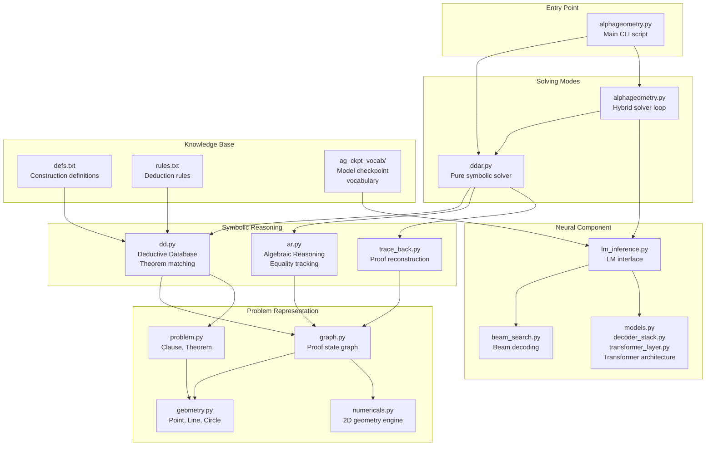
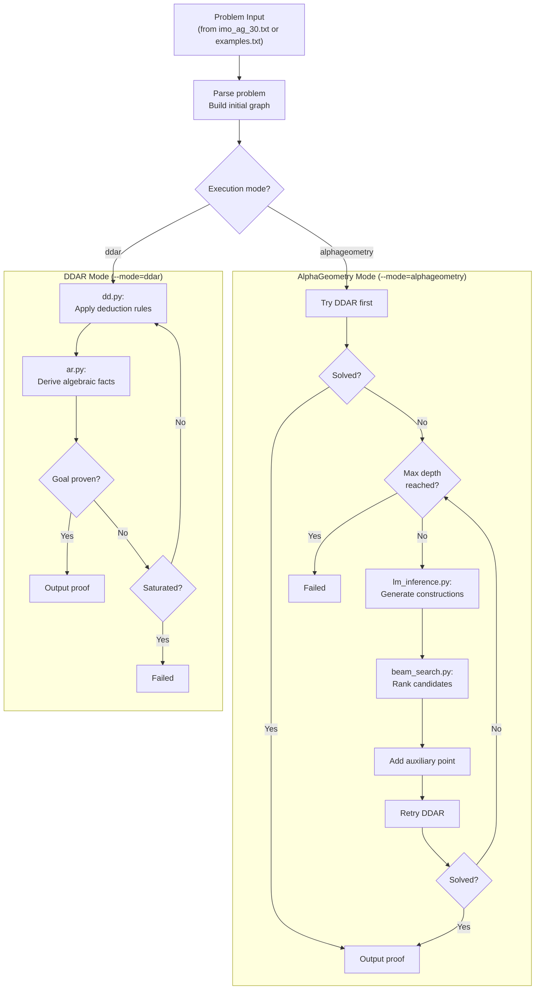

<!-- source: DeepWiki mcp.deepwiki.com · repo google-deepmind/alphageometry · page 1 Overview · fetched 2026-10-26 -->

# Overview

<details>
<summary>Relevant source files</summary>

The following files were used as context for generating this wiki page:

- [README.md](README.md)

</details>


## Purpose and Scope

This page provides a high-level introduction to AlphaGeometry, a geometric theorem proving system that combines symbolic deduction with neural language models. The document explains the system's purpose, capabilities, and architectural organization. For detailed information about specific components, see:
- Symbolic deduction engine: [DD+AR Solver](#4)
- Neural components: [Language Model Component](#5)
- Problem representation: [Geometric Representation](#3)
- Practical usage instructions: [Usage Guide](#6)

**Sources:** [README.md:1-10]()

---

## What is AlphaGeometry?

AlphaGeometry is a geometry theorem proving system introduced in the Nature 2024 paper "Solving Olympiad Geometry without Human Demonstrations." The system proves geometric theorems at the level of International Mathematical Olympiad (IMO) problems without requiring human-annotated proofs during training.

The system implements two solving modes:

| Mode | Description | Components Used |
|------|-------------|-----------------|
| **DDAR** | Pure symbolic reasoning | DD (deductive database) + AR (algebraic reasoning) |
| **AlphaGeometry** | Neural-symbolic hybrid | DDAR + Language Model for auxiliary constructions |

In DDAR mode, the solver applies deduction rules and algebraic reasoning iteratively until the goal is proven or the system saturates. In AlphaGeometry mode, when symbolic reasoning stalls, a trained language model proposes auxiliary geometric constructions (e.g., "add point E on line AC") that enable symbolic reasoning to proceed.

**Sources:** [README.md:2-10](), [README.md:329-357]()

---

## Research Context and Performance

### Publication and Development

- **Primary Publication:** Nature 2024 (DOI: 10.1038/s41586-023-06747-5)
- **Collaboration:** Google DeepMind and New York University Computer Science Department
- **Follow-up:** AlphaGeometry2 published in JMLR (Jan 2026)
- **License:** Apache 2.0 for code, CC-BY 4.0 for model checkpoints

### Benchmark Performance

The system was evaluated on two problem sets:

| Problem Set | Total Problems | DDAR Solved | AlphaGeometry Solved |
|-------------|----------------|-------------|----------------------|
| **IMO-AG-30** | 30 IMO geometry problems | 14 | 25 |
| **JGEX-AG-231** | 231 problems | 198 | 228 |

The IMO-AG-30 set consists of geometry problems from International Mathematical Olympiad competitions, representing olympiad-level difficulty. The results demonstrate that the neural-symbolic hybrid approach substantially outperforms pure symbolic reasoning.

**Sources:** [README.md:8-10](), [README.md:303-327](), [README.md:371-381]()

---

## System Architecture Overview

The following diagram maps the system's conceptual components to their implementing code modules:



**Key architectural principles:**

1. **Modular separation:** Symbolic reasoning (DD, AR) is independent of neural components (LM, beam search)
2. **Central graph representation:** `graph.py` serves as the hub connecting all components
3. **Declarative knowledge:** Deduction rules and construction definitions are defined in text files, not hardcoded
4. **Numerical backend:** `numericals.py` provides validation through concrete 2D coordinates

**Sources:** [README.md:329-368]()

---

## Execution Flow Comparison

The following diagram illustrates how problem-solving differs between DDAR and AlphaGeometry modes:



**DDAR mode characteristics:**
- Deterministic: always produces the same output for a given problem
- Fast: no neural inference overhead
- Limited: cannot solve problems requiring auxiliary constructions

**AlphaGeometry mode characteristics:**
- Stochastic: language model sampling introduces variation
- Computationally intensive: requires GPU for model inference
- More powerful: can propose auxiliary constructions that unlock new proof paths
- Configurable search depth: controlled via `--search_depth` flag

**Sources:** [README.md:140-186](), [README.md:199-272]()

---

## Core Component Breakdown

### Symbolic Reasoning Components

The symbolic engine consists of three tightly integrated modules:

**`dd.py` - Deductive Database**
- Loads deduction rules from `rules.txt` [README.md:79-86]()
- Matches rule patterns against current proof state
- Applies matched rules to derive new geometric facts
- Example rule: "If AB ⊥ CD and CD ⊥ EF, then AB ∥ EF"
- See [Deductive Database](#4.1) for details

**`ar.py` - Algebraic Reasoning**
- Maintains tables of algebraic equalities: ratios, angles, distances
- Derives new equalities through algebraic manipulation
- Tracks dependencies for proof reconstruction
- Example: "If AB:CD = 2:3 and CD:EF = 3:4, then AB:EF = 1:2"
- See [Algebraic Reasoning](#4.2) for details

**`trace_back.py` - Proof Reconstruction**
- Recursively traces dependencies from proven goal back to premises
- Produces human-readable proof steps with numbered references
- Implements dependency difference algorithm to minimize proof steps
- See [Integration and Proof Search](#4.3) for details

### Neural Components

**`lm_inference.py` - Language Model Interface**
- Loads pre-trained transformer checkpoint from `ag_ckpt_vocab/`
- Configures model via Gin configuration files [README.md:117-133]()
- Encodes problem state as token sequence
- Decodes auxiliary construction proposals
- See [Language Model Component](#5) for details

**`beam_search.py` - Beam Search Decoder**
- Implements parallel generation of multiple candidate constructions
- Ranks candidates by language model score with brevity penalty
- Manages beam state across decoding steps
- See [Beam Search Decoding](#5.2) for details

### Representation Components

**`graph.py` - Proof State Graph**
- Central data structure maintaining all known geometric facts
- Nodes represent points, predicates represent relationships
- Updated incrementally as new facts are derived
- See [Geometric Representation](#3) for details

**`geometry.py` - Geometric Primitives**
- Defines `Point`, `Line`, `Circle`, `Angle`, `Segment` classes
- Represents geometric relationships as predicates
- Examples: `perp(AB, CD)`, `cong(AB, CD)`, `on_line(P, AB)`

**`numericals.py` - Numerical Engine**
- Implements concrete 2D coordinate geometry operations
- Validates constructions and predicates numerically
- Used for visualization and sanity checking
- See [Numerical Geometry Engine](#3.1) for details

**Sources:** [README.md:329-357]()

---

## Example Walkthrough: Orthocenter Problem

The README provides a detailed example of solving the orthocenter problem in AlphaGeometry mode. This illustrates the complete system workflow.

### Problem Statement

Given triangle ABC with altitudes BD and CD, prove that AD ⊥ BC.

**Problem encoding in `examples.txt`:**
```
orthocenter : a b c = triangle a b c; d = on_tline d b a c, on_tline d c a b ? perp a d b c
```

**Explanation:**
- `a b c = triangle a b c`: Construct triangle ABC
- `d = on_tline d b a c, on_tline d c a b`: Point D is intersection of perpendicular from B to AC and perpendicular from C to AB
- `? perp a d b c`: Goal is to prove AD ⊥ BC

### Execution Flow

**Phase 1: Initial DDAR attempt** [README.md:229-231]()
```
ddar.py:41] Depth 1/1000 time = 0.009987592697143555 branch = 4
ddar.py:41] Depth 2/1000 time = 0.00672602653503418 branch = 0
alphageometry.py:221] DD+AR failed to solve the problem.
```
Pure symbolic reasoning saturates without finding a proof.

**Phase 2: Language model proposes construction** [README.md:238-239]()
```
alphageometry.py:470] LM output (score=-1.102287): "e : C a c e 02 C b d e 03 ;"
alphageometry.py:471] Translation: "e = on_line e a c, on_line e b d"
```
The LM proposes adding auxiliary point E at the intersection of AC and BD.

**Phase 3: DDAR retries with auxiliary point** [README.md:244-269]()
```
ddar.py:41] Depth 1/1000 time = 0.021120786666870117
ddar.py:41] Depth 2/1000 time = 0.033370018005371094
ddar.py:41] Depth 3/1000 time = 0.04297471046447754
```
With point E added, symbolic reasoning succeeds in 3 steps, producing a complete proof.

**Proof output structure:**
1. Lists theorem premises (given facts)
2. Lists auxiliary constructions (LM proposals)
3. Lists proof steps with references: `[02]`, `[03]`, etc.
4. Each step shows: antecedents → consequent with rule name

This example demonstrates the synergy between symbolic and neural components: DDAR provides rigorous logical inference, while the LM provides creative construction proposals.

**Sources:** [README.md:199-272]()

---

## File Organization

### Python Modules

| Category | Files | Purpose |
|----------|-------|---------|
| **Entry Point** | `alphageometry.py` | CLI, problem loading, solver orchestration |
| **Symbolic Solver** | `ddar.py`, `dd.py`, `ar.py`, `trace_back.py` | Deduction and algebraic reasoning |
| **Neural Inference** | `lm_inference.py`, `beam_search.py`, `models.py`, `decoder_stack.py`, `transformer_layer.py` | Language model implementation |
| **Representation** | `graph.py`, `geometry.py`, `problem.py`, `graph_utils.py` | Problem state and geometric objects |
| **Numerical Backend** | `numericals.py` | 2D coordinate geometry operations |
| **Utilities** | `pretty.py` | Proof formatting |
| **Tests** | `*_test.py` | Unit tests for each module |

### Resource Files

| File | Description | Usage |
|------|-------------|-------|
| `defs.txt` | Construction definitions | Loaded by `dd.py` to define valid geometric constructions [README.md:79-86]() |
| `rules.txt` | Deduction rules | Loaded by `dd.py` to define inference rules [README.md:79-86]() |
| `geometry_150M_generate.gin` | Model configuration | Gin config for 150M parameter transformer |
| `imo_ag_30.txt` | IMO problems | 30 olympiad geometry problems |
| `jgex_ag_231.txt` | JGEX problems | 231 synthetic geometry problems |
| `examples.txt` | Example problems | Simple problems for testing (orthocenter, incenter, etc.) |

### Scripts

| Script | Purpose |
|--------|---------|
| `run.sh` | Executes all README instructions in sequence |
| `download.sh` | Downloads model checkpoint and vocabulary from cloud storage |
| `run_tests.sh` | Executes complete test suite |

**Sources:** [README.md:329-368]()

---

## Dependencies and Setup

### Python Environment

- **Python version:** 3.10.9 [README.md:25-27]()
- **Virtual environment:** Created via `virtualenv` [README.md:50-54]()
- **Dependencies:** Listed in `requirements.txt` with version hashes [README.md:53]()

### External Libraries

| Library | Purpose | Installation |
|---------|---------|--------------|
| **meliad** | Transformer framework from Google Research | Manually cloned from GitHub [README.md:63-71]() |
| **JAX** | Numerical computation for model inference | Via pip |
| **TensorFlow** | Model checkpoint loading | Via pip |
| **Gin** | Configuration management | Via pip |
| **SentencePiece** | Tokenization | Via pip (optional for DDAR-only usage) |

### Model Artifacts

The `download.sh` script retrieves:
- **Model checkpoint:** Pre-trained 150M parameter transformer weights
- **Vocabulary file:** `geometry.757.model` for tokenization
- **Storage location:** `ag_ckpt_vocab/` directory

**Note:** DDAR mode can run without `meliad` and `sentencepiece` dependencies by disabling `lm_inference` module import in `alphageometry.py` [README.md:135-139]().

**Sources:** [README.md:23-71](), [README.md:396-410]()

---

## Key Concepts

### Auxiliary Constructions

The central innovation in AlphaGeometry is using a language model to propose **auxiliary constructions**—adding new geometric objects (typically points) that enable previously impossible proofs. 

**Example:** In the orthocenter problem, adding point E at the intersection of two altitudes creates similar triangles, unlocking an algebraic proof path.

**Construction syntax:** 
```
e = on_line e a c, on_line e b d
```
This means: "Construct point E as the intersection of line AC and line BD"

### Saturation

**Saturation** occurs when the symbolic solver (DDAR) can derive no new facts from the current problem state. In DDAR mode, saturation means failure. In AlphaGeometry mode, saturation triggers the language model to propose auxiliary constructions.

### Beam Search

Rather than generating a single construction proposal, AlphaGeometry uses **beam search** to generate and maintain multiple candidate constructions in parallel, ranked by language model score. The solver tries candidates in score order, stopping when one succeeds.

**Configuration:**
- `--beam_size=512`: Number of parallel candidates (paper value)
- `--search_depth=16`: Maximum number of auxiliary construction iterations (paper value)

Lightweight values (`BEAM_SIZE=2`, `DEPTH=2`) are used in README examples for demonstration [README.md:92-101]().

**Sources:** [README.md:92-110](), [README.md:289-302]()

---

## Next Steps

To learn more about specific system components:

- **Understand symbolic reasoning:** See [DD+AR Solver](#4) for deduction rules and algebraic reasoning algorithms
- **Understand neural components:** See [Language Model Component](#5) for transformer architecture and beam search implementation
- **Run the system yourself:** See [Usage Guide](#6) for installation and execution instructions
- **Explore problem formats:** See [Problem Definition Format](#3.2) for syntax details
- **View example problems:** See [Example Problems](#8.2) for annotated geometry problems

**Sources:** [README.md:1-450]()

---

