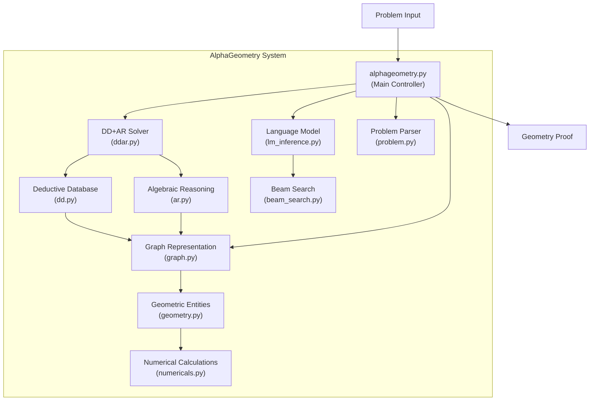
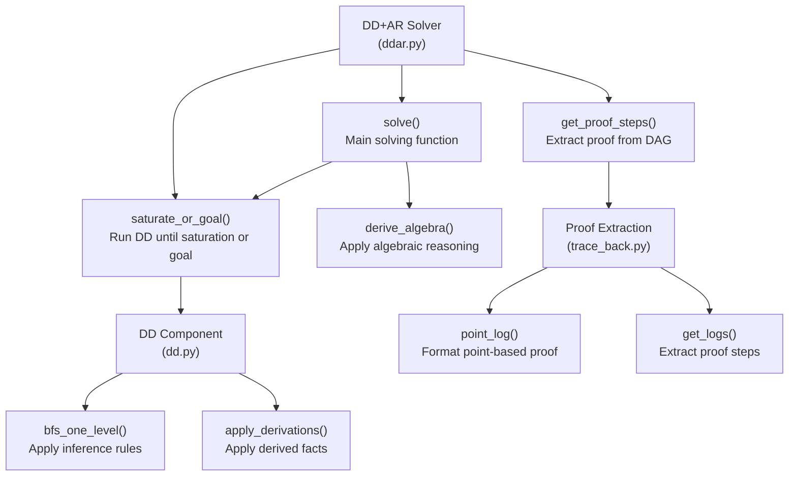
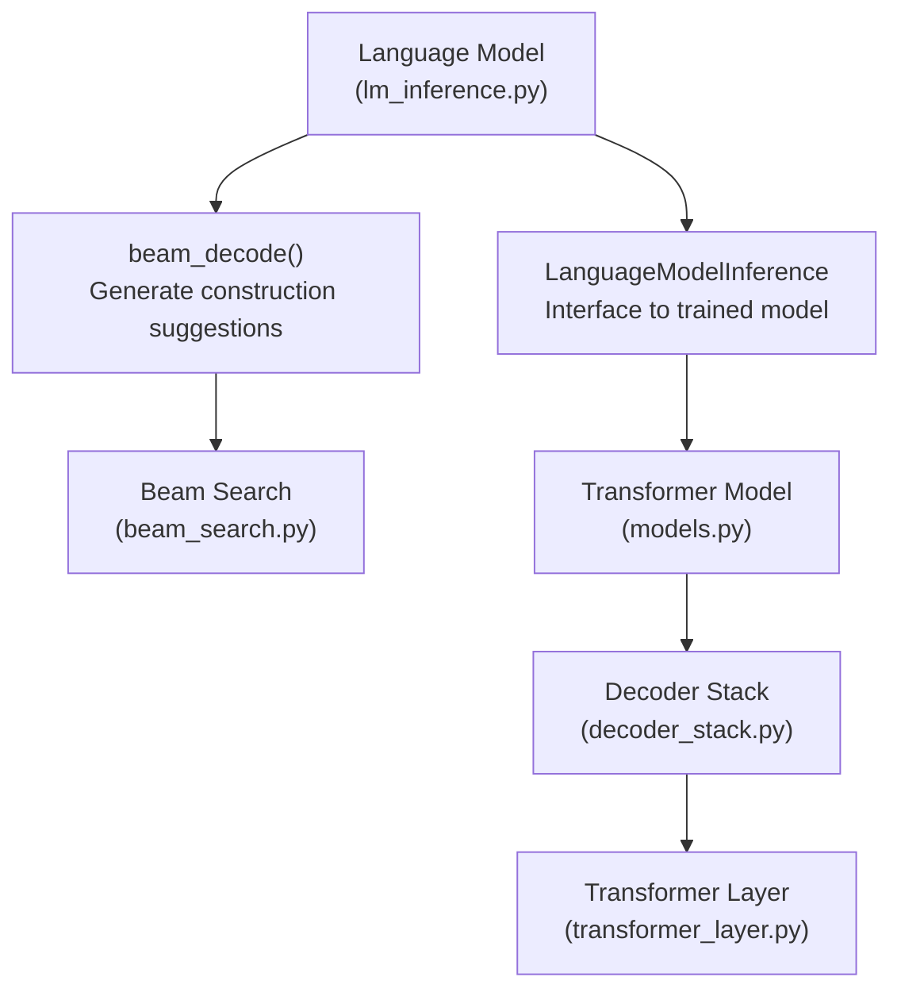
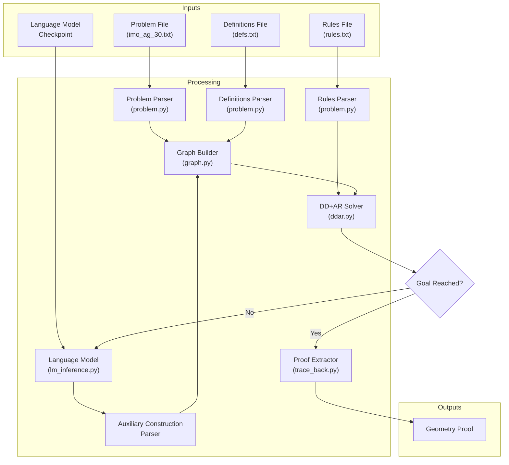
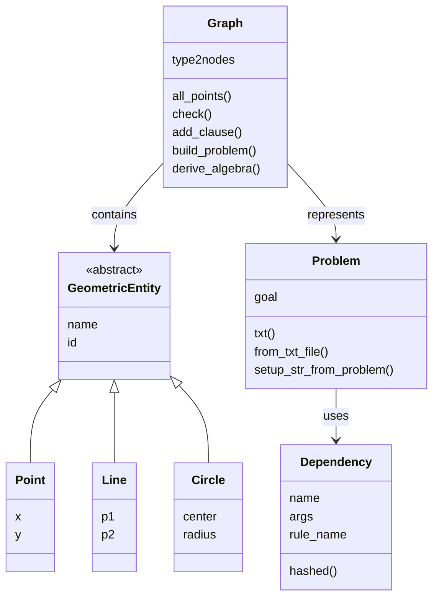

<!-- source: DeepWiki mcp.deepwiki.com · repo google-deepmind/alphageometry · page 2 System Architecture · fetched 2026-10-26 -->

# System Architecture

<details>
<summary>Relevant source files</summary>

The following files were used as context for generating this wiki page:

- [README.md](README.md)
- [alphageometry.py](alphageometry.py)

</details>


## Purpose and Scope

This document describes the high-level architecture of AlphaGeometry, a system for solving Olympiad-level geometry problems without human demonstrations. It explains how the main components interact to process and solve geometric problems through a combination of symbolic reasoning and language model guidance. 

This document focuses on the overall structure and component interactions. For detailed information about specific components, see [Core Components](#2.1) and [Data Structures](#2.2). For in-depth explanations of the solving approaches, see [DD+AR Solving Approach](#3) and [Language Model Component](#4).

## High-Level System Overview

AlphaGeometry combines symbolic reasoning with neural-guided search to solve complex geometric problems. The system consists of two major components:

1. **DD+AR (Deduction-Driven with Auxiliary Rules)**: A symbolic reasoning engine that applies geometric theorems to deduce new facts from a problem statement
2. **Language Model-Guided Search**: A transformer-based language model that suggests auxiliary constructions when the symbolic reasoning engine reaches saturation



Sources: [alphageometry.py:16-19](), [README.md:329-349]()

## Execution Flow

The AlphaGeometry system operates in two primary modes: `ddar` and `alphageometry`. The `ddar` mode uses only the symbolic reasoning engine, while the `alphageometry` mode integrates both symbolic reasoning and language model guidance.

```mermaid
sequenceDiagram
    participant Main as alphageometry.py
    participant Graph as graph.py
    participant DDAR as ddar.py
    participant LM as lm_inference.py
    
    Note over Main: Parse arguments and load definitions/rules
    Main->>Graph: Build problem graph
    
    alt mode == "ddar"
        Main->>DDAR: run_ddar()
        DDAR->>DDAR: solve()
        DDAR-->>Main: Return result (solved or saturated)
    else mode == "alphageometry"
        Main->>DDAR: Initial attempt with run_ddar()
        
        alt DDAR succeeds
            DDAR-->>Main: Solution found
        else DDAR saturates
            loop until solution or max depth
                Main->>LM: Generate auxiliary constructions
                LM-->>Main: Ranked construction suggestions
                Main->>Graph: Add best construction
                Main->>DDAR: Try with new construction
                
                alt DDAR succeeds
                    DDAR-->>Main: Solution found
                    break
                end
            end
        end
    end
    
    Main->>Main: Write solution
```

Sources: [alphageometry.py:206-232](), [alphageometry.py:488-601]()

## Component Architecture

### DD+AR Solver

The DD+AR solver is the symbolic reasoning engine of AlphaGeometry. It combines deductive database (DD) techniques with algebraic reasoning (AR) to derive new geometric facts from given premises.



Sources: [ddar.py:16-17](), [ddar.py:27-75](), [ddar.py:77-131](), [ddar.py:134-157]()

### Language Model Component

When the DD+AR solver reaches saturation without finding a solution, the language model component generates auxiliary constructions that may help with the proof.



Sources: [alphageometry.py:198-203](), [README.md:341-348]()

## Data Flow

The following diagram illustrates the data flow in AlphaGeometry when solving a geometric problem:



Sources: [alphageometry.py:488-601](), [README.md:61-82]()

## Main Components and Their Roles

| Component | File | Description |
|-----------|------|-------------|
| Main Controller | `alphageometry.py` | Orchestrates the execution flow, loads problems, and manages the solving process |
| Problem Parser | `problem.py` | Parses problem statements, definitions, and theorems from text files |
| Graph Representation | `graph.py` | Maintains the geometric state representation and supports operations on it |
| DD+AR Solver | `ddar.py` | Implements the combined deductive database and algebraic reasoning approach |
| Deductive Database | `dd.py` | Applies inference rules to derive new geometric facts |
| Algebraic Reasoning | `ar.py` | Derives additional facts using algebraic manipulations |
| Trace Back | `trace_back.py` | Implements recursive traceback to generate proof steps |
| Language Model | `lm_inference.py` | Provides interface to a trained language model for construction suggestions |
| Beam Search | `beam_search.py` | Implements beam decoding for language model outputs |
| Geometric Entities | `geometry.py` | Defines the geometric objects (Point, Line, Circle, etc.) |
| Numerical Calculations | `numericals.py` | Provides numerical computation for dynamic geometry environment |

Sources: [README.md:329-349]()

## Key Data Structures

The core data structures in AlphaGeometry include:

1. **Graph (graph.py)**: Represents the geometric state, containing all points, lines, circles, and relationships between them.
2. **Problem (problem.py)**: Represents a geometric problem with premises, goal, and auxiliary constructions.
3. **Dependency (problem.py)**: Represents logical dependencies in the proof steps.
4. **Geometric Entities (geometry.py)**: Defines the fundamental geometric objects like Point, Line, and Circle.



Sources: [README.md:329-349](), [alphageometry.py:83-95]()

## Integration Between Components

The main integration points in the AlphaGeometry system are:

1. **Problem Representation → Graph**: Problems parsed from text files are converted to a graph representation.
2. **DD+AR ↔ Graph**: The DD+AR solver operates on the graph representation to derive new facts.
3. **Language Model → Construction**: The language model suggests auxiliary constructions that are parsed and added to the graph.
4. **Graph → Proof Extraction**: When a solution is found, the proof is extracted from the graph representation.

This integration allows AlphaGeometry to seamlessly combine symbolic reasoning with neural-guided search, making it capable of solving complex geometric problems that would be difficult for either approach individually.

Sources: [alphageometry.py:488-601](), [README.md:316-325]()

---

