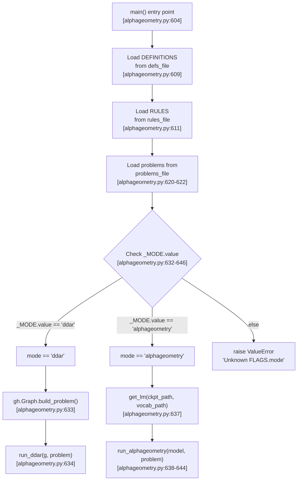
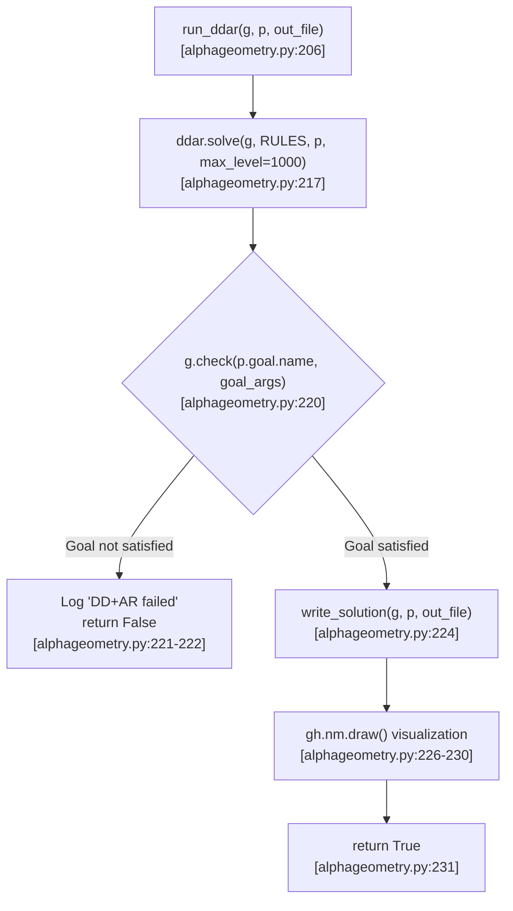
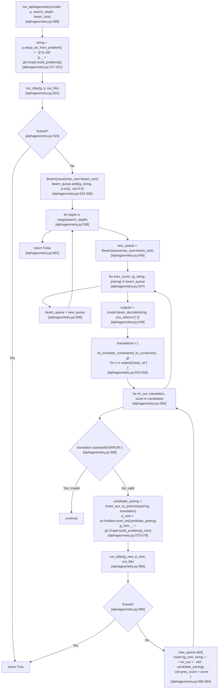
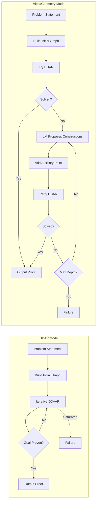

<!-- source: DeepWiki mcp.deepwiki.com · repo google-deepmind/alphageometry · page 2.1 Execution Modes · fetched 2026-10-26 -->

# Execution Modes

<details>
<summary>Relevant source files</summary>

The following files were used as context for generating this wiki page:

- [README.md](README.md)
- [alphageometry.py](alphageometry.py)

</details>


## Purpose and Scope

This document explains the two primary execution modes available in AlphaGeometry: **DDAR mode** (pure symbolic deduction) and **AlphaGeometry mode** (neural-symbolic hybrid). It covers how to select each mode, their execution workflows, and when to use each approach. For details on the underlying deductive database and algebraic reasoning engines, see [DD+AR Solver](#4). For information on the language model architecture used in AlphaGeometry mode, see [Language Model Component](#5).

## Mode Selection

The system provides two distinct solving strategies controlled via the `--mode` command-line flag defined in [alphageometry.py:56]():

| Mode | Value | Description |
|------|-------|-------------|
| **DDAR** | `--mode=ddar` | Pure symbolic deduction using Deductive Database (DD) and Algebraic Reasoning (AR) |
| **AlphaGeometry** | `--mode=alphageometry` | Hybrid approach combining DDAR with neural language model for auxiliary construction generation |

**Mode Dispatch Flow**



Sources: [alphageometry.py:604-648]()

## DDAR Mode: Pure Symbolic Deduction

DDAR mode executes purely symbolic reasoning without neural components. It iteratively applies deduction rules and algebraic reasoning until the goal is proven or the system reaches saturation (no new facts can be derived).

### Execution Flow



Sources: [alphageometry.py:206-231]()

### Command-Line Invocation

```bash
python -m alphageometry \
  --mode=ddar \
  --problems_file=imo_ag_30.txt \
  --problem_name=translated_imo_2000_p1 \
  --defs_file=defs.txt \
  --rules_file=rules.txt \
  --out_file=solution.txt
```

**Required Flags for DDAR Mode:**

| Flag | Purpose | Example Value |
|------|---------|---------------|
| `--mode` | Select DDAR mode | `ddar` |
| `--problems_file` | Input problem file | `imo_ag_30.txt` |
| `--problem_name` | Specific problem to solve | `translated_imo_2000_p1` |
| `--defs_file` | Construction definitions | `defs.txt` |
| `--rules_file` | Deduction rules | `rules.txt` |

**Optional Flags:**

| Flag | Purpose | Default |
|------|---------|---------|
| `--out_file` | Output solution file | (empty, logs only) |

Sources: [README.md:140-157](), [alphageometry.py:45-71]()

### Characteristics

- **No auxiliary constructions**: Works only with points defined in the problem statement
- **Deterministic**: Same input always produces same output
- **Fast**: No neural inference overhead
- **Limited coverage**: Can solve ~14/30 IMO-AG-30 problems, ~198/231 JGEX-AG-231 problems
- **No external dependencies**: Runs without `meliad` or model checkpoints

Sources: [README.md:316-327]()

## AlphaGeometry Mode: Neural-Symbolic Hybrid

AlphaGeometry mode augments DDAR with a language model that proposes auxiliary geometric constructions when symbolic reasoning alone cannot solve the problem. It performs iterative deepening search up to a specified depth.

### Execution Flow



Sources: [alphageometry.py:488-601]()

### Command-Line Invocation

```bash
python -m alphageometry \
  --mode=alphageometry \
  --problems_file=examples.txt \
  --problem_name=orthocenter \
  --defs_file=defs.txt \
  --rules_file=rules.txt \
  --ckpt_path=ag_ckpt_vocab \
  --vocab_path=ag_ckpt_vocab/geometry.757.model \
  --beam_size=512 \
  --search_depth=16 \
  --gin_search_paths=meliad_lib/meliad/transformer/configs \
  --gin_file=base_htrans.gin \
  --gin_file=size/medium_150M.gin \
  --gin_file=options/positions_t5.gin \
  --gin_file=options/lr_cosine_decay.gin \
  --gin_file=options/seq_1024_nocache.gin \
  --gin_file=geometry_150M_generate.gin
```

**Additional Required Flags (beyond DDAR flags):**

| Flag | Purpose | Example Value |
|------|---------|---------------|
| `--ckpt_path` | Model checkpoint directory | `ag_ckpt_vocab` |
| `--vocab_path` | Vocabulary file | `ag_ckpt_vocab/geometry.757.model` |
| `--beam_size` | Beam search width | `512` (paper), `2` (demo) |
| `--search_depth` | Maximum construction depth | `16` (paper), `2` (demo) |
| `--gin_search_paths` | Gin config search paths | `meliad_lib/meliad/transformer/configs` |
| `--gin_file` | Gin configuration files | Multiple files (see above) |

Sources: [README.md:199-215](), [alphageometry.py:33-77]()

### Auxiliary Construction Generation

The language model generates auxiliary construction proposals in a constrained format, which are then validated and translated to constructive predicates.

**LM Input Format:**
```
<existing_points> : <predicates> {F1} x00
```

**LM Output Format:**
```
<new_point> : <predicate_1> <id> <predicate_2> <id> ;
```

**Example:**
```
Input:  "a : ; b : ; c : ; d : T a b c d 00 T a c b d 01 ? T a d b c {F1} x00"
Output: "e : C a c e 02 C b d e 03 ;"
```

The output is translated via `try_translate_constrained_to_construct()` [alphageometry.py:371-442]() which:
1. Validates the syntax and point existence
2. Converts constraint-based predicates to constructive predicates using `translate_constrained_to_constructive()` [alphageometry.py:234-313]()
3. Attempts to add the construction to a copy of the graph to verify feasibility

**Mapping Examples:**

| Constraint Predicate | Constructive Predicate | Description |
|---------------------|------------------------|-------------|
| `T a b c d` (perp) | `on_tline a b c d` | Point `a` on line perpendicular to `cd` through `b` |
| `P a b c d` (para) | `on_pline a b c d` | Point `a` on line parallel to `cd` through `b` |
| `C a b c` (coll) | `on_line a b c` | Point `a` on line through `b` and `c` |
| `D a b c d` (cong) | `on_circle a b d` or `eqdistance a b c d` | Point `a` such that distances are equal |

Sources: [alphageometry.py:234-313](), [alphageometry.py:371-442](), [alphageometry.py:549-594]()

### Beam Search Mechanism

The search maintains a priority queue (`BeamQueue` [alphageometry.py:459-486]()) of at most `beam_size` proof states, each represented as a tuple:
```python
(graph, lm_input_string, problem_string)
```

At each depth level:
1. Expand all nodes in the beam
2. For each node, decode `beam_size` candidate auxiliary constructions
3. Score each candidate by LM log probability
4. Attempt DDAR on each valid construction
5. Add successful and unsuccessful candidates to new queue
6. Keep only top `beam_size` candidates by cumulative score

The cumulative score for a path is:
```
score(path) = sum of LM scores for all constructions on the path
```

Sources: [alphageometry.py:459-486](), [alphageometry.py:532-599]()

### Characteristics

- **Auxiliary constructions**: Proposes new points to enable proof discovery
- **Non-deterministic**: Different random seeds may explore different paths
- **Slower**: Requires GPU for neural inference
- **Higher coverage**: Solves ~25/30 IMO-AG-30 problems, ~228/231 JGEX-AG-231 problems
- **Requires dependencies**: Needs `meliad`, model checkpoints, and GPU resources

Sources: [README.md:316-327](), [README.md:279-287]()

## Mode Comparison



Sources: [alphageometry.py:206-231](), [alphageometry.py:488-601]()

**Feature Comparison:**

| Feature | DDAR Mode | AlphaGeometry Mode |
|---------|-----------|-------------------|
| **Deduction Engine** | DD+AR via `ddar.solve()` | DD+AR via `ddar.solve()` |
| **Auxiliary Constructions** | None | LM-generated via `model.beam_decode()` |
| **Search Strategy** | Saturation-based | Beam search with bounded depth |
| **External Dependencies** | None (Python standard library + NumPy/SciPy) | `meliad`, JAX, TensorFlow, model checkpoint |
| **Point Renaming** | Preserves original names | Renames to alphabetical (a, b, c, ...) |
| **GPU Requirement** | No | Yes (for neural inference) |
| **Determinism** | Deterministic | Non-deterministic (sampling) |
| **IMO-AG-30 Coverage** | 14/30 (47%) | 25/30 (83%) |
| **JGEX-AG-231 Coverage** | 198/231 (86%) | 228/231 (99%) |

Sources: [alphageometry.py:617](), [README.md:316-327]()

## Configuration Parameters

### Paper-Reported Settings

For reproducing the Nature 2024 paper results, use these parameters for AlphaGeometry mode:

```bash
BATCH_SIZE=32
BEAM_SIZE=512
SEARCH_DEPTH=16
```

With hardware requirements:
- 4 V100 GPUs for parallel model inference
- 250 CPU workers for parallel DDAR execution

Sources: [README.md:103-109]()

### Lightweight Demo Settings

For quick testing and demonstrations:

```bash
BATCH_SIZE=2
BEAM_SIZE=2
SEARCH_DEPTH=2
```

These settings allow the system to run on modest hardware but with significantly reduced solving capability.

Sources: [README.md:92-100]()

### Max DDAR Depth

Both modes use `max_level=1000` when calling `ddar.solve()` [alphageometry.py:217](), limiting the symbolic deduction depth to prevent infinite loops on unsolvable problems.

Sources: [alphageometry.py:217]()

---

