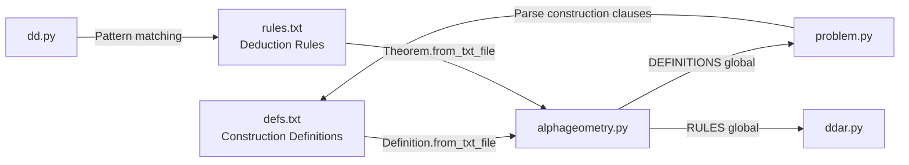
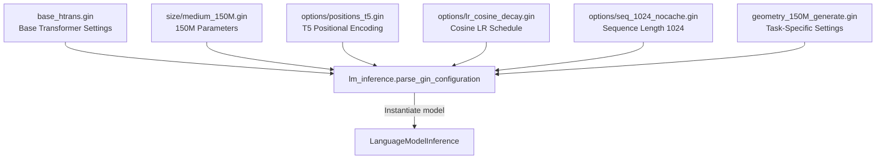
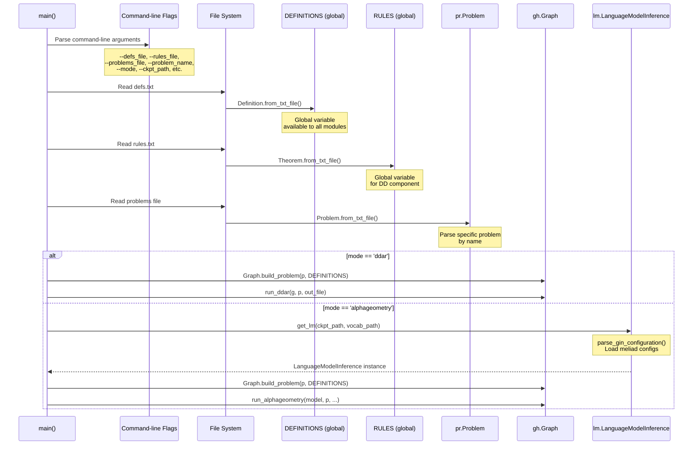
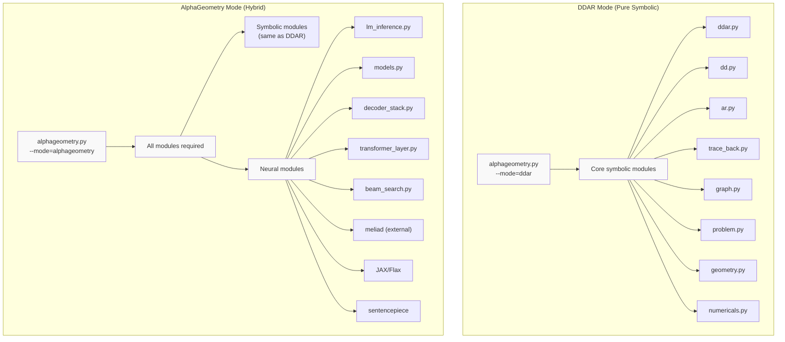

<!-- source: DeepWiki mcp.deepwiki.com · repo google-deepmind/alphageometry · page 2.2 Module Dependencies · fetched 2026-10-26 -->

# Module Dependencies

<details>
<summary>Relevant source files</summary>

The following files were used as context for generating this wiki page:

- [README.md](README.md)
- [alphageometry.py](alphageometry.py)
- [run.sh](run.sh)

</details>


## Purpose and Scope

This page documents the dependency relationships between Python modules in the AlphaGeometry codebase, the external libraries required for operation, and the configuration files that define system behavior. It covers the import graph structure, initialization sequence, and how the modular architecture enables both pure symbolic (DDAR) and hybrid neural-symbolic (AlphaGeometry) execution modes.

For information about how these modules are orchestrated during execution, see [Execution Modes](#2.1). For architectural patterns and component interactions, see [System Architecture](#2).

---

## Module Organization

The codebase is organized into five functional layers, each containing related modules that serve specific roles in the proof search pipeline.

### Layer Structure

| Layer | Modules | Primary Responsibility |
|-------|---------|----------------------|
| **Orchestration** | `alphageometry.py`, `ddar.py` | Problem loading, solver coordination, proof search control |
| **Symbolic Engine** | `dd.py`, `ar.py`, `trace_back.py` | Deductive reasoning, algebraic inference, proof reconstruction |
| **Neural Component** | `lm_inference.py`, `models.py`, `decoder_stack.py`, `transformer_layer.py`, `beam_search.py` | Language model interface, transformer architecture, beam decoding |
| **Representation** | `problem.py`, `graph.py`, `geometry.py`, `graph_utils.py` | Problem specification, proof state graph, geometric primitives |
| **Utilities** | `numericals.py`, `pretty.py` | Numerical geometry engine, output formatting |

**Sources:** [README.md:329-357](), [alphageometry.py:1-651]()

---

## Core Module Import Graph

The following diagram shows the direct import dependencies between Python modules. Nodes represent modules, and edges represent import statements.

```mermaid
graph TD
    alphageometry["alphageometry.py"]
    ddar["ddar.py"]
    dd["dd.py"]
    ar["ar.py"]
    trace_back["trace_back.py"]
    lm_inference["lm_inference.py"]
    models["models.py"]
    decoder_stack["decoder_stack.py"]
    transformer_layer["transformer_layer.py"]
    beam_search["beam_search.py"]
    problem["problem.py"]
    graph["graph.py"]
    geometry["geometry.py"]
    graph_utils["graph_utils.py"]
    numericals["numericals.py"]
    pretty["pretty.py"]
    
    alphageometry --> ddar
    alphageometry --> graph
    alphageometry --> lm_inference
    alphageometry --> pretty
    alphageometry --> problem
    
    ddar --> dd
    ddar --> ar
    ddar --> trace_back
    ddar --> graph
    ddar --> problem
    
    dd --> graph
    dd --> problem
    
    ar --> graph
    ar --> geometry
    ar --> problem
    
    trace_back --> graph
    trace_back --> problem
    
    lm_inference --> models
    lm_inference --> beam_search
    
    models --> decoder_stack
    
    decoder_stack --> transformer_layer
    
    graph --> geometry
    graph --> graph_utils
    graph --> numericals
    graph --> problem
    
    geometry --> numericals
    
    problem --> geometry
```

**Sources:** [alphageometry.py:23-30](), [README.md:335-357]()

---

## External Dependencies

### Python Standard Libraries

The system uses standard library modules for common operations:

| Library | Usage | Modules |
|---------|-------|---------|
| **absl** | Command-line flags, logging, application framework | `alphageometry.py`, all modules |
| **collections** | Data structures (defaultdict, namedtuple) | Throughout |
| **functools** | Function utilities (lru_cache) | `dd.py`, `ar.py` |
| **typing** | Type annotations | All modules |
| **traceback** | Error handling | `alphageometry.py` |

**Sources:** [alphageometry.py:21-30]()

### Scientific Computing Stack

| Library | Version | Purpose |
|---------|---------|---------|
| **numpy** | Latest | Numerical arrays, linear algebra operations |
| **scipy** | Latest | Scientific computing, optimization in AR |
| **matplotlib** | Latest | Geometry visualization |
| **jax** | Latest | Accelerated numerical computing for neural models |
| **flax** | Latest | Neural network library built on JAX |

**Sources:** [README.md:399-407](), [requirements.txt]()

### Meliad Library

The `meliad` library is a critical external dependency that provides the transformer model infrastructure. Unlike other dependencies, it is **not available through pip** and must be manually installed.

#### Installation Procedure

```bash
MELIAD_PATH=meliad_lib/meliad
mkdir -p $MELIAD_PATH
git clone https://github.com/google-research/meliad $MELIAD_PATH
export PYTHONPATH=$PYTHONPATH:$MELIAD_PATH
```

**Sources:** [README.md:63-71](), [run.sh:28-31]()

#### Components Used from Meliad

| Component | Location in Meliad | Used By |
|-----------|-------------------|---------|
| **Transformer configs** | `transformer/configs/` | Gin configuration system |
| **Base transformer** | `base_htrans.gin` | Model architecture |
| **Size configurations** | `size/medium_150M.gin` | Model parameter count |
| **Position embeddings** | `options/positions_t5.gin` | T5-style positional encoding |
| **Learning rate schedule** | `options/lr_cosine_decay.gin` | Training configuration |
| **Sequence length** | `options/seq_1024_nocache.gin` | Context window settings |

**Sources:** [README.md:113-133](), [run.sh:47-61]()

#### Optional Nature for DDAR Mode

The language model components (including meliad and sentencepiece) are **only required for AlphaGeometry mode**. DDAR mode can run without these dependencies:

```python
# From alphageometry.py - LM imports can be disabled for DDAR-only usage
# TIP: Note that you can still run the DDAR solver
# without defining SEARCH_ARGS and LM_ARGS.
# In such case, simply disable the import of the lm_inference module
# inside alphageometry.py.
```

**Sources:** [README.md:33-35](), [README.md:135-138](), [alphageometry.py:28]()

---

## Configuration File Dependencies

### Static Configuration Files

The system relies on three text-based configuration files that define the geometric domain:



#### defs.txt - Construction Definitions

Defines all valid geometric construction actions in the domain-specific language. Each definition specifies:
- Construction name (e.g., `on_line`, `on_circle`, `eqdistance`)
- Input points
- Output points (newly constructed)
- Geometric constraints

**Usage in code:**
```python
# Loaded at startup
DEFINITIONS = pr.Definition.from_txt_file(_DEFS_FILE.value, to_dict=True)

# Used when building graphs from problem text
g, _ = gh.Graph.build_problem(p, DEFINITIONS)

# Used when validating LM-proposed constructions
g.copy().add_clause(clause, 0, DEFINITIONS)
```

**Sources:** [alphageometry.py:609](), [alphageometry.py:521](), [alphageometry.py:438](), [README.md:77-86]()

#### rules.txt - Deduction Rules

Contains templates for all deductive inference rules used by the DD component. Each rule specifies:
- Premise pattern (geometric predicates required)
- Conclusion pattern (geometric predicate derived)
- Rule identifier (e.g., `r32` for SSS triangle congruence)

**Usage in code:**
```python
# Loaded at startup
RULES = pr.Theorem.from_txt_file(_RULES_FILE.value, to_dict=True)

# Passed to DD+AR solver
ddar.solve(g, RULES, p, max_level=1000)

# Used by DD for pattern matching
# Inside dd.py: theorem matching against current graph state
```

**Sources:** [alphageometry.py:611](), [alphageometry.py:217](), [README.md:77-86]()

### Gin Configuration System

The Gin library manages hierarchical configuration for the language model. Multiple Gin files are composed to define model behavior:



#### Gin File Loading Sequence

```python
# From alphageometry.py
_GIN_SEARCH_PATHS = flags.DEFINE_list(
    'gin_search_paths',
    ['third_party/py/meliad/transformer/configs'],
    'List of paths where the Gin config files are located.',
)

# Gin files are loaded in order:
LM_ARGS=(
  --gin_search_paths=$MELIAD_PATH/transformer/configs,$(pwd)
  --gin_file=base_htrans.gin              # 1. Base architecture
  --gin_file=size/medium_150M.gin          # 2. Model size
  --gin_file=options/positions_t5.gin      # 3. Position embeddings
  --gin_file=options/lr_cosine_decay.gin   # 4. Learning rate
  --gin_file=options/seq_1024_nocache.gin  # 5. Sequence length
  --gin_file=geometry_150M_generate.gin    # 6. Task-specific
  # Runtime parameter overrides
  --gin_param=DecoderOnlyLanguageModelGenerate.output_token_losses=True
  --gin_param=TransformerTaskConfig.batch_size=$BATCH_SIZE
  --gin_param=TransformerTaskConfig.sequence_length=128
  --gin_param=Trainer.restore_state_variables=False
)
```

**Sources:** [alphageometry.py:33-43](), [README.md:117-133](), [run.sh:47-61]()

### Model Checkpoints and Vocabulary

Binary data files required for language model inference:

| File | Location | Purpose |
|------|----------|---------|
| Model checkpoint | `ag_ckpt_vocab/` | Pre-trained transformer weights |
| Vocabulary | `ag_ckpt_vocab/geometry.757.model` | SentencePiece vocabulary (757 tokens) |

**Download procedure:**
```bash
bash download.sh
DATA=ag_ckpt_vocab
```

**Sources:** [README.md:56-61](), [alphageometry.py:65-68]()

---

## Initialization and Dependency Flow

### Startup Sequence

The following diagram shows the initialization order when `alphageometry.py` is executed:



**Sources:** [alphageometry.py:604-648]()

### Global State Management

Two global variables provide shared access to configuration across modules:

```python
# From alphageometry.py:79-80
DEFINITIONS = None  # contains definitions of construction actions
RULES = None       # contains rules of deductions

# Initialized in main():
def main(_):
  global DEFINITIONS
  global RULES
  
  DEFINITIONS = pr.Definition.from_txt_file(_DEFS_FILE.value, to_dict=True)
  RULES = pr.Theorem.from_txt_file(_RULES_FILE.value, to_dict=True)
```

These globals are accessed throughout the codebase:
- **DEFINITIONS**: Used by `graph.py` to interpret construction clauses, by `problem.py` to parse problem statements, and by `alphageometry.py` to validate LM-proposed constructions
- **RULES**: Passed to `ddar.solve()` which distributes to `dd.py` for theorem matching

**Sources:** [alphageometry.py:79-80](), [alphageometry.py:605-611]()

---

## Module Dependency Details

### Orchestration Layer

#### alphageometry.py

**Role:** Main entry point; coordinates between DDAR and LM components; manages proof search loop.

**Direct imports:**
```python
import ddar                  # DD+AR solver
import graph as gh           # Proof state graph
import lm_inference as lm    # Language model interface
import pretty as pt          # Output formatting
import problem as pr         # Problem representation
```

**Key functions:**
- `main()`: Entry point, loads configuration and dispatches to solver [alphageometry.py:604-648]()
- `run_ddar()`: Executes pure symbolic solver [alphageometry.py:206-231]()
- `run_alphageometry()`: Executes hybrid neural-symbolic solver [alphageometry.py:488-601]()
- `get_lm()`: Initializes language model with Gin configs [alphageometry.py:198-203]()

**Sources:** [alphageometry.py:1-651]()

#### ddar.py

**Role:** Integrates DD (deductive database) and AR (algebraic reasoning) in alternating fashion; implements proof search strategy.

**Direct imports:**
```python
import dd              # Deductive database
import ar              # Algebraic reasoning
import trace_back      # Proof reconstruction
import graph           # Proof state graph
import problem         # Problem representation
```

**Key function:**
- `solve()`: Main DD+AR alternation loop with saturation detection
- `get_proof_steps()`: Extracts human-readable proof from graph

**Sources:** [README.md:345]()

### Symbolic Engine Layer

#### dd.py

**Role:** Implements deductive database; performs theorem pattern matching; applies inference rules.

**Direct imports:**
```python
import graph           # Accesses proof state graph
import problem         # Uses Theorem class for rule templates
```

**Key capabilities:**
- Built-in matchers for common geometric patterns (collinearity, perpendicularity, etc.)
- Caching of matched theorem instances
- Efficient indexing for pattern retrieval

**Sources:** [README.md:342]()

#### ar.py

**Role:** Maintains algebraic tables (ratios, angles, distances); performs algebraic inference; uses linear programming for dependency tracking.

**Direct imports:**
```python
import graph           # Accesses proof state graph
import geometry        # Geometric object definitions
import problem         # Clause and dependency representation
```

**Key structures:**
- `RatioTable`: Tracks segment length ratios
- `AngleTable`: Tracks angle equalities
- `DistanceTable`: Tracks distance equalities

**Sources:** [README.md:343]()

#### trace_back.py

**Role:** Reconstructs proof dependencies by tracing backward from goal; implements dependency difference algorithm.

**Direct imports:**
```python
import graph           # Navigates dependency graph
import problem         # Dependency representation
```

**Sources:** [README.md:344]()

### Neural Component Layer

#### lm_inference.py

**Role:** Interface to trained language model; handles tokenization, beam search coordination, and output post-processing.

**Direct imports:**
```python
import models               # Transformer model architecture
import beam_search          # Beam decoding algorithm
# Also depends on meliad library (external)
```

**Key class:**
- `LanguageModelInference`: Wraps model for inference
  - `parse_gin_configuration()`: Loads and merges Gin configs [alphageometry.py:199-201]()
  - `beam_decode()`: Generates auxiliary constructions with beam search [alphageometry.py:549]()

**Sources:** [README.md:350](), [alphageometry.py:28]()

#### models.py

**Role:** Defines transformer model architecture.

**Direct imports:**
```python
import decoder_stack        # Decoder layer stack
```

**Key class:**
- `DecoderOnlyLanguageModel`: Autoregressive transformer

**Sources:** [README.md:347]()

#### decoder_stack.py

**Role:** Stacks multiple transformer layers.

**Direct imports:**
```python
import transformer_layer    # Individual attention layers
```

**Sources:** [README.md:349]()

#### transformer_layer.py

**Role:** Implements individual transformer layer with attention mechanism.

**Sources:** [README.md:348]()

#### beam_search.py

**Role:** Implements beam search decoding algorithm in JAX.

**Key function:**
- `beam_search_flat()`: Parallel beam search with brevity penalty

**Sources:** [README.md:346]()

### Representation Layer

#### problem.py

**Role:** Defines classes for problem specification: `Problem`, `Clause`, `Theorem`, `Definition`, `Dependency`.

**Direct imports:**
```python
import geometry        # Point, Line, Circle objects
```

**Key classes:**
- `Problem`: Complete problem with premises and goal
- `Clause`: Geometric constraint (e.g., "a = on_line a b c")
- `Theorem`: Inference rule template
- `Definition`: Construction definition from defs.txt
- `Dependency`: Represents a predicate with provenance

**Sources:** [README.md:341]()

#### graph.py

**Role:** Central hub; maintains proof state as graph; manages nodes for points, lines, circles; tracks dependencies.

**Direct imports:**
```python
import geometry        # Geometric primitives
import graph_utils     # Graph utility functions
import numericals      # Numerical validation
import problem         # Problem representation
```

**Key class:**
- `Graph`: Proof state representation
  - `type2nodes`: Maps geometric type to node instances
  - `check()`: Verifies if predicate holds
  - `add_clause()`: Adds new construction to graph
  - `build_problem()`: Static factory from Problem object

**Sources:** [README.md:340]()

#### geometry.py

**Role:** Defines geometric object classes: `Point`, `Line`, `Circle`, `Angle`, `Segment`.

**Direct imports:**
```python
import numericals      # Numerical geometry operations
```

**Sources:** [README.md:337]()

#### graph_utils.py

**Role:** Utility functions for graph operations.

**Sources:** [README.md:339]()

### Utilities Layer

#### numericals.py

**Role:** Numerical engine; implements 2D Euclidean geometry; handles intersections, distance calculations, visualization.

**No internal imports** (only standard libraries: numpy, matplotlib).

**Sources:** [README.md:338]()

#### pretty.py

**Role:** Formats solver output as human-readable proofs.

**No internal imports** (utility functions only).

**Sources:** [README.md:352]()

---

## Conditional Dependencies

### DDAR Mode vs AlphaGeometry Mode

The import requirements differ based on execution mode:



**Configuration differences:**

| Aspect | DDAR Mode | AlphaGeometry Mode |
|--------|-----------|-------------------|
| **Required flags** | `--defs_file`, `--rules_file` | All DDAR flags + `--ckpt_path`, `--vocab_path`, `--gin_file`, `--beam_size`, `--search_depth` |
| **External dependencies** | numpy, scipy, matplotlib | + JAX, Flax, meliad, sentencepiece |
| **Gin configuration** | Not used | Required (multiple .gin files) |
| **Model checkpoint** | Not needed | Required (`ag_ckpt_vocab/`) |
| **lm_inference import** | Can be disabled | Required |

**Sources:** [README.md:33-35](), [README.md:135-138](), [README.md:140-157](), [README.md:199-215]()

---

## Test Dependencies

Test modules follow a naming convention: `*_test.py` for each corresponding module.

| Test Module | Tests Module | Key Aspects Tested |
|-------------|-------------|-------------------|
| `dd_test.py` | `dd.py` | Theorem matching, rule application |
| `ar_test.py` | `ar.py` | Algebraic table operations, dependency tracking |
| `ddar_test.py` | `ddar.py` | DD+AR integration, proof search |
| `graph_test.py` | `graph.py` | Graph construction, node management |
| `geometry_test.py` | `geometry.py` | Geometric object operations |
| `numericals_test.py` | `numericals.py` | Numerical geometry calculations |
| `problem_test.py` | `problem.py` | Problem parsing, clause representation |

**Execution:**
```bash
bash run_tests.sh
```

**Sources:** [README.md:306-310](), [README.md:353]()

---

## Summary Table: Module Dependencies

| Module | Direct Dependencies | External Libraries | Configuration Files |
|--------|-------------------|-------------------|-------------------|
| `alphageometry.py` | ddar, graph, lm_inference, pretty, problem | absl | defs.txt, rules.txt, *.gin |
| `ddar.py` | dd, ar, trace_back, graph, problem | absl | - |
| `dd.py` | graph, problem | absl | rules.txt (via RULES global) |
| `ar.py` | graph, geometry, problem | scipy, absl | - |
| `trace_back.py` | graph, problem | absl | - |
| `lm_inference.py` | models, beam_search | jax, flax, meliad, gin, sentencepiece, absl | *.gin files |
| `models.py` | decoder_stack | jax, flax | - |
| `decoder_stack.py` | transformer_layer | jax, flax | - |
| `transformer_layer.py` | - | jax, flax | - |
| `beam_search.py` | - | jax | - |
| `problem.py` | geometry | absl | defs.txt (via DEFINITIONS global) |
| `graph.py` | geometry, graph_utils, numericals, problem | absl | defs.txt (via DEFINITIONS global) |
| `geometry.py` | numericals | absl | - |
| `graph_utils.py` | - | absl | - |
| `numericals.py` | - | numpy, matplotlib | - |
| `pretty.py` | - | - | - |

**Sources:** All module files, [README.md:329-368]()

---

