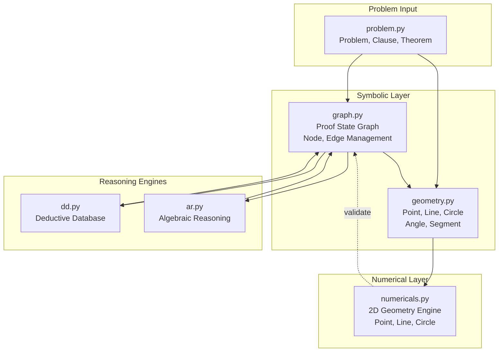
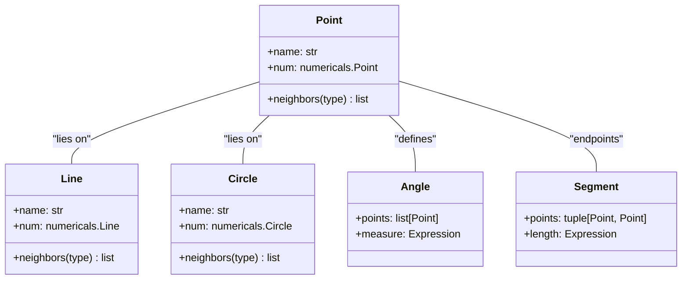
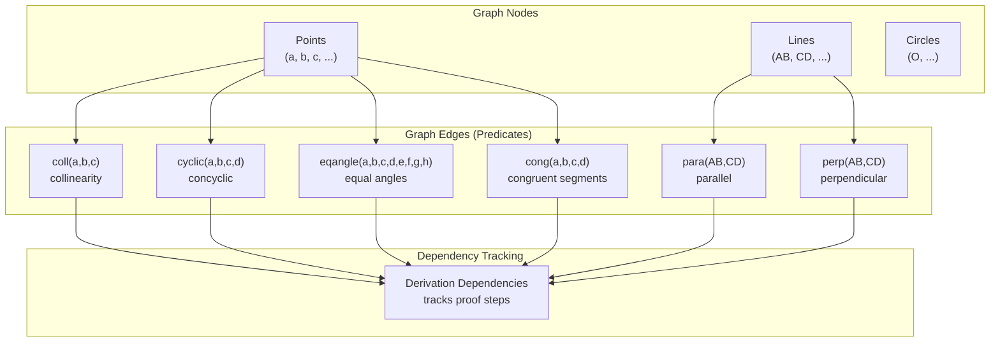
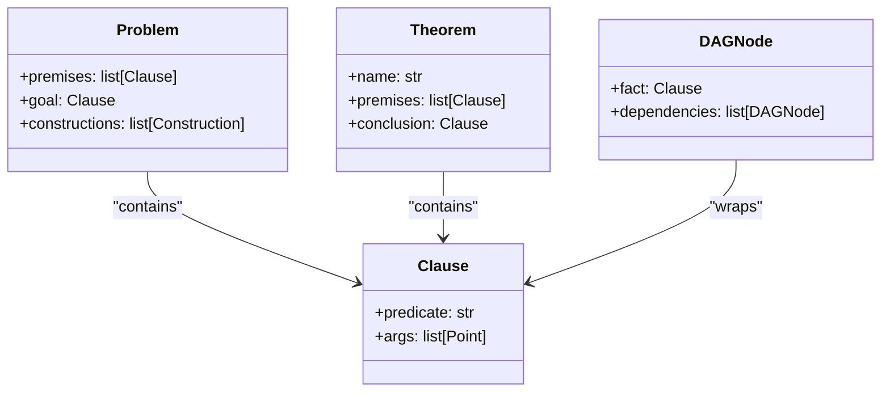
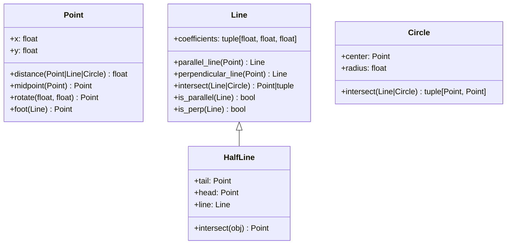
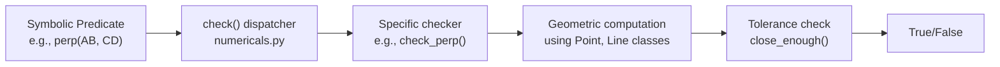
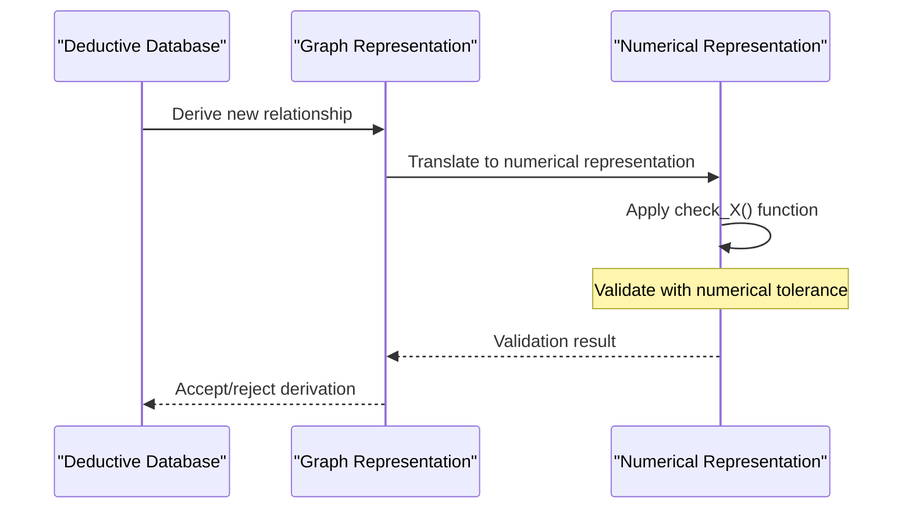
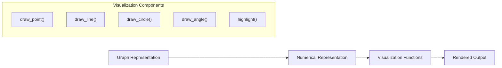
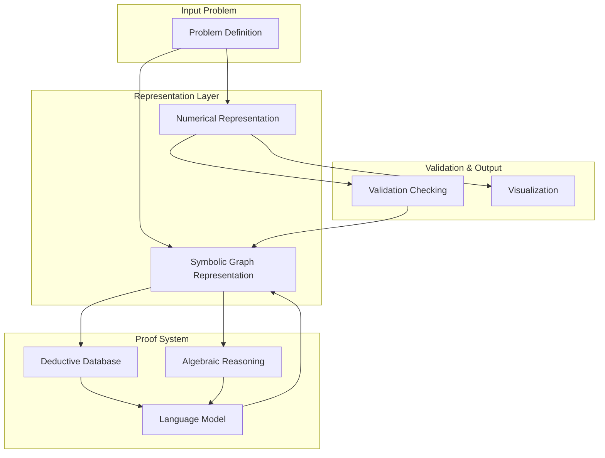

<!-- source: DeepWiki mcp.deepwiki.com · repo google-deepmind/alphageometry · page 3 Geometric Representation · fetched 2026-10-26 -->

# Geometric Representation

Relevant source files

The following files were used as context for generating this wiki page:

- [README.md](README.md)
- [numericals.py](numericals.py)

This page explains how AlphaGeometry represents geometric problems internally through a dual representation system: symbolic objects in a proof state graph for theorem proving, and numerical representations for validation and visualization. The geometric representation layer forms the foundation upon which both the deductive database and algebraic reasoning components operate.

## Overview

AlphaGeometry maintains geometric information in three interconnected modules:

1. **`geometry.py`**: Defines symbolic geometric objects (Point, Line, Circle, Angle, Segment) used in the proof graph
2. **`graph.py`**: Implements the proof state graph that tracks geometric relationships and dependencies
3. **`numericals.py`**: Provides numerical 2D geometry primitives for validation and visualization

Additional support comes from:
- **`problem.py`**: Defines problem structure (premises, goals, DAG nodes)
- **`graph_utils.py`**: Utilities for graph manipulation

Title: **Geometric Representation Architecture**

Sources: [README.md:335-357]()

The symbolic layer represents geometric objects and their relationships as graph nodes and edges, enabling pattern matching and logical deduction. The numerical layer provides concrete 2D coordinate implementations that validate symbolic derivations and enable visualization.

## Symbolic Geometric Objects

The `geometry.py` module defines symbolic geometric objects that serve as nodes in the proof state graph. These objects maintain both symbolic relationships and numerical instantiations.

### Core Entity Types

Title: **Symbolic Geometric Entity Hierarchy**

Sources: [README.md:337]()

Each symbolic object maintains:
- A unique name for identification
- A reference to its numerical counterpart (`.num` attribute)
- A list of neighboring objects in the graph
- Derived properties (angles, distances, ratios)

### Graph Connections

The `neighbors()` method allows traversal between related geometric objects. For example, a `Point` can retrieve all `Line` objects it lies on, or all `Circle` objects it belongs to.

Sources: [README.md:337]()

## Proof State Graph

The `graph.py` module implements the central proof state graph that tracks all geometric facts and their dependencies.

### Graph Structure

Title: **Proof State Graph Structure**

Sources: [README.md:340]()

The graph maintains:
- **Nodes**: Geometric objects (points, lines, circles)
- **Edges**: Geometric predicates (relationships between objects)
- **Dependencies**: How each fact was derived (for proof reconstruction)

### Graph Operations

Key operations in `graph.py`:
- **Adding nodes**: Register new geometric objects
- **Adding edges**: Record new geometric relationships
- **Querying**: Find objects satisfying certain predicates
- **Traversal**: Navigate relationships for pattern matching
- **Dependency tracking**: Record derivation chains for proof generation

Sources: [README.md:340]()

## Problem Definition

The `problem.py` module defines the structure of geometry problems and their components.

### Problem Components

Title: **Problem Structure Hierarchy**

Sources: [README.md:341]()

A `Problem` consists of:
- **Premises**: Initial geometric facts (e.g., "ABC is a triangle", "D is on line BC")
- **Goal**: The theorem to be proven (e.g., "AD is perpendicular to BC")
- **Constructions**: Auxiliary points added during solving

A `Theorem` represents a deduction rule:
- **Premises**: Pattern to match in the graph
- **Conclusion**: New fact to derive if pattern matches

A `DAGNode` represents a derived fact in the proof DAG:
- **Fact**: The derived geometric relationship
- **Dependencies**: Previous facts used in the derivation

Sources: [README.md:341]()

## Numerical Geometry Engine

The `numericals.py` module provides concrete 2D Euclidean geometry implementations. This numerical layer validates symbolic derivations and enables visualization. See [Numerical Geometry Engine (3.1)](#3.1) for detailed documentation.

### Numerical Entities

Title: **Numerical Geometry Classes**

Sources: [numericals.py:46-145](), [numericals.py:147-312](), [numericals.py:318-371](), [numericals.py:388-440]()

### Key Operations

The numerical engine provides:

| Operation Category | Functions | Purpose |
|-------------------|-----------|---------|
| **Intersection** | `line_line_intersection()`, `line_circle_intersection()`, `circle_circle_intersection()` | Find intersection points between geometric objects |
| **Validation** | `check_coll()`, `check_para()`, `check_perp()`, `check_cyclic()`, `check_eqangle()`, `check_cong()` | Verify geometric predicates numerically |
| **Sketching** | `sketch_line()`, `sketch_circle()`, `sketch_bisect()`, `sketch_tangent()` | Generate numerical constructions from symbolic definitions |
| **Visualization** | `draw()`, `draw_point()`, `draw_line()`, `draw_circle()`, `highlight()` | Render geometric diagrams |

Sources: [numericals.py:577-586](), [numericals.py:511-547](), [numericals.py:481-504](), [numericals.py:660-710](), [numericals.py:749-843](), [numericals.py:1326-1337](), [numericals.py:1203-1238]()

### Numerical Validation

Each symbolic predicate has a corresponding numerical checker that validates it within tolerance `ATOM = 1e-12`:

Title: **Predicate Validation Flow**

Sources: [numericals.py:624-649](), [numericals.py:696-700](), [numericals.py:1241-1242]()

## Integration with System Components

The numerical representation integrates with other AlphaGeometry components:

### Checking in the Deductive Process

When the system derives new geometric facts through the deductive database, it can validate them numerically:

Sources: [numericals.py:624-646]()

### Visualization

The numerical representation enables visualization of geometric problems and solutions:

Sources: [numericals.py:925-1189](), [numericals.py:1203-1238]()

## Error Handling

The system includes specific error classes to handle invalid geometric operations:

- `InvalidLineIntersectError`: When lines are parallel or don't intersect
- `InvalidQuadSolveError`: When solving quadratic equations fails (e.g., in circle-circle intersections)

Sources: [numericals.py:314-316](), [numericals.py:507-508]()

## Constants and Utilities

The system defines important constants and utility functions:

- `ATOM = 1e-12`: Tolerance for numerical equality checks
- `close_enough()`: Utility function for floating-point comparison
- `ang_of()`, `ang_between()`: Angular measurement utilities
- `random_points()`, `random_rfss()`: Functions to generate randomized points

Sources: [numericals.py:33](), [numericals.py:1241-1293]()

## Relationship to Proof System

The numerical representation primarily serves as a validation and visualization layer rather than the core proof mechanism:

The numerical representation ensures that geometric facts derived in the deductive process are mathematically valid, providing a concrete implementation of abstract geometric concepts.

Sources: [numericals.py:16-28]()

---

