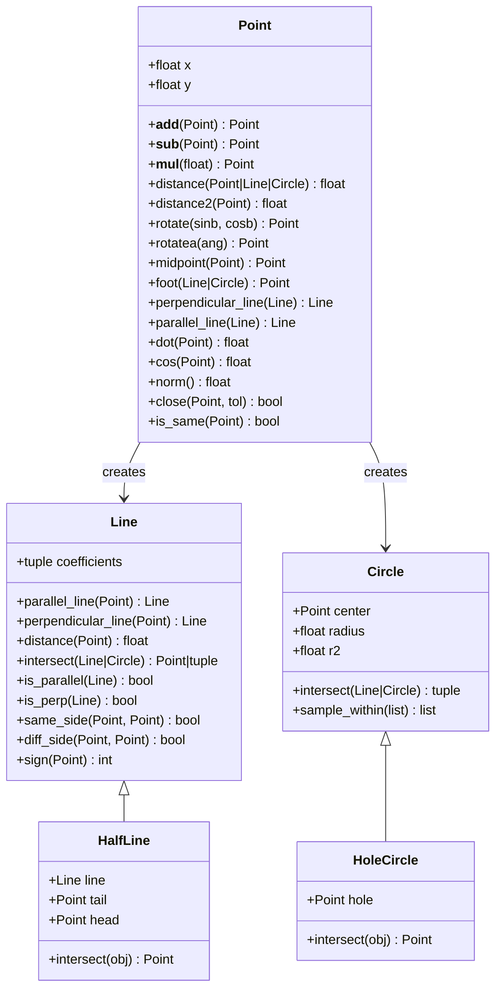
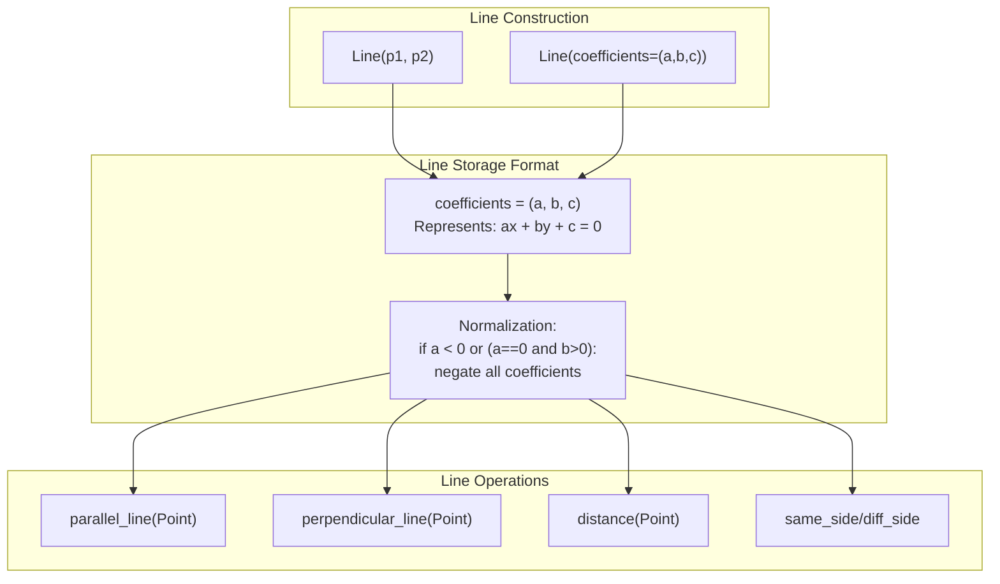
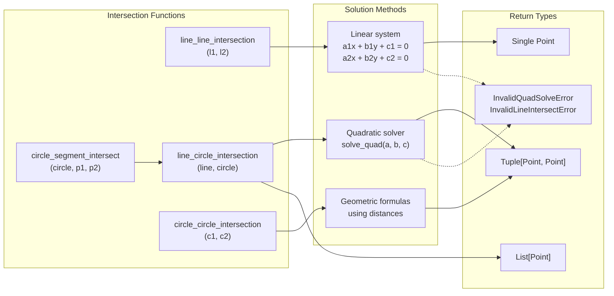
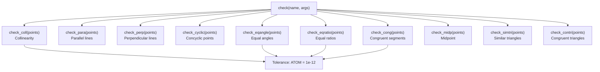
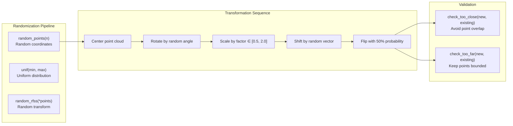
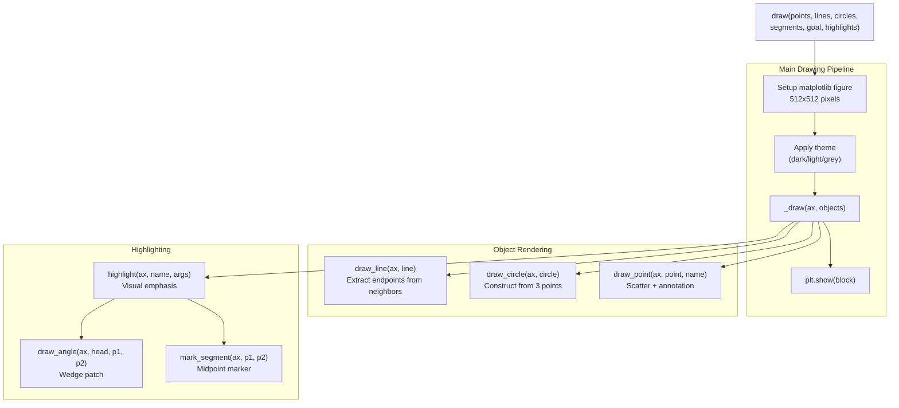
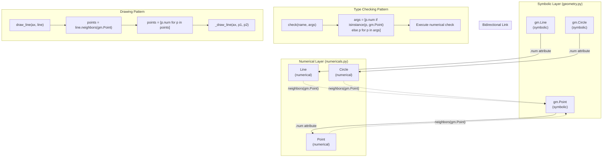
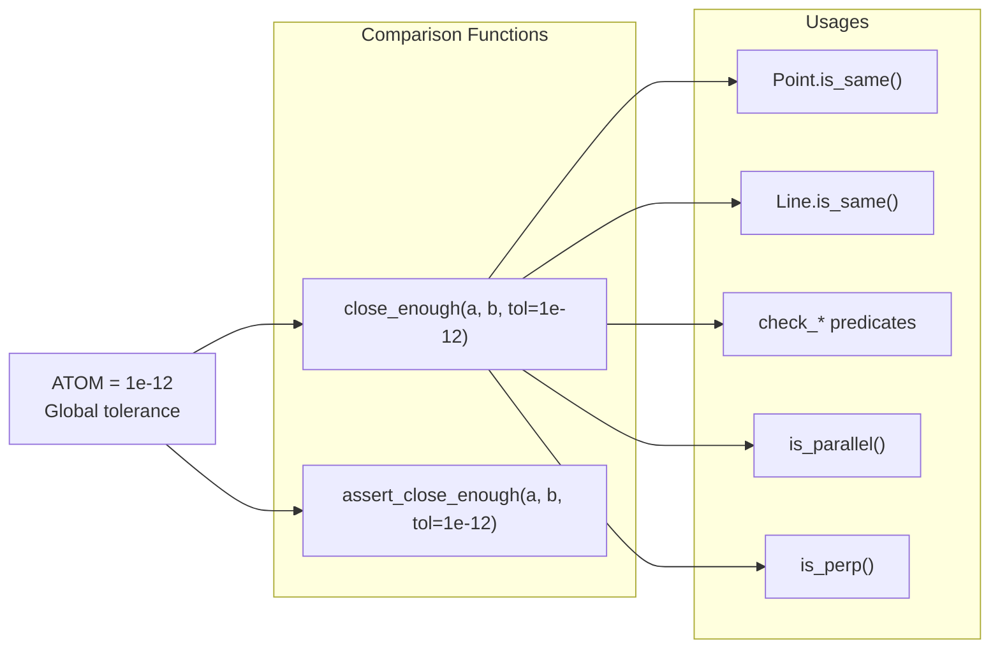

<!-- source: DeepWiki mcp.deepwiki.com · repo google-deepmind/alphageometry · page 3.1 Numerical Geometry Engine · fetched 2026-10-26 -->

# Numerical Geometry Engine

<details>
<summary>Relevant source files</summary>

The following files were used as context for generating this wiki page:

- [numericals.py](numericals.py)

</details>


## Purpose and Scope

The Numerical Geometry Engine (`numericals.py`) provides concrete 2D Euclidean geometry implementations that underpin the entire AlphaGeometry system. This module serves three primary functions:

1. **Numerical validation**: Verifies geometric properties and relationships through floating-point calculations
2. **Geometric construction**: Generates concrete point coordinates for all geometric construction definitions
3. **Visualization**: Renders proof states and geometric configurations using matplotlib

This engine bridges the symbolic representation (see [Problem Definition Format](#3.2)) with concrete numerical coordinates. The symbolic deduction system (see [DD+AR Solver](#4)) uses these numerical operations to validate that proposed constructions are geometrically sound before adding them to the proof graph.

**Sources**: [numericals.py:1-30]()

---

## Core Geometric Primitives

### Point Class

The `Point` class [numericals.py:46-145]() represents a 2D point with Cartesian coordinates and implements standard geometric operations:



**Key Operations**:
- Arithmetic: Addition, subtraction, scalar multiplication [numericals.py:59-76]()
- Distance: Point-to-point, point-to-line, point-to-circle [numericals.py:87-101]()
- Transformation: Rotation, reflection, projection [numericals.py:103-128]()
- Predicates: Proximity testing with tolerance `ATOM = 1e-12` [numericals.py:33, 143-144]()

**Sources**: [numericals.py:46-145]()

---

### Line Representation

Lines are stored in coefficient form `ax + by + c = 0` with normalization rules [numericals.py:147-312]():



The normalization ensures consistent representation: the coefficient `a` is always positive (or zero with negative `b`), which enables reliable equality and ordering comparisons [numericals.py:166-172]().

**Special Line Types**:
- `HalfLine`: Ray with tail and head points [numericals.py:318-372]()
- Used for constructions that require directional orientation
- Intersection with circles returns point in the ray's direction [numericals.py:327-348]()

**Sources**: [numericals.py:147-372]()

---

### Circle Classes

The `Circle` class [numericals.py:388-441]() supports multiple construction modes:

| Constructor | Parameters | Use Case |
|-------------|-----------|----------|
| Direct | `center`, `radius` | When center and radius are known |
| Three-point | `p1`, `p2`, `p3` | Circumcircle construction |
| Center + point | `center`, `p1` | Radius determined by distance |

The `HoleCircle` variant [numericals.py:443-468]() represents a circle with one point excluded, used in constructions where an intersection should avoid a specific point (e.g., tangent constructions).

**Sources**: [numericals.py:388-468]()

---

## Intersection Algorithms

The engine implements robust intersection solvers using algebraic methods:



**Key Functions**:

1. **`line_line_intersection`** [numericals.py:577-586](): Solves linear system using Cramer's rule. Raises `InvalidLineIntersectError` if lines are parallel (determinant is zero).

2. **`line_circle_intersection`** [numericals.py:511-548](): Handles three cases based on line coefficients:
   - Vertical line (`b == 0`): Solve for y coordinates
   - Horizontal line (`a == 0`): Solve for x coordinates  
   - General case: Substitute line equation into circle equation, solve quadratic

3. **`circle_circle_intersection`** [numericals.py:481-504](): Uses geometric construction:
   - Find radical axis (perpendicular bisector of centers)
   - Compute intersection point on line connecting centers
   - Calculate perpendicular offset using Pythagorean theorem

4. **`solve_quad`** [numericals.py:470-478](): Solves `ax² + bx + c = 0`, returns `None` if discriminant is negative (no real solutions).

**Sources**: [numericals.py:470-586]()

---

## Geometric Predicates

The `check` function [numericals.py:624-650]() dispatches to specialized validators for each geometric property:



### Critical Predicates

**Collinearity** [numericals.py:660-666](): Checks if points lie on same line:
```python
def check_coll(points: list[Point]) -> bool:
  a, b = points[:2]
  l = Line(a, b)
  for p in points[2:]:
    if abs(l(p.x, p.y)) > ATOM:  # Line equation value
      return False
  return True
```

**Equal Angles** [numericals.py:749-786](): Most complex predicate, handles parallel cases and orientation:
- Detect parallel lines (special case: both angle pairs must be parallel)
- Normalize angle measurements to intersection points
- Check if angles match modulo orientation (clock/counterclockwise)
- Uses `bring_together` helper to move angles to unit circle [numericals.py:713-722]()

**Equal Ratios** [numericals.py:789-795](): Validates ratio equality numerically:
```python
def check_eqratio(points: list[Point]) -> bool:
  a, b, c, d, e, f, g, h = points
  # Check if ab/cd == ef/gh, i.e., ab*gh == cd*ef
  return close_enough(ab * gh, cd * ef)
```

**Cyclic** [numericals.py:703-710](): Points lie on a circle if equidistant from circumcenter:
```python
def check_cyclic(points: list[Point]) -> bool:
  (a, b, c), *ps = points
  circle = Circle(p1=a, p2=b, p3=c)  # Construct circumcircle
  for d in ps:
    if not close_enough(d.distance(circle.center), circle.radius):
      return False
  return True
```

**Sources**: [numericals.py:624-843]()

---

## Construction Functions

The `sketch` function [numericals.py:1326-1336]() provides numerical implementations for all construction definitions in `defs.txt`:

```mermaid
graph TB
    SKETCH["sketch(name, args)"]
    
    subgraph "Basic Constructions"
        LINE["sketch_line(a, b)<br/>Line through two points"]
        MIDP["sketch_midp(a, b)<br/>Midpoint"]
        CIRCLE["sketch_circle(a, b, c)<br/>Circle with center a, radius bc"]
        BISECT["sketch_bisect(a, b, c)<br/>Angle bisector"]
    end
    
    subgraph "Complex Constructions"
        INCENTER["sketch_incenter2(a,b,c)<br/>Incenter + feet"]
        EXCENTER["sketch_excenter2(a,b,c)<br/>Excenter + feet"]
        CENTROID["sketch_centroid(a,b,c)<br/>Centroid + midpoints"]
        NINEPOINTS["sketch_ninepoints(a,b,c)<br/>Nine-point circle"]
    end
    
    subgraph "Angular Constructions"
        ALINE["sketch_aline(A,B,C,D,E)<br/>Angle transfer"]
        AMIRROR["sketch_amirror(A,B,C)<br/>Angle reflection"]
        SANGLE["sketch_s_angle(a,b,y)<br/>Specific angle"]
    end
    
    subgraph "Tangent Constructions"
        TANGENT["sketch_tangent(a,o,b)<br/>Circle tangent"]
        CCTANGENT["sketch_cc_tangent(o,a,w,b)<br/>Common tangent"]
    end
    
    SKETCH --> LINE
    SKETCH --> MIDP
    SKETCH --> CIRCLE
    SKETCH --> BISECT
    SKETCH --> INCENTER
    SKETCH --> EXCENTER
    SKETCH --> CENTROID
    SKETCH --> NINEPOINTS
    SKETCH --> ALINE
    SKETCH --> AMIRROR
    SKETCH --> SANGLE
    SKETCH --> TANGENT
    SKETCH --> CCTANGENT
```



### Construction Categories

**1. Initial Configurations** (generate entire point sets):
- `sketch_triangle`, `sketch_r_triangle`, `sketch_isos` [numericals.py:1871-1806]()
- `sketch_quadrangle`, `sketch_rectangle`, `sketch_square` [numericals.py:1750-1852]()
- `sketch_pentagon` [numericals.py:1726-1737]()

**2. Point Constructions** (return single point or small sets):
- Midpoint, foot, reflection [numericals.py:1721-1798]()
- Intersection-based: Uses `try_to_sketch_intersect` [numericals.py:1439-1478]()

**3. Line Constructions**:
- Perpendicular: `sketch_tline` [numericals.py:1854-1856]()
- Parallel: `sketch_pline` [numericals.py:1740-1742]()
- Bisector: `sketch_bisect`, `sketch_exbisect` [numericals.py:1526-1537]()

**4. Circle Constructions**:
- Three-point: `sketch_cyclic` [numericals.py:1711-1713]()
- Diameter: `sketch_dia` [numericals.py:1546-1548]()
- Custom: `sketch_acircle` (angle-based) [numericals.py:1481-1486]()

**5. Angular Constructions**:
The `sketch_aline` function [numericals.py:1489-1507]() transfers angles between configurations:
```
Given: Points A, B, C, D, E
Compute: angle(C, B, A) 
Transfer: From D-E, create point X such that angle(X, E, D) = angle(C, B, A)
```

**Sources**: [numericals.py:1326-1922]()

---

## Randomization and Sketch Generation

Constructions incorporate randomization for synthetic data generation:



The `random_rfss` function [numericals.py:1276-1294]() applies a random rotation-flip-scale-shift transformation to ensure diverse geometric configurations during synthetic proof generation. This prevents overfitting during neural model training.

**Validation Functions**:
- `check_too_close` [numericals.py:588-599](): Prevents degenerate cases where points are too close relative to problem scale
- `check_too_far` [numericals.py:602-612](): Ensures auxiliary points don't escape problem bounds

**Sources**: [numericals.py:588-612, 1272-1294]()

---

## Visualization System

The drawing functions render geometric configurations using matplotlib:



### Theme System

Three color schemes are supported [numericals.py:1191-1200]():

| Theme | Background | Points | Lines | Circles |
|-------|-----------|--------|-------|---------|
| `dark` | Black | White | White | Cyan |
| `light` | White | Black | Black | Blue |
| `grey` | White | Black | Black | Grey |

### Intelligent Label Positioning

The `naming_position` function [numericals.py:890-922]() computes optimal text placement:
1. Create circle of radius 0.08 around point
2. Find all intersections with nearby lines and circles
3. Compute angles to avoid intersections
4. Place label at angle with maximum clearance

### Highlighting Proof Elements

The `highlight` function [numericals.py:1058-1129]() emphasizes goal and derived facts:
- **Parallel lines**: Draw both lines with same color [numericals.py:1076-1079]()
- **Equal angles**: Draw wedge patches at angle vertices [numericals.py:1080-1106]()
- **Cyclic points**: Draw circumcircle [numericals.py:1069-1071]()
- **Equal segments**: Mark midpoints with colored dots [numericals.py:1115-1118]()

**Sources**: [numericals.py:846-1243]()

---

## Integration with Symbolic Layer

The numerical engine interfaces with symbolic geometry objects through attribute access:



### Type Conversion Pattern

Functions accept both symbolic and numerical types [numericals.py:648-649, 1067, 1330]:
```python
# Convert symbolic to numerical
args = [p.num if isinstance(p, gm.Point) else p for p in args]
```

This pattern appears in:
- `check()` [numericals.py:648]()
- `sketch()` [numericals.py:1330]()
- `highlight()` [numericals.py:1067]()
- Drawing functions [numericals.py:973-977, 1022-1027]()

### Accessing Symbolic Neighbors

Drawing functions extract related points from the graph structure:
```python
def draw_line(ax, line):
  points = line.neighbors(gm.Point)  # Get symbolic points
  points = [p.num for p in points]   # Convert to numerical
  # ... render using numerical coordinates
```

This enables rendering without explicitly tracking which points lie on which lines.

**Sources**: [numericals.py:624-650, 969-992, 1015-1030, 1326-1336]()

---

## Tolerance and Numerical Stability

All floating-point comparisons use tolerance-based equality:



The tolerance `ATOM = 1e-12` [numericals.py:33]() balances:
- **Precision**: Sufficient for typical geometric calculations
- **Robustness**: Accounts for floating-point rounding errors
- **Consistency**: Used uniformly across all predicates

Critical comparisons requiring tighter tolerance (e.g., similar triangles) explicitly specify `tol=1e-9` [numericals.py:817, 831]().

**Sources**: [numericals.py:33, 1241-1246]()

---

## Error Handling

The module defines custom exceptions for geometric degeneracies:

| Exception | Raised When | Typical Cause |
|-----------|-------------|---------------|
| `InvalidLineIntersectError` | Lines are parallel | Determinant is zero in linear system |
| `InvalidQuadSolveError` | Negative discriminant | No real intersection between circle/line or circle/circle |

These exceptions are caught in higher-level construction code to handle degenerate cases (e.g., `try_to_sketch_intersect` returns `None` on failure [numericals.py:1439-1478]()).

**Sources**: [numericals.py:314-315, 507-508, 577-585]()

---

