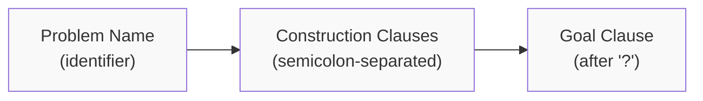
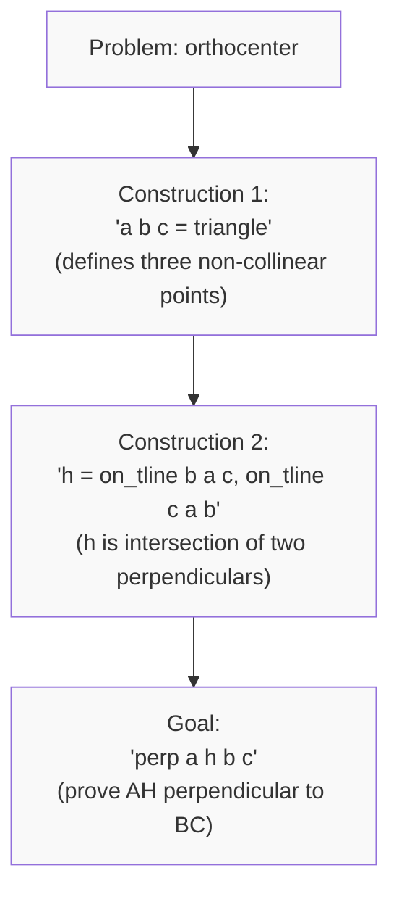
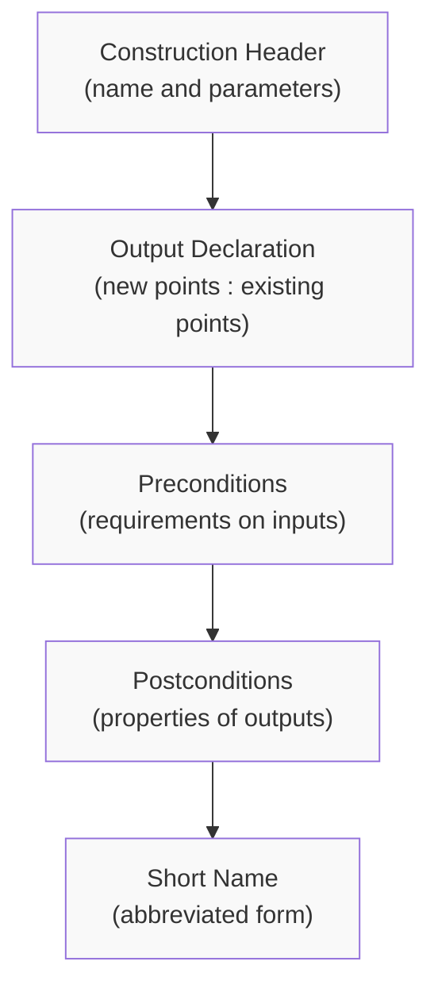
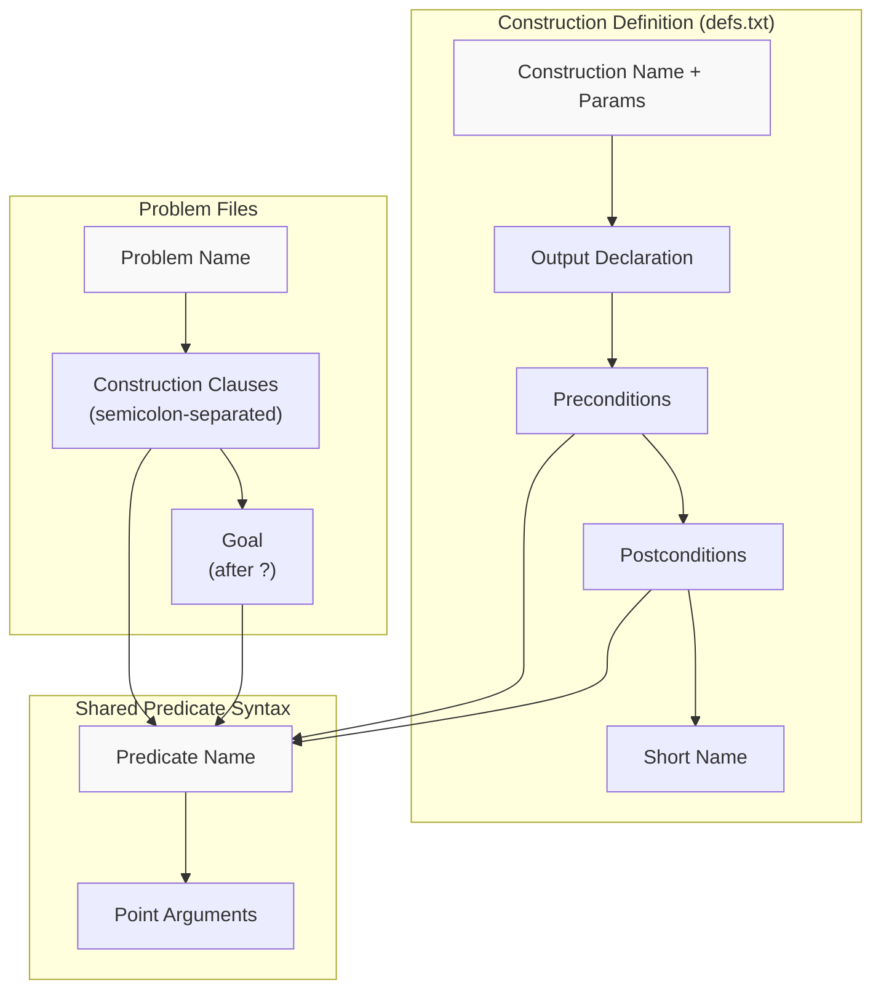
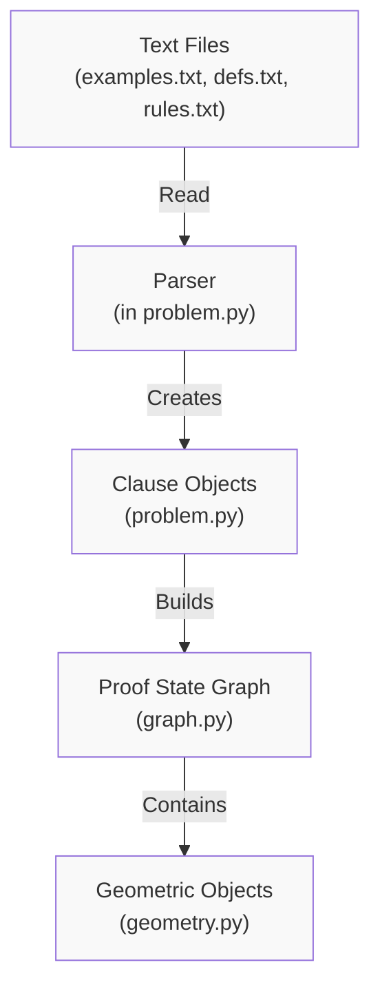

<!-- source: DeepWiki mcp.deepwiki.com · repo google-deepmind/alphageometry · page 3.2 Problem Definition Format · fetched 2026-10-26 -->

# Problem Definition Format

<details>
<summary>Relevant source files</summary>

The following files were used as context for generating this wiki page:

- [README.md](README.md)
- [defs.txt](defs.txt)
- [examples.txt](examples.txt)

</details>


This page documents the text-based format used to specify geometry problems, construction definitions, and deduction rules in AlphaGeometry. These formats enable users to define problems and allow the symbolic reasoning engine to understand geometric relationships.

For information about how these text representations are parsed and converted into internal Python objects, see [Geometric Representation](#3). For details on the numerical validation of constructions, see [Numerical Geometry Engine](#3.1).

---

## Overview

AlphaGeometry uses three primary text file formats:

1. **Problem files** (`examples.txt`, `imo_ag_30.txt`) - Define geometry problems with their constructions and goals
2. **Construction definitions** (`defs.txt`) - Define valid geometric construction actions
3. **Deduction rules** (`rules.txt`) - Define inference rules for symbolic reasoning

All three formats use a consistent predicate-based syntax to represent geometric relationships.

**Sources:** [README.md:73-86](), [README.md:359-368]()

---

## Problem File Format

### Problem Entry Structure

Each problem in a problem file consists of two parts separated by whitespace:
1. **Problem name** - A unique identifier for the problem
2. **Problem statement** - The geometric construction sequence and goal



**Diagram: Problem Entry Components**

**Sources:** [examples.txt:1-8](), [README.md:142-157]()

### Syntax Elements

| Element | Syntax | Example | Description |
|---------|--------|---------|-------------|
| Point list | `a b c` | `a b c` | Space-separated point names |
| Assignment | `points = construction` | `d = on_line d a b` | Assigns points to construction result |
| Separator | `;` | `a b = segment; c = ...` | Separates construction clauses |
| Goal marker | `?` | `? perp a h b c` | Marks the beginning of the goal |
| Multi-predicate | `,` | `on_line e a c, on_line e b d` | Multiple predicates for same point |

**Sources:** [examples.txt:1-8](), [README.md:163]()

### Example Problem Breakdown

```
orthocenter
a b c = triangle; h = on_tline b a c, on_tline c a b ? perp a h b c
```



**Diagram: Orthocenter Problem Structure**

**Sources:** [examples.txt:1-2](), [README.md:227-228]()

### Construction Types

Problems can use any construction defined in `defs.txt`. Common construction patterns:

| Pattern | Example | Meaning |
|---------|---------|---------|
| Basic shape | `a b c = triangle` | Define basic geometric objects |
| Point on line | `x = on_line x a b` | Point X lies on line AB |
| Point on circle | `m = on_circle m o a` | Point M lies on circle with center O through A |
| Intersection | `e = on_line e a c, on_line e b d` | Point E at intersection of AC and BD |
| Construction with dependencies | `h = orthocenter a b c` | Complex construction (orthocenter of triangle ABC) |

**Sources:** [examples.txt:1-8](), [defs.txt:1-408]()

---

## Construction Definition Format

The `defs.txt` file defines all available geometric constructions. Each definition specifies how to create new points and what geometric relationships they satisfy.

### Definition Structure



**Diagram: Construction Definition Components**

**Sources:** [defs.txt:1-408]()

### Anatomy of a Construction Definition

Each construction definition has exactly 5 lines:

```
angle_bisector x a b c
x : a b c x
a b c = ncoll a b c
x : eqangle b a b x b x b c
bisect a b c
```

| Line | Content | Description |
|------|---------|-------------|
| 1 | `angle_bisector x a b c` | Construction name and parameter list (output points first, then input points) |
| 2 | `x : a b c x` | Output points `:` dependency list |
| 3 | `a b c = ncoll a b c` | Preconditions (constraints on input points) |
| 4 | `x : eqangle b a b x b x b c` | Postconditions (properties guaranteed after construction) |
| 5 | `bisect a b c` | Short name for compact representation |

**Sources:** [defs.txt:1-5]()

### Parameter Declaration Format

The second line declares which points are outputs and what they depend on:

```
x : a b c x
```

- **Left of colon:** Output points (newly constructed)
- **Right of colon:** All points the construction depends on (inputs + outputs)

For constructions with multiple outputs:

```
x : a b c y, y : a b c x
```

Each output is declared separately with its full dependency list.

**Sources:** [defs.txt:349-360]()

### Preconditions (Line 3)

Preconditions specify requirements on input points using predicates:

| Predicate | Meaning | Example |
|-----------|---------|---------|
| `ncoll a b c` | Points A, B, C are not collinear | Required for triangle |
| `diff a b` | Points A and B are distinct | Required for line |
| `nperp a b c d` | AB not perpendicular to CD | Prevents degenerate cases |
| `npara a b c d` | AB not parallel to CD | Required for intersection |

Empty preconditions use `=` with no right-hand side for unconditional constructions.

**Sources:** [defs.txt:3](), [defs.txt:39](), [defs.txt:117]()

### Postconditions (Line 4)

Postconditions specify the geometric properties guaranteed by the construction:

```
x : eqangle b a b x b x b c
```

For constructions with multiple outputs:

```
x : coll x a b, cong x a x y; y : coll y a b, cong y x y b
```

Properties for different outputs are separated by semicolons.

**Sources:** [defs.txt:4](), [defs.txt:358]()

### Example Definitions

#### Simple Construction: Midpoint

```
midpoint x a b
x : a b
a b = diff a b
x : coll x a b, cong x a x b
midp a b
```

- **Output:** Point X
- **Inputs:** Points A, B
- **Precondition:** A and B are distinct
- **Postcondition:** X is collinear with A and B, and equidistant from both
- **Short name:** `midp a b`

**Sources:** [defs.txt:163-167]()

#### Complex Construction: Orthocenter

```
orthocenter x a b c
x : a b c
a b c = ncoll a b c
x : perp x a b c, perp x b c a; perp x c a b
tline a b c, tline b c a
```

- **Output:** Point X (orthocenter)
- **Inputs:** Triangle ABC (non-collinear)
- **Postconditions:** X is on perpendicular from A to BC, from B to CA, and from C to AB
- **Short name:** Uses auxiliary constructions `tline a b c, tline b c a`

**Sources:** [defs.txt:223-227]()

#### Multi-Output Construction: Incenter with Feet

```
incenter2 x y z i a b c
i : a b c, x : i b c, y : i c a, z : i a b
a b c = ncoll a b c
i : eqangle a b a i a i a c, eqangle c a c i c i c b; eqangle b c b i b i b a; 
x : coll x b c, perp i x b c; y : coll y c a, perp i y c a; 
z : coll z a b, perp i z a b; cong i x i y, cong i y i z
incenter2 a b c
```

- **Outputs:** Points I (incenter), X, Y, Z (feet of perpendiculars)
- **Multiple dependency declarations** for different outputs
- **Complex postconditions** with angle equalities and perpendicularity

**Sources:** [defs.txt:79-83]()

---

## Predicate Reference

### Geometric Predicates

AlphaGeometry uses predicates to express geometric relationships:

| Predicate | Arguments | Meaning |
|-----------|-----------|---------|
| `coll` | `a b c` | Points A, B, C are collinear |
| `ncoll` | `a b c` | Points A, B, C are not collinear |
| `para` | `a b c d` | Line AB is parallel to line CD |
| `npara` | `a b c d` | Line AB is not parallel to line CD |
| `perp` | `a b c d` | Line AB is perpendicular to line CD |
| `nperp` | `a b c d` | Line AB is not perpendicular to line CD |
| `cong` | `a b c d` | Segment AB is congruent to segment CD |
| `eqangle` | `a b c d e f g h` | Angle ABC-D equals angle EFG-H (directed angles) |
| `cyclic` | `a b c d` | Points A, B, C, D lie on a circle |
| `diff` | `a b` | Points A and B are distinct |
| `rconst` | `a b c d r1 r2` | Ratio AB:CD equals r1:r2 |
| `s_angle` | `a b x y` | Signed angle construction |

**Sources:** [defs.txt:1-408]()

### Construction Name Predicates

These appear as short names on line 5 of definitions:

| Short Name | Full Name | Description |
|------------|-----------|-------------|
| `triangle` | `triangle a b c` | Three points forming a triangle |
| `segment` | `segment a b` | Two distinct points |
| `line a b` | `on_line x a b` | Point on line through A, B |
| `circle o r` | `on_circle x o r` | Point on circle with center O through R |
| `midp a b` | `midpoint x a b` | Midpoint of segment AB |
| `bisect a b c` | `angle_bisector x a b c` | Angle bisector of ∠ABC |
| `tline a b c` | `on_tline x a b c` | Perpendicular from A to line BC |
| `pline a b c` | `on_pline x a b c` | Parallel to BC through A |

**Sources:** [defs.txt:5](), [defs.txt:167](), [defs.txt:209](), [defs.txt:221]()

---

## Deduction Rules Format

The `rules.txt` file contains theorem templates used by the DD (Deductive Database) component. While not shown in the provided files, these rules follow a pattern-matching format similar to construction definitions.

Rules specify:
1. **Pattern:** Geometric configuration to match
2. **Conclusion:** New facts that can be derived

The DD component in `dd.py` uses these rules to perform forward reasoning.

**Sources:** [README.md:79](), [README.md:343]()

---

## Format Syntax Summary



**Diagram: Relationship Between File Formats**

**Sources:** [examples.txt:1-8](), [defs.txt:1-408]()

---

## Parsing and Code Integration

### File Loading

Problems and definitions are loaded by `alphageometry.py`:

- Problem files specified via `--problems_file` flag
- Specific problem selected via `--problem_name` flag
- Definitions loaded from `--defs_file` (default: `defs.txt`)
- Rules loaded from `--rules_file` (default: `rules.txt`)

**Sources:** [README.md:144-157](), [README.md:82-86]()

### Parse Flow



**Diagram: Text Format to Internal Representation**

The `problem.py` module defines classes like `Clause` and `Theorem` that represent parsed problem statements. The `graph.py` module uses these to construct the proof state.

**Sources:** [README.md:341](), [README.md:340]()

### Usage in Solver

1. **Problem Loading:** Text file parsed into `Clause` objects
2. **Graph Construction:** Initial graph built from problem clauses
3. **DD Matching:** Rule patterns matched against graph predicates
4. **AR Processing:** Algebraic predicates (angles, ratios) extracted
5. **LM Encoding:** Graph serialized back to text for language model input

**Sources:** [README.md:163](), [README.md:227-228]()

---

## Common Patterns and Examples

### Pattern: Basic Shape Definition

```
problem_name
a b c = triangle ? <goal involving a, b, c>
```

Defines three non-collinear points forming a triangle.

**Sources:** [examples.txt:1-2]()

### Pattern: Auxiliary Point Construction

```
problem_name
a b c = triangle; d = on_tline d b a c ? <goal involving d>
```

Adds point D on perpendicular from B to line AC.

**Sources:** [examples.txt:2]()

### Pattern: Multiple Constructions

```
problem_name
a b c = triangle a b c; h = orthocenter a b c; g1 g2 g3 g = centroid g1 g2 g3 g a b c; 
o = circle a b c ? coll h g o
```

Combines multiple named constructions (orthocenter, centroid, circumcenter) and proves they are collinear.

**Sources:** [examples.txt:7-8]()

### Pattern: Intersection Point

```
e = on_line e a c, on_line e b d
```

Point E is at the intersection of lines AC and BD.

**Sources:** [examples.txt:4](), [README.md:239]()

---

## Format Conventions

### Point Naming

- Points typically named with lowercase letters: `a`, `b`, `c`, etc.
- Sequential naming used for synthetic problems: `a b c d e ...`
- Auxiliary points follow alphabetically
- The language model is trained on alphabetically-ordered point names

**Sources:** [README.md:274-277]()

### Predicate Ordering

- Predicates are order-sensitive for directed angles (`eqangle`)
- Most predicates are symmetric for point arguments
- Multiple predicates for the same point separated by commas

**Sources:** [defs.txt:4](), [examples.txt:2]()

### Whitespace and Formatting

- Spaces separate point names
- Semicolons separate construction clauses
- No strict requirement for line breaks
- Definitions in `defs.txt` use fixed 5-line structure

**Sources:** [examples.txt:1-8](), [defs.txt:1-408]()

---

