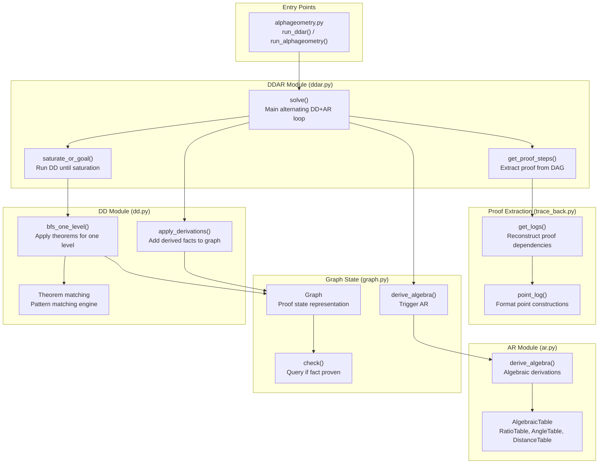
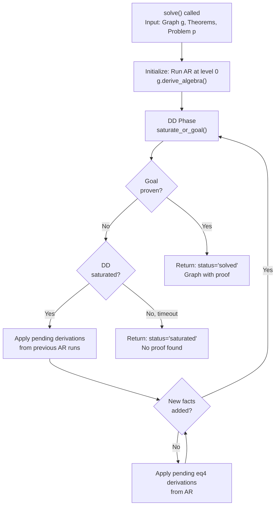
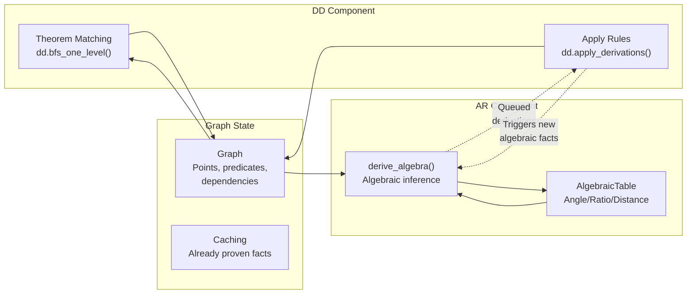
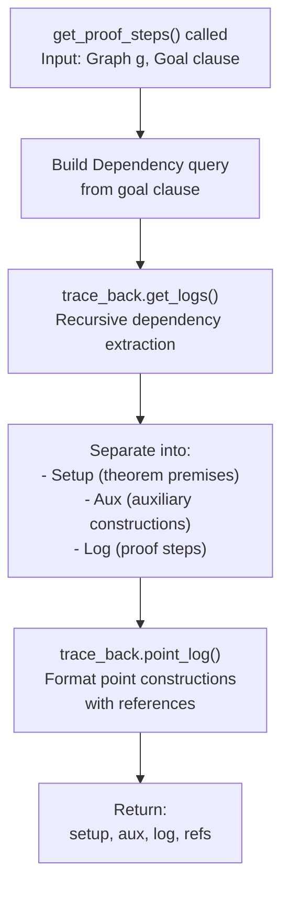

<!-- source: DeepWiki mcp.deepwiki.com · repo google-deepmind/alphageometry · page 4 DD+AR Solver · fetched 2026-10-26 -->

# DD+AR Solver

<details>
<summary>Relevant source files</summary>

The following files were used as context for generating this wiki page:

- [README.md](README.md)
- [ddar.py](ddar.py)

</details>


## Purpose and Scope

The DD+AR Solver is the symbolic deduction engine that forms the core reasoning component of both DDAR and AlphaGeometry modes. It combines two complementary techniques:

- **DD (Deductive Database)**: Pattern-matching and application of geometric theorem templates
- **AR (Algebraic Reasoning)**: Algebraic manipulation of equalities involving angles, ratios, and distances

This page describes the integration of DD and AR in `ddar.py`, the main solving loop, and proof extraction. For detailed coverage of the DD component, see [Deductive Database (DD)](#4.1). For the AR component, see [Algebraic Reasoning (AR)](#4.2). For integration mechanics, see [Integration and Proof Search](#4.3).

**Sources:** [README.md:1-158](), [ddar.py:1-158]()

---

## System Overview

The DD+AR solver operates on a `Graph` object that maintains the current proof state. It alternates between symbolic deduction (DD) and algebraic reasoning (AR) until either:
1. The goal is proven
2. The system saturates (no new facts can be derived)
3. A timeout or depth limit is reached

The solver is used in two contexts:
- **DDAR mode**: Standalone symbolic solver
- **AlphaGeometry mode**: Symbolic solver that retries after neural model adds auxiliary constructions

**Sources:** [ddar.py:16-158](), [README.md:140-197]()

---

## Architecture Diagram



**Sources:** [ddar.py:1-158](), [README.md:329-357]()

---

## Main Solving Algorithm

The core solving algorithm is implemented in the `solve()` function at [ddar.py:77-131](). It alternates between DD and AR phases:

### Algorithm Flow



**Sources:** [ddar.py:77-131]()

### Key Functions

| Function | Location | Purpose |
|----------|----------|---------|
| `solve()` | [ddar.py:77-131]() | Main loop alternating DD and AR until goal or saturation |
| `saturate_or_goal()` | [ddar.py:27-74]() | Runs DD breadth-first until saturation or goal found |
| `get_proof_steps()` | [ddar.py:134-158]() | Extracts readable proof steps from dependency DAG |

**Sources:** [ddar.py:1-158]()

---

## DD Phase: Saturation or Goal

The `saturate_or_goal()` function implements the DD phase:

```python
def saturate_or_goal(
    g: gh.Graph,
    theorems: list[pr.Theorem],
    level_times: list[float],
    p: pr.Problem,
    max_level: int = 100,
    timeout: int = 600,
) -> tuple[...]:
```

This function:
1. Calls `dd.bfs_one_level()` to apply theorem matching at each depth level
2. Tracks execution time per level
3. Checks if goal is satisfied after each level
4. Returns derivations, algebraic equalities, and branching factors

The function terminates when:
- **Goal found**: `g.check(p.goal.name, goal_args)` returns True
- **Saturated**: No new facts derived (`added` is empty)
- **Timeout**: Level time exceeds threshold

**Sources:** [ddar.py:27-74]()

---

## AR Phase: Algebraic Derivations

After DD saturates, the solver attempts to make progress using algebraic reasoning:

1. **Initial AR call** at level 0: [ddar.py:88]()
   ```python
   dervs, eq4 = g.derive_algebra(level=0, verbose=False)
   ```

2. **Apply pending derivations** from previous AR runs: [ddar.py:116-117]()
   ```python
   while derives and not added:
       added += dd.apply_derivations(g, derives.pop(0))
   ```

3. **Apply eq4 derivations** (higher-order algebraic facts): [ddar.py:123-124]()
   ```python
   while eq4s and not added:
       added += dd.apply_derivations(g, eq4s.pop(0))
   ```

The AR phase produces dictionaries mapping predicate names to lists of point tuples that satisfy those predicates. These are queued and applied when DD saturates.

**Sources:** [ddar.py:88-130]()

---

## Integration Pattern

The DD and AR components are tightly integrated through the `Graph` object:



**Key Integration Points:**

1. **DD queries Graph**: Checks if premise patterns match current state
2. **DD updates Graph**: Adds newly derived facts via `apply_derivations()`
3. **AR reads Graph**: Extracts algebraic equalities from predicates
4. **AR queues derivations**: Returns dictionaries for DD to apply later
5. **Cycle continues**: New DD facts trigger new AR derivations

**Sources:** [ddar.py:77-131]()

---

## Proof Extraction

Once the goal is proven, `get_proof_steps()` extracts a human-readable proof:

### Extraction Process



**Sources:** [ddar.py:134-158]()

### Output Structure

The function returns:
- **setup**: Theorem premises from problem statement with reference numbers
- **aux**: Auxiliary point constructions (if AlphaGeometry mode)
- **log**: Step-by-step proof derivations
- **refs**: Dictionary mapping predicate tuples to reference numbers

Example from [README.md:172-186]():
```
* From theorem premises:
A B G1 G2 M N C D E P Q : Points
AG_1 ⟂ AB [00]
BA ⟂ G_2B [01]
...

036. ∠QEB = ∠(QP-EA) [46] & ∠(BE-QP) = ∠AEP [55] ⇒  ∠EQP = ∠QPE [56]
037. ∠PQE = ∠EPQ [56] ⇒  EP = EQ
```

**Sources:** [ddar.py:134-158](), [README.md:172-186]()

---

## Data Structures

### Key Types

The solver operates on several core data structures:

| Type | Module | Purpose |
|------|--------|---------|
| `Graph` | `graph.py` | Maintains proof state, points, predicates, dependencies |
| `Theorem` | `problem.py` | Represents deduction rule templates |
| `Problem` | `problem.py` | Encapsulates problem premises and goal |
| `Dependency` | `problem.py` | Tracks how facts were derived (for proof reconstruction) |
| `Clause` | `problem.py` | Represents a single geometric predicate |

**Sources:** [ddar.py:18-24](), [README.md:336-352]()

### Return Values

The `solve()` function returns:
```python
tuple[gh.Graph, list[float], str, list[int], list[pr.Dependency]]
```

Components:
1. **Graph**: Final proof state with all derived facts
2. **level_times**: Execution time for each depth level
3. **status**: Either `'solved'` or `'saturated'`
4. **branches**: Branching factor at each level (for search analysis)
5. **all_added**: List of all dependencies added during solving

**Sources:** [ddar.py:77-131]()

---

## Execution Example

From the DDAR execution in [README.md:148-186]():

### Input
```
translated_imo_2000_p1
a b = segment a b; 
g1 = on_tline g1 a a b; 
g2 = on_tline g2 b b a; 
m = on_circle m g1 a, on_circle m g2 b; 
... 
? cong e p e q
```

### Execution Log
```
Depth 1/1000 time = 1.777...
Depth 2/1000 time = 5.635...
Depth 3/1000 time = 6.883...
Depth 4/1000 time = 10.275...
Depth 5/1000 time = 12.048...
```

The solver alternates DD and AR, progressing through depth levels until the goal `cong e p e q` (EP = EQ) is proven at depth 5.

**Sources:** [README.md:148-186]()

---

## Configuration Parameters

The solver accepts several configuration parameters:

| Parameter | Default | Location | Purpose |
|-----------|---------|----------|---------|
| `max_level` | 1000 | [ddar.py:81]() | Maximum depth levels before giving up |
| `timeout` | 600 | [ddar.py:82]() | Timeout in seconds per level |
| `merge_trivials` | False | [ddar.py:135]() | Whether to merge trivial steps in proof output |

In the paper's experiments, `max_level=1000` and `timeout=600` (10 minutes) are used.

**Sources:** [ddar.py:77-82](), [README.md:90-109]()

---

## Integration with AlphaGeometry Mode

In AlphaGeometry mode, the DD+AR solver is called repeatedly:
1. **Initial attempt**: Try to solve with existing points
2. **If fails**: Language model proposes auxiliary constructions
3. **Retry**: Add auxiliary point and re-run DD+AR solver
4. **Repeat**: Up to maximum search depth

The `solve()` function is stateless and can be called multiple times on graphs with different auxiliary constructions. See [System Architecture](#2) for the full AlphaGeometry loop.

**Sources:** [README.md:199-302](), Diagram 2 from system overview

---

## Summary

The DD+AR Solver provides the symbolic reasoning foundation for AlphaGeometry:

- **Core algorithm**: Alternates DD (theorem matching) and AR (algebraic reasoning)
- **Termination**: Stops when goal proven, saturated, or timeout
- **Proof extraction**: Reconstructs human-readable proof from dependency DAG
- **Integration**: Used standalone (DDAR mode) or with neural guidance (AlphaGeometry mode)

For implementation details, see:
- [Deductive Database (DD)](#4.1) - Theorem matching and rule application
- [Algebraic Reasoning (AR)](#4.2) - Algebraic table structures and inference
- [Integration and Proof Search](#4.3) - Detailed integration mechanics

**Sources:** [ddar.py:1-158](), [README.md:1-450]()

---

