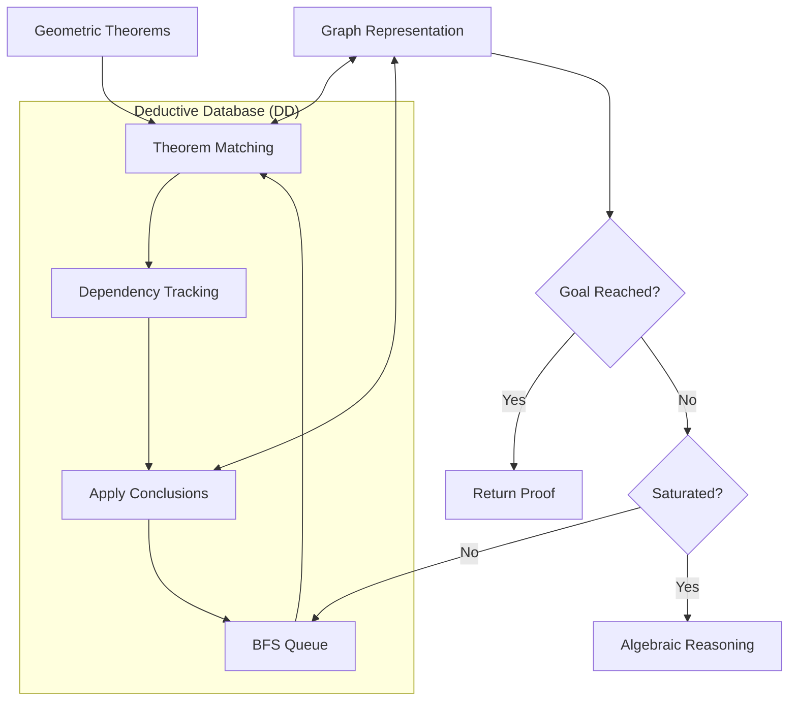
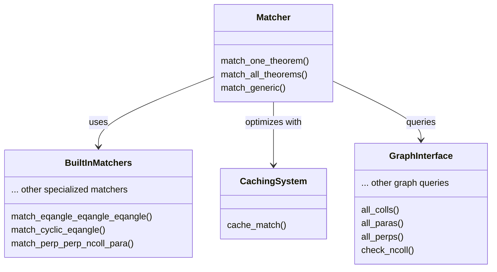
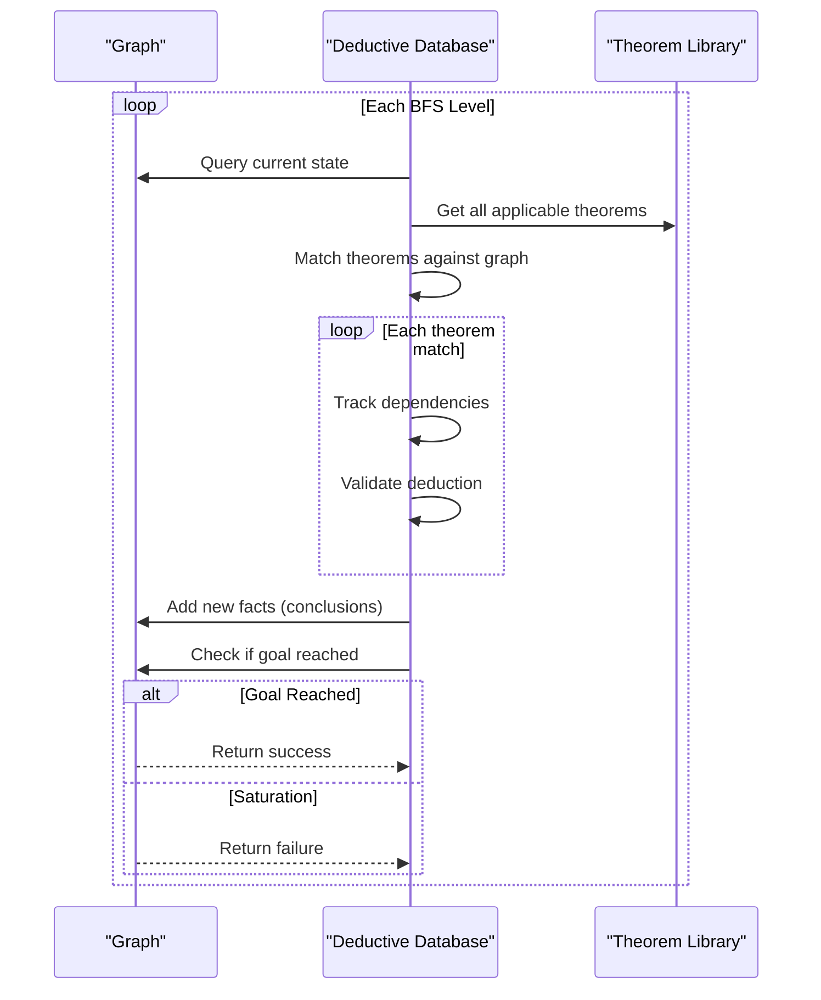
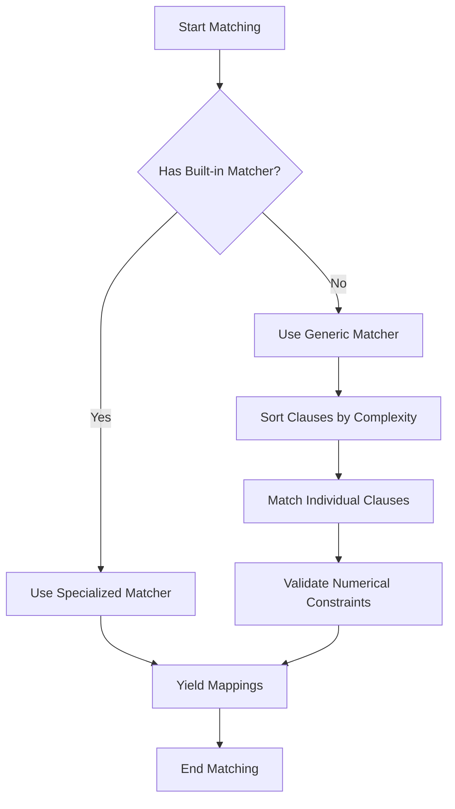
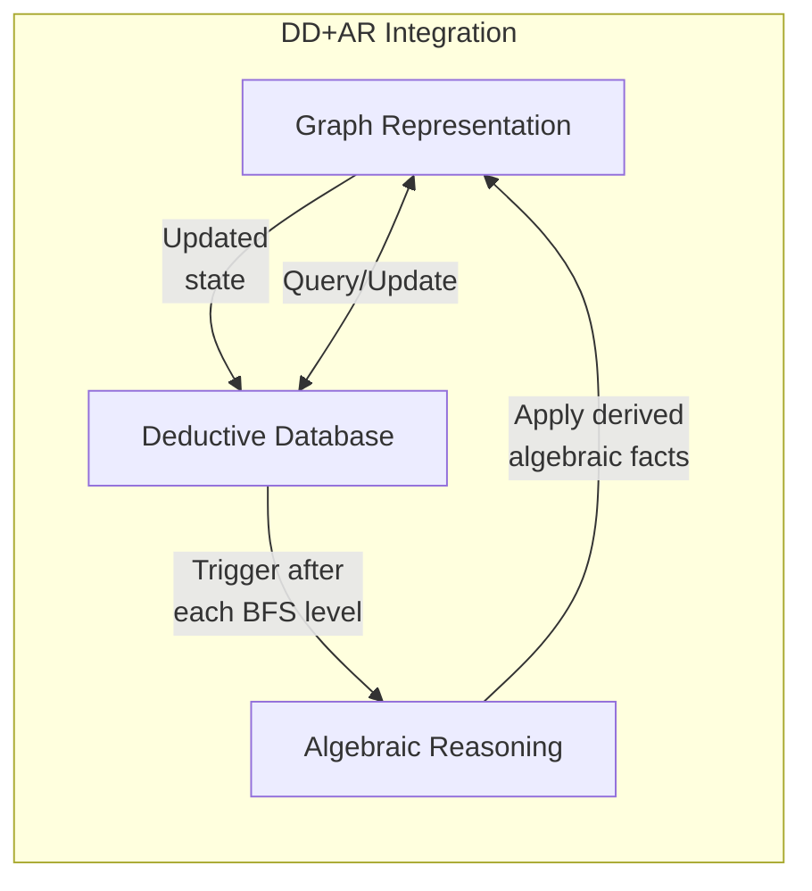

<!-- source: DeepWiki mcp.deepwiki.com · repo google-deepmind/alphageometry · page 4.1 Deductive Database (DD) · fetched 2026-10-26 -->

# Deductive Database (DD)

Relevant source files

The following files were used as context for generating this wiki page:

- [README.md](README.md)
- [dd.py](dd.py)

## Purpose and Scope

The Deductive Database (DD) is a core component of AlphaGeometry's symbolic reasoning engine. It implements forward-chaining deductive inference to derive new geometric facts from existing ones by applying theorems from geometric theory. This document explains how the DD component works, its architecture, and how it integrates with other components of the system. For information about how DD works together with Algebraic Reasoning (AR), see [DD+AR Integration](#3.3).

## Overview

The Deductive Database applies inference rules (geometric theorems) to a graph representation of a geometric problem. It uses a breadth-first search approach to systematically derive new facts until either the goal is reached or no more facts can be derived (saturation).

Sources: [dd.py:1008-1123]()

## Core Components

### Theorem Matching System

The DD component contains a sophisticated theorem matching system that identifies where geometric rules can be applied to the current graph state. This matching system consists of:

1. **Built-in matchers**: Specialized functions for efficiently matching specific theorem patterns
2. **Generic matcher**: A fallback mechanism for theorems without specialized matchers
3. **Caching system**: Optimizes performance by avoiding redundant matching operations

Sources: [dd.py:49-807](), [dd.py:903-935](), [dd.py:949-1005]()

### BFS Execution Engine

The DD component employs a breadth-first search strategy to systematically apply theorems and derive new facts:

1. At each level, all applicable theorems are identified
2. Dependencies are tracked for each potential deduction
3. New facts are added to the graph in batch fashion
4. The process continues until the goal is reached or saturation occurs

The BFS approach ensures that the shortest proof (in terms of deduction steps) is found and prevents infinite loops in the deduction process.

Sources: [dd.py:1008-1123](), [dd_test.py:47-55]()

## Workflow and Operation

The DD component operates in a cyclical process of matching theorems, tracking dependencies, and applying new facts to the graph:

Sources: [dd.py:1008-1123](), [dd_test.py:36-76]()

### Theorem Matching Process

The theorem matching process is a critical part of the DD component:

1. For each theorem, potential applications are found by matching the theorem's premises against the current graph state
2. Specialized matcher functions handle common theorem patterns efficiently
3. A generic matcher handles arbitrary theorems by decomposing them into individual clauses

Sources: [dd.py:949-976](), [dd.py:855-901]()

### Dependency Tracking

DD maintains a dependency structure to track how each fact is derived, which is essential for:

1. Generating formal proofs
2. Avoiding redundant deductions
3. Verifying the correctness of each step

The dependency structure forms a directed acyclic graph (DAG) where each node represents a fact and edges represent the deductive steps.

Sources: [dd.py:1037-1072](), [problem.py]() (referenced but not shown in provided files)

## Integration with Other Components

### Relationship with Graph Representation

The DD component relies heavily on the graph representation of geometric problems:

- The graph stores points, lines, circles, and other geometric objects
- Relationships between objects (e.g., incidence, parallelism, congruence) are represented as edges or properties
- DD queries the graph to find patterns where theorems can be applied
- DD updates the graph with newly derived facts

Sources: [dd.py:30-42](), [dd.py:809-823]()

### Integration with Algebraic Reasoning

While DD focuses on symbolic geometric reasoning, it also interfaces with the Algebraic Reasoning (AR) component:

1. After each BFS level, algebraic derivations are computed
2. These algebraic facts can lead to new geometric insights
3. The coordination between DD and AR creates a powerful hybrid reasoning system

Sources: [dd.py:1115-1123](), [dd.py:1138-1156]()

## Implementation Details

### Built-in Matcher Functions

The DD component includes specialized matcher functions for common theorem patterns:

| Matcher Function | Purpose |
|------------------|---------|
| `match_eqangle_eqangle_eqangle` | Transitivity of angle equality |
| `match_eqratio_eqratio_eqratio` | Transitivity of ratio equality |
| `match_perp_perp_ncoll_para` | Perpendicular lines relation to parallel lines |
| `match_cyclic_eqangle` | Properties of cyclic quadrilaterals |
| `match_eqangle_para` | Relationship between equal angles and parallel lines |
| ... | ... |

These specialized matchers improve performance by implementing efficient pattern recognition for specific geometric configurations.

Sources: [dd.py:49-807](), [dd.py:903-935]()

### Caching Mechanism

To optimize performance, DD implements a caching system:

1. Results of common queries are cached within a BFS level
2. The cache prevents redundant matching operations
3. Dependencies for derivations are also cached for reuse

Sources: [dd.py:809-823]()

### Maximum Branching Control

To prevent combinatorial explosion, DD implements controls on branching factor:

1. A maximum branch limit (set to 50,000) caps the number of matches considered for any theorem
2. Theorem skipping allows certain theorems to be excluded from matching
3. These controls ensure computational tractability while maintaining reasoning power

Sources: [dd.py:946](), [dd.py:939-944](), [dd.py:971-974]()

## Example Operation

To illustrate how DD operates, consider a simple example from the test cases:

1. A geometric problem is loaded and converted to a graph representation
2. DD runs BFS levels iteratively, applying theorems at each level
3. After each level, the goal is checked to see if it has been reached
4. If no new facts are derived (saturation), DD terminates
5. The process either succeeds (goal reached) or fails (saturation without reaching the goal)

Sources: [dd_test.py:36-76]()

## Performance Considerations

The DD component is designed with several performance optimizations:

1. **Specialized matchers** for common theorem patterns
2. **Caching** to avoid redundant computations
3. **BFS level separation** to maintain a breadth-first approach
4. **Timeout mechanism** to prevent excessive computation
5. **Algebraic integration** to leverage both symbolic and numeric reasoning

These optimizations enable DD to efficiently explore the space of potential deductions while maintaining completeness within its scope.

Sources: [dd.py:1008-1123](), [dd.py:809-823](), [dd.py:971-974]()

---

