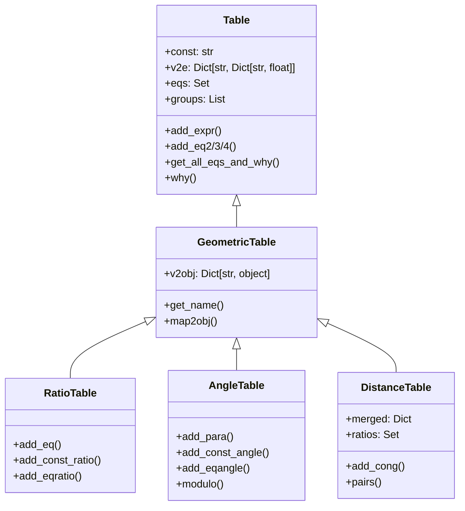
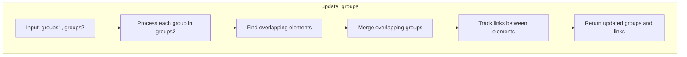
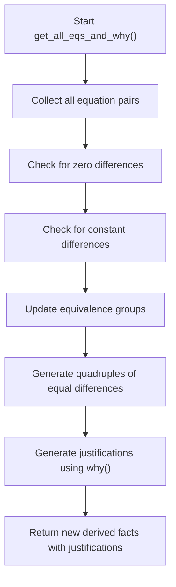
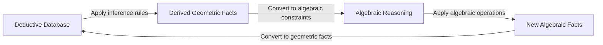
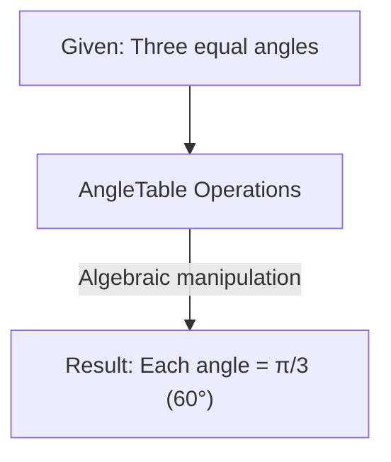
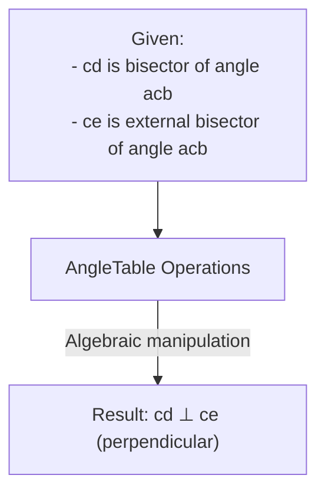

<!-- source: DeepWiki mcp.deepwiki.com · repo google-deepmind/alphageometry · page 4.2 Algebraic Reasoning (AR) · fetched 2026-10-26 -->

# Algebraic Reasoning (AR)

<details>
<summary>Relevant source files</summary>

The following files were used as context for generating this wiki page:

- [README.md](README.md)
- [ar.py](ar.py)

</details>


## Purpose and Scope

The Algebraic Reasoning (AR) component extends the deductive capabilities of AlphaGeometry by applying algebraic methods to derive additional geometric facts that may not be directly derivable through logical inference rules. AR works alongside the Deductive Database (DD) component (see [Deductive Database](#3.1)) to form the complete DD+AR solver (see [DD+AR Integration](#3.3)). 

This document details the implementation, structure, and functionality of the AR component, focusing on how it represents and manipulates algebraic expressions to derive new geometric relationships.

Sources: [ar.py:16-27]()

## Architecture Overview

### Table Hierarchy

The AR component is built around a hierarchy of table classes that represent and manipulate algebraic relationships between geometric entities:



Sources: [ar.py:273-753]()

## Core Components

### Base Table

The `Table` class is the foundation of AR, representing a coefficient matrix that maps variables to linear expressions:

- `v2e`: Dictionary mapping variables to expressions as linear combinations
- `eqs`: Set of already derived equations
- `groups`: Lists of groups of equivalent expressions
- Core methods for adding equations and deriving new equalities

Sources: [ar.py:273-324]()

### Specialized Tables

AR includes three specialized table types for different geometric relationships:

1. **RatioTable (ar.RatioTable)**: 
   - Handles distance ratios
   - Methods: `add_eq()`, `add_const_ratio()`, `add_eqratio()`

2. **AngleTable (ar.AngleTable)**: 
   - Manages angle relationships
   - Methods: `add_para()`, `add_const_angle()`, `add_eqangle()`
   - Special handling of angle modulo operations

3. **DistanceTable (ar.DistanceTable)**: 
   - Works with point positions relative to lines
   - Method: `add_cong()` for segment congruence

Sources: [ar.py:526-752](), [ar.py:558-588](), [ar.py:591-656](), [ar.py:659-752]()

## Algebraic Representation

### Expression Format

AR represents algebraic expressions as dictionaries mapping variable names to coefficients:

| Mathematical Expression | Dictionary Representation |
|------------------------|---------------------------|
| 2a - 3b + c            | `{'a': 2, 'b': -3, 'c': 1}` |
| a = b                  | `{'a': 1, 'b': -1}` |
| a/b = c/d              | `{'a': 1, 'b': -1, 'c': -1, 'd': 1}` |

Sources: [ar.py:78-88]()

### Algebraic Operations

The module implements several fundamental operations for manipulating expressions:

```mermaid
flowchart TD
    subgraph "Core Operations"
        Plus["plus(e1, e2)"] --- "Combine expressions by adding coefficients"
        Minus["minus(e1, e2)"] --- "Subtract expressions"
        Mult["mult(e, m)"] --- "Multiply expression by constant"
        Div["div(e1, e2)"] --- "Compute ratio between expressions"
    end
    
    subgraph "Helper Functions"
        Strip["strip(e)"] --- "Remove zero coefficients"
        IsZero["is_zero(e)"] --- "Check if expression is zero"
        Fix["fix(e)"] --- "Round fractional values"
        Simplify["simplify(n, d)"] --- "Simplify fraction"
    end
```

Sources: [ar.py:32-129]()

## Expression Equivalence and Grouping

A key functionality of AR is identifying and managing groups of equivalent expressions:

### The update_groups Function

The `update_groups` function manages equivalence classes of expressions:



This function takes two lists of equivalent sets and updates the first list based on the second, tracking the specific links that caused the merges.

Sources: [ar.py:181-270]()

## Fact Derivation Process

### Adding Facts

AR tables accept geometric facts and translate them into algebraic constraints:

1. **Adding Equations**: 
   - `add_expr()`: Core method that adds an equation to the system
   - `add_eq2()`, `add_eq3()`, `add_eq4()`: Specialized methods for different equation formats

2. **Registering Dependencies**:
   - `register()`, `register2()`, etc.: Methods to record the dependency information for traceability

Sources: [ar.py:337-456]()

### Deriving New Facts

The `get_all_eqs_and_why()` method is the core engine for deriving new facts:



Sources: [ar.py:467-523]()

### Justification System

A notable feature of AR is its ability to explain how facts were derived:

- The `why()` method uses linear programming (through `scipy.optimize.linprog`) to determine the minimal set of input facts needed to derive a conclusion
- This creates traceability from derived facts back to the original axioms or facts provided in the problem

Sources: [ar.py:375-406]()

## Integration with DD+AR Solver

The AR component integrates with the DD+AR solver through this process:



1. DD applies inference rules to derive initial facts
2. These facts are converted to algebraic constraints and added to AR tables
3. AR derives new facts through algebraic manipulation
4. The new facts are converted back to geometric form and added to DD
5. The process continues until the goal is reached or no new facts can be derived

Sources: [ar.py:16-27]()

## Example Use Cases

### Equilateral Triangle

AR can derive that in a triangle with three equal angles, each angle must be 60° (π/3):



The system represents π/3 as the fraction (1, 3) and 2π/3 as (2, 3).

Sources: [ar_test.py:125-163]()

### Angle Bisector Properties

AR can prove that an angle bisector and external angle bisector are perpendicular:



This demonstrates AR's ability to discover non-trivial relationships between geometric constructions.

Sources: [ar_test.py:88-123]()

## Technical Implementation Details

### Fraction Handling

AR uses the Python `fractions.Fraction` class to handle rational numbers precisely:

- Functions like `get_quotient()` and `fix_v()` convert floating-point values to rational form
- Maximum denominator limit (`MAX_DENOMINATOR`) prevents infinite expansions
- `simplify()` reduces fractions to lowest terms

Sources: [ar.py:18-66]()

### Traceback Mechanism

The traceback mechanism (implemented in the `why()` method) creates a mathematical optimization problem:

- Constructs a linear system representing how facts combine to derive a conclusion
- Uses linear programming to find the minimal set of facts required
- Returns the dependencies needed for the formal proof

Sources: [ar.py:375-406]()

## Conclusion

The Algebraic Reasoning component significantly extends AlphaGeometry's problem-solving capabilities by:

1. Providing algebraic representations of geometric relationships
2. Applying algebraic methods to derive facts not directly accessible through logical inference
3. Maintaining traceability to explain how facts were derived

This algebraic approach complements the logical inference of the Deductive Database component, creating a powerful hybrid reasoning system for geometric theorem proving.

Sources: [ar.py:16-27](), [ar.py:375-406]()

---

