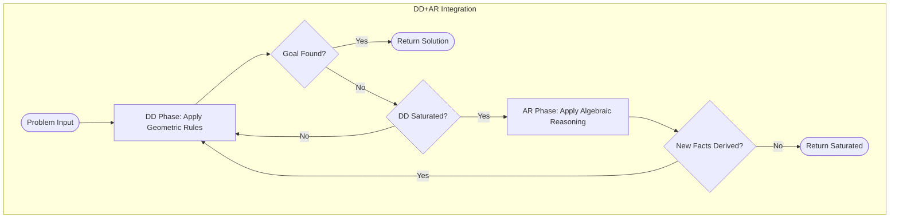
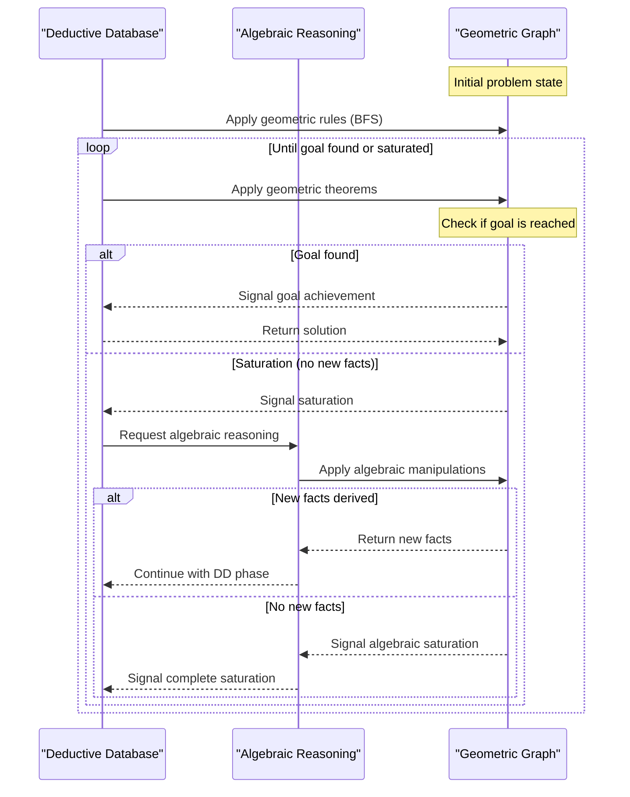
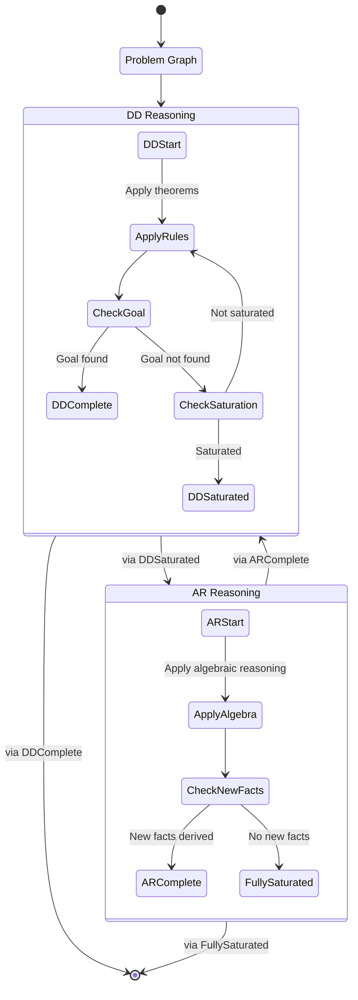
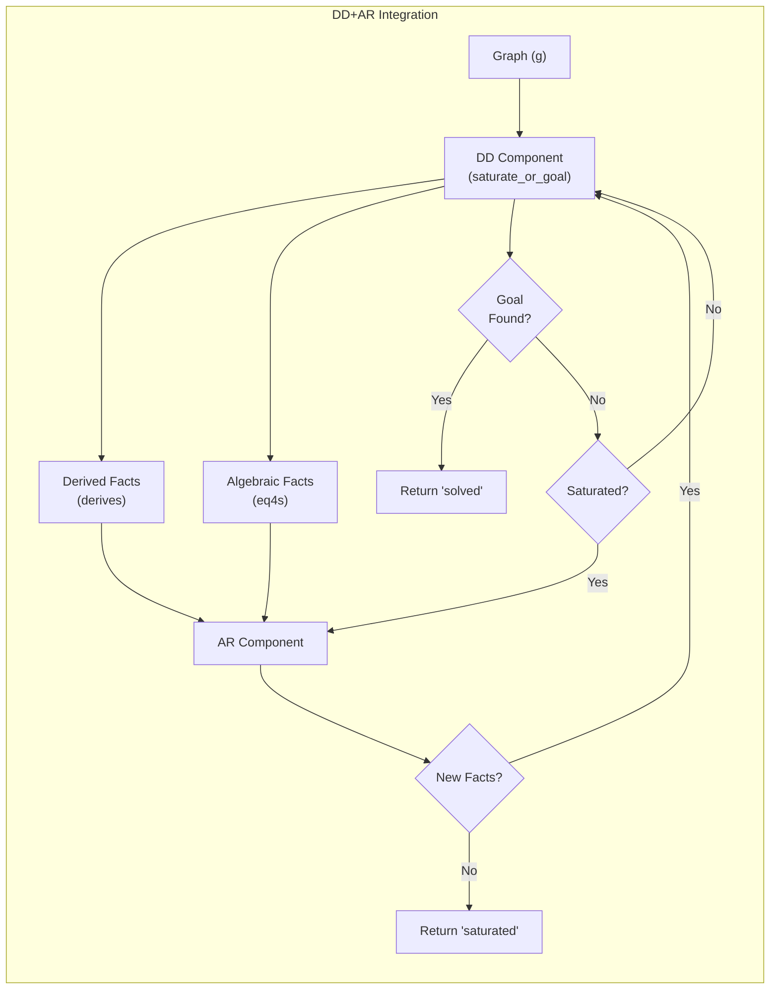

<!-- source: DeepWiki mcp.deepwiki.com · repo google-deepmind/alphageometry · page 4.3 Integration and Proof Search · fetched 2026-10-26 -->

# DD+AR Integration

Relevant source files

The following files were used as context for generating this wiki page:

- [README.md](README.md)
- [ddar.py](ddar.py)

## Purpose and Scope

This document explains how the Deductive Database (DD) and Algebraic Reasoning (AR) components are integrated within AlphaGeometry to create a powerful hybrid reasoning system. DD+AR integration forms the core symbolic reasoning engine that combines geometric theorem application with algebraic manipulations to solve complex geometry problems. For details about the individual components, see [Deductive Database (DD)](#3.1) and [Algebraic Reasoning (AR)](#3.2).

## Integration Overview

The DD+AR solver combines two complementary approaches to geometric reasoning:

1. **Deductive Database (DD)**: Applies geometric inference rules to derive new facts from existing ones using pattern matching and rule application
2. **Algebraic Reasoning (AR)**: Uses algebraic manipulations to derive additional facts that may not be directly derivable through geometric reasoning alone

By alternating between these approaches, DD+AR can solve problems that would be intractable for either component individually. This integration represents a key innovation in automated geometric theorem proving.

Sources: [ddar.py:77-131]()

## Integration Mechanism

The DD+AR integration follows a specific algorithm that alternates between geometric and algebraic reasoning until either the goal is reached or no further progress can be made:

1. **Initialization**: Start with initial graph representing the problem
2. **Initial Algebraic Derivation**: Derive algebraic facts at level 0
3. **Main Loop**:
   - Run DD until saturation or goal found
   - If goal found, return solution
   - If DD saturated (no new facts derived), apply algebraic reasoning
   - If AR produces new facts, return to DD phase
   - If no new facts can be derived, return saturated

This approach leverages the strengths of both symbolic reasoning methods, creating a more powerful system than either component alone.

Sources: [ddar.py:77-131]()

## Implementation Details

The DD+AR integration is implemented in the `ddar.py` file, with two key functions:

### Core Functions

1. **`saturate_or_goal`**: Runs the DD component until either:
   - The goal is found
   - No new facts can be derived (saturation)
   - Maximum level or timeout is reached

2. **`solve`**: Coordinates the alternation between DD and AR:
   - Initiates algebraic derivation at level 0
   - Runs DD until saturation or goal found via `saturate_or_goal`
   - If goal is found, returns "solved"
   - If DD is saturated, attempts to derive new facts using previously cached algebraic derivations
   - If still saturated, attempts more advanced algebraic reasoning
   - Continues until goal is found, complete saturation occurs, or limits are reached

3. **`get_proof_steps`**: After solving, extracts a coherent proof from the built graph

Sources: [ddar.py:27-73](), [ddar.py:77-131](), [ddar.py:134-157]()

## Technical Implementation

The following table summarizes the key components and data structures used in the DD+AR integration:

| Component | Description | Key Data Structures |
|-----------|-------------|---------------------|
| Graph | Represents the geometric problem state | Points, lines, relations, facts |
| Theorems | Geometric inference rules | List of `pr.Theorem` objects |
| Derivations | Cached facts derived from DD | Dictionary mapping relation names to argument tuples |
| Algebraic facts | Results from AR component | Primarily equality relations between expressions |
| Dependencies | Tracking proof steps | Captures the premises and conclusions |

Sources: [ddar.py:16-26](), [ddar.py:77-131]()

## DD+AR Solution Process

Sources: [ddar.py:77-131](), [ddar_test.py:33-61]()

## Data Flow Within DD+AR

Sources: [ddar.py:77-131]()

## Examples of DD+AR Effectiveness

The power of the DD+AR integration is demonstrated by problems that can be solved with the combined approach but not with DD alone. The test cases in `ddar_test.py` illustrate this:

1. **Orthocenter Problem Without Auxiliary Points**: 
   - Fails with DD alone because the necessary relationships cannot be directly derived through pure geometric reasoning
   - Example: Finding perpendicularity in a triangle without appropriate auxiliary constructions

2. **Orthocenter Problem With Auxiliary Points**:
   - Succeeds when auxiliary points are provided, showing how DD+AR can leverage additional geometric information
   - Example: Addition of point E on lines AC and BD enables the solution

3. **Incenter-Excenter Problem**:
   - Fails with DD alone but succeeds with DD+AR
   - Demonstrates how algebraic reasoning can bridge gaps in pure geometric reasoning

These examples highlight how DD+AR integration enhances the problem-solving capabilities of AlphaGeometry beyond what either component could achieve independently.

Sources: [ddar_test.py:33-61]()

## Benefits of DD+AR Integration

The integration of DD and AR provides several key advantages:

1. **Complementary strengths**: DD excels at direct geometric inference while AR handles algebraic relationships
2. **Breaking reasoning barriers**: Can overcome situations where pure geometric reasoning gets stuck
3. **Bidirectional feedback**: Facts derived algebraically enable new geometric derivations and vice versa
4. **Complete proof generation**: The combined approach constructs complete formal proofs that include both geometric and algebraic steps

This integration represents a significant advancement in automated geometric theorem proving, enabling AlphaGeometry to solve complex problems that were previously challenging for automated systems.

Sources: [ddar.py:16-26](), [ddar.py:77-131]()

---

