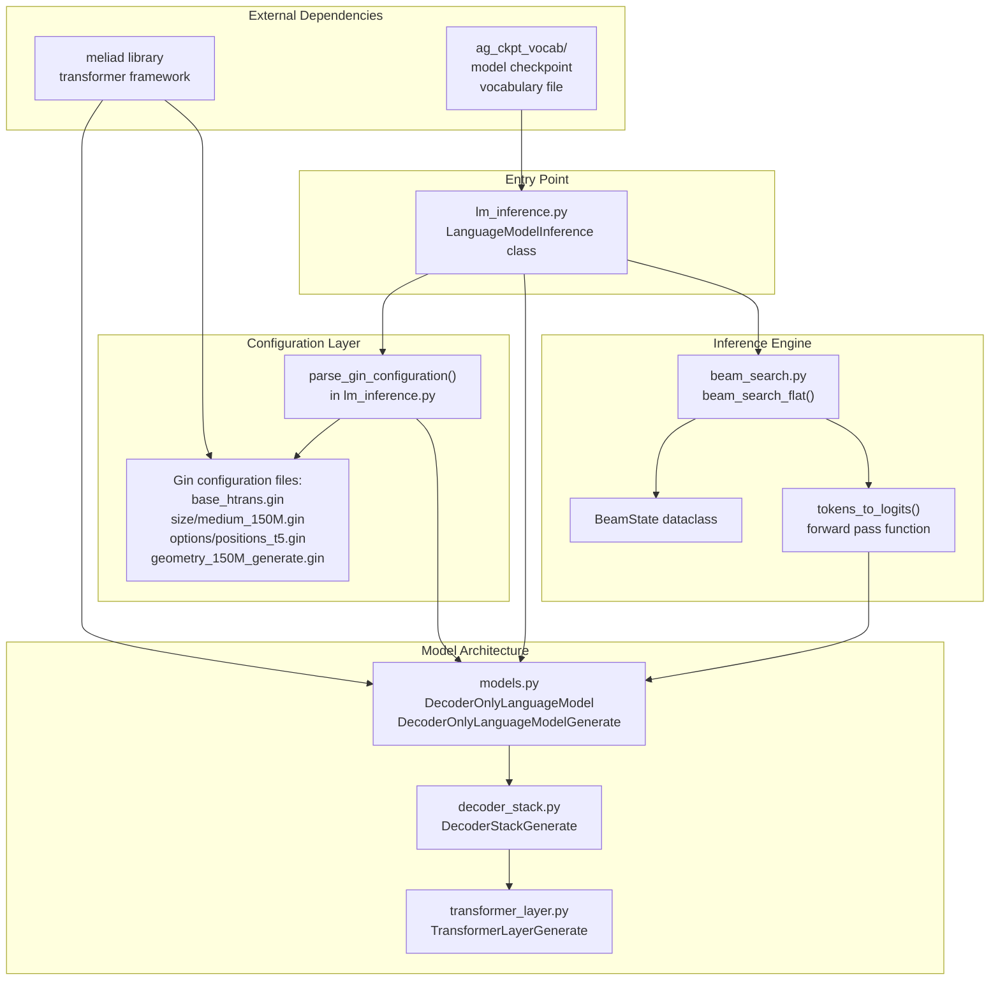
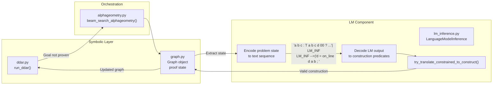
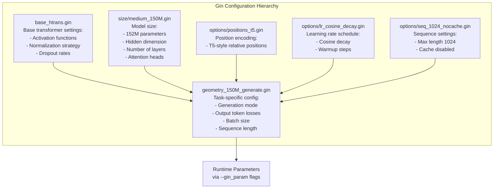
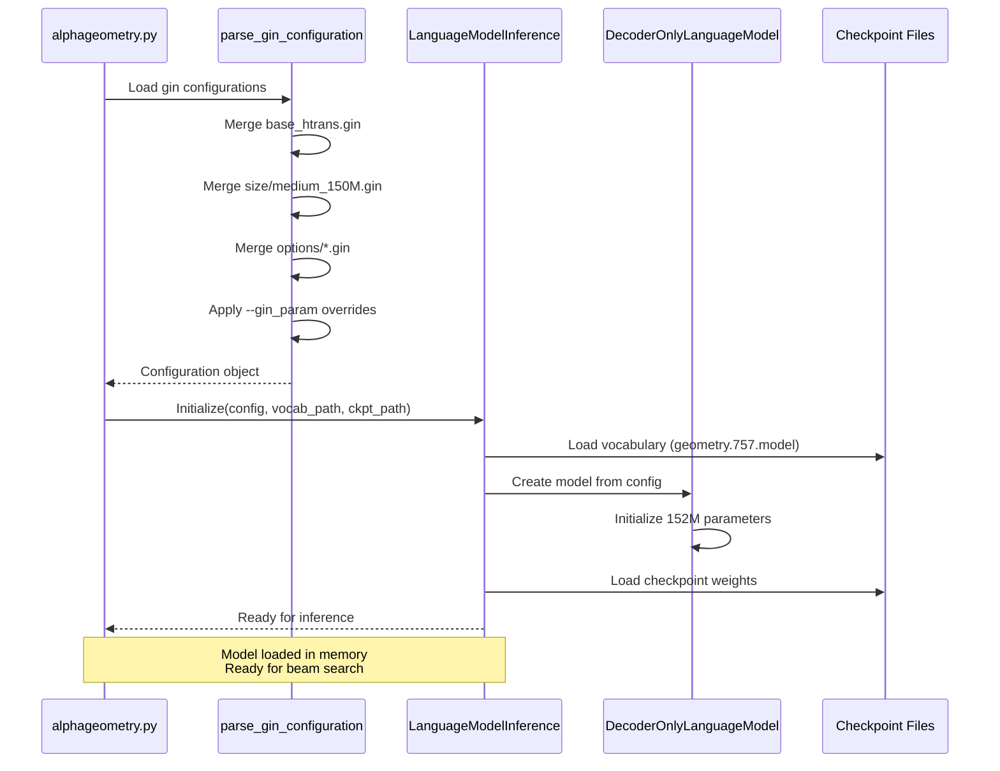
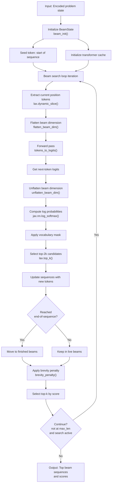
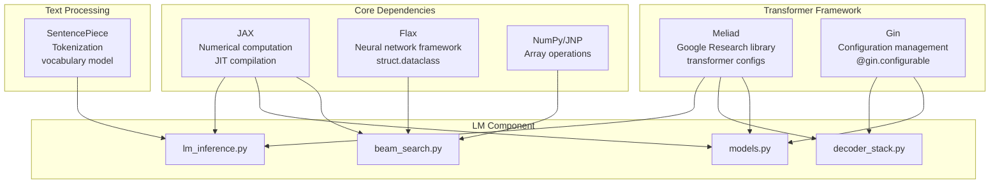

<!-- source: DeepWiki mcp.deepwiki.com · repo google-deepmind/alphageometry · page 5 Language Model Component · fetched 2026-10-26 -->

# Language Model Component

<details>
<summary>Relevant source files</summary>

The following files were used as context for generating this wiki page:

- [README.md](README.md)
- [beam_search.py](beam_search.py)
- [decoder_stack.py](decoder_stack.py)

</details>


## Purpose and Scope

The Language Model Component provides neural augmentation capabilities for AlphaGeometry mode. When the symbolic DD+AR solver reaches saturation without proving the goal, this component proposes auxiliary geometric constructions that can unlock new reasoning paths. This page describes the high-level architecture, configuration system, and integration points between the neural model and symbolic solver.

For details on the transformer architecture itself, see [Model Architecture](#5.1). For beam search decoding algorithms, see [Beam Search Decoding](#5.2). For how auxiliary constructions are generated and validated, see [Auxiliary Construction Generation](#5.3).

Sources: [README.md:1-441](), [beam_search.py:1-464](), [decoder_stack.py:1-56]()

## Role in AlphaGeometry System

The Language Model Component serves as a learned construction oracle. It has been trained on millions of synthetic geometry problems and their solutions, learning patterns about which auxiliary constructions are useful in different geometric contexts. During proof search, when DDAR fails to solve a problem, the LM analyzes the current problem state and proposes candidate auxiliary points with associated geometric constraints.

The LM operates in an alternating loop with DDAR:
1. DDAR attempts symbolic proof search
2. If unsuccessful, LM proposes auxiliary constructions
3. Best-scoring constructions are added to the problem
4. DDAR retries with expanded problem
5. Repeat until solved or maximum depth reached

This hybrid approach combines the precision of symbolic reasoning with the intuition-like pattern recognition of neural networks.

Sources: [README.md:199-302]()

## Core Components and Code Entities



**Key Code Entities:**

| Entity | File | Description |
|--------|------|-------------|
| `LanguageModelInference` | lm_inference.py | Main interface class for model inference |
| `parse_gin_configuration()` | lm_inference.py | Loads and merges gin config files |
| `DecoderOnlyLanguageModel` | models.py | Transformer model implementation |
| `DecoderStackGenerate` | decoder_stack.py | Stack of decoder layers for generation |
| `TransformerLayerGenerate` | transformer_layer.py | Individual transformer layer with attention |
| `beam_search_flat()` | beam_search.py | Beam search decoding algorithm |
| `BeamState` | beam_search.py | Data structure holding beam search state |

Sources: [README.md:115-132](), [decoder_stack.py:40-56](), [beam_search.py:175-222]()

## Integration with Symbolic Solver



**Integration Flow:**

1. **State Extraction**: The current proof graph is serialized into a text sequence representing known points, their relationships, and the goal
2. **Encoding**: Problem state is tokenized using SentencePiece vocabulary [README.md:120]()
3. **Generation**: Beam search generates multiple candidate construction sequences in parallel
4. **Decoding**: Raw token sequences are parsed into formal geometric predicates
5. **Validation**: Each construction is validated for geometric soundness and added to the graph if valid
6. **Retry**: DDAR attempts proof search with the augmented problem

Sources: [README.md:199-302]()

## Configuration System

The Language Model Component uses the Gin configuration library to manage model hyperparameters. Configuration is hierarchical, allowing modular specification of different aspects:



**Key Configuration Parameters:**

| Parameter | Value | Description |
|-----------|-------|-------------|
| Model size | 150M parameters | Total trainable parameters [README.md:104]() |
| Batch size | 2 (example) / 32 (paper) | Number of parallel constructions [README.md:93-94]() |
| Beam size | 2 (example) / 512 (paper) | Number of beams in beam search [README.md:94]() |
| Sequence length | 128 | Max tokens in input/output [README.md:130]() |
| Max decode length | 32 | Max tokens to generate [beam_search.py:40]() |

**Configuration Flags in Command Line:**

```
LM_ARGS=(
  --ckpt_path=$DATA \
  --vocab_path=$DATA/geometry.757.model
  --gin_search_paths=$MELIAD_PATH/transformer/configs,$(pwd) \
  --gin_file=base_htrans.gin \
  --gin_file=size/medium_150M.gin \
  --gin_file=options/positions_t5.gin \
  --gin_file=options/lr_cosine_decay.gin \
  --gin_file=options/seq_1024_nocache.gin \
  --gin_file=geometry_150M_generate.gin \
  --gin_param=DecoderOnlyLanguageModelGenerate.output_token_losses=True \
  --gin_param=TransformerTaskConfig.batch_size=$BATCH_SIZE \
  --gin_param=TransformerTaskConfig.sequence_length=128 \
  --gin_param=Trainer.restore_state_variables=False
);
```

Sources: [README.md:115-132](), [beam_search.py:35-44]()

## Input Format: Problem State Encoding

The LM receives the current proof state as a text sequence with specific syntax:

**Format Structure:**
```
{S} <points> : <predicates> ? <goal> {F1} x00
```

**Components:**
- `{S}`: Start-of-sequence token
- Points: Space-separated point names (e.g., `a b c d`)
- Predicates: Numbered geometric relationships (e.g., `T a b c d 00` for perpendicularity)
- `?`: Separator before goal
- Goal: Target predicate to prove
- `{F1}`: Marker indicating auxiliary construction needed
- `x00`: Depth marker

**Example from README:**
```
{S} a : ; b : ; c : ; d : T a b c d 00 T a c b d 01 ? T a d b c {F1} x00
```

This encodes:
- Points: a, b, c, d
- Known facts: `T a b c d 00` (perpendicularity), `T a c b d 01`
- Goal: `T a d b c` (perpendicularity to prove)
- Request: Auxiliary construction needed (depth 0)

Sources: [README.md:233-234]()

## Output Format: Construction Proposals

The LM outputs auxiliary construction specifications in a structured format:

**Format Structure:**
```
<point> : <predicate1> <predicate2> ... ;
```

**Examples from README:**

1. **Intersection of line and circle:**
   ```
   e : C a c e 02 C b d e 03 ;
   ```
   Translation: `e = on_line e a c, on_line e b d`
   
2. **Equidistance construction:**
   ```
   e = eqdistance e c a b, eqdistance e b a c
   ```
   Translation: construct E as intersection of circle(center=C, radius=AB) and circle(center=B, radius=AC)

**Scoring:**
Each construction receives a score from beam search (log probability divided by brevity penalty). Higher scores indicate more likely constructions. The beam search generates multiple candidates ranked by score:
- First candidate: score = -1.186
- Second candidate: score = -1.102 (better, tried first)

Sources: [README.md:238-240](), [README.md:290-300](), [beam_search.py:47-60]()

## Model Initialization

The Language Model Component is initialized during the AlphaGeometry startup phase:



**Initialization Steps:**

1. **Parse Configuration** [README.md:117-127](): Load and merge gin files
2. **Load Vocabulary**: Read SentencePiece model [README.md:120]()
3. **Create Model**: Instantiate transformer with 152M parameters [README.md:224]()
4. **Load Checkpoint**: Restore trained weights from `ag_ckpt_vocab/` [README.md:119]()
5. **Prepare for Generation**: Set up beam search parameters [README.md:129]()

Sources: [README.md:115-132](), [README.md:223-225]()

## Inference Process

During proof search, the LM performs inference through beam search:



**Key Functions:**

| Function | File | Purpose |
|----------|------|---------|
| `beam_init()` | beam_search.py:194-221 | Initialize beam search state with seed token |
| `flatten_beam_dim()` | beam_search.py:93-97 | Flatten batch and beam dimensions for model |
| `tokens_to_logits()` | beam_search.py:243 | Forward pass through transformer |
| `unflatten_beam_dim()` | beam_search.py:100-105 | Restore beam dimension after forward pass |
| `brevity_penalty()` | beam_search.py:47-60 | Score adjustment favoring longer sequences |
| `gather_topk_beams()` | beam_search.py:140-156 | Select best-scoring beams |

Sources: [beam_search.py:1-464](), [README.md:227-301]()

## Beam State Management

The `BeamState` dataclass tracks all information needed during beam search:

```python
@flax.struct.dataclass
class BeamState:
  cur_index: jax.Array          # Current decode position
  live_logprobs: jax.Array      # [batch_size, beam_size] log probs
  finished_scores: jax.Array    # [batch_size, beam_size] final scores
  live_seqs: jax.Array          # [batch_size, beam_size, max_len] active
  finished_seqs: jax.Array      # [batch_size, beam_size, max_len] complete
  finished_flags: jax.Array     # [batch_size, beam_size] completion flags
  cache: Any                    # Transformer attention cache
```

**State Evolution:**

1. **Initialization** [beam_search.py:194-221](): Start with single active beam per batch
2. **Expansion**: Expand to `beam_size` beams (e.g., 512) [README.md:94]()
3. **Iteration**: Each step generates `beam_size * vocab_size` candidates
4. **Selection**: Keep top `beam_size` active and top `beam_size` finished
5. **Termination**: Stop when all beams finish or max length reached

Sources: [beam_search.py:175-192]()

## Dependencies and External Libraries

The Language Model Component relies on several external libraries:



**Installation Requirements:**

The Meliad library is not registered with pip and must be manually installed:

```bash
MELIAD_PATH=meliad_lib/meliad
mkdir -p $MELIAD_PATH
git clone https://github.com/google-research/meliad $MELIAD_PATH
export PYTHONPATH=$PYTHONPATH:$MELIAD_PATH
```

**Note:** The DDAR solver can run without these dependencies by disabling the LM inference import in alphageometry.py [README.md:137-138]()

Sources: [README.md:23-34](), [README.md:63-71](), [README.md:399-413]()

## Performance Characteristics

The Language Model Component has significant computational requirements:

**Model Size:**
- Parameters: 152,072,288 (152M) [README.md:223]()
- Architecture: Decoder-only transformer

**Hardware Requirements (Paper Settings):**
- GPUs: 4 V100 GPUs for model inference [README.md:106]()
- CPUs: 250 CPU workers for DDAR [README.md:106-107]()
- Purpose: Stay under IMO time limits [README.md:106]()

**Inference Parameters:**
- Batch size: 32 (generates 32 constructions in parallel) [README.md:104]()
- Beam size: 512 (maintains 512 hypotheses) [README.md:104]()
- Search depth: 16 (maximum auxiliary construction iterations) [README.md:105]()

**Simplified Settings:**
The repository examples use lightweight values for demonstration:
- Batch size: 2
- Beam size: 2  
- Depth: 2

Sources: [README.md:93-109](), [README.md:223-225]()

## Limitations and Optimizations

**Current Implementation:**

The released implementation removes several optimizations present in the research system:

1. **Parallelization Removed** [README.md:279-287]():
   - No multi-GPU model inference
   - No multi-CPU DDAR parallelization
   - No parallel execution of LM and DDAR
   - No shared CPU worker pool across problems

2. **Simplifications for Clarity** [README.md:286-287]():
   - Memory optimizations removed
   - Speed optimizations stripped
   - Code abstractions reduced

**Reproducibility Note:**

There is a known issue where different users may observe different LM scores for the same inputs, though the top beam decodes remain consistent [README.md:312]()

Sources: [README.md:279-312]()

---

