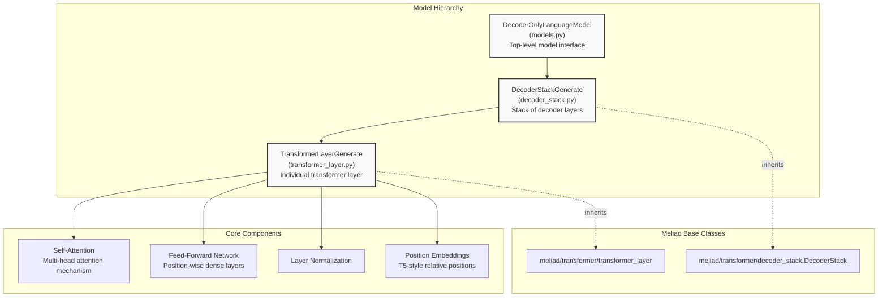
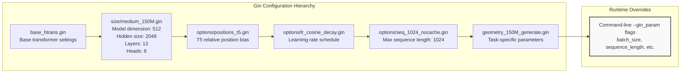
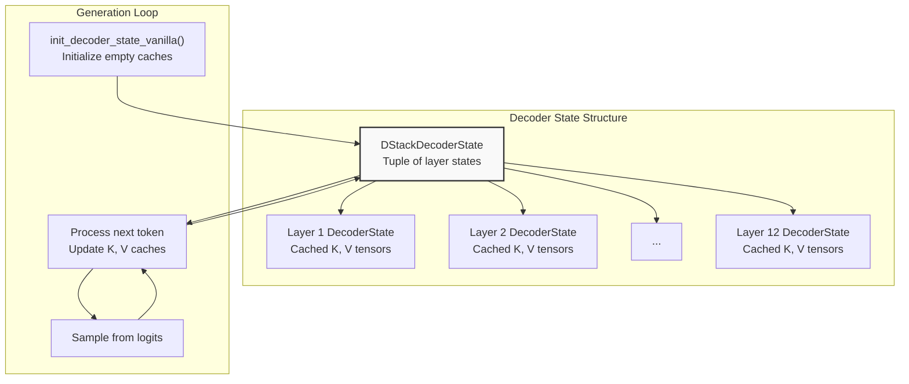

<!-- source: DeepWiki mcp.deepwiki.com · repo google-deepmind/alphageometry · page 5.1 Model Architecture · fetched 2026-10-26 -->

# Model Architecture

<details>
<summary>Relevant source files</summary>

The following files were used as context for generating this wiki page:

- [README.md](README.md)
- [decoder_stack.py](decoder_stack.py)

</details>


This page documents the transformer model architecture used in AlphaGeometry's neural component. The model is a decoder-only transformer with 150M parameters that generates auxiliary construction proposals. For information about how this model performs inference via beam search, see [Beam Search Decoding](#5.2). For details on how the model outputs are translated to geometric constructions, see [Auxiliary Construction Generation](#5.3).

## Overview

AlphaGeometry's language model is a **decoder-only transformer** built on the [meliad](https://github.com/google-research/meliad) library from Google Research. The model architecture follows the T5-style transformer design but operates in generation-only mode, predicting auxiliary geometric constructions token-by-token autoregressively.

The model consists of:
- **Size**: 150 million trainable parameters
- **Layers**: A stack of decoder-only transformer layers
- **Configuration**: Gin-based hierarchical configuration system
- **Dependencies**: Built on meliad's transformer implementation

**Sources**: [README.md:1-449]()

## Architecture Components

The model architecture is implemented across three primary Python modules that inherit from and extend meliad's base transformer components:



**Diagram: Model Component Hierarchy**

**Sources**: [README.md:336-357](), [decoder_stack.py:1-56]()

### DecoderOnlyLanguageModel

The top-level model class `DecoderOnlyLanguageModel` (defined in `models.py`) provides the main interface for the transformer. This class:
- Manages the vocabulary embedding and output projection
- Coordinates the decoder stack
- Handles token-to-logits forward pass
- Supports optional output of per-token losses during generation

The model is instantiated and configured through Gin parameters, including the critical setting to enable loss tracking:

```
--gin_param=DecoderOnlyLanguageModelGenerate.output_token_losses=True
```

**Sources**: [README.md:117-133]()

### DecoderStackGenerate

The `DecoderStackGenerate` class [decoder_stack.py:41-56]() implements the stack of transformer decoder layers. Key characteristics:

- **Inherits from**: `decoder_stack.DecoderStack` (meliad base class)
- **Layer Factory**: Uses `TransformerLayerGenerate` to construct individual layers
- **State Management**: Implements `init_decoder_state_vanilla()` for autoregressive generation

The decoder stack maintains state across generation steps, initializing a tuple of decoder states (one per layer) that cache key-value pairs for efficient sequential decoding:

```python
def init_decoder_state_vanilla(
    self, sequence_length: int, start_of_sequence: Array
) -> DStackDecoderState:
    """Return initial state for autoregressive generation."""
    return tuple([
        layer.init_decoder_state_vanilla(sequence_length, start_of_sequence)
        for layer in self.transformer_layers
    ])
```

**Sources**: [decoder_stack.py:40-56]()

### TransformerLayerGenerate

Each layer in the stack is a `TransformerLayerGenerate` instance (defined in `transformer_layer.py`) that implements the standard transformer decoder layer pattern:

1. **Self-Attention**: Multi-head attention with causal masking
2. **Layer Normalization**: Applied before and after sub-layers
3. **Feed-Forward Network**: Position-wise dense transformations
4. **Residual Connections**: Skip connections around sub-layers

The layer maintains its own decoder state for efficient autoregressive generation, storing cached attention keys and values.

**Sources**: [decoder_stack.py:22](), [README.md:346-349]()

## Configuration System

AlphaGeometry uses a **hierarchical Gin configuration system** to specify model architecture, training hyperparameters, and generation settings. This approach allows flexible composition of model configurations without hardcoding parameters.



**Diagram: Gin Configuration Flow**

The configuration files are loaded in order, with later files overriding earlier settings:

| Configuration File | Purpose |
|-------------------|---------|
| `base_htrans.gin` | Base hyperparameters for the transformer architecture |
| `size/medium_150M.gin` | Specifies 150M parameter model dimensions (embedding size, hidden size, number of layers/heads) |
| `options/positions_t5.gin` | Enables T5-style relative position embeddings |
| `options/lr_cosine_decay.gin` | Configures cosine learning rate decay schedule |
| `options/seq_1024_nocache.gin` | Sets maximum sequence length to 1024 tokens without KV caching |
| `geometry_150M_generate.gin` | Task-specific settings for geometry construction generation |

Runtime parameters can override these settings via command-line flags:

```bash
--gin_param=TransformerTaskConfig.batch_size=$BATCH_SIZE
--gin_param=TransformerTaskConfig.sequence_length=128
--gin_param=Trainer.restore_state_variables=False
```

**Sources**: [README.md:113-133]()

## Model Dimensions and Parameters

The medium-sized model used in AlphaGeometry has the following architectural specifications:

| Parameter | Value |
|-----------|-------|
| Total Parameters | 152,072,288 (~150M) |
| Embedding Dimension | 512 |
| Hidden Layer Size | 2048 |
| Number of Layers | 12 |
| Attention Heads | 8 |
| Vocabulary Size | 757 tokens |
| Maximum Sequence Length | 1024 tokens (config), 128 tokens (runtime) |

The vocabulary consists of 757 tokens specific to geometric constructions, loaded from `ag_ckpt_vocab/geometry.757.model`. During inference for AlphaGeometry problems, the sequence length is typically limited to 128 tokens for efficiency.

**Sources**: [README.md:117-133](), [README.md:223]()

## Attention Mechanisms

The model uses **causal self-attention** with several key features:

1. **Multi-Head Attention**: 8 parallel attention heads per layer, each processing different representation subspaces
2. **T5-Style Relative Position Embeddings**: Instead of absolute position encodings, the model uses learned relative position biases as introduced in the T5 architecture
3. **Causal Masking**: During generation, attention is masked to prevent looking at future tokens, ensuring autoregressive property
4. **Key-Value Caching**: For efficient sequential generation, past keys and values are cached in the decoder state

The attention mechanism is configured through `options/positions_t5.gin`, which enables the relative position bias computation specific to T5.

**Sources**: [README.md:122-124]()

## State Management for Generation

For autoregressive generation, the model maintains a `DStackDecoderState` that caches computation from previous timesteps:



**Diagram: Decoder State Management During Generation**

The `init_decoder_state_vanilla()` method [decoder_stack.py:46-55]() creates the initial state tuple by calling each layer's initialization method. This state is then threaded through each generation step, allowing the model to efficiently generate sequences without recomputing attention for previously generated tokens.

The state includes:
- **Key-Value Cache**: Stored attention keys and values for all previous tokens
- **Sequence Position Tracking**: Current position in the generation sequence
- **Start-of-Sequence Markers**: Flags indicating sequence boundaries

**Sources**: [decoder_stack.py:40-56]()

## Integration with Meliad

AlphaGeometry's transformer extends Google Research's [meliad library](https://github.com/google-research/meliad), which provides the foundational transformer implementation. The integration involves:

1. **Installation**: Meliad is cloned from GitHub and added to `PYTHONPATH` [README.md:63-71]()
2. **Import Path**: The model imports from `meliad.transformer` modules [decoder_stack.py:21]()
3. **Inheritance**: AlphaGeometry classes inherit from meliad base classes
4. **Configuration**: Gin search paths include meliad's config directory [README.md:121]()

The meliad library provides:
- Core transformer implementations (`DecoderStack`, transformer layers)
- Attention mechanisms (multi-head, relative position)
- Training utilities (`Trainer`, optimization schedules)
- Gin configuration system integration

By building on meliad, AlphaGeometry leverages a well-tested transformer implementation while customizing generation behavior through the `*Generate` subclasses.

**Sources**: [README.md:29-34](), [README.md:63-71](), [README.md:121](), [decoder_stack.py:21-29]()

## Loading Pretrained Weights

The model weights are loaded from a checkpoint directory specified via `--ckpt_path`:

```bash
--ckpt_path=$DATA
```

where `$DATA` points to `ag_ckpt_vocab/` containing:
- Model checkpoint files (trained parameters)
- Vocabulary file `geometry.757.model` (SentencePiece tokenizer)

The checkpoint contains the full model state (152M parameters) trained on synthetic geometry problems. During initialization, the model architecture is configured via Gin, and then the pretrained weights are restored. The flag `--gin_param=Trainer.restore_state_variables=False` [README.md:131]() indicates that optimizer state variables are not restored (only model parameters), since inference doesn't require optimizer state.

**Sources**: [README.md:56-61](), [README.md:119-120]()

## Model Architecture in Context

The transformer model fits into the broader AlphaGeometry system as the neural component that proposes auxiliary constructions when symbolic reasoning stalls:

```mermaid
flowchart LR
    subgraph "Input"
        PROB["Problem State<br/>Points, predicates, goal"]
    end
    
    subgraph "Model Encoding"
        ENCODE["lm_inference.py<br/>Encode as token sequence"]
        VOCAB["SentencePiece vocab<br/>geometry.757.model"]
    end
    
    subgraph "Transformer Architecture"
        EMBED["Token Embeddings"]
        DS["DecoderStackGenerate<br/>12 transformer layers"]
        PROJ["Output Projection<br/>Vocabulary logits"]
    end
    
    subgraph "Output"
        LOGITS["Token Logits"]
        BEAM["Beam Search<br/>beam_search.py"]
        CONSTR["Construction Proposals"]
    end
    
    PROB --> ENCODE
    ENCODE --> VOCAB
    VOCAB --> EMBED
    EMBED --> DS
    DS --> PROJ
    PROJ --> LOGITS
    LOGITS --> BEAM
    BEAM --> CONSTR
    
    style DS fill:#f9f9f9,stroke:#333,stroke-width:2px
```



**Diagram: Model Data Flow in AlphaGeometry System**

The model takes encoded problem states and generates construction proposals that are then validated and added to the symbolic reasoning graph. This hybrid approach allows the system to solve problems beyond pure symbolic reasoning capabilities.

**Sources**: [README.md:1-449](), [decoder_stack.py:1-56]()

---

