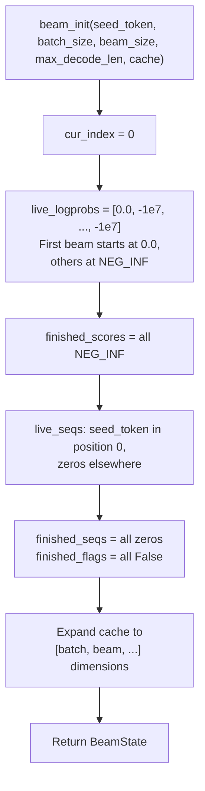
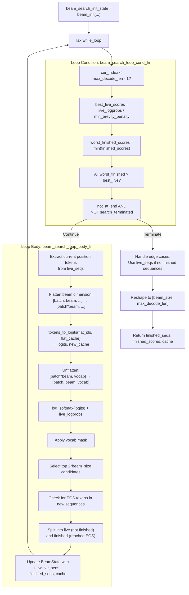
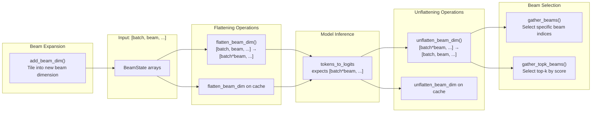
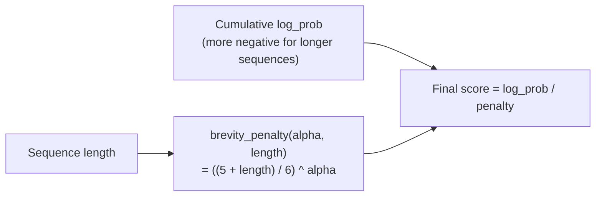
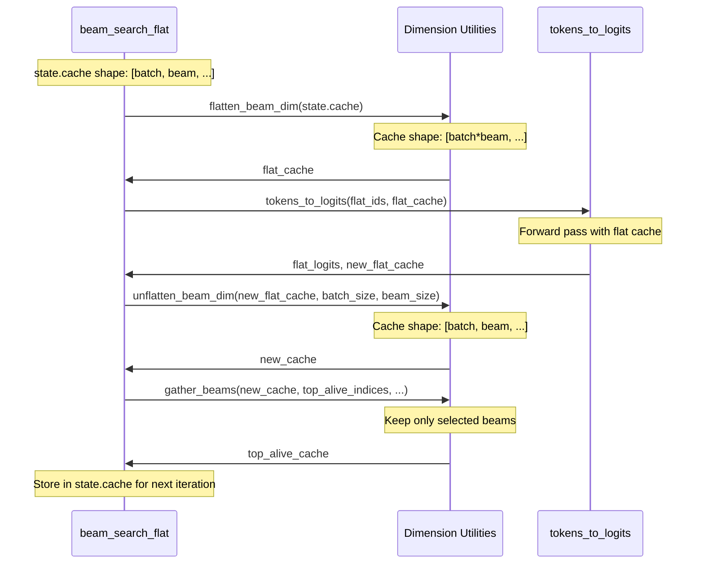

<!-- source: DeepWiki mcp.deepwiki.com · repo google-deepmind/alphageometry · page 5.2 Beam Search Decoding · fetched 2026-10-26 -->

# Beam Search Decoding

<details>
<summary>Relevant source files</summary>

The following files were used as context for generating this wiki page:

- [README.md](README.md)
- [beam_search.py](beam_search.py)

</details>


This page documents the beam search algorithm used to generate multiple candidate construction proposals from the language model in parallel. The implementation in [beam_search.py]() manages beam states, scores candidates using log probabilities with brevity penalties, and efficiently handles dimension manipulation for batched inference.

For information about the transformer model architecture that produces logits, see [Model Architecture](#5.1). For how beam search outputs are translated into geometric constructions, see [Auxiliary Construction Generation](#5.3).

---

## Purpose and Scope

The beam search decoder maintains multiple candidate sequences (beams) simultaneously during autoregressive generation. It scores each candidate by its cumulative log probability, applies brevity penalties to avoid favoring short sequences, and prunes low-scoring beams at each decoding step. The implementation is optimized for JAX and handles dimension manipulation to batch beams efficiently during model inference.

The primary entry point is `beam_search_flat` [beam_search.py:227-463](), which expects flattened (batch × beam) inputs and returns top-scoring sequences with their scores and updated cache.

**Sources:** [beam_search.py:1-464](), [README.md:94-104]()

---

## BeamState Data Structure

The `BeamState` dataclass [beam_search.py:175-192]() encapsulates all state needed during beam search:

| Field | Type | Shape | Description |
|-------|------|-------|-------------|
| `cur_index` | `jax.Array` | scalar | Current position in sequence being decoded |
| `live_logprobs` | `jax.Array` | `[batch_size, beam_size]` | Cumulative log probabilities of active sequences |
| `finished_scores` | `jax.Array` | `[batch_size, beam_size]` | Scores of completed sequences (with brevity penalty) |
| `live_seqs` | `jax.Array` | `[batch_size, beam_size, max_decode_len]` | Token IDs of active sequences |
| `finished_seqs` | `jax.Array` | `[batch_size, beam_size, max_decode_len]` | Token IDs of completed sequences |
| `finished_flags` | `jax.Array` | `[batch_size, beam_size]` | Boolean mask indicating valid finished sequences |
| `cache` | `Any` | Various | Autoregressive attention cache (keys/values per layer) |

The distinction between "live" and "finished" sequences enables the algorithm to maintain both actively-growing beams and completed sequences that have reached end-of-sequence (EOS) tokens.

**Sources:** [beam_search.py:175-192]()

---

## Algorithm Flow

### Initialization

The `beam_init` function [beam_search.py:194-221]() constructs the initial `BeamState`:



The initialization ensures only the first beam in each batch has a valid starting probability (0.0 in log space), while others are effectively masked out with `NEG_INF = -1.0e7` [beam_search.py:36](). This allows the algorithm to expand from a single seed into `beam_size` beams during the first iteration.

**Sources:** [beam_search.py:194-221](), [beam_search.py:36]()

### Main Loop Structure

The `beam_search_flat` function [beam_search.py:227-463]() uses `lax.while_loop` with condition and body functions:



**Sources:** [beam_search.py:227-463](), [beam_search.py:267-290](), [beam_search.py:292-435]()

### Loop Termination

The loop condition [beam_search.py:267-290]() terminates when either:

1. **Maximum length reached**: `cur_index >= max_decode_len - 1`
2. **Search cannot improve**: The best possible score from any live sequence (even with minimal brevity penalty) is worse than the worst finished sequence score. This optimization prunes futile search.

**Sources:** [beam_search.py:267-290]()

### Core Loop Body Operations

The loop body [beam_search.py:292-435]() performs these steps each iteration:

1. **Token extraction**: Extract tokens at `cur_index` from all live sequences
2. **Dimension flattening**: Flatten `[batch, beam, ...]` to `[batch*beam, ...]` for efficient batched inference
3. **Forward pass**: Call `tokens_to_logits(flat_ids, flat_cache)` to get next-token logits
4. **Dimension restoration**: Unflatten back to `[batch, beam, vocab]`
5. **Probability calculation**: Compute `log_softmax(logits)` and add to cumulative `live_logprobs`
6. **Vocabulary masking**: Apply mask to disable certain tokens (if provided)
7. **Top-2K selection**: Select top `2 * beam_size` candidates (2× ensures we have extras if many reach EOS)
8. **EOS detection**: Identify newly finished sequences using EOS mask
9. **Beam pruning**: Separate finished sequences, select top `beam_size` live sequences
10. **Cache gathering**: Update attention cache to correspond with selected beams

**Sources:** [beam_search.py:292-435]()

---

## Beam Dimension Manipulation

The beam search implementation uses several utility functions to manage the beam dimension efficiently during batched inference. These functions are critical because the model expects inputs with shape `[batch, ...]`, but beam search operates on `[batch, beam, ...]`.

### Dimension Manipulation Functions



| Function | Signature | Purpose |
|----------|-----------|---------|
| `add_beam_dim` | `(x, beam_size)` [beam_search.py:66-73]() | Expands array by adding beam dimension and tiling |
| `flatten_beam_dim` | `(x)` [beam_search.py:93-97]() | Merges batch and beam dimensions: `[batch, beam, ...]` → `[batch*beam, ...]` |
| `unflatten_beam_dim` | `(x, batch_size, beam_size)` [beam_search.py:100-105]() | Splits flattened dimension: `[batch*beam, ...]` → `[batch, beam, ...]` |
| `gather_beams` | `(nested, beam_indices, batch_size, new_beam_size)` [beam_search.py:113-137]() | Gathers selected beam slices from pytree of arrays |
| `gather_topk_beams` | `(nested, score_or_log_prob, batch_size, new_beam_size)` [beam_search.py:140-156]() | Gathers top-k beams by score using `lax.top_k` |
| `flat_batch_beam_expand` | `(x, beam_size)` [beam_search.py:108-110]() | Combines `add_beam_dim` and `flatten_beam_dim` |

**Sources:** [beam_search.py:66-156]()

### Cache-Specific Operations

The attention cache requires special handling because not all cache fields should be manipulated. The `apply_on_cache` function [beam_search.py:159-169]() applies transformations only to relevant fields (`'keys'`, `'values'`, `'current_index'`, `'relative_position_bias'`), leaving other metadata untouched.

```python
# Example: Flattening cache for model inference
flat_cache = apply_on_cache(flatten_beam_dim, state.cache)
# Only 'keys', 'values', etc. are flattened; other fields pass through
```

**Sources:** [beam_search.py:159-169](), [beam_search.py:76-90]()

---

## Scoring and Penalties

### Log Probability Accumulation

The algorithm maintains cumulative log probabilities in `live_logprobs` [beam_search.py:182](). At each step:

1. Compute next-token log probabilities: `candidate_log_probs = log_softmax(logits)` [beam_search.py:322]()
2. Add to existing sequence log probabilities: `log_probs = candidate_log_probs + expand_dims(live_logprobs)` [beam_search.py:325-327]()
3. Select top-k candidates by log probability [beam_search.py:345]()

This accumulation means longer sequences naturally have more negative log probabilities (since each token probability ≤ 1, and log(p) ≤ 0).

**Sources:** [beam_search.py:322-327](), [beam_search.py:345]()

### Brevity Penalty

To counteract the bias toward shorter sequences, the `brevity_penalty` function [beam_search.py:47-60]() applies a length normalization:

```
brevity_penalty(alpha, length) = ((5.0 + length) / 6.0) ^ alpha
```

Where:
- `BREVITY_LEN_BIAS_NUMERATOR = 5.0` [beam_search.py:43]()
- `BREVITY_LEN_BIAS_DENOMINATOR = 6.0` [beam_search.py:44]()
- `alpha` defaults to `BEAM_SEARCH_DEFAULT_ALPHA = 0.6` [beam_search.py:39]()

The final score for a finished sequence is:
```
score = log_prob / brevity_penalty(alpha, length)
```

Applied at [beam_search.py:400]() when sequences reach EOS.

**Scoring Equation:**



This scoring encourages longer sequences by dividing by a penalty that grows with length. The alpha parameter controls the strength of this effect.

**Sources:** [beam_search.py:47-60](), [beam_search.py:400](), [beam_search.py:39](), [beam_search.py:43-44]()

### Vocabulary Masking

The algorithm supports masking specific vocabulary tokens via the `mask` parameter [beam_search.py:234]():

- `mask[i] = 1`: token `i` is allowed
- `mask[i] = 0`: token `i` is disabled

Implemented as: `log_probs += (1 - mask) * NEG_INF` [beam_search.py:333](), effectively setting disabled token probabilities to zero.

**Sources:** [beam_search.py:234](), [beam_search.py:333]()

---

## Integration with Language Model

### tokens_to_logits Interface

The `beam_search_flat` function accepts a `tokens_to_logits` callable [beam_search.py:230]():

```python
def tokens_to_logits(tokens: Array, cache: Any) -> tuple[Array, Any]:
    """
    Args:
        tokens: [batch*beam, 1] current token IDs
        cache: Attention cache from previous step
    
    Returns:
        logits: [batch*beam, vocab_size] next-token logits
        new_cache: Updated attention cache
    """
```

This abstraction decouples beam search from the specific model implementation. In practice, this is bound to the transformer model's forward pass with caching enabled.

**Sources:** [beam_search.py:230](), [beam_search.py:309]()

### Cache Management Flow



The cache flow ensures:
1. Cache is flattened before model inference [beam_search.py:305]()
2. Cache is unflattened after inference [beam_search.py:317-319]()
3. Only caches corresponding to surviving beams are retained [beam_search.py:394-396]()

**Sources:** [beam_search.py:305](), [beam_search.py:309](), [beam_search.py:317-319](), [beam_search.py:394-396]()

---

## Usage in AlphaGeometry

The beam search is invoked from `lm_inference.py` when generating auxiliary construction proposals. The typical parameter values used:

| Parameter | Development Value | Paper Value | Purpose |
|-----------|------------------|-------------|---------|
| `beam_size` | 2 | 512 | Number of parallel candidate sequences |
| `max_decode_len` | 32 [beam_search.py:40]() | 32 | Maximum construction length |
| `alpha` | 0.6 [beam_search.py:39]() | 0.6 | Brevity penalty strength |

From [README.md:94-104]():
- Development: `BEAM_SIZE=2` for lightweight testing
- Production: `BEAM_SIZE=512` as reported in the paper's Methods section

The beam search outputs are ranked by score, and the highest-scoring constructions are attempted first by the symbolic solver.

**Sources:** [README.md:94-104](), [beam_search.py:39-40]()

---

## Implementation Notes

### JAX-Specific Optimizations

The implementation leverages JAX primitives:
- `jax.lax.while_loop` [beam_search.py:438-440]() for compiled loop execution
- `jax.lax.top_k` [beam_search.py:345]() for efficient top-k selection
- `jax.lax.dynamic_slice` [beam_search.py:299-301]() and `jax.lax.dynamic_update_slice` [beam_search.py:360-362]() for in-place-like updates
- `jax.tree_util.tree_map` [beam_search.py:137]() for pytree transformations

These primitives enable JIT compilation and efficient execution on accelerators (GPUs/TPUs).

**Sources:** [beam_search.py:438-440](), [beam_search.py:345](), [beam_search.py:299-301](), [beam_search.py:360-362](), [beam_search.py:137]()

### Modified from Flax Examples

The implementation is adapted from the Flax WMT example [beam_search.py:18]() with two key modifications:

1. **Continued decoding**: Support for resuming from a previous beam cache [beam_search.py:21]()
2. **Single-to-multiple beam expansion**: Initialize with a single beam and expand to `beam_size` [beam_search.py:22]()

These modifications enable iterative construction generation where the language model proposes new constructions based on the current proof state.

**Sources:** [beam_search.py:18-23]()

### Batch Size Constraint

The current implementation assumes `batch_size = 1` [beam_search.py:257](), meaning only one problem is processed at a time. This simplifies the code and aligns with the AlphaGeometry workflow, which solves problems sequentially. The final outputs are reshaped to remove the batch dimension [beam_search.py:459-460]().

**Sources:** [beam_search.py:257](), [beam_search.py:459-460]()

---

