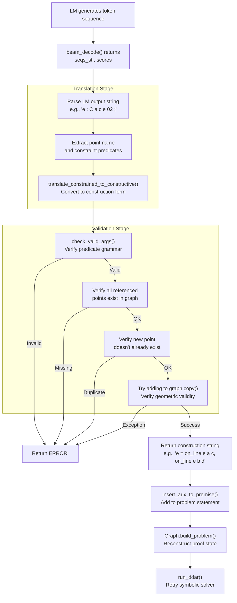
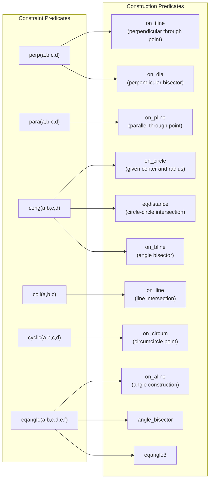
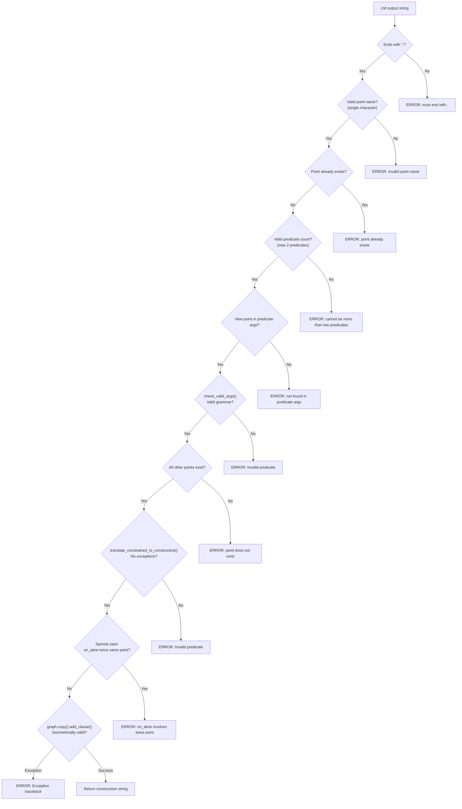
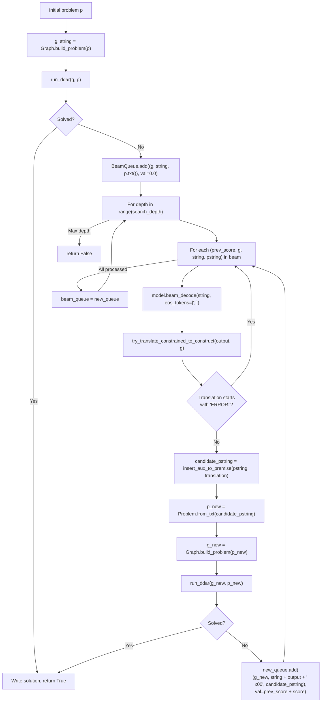
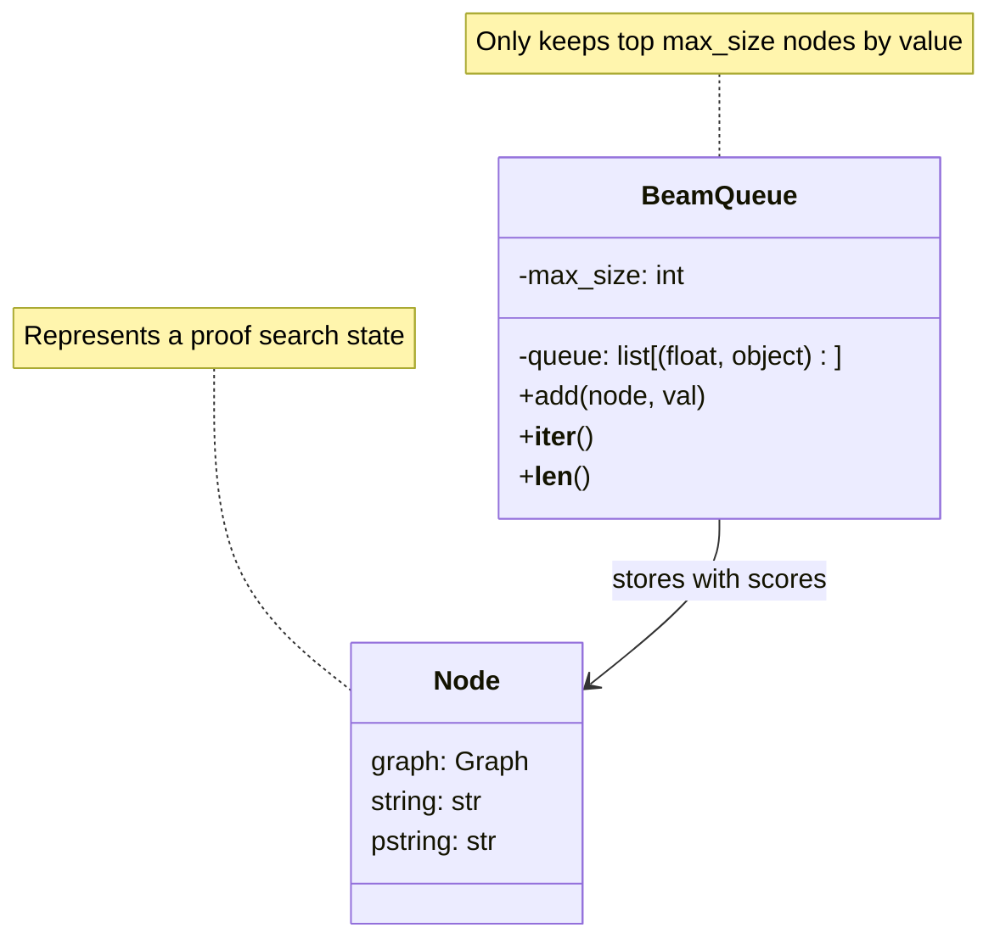

<!-- source: DeepWiki mcp.deepwiki.com · repo google-deepmind/alphageometry · page 5.3 Auxiliary Construction Generation · fetched 2026-10-26 -->

# Auxiliary Construction Generation

<details>
<summary>Relevant source files</summary>

The following files were used as context for generating this wiki page:

- [README.md](README.md)
- [alphageometry.py](alphageometry.py)

</details>


## Purpose and Scope

This document describes how AlphaGeometry's language model generates auxiliary construction proposals, validates them, and integrates them back into the symbolic solver. This is the final stage of the neural augmentation pipeline that enables AlphaGeometry to solve problems that DDAR alone cannot handle.

For information about the transformer architecture that generates these constructions, see [Model Architecture](#5.1). For details on the beam search algorithm that ranks candidates, see [Beam Search Decoding](#5.2). For the complete proof search orchestration, see [System Architecture](#2).

## Overview

When the symbolic DDAR solver fails to prove a theorem from the initial premises, AlphaGeometry's language model proposes auxiliary constructions (new geometric points and their defining constraints). These proposals must be:

1. **Decoded** from the LM's token sequence output
2. **Translated** from constraint-based to construction-based representation
3. **Validated** for geometric consistency and grammatical correctness
4. **Integrated** into the proof state graph for DDAR to retry

The key insight is that the LM learns to suggest constructions that unlock new deductive pathways, effectively bridging gaps that symbolic reasoning cannot traverse alone.

**Sources:** [alphageometry.py:488-601](), [README.md:199-302]()

## Construction Generation Pipeline

The following diagram shows the complete flow from LM output to validated construction:



**Sources:** [alphageometry.py:547-597](), [alphageometry.py:371-442]()

## LM Output Format

The language model is trained to generate auxiliary constructions in a constraint-based format that describes geometric relationships. The output follows a specific grammar:

| Component | Format | Example |
|-----------|--------|---------|
| Point Declaration | `<point> :` | `e :` |
| Constraint Predicate | `<pred> <args> <id>` | `C a c e 02` |
| Separator | Token `<id>` between predicates | `02` |
| Terminator | `;` | `;` |

### Example LM Outputs

From the orthocenter example in the README:

```
LM Output:  "e : C a c e 02 C b d e 03 ;"
Translation: "e = on_line e a c, on_line e b d"
```

This declares point `e` at the intersection of line `ac` and line `bd`.

The LM output uses symbolic codes for predicates:
- `C` = collinearity (coll)
- `T` = perpendicular (perp)
- `P` = parallel (para)
- `D` = congruent distance (cong)
- `O` = cyclic (on same circle)
- `^` = equal angle (eqangle)

**Sources:** [alphageometry.py:516-519](), [README.md:238-239]()

## Translation to Constructive Representation

### Constraint-Based vs Construction-Based

AlphaGeometry uses two representations for geometric statements:

| Representation | Example | Use Case |
|----------------|---------|----------|
| **Constraint-Based** | `coll(e, a, c)` | LM training/inference |
| **Construction-Based** | `e = on_line e a c` | Graph building, DDAR |

The constraint-based format states relationships between existing points. The construction-based format specifies how to construct a new point from existing ones.

### Translation Function Mapping

The `translate_constrained_to_constructive()` function converts each constraint predicate to its construction equivalent:



**Sources:** [alphageometry.py:234-313]()

### Translation Logic by Predicate Type

#### Perpendicular (perp/T)

For `perp(a, b, c, d)` where the new point is among `{a, b, c, d}`:

```
If new_point == a and a == c:
    → on_dia(a, b, d)  # perpendicular bisector
Otherwise:
    → on_tline(a, b, c, d)  # perpendicular through point
```

The function reorders arguments so the new point is in the first position.

**Implementation:** [alphageometry.py:247-257]()

#### Parallel (para/P)

For `para(a, b, c, d)` where the new point is among `{a, b}`:

```
Reorder so new point is first: a
→ on_pline(a, b, c, d)  # parallel to cd through points near a
```

**Implementation:** [alphageometry.py:259-265]()

#### Congruent Distance (cong/D)

For `cong(a, b, c, d)` where the new point is among `{a, b, c, d}`:

```
If new_point == a and a == c:
    → on_bline(a, b, d)  # angle bisector case
Else if b in {c, d}:
    → on_circle(a, b, d)  # point on circle with center a, radius bd
Otherwise:
    → eqdistance(a, b, c, d)  # circle-circle intersection
```

**Implementation:** [alphageometry.py:267-281]()

#### Collinear (coll/C)

For `coll(a, b, c)` where the new point is `a`:

```
→ on_line(a, b, c)  # intersection of line bc
```

**Implementation:** [alphageometry.py:283-289]()

#### Equal Angle (eqangle/^)

For `eqangle(a, b, c, d, e, f)` where the new point is among `{a, b, c}`:

```
If special angle bisector case:
    → angle_bisector(point, b, x, c)
Else if point == x:
    → eqangle3(x, a, b, y, c, d)
Otherwise:
    → on_aline(a, x, b, c, y, d)  # angle transfer construction
```

**Implementation:** [alphageometry.py:291-307]()

#### Cyclic (cyclic/O)

For `cyclic(a, b, c, d)` where the new point is `a`:

```
→ on_circum(a, b, c, d)  # point on circumcircle of triangle bcd
```

**Implementation:** [alphageometry.py:309-311]()

**Sources:** [alphageometry.py:234-313]()

## Validation Pipeline

The `try_translate_constrained_to_construct()` function performs comprehensive validation before accepting a construction:



**Sources:** [alphageometry.py:371-442]()

### Grammar Validation

The `check_valid_args()` function verifies predicate-specific argument constraints:

| Predicate | Required Args | Uniqueness Constraints |
|-----------|---------------|------------------------|
| `perp` | 4 | `{a,b}` ≥ 2 distinct, `{c,d}` ≥ 2 distinct |
| `para` | 4 | All 4 distinct |
| `cong` | 4 | `{a,b}` ≥ 2 distinct, `{c,d}` ≥ 2 distinct |
| `coll` | 3 | All 3 distinct |
| `cyclic` | 4 | All 4 distinct |
| `eqangle` | 8 | `{a,b,c,d}` ≥ 3 distinct, `{e,f,g,h}` ≥ 3 distinct |

**Implementation:** [alphageometry.py:316-368]()

### Geometric Validity Check

The final validation step attempts to add the construction to a copy of the proof state graph:

```python
# From alphageometry.py:437-440
try:
    g.copy().add_clause(clause, 0, DEFINITIONS)
except:
    return 'ERROR: ' + traceback.format_exc()
```

This ensures the construction is geometrically realizable according to the numerical engine in `numericals.py`. Common failures include:
- Points that cannot be constructed (e.g., parallel lines don't intersect)
- Degenerate configurations (e.g., three collinear points for circumcircle)
- Inconsistent constraints (e.g., point both on circle and off circle)

**Sources:** [alphageometry.py:437-442]()

## Integration with Proof Search

### Beam Search Loop Integration

The `run_alphageometry()` function orchestrates the integration of LM-generated constructions with symbolic solving:



**Sources:** [alphageometry.py:488-601]()

### Problem String Modification

The `insert_aux_to_premise()` function modifies the problem statement to include auxiliary constructions:

```python
# Original problem:
"a b c = triangle a b c; d = on_tline d b a c, on_tline d c a b ? perp a d b c"

# LM generates:
"e = on_line e a c, on_line e b d"

# Result after insert_aux_to_premise():
"a b c = triangle a b c; d = on_tline d b a c, on_tline d c a b; e = on_line e a c, on_line e b d ? perp a d b c"
```

The function splits on `" ? "` (goal separator) and inserts the auxiliary construction before the goal:

**Implementation:** [alphageometry.py:445-456]()

**Sources:** [alphageometry.py:445-456](), [README.md:241-243]()

## Beam Queue Management

The `BeamQueue` class maintains the top-k constructions across the proof search:



### Add Operation Logic

When adding a new node to the beam:

1. If queue size < max_size: simply append
2. Otherwise:
   - Find minimum-valued node in queue
   - Replace it if new node has higher value
   - Otherwise discard new node

This ensures the queue always contains the top-k scoring constructions without explicit sorting.

**Implementation:** [alphageometry.py:459-485]()

**Sources:** [alphageometry.py:459-486]()

## Example: Orthocenter Construction

The README demonstrates auxiliary construction generation on the orthocenter problem:

### Initial Problem State

```
Problem: a b c = triangle a b c; d = on_tline d b a c, on_tline d c a b ? perp a d b c
Goal: Prove AD ⊥ BC
```

DDAR fails to prove this directly from the premises.

### LM Generation

The LM proposes two constructions (with `BATCH_SIZE=2`):

| Rank | LM Output | Translation | Score |
|------|-----------|-------------|-------|
| 1 | `e : C a c e 02 C b d e 03 ;` | `e = on_line e a c, on_line e b d` | -1.102287 |
| 2 | `e : D e c a b 02 D e b a c 03 ;` | `e = eqdistance e c a b, eqdistance e b a c` | -1.186 |

### Translation Details

For the higher-scoring construction:

1. **Parse:** Point `e`, predicates `C a c e` and `C b d e`
2. **Translate:** 
   - `coll(a, c, e)` → `on_line(e, a, c)`
   - `coll(b, d, e)` → `on_line(e, b, d)`
3. **Validate:** All checks pass
4. **Insert:** `a b c = triangle a b c; d = ...; e = on_line e a c, on_line e b d ? perp a d b c`

### DDAR Success

With point E added (intersection of AC and BD), DDAR successfully proves the goal using angle chasing and similar triangles.

**Sources:** [README.md:227-271](), [alphageometry.py:547-597]()

## Error Handling

The validation pipeline returns descriptive error messages for various failure modes:

| Error Type | Message Format | Example |
|------------|----------------|---------|
| Missing semicolon | `ERROR: must end with ;` | Input: `e : C a c e 02` |
| Invalid point name | `ERROR: invalid point name {point}` | Input: `ee : ...` |
| Duplicate point | `ERROR: point {point} already exists.` | Point `a` in original premises |
| Too many predicates | `ERROR: there cannot be more than two predicates.` | Three constraint predicates |
| Point not in args | `ERROR: {point} not found in predicate args.` | `e : C a b c 02 ;` |
| Grammar violation | `ERROR: Invalid predicate {name} {args}` | `perp a b c` (needs 4 args) |
| Nonexistent reference | `ERROR: point {a} does not exist.` | References undefined point |
| Translation failure | `ERROR: Invalid predicate {name} {args}` | Exception during translation |
| Geometric invalid | `ERROR: {traceback}` | Cannot construct geometrically |

These errors cause the LM output to be discarded, and beam search continues with other candidates.

**Sources:** [alphageometry.py:371-442]()

## Performance Considerations

### Search Parameters

The proof search performance is controlled by:

| Parameter | Default (README) | Paper | Effect |
|-----------|------------------|-------|--------|
| `BEAM_SIZE` | 2 | 512 | Number of parallel constructions explored |
| `SEARCH_DEPTH` | 2 | 16 | Maximum auxiliary construction iterations |
| `BATCH_SIZE` | 2 | 32 | LM batch decode size |

Increasing these parameters improves solve rates but requires more compute resources.

**Sources:** [README.md:92-105](), [alphageometry.py:72-77]()

### Optimization Opportunities

The README notes that several optimizations were removed for code clarity:

> "We removed all optimizations that are infrastructure-dependent, e.g., parallelized model inference on multi GPUs, parallelized DD+AR on multiple CPUs, parallel execution of LM and DD+AR, shared pool of CPU workers across different problems, etc."

Production implementations would benefit from:
- Parallel LM inference across beam candidates
- Parallel DDAR execution on different constructions
- Overlapped LM generation and DDAR solving
- Shared worker pools for multiple problems

**Sources:** [README.md:279-288](), [alphageometry.py:496-504]()

---

