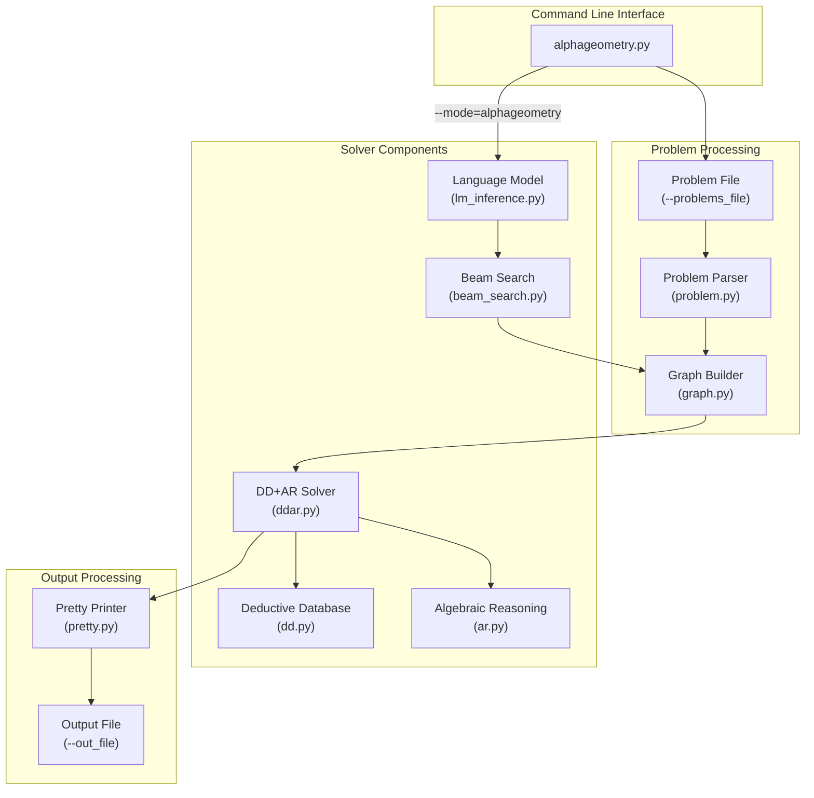
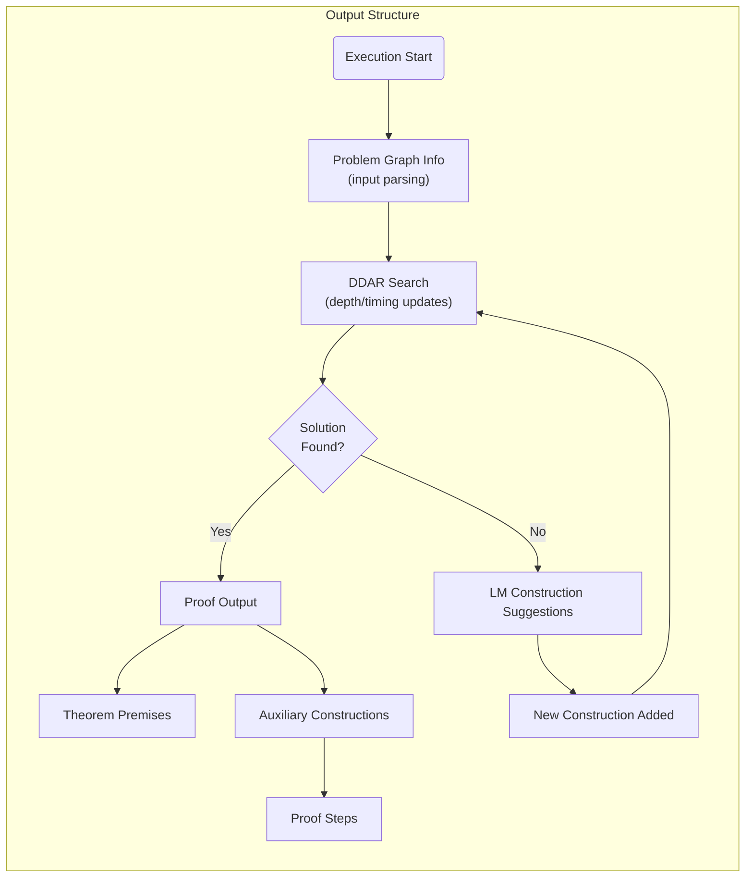
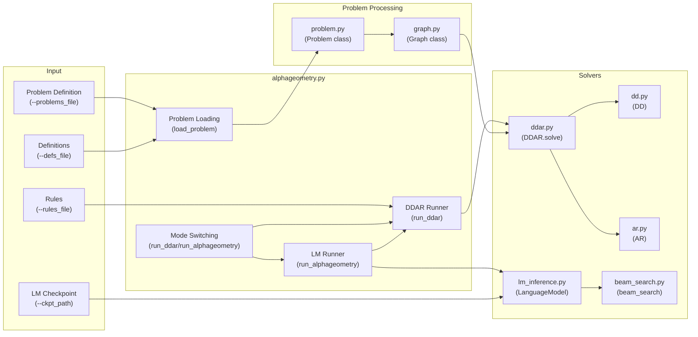

<!-- source: DeepWiki mcp.deepwiki.com · repo google-deepmind/alphageometry · page 6 Usage Guide · fetched 2026-10-26 -->

# Usage Guide

<details>
<summary>Relevant source files</summary>

The following files were used as context for generating this wiki page:

- [README.md](README.md)
- [download.sh](download.sh)
- [run.sh](run.sh)

</details>


This document provides step-by-step instructions for installing, configuring, and running the AlphaGeometry system. It covers both the basic DDAR (Deduction-Driven with Auxiliary Rules) solver and the full AlphaGeometry system that incorporates the language model component. For details about the theoretical foundations and system architecture, see [System Architecture](#2).

## 1. System Requirements

AlphaGeometry requires:
- Python 3.10.9
- For DDAR solver only: Standard CPU hardware is sufficient 
- For full AlphaGeometry: GPU acceleration is recommended (for optimal performance, the paper used 4 V100 GPUs and 250 CPU workers)

Sources: [README.md:21-32]()

## 2. Installation and Setup

### 2.1 Setting Up a Virtual Environment

Create and activate a Python virtual environment:

```bash
virtualenv -p python3 .
source ./bin/activate
pip install --require-hashes -r requirements.txt
```

Sources: [README.md:46-52](), [run.sh:20-23]()

### 2.2 Download Model Weights and Vocabulary

Run the provided download script to fetch the required model files:

```bash
bash download.sh
DATA=ag_ckpt_vocab
```

Sources: [README.md:54-59](), [run.sh:25-26]()

### 2.3 Installing Meliad

The Meliad library is required for the language model component but is not needed if you only plan to use the DDAR solver:

```bash
MELIAD_PATH=meliad_lib/meliad
mkdir -p $MELIAD_PATH
git clone https://github.com/google-research/meliad $MELIAD_PATH
export PYTHONPATH=$PYTHONPATH:$MELIAD_PATH
```

Sources: [README.md:61-69](), [run.sh:28-31]()

## 3. Execution Pipeline

The following diagram illustrates the high-level execution flow when running AlphaGeometry:



Sources: [README.md:328-350](), [README.md:205-269]()

## 4. Configuration Parameters

### 4.1 Common Flags

These flags are necessary for both DDAR and AlphaGeometry modes:

```bash
DDAR_ARGS=(
  --defs_file=$(pwd)/defs.txt \
  --rules_file=$(pwd)/rules.txt \
);
```

Sources: [README.md:76-83](), [run.sh:33-36]()

### 4.2 Search Parameters

These parameters control the proof search when using the language model:

```bash
# Light configuration for testing (used in examples)
BATCH_SIZE=2
BEAM_SIZE=2
DEPTH=2

# Paper results configuration
# BATCH_SIZE=32
# BEAM_SIZE=512
# DEPTH=16

SEARCH_ARGS=(
  --beam_size=$BEAM_SIZE
  --search_depth=$DEPTH
)
```

Sources: [README.md:86-98](), [README.md:101-108](), [run.sh:38-45]()

### 4.3 Language Model Configuration

Required parameters for the language model component:

```bash
LM_ARGS=(
  --ckpt_path=$DATA \
  --vocab_path=$DATA/geometry.757.model \
  --gin_search_paths=$MELIAD_PATH/transformer/configs,$(pwd) \
  --gin_file=base_htrans.gin \
  --gin_file=size/medium_150M.gin \
  --gin_file=options/positions_t5.gin \
  --gin_file=options/lr_cosine_decay.gin \
  --gin_file=options/seq_1024_nocache.gin \
  --gin_file=geometry_150M_generate.gin \
  --gin_param=DecoderOnlyLanguageModelGenerate.output_token_losses=True \
  --gin_param=TransformerTaskConfig.batch_size=$BATCH_SIZE \
  --gin_param=TransformerTaskConfig.sequence_length=128 \
  --gin_param=Trainer.restore_state_variables=False
);
```

Sources: [README.md:110-130](), [run.sh:47-61]()

## 5. Running AlphaGeometry

AlphaGeometry can be run in two modes:

1. **DDAR mode**: Uses only the symbolic reasoning engine with deductive database and algebraic reasoning
2. **AlphaGeometry mode**: Combines DDAR with language model-guided search

### 5.1 Running in DDAR Mode

To run the DDAR solver on a specific problem:

```bash
python -m alphageometry \
  --alsologtostderr \
  --problems_file=/path/to/problems.txt \
  --problem_name=problem_identifier \
  --mode=ddar \
  "${DDAR_ARGS[@]}"
```

Example using the provided IMO 2000 P1 problem:

```bash
python -m alphageometry \
  --alsologtostderr \
  --problems_file=$(pwd)/imo_ag_30.txt \
  --problem_name=translated_imo_2000_p1 \
  --mode=ddar \
  "${DDAR_ARGS[@]}"
```

Sources: [README.md:138-155]()

### 5.2 Running in AlphaGeometry Mode

To run the full AlphaGeometry system, which includes the language model for suggesting auxiliary constructions:

```bash
python -m alphageometry \
  --alsologtostderr \
  --problems_file=/path/to/problems.txt \
  --problem_name=problem_identifier \
  --mode=alphageometry \
  "${DDAR_ARGS[@]}" \
  "${SEARCH_ARGS[@]}" \
  "${LM_ARGS[@]}"
```

Example using the provided orthocenter problem:

```bash
python -m alphageometry \
  --alsologtostderr \
  --problems_file=$(pwd)/examples.txt \
  --problem_name=orthocenter \
  --mode=alphageometry \
  "${DDAR_ARGS[@]}" \
  "${SEARCH_ARGS[@]}" \
  "${LM_ARGS[@]}"
```

Sources: [README.md:197-212](), [run.sh:65-72]()

## 6. Command-Line Arguments

The following table lists the key command-line arguments for AlphaGeometry:

| Argument | Description | Required | Default |
|----------|-------------|----------|---------|
| `--problems_file` | Path to a text file containing problem definitions | Yes | - |
| `--problem_name` | Identifier of the problem to solve from the problems file | Yes | - |
| `--mode` | Solver mode: `ddar` or `alphageometry` | Yes | - |
| `--defs_file` | Path to definitions file | Yes | - |
| `--rules_file` | Path to rules file | Yes | - |
| `--out_file` | Path to output file for writing the proof | No | - |
| `--beam_size` | Size of the beam for language model search | For AlphaGeometry mode | - |
| `--search_depth` | Maximum depth for language model-guided search | For AlphaGeometry mode | - |
| `--ckpt_path` | Path to language model checkpoint | For AlphaGeometry mode | - |
| `--vocab_path` | Path to vocabulary file | For AlphaGeometry mode | - |

Sources: [README.md:138-155](), [README.md:197-212](), [README.md:74-130]()

## 7. Understanding the Output

The output of AlphaGeometry consists of several key sections:



The proof output follows this structure:
1. **Theorem premises**: Initial facts from the problem statement
2. **Auxiliary constructions**: Additional constructions added by AlphaGeometry
3. **Proof steps**: Sequence of deductions that lead to the solution

Sources: [README.md:160-183](), [README.md:225-269]()

## 8. Data Flow in AlphaGeometry

The following diagram illustrates the data flow between major components of AlphaGeometry:



Sources: [README.md:328-350](), [README.md:134-312]()

## 9. Tips and Best Practices

1. **Resource Requirements**:
   - For reproducing paper results, use `BATCH_SIZE=32`, `BEAM_SIZE=512`, `DEPTH=16`
   - The full system requires significant computational resources (the paper used 4 V100 GPUs and 250 CPU workers)

2. **DDAR-only Mode**:
   - If you only need the DDAR solver, you can skip installing Meliad and the language model dependencies
   - In `alphageometry.py`, you can disable the import of the `lm_inference` module when running in DDAR-only mode

3. **Output File**:
   - Use the `--out_file` parameter to save the proof to a text file instead of just displaying it on the console
   - Example: `--out_file=path/to/output.txt`

4. **Testing**:
   - Run the test suite before attempting to reproduce the paper results: `bash run_tests.sh`
   - This ensures your installation is working correctly

Sources: [README.md:101-108](), [README.md:133-136](), [README.md:191-193](), [README.md:303-310]()

## 10. Troubleshooting

1. **Language Model Scoring Inconsistency**:
   - Issue: Different users may get different scores from the language model, even though top beam decodes remain the same
   - Reference: [Issues#14](https://github.com/google-deepmind/alphageometry/issues/14)

2. **Performance Considerations**:
   - The open-source implementation removes many optimizations that depend on internal infrastructure
   - These include parallelized model inference, parallelized DDAR, parallel execution, and shared CPU worker pools
   - Expect lower performance compared to the results reported in the paper

Sources: [README.md:310-311](), [README.md:277-286]()

---

