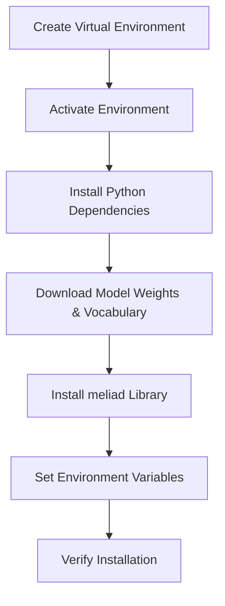
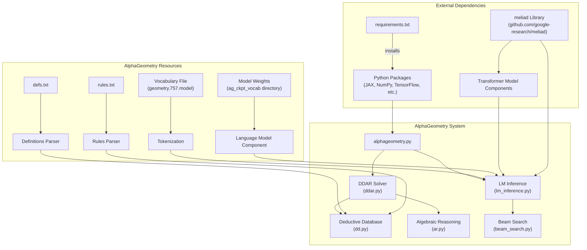
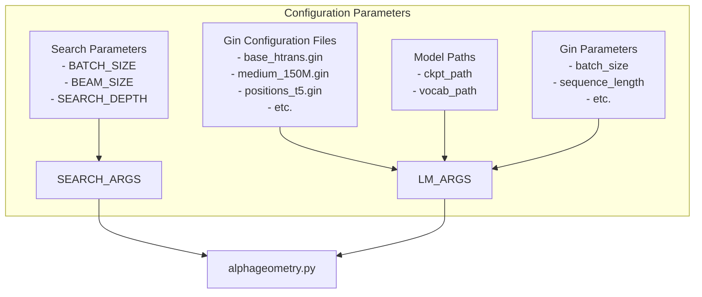

<!-- source: DeepWiki mcp.deepwiki.com · repo google-deepmind/alphageometry · page 6.1 Installation and Setup · fetched 2026-10-26 -->

# Installation and Setup

<details>
<summary>Relevant source files</summary>

The following files were used as context for generating this wiki page:

- [README.md](README.md)
- [download.sh](download.sh)
- [run.sh](run.sh)

</details>


This document provides step-by-step instructions for installing and setting up the AlphaGeometry system, including its dependencies, model weights, and configuration settings. For information about running the system after installation, see [Running AlphaGeometry](#6.2).

## System Requirements

AlphaGeometry has the following system requirements:

- Python 3.10.9
- A UNIX-like environment (Linux or macOS)
- Sufficient disk space for model weights (~500MB)
- For full IMO-level performance: 4 V100 GPUs and 250 CPU workers (optional)

Sources: [README.md:23-25]()

## Installation Process

The installation process consists of several steps, which are outlined in the diagram below:



### Setting Up the Environment

1. First, create a virtual environment to isolate the AlphaGeometry dependencies:

```bash
virtualenv -p python3 .
source ./bin/activate
```

This creates a virtual environment in the current directory and activates it.

Sources: [README.md:49-50](), [run.sh:20-21]()

### Installing Dependencies

Install the required Python packages using pip:

```bash
pip install --require-hashes -r requirements.txt
```

This command installs all dependencies listed in the `requirements.txt` file, verifying their hashes for security.

Sources: [README.md:51](), [run.sh:23]()

### Downloading Model Weights and Vocabulary

Download the AlphaGeometry model weights and vocabulary files:

```bash
bash download.sh
DATA=ag_ckpt_vocab
```

The `download.sh` script fetches the required model files and places them in the `ag_ckpt_vocab` directory.

Sources: [README.md:56-59](), [run.sh:25-26]()

### Installing meliad

The AlphaGeometry system depends on `meliad`, which is not available through pip and must be installed manually:

```bash
MELIAD_PATH=meliad_lib/meliad
mkdir -p $MELIAD_PATH
git clone https://github.com/google-research/meliad $MELIAD_PATH
export PYTHONPATH=$PYTHONPATH:$MELIAD_PATH
```

This clones the meliad repository and adds it to the Python path.

Sources: [README.md:64-69](), [run.sh:28-31]()

## System Architecture

The following diagram shows the relationship between the installation components and how they fit into the AlphaGeometry system:



Sources: [README.md:329-352]()

## Configuration

After installation, you need to configure several settings before running AlphaGeometry.

### Common Flags for DDAR

The Deductive Database and Algebraic Reasoning (DDAR) solver requires configuration flags to locate the definitions and rules files:

```bash
DDAR_ARGS=(
  --defs_file=$(pwd)/defs.txt \
  --rules_file=$(pwd)/rules.txt \
);
```

Sources: [README.md:80-83](), [run.sh:33-36]()

### Configuration for AlphaGeometry

Running the full AlphaGeometry system requires additional configuration for the beam search and language model components:



1. **Search Parameters Configuration:**

```bash
BATCH_SIZE=2
BEAM_SIZE=2
DEPTH=2

SEARCH_ARGS=(
  --beam_size=$BEAM_SIZE
  --search_depth=$DEPTH
)
```

2. **Language Model Configuration:**

```bash
LM_ARGS=(
  --ckpt_path=$DATA \
  --vocab_path=$DATA/geometry.757.model \
  --gin_search_paths=$MELIAD_PATH/transformer/configs,$(pwd) \
  --gin_file=base_htrans.gin \
  --gin_file=size/medium_150M.gin \
  --gin_file=options/positions_t5.gin \
  --gin_file=options/lr_cosine_decay.gin \
  --gin_file=options/seq_1024_nocache.gin \
  --gin_file=geometry_150M_generate.gin \
  --gin_param=DecoderOnlyLanguageModelGenerate.output_token_losses=True \
  --gin_param=TransformerTaskConfig.batch_size=$BATCH_SIZE \
  --gin_param=TransformerTaskConfig.sequence_length=128 \
  --gin_param=Trainer.restore_state_variables=False
);
```

Note: The values shown here (`BATCH_SIZE=2`, `BEAM_SIZE=2`, `DEPTH=2`) are lightweight for testing purposes. For full IMO-level performance, use `BATCH_SIZE=32`, `BEAM_SIZE=512`, `DEPTH=16` as described in the paper's Methods section.

Sources: [README.md:88-130](), [run.sh:38-61]()

## Production vs. Development Configuration

The following table outlines the differences between lightweight testing configuration and full production configuration:

| Parameter | Lightweight (Testing) | Full (Production) |
|-----------|----------------------|-------------------|
| BATCH_SIZE | 2 | 32 |
| BEAM_SIZE | 2 | 512 |
| SEARCH_DEPTH | 2 | 16 |
| Hardware | Standard hardware | 4 V100 GPUs, 250 CPU workers |

Sources: [README.md:100-105]()

## Running DDAR Without Language Model

If you want to run only the DDAR solver without the language model component, you can:

1. Skip the LM-related setup steps (downloading weights, installing meliad)
2. Disable the import of the `lm_inference` module in `alphageometry.py`
3. Run with only the DDAR arguments

This creates a lightweight configuration that doesn't require the heavy language model components.

Sources: [README.md:132-136]()

## Verifying the Installation

To verify that your installation is working correctly, run the test suite:

```bash
bash run_tests.sh
```

All tests should pass, confirming that the system is properly set up.

Sources: [README.md:304-307]()

## Running a Simple Example

After installation and configuration, you can run a simple example to test the system:

```bash
python -m alphageometry \
--alsologtostderr \
--problems_file=$(pwd)/examples.txt \
--problem_name=orthocenter \
--mode=alphageometry \
"${DDAR_ARGS[@]}" \
"${SEARCH_ARGS[@]}" \
"${LM_ARGS[@]}"
```

This command runs AlphaGeometry on the "orthocenter" problem from the examples.txt file.

Sources: [README.md:204-212](), [run.sh:65-72]()

## Dependency Relationship

The following diagram shows the key dependencies and their relationships within the AlphaGeometry system:

```mermaid
graph LR
    subgraph "External Libraries"
        abseil["Abseil"]
        jax["JAX"]
        matplotlib["matplotlib"]
        numpy["NumPy"]
        scipy["SciPy"]
        tensorflow["TensorFlow"]
        meliad["Meliad"]
        flax["Flax"]
        gin["Gin"]
        t5["T5"]
        sentencepiece["SentencePiece"]
    end
    
    subgraph "Core AlphaGeometry"
        alphageometry["alphageometry.py"]
        ddar["ddar.py"]
        dd["dd.py"]
        ar["ar.py"]
        lm["lm_inference.py"]
        beamSearch["beam_search.py"]
        transformerLayer["transformer_layer.py"]
        decoderStack["decoder_stack.py"]
        models["models.py"]
    end
    
    subgraph "Problem Representation"
        geometry["geometry.py"]
        numericals["numericals.py"]
        graphUtils["graph_utils.py"]
        graph["graph.py"]
        problem["problem.py"]
    end
    
    subgraph "Resources"
        defs["defs.txt"]
        rules["rules.txt"]
        checkpoints["Model Checkpoints"]
        vocabFile["Vocabulary File"]
    end
    
    jax --> beamSearch
    flax --> models
    gin --> lm
    meliad --> transformerLayer
    meliad --> decoderStack
    sentencepiece --> lm
    
    alphageometry --> ddar
    alphageometry --> lm
    alphageometry --> graph
    alphageometry --> problem
    
    ddar --> dd
    ddar --> ar
    
    lm --> beamSearch
    lm --> models
    
    graph --> geometry
    geometry --> numericals
    
    defs --> dd
    rules --> dd
    checkpoints --> lm
    vocabFile --> lm
```

Sources: [README.md:394-407](), [README.md:329-352]()

---

