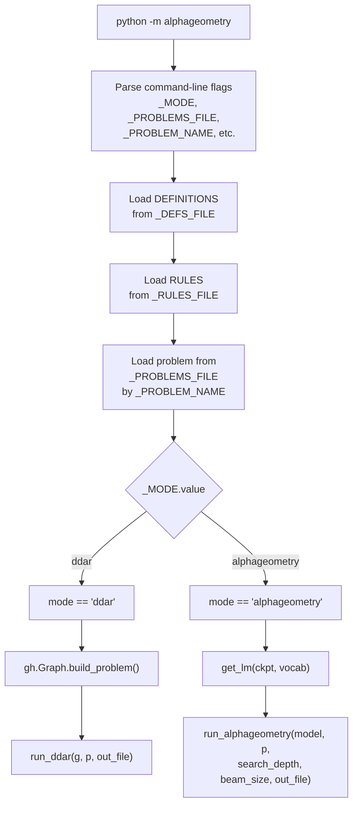
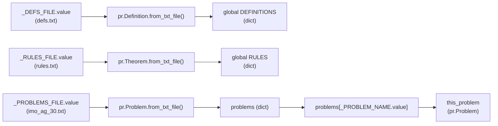
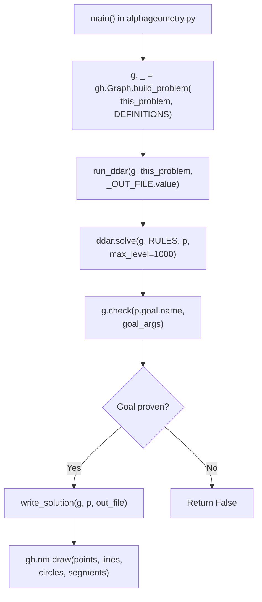
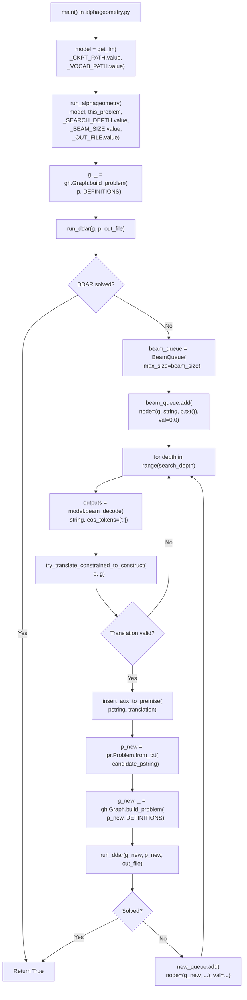
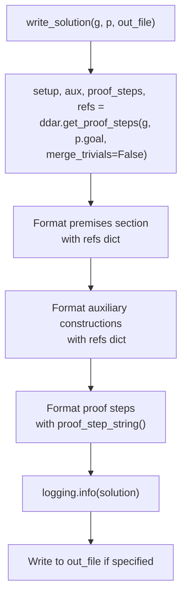
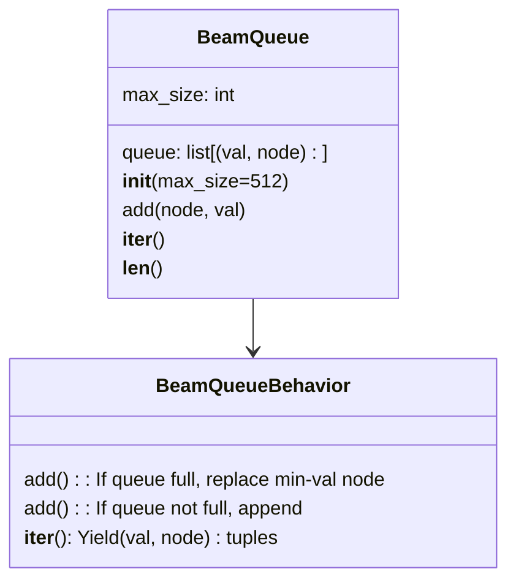

<!-- source: DeepWiki mcp.deepwiki.com · repo google-deepmind/alphageometry · page 6.2 Running the Solvers · fetched 2026-10-26 -->

# Running the Solvers

<details>
<summary>Relevant source files</summary>

The following files were used as context for generating this wiki page:

- [README.md](README.md)
- [alphageometry.py](alphageometry.py)
- [run.sh](run.sh)

</details>


This page explains how to invoke [alphageometry.py]() from the command line to solve geometric problems using either pure symbolic reasoning (DDAR mode) or hybrid neural-symbolic reasoning (AlphaGeometry mode).

## Main Entry Point: alphageometry.py

The [alphageometry.py]() script serves as the main entry point for solving geometry problems. It accepts command-line arguments to configure the solver mode, specify problem files, and control search parameters.

**Execution Flow Through alphageometry.py**



Sources: [alphageometry.py:604-647](), [alphageometry.py:16-19]()

## Solver Modes

The `--mode` flag selects between two solving approaches:

| Mode | Description | Uses Language Model | Typical Success Rate |
|------|-------------|---------------------|----------------------|
| `ddar` | Pure symbolic deduction via DD+AR | No | Lower (14/30 on IMO-AG-30) |
| `alphageometry` | DD+AR with LM-suggested auxiliary constructions | Yes | Higher (25/30 on IMO-AG-30) |

Sources: [alphageometry.py:55-56](), [README.md:312-325]()

## Command-Line Flags

The following flags are defined using `absl.flags` in [alphageometry.py:33-77]():

**Core Flags (Required for Both Modes)**

| Flag | Type | Default | Description |
|------|------|---------|-------------|
| `--problems_file` | string | `imo_ag_30.txt` | Path to text file containing problem definitions |
| `--problem_name` | string | `imo_2000_p1` | Name of specific problem to solve from problems_file |
| `--mode` | string | `ddar` | Solver mode: `ddar` or `alphageometry` |
| `--defs_file` | string | `defs.txt` | Path to construction definitions (see [defs.txt]()) |
| `--rules_file` | string | `rules.txt` | Path to deduction rules (see [rules.txt]()) |
| `--out_file` | string | empty | Optional path to write solution output |

**Language Model Flags (Required for `--mode=alphageometry`)**

| Flag | Type | Default | Description |
|------|------|---------|-------------|
| `--ckpt_path` | string | empty | Directory containing model checkpoint files |
| `--vocab_path` | string | empty | Path to SentencePiece vocabulary file (e.g., `geometry.757.model`) |
| `--beam_size` | integer | 1 | Beam width for proof search |
| `--search_depth` | integer | 1 | Maximum number of auxiliary construction steps |

**Gin Configuration Flags (For AlphaGeometry Mode)**

| Flag | Type | Default | Description |
|------|------|---------|-------------|
| `--gin_search_paths` | list[string] | `['third_party/py/meliad/transformer/configs']` | Directories to search for .gin files |
| `--gin_file` | multi_string | `['base_htrans.gin']` | Gin config files to load (can specify multiple) |
| `--gin_param` | multi_string | None | Individual Gin parameter overrides |

Sources: [alphageometry.py:33-77](), [README.md:73-130]()

## Flag Processing and Problem Loading

The `main()` function in [alphageometry.py:604-647]() processes flags and loads resources:

**Resource Loading Sequence**



Sources: [alphageometry.py:604-630]()

## Running DDAR Mode

DDAR mode performs pure symbolic reasoning without neural network inference. It requires only the core flags.

**Minimal Command**

```bash
python -m alphageometry \
  --problems_file=imo_ag_30.txt \
  --problem_name=translated_imo_2000_p1 \
  --mode=ddar \
  --defs_file=defs.txt \
  --rules_file=rules.txt
```

**DDAR Execution Path in Code**

When `_MODE.value == 'ddar'`, the code path is:



The `run_ddar()` function in [alphageometry.py:206-231]() calls:
1. `ddar.solve()` to apply deduction rules iteratively
2. `g.check()` to verify if the goal is proven
3. `write_solution()` to format the proof if successful
4. `gh.nm.draw()` to visualize the geometric configuration

Sources: [alphageometry.py:632-634](), [alphageometry.py:206-231](), [README.md:140-156]()

**Example Output**

```
graph.py:468] translated_imo_2000_p1
graph.py:469] a b = segment a b; g1 = on_tline g1 a a b; ...
ddar.py:41] Depth 1/1000 time = 1.777...
ddar.py:41] Depth 2/1000 time = 5.635...
...
036. ∠QEB = ∠(QP-EA) [46] & ∠(BE-QP) = ∠AEP [55] ⇒  ∠EQP = ∠QPE [56]
037. ∠PQE = ∠EPQ [56] ⇒  EP = EQ
```

Sources: [README.md:159-185]()

## Running AlphaGeometry Mode

AlphaGeometry mode requires additional flags for the language model and Gin configuration.

**Complete Command with Environment Variables**

The [README.md:36-130]() and [run.sh:33-72]() demonstrate setting up shell variables:

```bash
# Define paths
DATA=ag_ckpt_vocab
MELIAD_PATH=meliad_lib/meliad

# Core solver flags
DDAR_ARGS=(
  --defs_file=$(pwd)/defs.txt
  --rules_file=$(pwd)/rules.txt
)

# Search parameters
BEAM_SIZE=2
SEARCH_DEPTH=2
SEARCH_ARGS=(
  --beam_size=$BEAM_SIZE
  --search_depth=$SEARCH_DEPTH
)

# Language model configuration
BATCH_SIZE=2
LM_ARGS=(
  --ckpt_path=$DATA
  --vocab_path=$DATA/geometry.757.model
  --gin_search_paths=$MELIAD_PATH/transformer/configs
  --gin_file=base_htrans.gin
  --gin_file=size/medium_150M.gin
  --gin_file=options/positions_t5.gin
  --gin_file=options/lr_cosine_decay.gin
  --gin_file=options/seq_1024_nocache.gin
  --gin_file=geometry_150M_generate.gin
  --gin_param=DecoderOnlyLanguageModelGenerate.output_token_losses=True
  --gin_param=TransformerTaskConfig.batch_size=$BATCH_SIZE
  --gin_param=TransformerTaskConfig.sequence_length=128
  --gin_param=Trainer.restore_state_variables=False
)

# Execute
python -m alphageometry \
  --alsologtostderr \
  --problems_file=$(pwd)/examples.txt \
  --problem_name=orthocenter \
  --mode=alphageometry \
  "${DDAR_ARGS[@]}" \
  "${SEARCH_ARGS[@]}" \
  "${LM_ARGS[@]}"
```

Sources: [README.md:73-130](), [run.sh:33-72]()

**AlphaGeometry Execution Path in Code**

When `_MODE.value == 'alphageometry'`, the execution follows:



The `run_alphageometry()` function in [alphageometry.py:488-601]() implements beam search:
1. First attempts pure DDAR via `run_ddar()`
2. If DDAR fails, initializes `BeamQueue` with initial state
3. For each depth level up to `search_depth`:
   - Decodes auxiliary constructions via `model.beam_decode()`
   - Validates each output with `try_translate_constrained_to_construct()`
   - Adds valid constructions to problem via `insert_aux_to_premise()`
   - Rebuilds graph and retries DDAR
   - Adds successful candidates to `new_queue`
4. Replaces `beam_queue` with `new_queue` for next depth

Sources: [alphageometry.py:636-644](), [alphageometry.py:488-601]()

**Example Output**

```
graph.py:468] orthocenter
graph.py:469] a b c = triangle a b c; d = on_tline d b a c, on_tline d c a b ? perp a d b c
ddar.py:41] Depth 1/1000 time = 0.009... branch = 4
alphageometry.py:221] DD+AR failed to solve the problem.
alphageometry.py:457] Depth 0. There are 1 nodes to expand:
alphageometry.py:465] Decoding from {S} a : ; b : ; c : ; d : ... {F1} x00
alphageometry.py:470] LM output (score=-1.102287): "e : C a c e 02 C b d e 03 ;"
alphageometry.py:471] Translation: "e = on_line e a c, on_line e b d"
...
alphageometry.py:505] Solved.
```

Sources: [README.md:217-271]()

## Auxiliary Construction Translation

The language model outputs constrained predicates (e.g., `"e : C a c e 02 C b d e 03 ;"`) which must be translated to constructive predicates that can be added to the problem.

**Translation Pipeline**

```mermaid
flowchart LR
    lmOut["LM Output
    'e : C a c e 02 C b d e 03 ;'"]
    
    tryTrans["try_translate_constrained_to_construct(
    string, g)"]
    
    parseHead["Parse 'e : ' → point name"]
    parsePreds["Parse 'C a c e 02' → predicates"]
    
    checkValid["check_valid_args(name, args)"]
    transCons["translate_constrained_to_constructive(
    point, name, args)"]
    
    buildClause["pr.Clause.from_txt(clause_txt)"]
    testAdd["g.copy().add_clause(clause, 0, DEFINITIONS)"]
    
    valid{"Valid?"}
    errorMsg["Return 'ERROR: ...'"]
    clauseTxt["Return clause_txt
    'e = on_line e a c, on_line e b d'"]
    
    lmOut --> tryTrans
    tryTrans --> parseHead
    parseHead --> parsePreds
    parsePreds --> checkValid
    checkValid --> transCons
    transCons --> buildClause
    buildClause --> testAdd
    testAdd --> valid
    
    valid -->|"No"| errorMsg
    valid -->|"Yes"| clauseTxt
```



Key functions in [alphageometry.py:234-442]():
- `translate_constrained_to_constructive()`: Converts constraint predicates (e.g., `perp`, `coll`) to construction predicates (e.g., `on_tline`, `on_line`)
- `check_valid_args()`: Validates predicate argument counts and uniqueness
- `try_translate_constrained_to_construct()`: Orchestrates parsing, validation, and clause construction

Sources: [alphageometry.py:234-442](), [alphageometry.py:371-442]()

## Understanding Proof Output

The `write_solution()` function in [alphageometry.py:131-195]() formats proof output into human-readable text.

**Proof Output Structure**



**Output Components**

The proof output contains three sections:

1. **From theorem premises**: Initial points and given constraints
   ```
   A B C D : Points
   BD ⟂ AC [00]
   CD ⟂ AB [01]
   ```

2. **Auxiliary Constructions**: Points added during search (AlphaGeometry mode only)
   ```
   E : Points
   E,B,D are collinear [02]
   E,C,A are collinear [03]
   ```

3. **Proof steps**: Derivation chain leading to goal
   ```
   001. E,B,D are collinear [02] & E,C,A are collinear [03] & BD ⟂ AC [00] ⇒ ∠BEA = ∠CED [04]
   002. ...
   009. ... ⇒ AD ⟂ BC
   ```

Each predicate is numbered (e.g., `[00]`, `[01]`) to track dependencies. The final step proves the goal without a reference number.

Sources: [alphageometry.py:131-195](), [README.md:159-185](), [README.md:245-269]()

**Natural Language Translation**

The `natural_language_statement()` function in [alphageometry.py:83-94]() converts logical predicates to pseudo-natural language using `pt.pretty_nl()`:

| Predicate | Natural Language |
|-----------|------------------|
| `perp a b c d` | `AB ⟂ CD` |
| `coll a b c` | `A,B,C are collinear` |
| `cong a b c d` | `AB = CD` |
| `eqangle a b c d e f g h` | `∠ABC = ∠EFG` |

Special rule names are also translated via `r2name` dict in [alphageometry.py:167-180]():
- `r32` → `(SSS)`
- `r34` → `(Similar Triangles)`
- `r40` → `(Congruent Triangles)`
- `a02` → `(Angle chase)`

Sources: [alphageometry.py:83-94](), [alphageometry.py:167-180]()

## Search Parameters

The `--beam_size` and `--search_depth` flags control the AlphaGeometry search process.

**Parameter Trade-offs**

| Parameter | Effect on Search | Computational Cost |
|-----------|------------------|-------------------|
| `--beam_size` | Number of candidate constructions kept at each depth | Proportional to beam_size |
| `--search_depth` | Maximum construction depth before termination | Exponential in depth |
| `--batch_size` (via Gin) | Parallel LM inferences | GPU memory requirement |

**Recommended Configurations**

| Use Case | beam_size | search_depth | batch_size | Hardware |
|----------|-----------|--------------|------------|----------|
| Quick testing | 2 | 2 | 2 | CPU only |
| Full evaluation | 512 | 16 | 32 | 4 V100 GPUs + 250 CPUs |

The paper results ([README.md:103-107]()) require large-scale parallelization omitted from this implementation for clarity.

Sources: [README.md:88-109](), [alphageometry.py:72-77]()

**BeamQueue Implementation**

The `BeamQueue` class in [alphageometry.py:459-486]() maintains top-k nodes:



Each node in the queue is a tuple `(graph, string, problem_text)` representing a proof state.

Sources: [alphageometry.py:459-486](), [alphageometry.py:532-599]()

## Optional Output File

The `--out_file` flag writes the formatted proof to a file:

```bash
--out_file=path/to/solution.txt
```

If specified, `write_solution()` calls `open(out_file, 'w')` in [alphageometry.py:193-195]() after logging to console.

Sources: [alphageometry.py:69-71](), [alphageometry.py:193-195]()

## Troubleshooting

### Common Issues

1. **Missing dependencies**: Ensure all dependencies are installed per the installation instructions
2. **Language model not found**: Verify that the checkpoint and vocabulary paths are correct
3. **Language model scoring inconsistency**: Different users may get different scores for the same inputs, but the top beam decodes should remain the same
4. **Memory errors**: Reduce beam size or batch size if facing memory constraints

### Testing Your Installation

Before running full experiments, verify your installation by running the test suite:

```
bash run_tests.sh
```

Sources: [README.md:303-310]()

## Performance Expectations

The following table shows the expected performance for different problem sets and modes:

| Mode | IMO-AG-30 (imo_ag_30.txt) | JGEX-AG-231 (jgex_ag_231.txt) |
|------|---------------------------|------------------------------|
| DDAR | 14 problems solved | 198 problems solved |
| AlphaGeometry | 25 problems solved | 228 problems solved |

Sources: [README.md:312-325]()

---

