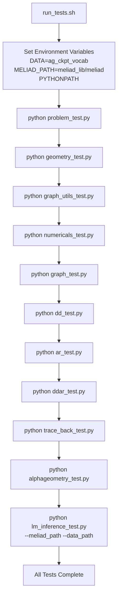
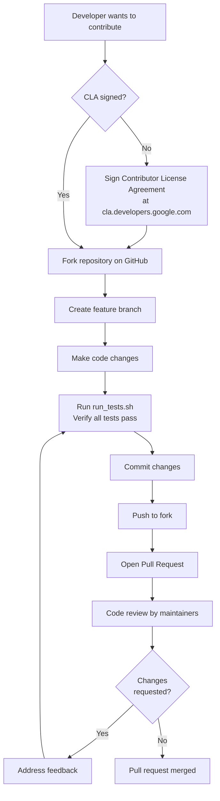
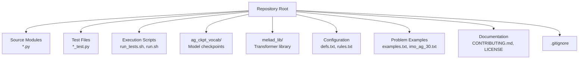

<!-- source: DeepWiki mcp.deepwiki.com · repo google-deepmind/alphageometry · page 7 Development and Testing · fetched 2026-10-26 -->

# Development and Testing

<details>
<summary>Relevant source files</summary>

The following files were used as context for generating this wiki page:

- [.gitignore](.gitignore)
- [CONTRIBUTING.md](CONTRIBUTING.md)
- [run_tests.sh](run_tests.sh)

</details>


This document provides an overview of development practices and testing procedures for the AlphaGeometry codebase. It covers the test suite organization, test execution, and contribution workflow. For detailed information about the test framework and test files, see [Testing Framework](#7.1). For contribution requirements and GitHub workflow, see [Contributing Guidelines](#7.2).

## Purpose and Scope

This page serves as a guide for developers who want to understand, modify, or contribute to the AlphaGeometry codebase. It explains:

- How the test suite is organized and executed
- The relationship between source modules and their corresponding test files
- The development workflow for making contributions
- Repository conventions and file organization

This page provides the high-level overview; child pages [7.1](#7.1) and [7.2](#7.2) contain detailed information about specific aspects.

## Development Environment

The AlphaGeometry codebase requires a properly configured Python environment with specific dependencies and paths set up correctly.

### Required Components

| Component | Purpose | Location |
|-----------|---------|----------|
| Python environment | Runtime for all modules | System Python or virtualenv |
| meliad library | Transformer model framework | `meliad_lib/meliad` |
| Model checkpoints | Pre-trained weights and vocabulary | `ag_ckpt_vocab` |
| PYTHONPATH | Enable imports from meliad | Set in [run_tests.sh:18]() |

The test script [run_tests.sh:16-18]() configures the environment by setting:
- `DATA` variable pointing to `ag_ckpt_vocab`
- `MELIAD_PATH` pointing to `meliad_lib/meliad`
- `PYTHONPATH` to include the meliad library

Sources: [run_tests.sh:16-18]()

## Test Suite Organization

The AlphaGeometry test suite consists of unit tests for each major module. Each source file has a corresponding test file that validates its functionality in isolation.

### Test Execution Flow



**Test Execution Flow**: The [run_tests.sh]() script executes all test files sequentially. Tests are ordered from foundational modules (problem, geometry) through the core reasoning components (DD, AR, DDAR) to high-level integration (alphageometry) and neural components (lm_inference). The LM inference test requires additional arguments for model paths.

Sources: [run_tests.sh:20-30]()

### Module-to-Test Mapping

```mermaid
graph LR
    subgraph "Source Modules"
        problem["problem.py"]
        geometry["geometry.py"]
        graph_utils["graph_utils.py"]
        numericals["numericals.py"]
        graph["graph.py"]
        dd["dd.py"]
        ar["ar.py"]
        ddar["ddar.py"]
        trace_back["trace_back.py"]
        alphageometry["alphageometry.py"]
        lm_inference["lm_inference.py"]
    end
    
    subgraph "Test Files"
        problem_test["problem_test.py"]
        geometry_test["geometry_test.py"]
        graph_utils_test["graph_utils_test.py"]
        numericals_test["numericals_test.py"]
        graph_test["graph_test.py"]
        dd_test["dd_test.py"]
        ar_test["ar_test.py"]
        ddar_test["ddar_test.py"]
        trace_back_test["trace_back_test.py"]
        alphageometry_test["alphageometry_test.py"]
        lm_inference_test["lm_inference_test.py"]
    end
    
    problem --> problem_test
    geometry --> geometry_test
    graph_utils --> graph_utils_test
    numericals --> numericals_test
    graph --> graph_test
    dd --> dd_test
    ar --> ar_test
    ddar --> ddar_test
    trace_back --> trace_back_test
    alphageometry --> alphageometry_test
    lm_inference --> lm_inference_test
```

**Module Coverage**: Each source module has a corresponding test file with the `_test.py` suffix. This one-to-one mapping ensures comprehensive coverage across all components of the system, from geometric primitives through symbolic reasoning to neural inference.

Sources: [run_tests.sh:20-30]()

## Testing Strategy

The AlphaGeometry test suite follows a layered testing approach that mirrors the system architecture:

### Testing Layers

| Layer | Test Files | Purpose |
|-------|------------|---------|
| **Geometric Representation** | `problem_test.py`, `geometry_test.py`, `numericals_test.py` | Validate geometric primitives, object construction, and numerical calculations |
| **Graph Infrastructure** | `graph_utils_test.py`, `graph_test.py` | Test graph data structures, node management, and state tracking |
| **Symbolic Reasoning** | `dd_test.py`, `ar_test.py`, `trace_back_test.py` | Verify theorem matching, algebraic reasoning, and proof reconstruction |
| **Solver Integration** | `ddar_test.py`, `alphageometry_test.py` | Test end-to-end solving with DD+AR and hybrid AlphaGeometry modes |
| **Neural Components** | `lm_inference_test.py` | Validate language model integration and construction generation |

### Test Execution Order

The test execution order in [run_tests.sh:20-30]() is deliberately chosen to test dependencies before dependents:

1. **Foundation** (`problem_test.py`, `geometry_test.py`) - Core data structures
2. **Utilities** (`graph_utils_test.py`) - Graph helper functions
3. **Numerical Backend** (`numericals_test.py`) - 2D geometry operations
4. **Graph Layer** (`graph_test.py`) - Proof state management
5. **Symbolic Core** (`dd_test.py`, `ar_test.py`) - Deduction and algebraic reasoning
6. **Solver** (`ddar_test.py`) - Integrated symbolic solving
7. **Proof Processing** (`trace_back_test.py`) - Dependency reconstruction
8. **High-Level** (`alphageometry_test.py`) - Complete system integration
9. **Neural** (`lm_inference_test.py`) - Language model inference

Sources: [run_tests.sh:20-30]()

### Special Test Configuration

The language model inference test requires additional configuration:

```bash
python lm_inference_test.py --meliad_path=$MELIAD_PATH --data_path=$DATA
```

This test needs access to:
- `--meliad_path`: Path to the meliad library for transformer model loading
- `--data_path`: Path to model checkpoints and vocabulary files

Sources: [run_tests.sh:30]()

## Contribution Workflow

Contributors to AlphaGeometry must follow a structured workflow involving legal agreements, code review, and community guidelines.

### Contribution Process



**Contribution Workflow**: All contributions require a signed CLA before code review. Developers fork the repository, make changes in a feature branch, ensure tests pass, and submit a pull request for review. The review process may involve multiple iterations before merging.

Sources: [CONTRIBUTING.md:1-26]()

### Contributor License Agreement

Before contributing code, developers must sign a Contributor License Agreement (CLA):

- **Purpose**: Grants permission to use and redistribute contributions while retaining copyright
- **Scope**: One-time process; valid across multiple Google projects
- **Location**: Sign at [https://cla.developers.google.com/](https://cla.developers.google.com/)

Contributors (or their employers) retain copyright to their contributions. The CLA simply provides the project with necessary permissions for distribution.

Sources: [CONTRIBUTING.md:3-13]()

### Code Review Process

All submissions undergo code review via GitHub pull requests:

| Aspect | Details |
|--------|---------|
| **Platform** | GitHub pull requests |
| **Scope** | All submissions, including from project members |
| **Resources** | [GitHub Help - Pull Requests](https://help.github.com/articles/about-pull-requests/) |
| **Standards** | [Google's Open Source Community Guidelines](https://opensource.google/conduct/) |

The review process ensures code quality, consistency with project conventions, and adherence to community standards.

Sources: [CONTRIBUTING.md:15-25]()

## Repository Conventions

The repository follows standard Python project conventions for file organization and version control.

### File Exclusions

The `.gitignore` file specifies patterns for files that should not be tracked:

```
__pycache__/          # Python bytecode cache
*.py[cod]             # Compiled Python files
build/, dist/         # Distribution artifacts
*.egg-info/           # Package metadata
```

These exclusions prevent compiled artifacts, build outputs, and Python cache files from being committed to version control.

Sources: [.gitignore:1-24]()

### Development Files Structure



**Repository Structure**: The repository organizes code (source and tests), execution scripts, external dependencies (meliad, checkpoints), configuration files, example problems, and documentation at the root level. The `.gitignore` file ensures build artifacts and cache files are excluded from version control.

Sources: [.gitignore:1-24](), [run_tests.sh:16-18]()

## Running Tests Locally

To execute the full test suite:

1. **Set up environment**: Ensure Python is installed and dependencies are available
2. **Download checkpoints**: Run `bash download.sh` to obtain model weights (required for `lm_inference_test.py`)
3. **Execute tests**: Run `bash run_tests.sh` from the repository root

The test script automatically:
- Configures `PYTHONPATH` to include the meliad library
- Sets paths for model checkpoints and vocabulary
- Executes all test files in dependency order
- Reports any test failures

Sources: [run_tests.sh:16-30]()

## Testing Coverage

The test suite provides comprehensive coverage across all system layers:

| Component | Test Coverage |
|-----------|---------------|
| **Problem Representation** | Clause parsing, theorem definitions, goal specifications |
| **Geometric Objects** | Point, Line, Circle, Angle, Segment construction and properties |
| **Numerical Engine** | Intersection calculations, distance computations, angle measurements |
| **Graph Management** | Node creation, edge tracking, state updates |
| **Deductive Database** | Theorem matching, rule application, caching |
| **Algebraic Reasoning** | Ratio/angle/distance tables, equality tracking, LP-based dependency |
| **DDAR Integration** | Combined DD+AR solving, saturation detection |
| **Proof Reconstruction** | Dependency tracing, proof step ordering |
| **AlphaGeometry** | Hybrid symbolic-neural solving |
| **Language Model** | Construction generation, beam search, encoding/decoding |

For detailed information about individual test files and their test cases, see [Testing Framework](#7.1).

Sources: [run_tests.sh:20-30]()

## Next Steps

For more detailed information about development and testing:

- **[Testing Framework](#7.1)**: Detailed documentation of each test file, test cases, and coverage analysis
- **[Contributing Guidelines](#7.2)**: Complete contribution requirements, CLA process, and GitHub workflow
- **[Usage Guide](#6)**: Instructions for running AlphaGeometry and interpreting results

Sources: [run_tests.sh](), [CONTRIBUTING.md]()

---

