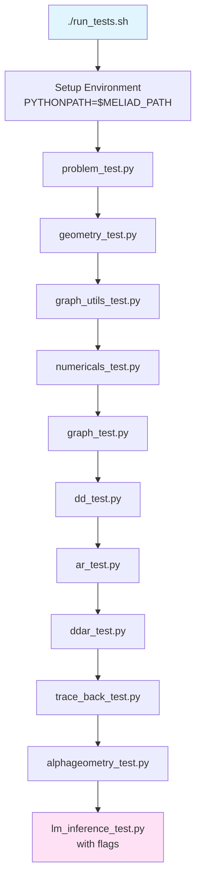
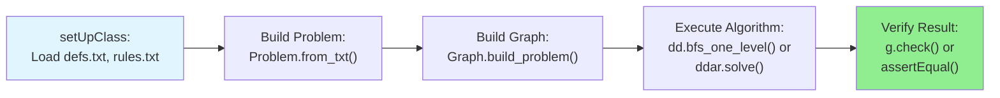
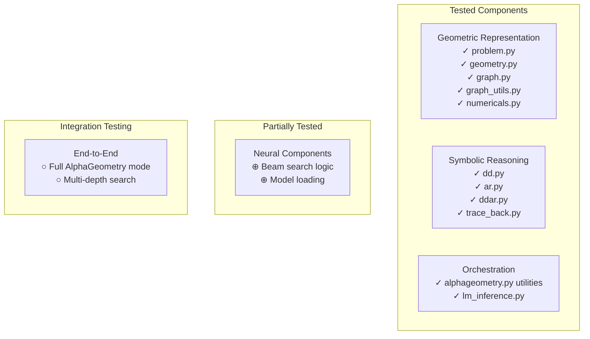

<!-- source: DeepWiki mcp.deepwiki.com · repo google-deepmind/alphageometry · page 7.1 Testing Framework · fetched 2026-10-26 -->

# Testing Framework

<details>
<summary>Relevant source files</summary>

The following files were used as context for generating this wiki page:

- [alphageometry_test.py](alphageometry_test.py)
- [ar_test.py](ar_test.py)
- [dd_test.py](dd_test.py)
- [ddar_test.py](ddar_test.py)
- [run_tests.sh](run_tests.sh)

</details>


## Purpose and Scope

The testing framework validates the correctness of the AlphaGeometry codebase through a suite of unit tests covering symbolic reasoning, algebraic reasoning, graph operations, and neural model inference. This page documents how to execute tests, the organization of test files, and the testing patterns employed across the codebase.

For information about the development process and contribution guidelines, see [Contributing Guidelines](#7.2). For details on the symbolic and algebraic reasoning systems being tested, see [DD+AR Solver](#4).

**Sources:** [run_tests.sh:1-31]()

---

## Test Execution

### Running All Tests

The primary method for executing the test suite is through the `run_tests.sh` shell script, which orchestrates the execution of all test modules in sequence:

```bash
./run_tests.sh
```

The script performs the following setup:
1. Sets the `DATA` variable to point to the model checkpoint directory (`ag_ckpt_vocab`)
2. Sets the `MELIAD_PATH` to the meliad library location (`meliad_lib/meliad`)
3. Exports `PYTHONPATH` to include the meliad library path
4. Executes each test module individually using Python's test runner

**Sources:** [run_tests.sh:16-31]()

### Test Execution Sequence

The tests run in the following order:



**Diagram: Test execution sequence in run_tests.sh**

The language model inference test (`lm_inference_test.py`) requires special command-line arguments to specify the meliad library path and model checkpoint directory, as shown in [run_tests.sh:30]().

**Sources:** [run_tests.sh:20-30]()

---

## Test Organization

The test suite follows a one-to-one mapping pattern where each major Python module has a corresponding test file:

| Module Under Test | Test File | Primary Focus |
|------------------|-----------|---------------|
| `problem.py` | `problem_test.py` | Problem parsing and representation |
| `geometry.py` | `geometry_test.py` | Geometric objects and primitives |
| `graph_utils.py` | `graph_utils_test.py` | Graph utility functions |
| `numericals.py` | `numericals_test.py` | Numerical geometry engine |
| `graph.py` | `graph_test.py` | Proof state graph operations |
| `dd.py` | `dd_test.py` | Deductive database reasoning |
| `ar.py` | `ar_test.py` | Algebraic reasoning tables |
| `ddar.py` | `ddar_test.py` | Integrated DD+AR solver |
| `trace_back.py` | `trace_back_test.py` | Proof reconstruction |
| `alphageometry.py` | `alphageometry_test.py` | High-level orchestration functions |
| `lm_inference.py` | `lm_inference_test.py` | Language model inference |

**Sources:** [run_tests.sh:20-30]()

### Test Framework Architecture

```mermaid
graph TB
    subgraph "Test Infrastructure"
        RUNNER["run_tests.sh<br/>Test Orchestrator"]
        UNITTEST["unittest.TestCase<br/>Base Test Class"]
        ABSTEST["absltest.main()<br/>Test Runner"]
    end
    
    subgraph "Representation Tests"
        PROB_T["problem_test.py"]
        GEOM_T["geometry_test.py"]
        GRAPH_T["graph_test.py"]
        GRAPH_U_T["graph_utils_test.py"]
        NUM_T["numericals_test.py"]
    end
    
    subgraph "Symbolic Reasoning Tests"
        DD_T["dd_test.py"]
        AR_T["ar_test.py"]
        DDAR_T["ddar_test.py"]
        TB_T["trace_back_test.py"]
    end
    
    subgraph "Integration Tests"
        ALPHA_T["alphageometry_test.py"]
        LM_T["lm_inference_test.py"]
    end
    
    subgraph "Test Resources"
        DEFS["defs.txt"]
        RULES["rules.txt"]
        CKPT["ag_ckpt_vocab/"]
    end
    
    RUNNER --> PROB_T
    RUNNER --> GEOM_T
    RUNNER --> GRAPH_T
    RUNNER --> GRAPH_U_T
    RUNNER --> NUM_T
    RUNNER --> DD_T
    RUNNER --> AR_T
    RUNNER --> DDAR_T
    RUNNER --> TB_T
    RUNNER --> ALPHA_T
    RUNNER --> LM_T
    
    PROB_T --> UNITTEST
    GEOM_T --> UNITTEST
    GRAPH_T --> UNITTEST
    DD_T --> UNITTEST
    AR_T --> UNITTEST
    DDAR_T --> UNITTEST
    ALPHA_T --> UNITTEST
    LM_T --> UNITTEST
    
    PROB_T --> ABSTEST
    GEOM_T --> ABSTEST
    GRAPH_T --> ABSTEST
    DD_T --> ABSTEST
    AR_T --> ABSTEST
    DDAR_T --> ABSTEST
    ALPHA_T --> ABSTEST
    LM_T --> ABSTEST
    
    DD_T --> DEFS
    DD_T --> RULES
    AR_T --> DEFS
    AR_T --> RULES
    DDAR_T --> DEFS
    DDAR_T --> RULES
    LM_T --> CKPT
```



**Diagram: Test infrastructure and dependencies**

**Sources:** [alphageometry_test.py:18-20](), [ar_test.py:18-22](), [dd_test.py:18-22](), [ddar_test.py:18-22]()

---

## Module-Specific Tests

### Deductive Database Tests (dd_test.py)

The `dd_test.py` module tests the symbolic deduction engine in isolation, without algebraic reasoning. It uses the `dd.bfs_one_level` function to iteratively apply deduction rules and verify goal satisfaction.

**Key Test Cases:**

| Test Method | Purpose | Expected Outcome |
|------------|---------|-----------------|
| `test_imo_2022_p4_should_succeed` | Tests DD on IMO 2022 Problem 4 | Should prove the goal using only DD rules |
| `test_incenter_excenter_should_fail` | Tests DD on incenter/excenter perpendicularity | Should fail (requires AR) |

**Test Pattern:**
```python
# Build problem and graph
p = pr.Problem.from_txt('...')
g, _ = gh.Graph.build_problem(p, DDTest.defs)
goal_args = g.names2nodes(p.goal.args)

# Iteratively apply DD rules
for level in range(MAX_LEVEL):
    added, _, _, _ = dd.bfs_one_level(g, DDTest.rules, level, p)
    if g.check(p.goal.name, goal_args):
        success = True
        break
    if not added:  # saturated
        break
```

The tests demonstrate that DD alone can solve some problems (like IMO 2022 P4) but not others that require algebraic reasoning (like the incenter/excenter problem).

**Sources:** [dd_test.py:36-75]()

### Algebraic Reasoning Tests (ar_test.py)

The `ar_test.py` module validates the algebraic reasoning components, including the group update mechanism and specialized algebraic tables (`Table`, `AngleTable`, `DistanceTable`).

**Key Test Cases:**

| Test Method | Purpose | Coverage |
|------------|---------|----------|
| `test_update_groups` | Tests group merging logic | Union-find operations |
| `test_generic_table_simple` | Tests basic equality derivation | Generic algebraic table |
| `test_angle_table_inbisector_exbisector` | Tests angle bisector reasoning | `AngleTable` with rational multiples |
| `test_angle_table_equilateral_triangle` | Tests angle constant derivation | Computing π/3 angles |
| `test_incenter_excenter_touchpoints` | Tests distance reasoning | `DistanceTable` with linear expressions |

**Example Test Structure:**

```python
# Create algebraic table
tb = ar.AngleTable('pi')

# Add known facts
ca, cd, cb, ce = g.names2nodes(['d(ac)', 'd(cd)', 'd(bc)', 'd(ce)'])
tb.add_eqangle(ca, cd, cd, cb, 'fact1')
tb.add_eqangle(ce, ca, cb, ce, 'fact2')

# Check derived equalities
result = list(tb.get_all_eqs_and_why())
```

The tests verify that AR can:
- Derive angle bisector properties (perpendicularity of bisector and ex-bisector)
- Compute rational angle multiples (π/3 for equilateral triangles)
- Track distance relationships through linear expressions

**Sources:** [ar_test.py:33-201]()

### Integrated DDAR Tests (ddar_test.py)

The `ddar_test.py` module tests the integrated DD+AR solver, demonstrating the power of combining symbolic deduction with algebraic reasoning.

**Key Test Cases:**

| Test Method | Purpose | Demonstrates |
|------------|---------|-------------|
| `test_orthocenter_should_fail` | Orthocenter without auxiliary point | DD+AR cannot always solve without constructions |
| `test_orthocenter_aux_should_succeed` | Orthocenter with auxiliary point | Correct auxiliary points enable proof |
| `test_incenter_excenter_should_succeed` | Incenter/excenter perpendicularity | AR enables proofs DD alone cannot complete |

**Test Pattern:**

```python
p = pr.Problem.from_txt(txt)
g, _ = gh.Graph.build_problem(p, DDARTest.defs)

# Run integrated DDAR solver
ddar.solve(g, DDARTest.rules, p, max_level=1000)

# Check goal satisfaction
goal_args = g.names2nodes(p.goal.args)
self.assertTrue(g.check(p.goal.name, goal_args))
```

The comparison between `dd_test.py` and `ddar_test.py` highlights the critical role of algebraic reasoning:
- The incenter/excenter problem **fails** in DD alone ([dd_test.py:58-75]())
- The same problem **succeeds** with DDAR ([ddar_test.py:51-61]())

**Sources:** [ddar_test.py:33-61]()

### High-Level Integration Tests (alphageometry_test.py)

The `alphageometry_test.py` module tests utility functions and data structures used in the high-level orchestration layer.

**Key Test Cases:**

| Test Method | Purpose | Component Tested |
|------------|---------|-----------------|
| `test_translate_constrained_to_constructive` | Tests construction translation | Mapping from constrained to constructive predicates |
| `test_insert_aux_to_premise` | Tests auxiliary point insertion | String manipulation for problem augmentation |
| `test_beam_queue` | Tests beam search queue | Priority queue with size limit |

**Example Test:**

```python
def test_translate_constrained_to_constructive(self):
    self.assertEqual(
        alphageometry.translate_constrained_to_constructive(
            'd', 'T', list('addb')
        ),
        ('on_dia', ['d', 'b', 'a']),
    )
```

This tests the mapping from constraint specifications (e.g., "point d satisfies constraint T with points a, d, d, b") to constructive predicates (e.g., "on_dia d b a").

**Sources:** [alphageometry_test.py:26-99]()

---

## Test Patterns and Conventions

### Common Test Structure

All test modules follow a consistent pattern:



**Diagram: Standard test execution pattern**

**Sources:** [dd_test.py:30-34](), [ar_test.py:27-31](), [ddar_test.py:27-31]()

### Shared Test Resources

Tests use shared resources loaded once per test class:

```python
@classmethod
def setUpClass(cls):
    super().setUpClass()
    cls.defs = pr.Definition.from_txt_file('defs.txt', to_dict=True)
    cls.rules = pr.Theorem.from_txt_file('rules.txt', to_dict=True)
```

This pattern is used in:
- [ar_test.py:27-31]()
- [dd_test.py:30-34]()
- [ddar_test.py:27-31]()

### Test Naming Conventions

Test methods follow descriptive naming patterns:
- `test_<scenario>_should_<outcome>` (e.g., `test_orthocenter_should_fail`)
- `test_<component>_<specific_case>` (e.g., `test_angle_table_equilateral_triangle`)
- `test_<function_name>` (e.g., `test_update_groups`)

**Sources:** [dd_test.py:36-75](), [ar_test.py:76-201](), [ddar_test.py:33-61]()

### Problem Construction Pattern

Tests construct problems using text-based specifications:

```python
p = pr.Problem.from_txt(
    'a b c = triangle a b c; d = incenter d a b c; e = excenter e a b c ? perp d c c e'
)
g, _ = gh.Graph.build_problem(p, DDTest.defs)
```

This pattern appears throughout the test suite and mirrors how real problems are specified in example files.

**Sources:** [dd_test.py:59-63](), [ar_test.py:92-95](), [ddar_test.py:34-36]()

---

## Test Coverage

### Coverage by System Layer



**Diagram: Test coverage across system layers**

| Symbol | Meaning |
|--------|---------|
| ✓ | Unit tests present |
| ⊕ | Partially tested |
| ○ | Limited/no dedicated tests |

**Sources:** [run_tests.sh:20-30]()

### Verification Strategies

The test suite employs multiple verification strategies:

1. **Goal Satisfaction**: Verifies that `g.check(goal_name, goal_args)` returns `True` after solving
   - Used in: [dd_test.py:50](), [ddar_test.py:40](), [ddar_test.py:49]()

2. **Equality Assertions**: Validates specific outputs match expected values
   - Used in: [alphageometry_test.py:27-32](), [ar_test.py:39-46]()

3. **Algebraic Derivation Checks**: Verifies AR tables derive expected relationships
   - Used in: [ar_test.py:111-123](), [ar_test.py:145-163]()

4. **Negative Tests**: Confirms problems fail when expected (to validate test correctness)
   - Used in: [dd_test.py:58-75](), [ddar_test.py:33-40]()

**Sources:** [dd_test.py:36-75](), [ar_test.py:33-201](), [alphageometry_test.py:26-99]()

### Test Execution Time

Tests run sequentially, with computational complexity varying by module:
- **Fast tests**: `alphageometry_test.py` (utility functions)
- **Moderate tests**: `ar_test.py`, `dd_test.py` (bounded iterations)
- **Slower tests**: `ddar_test.py` (up to 1000 levels of reasoning)
- **Special requirements**: `lm_inference_test.py` (requires model checkpoints)

**Sources:** [run_tests.sh:20-30](), [ddar_test.py:38](), [dd_test.py:25]()

---

## Summary

The AlphaGeometry testing framework provides comprehensive coverage of the symbolic reasoning core through module-specific unit tests organized in a one-to-one mapping with production code. The test suite validates:

- Geometric representation and graph operations
- Symbolic deduction (DD) in isolation
- Algebraic reasoning (AR) with specialized tables
- Integrated DD+AR solving capability
- High-level orchestration utilities
- Language model inference components

The testing strategy emphasizes comparing expected vs. actual outcomes through goal satisfaction checks and equality assertions, with particular attention to demonstrating the complementary strengths of DD and AR through carefully selected test problems.

**Sources:** [run_tests.sh:1-31](), [dd_test.py:1-79](), [ar_test.py:1-204](), [ddar_test.py:1-65](), [alphageometry_test.py:1-103]()

---

