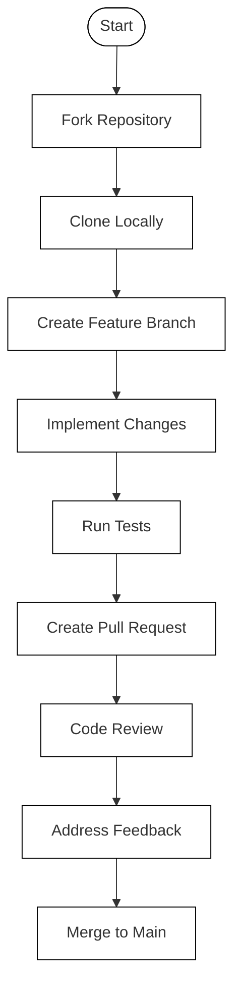
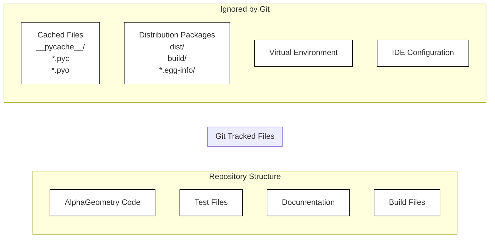
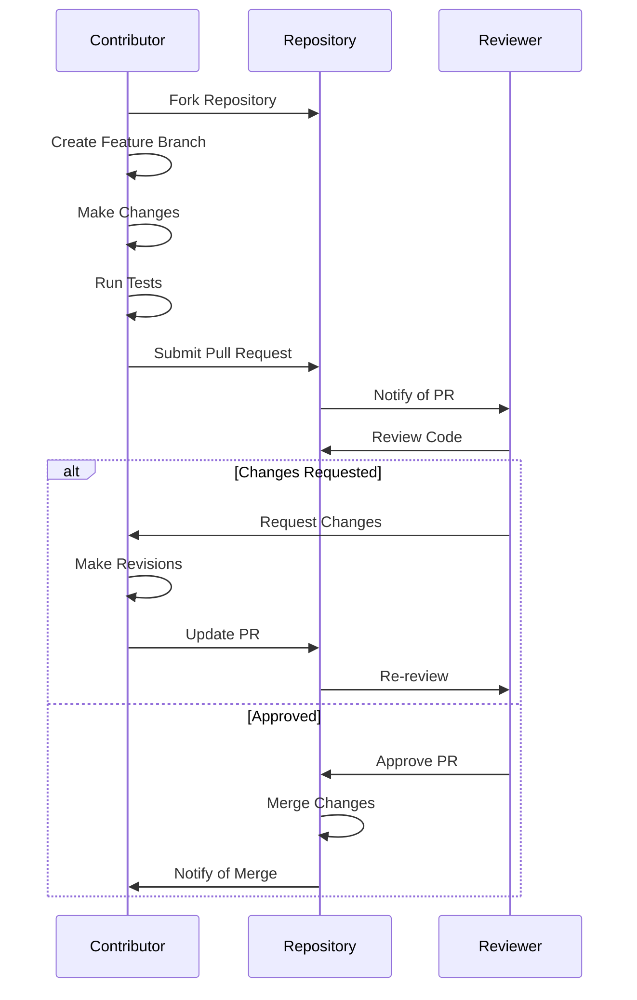
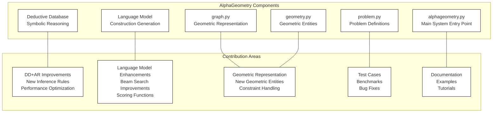
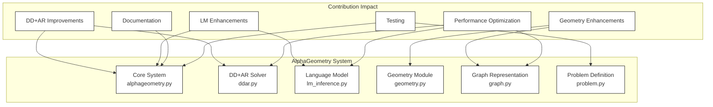

<!-- source: DeepWiki mcp.deepwiki.com · repo google-deepmind/alphageometry · page 7.2 Contributing Guidelines · fetched 2026-10-26 -->

# Contributing Guidelines

Relevant source files

The following files were used as context for generating this wiki page:

- [.gitignore](.gitignore)
- [CONTRIBUTING.md](CONTRIBUTING.md)

This document provides comprehensive guidelines for contributing to the AlphaGeometry project. It covers the contribution process, development setup, code standards, and licensing requirements. For information about the testing framework and how to run tests, see [Testing Framework](#7.1).

## Overview of the Contribution Process

The AlphaGeometry project welcomes contributions from the community. Below is a high-level overview of how to contribute to the project.

### Contribution Workflow

Sources: [CONTRIBUTING.md:15-20]()

## License and Legal Requirements

### Contributor License Agreement (CLA)

All contributions to the AlphaGeometry project must be accompanied by a Contributor License Agreement (CLA). This agreement allows the project to use and redistribute your contributions.

- Visit https://cla.developers.google.com/ to see your current agreements or sign a new one
- You generally only need to submit a CLA once, even if it was for a different project

Sources: [CONTRIBUTING.md:3-13]()

## Development Setup

### Environment Setup

To set up your development environment for contributing to AlphaGeometry:

1. Fork the repository on GitHub
2. Clone your fork locally
3. Install dependencies as described in the installation guide
4. Ensure you can run the system and tests successfully

### Git Configuration

The project uses a `.gitignore` file to specify which files should not be committed to the repository. These include:

- Python bytecode files (`*.pyc`, `*.pyo`, `__pycache__/`)
- Distribution packages (`dist/`, `build/`, `*.egg-info/`)
- Virtual environment files
- IDE-specific configuration files

Sources: [.gitignore:1-24]()

## Code Review Process

### Pull Request Workflow

All submissions to the AlphaGeometry project require code review, including submissions from project members. The project uses GitHub pull requests for this purpose.

1. Create a pull request from your feature branch to the main repository
2. Ensure your PR includes:
   - A clear description of the changes
   - Any relevant issue numbers
   - Tests for new functionality
3. Wait for review feedback
4. Address any requested changes
5. Once approved, your changes will be merged

Sources: [CONTRIBUTING.md:15-20]()

## Code Structure and Contribution Areas

The AlphaGeometry system is comprised of several components that you may contribute to:

### Potential Contribution Areas

| Component | Contribution Types | Files |
|-----------|-------------------|-------|
| DD+AR Solver | New inference rules, Performance optimizations | `ddar.py` and related files |
| Language Model | Inference improvements, Beam search optimizations | `lm_inference.py`, `beam_search.py` |
| Geometric Representation | New geometric entities, Constraint handling | `graph.py`, `geometry.py` |
| Problem Definition | New test cases, Problem parsers | `problem.py` |
| Documentation | User guides, API documentation | Markdown files, Docstrings |

## Coding Standards

When contributing to AlphaGeometry, please adhere to the following standards:

1. Follow the existing code style of the project
2. Include docstrings for public functions and classes
3. Write clear, self-explanatory code with meaningful variable names
4. Include appropriate comments for complex logic
5. Ensure your code passes all existing tests
6. Add tests for new functionality

## Community Guidelines

The AlphaGeometry project follows [Google's Open Source Community Guidelines](https://opensource.google/conduct/). Contributors are expected to:

1. Be respectful and inclusive in communications
2. Focus on constructive feedback during code reviews
3. Work collaboratively to solve issues
4. Maintain a welcoming environment for all contributors

Sources: [CONTRIBUTING.md:22-25]()

## Issue Reporting

When reporting issues with the AlphaGeometry project:

1. Check for existing issues before creating a new one
2. Include detailed information about the issue
3. Provide steps to reproduce the problem
4. Include relevant environment information
5. Suggest a fix if possible

## Contribution Impact Map

## Conclusion

Contributing to AlphaGeometry is a collaborative process that relies on community participation. By following these guidelines, you can help improve the system and ensure that your contributions are effectively integrated into the project.

For questions about contributing that aren't covered in this guide, please reach out to the project maintainers or open an issue for clarification.

Sources: [CONTRIBUTING.md:1-25]()

---

