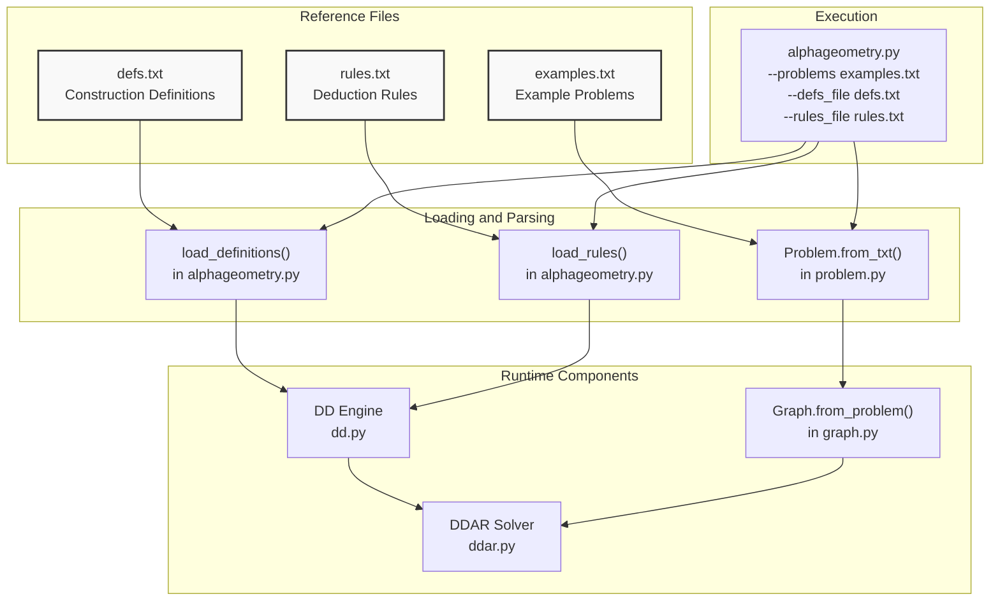
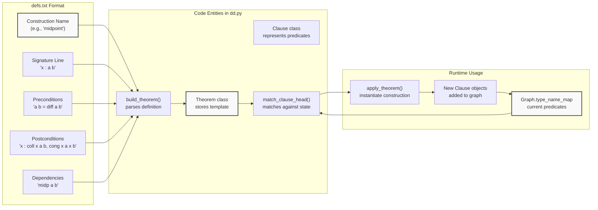
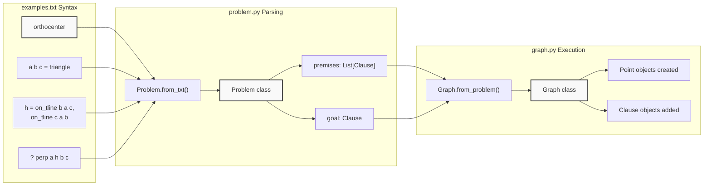

<!-- source: DeepWiki mcp.deepwiki.com · repo google-deepmind/alphageometry · page 8 Reference · fetched 2026-10-26 -->

# Reference

Relevant source files

The following files were used as context for generating this wiki page:

- [LICENSE](LICENSE)
- [defs.txt](defs.txt)
- [examples.txt](examples.txt)

## Purpose and Scope

This section provides reference documentation for the core data files and licensing information in the AlphaGeometry system. It covers:

- **Construction Definitions** ([defs.txt]()): Formal specifications of geometric constructions used by the solver
- **Example Problems** ([examples.txt]()): Sample geometry problems demonstrating system capabilities
- **License Information** ([LICENSE]()): Apache 2.0 license terms and conditions

For detailed usage instructions, see [Usage Guide](#6). For information on how these definitions are processed by the deduction engine, see [DD+AR Solver](#4).

**Sources:** [defs.txt:1-408](), [examples.txt:1-9](), [LICENSE:1-203]()

---

## Reference Material Overview

The AlphaGeometry codebase includes three primary reference resources that define the system's geometric knowledge base and operational constraints:

| Resource | File | Purpose | Used By |
|----------|------|---------|---------|
| Construction Definitions | `defs.txt` | Defines 80+ geometric construction templates with input/output specifications | `dd.py`, `ddar.py`, `alphageometry.py` |
| Example Problems | `examples.txt` | Provides test problems (orthocenter, incenter, Euler line, etc.) | `alphageometry.py` test execution |
| License | `LICENSE` | Apache License 2.0 legal terms | All code distribution |

**Sources:** [defs.txt:1-408](), [examples.txt:1-9](), [LICENSE:1-203]()

---

## Reference Files Integration Architecture

The following diagram shows how reference files integrate with the AlphaGeometry codebase:

**Sources:** [defs.txt:1-408](), [examples.txt:1-9](), [alphageometry.py]()

---

## Construction Definition Structure

Construction definitions in `defs.txt` follow a specific format that maps to code entities in the system. The diagram below shows how a definition is structured:

**Sources:** [defs.txt:1-408]()

---

## Construction Definition Format Details

Each construction definition in `defs.txt` consists of five lines:

| Line | Content | Purpose | Example |
|------|---------|---------|---------|
| 1 | Construction name and input points | Identifies construction and lists input parameters | `midpoint x a b` |
| 2 | Output signature | Declares which points are outputs and their dependencies | `x : a b` |
| 3 | Preconditions | Constraints that must hold before applying construction | `a b = diff a b` |
| 4 | Postconditions | New facts derived after construction | `x : coll x a b, cong x a x b` |
| 5 | Dependencies | Shorthand name for algebraic reasoning | `midp a b` |

### Predicate Types

The system recognizes the following predicate types in construction definitions:

```mermaid
graph TD
    PREDICATES["Predicates in defs.txt"]
    
    GEOMETRIC["Geometric Predicates"]
    ALGEBRAIC["Algebraic Predicates"]
    CONSTRAINTS["Constraint Predicates"]
    
    G1["coll (collinear)"]
    G2["cyclic (concyclic)"]
    G3["para (parallel)"]
    G4["perp (perpendicular)"]
    
    A1["cong (congruent)"]
    A2["eqangle (equal angles)"]
    A3["rconst (ratio constant)"]
    
    C1["diff (distinct)"]
    C2["ncoll (non-collinear)"]
    C3["npara (non-parallel)"]
    C4["nperp (non-perpendicular)"]
    
    PREDICATES --> GEOMETRIC
    PREDICATES --> ALGEBRAIC
    PREDICATES --> CONSTRAINTS
    
    GEOMETRIC --> G1
    GEOMETRIC --> G2
    GEOMETRIC --> G3
    GEOMETRIC --> G4
    
    ALGEBRAIC --> A1
    ALGEBRAIC --> A2
    ALGEBRAIC --> A3
    
    CONSTRAINTS --> C1
    CONSTRAINTS --> C2
    CONSTRAINTS --> C3
    CONSTRAINTS --> C4
    
    style PREDICATES fill:#f9f9f9,stroke:#333,stroke-width:2px
    style GEOMETRIC fill:#f9f9f9,stroke:#333,stroke-width:1px
    style ALGEBRAIC fill:#f9f9f9,stroke:#333,stroke-width:1px
    style CONSTRAINTS fill:#f9f9f9,stroke:#333,stroke-width:1px
```

**Sources:** [defs.txt:1-408]()

---

## Example Problem Format

Problems in `examples.txt` use a concise text format that specifies constructions, premises, and goals:

| Component | Syntax | Purpose | Example |
|-----------|--------|---------|---------|
| Problem Name | First line (no syntax) | Identifies the problem | `orthocenter` |
| Initial Construction | `a b c = triangle` | Defines starting points | `a b c = triangle a b c` |
| Additional Constructions | `x = construction_name args` | Applies constructions | `h = orthocenter a b c` |
| Premises | Constructions before `?` | Facts assumed true | `d = on_line d a b` |
| Goal | After `?` | Statement to prove | `? perp a h b c` |

### Example Problem Structure Mapping

**Sources:** [examples.txt:1-9]()

---

## Construction Category Overview

The `defs.txt` file contains 80+ construction definitions organized by geometric category:

| Category | Count | Examples | Purpose |
|----------|-------|----------|---------|
| **Basic Constructions** | ~15 | `midpoint`, `on_line`, `on_circle` | Fundamental point constructions |
| **Angle Constructions** | ~10 | `angle_bisector`, `angle_mirror`, `s_angle` | Angle-based constructions |
| **Special Points** | ~8 | `orthocenter`, `incenter`, `centroid`, `circumcenter` | Triangle centers |
| **Intersections** | ~12 | `intersection_ll`, `intersection_lc`, `intersection_cc` | Line/circle intersections |
| **Parallel/Perpendicular** | ~8 | `on_pline`, `on_tline`, `foot` | Parallel and perpendicular constructions |
| **Special Figures** | ~15 | `square`, `rectangle`, `parallelogram`, `eq_triangle` | Pre-defined shapes |
| **Transformations** | ~8 | `reflect`, `mirror`, `shift` | Geometric transformations |
| **Tangency** | ~5 | `lc_tangent`, `cc_tangent`, `tangent` | Tangent constructions |
| **Advanced** | ~15 | `3peq`, `trisect`, `eqangle2`, `on_aline` | Complex constructions |

**Sources:** [defs.txt:1-408]()

---

## Subsection References

For detailed information on specific reference materials:

- **[Construction Definitions Reference](#8.1)**: Complete documentation of all 80+ construction definitions from `defs.txt`, including syntax, semantics, and usage examples.

- **[Example Problems](#8.2)**: Detailed walkthrough of example problems from `examples.txt`, showing problem format, solution traces, and how they test different aspects of the system.

- **[License](#8.3)**: Full text of the Apache License 2.0 under which the AlphaGeometry codebase is distributed, including terms of use, redistribution rights, and warranty disclaimers.

**Sources:** [defs.txt:1-408](), [examples.txt:1-9](), [LICENSE:1-203]()

---

