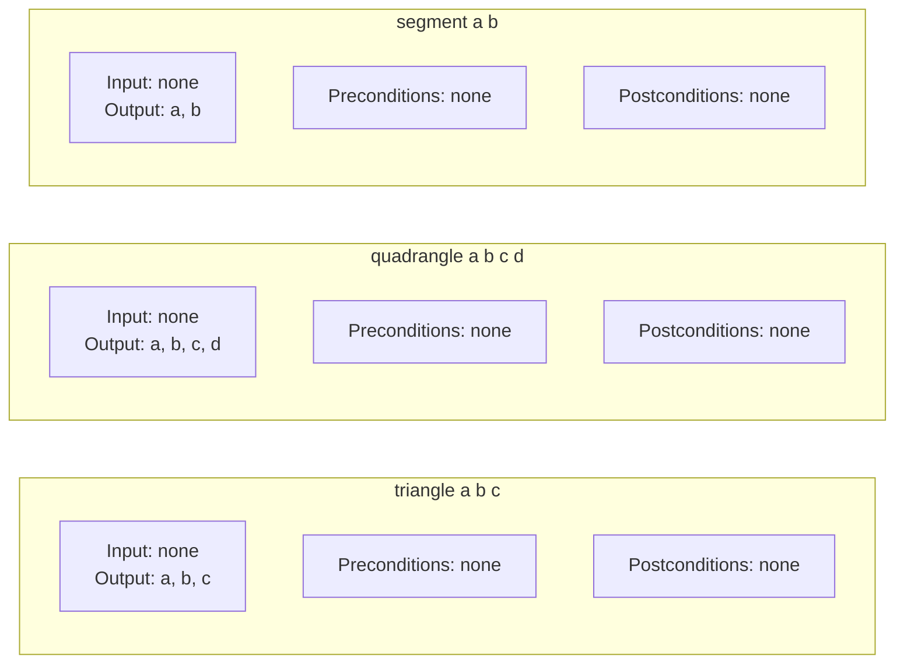
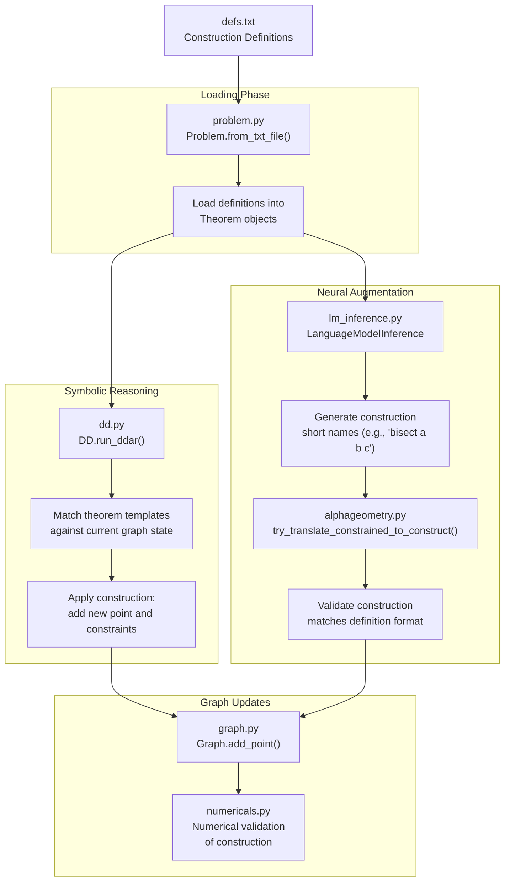

<!-- source: DeepWiki mcp.deepwiki.com · repo google-deepmind/alphageometry · page 8.1 Construction Definitions Reference · fetched 2026-10-26 -->

# Construction Definitions Reference

Relevant source files

The following files were used as context for generating this wiki page:

- [defs.txt](defs.txt)

## Purpose and Scope

This document provides a comprehensive reference for all geometric construction definitions specified in [defs.txt:1-408](). Construction definitions form the vocabulary of geometric actions that the DDAR and AlphaGeometry solvers can use to introduce new points and establish geometric relationships during proof search. Each definition specifies:

- **Input parameters**: Existing points required for the construction
- **Output parameters**: New points created by the construction
- **Preconditions**: Constraints that input points must satisfy
- **Postconditions**: Geometric properties guaranteed for output points
- **Short name**: Abbreviated form used in proof traces

For information about how these constructions are used during solving, see [Deductive Database (DD)](#4.1). For the problem definition format that references these constructions, see [Problem Definition Format](#3.2).

**Sources**: [defs.txt:1-408]()

---

## Construction Definition Format

Each construction definition in [defs.txt:1-408]() follows a standardized five-line format. Understanding this format is essential for interpreting and extending the construction vocabulary.

### Anatomy of a Construction Definition

```mermaid
graph TB
    subgraph "Construction Definition Structure"
        LINE1["Line 1: Construction Signature<br/>construction_name param1 param2 ..."]
        LINE2["Line 2: Point Dependency Declaration<br/>outputs : all_points"]
        LINE3["Line 3: Preconditions<br/>inputs = constraint1, constraint2, ..."]
        LINE4["Line 4: Postconditions<br/>outputs : property1, property2, ..."]
        LINE5["Line 5: Short Name<br/>abbrev input_params"]
    end
    
    LINE1 --> LINE2
    LINE2 --> LINE3
    LINE3 --> LINE4
    LINE4 --> LINE5
    
    subgraph "Example: angle_bisector x a b c"
        EX1["angle_bisector x a b c"]
        EX2["x : a b c x"]
        EX3["a b c = ncoll a b c"]
        EX4["x : eqangle b a b x b x b c"]
        EX5["bisect a b c"]
    end
    
    EX1 --> EX2
    EX2 --> EX3
    EX3 --> EX4
    EX4 --> EX5
```

**Sources**: [defs.txt:1-5](), [defs.txt:61-65](), [defs.txt:163-167]()

### Line-by-Line Specification

| Line | Purpose | Format | Example |
|------|---------|--------|---------|
| 1 | **Signature** | `name output_params input_params` | `angle_bisector x a b c` |
| 2 | **Dependencies** | `outputs : all_points` | `x : a b c x` |
| 3 | **Preconditions** | `inputs = constraints` | `a b c = ncoll a b c` |
| 4 | **Postconditions** | `outputs : properties` | `x : eqangle b a b x b x b c` |
| 5 | **Abbreviation** | `shortname inputs` | `bisect a b c` |

**Key observations**:
- **Output parameters** appear before the colon (`:`) in line 2
- **Input parameters** appear after the equals sign (`=`) in line 3
- Multiple properties in line 4 are separated by commas or semicolons
- Empty line 3 (`=`) indicates no preconditions (e.g., `free` points)
- Empty line 4 indicates no guaranteed properties (e.g., `segment`, `triangle`)

**Sources**: [defs.txt:1-408]()

---

## Predicate Reference

Construction postconditions use geometric predicates to specify properties. The following predicates appear throughout [defs.txt:1-408]():

| Predicate | Meaning | Example |
|-----------|---------|---------|
| `coll x a b` | Point x is collinear with a and b | `coll x b c` |
| `ncoll a b c` | Points a, b, c are not collinear | `ncoll a b c` |
| `cong x a x b` | Distance from x to a equals distance from x to b | `cong x a x b` |
| `perp x a b c` | Line xa is perpendicular to line bc | `perp x a b c` |
| `nperp b o b a` | Line bo is not perpendicular to line ba | `nperp b o b a` |
| `para a b c d` | Line ab is parallel to line cd | `para a b c d` |
| `npara a b c d` | Line ab is not parallel to line cd | `npara a b c d` |
| `eqangle a b a x c x c b` | Angle ∠bax equals angle ∠xcb (modulo sign) | `eqangle b a b x b x b c` |
| `cyclic a b c x` | Points a, b, c, x lie on a circle | `cyclic a b c x` |
| `diff a b` | Points a and b are distinct | `diff a b` |
| `rconst a b a c 1 2` | Ratio AB/AC = 1/2 | `rconst a b a c 1 2` |
| `s_angle a b x y` | Signed angle construction | `s_angle a b x y` |

**Sources**: [defs.txt:1-408]()

---

## Construction Taxonomy

The 70+ constructions in [defs.txt:1-408]() can be organized into functional categories:

```mermaid
graph TB
    ROOT["Construction Definitions<br/>defs.txt"]
    
    subgraph "Shape Definitions"
        BASIC["Basic Shapes<br/>triangle, quadrangle, pentagon"]
        SPECIAL["Special Shapes<br/>square, rectangle, parallelogram,<br/>trapezoid, iso_triangle, eq_triangle"]
    end
    
    subgraph "Point Constructions"
        FREE["Free Points<br/>free"]
        ONCURVE["Points on Curves<br/>on_line, on_circle, on_bline,<br/>on_pline, on_tline, on_aline,<br/>on_aline2, on_dia, on_opline,<br/>on_circum"]
        MIDFOOT["Midpoints & Feet<br/>midpoint, foot, mirror,<br/>eqdistance"]
    end
    
    subgraph "Centers & Special Points"
        CENTERS["Triangle Centers<br/>circumcenter, incenter, excenter,<br/>orthocenter, centroid, ninepoints"]
        INCENTER2["Extended Center Constructions<br/>incenter2, excenter2"]
    end
    
    subgraph "Intersections"
        INTER["Intersection Constructions<br/>intersection_ll, intersection_lc,<br/>intersection_cc, intersection_lt,<br/>intersection_lp, intersection_pp,<br/>intersection_tt"]
    end
    
    subgraph "Angle Constructions"
        ANGLE["Angle Operations<br/>angle_bisector, angle_mirror,<br/>eqangle2, eqangle3, s_angle,<br/>trisect"]
    end
    
    subgraph "Transformations"
        TRANS["Geometric Transformations<br/>reflect, mirror, shift,<br/>nsquare, psquare"]
    end
    
    subgraph "Tangency"
        TANG["Tangent Constructions<br/>lc_tangent, cc_tangent,<br/>cc_tangent0, tangent"]
    end
    
    subgraph "Specialized"
        SPEC["Problem-Specific<br/>2l1c, e5128, 3peq,<br/>trisegment, centroid"]
    end
    
    ROOT --> BASIC
    ROOT --> SPECIAL
    ROOT --> FREE
    ROOT --> ONCURVE
    ROOT --> MIDFOOT
    ROOT --> CENTERS
    ROOT --> INCENTER2
    ROOT --> INTER
    ROOT --> ANGLE
    ROOT --> TRANS
    ROOT --> TANG
    ROOT --> SPEC
```

**Sources**: [defs.txt:1-408]()

---

## Basic Shape Definitions

These constructions define polygonal shapes without enforcing specific geometric properties. They serve as templates for problem statements.

### Triangle, Quadrangle, Pentagon, Segment

**Definition Details**:

| Construction | Signature | Outputs | Properties | Short Name |
|--------------|-----------|---------|------------|------------|
| `triangle` | `triangle a b c` | a, b, c | None | `triangle` |
| `quadrangle` | `quadrangle a b c d` | a, b, c, d | None | `quadrangle` |
| `pentagon` | `pentagon a b c d e` | a, b, c, d, e | None | `pentagon` |
| `segment` | `segment a b` | a, b | None | `segment` |

**Sources**: [defs.txt:319-323](), [defs.txt:247-251](), [defs.txt:235-239](), [defs.txt:289-293]()

---

## Special Shape Definitions

These constructions define shapes with specific geometric properties enforced as postconditions.

### Isosceles and Equilateral Triangles

| Construction | Signature | Preconditions | Postconditions | Short Name |
|--------------|-----------|---------------|----------------|------------|
| `iso_triangle` | `iso_triangle a b c` | None | `eqangle b a b c c b c a, cong a b a c` | `isos` |
| `eq_triangle` | `eq_triangle x b c` | `diff b c` | `cong x b b c, cong b c c x` `eqangle b x b c c b c x, eqangle x c x b b x b c` | `circle b b c, circle c b c` |
| `ieq_triangle` | `ieq_triangle a b c` | None | `cong a b b c, cong b c c a` `eqangle a b a c c a c b, eqangle c a c b b c b a` | `ieq_triangle` |

**Geometric Interpretation**:
- **`iso_triangle`**: Creates an isosceles triangle with AB = AC
- **`eq_triangle`**: Creates an equilateral triangle on base BC
- **`ieq_triangle`**: Creates an equilateral triangle (all sides equal)

**Sources**: [defs.txt:151-155](), [defs.txt:37-41](), [defs.txt:367-371]()

### Right Triangles

| Construction | Signature | Preconditions | Postconditions | Short Name |
|--------------|-----------|---------------|----------------|------------|
| `r_triangle` | `r_triangle a b c` | None | `perp a b a c` | `r_triangle` |
| `risos` | `risos a b c` | None | `perp a b a c, cong a b a c` `eqangle b a b c c b c a` | `risos` |

**Sources**: [defs.txt:259-263](), [defs.txt:277-281]()

### Quadrilaterals

| Construction | Signature | Preconditions | Postconditions | Short Name |
|--------------|-----------|---------------|----------------|------------|
| `parallelogram` | `parallelogram a b c x` | `ncoll a b c` | `para a b c x, para a x b c` `cong a b c x, cong a x b c` | `pline a b c, pline c a b` |
| `rectangle` | `rectangle a b c d` | None | `perp a b b c, para a b c d, para a d b c` `perp a b a d, cong a b c d, cong a d b c, cong a c b d` | `rectangle` |
| `square` | `square a b x y` | `diff a b` | `perp a b b x, cong a b b x, para a b x y, para a y b x` `perp a y y x, cong b x x y, cong x y y a, perp a x b y, cong a x b y` | `square a b` |
| `isquare` | `isquare a b c d` | None | `perp a b b c, cong a b b c, para a b c d, para a d b c` `perp a d d c, cong b c c d, cong c d d a, perp a c b d, cong a c b d` | `isquare` |
| `trapezoid` | `trapezoid a b c d` | None | `para a b c d` | `trapezoid` |
| `r_trapezoid` | `r_trapezoid a b c d` | None | `para a b c d, perp a b a d` | `r_trapezoid` |
| `eq_trapezoid` | `eq_trapezoid a b c d` | None | `para d c a b, cong d a b c` | `eq_trapezoid` |

**Sources**: [defs.txt:229-233](), [defs.txt:265-269](), [defs.txt:301-305](), [defs.txt:307-311](), [defs.txt:313-317](), [defs.txt:253-257](), [defs.txt:31-35]()

### Specialized Quadrilaterals

| Construction | Signature | Postconditions | Short Name |
|--------------|-----------|----------------|------------|
| `eq_quadrangle` | `eq_quadrangle a b c d` | `cong d a b c` | `eq_quadrangle` |
| `eqdia_quadrangle` | `eqdia_quadrangle a b c d` | `cong d b a c` | `eqdia_quadrangle` |

**Sources**: [defs.txt:25-29](), [defs.txt:49-53]()

---

## Point Construction Operations

### Free Points

The simplest construction creates a point with no constraints:

| Construction | Signature | Preconditions | Postconditions | Short Name |
|--------------|-----------|---------------|----------------|------------|
| `free` | `free a` | None | None | `free` |

**Usage**: Used to introduce auxiliary points whose position will be determined by subsequent constraints.

**Sources**: [defs.txt:67-71]()

### Midpoints and Reflections

| Construction | Signature | Preconditions | Postconditions | Short Name |
|--------------|-----------|---------------|----------------|------------|
| `midpoint` | `midpoint x a b` | `diff a b` | `coll x a b, cong x a x b` | `midp a b` |
| `mirror` | `mirror x a b` | `diff a b` | `coll x a b, cong b a b x` | `pmirror a b` |
| `reflect` | `reflect x a b c` | `diff b c, ncoll a b c` | `cong b a b x, cong c a c x, perp b c a x` | `reflect a b c` |

**Geometric Interpretation**:
- **`midpoint`**: x is the midpoint of segment AB
- **`mirror`**: x is the reflection of A across point B (B + (B - A))
- **`reflect`**: x is the reflection of A across line BC

**Sources**: [defs.txt:163-167](), [defs.txt:169-173](), [defs.txt:271-275]()

### Foot of Perpendicular

| Construction | Signature | Preconditions | Postconditions | Short Name |
|--------------|-----------|---------------|----------------|------------|
| `foot` | `foot x a b c` | `ncoll a b c` | `perp x a b c, coll x b c` | `tline a b c, line b c` |

**Geometric Interpretation**: x is the foot of the perpendicular from A to line BC.

**Sources**: [defs.txt:61-65]()

### Equidistance

| Construction | Signature | Preconditions | Postconditions | Short Name |
|--------------|-----------|---------------|----------------|------------|
| `eqdistance` | `eqdistance x a b c` | `diff b c` | `cong x a b c` | `circle a b c` |

**Geometric Interpretation**: x is a point such that XA = BC (distance XA equals distance BC).

**Sources**: [defs.txt:55-59]()

---

## Points on Lines and Circles

These constructions create points constrained to lie on specific geometric objects.

### Line-Based Constructions

| Construction | Signature | Preconditions | Postconditions | Short Name |
|--------------|-----------|---------------|----------------|------------|
| `on_line` | `on_line x a b` | `diff a b` | `coll x a b` | `line a b` |
| `on_pline` | `on_pline x a b c` | `diff b c, ncoll a b c` | `para x a b c` | `pline a b c` |
| `on_tline` | `on_tline x a b c` | `diff b c` | `perp x a b c` | `tline a b c` |
| `on_bline` | `on_bline x a b` | `diff a b` | `cong x a x b, eqangle a x a b b a b x` | `bline a b` |
| `on_aline` | `on_aline x a b c d e` | `ncoll c d e` | `eqangle a x a b d c d e` | `aline e d c b a` |
| `on_aline2` | `on_aline2 x a b c d e` | `ncoll c d e` | `eqangle x a x b d c d e` | `aline2 e d c b a` |
| `on_opline` | `on_opline x a b` | `diff a b` | `coll x a b` | `on_opline a b` |

**Geometric Interpretation**:
- **`on_line`**: x lies on line AB
- **`on_pline`**: x lies on the line through A parallel to BC
- **`on_tline`**: x lies on the line through A perpendicular to BC
- **`on_bline`**: x lies on the perpendicular bisector of AB
- **`on_aline`**: x lies on a line through A making angle with AB equal to angle ∠CDE
- **`on_aline2`**: x lies on a line through B making angle with BA equal to angle ∠CDE
- **`on_opline`**: x lies on the line through AB (variant)

**Sources**: [defs.txt:205-209](), [defs.txt:211-215](), [defs.txt:217-221](), [defs.txt:193-197](), [defs.txt:181-185](), [defs.txt:187-191](), [defs.txt:373-377]()

### Circle-Based Constructions

| Construction | Signature | Preconditions | Postconditions | Short Name |
|--------------|-----------|---------------|----------------|------------|
| `on_circle` | `on_circle x o a` | `diff o a` | `cong o x o a` | `circle o o a` |
| `on_circum` | `on_circum x a b c` | `ncoll a b c` | `cyclic a b c x` | `cyclic a b c` |
| `on_dia` | `on_dia x a b` | `diff a b` | `perp x a x b` | `dia a b` |

**Geometric Interpretation**:
- **`on_circle`**: x lies on the circle centered at O passing through A
- **`on_circum`**: x lies on the circumcircle of triangle ABC
- **`on_dia`**: x lies on the circle with diameter AB (∠AXB = 90°)

**Sources**: [defs.txt:199-203](), [defs.txt:403-407](), [defs.txt:361-365]()

---

## Triangle Centers and Special Points

### Basic Triangle Centers

| Construction | Signature | Preconditions | Postconditions | Short Name |
|--------------|-----------|---------------|----------------|------------|
| `circumcenter` | `circumcenter x a b c` | `ncoll a b c` | `cong x a x b, cong x b x c` | `bline a b, bline a c` |
| `incenter` | `incenter x a b c` | `ncoll a b c` | `eqangle a b a x a x a c, eqangle c a c x c x c b` `eqangle b c b x b x b a` | `bisect a b c, bisect b c a` |
| `excenter` | `excenter x a b c` | `ncoll a b c` | `eqangle a b a x a x a c, eqangle c a c x c x c b` `eqangle b c b x b x b a` | `bisect b a c, exbisect b c a` |
| `orthocenter` | `orthocenter x a b c` | `ncoll a b c` | `perp x a b c, perp x b c a, perp x c a b` | `tline a b c, tline b c a` |
| `centroid` | `centroid x y z i a b c` | `ncoll a b c` | `coll x b c, cong x b x c` `coll y c a, cong y c y a` `coll z a b, cong z a z b` `coll a x i, coll b y i, coll c z i` | `centroid a b c` |
| `ninepoints` | `ninepoints x y z i a b c` | `ncoll a b c` | `coll x b c, cong x b x c` `coll y c a, cong y c y a` `coll z a b, cong z a z b` `cong i x i y, cong i y i z` | `ninepoints a b c` |

**Geometric Interpretation**:
- **`circumcenter`**: x is equidistant from A, B, C (center of circumcircle)
- **`incenter`**: x lies on angle bisectors (center of incircle)
- **`excenter`**: x is the center of an excircle
- **`orthocenter`**: x is where altitudes meet
- **`centroid`**: i is where medians meet (also constructs midpoints x, y, z)
- **`ninepoints`**: i is the nine-point circle center

**Sources**: [defs.txt:19-23](), [defs.txt:73-77](), [defs.txt:85-89](), [defs.txt:223-227](), [defs.txt:97-101](), [defs.txt:103-107]()

### Extended Center Constructions

| Construction | Signature | Outputs | Postconditions |
|--------------|-----------|---------|----------------|
| `incenter2` | `incenter2 x y z i a b c` | x, y, z, i | All incenter properties plus feet of perpendiculars: `coll x b c, perp i x b c` `coll y c a, perp i y c a` `coll z a b, perp i z a b` `cong i x i y, cong i y i z` |
| `excenter2` | `excenter2 x y z i a b c` | x, y, z, i | All excenter properties plus feet of perpendiculars |

**Sources**: [defs.txt:79-83](), [defs.txt:91-95]()

---

## Intersection Constructions

Intersection constructions find points where geometric objects meet.

### Line-Line and Line-Circle Intersections

| Construction | Signature | Preconditions | Postconditions | Short Name |
|--------------|-----------|---------------|----------------|------------|
| `intersection_ll` | `intersection_ll x a b c d` | `npara a b c d, ncoll a b c d` | `coll x a b, coll x c d` | `line a b, line c d` |
| `intersection_lc` | `intersection_lc x a o b` | `diff a b, diff o b, nperp b o b a` | `coll x a b, cong o b o x` | `line b a, circle o o b` |
| `intersection_lt` | `intersection_lt x a b c d e` | `ncoll a b c, nperp a b d e` | `coll x a b, perp x c d e` | `line a b, tline c d e` |
| `intersection_lp` | `intersection_lp x a b c m n` | `npara m n a b, ncoll a b c, ncoll c m n` | `coll x a b, para c x m n` | `line a b, pline c m n` |

**Geometric Interpretation**:
- **`intersection_ll`**: x is where line AB intersects line CD
- **`intersection_lc`**: x is where line AB intersects circle centered at O through B
- **`intersection_lt`**: x is where line AB intersects the perpendicular from C to DE
- **`intersection_lp`**: x is where line AB intersects the line through C parallel to MN

**Sources**: [defs.txt:121-125](), [defs.txt:115-119](), [defs.txt:133-137](), [defs.txt:127-131]()

### Circle-Circle and Special Intersections

| Construction | Signature | Preconditions | Postconditions | Short Name |
|--------------|-----------|---------------|----------------|------------|
| `intersection_cc` | `intersection_cc x o w a` | `ncoll o w a` | `cong o a o x, cong w a w x` | `circle o o a, circle w w a` |
| `intersection_pp` | `intersection_pp x a b c d e f` | `diff a d, npara b c e f` | `para x a b c, para x d e f` | `pline a b c, pline d e f` |
| `intersection_tt` | `intersection_tt x a b c d e f` | `diff a d, npara b c e f` | `perp x a b c, perp x d e f` | `tline a b c, tline d e f` |

**Geometric Interpretation**:
- **`intersection_cc`**: x is where circle (O, OA) intersects circle (W, WA)
- **`intersection_pp`**: x is where line through A parallel to BC meets line through D parallel to EF
- **`intersection_tt`**: x is where line through A perpendicular to BC meets line through D perpendicular to EF

**Sources**: [defs.txt:109-113](), [defs.txt:139-143](), [defs.txt:145-149]()

---

## Angle Operations

### Angle Bisectors and Mirrors

| Construction | Signature | Preconditions | Postconditions | Short Name |
|--------------|-----------|---------------|----------------|------------|
| `angle_bisector` | `angle_bisector x a b c` | `ncoll a b c` | `eqangle b a b x b x b c` | `bisect a b c` |
| `angle_mirror` | `angle_mirror x a b c` | `ncoll a b c` | `eqangle b a b c b c b x` | `amirror a b c` |
| `eqangle2` | `eqangle2 x a b c` | `ncoll a b c` | `eqangle a b a x c x c b` | `eqangle2 a b c` |
| `eqangle3` | `eqangle3 x a b d e f` | `ncoll d e f, diff a b, diff d e, diff e f` | `eqangle x a x b d e d f` | `eqangle3 a b d e f` |

**Geometric Interpretation**:
- **`angle_bisector`**: x lies on the bisector of ∠ABC
- **`angle_mirror`**: x is the reflection of ray BA across the bisector of ∠ABC
- **`eqangle2`**: x is positioned such that ∠ABX = ∠CXB
- **`eqangle3`**: x is positioned such that ∠XAB = ∠DEF

**Sources**: [defs.txt:1-5](), [defs.txt:7-11](), [defs.txt:43-47](), [defs.txt:391-395]()

### Angle Trisection

| Construction | Signature | Preconditions | Postconditions | Short Name |
|--------------|-----------|---------------|----------------|------------|
| `trisect` | `trisect x y a b c` | `ncoll a b c` | `coll x a c, coll y a c` `eqangle b a b x b x b y, eqangle b x b y b y b c` | `trisect a b c` |

**Geometric Interpretation**: x and y trisect angle ∠BAC.

**Sources**: [defs.txt:349-353]()

### Signed Angles

| Construction | Signature | Preconditions | Postconditions | Short Name |
|--------------|-----------|---------------|----------------|------------|
| `s_angle` | `s_angle a b x y` | `diff a b` | `s_angle a b x y` | `s_angle a b y` |

**Note**: This construction introduces a signed angle constraint, used for problems requiring orientation.

**Sources**: [defs.txt:283-287]()

---

## Rotation and Transformation Constructions

| Construction | Signature | Preconditions | Postconditions | Short Name |
|--------------|-----------|---------------|----------------|------------|
| `nsquare` | `nsquare x a b` | `diff a b` | `cong x a a b, perp x a a b` | `rotaten90 a b` |
| `psquare` | `psquare x a b` | `diff a b` | `cong x a a b, perp x a a b` | `rotatep90 a b` |
| `shift` | `shift x b c d` | `diff d b` | `cong x b c d, cong x c b d` | `shift d c b` |

**Geometric Interpretation**:
- **`nsquare`**: x is obtained by rotating B around A by -90° (clockwise)
- **`psquare`**: x is obtained by rotating B around A by +90° (counterclockwise)
- **`shift`**: x is the translation of B by vector CD

**Sources**: [defs.txt:175-179](), [defs.txt:241-245](), [defs.txt:295-299]()

---

## Tangency Constructions

### Line-Circle Tangency

| Construction | Signature | Preconditions | Postconditions | Short Name |
|--------------|-----------|---------------|----------------|------------|
| `lc_tangent` | `lc_tangent x a o` | `diff a o` | `perp a x a o` | `tline a a o` |
| `tangent` | `tangent x y a o b` | `diff o a, diff o b, diff a b` | `cong o x o b, perp a x o x` `cong o y o b, perp a y o y` | `tangent a o b` |

**Geometric Interpretation**:
- **`lc_tangent`**: x is on the tangent line to circle (O, OA) at point A
- **`tangent`**: x and y are the tangent points from external point A to circle (O, OB)

**Sources**: [defs.txt:157-161](), [defs.txt:397-401]()

### Circle-Circle Tangency

| Construction | Signature | Outputs | Postconditions | Short Name |
|--------------|-----------|---------|----------------|------------|
| `cc_tangent0` | `cc_tangent0 x y o a w b` | x, y | `cong o x o a, cong w y w b` `perp x o x y, perp y w y x` | `cc_tangent0 o a w b` |
| `cc_tangent` | `cc_tangent x y z i o a w b` | x, y, z, i | Four tangent points where two circles touch each other | `cc_tangent o a w b` |

**Geometric Interpretation**:
- **`cc_tangent0`**: x and y are tangent points on circles (O, OA) and (W, WB)
- **`cc_tangent`**: All four tangent points between two circles

**Sources**: [defs.txt:379-383](), [defs.txt:385-389]()

---

## Circle Construction

| Construction | Signature | Preconditions | Postconditions | Short Name |
|--------------|-----------|---------------|----------------|------------|
| `circle` | `circle x a b c` | `ncoll a b c` | `cong x a x b, cong x b x c` | `bline a b, bline a c` |

**Note**: This is equivalent to `circumcenter` and constructs the center of the circle through three points.

**Sources**: [defs.txt:13-17]()

---

## Specialized Problem-Specific Constructions

These constructions encode complex geometric configurations used in specific problem domains.

| Construction | Signature | Purpose |
|--------------|-----------|---------|
| `2l1c` | `2l1c x y z i a b c o` | Configuration with two lines and one circle involving points A, B, C, O |
| `e5128` | `e5128 x y a b c d` | Specific configuration for problem E5128 |
| `3peq` | `3peq x y z a b c` | Three-point equality configuration |
| `trisegment` | `trisegment x y a b` | Trisect segment AB into three equal parts |
| `triangle12` | `triangle12 a b c` | Triangle with specific ratio constraint: AB/AC = 1/2 |

**Sources**: [defs.txt:331-335](), [defs.txt:337-341](), [defs.txt:343-347](), [defs.txt:355-359](), [defs.txt:325-329]()

---

## Usage in Code

Construction definitions are loaded and processed by multiple components in the AlphaGeometry system:

**Sources**: [defs.txt:1-408]()

### Definition Loading

Construction definitions are parsed when initializing a `Problem` instance. The format is read by [problem.py]() which creates `Theorem` objects representing each construction.

**Key components**:
- **Line 1**: Stored as the theorem's signature
- **Line 2**: Parsed to identify output vs. input parameters
- **Line 3**: Converted to precondition predicates
- **Line 4**: Converted to postcondition predicates
- **Line 5**: Stored as the short name for proof output

### Usage in DD (Deductive Database)

The DD component in [dd.py]() uses construction definitions during backward reasoning:
1. **Template Matching**: When the goal requires a new point, DD searches for applicable constructions
2. **Precondition Checking**: Verifies input points satisfy all preconditions
3. **Construction Application**: Creates the new point and adds postcondition predicates to the graph
4. **Caching**: Uses theorem name and parameter hash for efficient lookup

For details on DD theorem matching, see [Deductive Database (DD)](#4.1).

### Usage in Language Model

When the neural component generates auxiliary constructions:
1. **Generation**: The LM outputs a short name like `"bisect a b c"`
2. **Parsing**: [alphageometry.py]() function `try_translate_constrained_to_construct()` maps this to the full construction definition
3. **Validation**: Checks that referenced points exist and preconditions hold
4. **Application**: Adds the construction to the graph if valid

For details on LM auxiliary construction generation, see [Auxiliary Construction Generation](#5.3).

### Numerical Validation

After a construction is applied symbolically, [numericals.py]() validates it numerically:
- Computes concrete 2D coordinates for the new point
- Verifies postconditions hold within numerical tolerance
- Detects degenerate cases (e.g., parallel lines that should intersect)

For details on numerical validation, see [Numerical Geometry Engine](#3.1).

**Sources**: [problem.py](), [dd.py](), [alphageometry.py](), [numericals.py]()

---

## Construction Definition Summary Table

The following table provides a complete index of all 70+ constructions in [defs.txt:1-408]():

| Category | Construction Names |
|----------|-------------------|
| **Basic Shapes** | `free`, `segment`, `triangle`, `quadrangle`, `pentagon` |
| **Special Triangles** | `iso_triangle`, `eq_triangle`, `ieq_triangle`, `r_triangle`, `risos`, `triangle12` |
| **Quadrilaterals** | `parallelogram`, `rectangle`, `square`, `isquare`, `trapezoid`, `r_trapezoid`, `eq_trapezoid`, `eq_quadrangle`, `eqdia_quadrangle` |
| **Triangle Centers** | `circumcenter`, `incenter`, `excenter`, `orthocenter`, `centroid`, `ninepoints`, `incenter2`, `excenter2` |
| **Points on Lines** | `on_line`, `on_pline`, `on_tline`, `on_bline`, `on_aline`, `on_aline2`, `on_opline` |
| **Points on Circles** | `on_circle`, `on_circum`, `on_dia`, `circle` |
| **Intersections** | `intersection_ll`, `intersection_lc`, `intersection_cc`, `intersection_lt`, `intersection_lp`, `intersection_pp`, `intersection_tt` |
| **Midpoints & Feet** | `midpoint`, `foot`, `mirror`, `reflect`, `eqdistance` |
| **Angle Operations** | `angle_bisector`, `angle_mirror`, `eqangle2`, `eqangle3`, `s_angle`, `trisect` |
| **Rotations** | `nsquare`, `psquare`, `shift` |
| **Tangency** | `lc_tangent`, `tangent`, `cc_tangent0`, `cc_tangent` |
| **Specialized** | `2l1c`, `e5128`, `3peq`, `trisegment`, `centroid` |

**Sources**: [defs.txt:1-408]()

---

