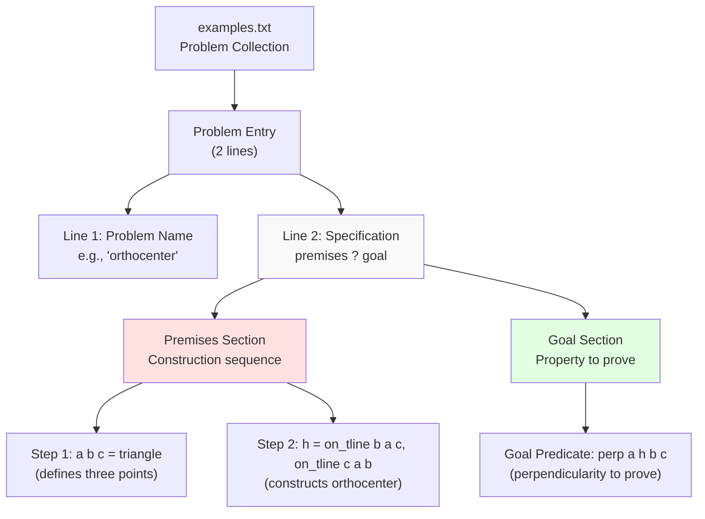
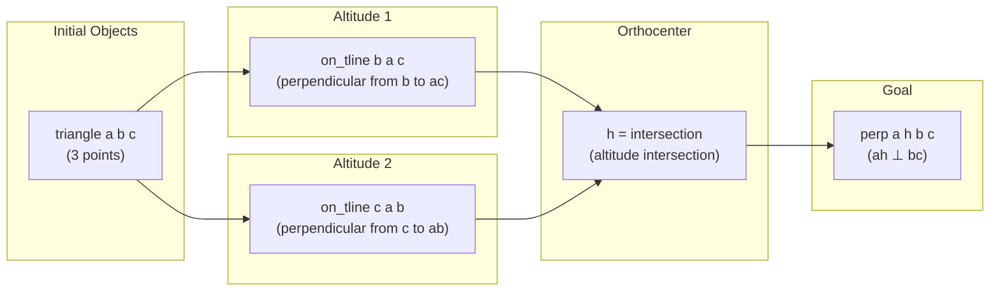
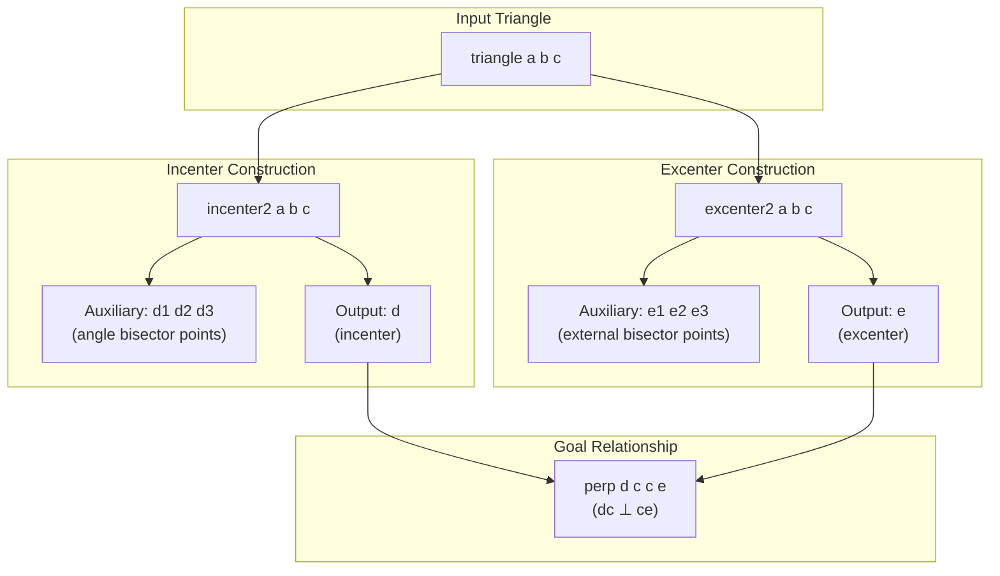
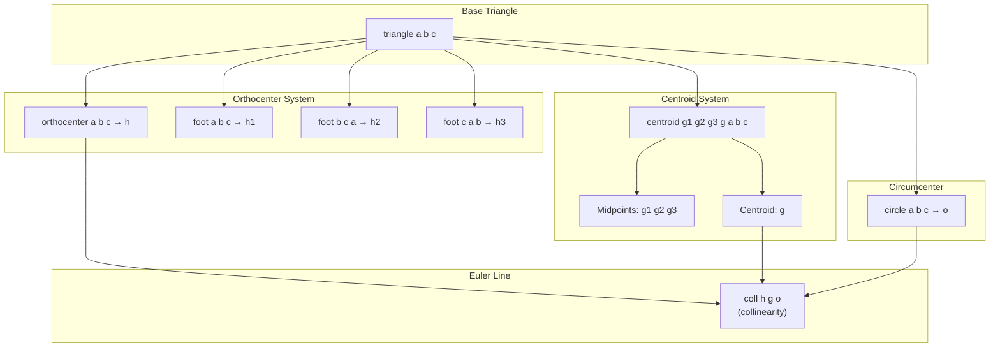
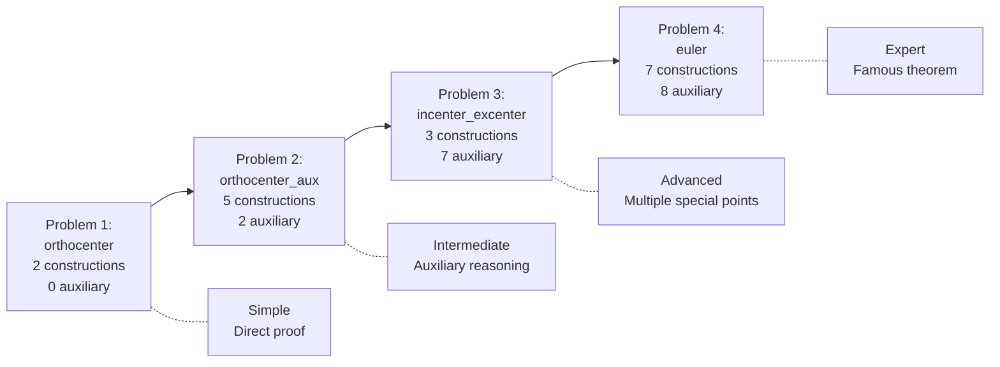

<!-- source: DeepWiki mcp.deepwiki.com · repo google-deepmind/alphageometry · page 8.2 Example Problems · fetched 2026-10-26 -->

# Example Problems

<details>
<summary>Relevant source files</summary>

The following files were used as context for generating this wiki page:

- [examples.txt](examples.txt)

</details>


This page documents the example geometry problems provided in [examples.txt:1-9](). These examples demonstrate the text-based problem specification format used by AlphaGeometry and illustrate how geometric construction sequences and proof goals are represented. Each example showcases increasingly complex geometric theorems, from basic properties like the orthocenter to advanced results like the Euler line.

For detailed information about the construction predicates used in these examples (e.g., `triangle`, `on_tline`, `incenter2`), see [Construction Definitions Reference](#8.1). For information on how these problems are parsed and represented internally, see [Problem Definition Format](#3.2).

**Sources:** [examples.txt:1-9]()

---

## Problem Specification Format

Each problem in `examples.txt` follows a two-line format:

```
<problem_name>
<premises> ? <goal>
```

The **premises** section contains a semicolon-separated sequence of construction steps. Each step either:
1. **Assigns variables** to geometric objects using construction predicates (e.g., `a b c = triangle`)
2. **Constrains objects** using geometric predicates (e.g., `perp a h b c`)

The **goal** section (following the `?` symbol) specifies the property that must be proven using the constructed objects.

### Syntax Components

| Component | Description | Example |
|-----------|-------------|---------|
| Variable names | Single lowercase letters | `a`, `b`, `c`, `h`, `d1` |
| Construction predicate | Defines geometric relationship | `triangle`, `on_tline`, `incenter2` |
| Assignment operator | Associates variables with construction | `=` |
| Statement separator | Separates construction steps | `;` |
| Goal separator | Separates premises from conclusion | `?` |
| Constraint predicates | Properties to prove or assume | `perp`, `coll`, `on_line` |

**Sources:** [examples.txt:1-9]()

---

## Problem Format Structure



**Diagram: Problem Specification Format Structure**

This diagram shows how each problem is organized. The name line identifies the problem, while the specification line contains the logical structure. Premises define the geometric configuration through construction steps (separated by semicolons), and the goal states what must be proven.

**Sources:** [examples.txt:1-9]()

---

## Example Problems Overview

The file contains four example problems of increasing complexity:

| Problem Name | Lines | Geometric Concept | Auxiliary Points | Goal Type |
|--------------|-------|-------------------|------------------|-----------|
| `orthocenter` | 2 | Orthocenter theorem | 0 | Perpendicularity |
| `orthocenter_aux` | 4 | Orthocenter with auxiliary | 2 (`d`, `e`) | Perpendicularity |
| `incenter_excenter` | 6 | Incenter-excenter properties | 7 (`d1-d3`, `e1-e3`, `d`, `e`) | Perpendicularity |
| `euler` | 8 | Euler line collinearity | 8 (`h`, `h1-h3`, `g1-g3`, `g`, `o`) | Collinearity |

**Sources:** [examples.txt:1-9]()

---

## Problem 1: Orthocenter

```
orthocenter
a b c = triangle; h = on_tline b a c, on_tline c a b ? perp a h b c
```

### Geometric Description

This problem proves that the **orthocenter** (the intersection of altitudes) of a triangle is perpendicular to one of the sides when connected to the opposite vertex.

### Construction Breakdown

| Step | Code | Geometric Meaning |
|------|------|-------------------|
| 1 | `a b c = triangle` | Define three non-collinear points forming triangle ABC |
| 2 | `h = on_tline b a c` | Point h lies on the line through b perpendicular to line ac |
| 3 | `h = on_tline c a b` | Point h also lies on the line through c perpendicular to line ab |

**Goal:** `perp a h b c` — Prove that line segment ah is perpendicular to line segment bc.

### Construction Flow



**Diagram: Orthocenter Problem Construction Sequence**

This shows the dependency flow: the triangle is constructed first, then two altitudes are defined using `on_tline` (perpendicular line through a point), their intersection defines the orthocenter h, and the goal is to prove ah is perpendicular to bc.

**Sources:** [examples.txt:1-2]()

---

## Problem 2: Orthocenter with Auxiliary Point

```
orthocenter_aux
a b c = triangle; d = on_tline d b a c, on_tline d c a b; e = on_line e a c, on_line e b d ? perp a d b c
```

### Geometric Description

This is a more complex variant that introduces **auxiliary points** (d and e) to prove the same orthocenter property. This demonstrates how additional constructions can facilitate proofs that might be difficult to derive directly.

### Construction Breakdown

| Step | Code | Geometric Meaning |
|------|------|-------------------|
| 1 | `a b c = triangle` | Define triangle ABC |
| 2 | `d = on_tline d b a c` | Point d on perpendicular from b to ac |
| 3 | `d = on_tline d c a b` | Point d also on perpendicular from c to ab (orthocenter) |
| 4 | `e = on_line e a c` | Auxiliary point e on line ac |
| 5 | `e = on_line e b d` | Point e also on line bd |

**Goal:** `perp a d b c` — Prove that line ad is perpendicular to line bc.

**Note:** This problem uses `on_tline d b a c` syntax where the first parameter after the predicate name (`d`) is repeated to specify the output point explicitly. This is equivalent to the simpler form in Problem 1.

**Sources:** [examples.txt:3-4]()

---

## Problem 3: Incenter and Excenter

```
incenter_excenter
a b c = triangle a b c; d1 d2 d3 d = incenter2 a b c; e1 e2 e3 e = excenter2 a b c ? perp d c c e
```

### Geometric Description

This problem proves a relationship between the **incenter** (center of inscribed circle) and **excenter** (center of one escribed circle) of a triangle. Specifically, it proves that the line from the incenter to vertex c is perpendicular to the line connecting c and the excenter.

### Construction Breakdown

| Step | Code | Geometric Meaning |
|------|------|-------------------|
| 1 | `a b c = triangle a b c` | Define triangle ABC (explicit naming) |
| 2 | `d1 d2 d3 d = incenter2 a b c` | Compute incenter d with auxiliary points d1, d2, d3 |
| 3 | `e1 e2 e3 e = excenter2 a b c` | Compute excenter e with auxiliary points e1, e2, e3 |

**Goal:** `perp d c c e` — Prove that line dc is perpendicular to line ce.

### Advanced Construction Predicates

This example demonstrates multi-output constructions:

- `incenter2`: Returns 4 points (3 auxiliary points for angle bisectors + incenter)
- `excenter2`: Returns 4 points (3 auxiliary points for external angle bisectors + excenter)

These compound constructions are defined in `defs.txt` (see [Construction Definitions Reference](#8.1)) and internally create intermediate geometric objects needed to define the incenter and excenter.



**Diagram: Incenter-Excenter Problem Structure**

This shows how the complex `incenter2` and `excenter2` predicates produce multiple output points, some auxiliary (for intermediate steps) and some primary (the actual centers). The goal relates these computed centers to the original triangle vertices.

**Sources:** [examples.txt:5-6]()

---

## Problem 4: Euler Line

```
euler
a b c = triangle a b c; h = orthocenter a b c; h1 = foot a b c; h2 = foot b c a; h3 = foot c a b; g1 g2 g3 g = centroid g1 g2 g3 g a b c; o = circle a b c ? coll h g o
```

### Geometric Description

This problem proves one of the most famous results in triangle geometry: the **Euler line theorem**. It states that the orthocenter (h), centroid (g), and circumcenter (o) of any triangle are collinear.

### Construction Breakdown

| Step | Code | Geometric Meaning |
|------|------|-------------------|
| 1 | `a b c = triangle a b c` | Define triangle ABC |
| 2 | `h = orthocenter a b c` | Compute orthocenter h |
| 3 | `h1 = foot a b c` | Foot of altitude from a to bc |
| 4 | `h2 = foot b c a` | Foot of altitude from b to ca |
| 5 | `h3 = foot c a b` | Foot of altitude from c to ab |
| 6 | `g1 g2 g3 g = centroid g1 g2 g3 g a b c` | Compute centroid g with auxiliary midpoints g1, g2, g3 |
| 7 | `o = circle a b c` | Compute circumcenter o (center of circumscribed circle) |

**Goal:** `coll h g o` — Prove that points h, g, and o are collinear (lie on the Euler line).

### Multiple Special Points

This example demonstrates how to construct multiple special points of a triangle:

- **Orthocenter** (`orthocenter`): Intersection of altitudes
- **Feet** (`foot`): Base points of altitudes (perpendicular projections)
- **Centroid** (`centroid`): Intersection of medians (center of mass)
- **Circumcenter** (`circle`): Center of the circumscribed circle



**Diagram: Euler Line Problem Construction Dependencies**

This shows the three independent construction branches (orthocenter system, centroid system, circumcenter) that all derive from the base triangle. The goal is to prove that the three special points (h, g, o) lie on a single line.

**Sources:** [examples.txt:7-8]()

---

## Problem Format Summary

All example problems follow these design patterns:

### Construction Patterns

1. **Single-output constructions**: `h = orthocenter a b c` produces one point
2. **Multi-output constructions**: `d1 d2 d3 d = incenter2 a b c` produces auxiliary points plus primary output
3. **Multiple constraints**: `h = on_tline b a c, on_tline c a b` specifies intersection via multiple conditions
4. **Explicit repetition**: `d = on_tline d b a c` repeats the output variable as first parameter (syntax variation)

### Goal Types

| Predicate | Meaning | Example |
|-----------|---------|---------|
| `perp` | Perpendicularity | `perp a h b c` (ah ⊥ bc) |
| `coll` | Collinearity | `coll h g o` (h, g, o on one line) |
| `para` | Parallelism | Not shown in examples |
| `cong` | Congruence | Not shown in examples |
| `cycl` | Concyclic | Not shown in examples |

### Complexity Progression



**Diagram: Problem Complexity Progression**

The examples are ordered by increasing sophistication: from direct proofs to those requiring auxiliary constructions, multiple special points, and complex geometric relationships.

**Sources:** [examples.txt:1-9]()

---

## Usage in AlphaGeometry

These example problems serve multiple purposes:

1. **Testing**: Validate that both DDAR and AlphaGeometry modes can solve known problems
2. **Demonstration**: Show users the problem specification syntax
3. **Benchmarking**: Provide baseline performance measurements

To run these examples:

```bash
# Using DDAR mode (pure symbolic)
python alphageometry.py --mode=ddar --problems_file=examples.txt

# Using AlphaGeometry mode (neural + symbolic)
python alphageometry.py --mode=alphageometry --problems_file=examples.txt
```

For more information on command-line usage, see [Running the Solvers](#6.2).

**Sources:** [examples.txt:1-9]()

---

