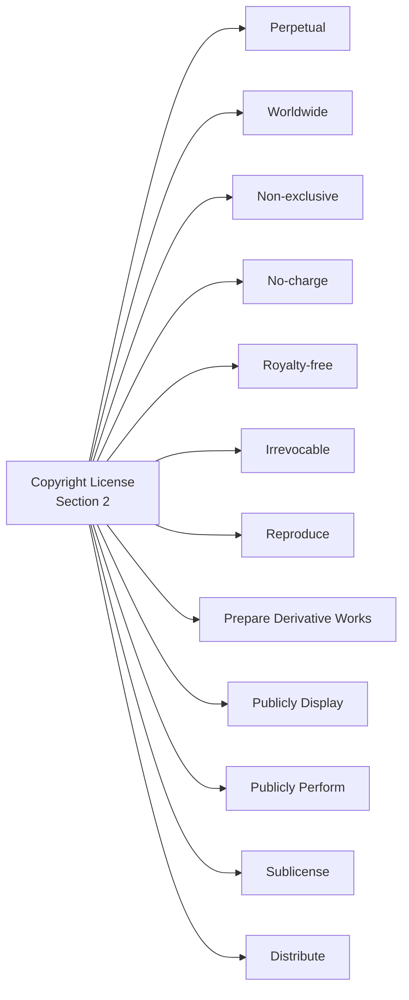
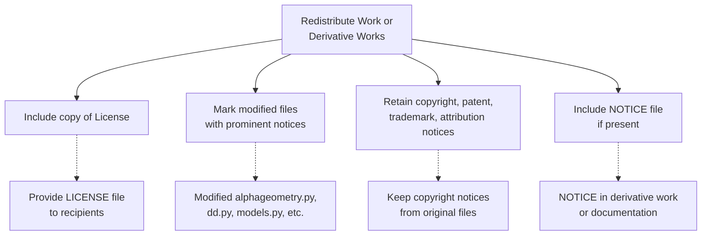
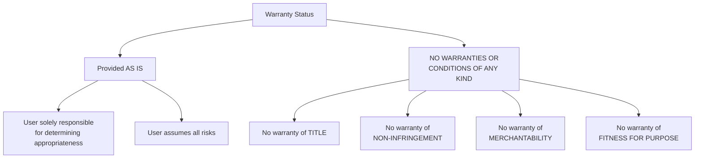
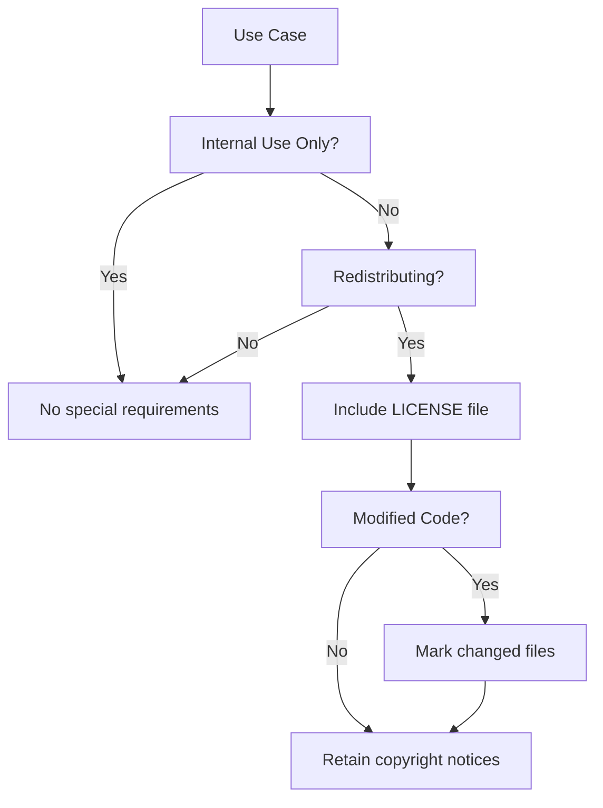

<!-- source: DeepWiki mcp.deepwiki.com · repo google-deepmind/alphageometry · page 8.3 License · fetched 2026-10-26 -->

# License

<details>
<summary>Relevant source files</summary>

The following files were used as context for generating this wiki page:

- [LICENSE](LICENSE)

</details>


## Purpose and Scope

This page documents the licensing terms under which the AlphaGeometry codebase is distributed. The project uses the **Apache License 2.0**, which governs how users may use, modify, and redistribute the software. This page provides a summary of the license terms, key permissions, requirements, and limitations. For information about contributing code to the project, see [Contributing Guidelines](#7.2).

The complete license text is located at [LICENSE:1-203]().

---

## License Overview

AlphaGeometry is licensed under the **Apache License, Version 2.0** (January 2004). This is a permissive open-source license that allows broad usage rights while providing patent protection and requiring proper attribution.

### Key Characteristics

| Aspect | Details |
|--------|---------|
| **License Type** | Apache License 2.0 |
| **License URL** | http://www.apache.org/licenses/LICENSE-2.0 |
| **Permissiveness** | Permissive (allows commercial use, modification, distribution) |
| **Patent Grant** | Includes explicit patent license grant |
| **Copyleft** | No (allows proprietary derivatives) |
| **Attribution Required** | Yes (copyright and license notices must be retained) |

Sources: [LICENSE:1-6]()

---

## License Application Across Codebase

The Apache License 2.0 applies to all components of the AlphaGeometry repository, including Python modules, configuration files, data definitions, and documentation.

```mermaid
graph TD
    LICENSE["LICENSE<br/>(Apache 2.0 Terms)"]
    
    subgraph "Python Modules"
        ALPHA["alphageometry.py"]
        DD["dd.py"]
        AR["ar.py"]
        GRAPH["graph.py"]
        GEOM["geometry.py"]
        LM["lm_inference.py"]
        MODELS["models.py"]
    end
    
    subgraph "Configuration Files"
        DEFS["defs.txt"]
        RULES["rules.txt"]
        GIN["*.gin files"]
    end
    
    subgraph "Test Suite"
        TESTS["*_test.py files"]
        RUN_TESTS["run_tests.sh"]
    end
    
    subgraph "Scripts"
        RUN["run.sh"]
        DOWNLOAD["download.sh"]
    end
    
    subgraph "Data Files"
        EXAMPLES["examples.txt"]
        IMO["imo_ag_30.txt"]
    end
    
    LICENSE --> ALPHA
    LICENSE --> DD
    LICENSE --> AR
    LICENSE --> GRAPH
    LICENSE --> GEOM
    LICENSE --> LM
    LICENSE --> MODELS
    LICENSE --> DEFS
    LICENSE --> RULES
    LICENSE --> GIN
    LICENSE --> TESTS
    LICENSE --> RUN_TESTS
    LICENSE --> RUN
    LICENSE --> DOWNLOAD
    LICENSE --> EXAMPLES
    LICENSE --> IMO
```



**Diagram: License Coverage Across Repository Components**

All source files, scripts, configurations, and data files in the repository are covered by the Apache 2.0 license terms. This includes both the symbolic reasoning components (dd.py, ar.py) and the neural components (lm_inference.py, models.py).

Sources: [LICENSE:1-203]()

---

## Key Definitions

The Apache License 2.0 defines specific terms that govern how the license applies. Understanding these definitions is essential for proper compliance.

### Core Terms

| Term | Definition | Reference |
|------|------------|-----------|
| **License** | The terms and conditions for use, reproduction, and distribution (Sections 1-9) | [LICENSE:10-11]() |
| **Work** | The work of authorship made available under the License, including source code and documentation | [LICENSE:36-39]() |
| **Source Form** | Preferred form for making modifications (source code, documentation source, configuration files) | [LICENSE:27-29]() |
| **Object Form** | Any form resulting from mechanical transformation (compiled code, generated documentation) | [LICENSE:31-34]() |
| **Derivative Works** | Works based on or derived from the Work, representing original authorship | [LICENSE:41-47]() |
| **Contribution** | Work intentionally submitted for inclusion by copyright owner or authorized entity | [LICENSE:49-61]() |
| **Contributor** | Licensor and any entity whose Contribution has been incorporated | [LICENSE:63-65]() |

Sources: [LICENSE:8-66]()

---

## Permissions Granted

The Apache License 2.0 grants two primary licenses to users: a copyright license and a patent license.

### Copyright License (Section 2)



**Diagram: Copyright License Permissions Structure**

Each Contributor grants users the right to:
- **Reproduce** the Work
- **Prepare Derivative Works** (modifications, extensions)
- **Publicly display and perform** the Work
- **Sublicense** to others
- **Distribute** in Source or Object form

These rights are perpetual, worldwide, non-exclusive, no-charge, royalty-free, and irrevocable.

Sources: [LICENSE:67-72]()

### Patent License (Section 3)

The patent license grants rights to use any patent claims that are necessarily infringed by Contributions. Key aspects:

- **Scope**: Covers patent claims licensable by Contributors necessarily infringed by their Contributions
- **Termination**: Patent license terminates if you file patent litigation alleging the Work infringes
- **Duration**: Perpetual, worldwide, non-exclusive, no-charge, royalty-free, irrevocable (except for termination clause)

This means users can implement and use AlphaGeometry's algorithms (e.g., DDAR deduction in [dd.py](), algebraic reasoning in [ar.py](), language model inference in [lm_inference.py]()) without patent concerns from Contributors.

Sources: [LICENSE:74-88]()

---

## Conditions and Requirements

While the Apache License 2.0 is permissive, it imposes specific conditions on redistribution to ensure proper attribution and transparency.

### Redistribution Requirements (Section 4)

When distributing the Work or Derivative Works (whether in Source or Object form), you must:



**Diagram: Redistribution Compliance Requirements**

#### Detailed Requirements

1. **License Distribution** ([LICENSE:95-96]()): Recipients must receive a copy of the Apache License 2.0

2. **Change Notification** ([LICENSE:98-99]()): Modified files must carry prominent notices indicating changes
   - Example: If you modify [dd.py]() to add custom theorem matching, document this change

3. **Notice Retention** ([LICENSE:101-105]()): Preserve all copyright, patent, trademark, and attribution notices from Source form
   - Example: Keep header comments in [alphageometry.py](), [graph.py](), [geometry.py]()

4. **NOTICE File** ([LICENSE:107-122]()): If present, include readable copy in Derivative Works
   - Note: The current AlphaGeometry repository does not include a NOTICE file

Sources: [LICENSE:90-129]()

### Modifications and License Terms

You may:
- Add your own copyright statement to modifications ([LICENSE:124]())
- Provide different license terms for your modifications ([LICENSE:125-127]())
- Create Derivative Works under different licenses ([LICENSE:127-129]())

However, your use of the original Work must still comply with Apache License 2.0 conditions.

Sources: [LICENSE:124-129]()

---

## Contribution Submission (Section 5)

When submitting Contributions to the AlphaGeometry project (e.g., improvements to [dd.py](), [ar.py](), or [lm_inference.py]()):

- **Default Terms**: Contributions are automatically under Apache License 2.0 unless explicitly stated otherwise
- **No Additional Terms**: No additional terms or conditions apply unless agreed separately with Licensor
- **Scope**: This applies to any Contribution intentionally submitted for inclusion

For practical contribution procedures (pull requests, code review), see [Contributing Guidelines](#7.2).

Sources: [LICENSE:131-137]()

---

## Limitations and Disclaimers

The Apache License 2.0 includes important limitations on liability and warranty disclaimers.

### Trademark Restrictions (Section 6)

The license **does not** grant permission to use:
- Trade names of Licensor
- Trademarks
- Service marks
- Product names

Exception: Usage is permitted for reasonable description of Work origin and NOTICE file reproduction.

Sources: [LICENSE:139-142]()

### Warranty Disclaimer (Section 7)



**Diagram: Warranty Disclaimer Structure**

The Work (including [alphageometry.py](), [dd.py](), [ar.py](), all modules) is provided **"AS IS"** with:
- No express or implied warranties
- No warranty of title, non-infringement, merchantability, or fitness for purpose
- User assumes all risks associated with use

Sources: [LICENSE:144-152]()

### Limitation of Liability (Section 8)

Contributors are **not liable** for damages including:
- Direct, indirect, special, incidental, or consequential damages
- Loss of goodwill, work stoppage, computer failure
- Commercial damages or losses

This applies even if the Contributor was advised of potential damages, except as required by law (deliberate and grossly negligent acts).

**Practical Implication**: If the symbolic solver ([ddar.py]()) or language model ([lm_inference.py]()) produces incorrect results, Contributors are not liable for downstream consequences.

Sources: [LICENSE:154-164]()

---

## Usage Scenarios

This section illustrates how the license applies to common usage scenarios.

### Scenario Matrix

| Scenario | Permitted | Requirements | Notes |
|----------|-----------|--------------|-------|
| **Use internally** | ✓ Yes | None | Run [alphageometry.py]() within organization |
| **Modify for internal use** | ✓ Yes | None | Customize [dd.py](), [ar.py](), [geometry.py]() |
| **Distribute unmodified** | ✓ Yes | Include LICENSE | Share original repository |
| **Distribute modified** | ✓ Yes | Include LICENSE, mark changes, retain notices | Share modified [alphageometry.py]() |
| **Use in commercial product** | ✓ Yes | Include LICENSE if redistributing | Integrate DDAR solver into product |
| **Sublicense** | ✓ Yes | Include LICENSE, retain notices | Grant rights to others |
| **Create proprietary derivative** | ✓ Yes | Include LICENSE for original portions | Build closed-source extension |
| **Use trademarks** | ✗ No (except reasonable origin description) | N/A | Cannot use "AlphaGeometry" as trademark |



**Diagram: License Compliance Decision Flow**

Sources: [LICENSE:90-129]()

---

## Accepting Additional Liability (Section 9)

When redistributing the Work or Derivative Works, you may optionally:
- Offer acceptance of support, warranty, or indemnity
- Charge fees for such obligations

However, you must:
- Act only on your own behalf and sole responsibility
- Not act on behalf of other Contributors
- Indemnify, defend, and hold harmless other Contributors for any liability incurred

This provision allows commercial support offerings while protecting original Contributors from liability.

Sources: [LICENSE:166-175]()

---

## Applying License to Your Work

If creating Derivative Works of AlphaGeometry (e.g., extending [dd.py]() with new theorem matching rules, enhancing [lm_inference.py]() with different model architectures), the license recommends including this boilerplate notice:

```
Copyright [yyyy] [name of copyright owner]

Licensed under the Apache License, Version 2.0 (the "License");
you may not use this file except in compliance with the License.
You may obtain a copy of the License at

    http://www.apache.org/licenses/LICENSE-2.0

Unless required by applicable law or agreed to in writing, software
distributed under the License is distributed on an "AS IS" BASIS,
WITHOUT WARRANTIES OR CONDITIONS OF ANY KIND, either express or implied.
See the License for the specific language governing permissions and
limitations under the License.
```

This boilerplate should be placed in file headers using appropriate comment syntax.

Sources: [LICENSE:179-202]()

---

## License File Location

The complete Apache License 2.0 text is located at:
- **File Path**: [LICENSE:1-203]()
- **Format**: Plain text
- **Lines**: 203 lines total

This file must be included when redistributing the AlphaGeometry codebase or any Derivative Works in Source form.

Sources: [LICENSE:1-203]()

---

## Summary

The AlphaGeometry project is distributed under the **Apache License 2.0**, a permissive open-source license that:

**Grants**:
- Broad usage rights (reproduce, modify, distribute, sublicense)
- Patent protection for implemented algorithms
- Permission to create proprietary derivatives

**Requires**:
- Include LICENSE file in distributions
- Mark modified files with change notices
- Retain copyright and attribution notices
- Include NOTICE file if present (currently none in repository)

**Disclaims**:
- All warranties (AS IS basis)
- Liability for damages
- Trademark rights (except reasonable origin description)

Users may freely use all components ([alphageometry.py](), [dd.py](), [ar.py](), [graph.py](), [geometry.py](), [lm_inference.py](), [models.py](), configuration files, test suites) for any purpose, including commercial applications, as long as they comply with the simple attribution and notice requirements.

For contribution procedures, see [Contributing Guidelines](#7.2). For setup and usage instructions, see [Installation and Setup](#6.1) and [Running the Solvers](#6.2).

Sources: [LICENSE:1-203]()