# Page: Overview

# Overview

<details>
<summary>Relevant source files</summary>

The following files were used as context for generating this wiki page:

- [README.md](README.md)

</details>


## Purpose and Scope

This page provides a high-level introduction to AlphaGeometry, a geometric theorem proving system that combines symbolic deduction with neural language models. The document explains the system's purpose, capabilities, and architectural organization. For detailed information about specific components, see:
- Symbolic deduction engine: [DD+AR Solver](#4)
- Neural components: [Language Model Component](#5)
- Problem representation: [Geometric Representation](#3)
- Practical usage instructions: [Usage Guide](#6)

**Sources:** [README.md:1-10]()

---

## What is AlphaGeometry?

AlphaGeometry is a geometry theorem proving system introduced in the Nature 2024 paper "Solving Olympiad Geometry without Human Demonstrations." The system proves geometric theorems at the level of International Mathematical Olympiad (IMO) problems without requiring human-annotated proofs during training.

The system implements two solving modes:

| Mode | Description | Components Used |
|------|-------------|-----------------|
| **DDAR** | Pure symbolic reasoning | DD (deductive database) + AR (algebraic reasoning) |
| **AlphaGeometry** | Neural-symbolic hybrid | DDAR + Language Model for auxiliary constructions |

In DDAR mode, the solver applies deduction rules and algebraic reasoning iteratively until the goal is proven or the system saturates. In AlphaGeometry mode, when symbolic reasoning stalls, a trained language model proposes auxiliary geometric constructions (e.g., "add point E on line AC") that enable symbolic reasoning to proceed.

**Sources:** [README.md:2-10](), [README.md:329-357]()

---

## Research Context and Performance

### Publication and Development

- **Primary Publication:** Nature 2024 (DOI: 10.1038/s41586-023-06747-5)
- **Collaboration:** Google DeepMind and New York University Computer Science Department
- **Follow-up:** AlphaGeometry2 published in JMLR (Jan 2026)
- **License:** Apache 2.0 for code, CC-BY 4.0 for model checkpoints

### Benchmark Performance

The system was evaluated on two problem sets:

| Problem Set | Total Problems | DDAR Solved | AlphaGeometry Solved |
|-------------|----------------|-------------|----------------------|
| **IMO-AG-30** | 30 IMO geometry problems | 14 | 25 |
| **JGEX-AG-231** | 231 problems | 198 | 228 |

The IMO-AG-30 set consists of geometry problems from International Mathematical Olympiad competitions, representing olympiad-level difficulty. The results demonstrate that the neural-symbolic hybrid approach substantially outperforms pure symbolic reasoning.

**Sources:** [README.md:8-10](), [README.md:303-327](), [README.md:371-381]()

---

## System Architecture Overview

The following diagram maps the system's conceptual components to their implementing code modules:

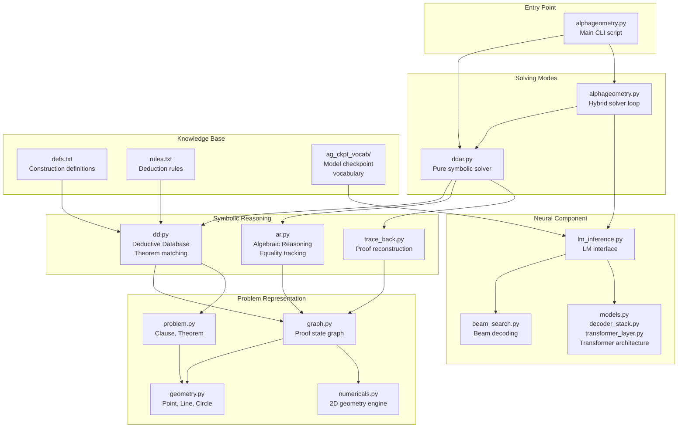

**Key architectural principles:**

1. **Modular separation:** Symbolic reasoning (DD, AR) is independent of neural components (LM, beam search)
2. **Central graph representation:** `graph.py` serves as the hub connecting all components
3. **Declarative knowledge:** Deduction rules and construction definitions are defined in text files, not hardcoded
4. **Numerical backend:** `numericals.py` provides validation through concrete 2D coordinates

**Sources:** [README.md:329-368]()

---

## Execution Flow Comparison

The following diagram illustrates how problem-solving differs between DDAR and AlphaGeometry modes:

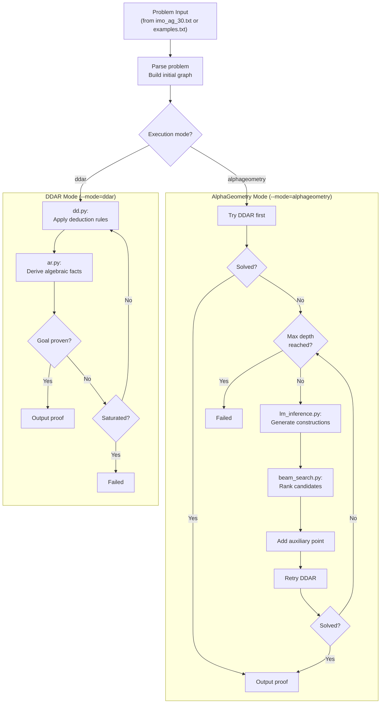

**DDAR mode characteristics:**
- Deterministic: always produces the same output for a given problem
- Fast: no neural inference overhead
- Limited: cannot solve problems requiring auxiliary constructions

**AlphaGeometry mode characteristics:**
- Stochastic: language model sampling introduces variation
- Computationally intensive: requires GPU for model inference
- More powerful: can propose auxiliary constructions that unlock new proof paths
- Configurable search depth: controlled via `--search_depth` flag

**Sources:** [README.md:140-186](), [README.md:199-272]()

---

## Core Component Breakdown

### Symbolic Reasoning Components

The symbolic engine consists of three tightly integrated modules:

**`dd.py` - Deductive Database**
- Loads deduction rules from `rules.txt` [README.md:79-86]()
- Matches rule patterns against current proof state
- Applies matched rules to derive new geometric facts
- Example rule: "If AB ⊥ CD and CD ⊥ EF, then AB ∥ EF"
- See [Deductive Database](#4.1) for details

**`ar.py` - Algebraic Reasoning**
- Maintains tables of algebraic equalities: ratios, angles, distances
- Derives new equalities through algebraic manipulation
- Tracks dependencies for proof reconstruction
- Example: "If AB:CD = 2:3 and CD:EF = 3:4, then AB:EF = 1:2"
- See [Algebraic Reasoning](#4.2) for details

**`trace_back.py` - Proof Reconstruction**
- Recursively traces dependencies from proven goal back to premises
- Produces human-readable proof steps with numbered references
- Implements dependency difference algorithm to minimize proof steps
- See [Integration and Proof Search](#4.3) for details

### Neural Components

**`lm_inference.py` - Language Model Interface**
- Loads pre-trained transformer checkpoint from `ag_ckpt_vocab/`
- Configures model via Gin configuration files [README.md:117-133]()
- Encodes problem state as token sequence
- Decodes auxiliary construction proposals
- See [Language Model Component](#5) for details

**`beam_search.py` - Beam Search Decoder**
- Implements parallel generation of multiple candidate constructions
- Ranks candidates by language model score with brevity penalty
- Manages beam state across decoding steps
- See [Beam Search Decoding](#5.2) for details

### Representation Components

**`graph.py` - Proof State Graph**
- Central data structure maintaining all known geometric facts
- Nodes represent points, predicates represent relationships
- Updated incrementally as new facts are derived
- See [Geometric Representation](#3) for details

**`geometry.py` - Geometric Primitives**
- Defines `Point`, `Line`, `Circle`, `Angle`, `Segment` classes
- Represents geometric relationships as predicates
- Examples: `perp(AB, CD)`, `cong(AB, CD)`, `on_line(P, AB)`

**`numericals.py` - Numerical Engine**
- Implements concrete 2D coordinate geometry operations
- Validates constructions and predicates numerically
- Used for visualization and sanity checking
- See [Numerical Geometry Engine](#3.1) for details

**Sources:** [README.md:329-357]()

---

## Example Walkthrough: Orthocenter Problem

The README provides a detailed example of solving the orthocenter problem in AlphaGeometry mode. This illustrates the complete system workflow.

### Problem Statement

Given triangle ABC with altitudes BD and CD, prove that AD ⊥ BC.

**Problem encoding in `examples.txt`:**
```
orthocenter : a b c = triangle a b c; d = on_tline d b a c, on_tline d c a b ? perp a d b c
```

**Explanation:**
- `a b c = triangle a b c`: Construct triangle ABC
- `d = on_tline d b a c, on_tline d c a b`: Point D is intersection of perpendicular from B to AC and perpendicular from C to AB
- `? perp a d b c`: Goal is to prove AD ⊥ BC

### Execution Flow

**Phase 1: Initial DDAR attempt** [README.md:229-231]()
```
ddar.py:41] Depth 1/1000 time = 0.009987592697143555 branch = 4
ddar.py:41] Depth 2/1000 time = 0.00672602653503418 branch = 0
alphageometry.py:221] DD+AR failed to solve the problem.
```
Pure symbolic reasoning saturates without finding a proof.

**Phase 2: Language model proposes construction** [README.md:238-239]()
```
alphageometry.py:470] LM output (score=-1.102287): "e : C a c e 02 C b d e 03 ;"
alphageometry.py:471] Translation: "e = on_line e a c, on_line e b d"
```
The LM proposes adding auxiliary point E at the intersection of AC and BD.

**Phase 3: DDAR retries with auxiliary point** [README.md:244-269]()
```
ddar.py:41] Depth 1/1000 time = 0.021120786666870117
ddar.py:41] Depth 2/1000 time = 0.033370018005371094
ddar.py:41] Depth 3/1000 time = 0.04297471046447754
```
With point E added, symbolic reasoning succeeds in 3 steps, producing a complete proof.

**Proof output structure:**
1. Lists theorem premises (given facts)
2. Lists auxiliary constructions (LM proposals)
3. Lists proof steps with references: `[02]`, `[03]`, etc.
4. Each step shows: antecedents → consequent with rule name

This example demonstrates the synergy between symbolic and neural components: DDAR provides rigorous logical inference, while the LM provides creative construction proposals.

**Sources:** [README.md:199-272]()

---

## File Organization

### Python Modules

| Category | Files | Purpose |
|----------|-------|---------|
| **Entry Point** | `alphageometry.py` | CLI, problem loading, solver orchestration |
| **Symbolic Solver** | `ddar.py`, `dd.py`, `ar.py`, `trace_back.py` | Deduction and algebraic reasoning |
| **Neural Inference** | `lm_inference.py`, `beam_search.py`, `models.py`, `decoder_stack.py`, `transformer_layer.py` | Language model implementation |
| **Representation** | `graph.py`, `geometry.py`, `problem.py`, `graph_utils.py` | Problem state and geometric objects |
| **Numerical Backend** | `numericals.py` | 2D coordinate geometry operations |
| **Utilities** | `pretty.py` | Proof formatting |
| **Tests** | `*_test.py` | Unit tests for each module |

### Resource Files

| File | Description | Usage |
|------|-------------|-------|
| `defs.txt` | Construction definitions | Loaded by `dd.py` to define valid geometric constructions [README.md:79-86]() |
| `rules.txt` | Deduction rules | Loaded by `dd.py` to define inference rules [README.md:79-86]() |
| `geometry_150M_generate.gin` | Model configuration | Gin config for 150M parameter transformer |
| `imo_ag_30.txt` | IMO problems | 30 olympiad geometry problems |
| `jgex_ag_231.txt` | JGEX problems | 231 synthetic geometry problems |
| `examples.txt` | Example problems | Simple problems for testing (orthocenter, incenter, etc.) |

### Scripts

| Script | Purpose |
|--------|---------|
| `run.sh` | Executes all README instructions in sequence |
| `download.sh` | Downloads model checkpoint and vocabulary from cloud storage |
| `run_tests.sh` | Executes complete test suite |

**Sources:** [README.md:329-368]()

---

## Dependencies and Setup

### Python Environment

- **Python version:** 3.10.9 [README.md:25-27]()
- **Virtual environment:** Created via `virtualenv` [README.md:50-54]()
- **Dependencies:** Listed in `requirements.txt` with version hashes [README.md:53]()

### External Libraries

| Library | Purpose | Installation |
|---------|---------|--------------|
| **meliad** | Transformer framework from Google Research | Manually cloned from GitHub [README.md:63-71]() |
| **JAX** | Numerical computation for model inference | Via pip |
| **TensorFlow** | Model checkpoint loading | Via pip |
| **Gin** | Configuration management | Via pip |
| **SentencePiece** | Tokenization | Via pip (optional for DDAR-only usage) |

### Model Artifacts

The `download.sh` script retrieves:
- **Model checkpoint:** Pre-trained 150M parameter transformer weights
- **Vocabulary file:** `geometry.757.model` for tokenization
- **Storage location:** `ag_ckpt_vocab/` directory

**Note:** DDAR mode can run without `meliad` and `sentencepiece` dependencies by disabling `lm_inference` module import in `alphageometry.py` [README.md:135-139]().

**Sources:** [README.md:23-71](), [README.md:396-410]()

---

## Key Concepts

### Auxiliary Constructions

The central innovation in AlphaGeometry is using a language model to propose **auxiliary constructions**—adding new geometric objects (typically points) that enable previously impossible proofs. 

**Example:** In the orthocenter problem, adding point E at the intersection of two altitudes creates similar triangles, unlocking an algebraic proof path.

**Construction syntax:** 
```
e = on_line e a c, on_line e b d
```
This means: "Construct point E as the intersection of line AC and line BD"

### Saturation

**Saturation** occurs when the symbolic solver (DDAR) can derive no new facts from the current problem state. In DDAR mode, saturation means failure. In AlphaGeometry mode, saturation triggers the language model to propose auxiliary constructions.

### Beam Search

Rather than generating a single construction proposal, AlphaGeometry uses **beam search** to generate and maintain multiple candidate constructions in parallel, ranked by language model score. The solver tries candidates in score order, stopping when one succeeds.

**Configuration:**
- `--beam_size=512`: Number of parallel candidates (paper value)
- `--search_depth=16`: Maximum number of auxiliary construction iterations (paper value)

Lightweight values (`BEAM_SIZE=2`, `DEPTH=2`) are used in README examples for demonstration [README.md:92-101]().

**Sources:** [README.md:92-110](), [README.md:289-302]()

---

## Next Steps

To learn more about specific system components:

- **Understand symbolic reasoning:** See [DD+AR Solver](#4) for deduction rules and algebraic reasoning algorithms
- **Understand neural components:** See [Language Model Component](#5) for transformer architecture and beam search implementation
- **Run the system yourself:** See [Usage Guide](#6) for installation and execution instructions
- **Explore problem formats:** See [Problem Definition Format](#3.2) for syntax details
- **View example problems:** See [Example Problems](#8.2) for annotated geometry problems

**Sources:** [README.md:1-450]()

---

# Page: System Architecture

# System Architecture

<details>
<summary>Relevant source files</summary>

The following files were used as context for generating this wiki page:

- [README.md](README.md)
- [alphageometry.py](alphageometry.py)

</details>


## Purpose and Scope

This document describes the high-level architecture of AlphaGeometry, a system for solving Olympiad-level geometry problems without human demonstrations. It explains how the main components interact to process and solve geometric problems through a combination of symbolic reasoning and language model guidance. 

This document focuses on the overall structure and component interactions. For detailed information about specific components, see [Core Components](#2.1) and [Data Structures](#2.2). For in-depth explanations of the solving approaches, see [DD+AR Solving Approach](#3) and [Language Model Component](#4).

## High-Level System Overview

AlphaGeometry combines symbolic reasoning with neural-guided search to solve complex geometric problems. The system consists of two major components:

1. **DD+AR (Deduction-Driven with Auxiliary Rules)**: A symbolic reasoning engine that applies geometric theorems to deduce new facts from a problem statement
2. **Language Model-Guided Search**: A transformer-based language model that suggests auxiliary constructions when the symbolic reasoning engine reaches saturation

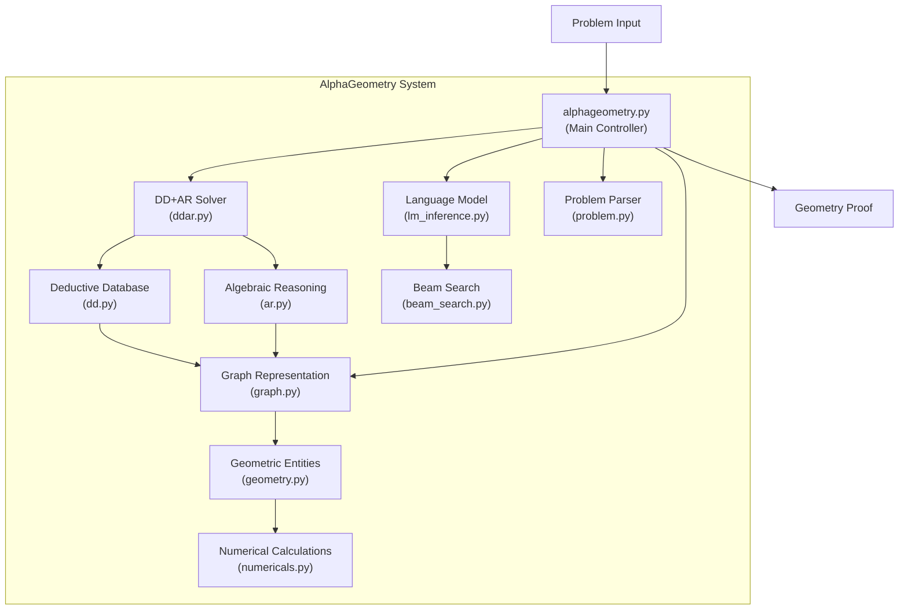

Sources: [alphageometry.py:16-19](), [README.md:329-349]()

## Execution Flow

The AlphaGeometry system operates in two primary modes: `ddar` and `alphageometry`. The `ddar` mode uses only the symbolic reasoning engine, while the `alphageometry` mode integrates both symbolic reasoning and language model guidance.

```mermaid
sequenceDiagram
    participant Main as alphageometry.py
    participant Graph as graph.py
    participant DDAR as ddar.py
    participant LM as lm_inference.py
    
    Note over Main: Parse arguments and load definitions/rules
    Main->>Graph: Build problem graph
    
    alt mode == "ddar"
        Main->>DDAR: run_ddar()
        DDAR->>DDAR: solve()
        DDAR-->>Main: Return result (solved or saturated)
    else mode == "alphageometry"
        Main->>DDAR: Initial attempt with run_ddar()
        
        alt DDAR succeeds
            DDAR-->>Main: Solution found
        else DDAR saturates
            loop until solution or max depth
                Main->>LM: Generate auxiliary constructions
                LM-->>Main: Ranked construction suggestions
                Main->>Graph: Add best construction
                Main->>DDAR: Try with new construction
                
                alt DDAR succeeds
                    DDAR-->>Main: Solution found
                    break
                end
            end
        end
    end
    
    Main->>Main: Write solution
```

Sources: [alphageometry.py:206-232](), [alphageometry.py:488-601]()

## Component Architecture

### DD+AR Solver

The DD+AR solver is the symbolic reasoning engine of AlphaGeometry. It combines deductive database (DD) techniques with algebraic reasoning (AR) to derive new geometric facts from given premises.

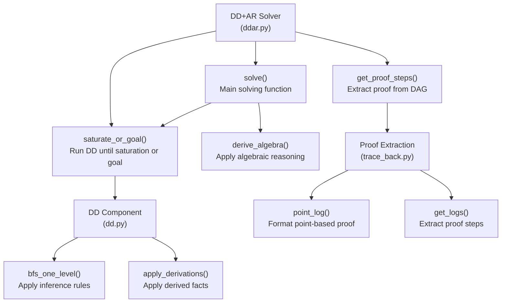

Sources: [ddar.py:16-17](), [ddar.py:27-75](), [ddar.py:77-131](), [ddar.py:134-157]()

### Language Model Component

When the DD+AR solver reaches saturation without finding a solution, the language model component generates auxiliary constructions that may help with the proof.

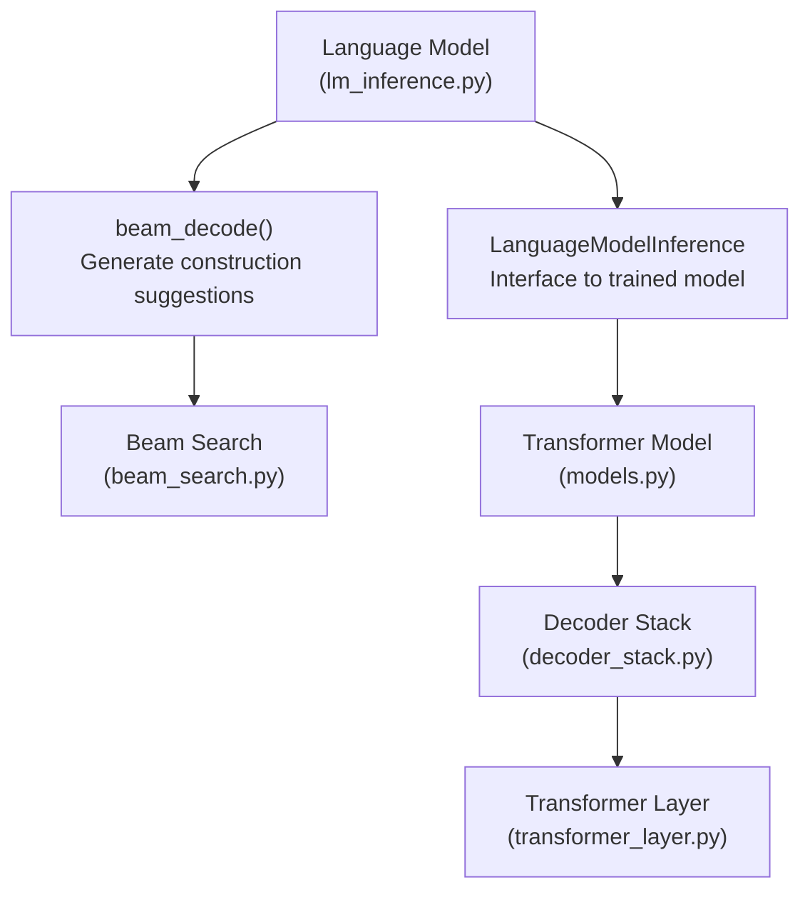

Sources: [alphageometry.py:198-203](), [README.md:341-348]()

## Data Flow

The following diagram illustrates the data flow in AlphaGeometry when solving a geometric problem:

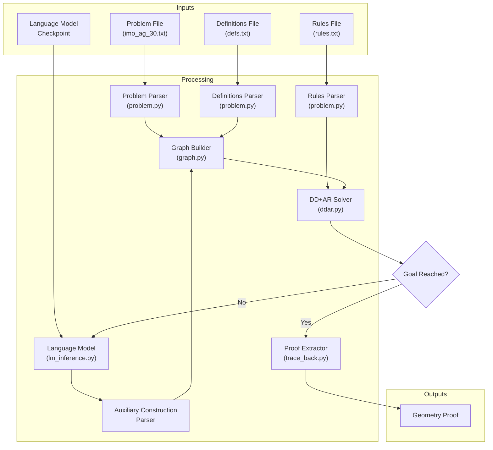

Sources: [alphageometry.py:488-601](), [README.md:61-82]()

## Main Components and Their Roles

| Component | File | Description |
|-----------|------|-------------|
| Main Controller | `alphageometry.py` | Orchestrates the execution flow, loads problems, and manages the solving process |
| Problem Parser | `problem.py` | Parses problem statements, definitions, and theorems from text files |
| Graph Representation | `graph.py` | Maintains the geometric state representation and supports operations on it |
| DD+AR Solver | `ddar.py` | Implements the combined deductive database and algebraic reasoning approach |
| Deductive Database | `dd.py` | Applies inference rules to derive new geometric facts |
| Algebraic Reasoning | `ar.py` | Derives additional facts using algebraic manipulations |
| Trace Back | `trace_back.py` | Implements recursive traceback to generate proof steps |
| Language Model | `lm_inference.py` | Provides interface to a trained language model for construction suggestions |
| Beam Search | `beam_search.py` | Implements beam decoding for language model outputs |
| Geometric Entities | `geometry.py` | Defines the geometric objects (Point, Line, Circle, etc.) |
| Numerical Calculations | `numericals.py` | Provides numerical computation for dynamic geometry environment |

Sources: [README.md:329-349]()

## Key Data Structures

The core data structures in AlphaGeometry include:

1. **Graph (graph.py)**: Represents the geometric state, containing all points, lines, circles, and relationships between them.
2. **Problem (problem.py)**: Represents a geometric problem with premises, goal, and auxiliary constructions.
3. **Dependency (problem.py)**: Represents logical dependencies in the proof steps.
4. **Geometric Entities (geometry.py)**: Defines the fundamental geometric objects like Point, Line, and Circle.

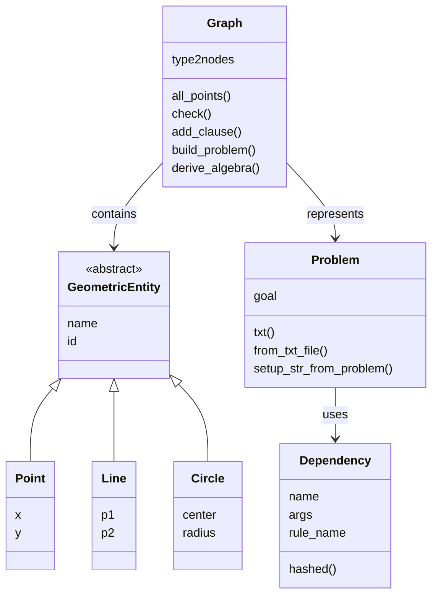

Sources: [README.md:329-349](), [alphageometry.py:83-95]()

## Integration Between Components

The main integration points in the AlphaGeometry system are:

1. **Problem Representation → Graph**: Problems parsed from text files are converted to a graph representation.
2. **DD+AR ↔ Graph**: The DD+AR solver operates on the graph representation to derive new facts.
3. **Language Model → Construction**: The language model suggests auxiliary constructions that are parsed and added to the graph.
4. **Graph → Proof Extraction**: When a solution is found, the proof is extracted from the graph representation.

This integration allows AlphaGeometry to seamlessly combine symbolic reasoning with neural-guided search, making it capable of solving complex geometric problems that would be difficult for either approach individually.

Sources: [alphageometry.py:488-601](), [README.md:316-325]()

---

# Page: Execution Modes

# Execution Modes

<details>
<summary>Relevant source files</summary>

The following files were used as context for generating this wiki page:

- [README.md](README.md)
- [alphageometry.py](alphageometry.py)

</details>


## Purpose and Scope

This document explains the two primary execution modes available in AlphaGeometry: **DDAR mode** (pure symbolic deduction) and **AlphaGeometry mode** (neural-symbolic hybrid). It covers how to select each mode, their execution workflows, and when to use each approach. For details on the underlying deductive database and algebraic reasoning engines, see [DD+AR Solver](#4). For information on the language model architecture used in AlphaGeometry mode, see [Language Model Component](#5).

## Mode Selection

The system provides two distinct solving strategies controlled via the `--mode` command-line flag defined in [alphageometry.py:56]():

| Mode | Value | Description |
|------|-------|-------------|
| **DDAR** | `--mode=ddar` | Pure symbolic deduction using Deductive Database (DD) and Algebraic Reasoning (AR) |
| **AlphaGeometry** | `--mode=alphageometry` | Hybrid approach combining DDAR with neural language model for auxiliary construction generation |

**Mode Dispatch Flow**

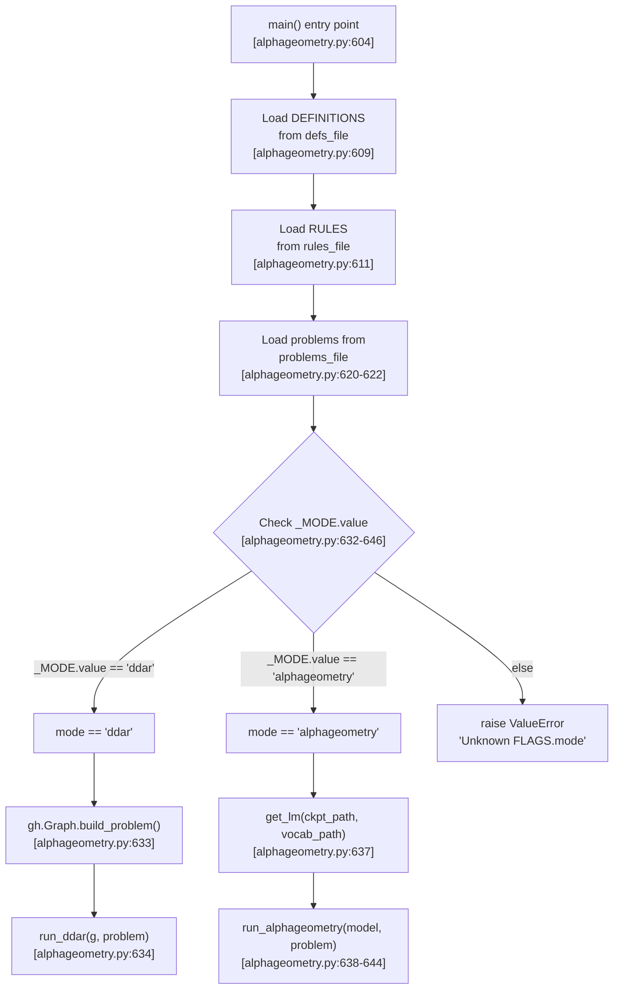

Sources: [alphageometry.py:604-648]()

## DDAR Mode: Pure Symbolic Deduction

DDAR mode executes purely symbolic reasoning without neural components. It iteratively applies deduction rules and algebraic reasoning until the goal is proven or the system reaches saturation (no new facts can be derived).

### Execution Flow

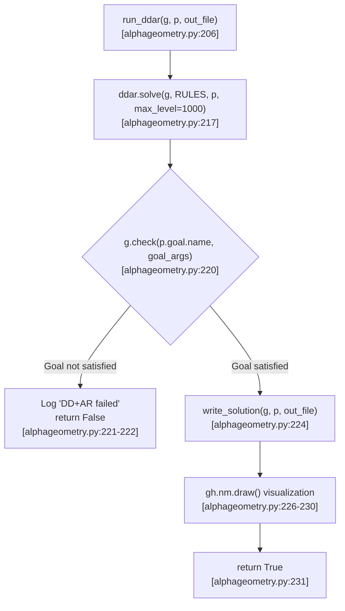

Sources: [alphageometry.py:206-231]()

### Command-Line Invocation

```bash
python -m alphageometry \
  --mode=ddar \
  --problems_file=imo_ag_30.txt \
  --problem_name=translated_imo_2000_p1 \
  --defs_file=defs.txt \
  --rules_file=rules.txt \
  --out_file=solution.txt
```

**Required Flags for DDAR Mode:**

| Flag | Purpose | Example Value |
|------|---------|---------------|
| `--mode` | Select DDAR mode | `ddar` |
| `--problems_file` | Input problem file | `imo_ag_30.txt` |
| `--problem_name` | Specific problem to solve | `translated_imo_2000_p1` |
| `--defs_file` | Construction definitions | `defs.txt` |
| `--rules_file` | Deduction rules | `rules.txt` |

**Optional Flags:**

| Flag | Purpose | Default |
|------|---------|---------|
| `--out_file` | Output solution file | (empty, logs only) |

Sources: [README.md:140-157](), [alphageometry.py:45-71]()

### Characteristics

- **No auxiliary constructions**: Works only with points defined in the problem statement
- **Deterministic**: Same input always produces same output
- **Fast**: No neural inference overhead
- **Limited coverage**: Can solve ~14/30 IMO-AG-30 problems, ~198/231 JGEX-AG-231 problems
- **No external dependencies**: Runs without `meliad` or model checkpoints

Sources: [README.md:316-327]()

## AlphaGeometry Mode: Neural-Symbolic Hybrid

AlphaGeometry mode augments DDAR with a language model that proposes auxiliary geometric constructions when symbolic reasoning alone cannot solve the problem. It performs iterative deepening search up to a specified depth.

### Execution Flow

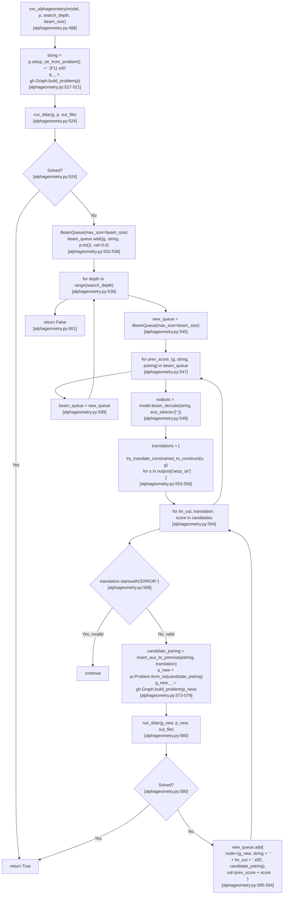

Sources: [alphageometry.py:488-601]()

### Command-Line Invocation

```bash
python -m alphageometry \
  --mode=alphageometry \
  --problems_file=examples.txt \
  --problem_name=orthocenter \
  --defs_file=defs.txt \
  --rules_file=rules.txt \
  --ckpt_path=ag_ckpt_vocab \
  --vocab_path=ag_ckpt_vocab/geometry.757.model \
  --beam_size=512 \
  --search_depth=16 \
  --gin_search_paths=meliad_lib/meliad/transformer/configs \
  --gin_file=base_htrans.gin \
  --gin_file=size/medium_150M.gin \
  --gin_file=options/positions_t5.gin \
  --gin_file=options/lr_cosine_decay.gin \
  --gin_file=options/seq_1024_nocache.gin \
  --gin_file=geometry_150M_generate.gin
```

**Additional Required Flags (beyond DDAR flags):**

| Flag | Purpose | Example Value |
|------|---------|---------------|
| `--ckpt_path` | Model checkpoint directory | `ag_ckpt_vocab` |
| `--vocab_path` | Vocabulary file | `ag_ckpt_vocab/geometry.757.model` |
| `--beam_size` | Beam search width | `512` (paper), `2` (demo) |
| `--search_depth` | Maximum construction depth | `16` (paper), `2` (demo) |
| `--gin_search_paths` | Gin config search paths | `meliad_lib/meliad/transformer/configs` |
| `--gin_file` | Gin configuration files | Multiple files (see above) |

Sources: [README.md:199-215](), [alphageometry.py:33-77]()

### Auxiliary Construction Generation

The language model generates auxiliary construction proposals in a constrained format, which are then validated and translated to constructive predicates.

**LM Input Format:**
```
<existing_points> : <predicates> {F1} x00
```

**LM Output Format:**
```
<new_point> : <predicate_1> <id> <predicate_2> <id> ;
```

**Example:**
```
Input:  "a : ; b : ; c : ; d : T a b c d 00 T a c b d 01 ? T a d b c {F1} x00"
Output: "e : C a c e 02 C b d e 03 ;"
```

The output is translated via `try_translate_constrained_to_construct()` [alphageometry.py:371-442]() which:
1. Validates the syntax and point existence
2. Converts constraint-based predicates to constructive predicates using `translate_constrained_to_constructive()` [alphageometry.py:234-313]()
3. Attempts to add the construction to a copy of the graph to verify feasibility

**Mapping Examples:**

| Constraint Predicate | Constructive Predicate | Description |
|---------------------|------------------------|-------------|
| `T a b c d` (perp) | `on_tline a b c d` | Point `a` on line perpendicular to `cd` through `b` |
| `P a b c d` (para) | `on_pline a b c d` | Point `a` on line parallel to `cd` through `b` |
| `C a b c` (coll) | `on_line a b c` | Point `a` on line through `b` and `c` |
| `D a b c d` (cong) | `on_circle a b d` or `eqdistance a b c d` | Point `a` such that distances are equal |

Sources: [alphageometry.py:234-313](), [alphageometry.py:371-442](), [alphageometry.py:549-594]()

### Beam Search Mechanism

The search maintains a priority queue (`BeamQueue` [alphageometry.py:459-486]()) of at most `beam_size` proof states, each represented as a tuple:
```python
(graph, lm_input_string, problem_string)
```

At each depth level:
1. Expand all nodes in the beam
2. For each node, decode `beam_size` candidate auxiliary constructions
3. Score each candidate by LM log probability
4. Attempt DDAR on each valid construction
5. Add successful and unsuccessful candidates to new queue
6. Keep only top `beam_size` candidates by cumulative score

The cumulative score for a path is:
```
score(path) = sum of LM scores for all constructions on the path
```

Sources: [alphageometry.py:459-486](), [alphageometry.py:532-599]()

### Characteristics

- **Auxiliary constructions**: Proposes new points to enable proof discovery
- **Non-deterministic**: Different random seeds may explore different paths
- **Slower**: Requires GPU for neural inference
- **Higher coverage**: Solves ~25/30 IMO-AG-30 problems, ~228/231 JGEX-AG-231 problems
- **Requires dependencies**: Needs `meliad`, model checkpoints, and GPU resources

Sources: [README.md:316-327](), [README.md:279-287]()

## Mode Comparison

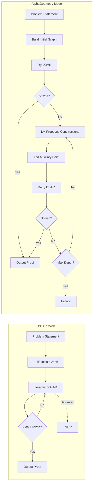

Sources: [alphageometry.py:206-231](), [alphageometry.py:488-601]()

**Feature Comparison:**

| Feature | DDAR Mode | AlphaGeometry Mode |
|---------|-----------|-------------------|
| **Deduction Engine** | DD+AR via `ddar.solve()` | DD+AR via `ddar.solve()` |
| **Auxiliary Constructions** | None | LM-generated via `model.beam_decode()` |
| **Search Strategy** | Saturation-based | Beam search with bounded depth |
| **External Dependencies** | None (Python standard library + NumPy/SciPy) | `meliad`, JAX, TensorFlow, model checkpoint |
| **Point Renaming** | Preserves original names | Renames to alphabetical (a, b, c, ...) |
| **GPU Requirement** | No | Yes (for neural inference) |
| **Determinism** | Deterministic | Non-deterministic (sampling) |
| **IMO-AG-30 Coverage** | 14/30 (47%) | 25/30 (83%) |
| **JGEX-AG-231 Coverage** | 198/231 (86%) | 228/231 (99%) |

Sources: [alphageometry.py:617](), [README.md:316-327]()

## Configuration Parameters

### Paper-Reported Settings

For reproducing the Nature 2024 paper results, use these parameters for AlphaGeometry mode:

```bash
BATCH_SIZE=32
BEAM_SIZE=512
SEARCH_DEPTH=16
```

With hardware requirements:
- 4 V100 GPUs for parallel model inference
- 250 CPU workers for parallel DDAR execution

Sources: [README.md:103-109]()

### Lightweight Demo Settings

For quick testing and demonstrations:

```bash
BATCH_SIZE=2
BEAM_SIZE=2
SEARCH_DEPTH=2
```

These settings allow the system to run on modest hardware but with significantly reduced solving capability.

Sources: [README.md:92-100]()

### Max DDAR Depth

Both modes use `max_level=1000` when calling `ddar.solve()` [alphageometry.py:217](), limiting the symbolic deduction depth to prevent infinite loops on unsolvable problems.

Sources: [alphageometry.py:217]()

---

# Page: Module Dependencies

# Module Dependencies

<details>
<summary>Relevant source files</summary>

The following files were used as context for generating this wiki page:

- [README.md](README.md)
- [alphageometry.py](alphageometry.py)
- [run.sh](run.sh)

</details>


## Purpose and Scope

This page documents the dependency relationships between Python modules in the AlphaGeometry codebase, the external libraries required for operation, and the configuration files that define system behavior. It covers the import graph structure, initialization sequence, and how the modular architecture enables both pure symbolic (DDAR) and hybrid neural-symbolic (AlphaGeometry) execution modes.

For information about how these modules are orchestrated during execution, see [Execution Modes](#2.1). For architectural patterns and component interactions, see [System Architecture](#2).

---

## Module Organization

The codebase is organized into five functional layers, each containing related modules that serve specific roles in the proof search pipeline.

### Layer Structure

| Layer | Modules | Primary Responsibility |
|-------|---------|----------------------|
| **Orchestration** | `alphageometry.py`, `ddar.py` | Problem loading, solver coordination, proof search control |
| **Symbolic Engine** | `dd.py`, `ar.py`, `trace_back.py` | Deductive reasoning, algebraic inference, proof reconstruction |
| **Neural Component** | `lm_inference.py`, `models.py`, `decoder_stack.py`, `transformer_layer.py`, `beam_search.py` | Language model interface, transformer architecture, beam decoding |
| **Representation** | `problem.py`, `graph.py`, `geometry.py`, `graph_utils.py` | Problem specification, proof state graph, geometric primitives |
| **Utilities** | `numericals.py`, `pretty.py` | Numerical geometry engine, output formatting |

**Sources:** [README.md:329-357](), [alphageometry.py:1-651]()

---

## Core Module Import Graph

The following diagram shows the direct import dependencies between Python modules. Nodes represent modules, and edges represent import statements.

```mermaid
graph TD
    alphageometry["alphageometry.py"]
    ddar["ddar.py"]
    dd["dd.py"]
    ar["ar.py"]
    trace_back["trace_back.py"]
    lm_inference["lm_inference.py"]
    models["models.py"]
    decoder_stack["decoder_stack.py"]
    transformer_layer["transformer_layer.py"]
    beam_search["beam_search.py"]
    problem["problem.py"]
    graph["graph.py"]
    geometry["geometry.py"]
    graph_utils["graph_utils.py"]
    numericals["numericals.py"]
    pretty["pretty.py"]
    
    alphageometry --> ddar
    alphageometry --> graph
    alphageometry --> lm_inference
    alphageometry --> pretty
    alphageometry --> problem
    
    ddar --> dd
    ddar --> ar
    ddar --> trace_back
    ddar --> graph
    ddar --> problem
    
    dd --> graph
    dd --> problem
    
    ar --> graph
    ar --> geometry
    ar --> problem
    
    trace_back --> graph
    trace_back --> problem
    
    lm_inference --> models
    lm_inference --> beam_search
    
    models --> decoder_stack
    
    decoder_stack --> transformer_layer
    
    graph --> geometry
    graph --> graph_utils
    graph --> numericals
    graph --> problem
    
    geometry --> numericals
    
    problem --> geometry
```

**Sources:** [alphageometry.py:23-30](), [README.md:335-357]()

---

## External Dependencies

### Python Standard Libraries

The system uses standard library modules for common operations:

| Library | Usage | Modules |
|---------|-------|---------|
| **absl** | Command-line flags, logging, application framework | `alphageometry.py`, all modules |
| **collections** | Data structures (defaultdict, namedtuple) | Throughout |
| **functools** | Function utilities (lru_cache) | `dd.py`, `ar.py` |
| **typing** | Type annotations | All modules |
| **traceback** | Error handling | `alphageometry.py` |

**Sources:** [alphageometry.py:21-30]()

### Scientific Computing Stack

| Library | Version | Purpose |
|---------|---------|---------|
| **numpy** | Latest | Numerical arrays, linear algebra operations |
| **scipy** | Latest | Scientific computing, optimization in AR |
| **matplotlib** | Latest | Geometry visualization |
| **jax** | Latest | Accelerated numerical computing for neural models |
| **flax** | Latest | Neural network library built on JAX |

**Sources:** [README.md:399-407](), [requirements.txt]()

### Meliad Library

The `meliad` library is a critical external dependency that provides the transformer model infrastructure. Unlike other dependencies, it is **not available through pip** and must be manually installed.

#### Installation Procedure

```bash
MELIAD_PATH=meliad_lib/meliad
mkdir -p $MELIAD_PATH
git clone https://github.com/google-research/meliad $MELIAD_PATH
export PYTHONPATH=$PYTHONPATH:$MELIAD_PATH
```

**Sources:** [README.md:63-71](), [run.sh:28-31]()

#### Components Used from Meliad

| Component | Location in Meliad | Used By |
|-----------|-------------------|---------|
| **Transformer configs** | `transformer/configs/` | Gin configuration system |
| **Base transformer** | `base_htrans.gin` | Model architecture |
| **Size configurations** | `size/medium_150M.gin` | Model parameter count |
| **Position embeddings** | `options/positions_t5.gin` | T5-style positional encoding |
| **Learning rate schedule** | `options/lr_cosine_decay.gin` | Training configuration |
| **Sequence length** | `options/seq_1024_nocache.gin` | Context window settings |

**Sources:** [README.md:113-133](), [run.sh:47-61]()

#### Optional Nature for DDAR Mode

The language model components (including meliad and sentencepiece) are **only required for AlphaGeometry mode**. DDAR mode can run without these dependencies:

```python
# From alphageometry.py - LM imports can be disabled for DDAR-only usage
# TIP: Note that you can still run the DDAR solver
# without defining SEARCH_ARGS and LM_ARGS.
# In such case, simply disable the import of the lm_inference module
# inside alphageometry.py.
```

**Sources:** [README.md:33-35](), [README.md:135-138](), [alphageometry.py:28]()

---

## Configuration File Dependencies

### Static Configuration Files

The system relies on three text-based configuration files that define the geometric domain:

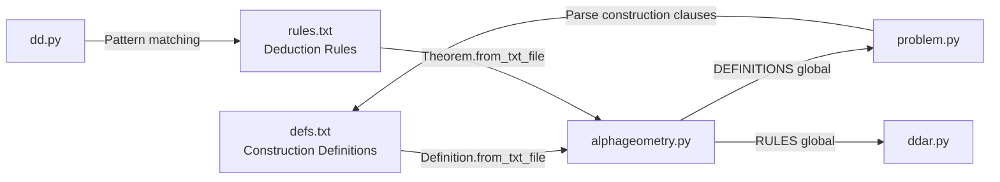

#### defs.txt - Construction Definitions

Defines all valid geometric construction actions in the domain-specific language. Each definition specifies:
- Construction name (e.g., `on_line`, `on_circle`, `eqdistance`)
- Input points
- Output points (newly constructed)
- Geometric constraints

**Usage in code:**
```python
# Loaded at startup
DEFINITIONS = pr.Definition.from_txt_file(_DEFS_FILE.value, to_dict=True)

# Used when building graphs from problem text
g, _ = gh.Graph.build_problem(p, DEFINITIONS)

# Used when validating LM-proposed constructions
g.copy().add_clause(clause, 0, DEFINITIONS)
```

**Sources:** [alphageometry.py:609](), [alphageometry.py:521](), [alphageometry.py:438](), [README.md:77-86]()

#### rules.txt - Deduction Rules

Contains templates for all deductive inference rules used by the DD component. Each rule specifies:
- Premise pattern (geometric predicates required)
- Conclusion pattern (geometric predicate derived)
- Rule identifier (e.g., `r32` for SSS triangle congruence)

**Usage in code:**
```python
# Loaded at startup
RULES = pr.Theorem.from_txt_file(_RULES_FILE.value, to_dict=True)

# Passed to DD+AR solver
ddar.solve(g, RULES, p, max_level=1000)

# Used by DD for pattern matching
# Inside dd.py: theorem matching against current graph state
```

**Sources:** [alphageometry.py:611](), [alphageometry.py:217](), [README.md:77-86]()

### Gin Configuration System

The Gin library manages hierarchical configuration for the language model. Multiple Gin files are composed to define model behavior:

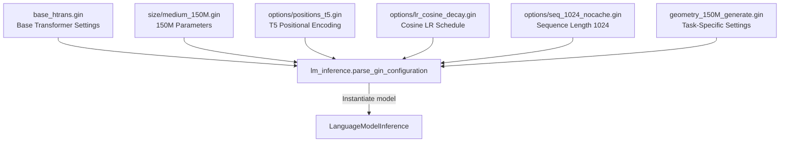

#### Gin File Loading Sequence

```python
# From alphageometry.py
_GIN_SEARCH_PATHS = flags.DEFINE_list(
    'gin_search_paths',
    ['third_party/py/meliad/transformer/configs'],
    'List of paths where the Gin config files are located.',
)

# Gin files are loaded in order:
LM_ARGS=(
  --gin_search_paths=$MELIAD_PATH/transformer/configs,$(pwd)
  --gin_file=base_htrans.gin              # 1. Base architecture
  --gin_file=size/medium_150M.gin          # 2. Model size
  --gin_file=options/positions_t5.gin      # 3. Position embeddings
  --gin_file=options/lr_cosine_decay.gin   # 4. Learning rate
  --gin_file=options/seq_1024_nocache.gin  # 5. Sequence length
  --gin_file=geometry_150M_generate.gin    # 6. Task-specific
  # Runtime parameter overrides
  --gin_param=DecoderOnlyLanguageModelGenerate.output_token_losses=True
  --gin_param=TransformerTaskConfig.batch_size=$BATCH_SIZE
  --gin_param=TransformerTaskConfig.sequence_length=128
  --gin_param=Trainer.restore_state_variables=False
)
```

**Sources:** [alphageometry.py:33-43](), [README.md:117-133](), [run.sh:47-61]()

### Model Checkpoints and Vocabulary

Binary data files required for language model inference:

| File | Location | Purpose |
|------|----------|---------|
| Model checkpoint | `ag_ckpt_vocab/` | Pre-trained transformer weights |
| Vocabulary | `ag_ckpt_vocab/geometry.757.model` | SentencePiece vocabulary (757 tokens) |

**Download procedure:**
```bash
bash download.sh
DATA=ag_ckpt_vocab
```

**Sources:** [README.md:56-61](), [alphageometry.py:65-68]()

---

## Initialization and Dependency Flow

### Startup Sequence

The following diagram shows the initialization order when `alphageometry.py` is executed:

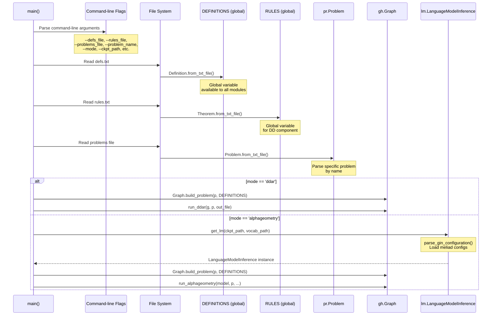

**Sources:** [alphageometry.py:604-648]()

### Global State Management

Two global variables provide shared access to configuration across modules:

```python
# From alphageometry.py:79-80
DEFINITIONS = None  # contains definitions of construction actions
RULES = None       # contains rules of deductions

# Initialized in main():
def main(_):
  global DEFINITIONS
  global RULES
  
  DEFINITIONS = pr.Definition.from_txt_file(_DEFS_FILE.value, to_dict=True)
  RULES = pr.Theorem.from_txt_file(_RULES_FILE.value, to_dict=True)
```

These globals are accessed throughout the codebase:
- **DEFINITIONS**: Used by `graph.py` to interpret construction clauses, by `problem.py` to parse problem statements, and by `alphageometry.py` to validate LM-proposed constructions
- **RULES**: Passed to `ddar.solve()` which distributes to `dd.py` for theorem matching

**Sources:** [alphageometry.py:79-80](), [alphageometry.py:605-611]()

---

## Module Dependency Details

### Orchestration Layer

#### alphageometry.py

**Role:** Main entry point; coordinates between DDAR and LM components; manages proof search loop.

**Direct imports:**
```python
import ddar                  # DD+AR solver
import graph as gh           # Proof state graph
import lm_inference as lm    # Language model interface
import pretty as pt          # Output formatting
import problem as pr         # Problem representation
```

**Key functions:**
- `main()`: Entry point, loads configuration and dispatches to solver [alphageometry.py:604-648]()
- `run_ddar()`: Executes pure symbolic solver [alphageometry.py:206-231]()
- `run_alphageometry()`: Executes hybrid neural-symbolic solver [alphageometry.py:488-601]()
- `get_lm()`: Initializes language model with Gin configs [alphageometry.py:198-203]()

**Sources:** [alphageometry.py:1-651]()

#### ddar.py

**Role:** Integrates DD (deductive database) and AR (algebraic reasoning) in alternating fashion; implements proof search strategy.

**Direct imports:**
```python
import dd              # Deductive database
import ar              # Algebraic reasoning
import trace_back      # Proof reconstruction
import graph           # Proof state graph
import problem         # Problem representation
```

**Key function:**
- `solve()`: Main DD+AR alternation loop with saturation detection
- `get_proof_steps()`: Extracts human-readable proof from graph

**Sources:** [README.md:345]()

### Symbolic Engine Layer

#### dd.py

**Role:** Implements deductive database; performs theorem pattern matching; applies inference rules.

**Direct imports:**
```python
import graph           # Accesses proof state graph
import problem         # Uses Theorem class for rule templates
```

**Key capabilities:**
- Built-in matchers for common geometric patterns (collinearity, perpendicularity, etc.)
- Caching of matched theorem instances
- Efficient indexing for pattern retrieval

**Sources:** [README.md:342]()

#### ar.py

**Role:** Maintains algebraic tables (ratios, angles, distances); performs algebraic inference; uses linear programming for dependency tracking.

**Direct imports:**
```python
import graph           # Accesses proof state graph
import geometry        # Geometric object definitions
import problem         # Clause and dependency representation
```

**Key structures:**
- `RatioTable`: Tracks segment length ratios
- `AngleTable`: Tracks angle equalities
- `DistanceTable`: Tracks distance equalities

**Sources:** [README.md:343]()

#### trace_back.py

**Role:** Reconstructs proof dependencies by tracing backward from goal; implements dependency difference algorithm.

**Direct imports:**
```python
import graph           # Navigates dependency graph
import problem         # Dependency representation
```

**Sources:** [README.md:344]()

### Neural Component Layer

#### lm_inference.py

**Role:** Interface to trained language model; handles tokenization, beam search coordination, and output post-processing.

**Direct imports:**
```python
import models               # Transformer model architecture
import beam_search          # Beam decoding algorithm
# Also depends on meliad library (external)
```

**Key class:**
- `LanguageModelInference`: Wraps model for inference
  - `parse_gin_configuration()`: Loads and merges Gin configs [alphageometry.py:199-201]()
  - `beam_decode()`: Generates auxiliary constructions with beam search [alphageometry.py:549]()

**Sources:** [README.md:350](), [alphageometry.py:28]()

#### models.py

**Role:** Defines transformer model architecture.

**Direct imports:**
```python
import decoder_stack        # Decoder layer stack
```

**Key class:**
- `DecoderOnlyLanguageModel`: Autoregressive transformer

**Sources:** [README.md:347]()

#### decoder_stack.py

**Role:** Stacks multiple transformer layers.

**Direct imports:**
```python
import transformer_layer    # Individual attention layers
```

**Sources:** [README.md:349]()

#### transformer_layer.py

**Role:** Implements individual transformer layer with attention mechanism.

**Sources:** [README.md:348]()

#### beam_search.py

**Role:** Implements beam search decoding algorithm in JAX.

**Key function:**
- `beam_search_flat()`: Parallel beam search with brevity penalty

**Sources:** [README.md:346]()

### Representation Layer

#### problem.py

**Role:** Defines classes for problem specification: `Problem`, `Clause`, `Theorem`, `Definition`, `Dependency`.

**Direct imports:**
```python
import geometry        # Point, Line, Circle objects
```

**Key classes:**
- `Problem`: Complete problem with premises and goal
- `Clause`: Geometric constraint (e.g., "a = on_line a b c")
- `Theorem`: Inference rule template
- `Definition`: Construction definition from defs.txt
- `Dependency`: Represents a predicate with provenance

**Sources:** [README.md:341]()

#### graph.py

**Role:** Central hub; maintains proof state as graph; manages nodes for points, lines, circles; tracks dependencies.

**Direct imports:**
```python
import geometry        # Geometric primitives
import graph_utils     # Graph utility functions
import numericals      # Numerical validation
import problem         # Problem representation
```

**Key class:**
- `Graph`: Proof state representation
  - `type2nodes`: Maps geometric type to node instances
  - `check()`: Verifies if predicate holds
  - `add_clause()`: Adds new construction to graph
  - `build_problem()`: Static factory from Problem object

**Sources:** [README.md:340]()

#### geometry.py

**Role:** Defines geometric object classes: `Point`, `Line`, `Circle`, `Angle`, `Segment`.

**Direct imports:**
```python
import numericals      # Numerical geometry operations
```

**Sources:** [README.md:337]()

#### graph_utils.py

**Role:** Utility functions for graph operations.

**Sources:** [README.md:339]()

### Utilities Layer

#### numericals.py

**Role:** Numerical engine; implements 2D Euclidean geometry; handles intersections, distance calculations, visualization.

**No internal imports** (only standard libraries: numpy, matplotlib).

**Sources:** [README.md:338]()

#### pretty.py

**Role:** Formats solver output as human-readable proofs.

**No internal imports** (utility functions only).

**Sources:** [README.md:352]()

---

## Conditional Dependencies

### DDAR Mode vs AlphaGeometry Mode

The import requirements differ based on execution mode:

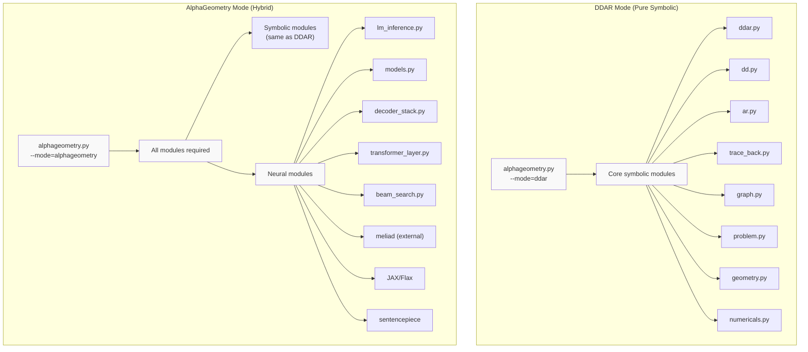

**Configuration differences:**

| Aspect | DDAR Mode | AlphaGeometry Mode |
|--------|-----------|-------------------|
| **Required flags** | `--defs_file`, `--rules_file` | All DDAR flags + `--ckpt_path`, `--vocab_path`, `--gin_file`, `--beam_size`, `--search_depth` |
| **External dependencies** | numpy, scipy, matplotlib | + JAX, Flax, meliad, sentencepiece |
| **Gin configuration** | Not used | Required (multiple .gin files) |
| **Model checkpoint** | Not needed | Required (`ag_ckpt_vocab/`) |
| **lm_inference import** | Can be disabled | Required |

**Sources:** [README.md:33-35](), [README.md:135-138](), [README.md:140-157](), [README.md:199-215]()

---

## Test Dependencies

Test modules follow a naming convention: `*_test.py` for each corresponding module.

| Test Module | Tests Module | Key Aspects Tested |
|-------------|-------------|-------------------|
| `dd_test.py` | `dd.py` | Theorem matching, rule application |
| `ar_test.py` | `ar.py` | Algebraic table operations, dependency tracking |
| `ddar_test.py` | `ddar.py` | DD+AR integration, proof search |
| `graph_test.py` | `graph.py` | Graph construction, node management |
| `geometry_test.py` | `geometry.py` | Geometric object operations |
| `numericals_test.py` | `numericals.py` | Numerical geometry calculations |
| `problem_test.py` | `problem.py` | Problem parsing, clause representation |

**Execution:**
```bash
bash run_tests.sh
```

**Sources:** [README.md:306-310](), [README.md:353]()

---

## Summary Table: Module Dependencies

| Module | Direct Dependencies | External Libraries | Configuration Files |
|--------|-------------------|-------------------|-------------------|
| `alphageometry.py` | ddar, graph, lm_inference, pretty, problem | absl | defs.txt, rules.txt, *.gin |
| `ddar.py` | dd, ar, trace_back, graph, problem | absl | - |
| `dd.py` | graph, problem | absl | rules.txt (via RULES global) |
| `ar.py` | graph, geometry, problem | scipy, absl | - |
| `trace_back.py` | graph, problem | absl | - |
| `lm_inference.py` | models, beam_search | jax, flax, meliad, gin, sentencepiece, absl | *.gin files |
| `models.py` | decoder_stack | jax, flax | - |
| `decoder_stack.py` | transformer_layer | jax, flax | - |
| `transformer_layer.py` | - | jax, flax | - |
| `beam_search.py` | - | jax | - |
| `problem.py` | geometry | absl | defs.txt (via DEFINITIONS global) |
| `graph.py` | geometry, graph_utils, numericals, problem | absl | defs.txt (via DEFINITIONS global) |
| `geometry.py` | numericals | absl | - |
| `graph_utils.py` | - | absl | - |
| `numericals.py` | - | numpy, matplotlib | - |
| `pretty.py` | - | - | - |

**Sources:** All module files, [README.md:329-368]()

---

# Page: Geometric Representation

# Geometric Representation

<details>
<summary>Relevant source files</summary>

The following files were used as context for generating this wiki page:

- [README.md](README.md)
- [numericals.py](numericals.py)

</details>


This page explains how AlphaGeometry represents geometric problems internally through a dual representation system: symbolic objects in a proof state graph for theorem proving, and numerical representations for validation and visualization. The geometric representation layer forms the foundation upon which both the deductive database and algebraic reasoning components operate.

## Overview

AlphaGeometry maintains geometric information in three interconnected modules:

1. **`geometry.py`**: Defines symbolic geometric objects (Point, Line, Circle, Angle, Segment) used in the proof graph
2. **`graph.py`**: Implements the proof state graph that tracks geometric relationships and dependencies
3. **`numericals.py`**: Provides numerical 2D geometry primitives for validation and visualization

Additional support comes from:
- **`problem.py`**: Defines problem structure (premises, goals, DAG nodes)
- **`graph_utils.py`**: Utilities for graph manipulation

Title: **Geometric Representation Architecture**

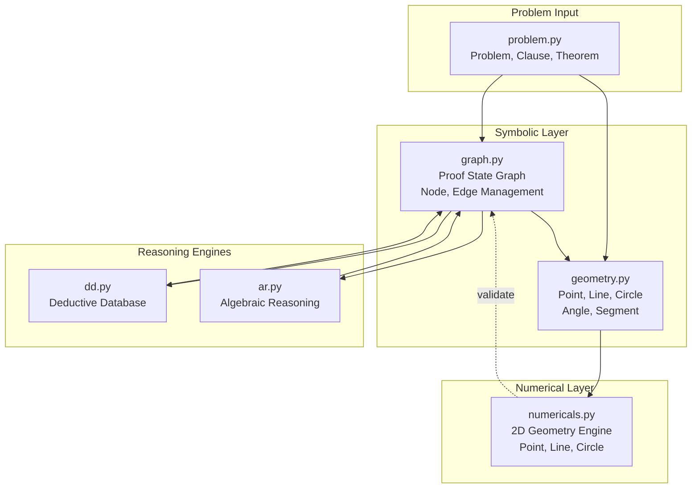

Sources: [README.md:335-357]()

The symbolic layer represents geometric objects and their relationships as graph nodes and edges, enabling pattern matching and logical deduction. The numerical layer provides concrete 2D coordinate implementations that validate symbolic derivations and enable visualization.

## Symbolic Geometric Objects

The `geometry.py` module defines symbolic geometric objects that serve as nodes in the proof state graph. These objects maintain both symbolic relationships and numerical instantiations.

### Core Entity Types

Title: **Symbolic Geometric Entity Hierarchy**

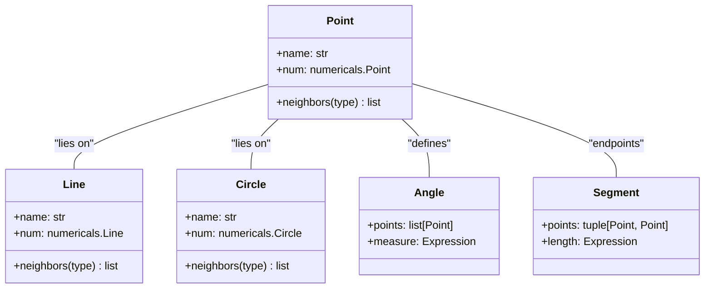

Sources: [README.md:337]()

Each symbolic object maintains:
- A unique name for identification
- A reference to its numerical counterpart (`.num` attribute)
- A list of neighboring objects in the graph
- Derived properties (angles, distances, ratios)

### Graph Connections

The `neighbors()` method allows traversal between related geometric objects. For example, a `Point` can retrieve all `Line` objects it lies on, or all `Circle` objects it belongs to.

Sources: [README.md:337]()

## Proof State Graph

The `graph.py` module implements the central proof state graph that tracks all geometric facts and their dependencies.

### Graph Structure

Title: **Proof State Graph Structure**

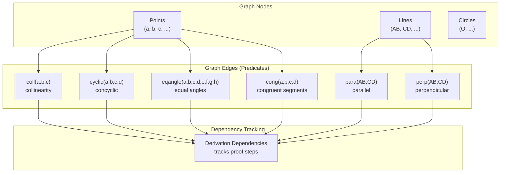

Sources: [README.md:340]()

The graph maintains:
- **Nodes**: Geometric objects (points, lines, circles)
- **Edges**: Geometric predicates (relationships between objects)
- **Dependencies**: How each fact was derived (for proof reconstruction)

### Graph Operations

Key operations in `graph.py`:
- **Adding nodes**: Register new geometric objects
- **Adding edges**: Record new geometric relationships
- **Querying**: Find objects satisfying certain predicates
- **Traversal**: Navigate relationships for pattern matching
- **Dependency tracking**: Record derivation chains for proof generation

Sources: [README.md:340]()

## Problem Definition

The `problem.py` module defines the structure of geometry problems and their components.

### Problem Components

Title: **Problem Structure Hierarchy**

```mermaid
classDiagram
    class Problem {
        +premises: list[Clause]
        +goal: Clause
        +constructions: list[Construction]
    }
    
    class Clause {
        +predicate: str
        +args: list[Point]
    }
    
    class Theorem {
        +name: str
        +premises: list[Clause]
        +conclusion: Clause
    }
    
    class DAGNode {
        +fact: Clause
        +dependencies: list[DAGNode]
    }
    
    Problem --> Clause: "contains"
    Theorem --> Clause: "contains"
    DAGNode --> Clause: "wraps"
```

Sources: [README.md:341]()

A `Problem` consists of:
- **Premises**: Initial geometric facts (e.g., "ABC is a triangle", "D is on line BC")
- **Goal**: The theorem to be proven (e.g., "AD is perpendicular to BC")
- **Constructions**: Auxiliary points added during solving

A `Theorem` represents a deduction rule:
- **Premises**: Pattern to match in the graph
- **Conclusion**: New fact to derive if pattern matches

A `DAGNode` represents a derived fact in the proof DAG:
- **Fact**: The derived geometric relationship
- **Dependencies**: Previous facts used in the derivation

Sources: [README.md:341]()

## Numerical Geometry Engine

The `numericals.py` module provides concrete 2D Euclidean geometry implementations. This numerical layer validates symbolic derivations and enables visualization. See [Numerical Geometry Engine (3.1)](#3.1) for detailed documentation.

### Numerical Entities

Title: **Numerical Geometry Classes**

```mermaid
classDiagram
    class Point {
        +x: float
        +y: float
        +distance(Point|Line|Circle) float
        +midpoint(Point) Point
        +rotate(float, float) Point
        +foot(Line) Point
    }
    
    class Line {
        +coefficients: tuple[float, float, float]
        +parallel_line(Point) Line
        +perpendicular_line(Point) Line
        +intersect(Line|Circle) Point|tuple
        +is_parallel(Line) bool
        +is_perp(Line) bool
    }
    
    class Circle {
        +center: Point
        +radius: float
        +intersect(Line|Circle) tuple[Point, Point]
    }
    
    class HalfLine {
        +tail: Point
        +head: Point
        +line: Line
        +intersect(obj) Point
    }
    
    Line <|-- HalfLine
```

Sources: [numericals.py:46-145](), [numericals.py:147-312](), [numericals.py:318-371](), [numericals.py:388-440]()

### Key Operations

The numerical engine provides:

| Operation Category | Functions | Purpose |
|-------------------|-----------|---------|
| **Intersection** | `line_line_intersection()`, `line_circle_intersection()`, `circle_circle_intersection()` | Find intersection points between geometric objects |
| **Validation** | `check_coll()`, `check_para()`, `check_perp()`, `check_cyclic()`, `check_eqangle()`, `check_cong()` | Verify geometric predicates numerically |
| **Sketching** | `sketch_line()`, `sketch_circle()`, `sketch_bisect()`, `sketch_tangent()` | Generate numerical constructions from symbolic definitions |
| **Visualization** | `draw()`, `draw_point()`, `draw_line()`, `draw_circle()`, `highlight()` | Render geometric diagrams |

Sources: [numericals.py:577-586](), [numericals.py:511-547](), [numericals.py:481-504](), [numericals.py:660-710](), [numericals.py:749-843](), [numericals.py:1326-1337](), [numericals.py:1203-1238]()

### Numerical Validation

Each symbolic predicate has a corresponding numerical checker that validates it within tolerance `ATOM = 1e-12`:

Title: **Predicate Validation Flow**

```mermaid
flowchart LR
    PRED["Symbolic Predicate<br/>e.g., perp(AB, CD)"] --> CHECK["check() dispatcher<br/>numericals.py"]
    CHECK --> SPEC["Specific checker<br/>e.g., check_perp()"]
    SPEC --> GEOM["Geometric computation<br/>using Point, Line classes"]
    GEOM --> TOL["Tolerance check<br/>close_enough()"]
    TOL --> RESULT["True/False"]
```

Sources: [numericals.py:624-649](), [numericals.py:696-700](), [numericals.py:1241-1242]()

## Integration with System Components

The numerical representation integrates with other AlphaGeometry components:

### Checking in the Deductive Process

When the system derives new geometric facts through the deductive database, it can validate them numerically:

```mermaid
sequenceDiagram
    participant DD as "Deductive Database"
    participant GR as "Graph Representation"
    participant NR as "Numerical Representation"
    
    DD->>GR: Derive new relationship
    GR->>NR: Translate to numerical representation
    NR->>NR: Apply check_X() function
    Note over NR: Validate with numerical tolerance
    NR-->>GR: Validation result
    GR-->>DD: Accept/reject derivation
```

Sources: [numericals.py:624-646]()

### Visualization

The numerical representation enables visualization of geometric problems and solutions:

```mermaid
flowchart LR
    GR["Graph Representation"] --> NR["Numerical Representation"]
    NR --> VF["Visualization Functions"]
    VF --> R["Rendered Output"]
    
    subgraph "Visualization Components"
        DP["draw_point()"]
        DL["draw_line()"]
        DC["draw_circle()"]
        DA["draw_angle()"]
        H["highlight()"]
    end
```

Sources: [numericals.py:925-1189](), [numericals.py:1203-1238]()

## Error Handling

The system includes specific error classes to handle invalid geometric operations:

- `InvalidLineIntersectError`: When lines are parallel or don't intersect
- `InvalidQuadSolveError`: When solving quadratic equations fails (e.g., in circle-circle intersections)

Sources: [numericals.py:314-316](), [numericals.py:507-508]()

## Constants and Utilities

The system defines important constants and utility functions:

- `ATOM = 1e-12`: Tolerance for numerical equality checks
- `close_enough()`: Utility function for floating-point comparison
- `ang_of()`, `ang_between()`: Angular measurement utilities
- `random_points()`, `random_rfss()`: Functions to generate randomized points

Sources: [numericals.py:33](), [numericals.py:1241-1293]()

## Relationship to Proof System

The numerical representation primarily serves as a validation and visualization layer rather than the core proof mechanism:

```mermaid
flowchart TD
    subgraph "Input Problem"
        PD["Problem Definition"]
    end
    
    subgraph "Representation Layer"
        SR["Symbolic Graph Representation"]
        NR["Numerical Representation"]
    end
    
    subgraph "Proof System"
        DD["Deductive Database"]
        AR["Algebraic Reasoning"]
        LM["Language Model"]
    end
    
    subgraph "Validation & Output"
        VC["Validation Checking"]
        VZ["Visualization"]
    end
    
    PD --> SR
    PD --> NR
    
    SR --> DD
    SR --> AR
    
    DD --> LM
    AR --> LM
    
    LM --> SR
    
    NR --> VC
    NR --> VZ
    
    VC --> SR
```

The numerical representation ensures that geometric facts derived in the deductive process are mathematically valid, providing a concrete implementation of abstract geometric concepts.

Sources: [numericals.py:16-28]()

---

# Page: Numerical Geometry Engine

# Numerical Geometry Engine

<details>
<summary>Relevant source files</summary>

The following files were used as context for generating this wiki page:

- [numericals.py](numericals.py)

</details>


## Purpose and Scope

The Numerical Geometry Engine (`numericals.py`) provides concrete 2D Euclidean geometry implementations that underpin the entire AlphaGeometry system. This module serves three primary functions:

1. **Numerical validation**: Verifies geometric properties and relationships through floating-point calculations
2. **Geometric construction**: Generates concrete point coordinates for all geometric construction definitions
3. **Visualization**: Renders proof states and geometric configurations using matplotlib

This engine bridges the symbolic representation (see [Problem Definition Format](#3.2)) with concrete numerical coordinates. The symbolic deduction system (see [DD+AR Solver](#4)) uses these numerical operations to validate that proposed constructions are geometrically sound before adding them to the proof graph.

**Sources**: [numericals.py:1-30]()

---

## Core Geometric Primitives

### Point Class

The `Point` class [numericals.py:46-145]() represents a 2D point with Cartesian coordinates and implements standard geometric operations:

```mermaid
classDiagram
    class Point {
        +float x
        +float y
        +__add__(Point) Point
        +__sub__(Point) Point
        +__mul__(float) Point
        +distance(Point|Line|Circle) float
        +distance2(Point) float
        +rotate(sinb, cosb) Point
        +rotatea(ang) Point
        +midpoint(Point) Point
        +foot(Line|Circle) Point
        +perpendicular_line(Line) Line
        +parallel_line(Line) Line
        +dot(Point) float
        +cos(Point) float
        +norm() float
        +close(Point, tol) bool
        +is_same(Point) bool
    }
    
    class Line {
        +tuple coefficients
        +parallel_line(Point) Line
        +perpendicular_line(Point) Line
        +distance(Point) float
        +intersect(Line|Circle) Point|tuple
        +is_parallel(Line) bool
        +is_perp(Line) bool
        +same_side(Point, Point) bool
        +diff_side(Point, Point) bool
        +sign(Point) int
    }
    
    class Circle {
        +Point center
        +float radius
        +float r2
        +intersect(Line|Circle) tuple
        +sample_within(list) list
    }
    
    class HalfLine {
        +Line line
        +Point tail
        +Point head
        +intersect(obj) Point
    }
    
    class HoleCircle {
        +Point hole
        +intersect(obj) Point
    }
    
    Point --> Line : creates
    Point --> Circle : creates
    Line <|-- HalfLine
    Circle <|-- HoleCircle
```

**Key Operations**:
- Arithmetic: Addition, subtraction, scalar multiplication [numericals.py:59-76]()
- Distance: Point-to-point, point-to-line, point-to-circle [numericals.py:87-101]()
- Transformation: Rotation, reflection, projection [numericals.py:103-128]()
- Predicates: Proximity testing with tolerance `ATOM = 1e-12` [numericals.py:33, 143-144]()

**Sources**: [numericals.py:46-145]()

---

### Line Representation

Lines are stored in coefficient form `ax + by + c = 0` with normalization rules [numericals.py:147-312]():

```mermaid
graph TB
    subgraph "Line Storage Format"
        COEF["coefficients = (a, b, c)<br/>Represents: ax + by + c = 0"]
        NORM["Normalization:<br/>if a < 0 or (a==0 and b>0):<br/>  negate all coefficients"]
    end
    
    subgraph "Line Construction"
        P1P2["Line(p1, p2)"]
        ABC["Line(coefficients=(a,b,c))"]
        P1P2 --> COEF
        ABC --> COEF
    end
    
    COEF --> NORM
    
    subgraph "Line Operations"
        PARALLEL["parallel_line(Point)"]
        PERP["perpendicular_line(Point)"]
        DIST["distance(Point)"]
        SIDE["same_side/diff_side"]
    end
    
    NORM --> PARALLEL
    NORM --> PERP
    NORM --> DIST
    NORM --> SIDE
```

The normalization ensures consistent representation: the coefficient `a` is always positive (or zero with negative `b`), which enables reliable equality and ordering comparisons [numericals.py:166-172]().

**Special Line Types**:
- `HalfLine`: Ray with tail and head points [numericals.py:318-372]()
- Used for constructions that require directional orientation
- Intersection with circles returns point in the ray's direction [numericals.py:327-348]()

**Sources**: [numericals.py:147-372]()

---

### Circle Classes

The `Circle` class [numericals.py:388-441]() supports multiple construction modes:

| Constructor | Parameters | Use Case |
|-------------|-----------|----------|
| Direct | `center`, `radius` | When center and radius are known |
| Three-point | `p1`, `p2`, `p3` | Circumcircle construction |
| Center + point | `center`, `p1` | Radius determined by distance |

The `HoleCircle` variant [numericals.py:443-468]() represents a circle with one point excluded, used in constructions where an intersection should avoid a specific point (e.g., tangent constructions).

**Sources**: [numericals.py:388-468]()

---

## Intersection Algorithms

The engine implements robust intersection solvers using algebraic methods:

```mermaid
graph LR
    subgraph "Intersection Functions"
        LL["line_line_intersection<br/>(l1, l2)"]
        LC["line_circle_intersection<br/>(line, circle)"]
        CC["circle_circle_intersection<br/>(c1, c2)"]
        CS["circle_segment_intersect<br/>(circle, p1, p2)"]
    end
    
    subgraph "Solution Methods"
        LINEAR["Linear system<br/>a1x + b1y + c1 = 0<br/>a2x + b2y + c2 = 0"]
        QUAD["Quadratic solver<br/>solve_quad(a, b, c)"]
        GEOM["Geometric formulas<br/>using distances"]
    end
    
    subgraph "Return Types"
        POINT["Single Point"]
        TUPLE["Tuple[Point, Point]"]
        LIST["List[Point]"]
        ERROR["InvalidQuadSolveError<br/>InvalidLineIntersectError"]
    end
    
    LL --> LINEAR --> POINT
    LC --> QUAD --> TUPLE
    CC --> GEOM --> TUPLE
    CS --> LC --> LIST
    
    LINEAR -.-> ERROR
    QUAD -.-> ERROR
```

**Key Functions**:

1. **`line_line_intersection`** [numericals.py:577-586](): Solves linear system using Cramer's rule. Raises `InvalidLineIntersectError` if lines are parallel (determinant is zero).

2. **`line_circle_intersection`** [numericals.py:511-548](): Handles three cases based on line coefficients:
   - Vertical line (`b == 0`): Solve for y coordinates
   - Horizontal line (`a == 0`): Solve for x coordinates  
   - General case: Substitute line equation into circle equation, solve quadratic

3. **`circle_circle_intersection`** [numericals.py:481-504](): Uses geometric construction:
   - Find radical axis (perpendicular bisector of centers)
   - Compute intersection point on line connecting centers
   - Calculate perpendicular offset using Pythagorean theorem

4. **`solve_quad`** [numericals.py:470-478](): Solves `ax² + bx + c = 0`, returns `None` if discriminant is negative (no real solutions).

**Sources**: [numericals.py:470-586]()

---

## Geometric Predicates

The `check` function [numericals.py:624-650]() dispatches to specialized validators for each geometric property:

```mermaid
graph TB
    CHECK["check(name, args)"]
    
    CHECK --> COLL["check_coll(points)<br/>Collinearity"]
    CHECK --> PARA["check_para(points)<br/>Parallel lines"]
    CHECK --> PERP["check_perp(points)<br/>Perpendicular lines"]
    CHECK --> CYCLIC["check_cyclic(points)<br/>Concyclic points"]
    CHECK --> EQANGLE["check_eqangle(points)<br/>Equal angles"]
    CHECK --> EQRATIO["check_eqratio(points)<br/>Equal ratios"]
    CHECK --> CONG["check_cong(points)<br/>Congruent segments"]
    CHECK --> MIDP["check_midp(points)<br/>Midpoint"]
    CHECK --> SIMTRI["check_simtri(points)<br/>Similar triangles"]
    CHECK --> CONTRI["check_contri(points)<br/>Congruent triangles"]
    
    COLL --> TOL["Tolerance: ATOM = 1e-12"]
    EQANGLE --> TOL
    EQRATIO --> TOL
    CONG --> TOL
```

### Critical Predicates

**Collinearity** [numericals.py:660-666](): Checks if points lie on same line:
```python
def check_coll(points: list[Point]) -> bool:
  a, b = points[:2]
  l = Line(a, b)
  for p in points[2:]:
    if abs(l(p.x, p.y)) > ATOM:  # Line equation value
      return False
  return True
```

**Equal Angles** [numericals.py:749-786](): Most complex predicate, handles parallel cases and orientation:
- Detect parallel lines (special case: both angle pairs must be parallel)
- Normalize angle measurements to intersection points
- Check if angles match modulo orientation (clock/counterclockwise)
- Uses `bring_together` helper to move angles to unit circle [numericals.py:713-722]()

**Equal Ratios** [numericals.py:789-795](): Validates ratio equality numerically:
```python
def check_eqratio(points: list[Point]) -> bool:
  a, b, c, d, e, f, g, h = points
  # Check if ab/cd == ef/gh, i.e., ab*gh == cd*ef
  return close_enough(ab * gh, cd * ef)
```

**Cyclic** [numericals.py:703-710](): Points lie on a circle if equidistant from circumcenter:
```python
def check_cyclic(points: list[Point]) -> bool:
  (a, b, c), *ps = points
  circle = Circle(p1=a, p2=b, p3=c)  # Construct circumcircle
  for d in ps:
    if not close_enough(d.distance(circle.center), circle.radius):
      return False
  return True
```

**Sources**: [numericals.py:624-843]()

---

## Construction Functions

The `sketch` function [numericals.py:1326-1336]() provides numerical implementations for all construction definitions in `defs.txt`:

```mermaid
graph TB
    SKETCH["sketch(name, args)"]
    
    subgraph "Basic Constructions"
        LINE["sketch_line(a, b)<br/>Line through two points"]
        MIDP["sketch_midp(a, b)<br/>Midpoint"]
        CIRCLE["sketch_circle(a, b, c)<br/>Circle with center a, radius bc"]
        BISECT["sketch_bisect(a, b, c)<br/>Angle bisector"]
    end
    
    subgraph "Complex Constructions"
        INCENTER["sketch_incenter2(a,b,c)<br/>Incenter + feet"]
        EXCENTER["sketch_excenter2(a,b,c)<br/>Excenter + feet"]
        CENTROID["sketch_centroid(a,b,c)<br/>Centroid + midpoints"]
        NINEPOINTS["sketch_ninepoints(a,b,c)<br/>Nine-point circle"]
    end
    
    subgraph "Angular Constructions"
        ALINE["sketch_aline(A,B,C,D,E)<br/>Angle transfer"]
        AMIRROR["sketch_amirror(A,B,C)<br/>Angle reflection"]
        SANGLE["sketch_s_angle(a,b,y)<br/>Specific angle"]
    end
    
    subgraph "Tangent Constructions"
        TANGENT["sketch_tangent(a,o,b)<br/>Circle tangent"]
        CCTANGENT["sketch_cc_tangent(o,a,w,b)<br/>Common tangent"]
    end
    
    SKETCH --> LINE
    SKETCH --> MIDP
    SKETCH --> CIRCLE
    SKETCH --> BISECT
    SKETCH --> INCENTER
    SKETCH --> EXCENTER
    SKETCH --> CENTROID
    SKETCH --> NINEPOINTS
    SKETCH --> ALINE
    SKETCH --> AMIRROR
    SKETCH --> SANGLE
    SKETCH --> TANGENT
    SKETCH --> CCTANGENT
```

### Construction Categories

**1. Initial Configurations** (generate entire point sets):
- `sketch_triangle`, `sketch_r_triangle`, `sketch_isos` [numericals.py:1871-1806]()
- `sketch_quadrangle`, `sketch_rectangle`, `sketch_square` [numericals.py:1750-1852]()
- `sketch_pentagon` [numericals.py:1726-1737]()

**2. Point Constructions** (return single point or small sets):
- Midpoint, foot, reflection [numericals.py:1721-1798]()
- Intersection-based: Uses `try_to_sketch_intersect` [numericals.py:1439-1478]()

**3. Line Constructions**:
- Perpendicular: `sketch_tline` [numericals.py:1854-1856]()
- Parallel: `sketch_pline` [numericals.py:1740-1742]()
- Bisector: `sketch_bisect`, `sketch_exbisect` [numericals.py:1526-1537]()

**4. Circle Constructions**:
- Three-point: `sketch_cyclic` [numericals.py:1711-1713]()
- Diameter: `sketch_dia` [numericals.py:1546-1548]()
- Custom: `sketch_acircle` (angle-based) [numericals.py:1481-1486]()

**5. Angular Constructions**:
The `sketch_aline` function [numericals.py:1489-1507]() transfers angles between configurations:
```
Given: Points A, B, C, D, E
Compute: angle(C, B, A) 
Transfer: From D-E, create point X such that angle(X, E, D) = angle(C, B, A)
```

**Sources**: [numericals.py:1326-1922]()

---

## Randomization and Sketch Generation

Constructions incorporate randomization for synthetic data generation:

```mermaid
graph LR
    subgraph "Randomization Pipeline"
        RANDOM["random_points(n)<br/>Random coordinates"]
        UNIF["unif(min, max)<br/>Uniform distribution"]
        RFSS["random_rfss(*points)<br/>Random transform"]
    end
    
    subgraph "Transformation Sequence"
        CENTER["Center point cloud"]
        ROTATE["Rotate by random angle"]
        SCALE["Scale by factor ∈ [0.5, 2.0]"]
        SHIFT["Shift by random vector"]
        FLIP["Flip with 50% probability"]
    end
    
    subgraph "Validation"
        CLOSE["check_too_close(new, existing)<br/>Avoid point overlap"]
        FAR["check_too_far(new, existing)<br/>Keep points bounded"]
    end
    
    RANDOM --> CENTER
    CENTER --> ROTATE
    ROTATE --> SCALE
    SCALE --> SHIFT
    SHIFT --> FLIP
    
    FLIP --> CLOSE
    FLIP --> FAR
```

The `random_rfss` function [numericals.py:1276-1294]() applies a random rotation-flip-scale-shift transformation to ensure diverse geometric configurations during synthetic proof generation. This prevents overfitting during neural model training.

**Validation Functions**:
- `check_too_close` [numericals.py:588-599](): Prevents degenerate cases where points are too close relative to problem scale
- `check_too_far` [numericals.py:602-612](): Ensures auxiliary points don't escape problem bounds

**Sources**: [numericals.py:588-612, 1272-1294]()

---

## Visualization System

The drawing functions render geometric configurations using matplotlib:

```mermaid
graph TB
    DRAW["draw(points, lines, circles,<br/>segments, goal, highlights)"]
    
    subgraph "Main Drawing Pipeline"
        SETUP["Setup matplotlib figure<br/>512x512 pixels"]
        THEME["Apply theme<br/>(dark/light/grey)"]
        DRAWOBJ["_draw(ax, objects)"]
        SHOW["plt.show(block)"]
    end
    
    subgraph "Object Rendering"
        DRAWLINE["draw_line(ax, line)<br/>Extract endpoints from neighbors"]
        DRAWCIRCLE["draw_circle(ax, circle)<br/>Construct from 3 points"]
        DRAWPOINT["draw_point(ax, point, name)<br/>Scatter + annotation"]
    end
    
    subgraph "Highlighting"
        HIGHLIGHT["highlight(ax, name, args)<br/>Visual emphasis"]
        ANGLE["draw_angle(ax, head, p1, p2)<br/>Wedge patch"]
        SEGMENT["mark_segment(ax, p1, p2)<br/>Midpoint marker"]
    end
    
    DRAW --> SETUP
    SETUP --> THEME
    THEME --> DRAWOBJ
    DRAWOBJ --> DRAWLINE
    DRAWOBJ --> DRAWCIRCLE
    DRAWOBJ --> DRAWPOINT
    DRAWOBJ --> HIGHLIGHT
    HIGHLIGHT --> ANGLE
    HIGHLIGHT --> SEGMENT
    DRAWOBJ --> SHOW
```

### Theme System

Three color schemes are supported [numericals.py:1191-1200]():

| Theme | Background | Points | Lines | Circles |
|-------|-----------|--------|-------|---------|
| `dark` | Black | White | White | Cyan |
| `light` | White | Black | Black | Blue |
| `grey` | White | Black | Black | Grey |

### Intelligent Label Positioning

The `naming_position` function [numericals.py:890-922]() computes optimal text placement:
1. Create circle of radius 0.08 around point
2. Find all intersections with nearby lines and circles
3. Compute angles to avoid intersections
4. Place label at angle with maximum clearance

### Highlighting Proof Elements

The `highlight` function [numericals.py:1058-1129]() emphasizes goal and derived facts:
- **Parallel lines**: Draw both lines with same color [numericals.py:1076-1079]()
- **Equal angles**: Draw wedge patches at angle vertices [numericals.py:1080-1106]()
- **Cyclic points**: Draw circumcircle [numericals.py:1069-1071]()
- **Equal segments**: Mark midpoints with colored dots [numericals.py:1115-1118]()

**Sources**: [numericals.py:846-1243]()

---

## Integration with Symbolic Layer

The numerical engine interfaces with symbolic geometry objects through attribute access:

```mermaid
graph TB
    subgraph "Symbolic Layer (geometry.py)"
        GMPOINT["gm.Point<br/>(symbolic)"]
        GMLINE["gm.Line<br/>(symbolic)"]
        GMCIRCLE["gm.Circle<br/>(symbolic)"]
    end
    
    subgraph "Numerical Layer (numericals.py)"
        NUMPOINT["Point<br/>(numerical)"]
        NUMLINE["Line<br/>(numerical)"]
        NUMCIRCLE["Circle<br/>(numerical)"]
    end
    
    subgraph "Bidirectional Link"
        GMPOINT -- ".num attribute" --> NUMPOINT
        GMLINE -- ".num attribute" --> NUMLINE
        GMCIRCLE -- ".num attribute" --> NUMCIRCLE
        
        NUMPOINT -. "neighbors(gm.Point)" .-> GMPOINT
        NUMLINE -. "neighbors(gm.Point)" .-> GMPOINT
        NUMCIRCLE -. "neighbors(gm.Point)" .-> GMPOINT
    end
    
    subgraph "Type Checking Pattern"
        CHECK["check(name, args)"]
        UNWRAP["args = [p.num if isinstance(p, gm.Point)<br/>else p for p in args]"]
        VERIFY["Execute numerical check"]
    end
    
    subgraph "Drawing Pattern"
        DRAWFN["draw_line(ax, line)"]
        NEIGHBORS["points = line.neighbors(gm.Point)"]
        CONVERT["points = [p.num for p in points]"]
        RENDER["_draw_line(ax, p1, p2)"]
    end
    
    CHECK --> UNWRAP
    UNWRAP --> VERIFY
    
    DRAWFN --> NEIGHBORS
    NEIGHBORS --> CONVERT
    CONVERT --> RENDER
```

### Type Conversion Pattern

Functions accept both symbolic and numerical types [numericals.py:648-649, 1067, 1330]:
```python
# Convert symbolic to numerical
args = [p.num if isinstance(p, gm.Point) else p for p in args]
```

This pattern appears in:
- `check()` [numericals.py:648]()
- `sketch()` [numericals.py:1330]()
- `highlight()` [numericals.py:1067]()
- Drawing functions [numericals.py:973-977, 1022-1027]()

### Accessing Symbolic Neighbors

Drawing functions extract related points from the graph structure:
```python
def draw_line(ax, line):
  points = line.neighbors(gm.Point)  # Get symbolic points
  points = [p.num for p in points]   # Convert to numerical
  # ... render using numerical coordinates
```

This enables rendering without explicitly tracking which points lie on which lines.

**Sources**: [numericals.py:624-650, 969-992, 1015-1030, 1326-1336]()

---

## Tolerance and Numerical Stability

All floating-point comparisons use tolerance-based equality:

```mermaid
graph LR
    ATOM["ATOM = 1e-12<br/>Global tolerance"]
    
    subgraph "Comparison Functions"
        CLOSE["close_enough(a, b, tol=1e-12)"]
        ASSERT["assert_close_enough(a, b, tol=1e-12)"]
    end
    
    subgraph "Usages"
        ISSAME["Point.is_same()"]
        LINEISSAME["Line.is_same()"]
        CHECKS["check_* predicates"]
        PARALLEL["is_parallel()"]
        PERP["is_perp()"]
    end
    
    ATOM --> CLOSE
    ATOM --> ASSERT
    
    CLOSE --> ISSAME
    CLOSE --> LINEISSAME
    CLOSE --> CHECKS
    CLOSE --> PARALLEL
    CLOSE --> PERP
```

The tolerance `ATOM = 1e-12` [numericals.py:33]() balances:
- **Precision**: Sufficient for typical geometric calculations
- **Robustness**: Accounts for floating-point rounding errors
- **Consistency**: Used uniformly across all predicates

Critical comparisons requiring tighter tolerance (e.g., similar triangles) explicitly specify `tol=1e-9` [numericals.py:817, 831]().

**Sources**: [numericals.py:33, 1241-1246]()

---

## Error Handling

The module defines custom exceptions for geometric degeneracies:

| Exception | Raised When | Typical Cause |
|-----------|-------------|---------------|
| `InvalidLineIntersectError` | Lines are parallel | Determinant is zero in linear system |
| `InvalidQuadSolveError` | Negative discriminant | No real intersection between circle/line or circle/circle |

These exceptions are caught in higher-level construction code to handle degenerate cases (e.g., `try_to_sketch_intersect` returns `None` on failure [numericals.py:1439-1478]()).

**Sources**: [numericals.py:314-315, 507-508, 577-585]()

---

# Page: Problem Definition Format

# Problem Definition Format

<details>
<summary>Relevant source files</summary>

The following files were used as context for generating this wiki page:

- [README.md](README.md)
- [defs.txt](defs.txt)
- [examples.txt](examples.txt)

</details>


This page documents the text-based format used to specify geometry problems, construction definitions, and deduction rules in AlphaGeometry. These formats enable users to define problems and allow the symbolic reasoning engine to understand geometric relationships.

For information about how these text representations are parsed and converted into internal Python objects, see [Geometric Representation](#3). For details on the numerical validation of constructions, see [Numerical Geometry Engine](#3.1).

---

## Overview

AlphaGeometry uses three primary text file formats:

1. **Problem files** (`examples.txt`, `imo_ag_30.txt`) - Define geometry problems with their constructions and goals
2. **Construction definitions** (`defs.txt`) - Define valid geometric construction actions
3. **Deduction rules** (`rules.txt`) - Define inference rules for symbolic reasoning

All three formats use a consistent predicate-based syntax to represent geometric relationships.

**Sources:** [README.md:73-86](), [README.md:359-368]()

---

## Problem File Format

### Problem Entry Structure

Each problem in a problem file consists of two parts separated by whitespace:
1. **Problem name** - A unique identifier for the problem
2. **Problem statement** - The geometric construction sequence and goal

```mermaid
flowchart LR
    NAME["Problem Name<br/>(identifier)"]
    CONSTRUCTIONS["Construction Clauses<br/>(semicolon-separated)"]
    GOAL["Goal Clause<br/>(after '?')"]
    
    NAME --> CONSTRUCTIONS
    CONSTRUCTIONS --> GOAL
    
    style NAME fill:#f9f9f9
    style CONSTRUCTIONS fill:#f9f9f9
    style GOAL fill:#f9f9f9
```

**Diagram: Problem Entry Components**

**Sources:** [examples.txt:1-8](), [README.md:142-157]()

### Syntax Elements

| Element | Syntax | Example | Description |
|---------|--------|---------|-------------|
| Point list | `a b c` | `a b c` | Space-separated point names |
| Assignment | `points = construction` | `d = on_line d a b` | Assigns points to construction result |
| Separator | `;` | `a b = segment; c = ...` | Separates construction clauses |
| Goal marker | `?` | `? perp a h b c` | Marks the beginning of the goal |
| Multi-predicate | `,` | `on_line e a c, on_line e b d` | Multiple predicates for same point |

**Sources:** [examples.txt:1-8](), [README.md:163]()

### Example Problem Breakdown

```
orthocenter
a b c = triangle; h = on_tline b a c, on_tline c a b ? perp a h b c
```

```mermaid
flowchart TD
    PROB["Problem: orthocenter"]
    CONS1["Construction 1:<br/>'a b c = triangle'<br/>(defines three non-collinear points)"]
    CONS2["Construction 2:<br/>'h = on_tline b a c, on_tline c a b'<br/>(h is intersection of two perpendiculars)"]
    GOAL["Goal:<br/>'perp a h b c'<br/>(prove AH perpendicular to BC)"]
    
    PROB --> CONS1
    CONS1 --> CONS2
    CONS2 --> GOAL
    
    style PROB fill:#f9f9f9
    style CONS1 fill:#f9f9f9
    style CONS2 fill:#f9f9f9
    style GOAL fill:#f9f9f9
```

**Diagram: Orthocenter Problem Structure**

**Sources:** [examples.txt:1-2](), [README.md:227-228]()

### Construction Types

Problems can use any construction defined in `defs.txt`. Common construction patterns:

| Pattern | Example | Meaning |
|---------|---------|---------|
| Basic shape | `a b c = triangle` | Define basic geometric objects |
| Point on line | `x = on_line x a b` | Point X lies on line AB |
| Point on circle | `m = on_circle m o a` | Point M lies on circle with center O through A |
| Intersection | `e = on_line e a c, on_line e b d` | Point E at intersection of AC and BD |
| Construction with dependencies | `h = orthocenter a b c` | Complex construction (orthocenter of triangle ABC) |

**Sources:** [examples.txt:1-8](), [defs.txt:1-408]()

---

## Construction Definition Format

The `defs.txt` file defines all available geometric constructions. Each definition specifies how to create new points and what geometric relationships they satisfy.

### Definition Structure

```mermaid
flowchart TD
    HEADER["Construction Header<br/>(name and parameters)"]
    OUTPUT["Output Declaration<br/>(new points : existing points)"]
    PRECOND["Preconditions<br/>(requirements on inputs)"]
    POSTCOND["Postconditions<br/>(properties of outputs)"]
    SHORTNAME["Short Name<br/>(abbreviated form)"]
    
    HEADER --> OUTPUT
    OUTPUT --> PRECOND
    PRECOND --> POSTCOND
    POSTCOND --> SHORTNAME
    
    style HEADER fill:#f9f9f9
    style OUTPUT fill:#f9f9f9
    style PRECOND fill:#f9f9f9
    style POSTCOND fill:#f9f9f9
    style SHORTNAME fill:#f9f9f9
```

**Diagram: Construction Definition Components**

**Sources:** [defs.txt:1-408]()

### Anatomy of a Construction Definition

Each construction definition has exactly 5 lines:

```
angle_bisector x a b c
x : a b c x
a b c = ncoll a b c
x : eqangle b a b x b x b c
bisect a b c
```

| Line | Content | Description |
|------|---------|-------------|
| 1 | `angle_bisector x a b c` | Construction name and parameter list (output points first, then input points) |
| 2 | `x : a b c x` | Output points `:` dependency list |
| 3 | `a b c = ncoll a b c` | Preconditions (constraints on input points) |
| 4 | `x : eqangle b a b x b x b c` | Postconditions (properties guaranteed after construction) |
| 5 | `bisect a b c` | Short name for compact representation |

**Sources:** [defs.txt:1-5]()

### Parameter Declaration Format

The second line declares which points are outputs and what they depend on:

```
x : a b c x
```

- **Left of colon:** Output points (newly constructed)
- **Right of colon:** All points the construction depends on (inputs + outputs)

For constructions with multiple outputs:

```
x : a b c y, y : a b c x
```

Each output is declared separately with its full dependency list.

**Sources:** [defs.txt:349-360]()

### Preconditions (Line 3)

Preconditions specify requirements on input points using predicates:

| Predicate | Meaning | Example |
|-----------|---------|---------|
| `ncoll a b c` | Points A, B, C are not collinear | Required for triangle |
| `diff a b` | Points A and B are distinct | Required for line |
| `nperp a b c d` | AB not perpendicular to CD | Prevents degenerate cases |
| `npara a b c d` | AB not parallel to CD | Required for intersection |

Empty preconditions use `=` with no right-hand side for unconditional constructions.

**Sources:** [defs.txt:3](), [defs.txt:39](), [defs.txt:117]()

### Postconditions (Line 4)

Postconditions specify the geometric properties guaranteed by the construction:

```
x : eqangle b a b x b x b c
```

For constructions with multiple outputs:

```
x : coll x a b, cong x a x y; y : coll y a b, cong y x y b
```

Properties for different outputs are separated by semicolons.

**Sources:** [defs.txt:4](), [defs.txt:358]()

### Example Definitions

#### Simple Construction: Midpoint

```
midpoint x a b
x : a b
a b = diff a b
x : coll x a b, cong x a x b
midp a b
```

- **Output:** Point X
- **Inputs:** Points A, B
- **Precondition:** A and B are distinct
- **Postcondition:** X is collinear with A and B, and equidistant from both
- **Short name:** `midp a b`

**Sources:** [defs.txt:163-167]()

#### Complex Construction: Orthocenter

```
orthocenter x a b c
x : a b c
a b c = ncoll a b c
x : perp x a b c, perp x b c a; perp x c a b
tline a b c, tline b c a
```

- **Output:** Point X (orthocenter)
- **Inputs:** Triangle ABC (non-collinear)
- **Postconditions:** X is on perpendicular from A to BC, from B to CA, and from C to AB
- **Short name:** Uses auxiliary constructions `tline a b c, tline b c a`

**Sources:** [defs.txt:223-227]()

#### Multi-Output Construction: Incenter with Feet

```
incenter2 x y z i a b c
i : a b c, x : i b c, y : i c a, z : i a b
a b c = ncoll a b c
i : eqangle a b a i a i a c, eqangle c a c i c i c b; eqangle b c b i b i b a; 
x : coll x b c, perp i x b c; y : coll y c a, perp i y c a; 
z : coll z a b, perp i z a b; cong i x i y, cong i y i z
incenter2 a b c
```

- **Outputs:** Points I (incenter), X, Y, Z (feet of perpendiculars)
- **Multiple dependency declarations** for different outputs
- **Complex postconditions** with angle equalities and perpendicularity

**Sources:** [defs.txt:79-83]()

---

## Predicate Reference

### Geometric Predicates

AlphaGeometry uses predicates to express geometric relationships:

| Predicate | Arguments | Meaning |
|-----------|-----------|---------|
| `coll` | `a b c` | Points A, B, C are collinear |
| `ncoll` | `a b c` | Points A, B, C are not collinear |
| `para` | `a b c d` | Line AB is parallel to line CD |
| `npara` | `a b c d` | Line AB is not parallel to line CD |
| `perp` | `a b c d` | Line AB is perpendicular to line CD |
| `nperp` | `a b c d` | Line AB is not perpendicular to line CD |
| `cong` | `a b c d` | Segment AB is congruent to segment CD |
| `eqangle` | `a b c d e f g h` | Angle ABC-D equals angle EFG-H (directed angles) |
| `cyclic` | `a b c d` | Points A, B, C, D lie on a circle |
| `diff` | `a b` | Points A and B are distinct |
| `rconst` | `a b c d r1 r2` | Ratio AB:CD equals r1:r2 |
| `s_angle` | `a b x y` | Signed angle construction |

**Sources:** [defs.txt:1-408]()

### Construction Name Predicates

These appear as short names on line 5 of definitions:

| Short Name | Full Name | Description |
|------------|-----------|-------------|
| `triangle` | `triangle a b c` | Three points forming a triangle |
| `segment` | `segment a b` | Two distinct points |
| `line a b` | `on_line x a b` | Point on line through A, B |
| `circle o r` | `on_circle x o r` | Point on circle with center O through R |
| `midp a b` | `midpoint x a b` | Midpoint of segment AB |
| `bisect a b c` | `angle_bisector x a b c` | Angle bisector of ∠ABC |
| `tline a b c` | `on_tline x a b c` | Perpendicular from A to line BC |
| `pline a b c` | `on_pline x a b c` | Parallel to BC through A |

**Sources:** [defs.txt:5](), [defs.txt:167](), [defs.txt:209](), [defs.txt:221]()

---

## Deduction Rules Format

The `rules.txt` file contains theorem templates used by the DD (Deductive Database) component. While not shown in the provided files, these rules follow a pattern-matching format similar to construction definitions.

Rules specify:
1. **Pattern:** Geometric configuration to match
2. **Conclusion:** New facts that can be derived

The DD component in `dd.py` uses these rules to perform forward reasoning.

**Sources:** [README.md:79](), [README.md:343]()

---

## Format Syntax Summary

```mermaid
graph TD
    subgraph "Problem Files"
        PROB_NAME["Problem Name"]
        CONSTRUCTIONS["Construction Clauses<br/>(semicolon-separated)"]
        GOAL["Goal<br/>(after ?)"]
    end
    
    subgraph "Construction Definition (defs.txt)"
        DEF_NAME["Construction Name + Params"]
        OUTPUT_DECL["Output Declaration"]
        PRECOND["Preconditions"]
        POSTCOND["Postconditions"]
        SHORT["Short Name"]
    end
    
    subgraph "Shared Predicate Syntax"
        PRED["Predicate Name"]
        ARGS["Point Arguments"]
    end
    
    PROB_NAME --> CONSTRUCTIONS
    CONSTRUCTIONS --> GOAL
    
    DEF_NAME --> OUTPUT_DECL
    OUTPUT_DECL --> PRECOND
    PRECOND --> POSTCOND
    POSTCOND --> SHORT
    
    CONSTRUCTIONS --> PRED
    GOAL --> PRED
    PRECOND --> PRED
    POSTCOND --> PRED
    
    PRED --> ARGS
    
    style PROB_NAME fill:#f9f9f9
    style DEF_NAME fill:#f9f9f9
    style PRED fill:#f9f9f9
```

**Diagram: Relationship Between File Formats**

**Sources:** [examples.txt:1-8](), [defs.txt:1-408]()

---

## Parsing and Code Integration

### File Loading

Problems and definitions are loaded by `alphageometry.py`:

- Problem files specified via `--problems_file` flag
- Specific problem selected via `--problem_name` flag
- Definitions loaded from `--defs_file` (default: `defs.txt`)
- Rules loaded from `--rules_file` (default: `rules.txt`)

**Sources:** [README.md:144-157](), [README.md:82-86]()

### Parse Flow

```mermaid
flowchart TD
    FILES["Text Files<br/>(examples.txt, defs.txt, rules.txt)"]
    PARSER["Parser<br/>(in problem.py)"]
    CLAUSE["Clause Objects<br/>(problem.py)"]
    GRAPH["Proof State Graph<br/>(graph.py)"]
    GEOM["Geometric Objects<br/>(geometry.py)"]
    
    FILES -->|"Read"| PARSER
    PARSER -->|"Creates"| CLAUSE
    CLAUSE -->|"Builds"| GRAPH
    GRAPH -->|"Contains"| GEOM
    
    style FILES fill:#f9f9f9
    style PARSER fill:#f9f9f9
    style CLAUSE fill:#f9f9f9
    style GRAPH fill:#f9f9f9
    style GEOM fill:#f9f9f9
```

**Diagram: Text Format to Internal Representation**

The `problem.py` module defines classes like `Clause` and `Theorem` that represent parsed problem statements. The `graph.py` module uses these to construct the proof state.

**Sources:** [README.md:341](), [README.md:340]()

### Usage in Solver

1. **Problem Loading:** Text file parsed into `Clause` objects
2. **Graph Construction:** Initial graph built from problem clauses
3. **DD Matching:** Rule patterns matched against graph predicates
4. **AR Processing:** Algebraic predicates (angles, ratios) extracted
5. **LM Encoding:** Graph serialized back to text for language model input

**Sources:** [README.md:163](), [README.md:227-228]()

---

## Common Patterns and Examples

### Pattern: Basic Shape Definition

```
problem_name
a b c = triangle ? <goal involving a, b, c>
```

Defines three non-collinear points forming a triangle.

**Sources:** [examples.txt:1-2]()

### Pattern: Auxiliary Point Construction

```
problem_name
a b c = triangle; d = on_tline d b a c ? <goal involving d>
```

Adds point D on perpendicular from B to line AC.

**Sources:** [examples.txt:2]()

### Pattern: Multiple Constructions

```
problem_name
a b c = triangle a b c; h = orthocenter a b c; g1 g2 g3 g = centroid g1 g2 g3 g a b c; 
o = circle a b c ? coll h g o
```

Combines multiple named constructions (orthocenter, centroid, circumcenter) and proves they are collinear.

**Sources:** [examples.txt:7-8]()

### Pattern: Intersection Point

```
e = on_line e a c, on_line e b d
```

Point E is at the intersection of lines AC and BD.

**Sources:** [examples.txt:4](), [README.md:239]()

---

## Format Conventions

### Point Naming

- Points typically named with lowercase letters: `a`, `b`, `c`, etc.
- Sequential naming used for synthetic problems: `a b c d e ...`
- Auxiliary points follow alphabetically
- The language model is trained on alphabetically-ordered point names

**Sources:** [README.md:274-277]()

### Predicate Ordering

- Predicates are order-sensitive for directed angles (`eqangle`)
- Most predicates are symmetric for point arguments
- Multiple predicates for the same point separated by commas

**Sources:** [defs.txt:4](), [examples.txt:2]()

### Whitespace and Formatting

- Spaces separate point names
- Semicolons separate construction clauses
- No strict requirement for line breaks
- Definitions in `defs.txt` use fixed 5-line structure

**Sources:** [examples.txt:1-8](), [defs.txt:1-408]()

---

# Page: DD+AR Solver

# DD+AR Solver

<details>
<summary>Relevant source files</summary>

The following files were used as context for generating this wiki page:

- [README.md](README.md)
- [ddar.py](ddar.py)

</details>


## Purpose and Scope

The DD+AR Solver is the symbolic deduction engine that forms the core reasoning component of both DDAR and AlphaGeometry modes. It combines two complementary techniques:

- **DD (Deductive Database)**: Pattern-matching and application of geometric theorem templates
- **AR (Algebraic Reasoning)**: Algebraic manipulation of equalities involving angles, ratios, and distances

This page describes the integration of DD and AR in `ddar.py`, the main solving loop, and proof extraction. For detailed coverage of the DD component, see [Deductive Database (DD)](#4.1). For the AR component, see [Algebraic Reasoning (AR)](#4.2). For integration mechanics, see [Integration and Proof Search](#4.3).

**Sources:** [README.md:1-158](), [ddar.py:1-158]()

---

## System Overview

The DD+AR solver operates on a `Graph` object that maintains the current proof state. It alternates between symbolic deduction (DD) and algebraic reasoning (AR) until either:
1. The goal is proven
2. The system saturates (no new facts can be derived)
3. A timeout or depth limit is reached

The solver is used in two contexts:
- **DDAR mode**: Standalone symbolic solver
- **AlphaGeometry mode**: Symbolic solver that retries after neural model adds auxiliary constructions

**Sources:** [ddar.py:16-158](), [README.md:140-197]()

---

## Architecture Diagram

```mermaid
graph TB
    subgraph "Entry Points"
        ALPHA["alphageometry.py<br/>run_ddar() / run_alphageometry()"]
    end
    
    subgraph "DDAR Module (ddar.py)"
        SOLVE["solve()<br/>Main alternating DD+AR loop"]
        SATURATE["saturate_or_goal()<br/>Run DD until saturation"]
        PROOF["get_proof_steps()<br/>Extract proof from DAG"]
    end
    
    subgraph "DD Module (dd.py)"
        BFS["bfs_one_level()<br/>Apply theorems for one level"]
        APPLY_D["apply_derivations()<br/>Add derived facts to graph"]
        MATCH["Theorem matching<br/>Pattern matching engine"]
    end
    
    subgraph "AR Module (ar.py)"
        DERIVE_ALG["derive_algebra()<br/>Algebraic derivations"]
        TABLES["AlgebraicTable<br/>RatioTable, AngleTable, DistanceTable"]
    end
    
    subgraph "Graph State (graph.py)"
        GRAPH["Graph<br/>Proof state representation"]
        CHECK["check()<br/>Query if fact proven"]
        DERIVE["derive_algebra()<br/>Trigger AR"]
    end
    
    subgraph "Proof Extraction (trace_back.py)"
        TRACEBACK["get_logs()<br/>Reconstruct proof dependencies"]
        POINT_LOG["point_log()<br/>Format point constructions"]
    end
    
    ALPHA --> SOLVE
    SOLVE --> SATURATE
    SOLVE --> APPLY_D
    SOLVE --> DERIVE
    
    SATURATE --> BFS
    BFS --> MATCH
    BFS --> GRAPH
    
    APPLY_D --> GRAPH
    
    DERIVE --> DERIVE_ALG
    DERIVE_ALG --> TABLES
    
    SOLVE --> PROOF
    PROOF --> TRACEBACK
    TRACEBACK --> POINT_LOG
    
    GRAPH --> CHECK
```

**Sources:** [ddar.py:1-158](), [README.md:329-357]()

---

## Main Solving Algorithm

The core solving algorithm is implemented in the `solve()` function at [ddar.py:77-131](). It alternates between DD and AR phases:

### Algorithm Flow

```mermaid
flowchart TD
    START["solve() called<br/>Input: Graph g, Theorems, Problem p"]
    
    INIT_AR["Initialize: Run AR at level 0<br/>g.derive_algebra()"]
    
    DD_PHASE["DD Phase<br/>saturate_or_goal()"]
    
    CHECK_GOAL{"Goal<br/>proven?"}
    
    CHECK_SAT{"DD<br/>saturated?"}
    
    APPLY_DERIV["Apply pending derivations<br/>from previous AR runs"]
    
    APPLY_EQ4["Apply pending eq4 derivations<br/>from AR"]
    
    CHECK_ADDED{"New facts<br/>added?"}
    
    RETURN_SOLVED["Return: status='solved'<br/>Graph with proof"]
    
    RETURN_SAT["Return: status='saturated'<br/>No proof found"]
    
    START --> INIT_AR
    INIT_AR --> DD_PHASE
    DD_PHASE --> CHECK_GOAL
    
    CHECK_GOAL -->|Yes| RETURN_SOLVED
    CHECK_GOAL -->|No| CHECK_SAT
    
    CHECK_SAT -->|Yes| APPLY_DERIV
    CHECK_SAT -->|No, timeout| RETURN_SAT
    
    APPLY_DERIV --> CHECK_ADDED
    CHECK_ADDED -->|Yes| DD_PHASE
    CHECK_ADDED -->|No| APPLY_EQ4
    
    APPLY_EQ4 --> CHECK_ADDED
```

**Sources:** [ddar.py:77-131]()

### Key Functions

| Function | Location | Purpose |
|----------|----------|---------|
| `solve()` | [ddar.py:77-131]() | Main loop alternating DD and AR until goal or saturation |
| `saturate_or_goal()` | [ddar.py:27-74]() | Runs DD breadth-first until saturation or goal found |
| `get_proof_steps()` | [ddar.py:134-158]() | Extracts readable proof steps from dependency DAG |

**Sources:** [ddar.py:1-158]()

---

## DD Phase: Saturation or Goal

The `saturate_or_goal()` function implements the DD phase:

```python
def saturate_or_goal(
    g: gh.Graph,
    theorems: list[pr.Theorem],
    level_times: list[float],
    p: pr.Problem,
    max_level: int = 100,
    timeout: int = 600,
) -> tuple[...]:
```

This function:
1. Calls `dd.bfs_one_level()` to apply theorem matching at each depth level
2. Tracks execution time per level
3. Checks if goal is satisfied after each level
4. Returns derivations, algebraic equalities, and branching factors

The function terminates when:
- **Goal found**: `g.check(p.goal.name, goal_args)` returns True
- **Saturated**: No new facts derived (`added` is empty)
- **Timeout**: Level time exceeds threshold

**Sources:** [ddar.py:27-74]()

---

## AR Phase: Algebraic Derivations

After DD saturates, the solver attempts to make progress using algebraic reasoning:

1. **Initial AR call** at level 0: [ddar.py:88]()
   ```python
   dervs, eq4 = g.derive_algebra(level=0, verbose=False)
   ```

2. **Apply pending derivations** from previous AR runs: [ddar.py:116-117]()
   ```python
   while derives and not added:
       added += dd.apply_derivations(g, derives.pop(0))
   ```

3. **Apply eq4 derivations** (higher-order algebraic facts): [ddar.py:123-124]()
   ```python
   while eq4s and not added:
       added += dd.apply_derivations(g, eq4s.pop(0))
   ```

The AR phase produces dictionaries mapping predicate names to lists of point tuples that satisfy those predicates. These are queued and applied when DD saturates.

**Sources:** [ddar.py:88-130]()

---

## Integration Pattern

The DD and AR components are tightly integrated through the `Graph` object:

```mermaid
graph LR
    subgraph "DD Component"
        DD_MATCH["Theorem Matching<br/>dd.bfs_one_level()"]
        DD_APPLY["Apply Rules<br/>dd.apply_derivations()"]
    end
    
    subgraph "Graph State"
        GRAPH["Graph<br/>Points, predicates,<br/>dependencies"]
        CACHE["Caching<br/>Already proven facts"]
    end
    
    subgraph "AR Component"
        AR_DERIVE["derive_algebra()<br/>Algebraic inference"]
        AR_TABLES["AlgebraicTable<br/>Angle/Ratio/Distance"]
    end
    
    DD_MATCH --> GRAPH
    GRAPH --> DD_MATCH
    DD_APPLY --> GRAPH
    
    GRAPH --> AR_DERIVE
    AR_DERIVE --> AR_TABLES
    AR_TABLES --> AR_DERIVE
    
    AR_DERIVE -.->|"Queued<br/>derivations"| DD_APPLY
    
    DD_APPLY -.->|"Triggers new<br/>algebraic facts"| AR_DERIVE
```

**Key Integration Points:**

1. **DD queries Graph**: Checks if premise patterns match current state
2. **DD updates Graph**: Adds newly derived facts via `apply_derivations()`
3. **AR reads Graph**: Extracts algebraic equalities from predicates
4. **AR queues derivations**: Returns dictionaries for DD to apply later
5. **Cycle continues**: New DD facts trigger new AR derivations

**Sources:** [ddar.py:77-131]()

---

## Proof Extraction

Once the goal is proven, `get_proof_steps()` extracts a human-readable proof:

### Extraction Process

```mermaid
flowchart TD
    START["get_proof_steps() called<br/>Input: Graph g, Goal clause"]
    
    BUILD_QUERY["Build Dependency query<br/>from goal clause"]
    
    TRACEBACK["trace_back.get_logs()<br/>Recursive dependency extraction"]
    
    SEPARATE["Separate into:<br/>- Setup (theorem premises)<br/>- Aux (auxiliary constructions)<br/>- Log (proof steps)"]
    
    POINT_LOG["trace_back.point_log()<br/>Format point constructions<br/>with references"]
    
    RETURN["Return:<br/>setup, aux, log, refs"]
    
    START --> BUILD_QUERY
    BUILD_QUERY --> TRACEBACK
    TRACEBACK --> SEPARATE
    SEPARATE --> POINT_LOG
    POINT_LOG --> RETURN
```

**Sources:** [ddar.py:134-158]()

### Output Structure

The function returns:
- **setup**: Theorem premises from problem statement with reference numbers
- **aux**: Auxiliary point constructions (if AlphaGeometry mode)
- **log**: Step-by-step proof derivations
- **refs**: Dictionary mapping predicate tuples to reference numbers

Example from [README.md:172-186]():
```
* From theorem premises:
A B G1 G2 M N C D E P Q : Points
AG_1 ⟂ AB [00]
BA ⟂ G_2B [01]
...

036. ∠QEB = ∠(QP-EA) [46] & ∠(BE-QP) = ∠AEP [55] ⇒  ∠EQP = ∠QPE [56]
037. ∠PQE = ∠EPQ [56] ⇒  EP = EQ
```

**Sources:** [ddar.py:134-158](), [README.md:172-186]()

---

## Data Structures

### Key Types

The solver operates on several core data structures:

| Type | Module | Purpose |
|------|--------|---------|
| `Graph` | `graph.py` | Maintains proof state, points, predicates, dependencies |
| `Theorem` | `problem.py` | Represents deduction rule templates |
| `Problem` | `problem.py` | Encapsulates problem premises and goal |
| `Dependency` | `problem.py` | Tracks how facts were derived (for proof reconstruction) |
| `Clause` | `problem.py` | Represents a single geometric predicate |

**Sources:** [ddar.py:18-24](), [README.md:336-352]()

### Return Values

The `solve()` function returns:
```python
tuple[gh.Graph, list[float], str, list[int], list[pr.Dependency]]
```

Components:
1. **Graph**: Final proof state with all derived facts
2. **level_times**: Execution time for each depth level
3. **status**: Either `'solved'` or `'saturated'`
4. **branches**: Branching factor at each level (for search analysis)
5. **all_added**: List of all dependencies added during solving

**Sources:** [ddar.py:77-131]()

---

## Execution Example

From the DDAR execution in [README.md:148-186]():

### Input
```
translated_imo_2000_p1
a b = segment a b; 
g1 = on_tline g1 a a b; 
g2 = on_tline g2 b b a; 
m = on_circle m g1 a, on_circle m g2 b; 
... 
? cong e p e q
```

### Execution Log
```
Depth 1/1000 time = 1.777...
Depth 2/1000 time = 5.635...
Depth 3/1000 time = 6.883...
Depth 4/1000 time = 10.275...
Depth 5/1000 time = 12.048...
```

The solver alternates DD and AR, progressing through depth levels until the goal `cong e p e q` (EP = EQ) is proven at depth 5.

**Sources:** [README.md:148-186]()

---

## Configuration Parameters

The solver accepts several configuration parameters:

| Parameter | Default | Location | Purpose |
|-----------|---------|----------|---------|
| `max_level` | 1000 | [ddar.py:81]() | Maximum depth levels before giving up |
| `timeout` | 600 | [ddar.py:82]() | Timeout in seconds per level |
| `merge_trivials` | False | [ddar.py:135]() | Whether to merge trivial steps in proof output |

In the paper's experiments, `max_level=1000` and `timeout=600` (10 minutes) are used.

**Sources:** [ddar.py:77-82](), [README.md:90-109]()

---

## Integration with AlphaGeometry Mode

In AlphaGeometry mode, the DD+AR solver is called repeatedly:
1. **Initial attempt**: Try to solve with existing points
2. **If fails**: Language model proposes auxiliary constructions
3. **Retry**: Add auxiliary point and re-run DD+AR solver
4. **Repeat**: Up to maximum search depth

The `solve()` function is stateless and can be called multiple times on graphs with different auxiliary constructions. See [System Architecture](#2) for the full AlphaGeometry loop.

**Sources:** [README.md:199-302](), Diagram 2 from system overview

---

## Summary

The DD+AR Solver provides the symbolic reasoning foundation for AlphaGeometry:

- **Core algorithm**: Alternates DD (theorem matching) and AR (algebraic reasoning)
- **Termination**: Stops when goal proven, saturated, or timeout
- **Proof extraction**: Reconstructs human-readable proof from dependency DAG
- **Integration**: Used standalone (DDAR mode) or with neural guidance (AlphaGeometry mode)

For implementation details, see:
- [Deductive Database (DD)](#4.1) - Theorem matching and rule application
- [Algebraic Reasoning (AR)](#4.2) - Algebraic table structures and inference
- [Integration and Proof Search](#4.3) - Detailed integration mechanics

**Sources:** [ddar.py:1-158](), [README.md:1-450]()

---

# Page: Deductive Database (DD)

# Deductive Database (DD)

<details>
<summary>Relevant source files</summary>

The following files were used as context for generating this wiki page:

- [README.md](README.md)
- [dd.py](dd.py)

</details>


## Purpose and Scope

The Deductive Database (DD) is a core component of AlphaGeometry's symbolic reasoning engine. It implements forward-chaining deductive inference to derive new geometric facts from existing ones by applying theorems from geometric theory. This document explains how the DD component works, its architecture, and how it integrates with other components of the system. For information about how DD works together with Algebraic Reasoning (AR), see [DD+AR Integration](#3.3).

## Overview

The Deductive Database applies inference rules (geometric theorems) to a graph representation of a geometric problem. It uses a breadth-first search approach to systematically derive new facts until either the goal is reached or no more facts can be derived (saturation).

```mermaid
flowchart TD
    subgraph "Deductive Database (DD)"
        direction TB
        Match["Theorem Matching"] --> Deps["Dependency Tracking"]
        Deps --> Apply["Apply Conclusions"]
        Apply --> BFS["BFS Queue"]
        BFS --> Match
    end
    
    Graph["Graph Representation"] <--> Match
    Graph <--> Apply
    Rules["Geometric Theorems"] --> Match
    Graph --> GoalCheck{"Goal Reached?"}
    GoalCheck -->|"Yes"| Proof["Return Proof"]
    GoalCheck -->|"No"| Saturated{"Saturated?"}
    Saturated -->|"Yes"| AR["Algebraic Reasoning"]
    Saturated -->|"No"| BFS
```

Sources: [dd.py:1008-1123]()

## Core Components

### Theorem Matching System

The DD component contains a sophisticated theorem matching system that identifies where geometric rules can be applied to the current graph state. This matching system consists of:

1. **Built-in matchers**: Specialized functions for efficiently matching specific theorem patterns
2. **Generic matcher**: A fallback mechanism for theorems without specialized matchers
3. **Caching system**: Optimizes performance by avoiding redundant matching operations

```mermaid
classDiagram
    class Matcher {
        match_one_theorem()
        match_all_theorems()
        match_generic()
    }
    
    class BuiltInMatchers {
        match_eqangle_eqangle_eqangle()
        match_cyclic_eqangle()
        match_perp_perp_ncoll_para()
        ... other specialized matchers
    }
    
    class CachingSystem {
        cache_match()
    }
    
    Matcher --> BuiltInMatchers: uses
    Matcher --> CachingSystem: optimizes with
    
    class GraphInterface {
        all_colls()
        all_paras() 
        all_perps()
        check_ncoll()
        ... other graph queries
    }
    
    Matcher --> GraphInterface: queries
```

Sources: [dd.py:49-807](), [dd.py:903-935](), [dd.py:949-1005]()

### BFS Execution Engine

The DD component employs a breadth-first search strategy to systematically apply theorems and derive new facts:

1. At each level, all applicable theorems are identified
2. Dependencies are tracked for each potential deduction
3. New facts are added to the graph in batch fashion
4. The process continues until the goal is reached or saturation occurs

The BFS approach ensures that the shortest proof (in terms of deduction steps) is found and prevents infinite loops in the deduction process.

Sources: [dd.py:1008-1123](), [dd_test.py:47-55]()

## Workflow and Operation

The DD component operates in a cyclical process of matching theorems, tracking dependencies, and applying new facts to the graph:

```mermaid
sequenceDiagram
    participant Graph as "Graph"
    participant DD as "Deductive Database"
    participant Theorems as "Theorem Library"
    
    loop Each BFS Level
        DD->>Graph: Query current state
        DD->>Theorems: Get all applicable theorems
        DD->>DD: Match theorems against graph
        
        loop Each theorem match
            DD->>DD: Track dependencies
            DD->>DD: Validate deduction
        end
        
        DD->>Graph: Add new facts (conclusions)
        DD->>Graph: Check if goal reached
        
        alt Goal Reached
            Graph-->>DD: Return success
        else Saturation
            Graph-->>DD: Return failure
        end
    end
```

Sources: [dd.py:1008-1123](), [dd_test.py:36-76]()

### Theorem Matching Process

The theorem matching process is a critical part of the DD component:

1. For each theorem, potential applications are found by matching the theorem's premises against the current graph state
2. Specialized matcher functions handle common theorem patterns efficiently
3. A generic matcher handles arbitrary theorems by decomposing them into individual clauses

```mermaid
flowchart TD
    Start["Start Matching"] --> CheckBuiltIn{"Has Built-in Matcher?"}
    CheckBuiltIn -->|"Yes"| UseBuiltIn["Use Specialized Matcher"]
    CheckBuiltIn -->|"No"| UseGeneric["Use Generic Matcher"]
    
    UseBuiltIn --> Yield["Yield Mappings"]
    UseGeneric --> ClauseSort["Sort Clauses by Complexity"]
    ClauseSort --> ClauseMatch["Match Individual Clauses"]
    ClauseMatch --> ValidateNumChecks["Validate Numerical Constraints"]
    ValidateNumChecks --> Yield
    
    Yield --> End["End Matching"]
```

Sources: [dd.py:949-976](), [dd.py:855-901]()

### Dependency Tracking

DD maintains a dependency structure to track how each fact is derived, which is essential for:

1. Generating formal proofs
2. Avoiding redundant deductions
3. Verifying the correctness of each step

The dependency structure forms a directed acyclic graph (DAG) where each node represents a fact and edges represent the deductive steps.

Sources: [dd.py:1037-1072](), [problem.py]() (referenced but not shown in provided files)

## Integration with Other Components

### Relationship with Graph Representation

The DD component relies heavily on the graph representation of geometric problems:

- The graph stores points, lines, circles, and other geometric objects
- Relationships between objects (e.g., incidence, parallelism, congruence) are represented as edges or properties
- DD queries the graph to find patterns where theorems can be applied
- DD updates the graph with newly derived facts

Sources: [dd.py:30-42](), [dd.py:809-823]()

### Integration with Algebraic Reasoning

While DD focuses on symbolic geometric reasoning, it also interfaces with the Algebraic Reasoning (AR) component:

1. After each BFS level, algebraic derivations are computed
2. These algebraic facts can lead to new geometric insights
3. The coordination between DD and AR creates a powerful hybrid reasoning system

```mermaid
flowchart LR
    Graph["Graph Representation"]
    
    subgraph "DD+AR Integration"
        DD["Deductive Database"]
        AR["Algebraic Reasoning"]
        
        DD -->|"Trigger after\neach BFS level"| AR
        AR -->|"Apply derived\nalgebraic facts"| Graph
        Graph -->|"Updated\nstate"| DD
    end
    
    Graph <-->|"Query/Update"| DD
```

Sources: [dd.py:1115-1123](), [dd.py:1138-1156]()

## Implementation Details

### Built-in Matcher Functions

The DD component includes specialized matcher functions for common theorem patterns:

| Matcher Function | Purpose |
|------------------|---------|
| `match_eqangle_eqangle_eqangle` | Transitivity of angle equality |
| `match_eqratio_eqratio_eqratio` | Transitivity of ratio equality |
| `match_perp_perp_ncoll_para` | Perpendicular lines relation to parallel lines |
| `match_cyclic_eqangle` | Properties of cyclic quadrilaterals |
| `match_eqangle_para` | Relationship between equal angles and parallel lines |
| ... | ... |

These specialized matchers improve performance by implementing efficient pattern recognition for specific geometric configurations.

Sources: [dd.py:49-807](), [dd.py:903-935]()

### Caching Mechanism

To optimize performance, DD implements a caching system:

1. Results of common queries are cached within a BFS level
2. The cache prevents redundant matching operations
3. Dependencies for derivations are also cached for reuse

Sources: [dd.py:809-823]()

### Maximum Branching Control

To prevent combinatorial explosion, DD implements controls on branching factor:

1. A maximum branch limit (set to 50,000) caps the number of matches considered for any theorem
2. Theorem skipping allows certain theorems to be excluded from matching
3. These controls ensure computational tractability while maintaining reasoning power

Sources: [dd.py:946](), [dd.py:939-944](), [dd.py:971-974]()

## Example Operation

To illustrate how DD operates, consider a simple example from the test cases:

1. A geometric problem is loaded and converted to a graph representation
2. DD runs BFS levels iteratively, applying theorems at each level
3. After each level, the goal is checked to see if it has been reached
4. If no new facts are derived (saturation), DD terminates
5. The process either succeeds (goal reached) or fails (saturation without reaching the goal)

Sources: [dd_test.py:36-76]()

## Performance Considerations

The DD component is designed with several performance optimizations:

1. **Specialized matchers** for common theorem patterns
2. **Caching** to avoid redundant computations
3. **BFS level separation** to maintain a breadth-first approach
4. **Timeout mechanism** to prevent excessive computation
5. **Algebraic integration** to leverage both symbolic and numeric reasoning

These optimizations enable DD to efficiently explore the space of potential deductions while maintaining completeness within its scope.

Sources: [dd.py:1008-1123](), [dd.py:809-823](), [dd.py:971-974]()

---

# Page: Algebraic Reasoning (AR)

# Algebraic Reasoning (AR)

<details>
<summary>Relevant source files</summary>

The following files were used as context for generating this wiki page:

- [README.md](README.md)
- [ar.py](ar.py)

</details>


## Purpose and Scope

The Algebraic Reasoning (AR) component extends the deductive capabilities of AlphaGeometry by applying algebraic methods to derive additional geometric facts that may not be directly derivable through logical inference rules. AR works alongside the Deductive Database (DD) component (see [Deductive Database](#3.1)) to form the complete DD+AR solver (see [DD+AR Integration](#3.3)). 

This document details the implementation, structure, and functionality of the AR component, focusing on how it represents and manipulates algebraic expressions to derive new geometric relationships.

Sources: [ar.py:16-27]()

## Architecture Overview

### Table Hierarchy

The AR component is built around a hierarchy of table classes that represent and manipulate algebraic relationships between geometric entities:

```mermaid
classDiagram
    class Table {
        +const: str
        +v2e: Dict[str, Dict[str, float]]
        +eqs: Set
        +groups: List
        +add_expr()
        +add_eq2/3/4()
        +get_all_eqs_and_why()
        +why()
    }
    
    class GeometricTable {
        +v2obj: Dict[str, object]
        +get_name()
        +map2obj()
    }
    
    class RatioTable {
        +add_eq()
        +add_const_ratio()
        +add_eqratio()
    }
    
    class AngleTable {
        +add_para()
        +add_const_angle()
        +add_eqangle()
        +modulo()
    }
    
    class DistanceTable {
        +merged: Dict
        +ratios: Set
        +add_cong()
        +pairs()
    }
    
    Table <|-- GeometricTable
    GeometricTable <|-- RatioTable
    GeometricTable <|-- AngleTable
    GeometricTable <|-- DistanceTable
```

Sources: [ar.py:273-753]()

## Core Components

### Base Table

The `Table` class is the foundation of AR, representing a coefficient matrix that maps variables to linear expressions:

- `v2e`: Dictionary mapping variables to expressions as linear combinations
- `eqs`: Set of already derived equations
- `groups`: Lists of groups of equivalent expressions
- Core methods for adding equations and deriving new equalities

Sources: [ar.py:273-324]()

### Specialized Tables

AR includes three specialized table types for different geometric relationships:

1. **RatioTable (ar.RatioTable)**: 
   - Handles distance ratios
   - Methods: `add_eq()`, `add_const_ratio()`, `add_eqratio()`

2. **AngleTable (ar.AngleTable)**: 
   - Manages angle relationships
   - Methods: `add_para()`, `add_const_angle()`, `add_eqangle()`
   - Special handling of angle modulo operations

3. **DistanceTable (ar.DistanceTable)**: 
   - Works with point positions relative to lines
   - Method: `add_cong()` for segment congruence

Sources: [ar.py:526-752](), [ar.py:558-588](), [ar.py:591-656](), [ar.py:659-752]()

## Algebraic Representation

### Expression Format

AR represents algebraic expressions as dictionaries mapping variable names to coefficients:

| Mathematical Expression | Dictionary Representation |
|------------------------|---------------------------|
| 2a - 3b + c            | `{'a': 2, 'b': -3, 'c': 1}` |
| a = b                  | `{'a': 1, 'b': -1}` |
| a/b = c/d              | `{'a': 1, 'b': -1, 'c': -1, 'd': 1}` |

Sources: [ar.py:78-88]()

### Algebraic Operations

The module implements several fundamental operations for manipulating expressions:

```mermaid
flowchart TD
    subgraph "Core Operations"
        Plus["plus(e1, e2)"] --- "Combine expressions by adding coefficients"
        Minus["minus(e1, e2)"] --- "Subtract expressions"
        Mult["mult(e, m)"] --- "Multiply expression by constant"
        Div["div(e1, e2)"] --- "Compute ratio between expressions"
    end
    
    subgraph "Helper Functions"
        Strip["strip(e)"] --- "Remove zero coefficients"
        IsZero["is_zero(e)"] --- "Check if expression is zero"
        Fix["fix(e)"] --- "Round fractional values"
        Simplify["simplify(n, d)"] --- "Simplify fraction"
    end
```

Sources: [ar.py:32-129]()

## Expression Equivalence and Grouping

A key functionality of AR is identifying and managing groups of equivalent expressions:

### The update_groups Function

The `update_groups` function manages equivalence classes of expressions:

```mermaid
flowchart TD
    subgraph "update_groups"
        Input["Input: groups1, groups2"] --> Process["Process each group in groups2"]
        Process --> FindOverlaps["Find overlapping elements"]
        FindOverlaps --> MergeGroups["Merge overlapping groups"]
        MergeGroups --> TrackLinks["Track links between elements"]
        TrackLinks --> Return["Return updated groups and links"]
    end
```

This function takes two lists of equivalent sets and updates the first list based on the second, tracking the specific links that caused the merges.

Sources: [ar.py:181-270]()

## Fact Derivation Process

### Adding Facts

AR tables accept geometric facts and translate them into algebraic constraints:

1. **Adding Equations**: 
   - `add_expr()`: Core method that adds an equation to the system
   - `add_eq2()`, `add_eq3()`, `add_eq4()`: Specialized methods for different equation formats

2. **Registering Dependencies**:
   - `register()`, `register2()`, etc.: Methods to record the dependency information for traceability

Sources: [ar.py:337-456]()

### Deriving New Facts

The `get_all_eqs_and_why()` method is the core engine for deriving new facts:

```mermaid
flowchart TD
    Start["Start get_all_eqs_and_why()"] --> CollectEqs["Collect all equation pairs"]
    CollectEqs --> CheckZero["Check for zero differences"]
    CheckZero --> CheckConst["Check for constant differences"]
    CheckConst --> UpdateGroups["Update equivalence groups"]
    UpdateGroups --> GenerateQuads["Generate quadruples of equal differences"]
    GenerateQuads --> Justify["Generate justifications using why()"]
    Justify --> Return["Return new derived facts with justifications"]
```

Sources: [ar.py:467-523]()

### Justification System

A notable feature of AR is its ability to explain how facts were derived:

- The `why()` method uses linear programming (through `scipy.optimize.linprog`) to determine the minimal set of input facts needed to derive a conclusion
- This creates traceability from derived facts back to the original axioms or facts provided in the problem

Sources: [ar.py:375-406]()

## Integration with DD+AR Solver

The AR component integrates with the DD+AR solver through this process:

```mermaid
flowchart LR
    DD["Deductive Database"] -->|"Apply inference rules"| Facts["Derived Geometric Facts"]
    Facts --> |"Convert to algebraic constraints"| AR["Algebraic Reasoning"]
    AR -->|"Apply algebraic operations"| NewFacts["New Algebraic Facts"]
    NewFacts -->|"Convert to geometric facts"| DD
```

1. DD applies inference rules to derive initial facts
2. These facts are converted to algebraic constraints and added to AR tables
3. AR derives new facts through algebraic manipulation
4. The new facts are converted back to geometric form and added to DD
5. The process continues until the goal is reached or no new facts can be derived

Sources: [ar.py:16-27]()

## Example Use Cases

### Equilateral Triangle

AR can derive that in a triangle with three equal angles, each angle must be 60° (π/3):

```mermaid
flowchart TD
    Given["Given: Three equal angles"] --> AR["AngleTable Operations"]
    AR --> |"Algebraic manipulation"| Result["Result: Each angle = π/3 (60°)"]
```

The system represents π/3 as the fraction (1, 3) and 2π/3 as (2, 3).

Sources: [ar_test.py:125-163]()

### Angle Bisector Properties

AR can prove that an angle bisector and external angle bisector are perpendicular:

```mermaid
flowchart TD
    Given["Given:
    - cd is bisector of angle acb
    - ce is external bisector of angle acb"] --> AR["AngleTable Operations"]
    AR --> |"Algebraic manipulation"| Result["Result: cd ⊥ ce (perpendicular)"]
```

This demonstrates AR's ability to discover non-trivial relationships between geometric constructions.

Sources: [ar_test.py:88-123]()

## Technical Implementation Details

### Fraction Handling

AR uses the Python `fractions.Fraction` class to handle rational numbers precisely:

- Functions like `get_quotient()` and `fix_v()` convert floating-point values to rational form
- Maximum denominator limit (`MAX_DENOMINATOR`) prevents infinite expansions
- `simplify()` reduces fractions to lowest terms

Sources: [ar.py:18-66]()

### Traceback Mechanism

The traceback mechanism (implemented in the `why()` method) creates a mathematical optimization problem:

- Constructs a linear system representing how facts combine to derive a conclusion
- Uses linear programming to find the minimal set of facts required
- Returns the dependencies needed for the formal proof

Sources: [ar.py:375-406]()

## Conclusion

The Algebraic Reasoning component significantly extends AlphaGeometry's problem-solving capabilities by:

1. Providing algebraic representations of geometric relationships
2. Applying algebraic methods to derive facts not directly accessible through logical inference
3. Maintaining traceability to explain how facts were derived

This algebraic approach complements the logical inference of the Deductive Database component, creating a powerful hybrid reasoning system for geometric theorem proving.

Sources: [ar.py:16-27](), [ar.py:375-406]()

---

# Page: Integration and Proof Search

# DD+AR Integration

<details>
<summary>Relevant source files</summary>

The following files were used as context for generating this wiki page:

- [README.md](README.md)
- [ddar.py](ddar.py)

</details>


## Purpose and Scope

This document explains how the Deductive Database (DD) and Algebraic Reasoning (AR) components are integrated within AlphaGeometry to create a powerful hybrid reasoning system. DD+AR integration forms the core symbolic reasoning engine that combines geometric theorem application with algebraic manipulations to solve complex geometry problems. For details about the individual components, see [Deductive Database (DD)](#3.1) and [Algebraic Reasoning (AR)](#3.2).

## Integration Overview

The DD+AR solver combines two complementary approaches to geometric reasoning:

1. **Deductive Database (DD)**: Applies geometric inference rules to derive new facts from existing ones using pattern matching and rule application
2. **Algebraic Reasoning (AR)**: Uses algebraic manipulations to derive additional facts that may not be directly derivable through geometric reasoning alone

By alternating between these approaches, DD+AR can solve problems that would be intractable for either component individually. This integration represents a key innovation in automated geometric theorem proving.

```mermaid
flowchart TD
    subgraph "DD+AR Integration"
        Start([Problem Input]) --> DDPhase["DD Phase: Apply Geometric Rules"]
        DDPhase --> DDCheck{Goal Found?}
        DDCheck -->|Yes| End([Return Solution])
        DDCheck -->|No| SatCheck{DD Saturated?}
        SatCheck -->|No| DDPhase
        SatCheck -->|Yes| ARPhase["AR Phase: Apply Algebraic Reasoning"]
        ARPhase --> ARCheck{New Facts Derived?}
        ARCheck -->|Yes| DDPhase
        ARCheck -->|No| End2([Return Saturated])
    end
```

Sources: [ddar.py:77-131]()

## Integration Mechanism

The DD+AR integration follows a specific algorithm that alternates between geometric and algebraic reasoning until either the goal is reached or no further progress can be made:

1. **Initialization**: Start with initial graph representing the problem
2. **Initial Algebraic Derivation**: Derive algebraic facts at level 0
3. **Main Loop**:
   - Run DD until saturation or goal found
   - If goal found, return solution
   - If DD saturated (no new facts derived), apply algebraic reasoning
   - If AR produces new facts, return to DD phase
   - If no new facts can be derived, return saturated

This approach leverages the strengths of both symbolic reasoning methods, creating a more powerful system than either component alone.

```mermaid
sequenceDiagram
    participant DD as "Deductive Database"
    participant AR as "Algebraic Reasoning"
    participant Graph as "Geometric Graph"
    
    Note over Graph: Initial problem state
    DD->>Graph: Apply geometric rules (BFS)
    
    loop Until goal found or saturated
        DD->>Graph: Apply geometric theorems
        Note over Graph: Check if goal is reached
        alt Goal found
            Graph-->>DD: Signal goal achievement
            DD-->>Graph: Return solution
        else Saturation (no new facts)
            Graph-->>DD: Signal saturation
            DD->>AR: Request algebraic reasoning
            AR->>Graph: Apply algebraic manipulations
            
            alt New facts derived
                Graph-->>AR: Return new facts
                AR-->>DD: Continue with DD phase
            else No new facts
                Graph-->>AR: Signal algebraic saturation
                AR-->>DD: Signal complete saturation
            end
        end
    end
```

Sources: [ddar.py:77-131]()

## Implementation Details

The DD+AR integration is implemented in the `ddar.py` file, with two key functions:

### Core Functions

1. **`saturate_or_goal`**: Runs the DD component until either:
   - The goal is found
   - No new facts can be derived (saturation)
   - Maximum level or timeout is reached

2. **`solve`**: Coordinates the alternation between DD and AR:
   - Initiates algebraic derivation at level 0
   - Runs DD until saturation or goal found via `saturate_or_goal`
   - If goal is found, returns "solved"
   - If DD is saturated, attempts to derive new facts using previously cached algebraic derivations
   - If still saturated, attempts more advanced algebraic reasoning
   - Continues until goal is found, complete saturation occurs, or limits are reached

3. **`get_proof_steps`**: After solving, extracts a coherent proof from the built graph

Sources: [ddar.py:27-73](), [ddar.py:77-131](), [ddar.py:134-157]()

## Technical Implementation

The following table summarizes the key components and data structures used in the DD+AR integration:

| Component | Description | Key Data Structures |
|-----------|-------------|---------------------|
| Graph | Represents the geometric problem state | Points, lines, relations, facts |
| Theorems | Geometric inference rules | List of `pr.Theorem` objects |
| Derivations | Cached facts derived from DD | Dictionary mapping relation names to argument tuples |
| Algebraic facts | Results from AR component | Primarily equality relations between expressions |
| Dependencies | Tracking proof steps | Captures the premises and conclusions |

Sources: [ddar.py:16-26](), [ddar.py:77-131]()

## DD+AR Solution Process

```mermaid
stateDiagram-v2
    [*] --> InitialState
    
    state "Problem Graph" as InitialState
    state "DD Reasoning" as DDState {
        DDStart --> ApplyRules: Apply theorems
        ApplyRules --> CheckGoal
        CheckGoal --> DDComplete: Goal found
        CheckGoal --> CheckSaturation: Goal not found
        CheckSaturation --> ApplyRules: Not saturated
        CheckSaturation --> DDSaturated: Saturated
    }
    
    state "AR Reasoning" as ARState {
        ARStart --> ApplyAlgebra: Apply algebraic reasoning
        ApplyAlgebra --> CheckNewFacts
        CheckNewFacts --> ARComplete: New facts derived
        CheckNewFacts --> FullySaturated: No new facts
    }
    
    InitialState --> DDState
    DDState --> [*]: via DDComplete
    DDState --> ARState: via DDSaturated
    ARState --> DDState: via ARComplete
    ARState --> [*]: via FullySaturated
```

Sources: [ddar.py:77-131](), [ddar_test.py:33-61]()

## Data Flow Within DD+AR

```mermaid
flowchart LR
    subgraph "DD+AR Integration"
        direction TB
        
        Graph["Graph (g)"] --> DD["DD Component\n(saturate_or_goal)"]
        DD --> Derives["Derived Facts\n(derives)"]
        DD --> Eq4s["Algebraic Facts\n(eq4s)"]
        DD --> CheckGoal{"Goal\nFound?"}
        
        CheckGoal -->|"Yes"| Success["Return 'solved'"]
        CheckGoal -->|"No"| CheckSat{"Saturated?"}
        
        CheckSat -->|"No"| DD
        CheckSat -->|"Yes"| AR["AR Component"]
        
        AR --> ARCheck{"New Facts?"}
        ARCheck -->|"Yes"| DD
        ARCheck -->|"No"| Failure["Return 'saturated'"]
        
        Derives --> AR
        Eq4s --> AR
    end
```

Sources: [ddar.py:77-131]()

## Examples of DD+AR Effectiveness

The power of the DD+AR integration is demonstrated by problems that can be solved with the combined approach but not with DD alone. The test cases in `ddar_test.py` illustrate this:

1. **Orthocenter Problem Without Auxiliary Points**: 
   - Fails with DD alone because the necessary relationships cannot be directly derived through pure geometric reasoning
   - Example: Finding perpendicularity in a triangle without appropriate auxiliary constructions

2. **Orthocenter Problem With Auxiliary Points**:
   - Succeeds when auxiliary points are provided, showing how DD+AR can leverage additional geometric information
   - Example: Addition of point E on lines AC and BD enables the solution

3. **Incenter-Excenter Problem**:
   - Fails with DD alone but succeeds with DD+AR
   - Demonstrates how algebraic reasoning can bridge gaps in pure geometric reasoning

These examples highlight how DD+AR integration enhances the problem-solving capabilities of AlphaGeometry beyond what either component could achieve independently.

Sources: [ddar_test.py:33-61]()

## Benefits of DD+AR Integration

The integration of DD and AR provides several key advantages:

1. **Complementary strengths**: DD excels at direct geometric inference while AR handles algebraic relationships
2. **Breaking reasoning barriers**: Can overcome situations where pure geometric reasoning gets stuck
3. **Bidirectional feedback**: Facts derived algebraically enable new geometric derivations and vice versa
4. **Complete proof generation**: The combined approach constructs complete formal proofs that include both geometric and algebraic steps

This integration represents a significant advancement in automated geometric theorem proving, enabling AlphaGeometry to solve complex problems that were previously challenging for automated systems.

Sources: [ddar.py:16-26](), [ddar.py:77-131]()

---

# Page: Language Model Component

# Language Model Component

<details>
<summary>Relevant source files</summary>

The following files were used as context for generating this wiki page:

- [README.md](README.md)
- [beam_search.py](beam_search.py)
- [decoder_stack.py](decoder_stack.py)

</details>


## Purpose and Scope

The Language Model Component provides neural augmentation capabilities for AlphaGeometry mode. When the symbolic DD+AR solver reaches saturation without proving the goal, this component proposes auxiliary geometric constructions that can unlock new reasoning paths. This page describes the high-level architecture, configuration system, and integration points between the neural model and symbolic solver.

For details on the transformer architecture itself, see [Model Architecture](#5.1). For beam search decoding algorithms, see [Beam Search Decoding](#5.2). For how auxiliary constructions are generated and validated, see [Auxiliary Construction Generation](#5.3).

Sources: [README.md:1-441](), [beam_search.py:1-464](), [decoder_stack.py:1-56]()

## Role in AlphaGeometry System

The Language Model Component serves as a learned construction oracle. It has been trained on millions of synthetic geometry problems and their solutions, learning patterns about which auxiliary constructions are useful in different geometric contexts. During proof search, when DDAR fails to solve a problem, the LM analyzes the current problem state and proposes candidate auxiliary points with associated geometric constraints.

The LM operates in an alternating loop with DDAR:
1. DDAR attempts symbolic proof search
2. If unsuccessful, LM proposes auxiliary constructions
3. Best-scoring constructions are added to the problem
4. DDAR retries with expanded problem
5. Repeat until solved or maximum depth reached

This hybrid approach combines the precision of symbolic reasoning with the intuition-like pattern recognition of neural networks.

Sources: [README.md:199-302]()

## Core Components and Code Entities

```mermaid
graph TD
    subgraph "Entry Point"
        LM_INF["lm_inference.py<br/>LanguageModelInference class"]
    end
    
    subgraph "Configuration Layer"
        GIN_PARSER["parse_gin_configuration()<br/>in lm_inference.py"]
        GIN_FILES["Gin configuration files:<br/>base_htrans.gin<br/>size/medium_150M.gin<br/>options/positions_t5.gin<br/>geometry_150M_generate.gin"]
    end
    
    subgraph "Model Architecture"
        MODELS["models.py<br/>DecoderOnlyLanguageModel<br/>DecoderOnlyLanguageModelGenerate"]
        DEC_STACK["decoder_stack.py<br/>DecoderStackGenerate"]
        TRANS_LAYER["transformer_layer.py<br/>TransformerLayerGenerate"]
    end
    
    subgraph "Inference Engine"
        BEAM["beam_search.py<br/>beam_search_flat()"]
        BEAM_STATE["BeamState dataclass"]
        TOKENS_TO_LOGITS["tokens_to_logits()<br/>forward pass function"]
    end
    
    subgraph "External Dependencies"
        MELIAD["meliad library<br/>transformer framework"]
        CKPT["ag_ckpt_vocab/<br/>model checkpoint<br/>vocabulary file"]
    end
    
    LM_INF --> GIN_PARSER
    GIN_PARSER --> GIN_FILES
    GIN_PARSER --> MODELS
    
    LM_INF --> MODELS
    MODELS --> DEC_STACK
    DEC_STACK --> TRANS_LAYER
    
    LM_INF --> BEAM
    BEAM --> BEAM_STATE
    BEAM --> TOKENS_TO_LOGITS
    TOKENS_TO_LOGITS --> MODELS
    
    MELIAD --> MODELS
    MELIAD --> GIN_FILES
    CKPT --> LM_INF
```

**Key Code Entities:**

| Entity | File | Description |
|--------|------|-------------|
| `LanguageModelInference` | lm_inference.py | Main interface class for model inference |
| `parse_gin_configuration()` | lm_inference.py | Loads and merges gin config files |
| `DecoderOnlyLanguageModel` | models.py | Transformer model implementation |
| `DecoderStackGenerate` | decoder_stack.py | Stack of decoder layers for generation |
| `TransformerLayerGenerate` | transformer_layer.py | Individual transformer layer with attention |
| `beam_search_flat()` | beam_search.py | Beam search decoding algorithm |
| `BeamState` | beam_search.py | Data structure holding beam search state |

Sources: [README.md:115-132](), [decoder_stack.py:40-56](), [beam_search.py:175-222]()

## Integration with Symbolic Solver

```mermaid
graph LR
    subgraph "Symbolic Layer"
        DDAR["ddar.py<br/>run_ddar()"]
        GRAPH["graph.py<br/>Graph object<br/>proof state"]
    end
    
    subgraph "Orchestration"
        AG["alphageometry.py<br/>beam_search_alphageometry()"]
    end
    
    subgraph "LM Component"
        ENCODE["Encode problem state<br/>to text sequence"]
        LM_INF["lm_inference.py<br/>LanguageModelInference"]
        DECODE["Decode LM output<br/>to construction predicates"]
        VALIDATE["try_translate_constrained_to_construct()"]
    end
    
    DDAR -->|"Goal not proven"| AG
    AG --> GRAPH
    GRAPH -->|"Extract state"| ENCODE
    ENCODE -->|"'a b c : T a b c d 00 ? ...'| LM_INF
    LM_INF -->|"'d = on_line d a b ; '| DECODE
    DECODE --> VALIDATE
    VALIDATE -->|"Valid construction"| GRAPH
    GRAPH -->|"Updated graph"| DDAR
```

**Integration Flow:**

1. **State Extraction**: The current proof graph is serialized into a text sequence representing known points, their relationships, and the goal
2. **Encoding**: Problem state is tokenized using SentencePiece vocabulary [README.md:120]()
3. **Generation**: Beam search generates multiple candidate construction sequences in parallel
4. **Decoding**: Raw token sequences are parsed into formal geometric predicates
5. **Validation**: Each construction is validated for geometric soundness and added to the graph if valid
6. **Retry**: DDAR attempts proof search with the augmented problem

Sources: [README.md:199-302]()

## Configuration System

The Language Model Component uses the Gin configuration library to manage model hyperparameters. Configuration is hierarchical, allowing modular specification of different aspects:

```mermaid
graph TD
    subgraph "Gin Configuration Hierarchy"
        BASE["base_htrans.gin<br/>Base transformer settings:<br/>- Activation functions<br/>- Normalization strategy<br/>- Dropout rates"]
        SIZE["size/medium_150M.gin<br/>Model size:<br/>- 152M parameters<br/>- Hidden dimension<br/>- Number of layers<br/>- Attention heads"]
        POS["options/positions_t5.gin<br/>Position encoding:<br/>- T5-style relative positions"]
        LR["options/lr_cosine_decay.gin<br/>Learning rate schedule:<br/>- Cosine decay<br/>- Warmup steps"]
        SEQ["options/seq_1024_nocache.gin<br/>Sequence settings:<br/>- Max length 1024<br/>- Cache disabled"]
        TASK["geometry_150M_generate.gin<br/>Task-specific config:<br/>- Generation mode<br/>- Output token losses<br/>- Batch size<br/>- Sequence length"]
    end
    
    BASE --> TASK
    SIZE --> TASK
    POS --> TASK
    LR --> TASK
    SEQ --> TASK
    
    TASK --> RUNTIME["Runtime Parameters<br/>via --gin_param flags"]
```

**Key Configuration Parameters:**

| Parameter | Value | Description |
|-----------|-------|-------------|
| Model size | 150M parameters | Total trainable parameters [README.md:104]() |
| Batch size | 2 (example) / 32 (paper) | Number of parallel constructions [README.md:93-94]() |
| Beam size | 2 (example) / 512 (paper) | Number of beams in beam search [README.md:94]() |
| Sequence length | 128 | Max tokens in input/output [README.md:130]() |
| Max decode length | 32 | Max tokens to generate [beam_search.py:40]() |

**Configuration Flags in Command Line:**

```
LM_ARGS=(
  --ckpt_path=$DATA \
  --vocab_path=$DATA/geometry.757.model
  --gin_search_paths=$MELIAD_PATH/transformer/configs,$(pwd) \
  --gin_file=base_htrans.gin \
  --gin_file=size/medium_150M.gin \
  --gin_file=options/positions_t5.gin \
  --gin_file=options/lr_cosine_decay.gin \
  --gin_file=options/seq_1024_nocache.gin \
  --gin_file=geometry_150M_generate.gin \
  --gin_param=DecoderOnlyLanguageModelGenerate.output_token_losses=True \
  --gin_param=TransformerTaskConfig.batch_size=$BATCH_SIZE \
  --gin_param=TransformerTaskConfig.sequence_length=128 \
  --gin_param=Trainer.restore_state_variables=False
);
```

Sources: [README.md:115-132](), [beam_search.py:35-44]()

## Input Format: Problem State Encoding

The LM receives the current proof state as a text sequence with specific syntax:

**Format Structure:**
```
{S} <points> : <predicates> ? <goal> {F1} x00
```

**Components:**
- `{S}`: Start-of-sequence token
- Points: Space-separated point names (e.g., `a b c d`)
- Predicates: Numbered geometric relationships (e.g., `T a b c d 00` for perpendicularity)
- `?`: Separator before goal
- Goal: Target predicate to prove
- `{F1}`: Marker indicating auxiliary construction needed
- `x00`: Depth marker

**Example from README:**
```
{S} a : ; b : ; c : ; d : T a b c d 00 T a c b d 01 ? T a d b c {F1} x00
```

This encodes:
- Points: a, b, c, d
- Known facts: `T a b c d 00` (perpendicularity), `T a c b d 01`
- Goal: `T a d b c` (perpendicularity to prove)
- Request: Auxiliary construction needed (depth 0)

Sources: [README.md:233-234]()

## Output Format: Construction Proposals

The LM outputs auxiliary construction specifications in a structured format:

**Format Structure:**
```
<point> : <predicate1> <predicate2> ... ;
```

**Examples from README:**

1. **Intersection of line and circle:**
   ```
   e : C a c e 02 C b d e 03 ;
   ```
   Translation: `e = on_line e a c, on_line e b d`
   
2. **Equidistance construction:**
   ```
   e = eqdistance e c a b, eqdistance e b a c
   ```
   Translation: construct E as intersection of circle(center=C, radius=AB) and circle(center=B, radius=AC)

**Scoring:**
Each construction receives a score from beam search (log probability divided by brevity penalty). Higher scores indicate more likely constructions. The beam search generates multiple candidates ranked by score:
- First candidate: score = -1.186
- Second candidate: score = -1.102 (better, tried first)

Sources: [README.md:238-240](), [README.md:290-300](), [beam_search.py:47-60]()

## Model Initialization

The Language Model Component is initialized during the AlphaGeometry startup phase:

```mermaid
sequenceDiagram
    participant Main as alphageometry.py
    participant Parser as parse_gin_configuration
    participant LM as LanguageModelInference
    participant Model as DecoderOnlyLanguageModel
    participant Ckpt as Checkpoint Files
    
    Main->>Parser: Load gin configurations
    Parser->>Parser: Merge base_htrans.gin
    Parser->>Parser: Merge size/medium_150M.gin
    Parser->>Parser: Merge options/*.gin
    Parser->>Parser: Apply --gin_param overrides
    Parser-->>Main: Configuration object
    
    Main->>LM: Initialize(config, vocab_path, ckpt_path)
    LM->>Ckpt: Load vocabulary (geometry.757.model)
    LM->>Model: Create model from config
    Model->>Model: Initialize 152M parameters
    LM->>Ckpt: Load checkpoint weights
    LM-->>Main: Ready for inference
    
    Note over Main,LM: Model loaded in memory<br/>Ready for beam search
```

**Initialization Steps:**

1. **Parse Configuration** [README.md:117-127](): Load and merge gin files
2. **Load Vocabulary**: Read SentencePiece model [README.md:120]()
3. **Create Model**: Instantiate transformer with 152M parameters [README.md:224]()
4. **Load Checkpoint**: Restore trained weights from `ag_ckpt_vocab/` [README.md:119]()
5. **Prepare for Generation**: Set up beam search parameters [README.md:129]()

Sources: [README.md:115-132](), [README.md:223-225]()

## Inference Process

During proof search, the LM performs inference through beam search:

```mermaid
graph TD
    START["Input: Encoded problem state"]
    
    INIT["Initialize BeamState<br/>beam_init()"]
    SEED["Seed token: start of sequence"]
    CACHE["Initialize transformer cache"]
    
    LOOP_START["Beam search loop iteration"]
    SLICE["Extract current position tokens<br/>lax.dynamic_slice()"]
    FLATTEN["Flatten beam dimension<br/>flatten_beam_dim()"]
    
    FORWARD["Forward pass<br/>tokens_to_logits()"]
    LOGITS["Get next-token logits"]
    
    UNFLATTEN["Unflatten beam dimension<br/>unflatten_beam_dim()"]
    LOGPROBS["Compute log probabilities<br/>jax.nn.log_softmax()"]
    MASK["Apply vocabulary mask"]
    
    TOPK["Select top-2k candidates<br/>lax.top_k()"]
    UPDATE["Update sequences with new tokens"]
    
    CHECK_EOS{"Reached<br/>end-of-sequence?"}
    FINISHED["Move to finished beams"]
    LIVE["Keep in live beams"]
    
    BREVITY["Apply brevity penalty<br/>brevity_penalty()"]
    BEST["Select top-k by score"]
    
    LOOP_COND{"Continue?<br/>not at max_len<br/>and search active"}
    
    OUTPUT["Output: Top beam sequences<br/>and scores"]
    
    START --> INIT
    INIT --> SEED
    INIT --> CACHE
    
    SEED --> LOOP_START
    CACHE --> LOOP_START
    
    LOOP_START --> SLICE
    SLICE --> FLATTEN
    FLATTEN --> FORWARD
    FORWARD --> LOGITS
    LOGITS --> UNFLATTEN
    UNFLATTEN --> LOGPROBS
    LOGPROBS --> MASK
    MASK --> TOPK
    TOPK --> UPDATE
    
    UPDATE --> CHECK_EOS
    CHECK_EOS -->|Yes| FINISHED
    CHECK_EOS -->|No| LIVE
    
    FINISHED --> BREVITY
    LIVE --> BREVITY
    BREVITY --> BEST
    
    BEST --> LOOP_COND
    LOOP_COND -->|Yes| LOOP_START
    LOOP_COND -->|No| OUTPUT
```

**Key Functions:**

| Function | File | Purpose |
|----------|------|---------|
| `beam_init()` | beam_search.py:194-221 | Initialize beam search state with seed token |
| `flatten_beam_dim()` | beam_search.py:93-97 | Flatten batch and beam dimensions for model |
| `tokens_to_logits()` | beam_search.py:243 | Forward pass through transformer |
| `unflatten_beam_dim()` | beam_search.py:100-105 | Restore beam dimension after forward pass |
| `brevity_penalty()` | beam_search.py:47-60 | Score adjustment favoring longer sequences |
| `gather_topk_beams()` | beam_search.py:140-156 | Select best-scoring beams |

Sources: [beam_search.py:1-464](), [README.md:227-301]()

## Beam State Management

The `BeamState` dataclass tracks all information needed during beam search:

```python
@flax.struct.dataclass
class BeamState:
  cur_index: jax.Array          # Current decode position
  live_logprobs: jax.Array      # [batch_size, beam_size] log probs
  finished_scores: jax.Array    # [batch_size, beam_size] final scores
  live_seqs: jax.Array          # [batch_size, beam_size, max_len] active
  finished_seqs: jax.Array      # [batch_size, beam_size, max_len] complete
  finished_flags: jax.Array     # [batch_size, beam_size] completion flags
  cache: Any                    # Transformer attention cache
```

**State Evolution:**

1. **Initialization** [beam_search.py:194-221](): Start with single active beam per batch
2. **Expansion**: Expand to `beam_size` beams (e.g., 512) [README.md:94]()
3. **Iteration**: Each step generates `beam_size * vocab_size` candidates
4. **Selection**: Keep top `beam_size` active and top `beam_size` finished
5. **Termination**: Stop when all beams finish or max length reached

Sources: [beam_search.py:175-192]()

## Dependencies and External Libraries

The Language Model Component relies on several external libraries:

```mermaid
graph TD
    subgraph "Core Dependencies"
        JAX["JAX<br/>Numerical computation<br/>JIT compilation"]
        FLAX["Flax<br/>Neural network framework<br/>struct.dataclass"]
        NUMPY["NumPy/JNP<br/>Array operations"]
    end
    
    subgraph "Transformer Framework"
        MELIAD["Meliad<br/>Google Research library<br/>transformer configs"]
        GIN["Gin<br/>Configuration management<br/>@gin.configurable"]
    end
    
    subgraph "Text Processing"
        SENTENCEPIECE["SentencePiece<br/>Tokenization<br/>vocabulary model"]
    end
    
    subgraph "LM Component"
        LM_INF["lm_inference.py"]
        MODELS["models.py"]
        BEAM["beam_search.py"]
        DEC_STACK["decoder_stack.py"]
    end
    
    JAX --> BEAM
    JAX --> MODELS
    FLAX --> BEAM
    NUMPY --> BEAM
    
    MELIAD --> MODELS
    MELIAD --> DEC_STACK
    GIN --> MODELS
    GIN --> DEC_STACK
    
    SENTENCEPIECE --> LM_INF
    
    MELIAD --> LM_INF
    JAX --> LM_INF
```

**Installation Requirements:**

The Meliad library is not registered with pip and must be manually installed:

```bash
MELIAD_PATH=meliad_lib/meliad
mkdir -p $MELIAD_PATH
git clone https://github.com/google-research/meliad $MELIAD_PATH
export PYTHONPATH=$PYTHONPATH:$MELIAD_PATH
```

**Note:** The DDAR solver can run without these dependencies by disabling the LM inference import in alphageometry.py [README.md:137-138]()

Sources: [README.md:23-34](), [README.md:63-71](), [README.md:399-413]()

## Performance Characteristics

The Language Model Component has significant computational requirements:

**Model Size:**
- Parameters: 152,072,288 (152M) [README.md:223]()
- Architecture: Decoder-only transformer

**Hardware Requirements (Paper Settings):**
- GPUs: 4 V100 GPUs for model inference [README.md:106]()
- CPUs: 250 CPU workers for DDAR [README.md:106-107]()
- Purpose: Stay under IMO time limits [README.md:106]()

**Inference Parameters:**
- Batch size: 32 (generates 32 constructions in parallel) [README.md:104]()
- Beam size: 512 (maintains 512 hypotheses) [README.md:104]()
- Search depth: 16 (maximum auxiliary construction iterations) [README.md:105]()

**Simplified Settings:**
The repository examples use lightweight values for demonstration:
- Batch size: 2
- Beam size: 2  
- Depth: 2

Sources: [README.md:93-109](), [README.md:223-225]()

## Limitations and Optimizations

**Current Implementation:**

The released implementation removes several optimizations present in the research system:

1. **Parallelization Removed** [README.md:279-287]():
   - No multi-GPU model inference
   - No multi-CPU DDAR parallelization
   - No parallel execution of LM and DDAR
   - No shared CPU worker pool across problems

2. **Simplifications for Clarity** [README.md:286-287]():
   - Memory optimizations removed
   - Speed optimizations stripped
   - Code abstractions reduced

**Reproducibility Note:**

There is a known issue where different users may observe different LM scores for the same inputs, though the top beam decodes remain consistent [README.md:312]()

Sources: [README.md:279-312]()

---

# Page: Model Architecture

# Model Architecture

<details>
<summary>Relevant source files</summary>

The following files were used as context for generating this wiki page:

- [README.md](README.md)
- [decoder_stack.py](decoder_stack.py)

</details>


This page documents the transformer model architecture used in AlphaGeometry's neural component. The model is a decoder-only transformer with 150M parameters that generates auxiliary construction proposals. For information about how this model performs inference via beam search, see [Beam Search Decoding](#5.2). For details on how the model outputs are translated to geometric constructions, see [Auxiliary Construction Generation](#5.3).

## Overview

AlphaGeometry's language model is a **decoder-only transformer** built on the [meliad](https://github.com/google-research/meliad) library from Google Research. The model architecture follows the T5-style transformer design but operates in generation-only mode, predicting auxiliary geometric constructions token-by-token autoregressively.

The model consists of:
- **Size**: 150 million trainable parameters
- **Layers**: A stack of decoder-only transformer layers
- **Configuration**: Gin-based hierarchical configuration system
- **Dependencies**: Built on meliad's transformer implementation

**Sources**: [README.md:1-449]()

## Architecture Components

The model architecture is implemented across three primary Python modules that inherit from and extend meliad's base transformer components:

```mermaid
graph TB
    subgraph "Model Hierarchy"
        DOLM["DecoderOnlyLanguageModel<br/>(models.py)<br/>Top-level model interface"]
        DS["DecoderStackGenerate<br/>(decoder_stack.py)<br/>Stack of decoder layers"]
        TL["TransformerLayerGenerate<br/>(transformer_layer.py)<br/>Individual transformer layer"]
    end
    
    subgraph "Meliad Base Classes"
        MELIAD_LM["meliad/transformer/decoder_stack.DecoderStack"]
        MELIAD_LAYER["meliad/transformer/transformer_layer"]
    end
    
    subgraph "Core Components"
        ATTN["Self-Attention<br/>Multi-head attention mechanism"]
        FFN["Feed-Forward Network<br/>Position-wise dense layers"]
        NORM["Layer Normalization"]
        POS["Position Embeddings<br/>T5-style relative positions"]
    end
    
    DOLM --> DS
    DS --> TL
    TL --> ATTN
    TL --> FFN
    TL --> NORM
    TL --> POS
    
    DS -.inherits.-> MELIAD_LM
    TL -.inherits.-> MELIAD_LAYER
    
    style DOLM fill:#f9f9f9,stroke:#333,stroke-width:2px
    style DS fill:#f9f9f9,stroke:#333,stroke-width:2px
    style TL fill:#f9f9f9,stroke:#333,stroke-width:2px
```

**Diagram: Model Component Hierarchy**

**Sources**: [README.md:336-357](), [decoder_stack.py:1-56]()

### DecoderOnlyLanguageModel

The top-level model class `DecoderOnlyLanguageModel` (defined in `models.py`) provides the main interface for the transformer. This class:
- Manages the vocabulary embedding and output projection
- Coordinates the decoder stack
- Handles token-to-logits forward pass
- Supports optional output of per-token losses during generation

The model is instantiated and configured through Gin parameters, including the critical setting to enable loss tracking:

```
--gin_param=DecoderOnlyLanguageModelGenerate.output_token_losses=True
```

**Sources**: [README.md:117-133]()

### DecoderStackGenerate

The `DecoderStackGenerate` class [decoder_stack.py:41-56]() implements the stack of transformer decoder layers. Key characteristics:

- **Inherits from**: `decoder_stack.DecoderStack` (meliad base class)
- **Layer Factory**: Uses `TransformerLayerGenerate` to construct individual layers
- **State Management**: Implements `init_decoder_state_vanilla()` for autoregressive generation

The decoder stack maintains state across generation steps, initializing a tuple of decoder states (one per layer) that cache key-value pairs for efficient sequential decoding:

```python
def init_decoder_state_vanilla(
    self, sequence_length: int, start_of_sequence: Array
) -> DStackDecoderState:
    """Return initial state for autoregressive generation."""
    return tuple([
        layer.init_decoder_state_vanilla(sequence_length, start_of_sequence)
        for layer in self.transformer_layers
    ])
```

**Sources**: [decoder_stack.py:40-56]()

### TransformerLayerGenerate

Each layer in the stack is a `TransformerLayerGenerate` instance (defined in `transformer_layer.py`) that implements the standard transformer decoder layer pattern:

1. **Self-Attention**: Multi-head attention with causal masking
2. **Layer Normalization**: Applied before and after sub-layers
3. **Feed-Forward Network**: Position-wise dense transformations
4. **Residual Connections**: Skip connections around sub-layers

The layer maintains its own decoder state for efficient autoregressive generation, storing cached attention keys and values.

**Sources**: [decoder_stack.py:22](), [README.md:346-349]()

## Configuration System

AlphaGeometry uses a **hierarchical Gin configuration system** to specify model architecture, training hyperparameters, and generation settings. This approach allows flexible composition of model configurations without hardcoding parameters.

```mermaid
graph LR
    subgraph "Gin Configuration Hierarchy"
        BASE["base_htrans.gin<br/>Base transformer settings"]
        SIZE["size/medium_150M.gin<br/>Model dimension: 512<br/>Hidden size: 2048<br/>Layers: 12<br/>Heads: 8"]
        POS["options/positions_t5.gin<br/>T5 relative position bias"]
        LR["options/lr_cosine_decay.gin<br/>Learning rate schedule"]
        SEQ["options/seq_1024_nocache.gin<br/>Max sequence length: 1024"]
        TASK["geometry_150M_generate.gin<br/>Task-specific parameters"]
    end
    
    subgraph "Runtime Overrides"
        PARAMS["Command-line --gin_param flags<br/>batch_size, sequence_length, etc."]
    end
    
    BASE --> SIZE
    SIZE --> POS
    POS --> LR
    LR --> SEQ
    SEQ --> TASK
    TASK --> PARAMS
    
    style PARAMS fill:#f9f9f9,stroke:#333,stroke-width:2px
```

**Diagram: Gin Configuration Flow**

The configuration files are loaded in order, with later files overriding earlier settings:

| Configuration File | Purpose |
|-------------------|---------|
| `base_htrans.gin` | Base hyperparameters for the transformer architecture |
| `size/medium_150M.gin` | Specifies 150M parameter model dimensions (embedding size, hidden size, number of layers/heads) |
| `options/positions_t5.gin` | Enables T5-style relative position embeddings |
| `options/lr_cosine_decay.gin` | Configures cosine learning rate decay schedule |
| `options/seq_1024_nocache.gin` | Sets maximum sequence length to 1024 tokens without KV caching |
| `geometry_150M_generate.gin` | Task-specific settings for geometry construction generation |

Runtime parameters can override these settings via command-line flags:

```bash
--gin_param=TransformerTaskConfig.batch_size=$BATCH_SIZE
--gin_param=TransformerTaskConfig.sequence_length=128
--gin_param=Trainer.restore_state_variables=False
```

**Sources**: [README.md:113-133]()

## Model Dimensions and Parameters

The medium-sized model used in AlphaGeometry has the following architectural specifications:

| Parameter | Value |
|-----------|-------|
| Total Parameters | 152,072,288 (~150M) |
| Embedding Dimension | 512 |
| Hidden Layer Size | 2048 |
| Number of Layers | 12 |
| Attention Heads | 8 |
| Vocabulary Size | 757 tokens |
| Maximum Sequence Length | 1024 tokens (config), 128 tokens (runtime) |

The vocabulary consists of 757 tokens specific to geometric constructions, loaded from `ag_ckpt_vocab/geometry.757.model`. During inference for AlphaGeometry problems, the sequence length is typically limited to 128 tokens for efficiency.

**Sources**: [README.md:117-133](), [README.md:223]()

## Attention Mechanisms

The model uses **causal self-attention** with several key features:

1. **Multi-Head Attention**: 8 parallel attention heads per layer, each processing different representation subspaces
2. **T5-Style Relative Position Embeddings**: Instead of absolute position encodings, the model uses learned relative position biases as introduced in the T5 architecture
3. **Causal Masking**: During generation, attention is masked to prevent looking at future tokens, ensuring autoregressive property
4. **Key-Value Caching**: For efficient sequential generation, past keys and values are cached in the decoder state

The attention mechanism is configured through `options/positions_t5.gin`, which enables the relative position bias computation specific to T5.

**Sources**: [README.md:122-124]()

## State Management for Generation

For autoregressive generation, the model maintains a `DStackDecoderState` that caches computation from previous timesteps:

```mermaid
graph TB
    subgraph "Decoder State Structure"
        STATE["DStackDecoderState<br/>Tuple of layer states"]
        L1["Layer 1 DecoderState<br/>Cached K, V tensors"]
        L2["Layer 2 DecoderState<br/>Cached K, V tensors"]
        LDOTS["..."]
        L12["Layer 12 DecoderState<br/>Cached K, V tensors"]
    end
    
    STATE --> L1
    STATE --> L2
    STATE --> LDOTS
    STATE --> L12
    
    subgraph "Generation Loop"
        INIT["init_decoder_state_vanilla()<br/>Initialize empty caches"]
        STEP["Process next token<br/>Update K, V caches"]
        SAMPLE["Sample from logits"]
    end
    
    INIT --> STATE
    STATE --> STEP
    STEP --> STATE
    STEP --> SAMPLE
    SAMPLE --> STEP
    
    style STATE fill:#f9f9f9,stroke:#333,stroke-width:2px
```

**Diagram: Decoder State Management During Generation**

The `init_decoder_state_vanilla()` method [decoder_stack.py:46-55]() creates the initial state tuple by calling each layer's initialization method. This state is then threaded through each generation step, allowing the model to efficiently generate sequences without recomputing attention for previously generated tokens.

The state includes:
- **Key-Value Cache**: Stored attention keys and values for all previous tokens
- **Sequence Position Tracking**: Current position in the generation sequence
- **Start-of-Sequence Markers**: Flags indicating sequence boundaries

**Sources**: [decoder_stack.py:40-56]()

## Integration with Meliad

AlphaGeometry's transformer extends Google Research's [meliad library](https://github.com/google-research/meliad), which provides the foundational transformer implementation. The integration involves:

1. **Installation**: Meliad is cloned from GitHub and added to `PYTHONPATH` [README.md:63-71]()
2. **Import Path**: The model imports from `meliad.transformer` modules [decoder_stack.py:21]()
3. **Inheritance**: AlphaGeometry classes inherit from meliad base classes
4. **Configuration**: Gin search paths include meliad's config directory [README.md:121]()

The meliad library provides:
- Core transformer implementations (`DecoderStack`, transformer layers)
- Attention mechanisms (multi-head, relative position)
- Training utilities (`Trainer`, optimization schedules)
- Gin configuration system integration

By building on meliad, AlphaGeometry leverages a well-tested transformer implementation while customizing generation behavior through the `*Generate` subclasses.

**Sources**: [README.md:29-34](), [README.md:63-71](), [README.md:121](), [decoder_stack.py:21-29]()

## Loading Pretrained Weights

The model weights are loaded from a checkpoint directory specified via `--ckpt_path`:

```bash
--ckpt_path=$DATA
```

where `$DATA` points to `ag_ckpt_vocab/` containing:
- Model checkpoint files (trained parameters)
- Vocabulary file `geometry.757.model` (SentencePiece tokenizer)

The checkpoint contains the full model state (152M parameters) trained on synthetic geometry problems. During initialization, the model architecture is configured via Gin, and then the pretrained weights are restored. The flag `--gin_param=Trainer.restore_state_variables=False` [README.md:131]() indicates that optimizer state variables are not restored (only model parameters), since inference doesn't require optimizer state.

**Sources**: [README.md:56-61](), [README.md:119-120]()

## Model Architecture in Context

The transformer model fits into the broader AlphaGeometry system as the neural component that proposes auxiliary constructions when symbolic reasoning stalls:

```mermaid
flowchart LR
    subgraph "Input"
        PROB["Problem State<br/>Points, predicates, goal"]
    end
    
    subgraph "Model Encoding"
        ENCODE["lm_inference.py<br/>Encode as token sequence"]
        VOCAB["SentencePiece vocab<br/>geometry.757.model"]
    end
    
    subgraph "Transformer Architecture"
        EMBED["Token Embeddings"]
        DS["DecoderStackGenerate<br/>12 transformer layers"]
        PROJ["Output Projection<br/>Vocabulary logits"]
    end
    
    subgraph "Output"
        LOGITS["Token Logits"]
        BEAM["Beam Search<br/>beam_search.py"]
        CONSTR["Construction Proposals"]
    end
    
    PROB --> ENCODE
    ENCODE --> VOCAB
    VOCAB --> EMBED
    EMBED --> DS
    DS --> PROJ
    PROJ --> LOGITS
    LOGITS --> BEAM
    BEAM --> CONSTR
    
    style DS fill:#f9f9f9,stroke:#333,stroke-width:2px
```

**Diagram: Model Data Flow in AlphaGeometry System**

The model takes encoded problem states and generates construction proposals that are then validated and added to the symbolic reasoning graph. This hybrid approach allows the system to solve problems beyond pure symbolic reasoning capabilities.

**Sources**: [README.md:1-449](), [decoder_stack.py:1-56]()

---

# Page: Beam Search Decoding

# Beam Search Decoding

<details>
<summary>Relevant source files</summary>

The following files were used as context for generating this wiki page:

- [README.md](README.md)
- [beam_search.py](beam_search.py)

</details>


This page documents the beam search algorithm used to generate multiple candidate construction proposals from the language model in parallel. The implementation in [beam_search.py]() manages beam states, scores candidates using log probabilities with brevity penalties, and efficiently handles dimension manipulation for batched inference.

For information about the transformer model architecture that produces logits, see [Model Architecture](#5.1). For how beam search outputs are translated into geometric constructions, see [Auxiliary Construction Generation](#5.3).

---

## Purpose and Scope

The beam search decoder maintains multiple candidate sequences (beams) simultaneously during autoregressive generation. It scores each candidate by its cumulative log probability, applies brevity penalties to avoid favoring short sequences, and prunes low-scoring beams at each decoding step. The implementation is optimized for JAX and handles dimension manipulation to batch beams efficiently during model inference.

The primary entry point is `beam_search_flat` [beam_search.py:227-463](), which expects flattened (batch × beam) inputs and returns top-scoring sequences with their scores and updated cache.

**Sources:** [beam_search.py:1-464](), [README.md:94-104]()

---

## BeamState Data Structure

The `BeamState` dataclass [beam_search.py:175-192]() encapsulates all state needed during beam search:

| Field | Type | Shape | Description |
|-------|------|-------|-------------|
| `cur_index` | `jax.Array` | scalar | Current position in sequence being decoded |
| `live_logprobs` | `jax.Array` | `[batch_size, beam_size]` | Cumulative log probabilities of active sequences |
| `finished_scores` | `jax.Array` | `[batch_size, beam_size]` | Scores of completed sequences (with brevity penalty) |
| `live_seqs` | `jax.Array` | `[batch_size, beam_size, max_decode_len]` | Token IDs of active sequences |
| `finished_seqs` | `jax.Array` | `[batch_size, beam_size, max_decode_len]` | Token IDs of completed sequences |
| `finished_flags` | `jax.Array` | `[batch_size, beam_size]` | Boolean mask indicating valid finished sequences |
| `cache` | `Any` | Various | Autoregressive attention cache (keys/values per layer) |

The distinction between "live" and "finished" sequences enables the algorithm to maintain both actively-growing beams and completed sequences that have reached end-of-sequence (EOS) tokens.

**Sources:** [beam_search.py:175-192]()

---

## Algorithm Flow

### Initialization

The `beam_init` function [beam_search.py:194-221]() constructs the initial `BeamState`:

```mermaid
graph TD
    START["beam_init(seed_token, batch_size, beam_size, max_decode_len, cache)"]
    INIT_INDEX["cur_index = 0"]
    INIT_LOGPROBS["live_logprobs = [0.0, -1e7, ..., -1e7]<br/>First beam starts at 0.0,<br/>others at NEG_INF"]
    INIT_SCORES["finished_scores = all NEG_INF"]
    INIT_LIVE["live_seqs: seed_token in position 0,<br/>zeros elsewhere"]
    INIT_FINISHED["finished_seqs = all zeros<br/>finished_flags = all False"]
    INIT_CACHE["Expand cache to<br/>[batch, beam, ...] dimensions"]
    RETURN["Return BeamState"]
    
    START --> INIT_INDEX
    INIT_INDEX --> INIT_LOGPROBS
    INIT_LOGPROBS --> INIT_SCORES
    INIT_SCORES --> INIT_LIVE
    INIT_LIVE --> INIT_FINISHED
    INIT_FINISHED --> INIT_CACHE
    INIT_CACHE --> RETURN
```

The initialization ensures only the first beam in each batch has a valid starting probability (0.0 in log space), while others are effectively masked out with `NEG_INF = -1.0e7` [beam_search.py:36](). This allows the algorithm to expand from a single seed into `beam_size` beams during the first iteration.

**Sources:** [beam_search.py:194-221](), [beam_search.py:36]()

### Main Loop Structure

The `beam_search_flat` function [beam_search.py:227-463]() uses `lax.while_loop` with condition and body functions:

```mermaid
graph TB
    INIT["beam_search_init_state =<br/>beam_init(...)"]
    LOOP_START["lax.while_loop"]
    
    subgraph "Loop Condition: beam_search_loop_cond_fn"
        CHECK_LEN["cur_index < max_decode_len - 1?"]
        CALC_BEST["best_live_scores =<br/>live_logprobs / min_brevity_penalty"]
        CALC_WORST["worst_finished_scores =<br/>min(finished_scores)"]
        COMPARE["All worst_finished > best_live?"]
        DECIDE["not_at_end AND<br/>NOT search_terminated"]
    end
    
    subgraph "Loop Body: beam_search_loop_body_fn"
        SLICE["Extract current position tokens<br/>from live_seqs"]
        FLATTEN_CACHE["Flatten beam dimension:<br/>[batch, beam, ...] → [batch*beam, ...]"]
        FORWARD["tokens_to_logits(flat_ids, flat_cache)<br/>→ logits, new_cache"]
        UNFLATTEN["Unflatten:<br/>[batch*beam, vocab] → [batch, beam, vocab]"]
        LOG_PROBS["log_softmax(logits) + live_logprobs"]
        MASK["Apply vocab mask"]
        TOPK_2K["Select top 2*beam_size candidates"]
        CHECK_EOS["Check for EOS tokens in new sequences"]
        SPLIT["Split into live (not finished)<br/>and finished (reached EOS)"]
        UPDATE_STATE["Update BeamState with<br/>new live_seqs, finished_seqs, cache"]
    end
    
    FINALIZE["Handle edge cases:<br/>Use live_seqs if no finished sequences"]
    RESHAPE["Reshape to [beam_size, max_decode_len]"]
    RETURN["Return finished_seqs, finished_scores, cache"]
    
    INIT --> LOOP_START
    LOOP_START --> CHECK_LEN
    CHECK_LEN --> CALC_BEST
    CALC_BEST --> CALC_WORST
    CALC_WORST --> COMPARE
    COMPARE --> DECIDE
    DECIDE -->|Continue| SLICE
    SLICE --> FLATTEN_CACHE
    FLATTEN_CACHE --> FORWARD
    FORWARD --> UNFLATTEN
    UNFLATTEN --> LOG_PROBS
    LOG_PROBS --> MASK
    MASK --> TOPK_2K
    TOPK_2K --> CHECK_EOS
    CHECK_EOS --> SPLIT
    SPLIT --> UPDATE_STATE
    UPDATE_STATE --> LOOP_START
    DECIDE -->|Terminate| FINALIZE
    FINALIZE --> RESHAPE
    RESHAPE --> RETURN
```

**Sources:** [beam_search.py:227-463](), [beam_search.py:267-290](), [beam_search.py:292-435]()

### Loop Termination

The loop condition [beam_search.py:267-290]() terminates when either:

1. **Maximum length reached**: `cur_index >= max_decode_len - 1`
2. **Search cannot improve**: The best possible score from any live sequence (even with minimal brevity penalty) is worse than the worst finished sequence score. This optimization prunes futile search.

**Sources:** [beam_search.py:267-290]()

### Core Loop Body Operations

The loop body [beam_search.py:292-435]() performs these steps each iteration:

1. **Token extraction**: Extract tokens at `cur_index` from all live sequences
2. **Dimension flattening**: Flatten `[batch, beam, ...]` to `[batch*beam, ...]` for efficient batched inference
3. **Forward pass**: Call `tokens_to_logits(flat_ids, flat_cache)` to get next-token logits
4. **Dimension restoration**: Unflatten back to `[batch, beam, vocab]`
5. **Probability calculation**: Compute `log_softmax(logits)` and add to cumulative `live_logprobs`
6. **Vocabulary masking**: Apply mask to disable certain tokens (if provided)
7. **Top-2K selection**: Select top `2 * beam_size` candidates (2× ensures we have extras if many reach EOS)
8. **EOS detection**: Identify newly finished sequences using EOS mask
9. **Beam pruning**: Separate finished sequences, select top `beam_size` live sequences
10. **Cache gathering**: Update attention cache to correspond with selected beams

**Sources:** [beam_search.py:292-435]()

---

## Beam Dimension Manipulation

The beam search implementation uses several utility functions to manage the beam dimension efficiently during batched inference. These functions are critical because the model expects inputs with shape `[batch, ...]`, but beam search operates on `[batch, beam, ...]`.

### Dimension Manipulation Functions

```mermaid
graph LR
    subgraph "Input: [batch, beam, ...]"
        INPUT["BeamState arrays"]
    end
    
    subgraph "Flattening Operations"
        FLATTEN["flatten_beam_dim()<br/>[batch, beam, ...] →<br/>[batch*beam, ...]"]
        FLAT_CACHE["flatten_beam_dim on cache"]
    end
    
    subgraph "Model Inference"
        MODEL["tokens_to_logits<br/>expects [batch*beam, ...]"]
    end
    
    subgraph "Unflattening Operations"
        UNFLATTEN["unflatten_beam_dim()<br/>[batch*beam, ...] →<br/>[batch, beam, ...]"]
        UNFLATTEN_CACHE["unflatten_beam_dim on cache"]
    end
    
    subgraph "Beam Selection"
        GATHER["gather_beams()<br/>Select specific beam indices"]
        TOPK["gather_topk_beams()<br/>Select top-k by score"]
    end
    
    subgraph "Beam Expansion"
        ADD["add_beam_dim()<br/>Tile into new beam dimension"]
    end
    
    INPUT --> FLATTEN
    INPUT --> FLAT_CACHE
    FLATTEN --> MODEL
    FLAT_CACHE --> MODEL
    MODEL --> UNFLATTEN
    MODEL --> UNFLATTEN_CACHE
    UNFLATTEN --> GATHER
    UNFLATTEN --> TOPK
    ADD --> INPUT
```

| Function | Signature | Purpose |
|----------|-----------|---------|
| `add_beam_dim` | `(x, beam_size)` [beam_search.py:66-73]() | Expands array by adding beam dimension and tiling |
| `flatten_beam_dim` | `(x)` [beam_search.py:93-97]() | Merges batch and beam dimensions: `[batch, beam, ...]` → `[batch*beam, ...]` |
| `unflatten_beam_dim` | `(x, batch_size, beam_size)` [beam_search.py:100-105]() | Splits flattened dimension: `[batch*beam, ...]` → `[batch, beam, ...]` |
| `gather_beams` | `(nested, beam_indices, batch_size, new_beam_size)` [beam_search.py:113-137]() | Gathers selected beam slices from pytree of arrays |
| `gather_topk_beams` | `(nested, score_or_log_prob, batch_size, new_beam_size)` [beam_search.py:140-156]() | Gathers top-k beams by score using `lax.top_k` |
| `flat_batch_beam_expand` | `(x, beam_size)` [beam_search.py:108-110]() | Combines `add_beam_dim` and `flatten_beam_dim` |

**Sources:** [beam_search.py:66-156]()

### Cache-Specific Operations

The attention cache requires special handling because not all cache fields should be manipulated. The `apply_on_cache` function [beam_search.py:159-169]() applies transformations only to relevant fields (`'keys'`, `'values'`, `'current_index'`, `'relative_position_bias'`), leaving other metadata untouched.

```python
# Example: Flattening cache for model inference
flat_cache = apply_on_cache(flatten_beam_dim, state.cache)
# Only 'keys', 'values', etc. are flattened; other fields pass through
```

**Sources:** [beam_search.py:159-169](), [beam_search.py:76-90]()

---

## Scoring and Penalties

### Log Probability Accumulation

The algorithm maintains cumulative log probabilities in `live_logprobs` [beam_search.py:182](). At each step:

1. Compute next-token log probabilities: `candidate_log_probs = log_softmax(logits)` [beam_search.py:322]()
2. Add to existing sequence log probabilities: `log_probs = candidate_log_probs + expand_dims(live_logprobs)` [beam_search.py:325-327]()
3. Select top-k candidates by log probability [beam_search.py:345]()

This accumulation means longer sequences naturally have more negative log probabilities (since each token probability ≤ 1, and log(p) ≤ 0).

**Sources:** [beam_search.py:322-327](), [beam_search.py:345]()

### Brevity Penalty

To counteract the bias toward shorter sequences, the `brevity_penalty` function [beam_search.py:47-60]() applies a length normalization:

```
brevity_penalty(alpha, length) = ((5.0 + length) / 6.0) ^ alpha
```

Where:
- `BREVITY_LEN_BIAS_NUMERATOR = 5.0` [beam_search.py:43]()
- `BREVITY_LEN_BIAS_DENOMINATOR = 6.0` [beam_search.py:44]()
- `alpha` defaults to `BEAM_SEARCH_DEFAULT_ALPHA = 0.6` [beam_search.py:39]()

The final score for a finished sequence is:
```
score = log_prob / brevity_penalty(alpha, length)
```

Applied at [beam_search.py:400]() when sequences reach EOS.

**Scoring Equation:**

```mermaid
graph LR
    LOG_PROB["Cumulative log_prob<br/>(more negative for longer sequences)"]
    LENGTH["Sequence length"]
    PENALTY["brevity_penalty(alpha, length)<br/>= ((5 + length) / 6) ^ alpha"]
    SCORE["Final score = log_prob / penalty"]
    
    LOG_PROB --> SCORE
    LENGTH --> PENALTY
    PENALTY --> SCORE
```

This scoring encourages longer sequences by dividing by a penalty that grows with length. The alpha parameter controls the strength of this effect.

**Sources:** [beam_search.py:47-60](), [beam_search.py:400](), [beam_search.py:39](), [beam_search.py:43-44]()

### Vocabulary Masking

The algorithm supports masking specific vocabulary tokens via the `mask` parameter [beam_search.py:234]():

- `mask[i] = 1`: token `i` is allowed
- `mask[i] = 0`: token `i` is disabled

Implemented as: `log_probs += (1 - mask) * NEG_INF` [beam_search.py:333](), effectively setting disabled token probabilities to zero.

**Sources:** [beam_search.py:234](), [beam_search.py:333]()

---

## Integration with Language Model

### tokens_to_logits Interface

The `beam_search_flat` function accepts a `tokens_to_logits` callable [beam_search.py:230]():

```python
def tokens_to_logits(tokens: Array, cache: Any) -> tuple[Array, Any]:
    """
    Args:
        tokens: [batch*beam, 1] current token IDs
        cache: Attention cache from previous step
    
    Returns:
        logits: [batch*beam, vocab_size] next-token logits
        new_cache: Updated attention cache
    """
```

This abstraction decouples beam search from the specific model implementation. In practice, this is bound to the transformer model's forward pass with caching enabled.

**Sources:** [beam_search.py:230](), [beam_search.py:309]()

### Cache Management Flow

```mermaid
sequenceDiagram
    participant BS as beam_search_flat
    participant Util as Dimension Utilities
    participant Model as tokens_to_logits
    
    Note over BS: state.cache shape: [batch, beam, ...]
    BS->>Util: flatten_beam_dim(state.cache)
    Note over Util: Cache shape: [batch*beam, ...]
    Util->>BS: flat_cache
    
    BS->>Model: tokens_to_logits(flat_ids, flat_cache)
    Note over Model: Forward pass with flat cache
    Model->>BS: flat_logits, new_flat_cache
    
    BS->>Util: unflatten_beam_dim(new_flat_cache, batch_size, beam_size)
    Note over Util: Cache shape: [batch, beam, ...]
    Util->>BS: new_cache
    
    BS->>Util: gather_beams(new_cache, top_alive_indices, ...)
    Note over Util: Keep only selected beams
    Util->>BS: top_alive_cache
    
    Note over BS: Store in state.cache for next iteration
```

The cache flow ensures:
1. Cache is flattened before model inference [beam_search.py:305]()
2. Cache is unflattened after inference [beam_search.py:317-319]()
3. Only caches corresponding to surviving beams are retained [beam_search.py:394-396]()

**Sources:** [beam_search.py:305](), [beam_search.py:309](), [beam_search.py:317-319](), [beam_search.py:394-396]()

---

## Usage in AlphaGeometry

The beam search is invoked from `lm_inference.py` when generating auxiliary construction proposals. The typical parameter values used:

| Parameter | Development Value | Paper Value | Purpose |
|-----------|------------------|-------------|---------|
| `beam_size` | 2 | 512 | Number of parallel candidate sequences |
| `max_decode_len` | 32 [beam_search.py:40]() | 32 | Maximum construction length |
| `alpha` | 0.6 [beam_search.py:39]() | 0.6 | Brevity penalty strength |

From [README.md:94-104]():
- Development: `BEAM_SIZE=2` for lightweight testing
- Production: `BEAM_SIZE=512` as reported in the paper's Methods section

The beam search outputs are ranked by score, and the highest-scoring constructions are attempted first by the symbolic solver.

**Sources:** [README.md:94-104](), [beam_search.py:39-40]()

---

## Implementation Notes

### JAX-Specific Optimizations

The implementation leverages JAX primitives:
- `jax.lax.while_loop` [beam_search.py:438-440]() for compiled loop execution
- `jax.lax.top_k` [beam_search.py:345]() for efficient top-k selection
- `jax.lax.dynamic_slice` [beam_search.py:299-301]() and `jax.lax.dynamic_update_slice` [beam_search.py:360-362]() for in-place-like updates
- `jax.tree_util.tree_map` [beam_search.py:137]() for pytree transformations

These primitives enable JIT compilation and efficient execution on accelerators (GPUs/TPUs).

**Sources:** [beam_search.py:438-440](), [beam_search.py:345](), [beam_search.py:299-301](), [beam_search.py:360-362](), [beam_search.py:137]()

### Modified from Flax Examples

The implementation is adapted from the Flax WMT example [beam_search.py:18]() with two key modifications:

1. **Continued decoding**: Support for resuming from a previous beam cache [beam_search.py:21]()
2. **Single-to-multiple beam expansion**: Initialize with a single beam and expand to `beam_size` [beam_search.py:22]()

These modifications enable iterative construction generation where the language model proposes new constructions based on the current proof state.

**Sources:** [beam_search.py:18-23]()

### Batch Size Constraint

The current implementation assumes `batch_size = 1` [beam_search.py:257](), meaning only one problem is processed at a time. This simplifies the code and aligns with the AlphaGeometry workflow, which solves problems sequentially. The final outputs are reshaped to remove the batch dimension [beam_search.py:459-460]().

**Sources:** [beam_search.py:257](), [beam_search.py:459-460]()

---

# Page: Auxiliary Construction Generation

# Auxiliary Construction Generation

<details>
<summary>Relevant source files</summary>

The following files were used as context for generating this wiki page:

- [README.md](README.md)
- [alphageometry.py](alphageometry.py)

</details>


## Purpose and Scope

This document describes how AlphaGeometry's language model generates auxiliary construction proposals, validates them, and integrates them back into the symbolic solver. This is the final stage of the neural augmentation pipeline that enables AlphaGeometry to solve problems that DDAR alone cannot handle.

For information about the transformer architecture that generates these constructions, see [Model Architecture](#5.1). For details on the beam search algorithm that ranks candidates, see [Beam Search Decoding](#5.2). For the complete proof search orchestration, see [System Architecture](#2).

## Overview

When the symbolic DDAR solver fails to prove a theorem from the initial premises, AlphaGeometry's language model proposes auxiliary constructions (new geometric points and their defining constraints). These proposals must be:

1. **Decoded** from the LM's token sequence output
2. **Translated** from constraint-based to construction-based representation
3. **Validated** for geometric consistency and grammatical correctness
4. **Integrated** into the proof state graph for DDAR to retry

The key insight is that the LM learns to suggest constructions that unlock new deductive pathways, effectively bridging gaps that symbolic reasoning cannot traverse alone.

**Sources:** [alphageometry.py:488-601](), [README.md:199-302]()

## Construction Generation Pipeline

The following diagram shows the complete flow from LM output to validated construction:

```mermaid
flowchart TD
    START["LM generates token sequence"]
    DECODE["beam_decode() returns<br/>seqs_str, scores"]
    
    subgraph "Translation Stage"
        PARSE["Parse LM output string<br/>e.g., 'e : C a c e 02 ;'"]
        EXTRACT["Extract point name<br/>and constraint predicates"]
        TRANSLATE["translate_constrained_to_constructive()<br/>Convert to construction form"]
    end
    
    subgraph "Validation Stage"
        CHECK_SYNTAX["check_valid_args()<br/>Verify predicate grammar"]
        CHECK_POINTS["Verify all referenced<br/>points exist in graph"]
        CHECK_NEW["Verify new point<br/>doesn't already exist"]
        CHECK_CONSTRUCT["Try adding to graph.copy()<br/>Verify geometric validity"]
    end
    
    RESULT_OK["Return construction string<br/>e.g., 'e = on_line e a c, on_line e b d'"]
    RESULT_ERR["Return ERROR: <reason>"]
    
    INSERT["insert_aux_to_premise()<br/>Add to problem statement"]
    REBUILD["Graph.build_problem()<br/>Reconstruct proof state"]
    RETRY["run_ddar()<br/>Retry symbolic solver"]
    
    START --> DECODE
    DECODE --> PARSE
    PARSE --> EXTRACT
    EXTRACT --> TRANSLATE
    TRANSLATE --> CHECK_SYNTAX
    CHECK_SYNTAX -->|Invalid| RESULT_ERR
    CHECK_SYNTAX -->|Valid| CHECK_POINTS
    CHECK_POINTS -->|Missing| RESULT_ERR
    CHECK_POINTS -->|OK| CHECK_NEW
    CHECK_NEW -->|Duplicate| RESULT_ERR
    CHECK_NEW -->|OK| CHECK_CONSTRUCT
    CHECK_CONSTRUCT -->|Exception| RESULT_ERR
    CHECK_CONSTRUCT -->|Success| RESULT_OK
    
    RESULT_OK --> INSERT
    INSERT --> REBUILD
    REBUILD --> RETRY
```

**Sources:** [alphageometry.py:547-597](), [alphageometry.py:371-442]()

## LM Output Format

The language model is trained to generate auxiliary constructions in a constraint-based format that describes geometric relationships. The output follows a specific grammar:

| Component | Format | Example |
|-----------|--------|---------|
| Point Declaration | `<point> :` | `e :` |
| Constraint Predicate | `<pred> <args> <id>` | `C a c e 02` |
| Separator | Token `<id>` between predicates | `02` |
| Terminator | `;` | `;` |

### Example LM Outputs

From the orthocenter example in the README:

```
LM Output:  "e : C a c e 02 C b d e 03 ;"
Translation: "e = on_line e a c, on_line e b d"
```

This declares point `e` at the intersection of line `ac` and line `bd`.

The LM output uses symbolic codes for predicates:
- `C` = collinearity (coll)
- `T` = perpendicular (perp)
- `P` = parallel (para)
- `D` = congruent distance (cong)
- `O` = cyclic (on same circle)
- `^` = equal angle (eqangle)

**Sources:** [alphageometry.py:516-519](), [README.md:238-239]()

## Translation to Constructive Representation

### Constraint-Based vs Construction-Based

AlphaGeometry uses two representations for geometric statements:

| Representation | Example | Use Case |
|----------------|---------|----------|
| **Constraint-Based** | `coll(e, a, c)` | LM training/inference |
| **Construction-Based** | `e = on_line e a c` | Graph building, DDAR |

The constraint-based format states relationships between existing points. The construction-based format specifies how to construct a new point from existing ones.

### Translation Function Mapping

The `translate_constrained_to_constructive()` function converts each constraint predicate to its construction equivalent:

```mermaid
flowchart LR
    subgraph "Constraint Predicates"
        PERP["perp(a,b,c,d)"]
        PARA["para(a,b,c,d)"]
        CONG["cong(a,b,c,d)"]
        COLL["coll(a,b,c)"]
        CYCLIC["cyclic(a,b,c,d)"]
        EQANGLE["eqangle(a,b,c,d,e,f)"]
    end
    
    subgraph "Construction Predicates"
        ON_TLINE["on_tline<br/>(perpendicular through point)"]
        ON_DIA["on_dia<br/>(perpendicular bisector)"]
        ON_PLINE["on_pline<br/>(parallel through point)"]
        ON_CIRCLE["on_circle<br/>(given center and radius)"]
        EQDIST["eqdistance<br/>(circle-circle intersection)"]
        ON_BLINE["on_bline<br/>(angle bisector)"]
        ON_LINE["on_line<br/>(line intersection)"]
        ON_CIRCUM["on_circum<br/>(circumcircle point)"]
        ON_ALINE["on_aline<br/>(angle construction)"]
        ANGLE_BIS["angle_bisector"]
        EQANGLE3["eqangle3"]
    end
    
    PERP --> ON_TLINE
    PERP --> ON_DIA
    PARA --> ON_PLINE
    CONG --> ON_CIRCLE
    CONG --> EQDIST
    CONG --> ON_BLINE
    COLL --> ON_LINE
    CYCLIC --> ON_CIRCUM
    EQANGLE --> ON_ALINE
    EQANGLE --> ANGLE_BIS
    EQANGLE --> EQANGLE3
```

**Sources:** [alphageometry.py:234-313]()

### Translation Logic by Predicate Type

#### Perpendicular (perp/T)

For `perp(a, b, c, d)` where the new point is among `{a, b, c, d}`:

```
If new_point == a and a == c:
    → on_dia(a, b, d)  # perpendicular bisector
Otherwise:
    → on_tline(a, b, c, d)  # perpendicular through point
```

The function reorders arguments so the new point is in the first position.

**Implementation:** [alphageometry.py:247-257]()

#### Parallel (para/P)

For `para(a, b, c, d)` where the new point is among `{a, b}`:

```
Reorder so new point is first: a
→ on_pline(a, b, c, d)  # parallel to cd through points near a
```

**Implementation:** [alphageometry.py:259-265]()

#### Congruent Distance (cong/D)

For `cong(a, b, c, d)` where the new point is among `{a, b, c, d}`:

```
If new_point == a and a == c:
    → on_bline(a, b, d)  # angle bisector case
Else if b in {c, d}:
    → on_circle(a, b, d)  # point on circle with center a, radius bd
Otherwise:
    → eqdistance(a, b, c, d)  # circle-circle intersection
```

**Implementation:** [alphageometry.py:267-281]()

#### Collinear (coll/C)

For `coll(a, b, c)` where the new point is `a`:

```
→ on_line(a, b, c)  # intersection of line bc
```

**Implementation:** [alphageometry.py:283-289]()

#### Equal Angle (eqangle/^)

For `eqangle(a, b, c, d, e, f)` where the new point is among `{a, b, c}`:

```
If special angle bisector case:
    → angle_bisector(point, b, x, c)
Else if point == x:
    → eqangle3(x, a, b, y, c, d)
Otherwise:
    → on_aline(a, x, b, c, y, d)  # angle transfer construction
```

**Implementation:** [alphageometry.py:291-307]()

#### Cyclic (cyclic/O)

For `cyclic(a, b, c, d)` where the new point is `a`:

```
→ on_circum(a, b, c, d)  # point on circumcircle of triangle bcd
```

**Implementation:** [alphageometry.py:309-311]()

**Sources:** [alphageometry.py:234-313]()

## Validation Pipeline

The `try_translate_constrained_to_construct()` function performs comprehensive validation before accepting a construction:

```mermaid
flowchart TD
    INPUT["LM output string"]
    
    CHECK1{"Ends with ';'?"}
    CHECK2{"Valid point name?<br/>(single character)"}
    CHECK3{"Point already exists?"}
    CHECK4{"Valid predicate count?<br/>(max 2 predicates)"}
    CHECK5{"New point in predicate args?"}
    CHECK6{"check_valid_args()<br/>Valid grammar?"}
    CHECK7{"All other points exist?"}
    CHECK8{"translate_constrained_to_constructive()<br/>No exceptions?"}
    CHECK9{"Special case:<br/>on_aline twice same point?"}
    CHECK10{"graph.copy().add_clause()<br/>Geometrically valid?"}
    
    SUCCESS["Return construction string"]
    ERROR1["ERROR: must end with ;"]
    ERROR2["ERROR: invalid point name"]
    ERROR3["ERROR: point already exists"]
    ERROR4["ERROR: cannot be more than two predicates"]
    ERROR5["ERROR: not found in predicate args"]
    ERROR6["ERROR: Invalid predicate"]
    ERROR7["ERROR: point does not exist"]
    ERROR8["ERROR: Invalid predicate"]
    ERROR9["ERROR: on_aline involves twice point"]
    ERROR10["ERROR: Exception traceback"]
    
    INPUT --> CHECK1
    CHECK1 -->|No| ERROR1
    CHECK1 -->|Yes| CHECK2
    CHECK2 -->|No| ERROR2
    CHECK2 -->|Yes| CHECK3
    CHECK3 -->|Yes| ERROR3
    CHECK3 -->|No| CHECK4
    CHECK4 -->|No| ERROR4
    CHECK4 -->|Yes| CHECK5
    CHECK5 -->|No| ERROR5
    CHECK5 -->|Yes| CHECK6
    CHECK6 -->|No| ERROR6
    CHECK6 -->|Yes| CHECK7
    CHECK7 -->|No| ERROR7
    CHECK7 -->|Yes| CHECK8
    CHECK8 -->|No| ERROR8
    CHECK8 -->|Yes| CHECK9
    CHECK9 -->|Yes| ERROR9
    CHECK9 -->|No| CHECK10
    CHECK10 -->|Exception| ERROR10
    CHECK10 -->|Success| SUCCESS
```

**Sources:** [alphageometry.py:371-442]()

### Grammar Validation

The `check_valid_args()` function verifies predicate-specific argument constraints:

| Predicate | Required Args | Uniqueness Constraints |
|-----------|---------------|------------------------|
| `perp` | 4 | `{a,b}` ≥ 2 distinct, `{c,d}` ≥ 2 distinct |
| `para` | 4 | All 4 distinct |
| `cong` | 4 | `{a,b}` ≥ 2 distinct, `{c,d}` ≥ 2 distinct |
| `coll` | 3 | All 3 distinct |
| `cyclic` | 4 | All 4 distinct |
| `eqangle` | 8 | `{a,b,c,d}` ≥ 3 distinct, `{e,f,g,h}` ≥ 3 distinct |

**Implementation:** [alphageometry.py:316-368]()

### Geometric Validity Check

The final validation step attempts to add the construction to a copy of the proof state graph:

```python
# From alphageometry.py:437-440
try:
    g.copy().add_clause(clause, 0, DEFINITIONS)
except:
    return 'ERROR: ' + traceback.format_exc()
```

This ensures the construction is geometrically realizable according to the numerical engine in `numericals.py`. Common failures include:
- Points that cannot be constructed (e.g., parallel lines don't intersect)
- Degenerate configurations (e.g., three collinear points for circumcircle)
- Inconsistent constraints (e.g., point both on circle and off circle)

**Sources:** [alphageometry.py:437-442]()

## Integration with Proof Search

### Beam Search Loop Integration

The `run_alphageometry()` function orchestrates the integration of LM-generated constructions with symbolic solving:

```mermaid
flowchart TD
    START["Initial problem p"]
    BUILD_GRAPH["g, string = Graph.build_problem(p)"]
    DDAR1["run_ddar(g, p)"]
    CHECK1{"Solved?"}
    DONE["Write solution, return True"]
    
    INIT_BEAM["BeamQueue.add((g, string, p.txt()), val=0.0)"]
    DEPTH_LOOP["For depth in range(search_depth)"]
    
    BEAM_ITER["For each (prev_score, g, string, pstring) in beam"]
    LM_DECODE["model.beam_decode(string, eos_tokens=[';'])"]
    
    TRANSLATE["try_translate_constrained_to_construct(output, g)"]
    CHECK_ERROR{"Translation starts<br/>with 'ERROR:'?"}
    
    INSERT["candidate_pstring = insert_aux_to_premise(pstring, translation)"]
    NEW_PROBLEM["p_new = Problem.from_txt(candidate_pstring)"]
    NEW_GRAPH["g_new = Graph.build_problem(p_new)"]
    
    DDAR2["run_ddar(g_new, p_new)"]
    CHECK2{"Solved?"}
    
    ADD_BEAM["new_queue.add(<br/>(g_new, string + output + ' x00', candidate_pstring),<br/>val=prev_score + score)"]
    
    REPLACE["beam_queue = new_queue"]
    
    FAIL["return False"]
    
    START --> BUILD_GRAPH
    BUILD_GRAPH --> DDAR1
    DDAR1 --> CHECK1
    CHECK1 -->|Yes| DONE
    CHECK1 -->|No| INIT_BEAM
    
    INIT_BEAM --> DEPTH_LOOP
    DEPTH_LOOP --> BEAM_ITER
    BEAM_ITER --> LM_DECODE
    LM_DECODE --> TRANSLATE
    TRANSLATE --> CHECK_ERROR
    CHECK_ERROR -->|Yes| BEAM_ITER
    CHECK_ERROR -->|No| INSERT
    
    INSERT --> NEW_PROBLEM
    NEW_PROBLEM --> NEW_GRAPH
    NEW_GRAPH --> DDAR2
    DDAR2 --> CHECK2
    CHECK2 -->|Yes| DONE
    CHECK2 -->|No| ADD_BEAM
    
    ADD_BEAM --> BEAM_ITER
    BEAM_ITER -->|All processed| REPLACE
    REPLACE --> DEPTH_LOOP
    DEPTH_LOOP -->|Max depth| FAIL
```

**Sources:** [alphageometry.py:488-601]()

### Problem String Modification

The `insert_aux_to_premise()` function modifies the problem statement to include auxiliary constructions:

```python
# Original problem:
"a b c = triangle a b c; d = on_tline d b a c, on_tline d c a b ? perp a d b c"

# LM generates:
"e = on_line e a c, on_line e b d"

# Result after insert_aux_to_premise():
"a b c = triangle a b c; d = on_tline d b a c, on_tline d c a b; e = on_line e a c, on_line e b d ? perp a d b c"
```

The function splits on `" ? "` (goal separator) and inserts the auxiliary construction before the goal:

**Implementation:** [alphageometry.py:445-456]()

**Sources:** [alphageometry.py:445-456](), [README.md:241-243]()

## Beam Queue Management

The `BeamQueue` class maintains the top-k constructions across the proof search:

```mermaid
classDiagram
    class BeamQueue {
        -queue: list[(float, object)]
        -max_size: int
        +add(node, val)
        +__iter__()
        +__len__()
    }
    
    class Node {
        graph: Graph
        string: str
        pstring: str
    }
    
    BeamQueue --> Node : stores with scores
    
    note for BeamQueue "Only keeps top max_size nodes by value"
    note for Node "Represents a proof search state"
```

### Add Operation Logic

When adding a new node to the beam:

1. If queue size < max_size: simply append
2. Otherwise:
   - Find minimum-valued node in queue
   - Replace it if new node has higher value
   - Otherwise discard new node

This ensures the queue always contains the top-k scoring constructions without explicit sorting.

**Implementation:** [alphageometry.py:459-485]()

**Sources:** [alphageometry.py:459-486]()

## Example: Orthocenter Construction

The README demonstrates auxiliary construction generation on the orthocenter problem:

### Initial Problem State

```
Problem: a b c = triangle a b c; d = on_tline d b a c, on_tline d c a b ? perp a d b c
Goal: Prove AD ⊥ BC
```

DDAR fails to prove this directly from the premises.

### LM Generation

The LM proposes two constructions (with `BATCH_SIZE=2`):

| Rank | LM Output | Translation | Score |
|------|-----------|-------------|-------|
| 1 | `e : C a c e 02 C b d e 03 ;` | `e = on_line e a c, on_line e b d` | -1.102287 |
| 2 | `e : D e c a b 02 D e b a c 03 ;` | `e = eqdistance e c a b, eqdistance e b a c` | -1.186 |

### Translation Details

For the higher-scoring construction:

1. **Parse:** Point `e`, predicates `C a c e` and `C b d e`
2. **Translate:** 
   - `coll(a, c, e)` → `on_line(e, a, c)`
   - `coll(b, d, e)` → `on_line(e, b, d)`
3. **Validate:** All checks pass
4. **Insert:** `a b c = triangle a b c; d = ...; e = on_line e a c, on_line e b d ? perp a d b c`

### DDAR Success

With point E added (intersection of AC and BD), DDAR successfully proves the goal using angle chasing and similar triangles.

**Sources:** [README.md:227-271](), [alphageometry.py:547-597]()

## Error Handling

The validation pipeline returns descriptive error messages for various failure modes:

| Error Type | Message Format | Example |
|------------|----------------|---------|
| Missing semicolon | `ERROR: must end with ;` | Input: `e : C a c e 02` |
| Invalid point name | `ERROR: invalid point name {point}` | Input: `ee : ...` |
| Duplicate point | `ERROR: point {point} already exists.` | Point `a` in original premises |
| Too many predicates | `ERROR: there cannot be more than two predicates.` | Three constraint predicates |
| Point not in args | `ERROR: {point} not found in predicate args.` | `e : C a b c 02 ;` |
| Grammar violation | `ERROR: Invalid predicate {name} {args}` | `perp a b c` (needs 4 args) |
| Nonexistent reference | `ERROR: point {a} does not exist.` | References undefined point |
| Translation failure | `ERROR: Invalid predicate {name} {args}` | Exception during translation |
| Geometric invalid | `ERROR: {traceback}` | Cannot construct geometrically |

These errors cause the LM output to be discarded, and beam search continues with other candidates.

**Sources:** [alphageometry.py:371-442]()

## Performance Considerations

### Search Parameters

The proof search performance is controlled by:

| Parameter | Default (README) | Paper | Effect |
|-----------|------------------|-------|--------|
| `BEAM_SIZE` | 2 | 512 | Number of parallel constructions explored |
| `SEARCH_DEPTH` | 2 | 16 | Maximum auxiliary construction iterations |
| `BATCH_SIZE` | 2 | 32 | LM batch decode size |

Increasing these parameters improves solve rates but requires more compute resources.

**Sources:** [README.md:92-105](), [alphageometry.py:72-77]()

### Optimization Opportunities

The README notes that several optimizations were removed for code clarity:

> "We removed all optimizations that are infrastructure-dependent, e.g., parallelized model inference on multi GPUs, parallelized DD+AR on multiple CPUs, parallel execution of LM and DD+AR, shared pool of CPU workers across different problems, etc."

Production implementations would benefit from:
- Parallel LM inference across beam candidates
- Parallel DDAR execution on different constructions
- Overlapped LM generation and DDAR solving
- Shared worker pools for multiple problems

**Sources:** [README.md:279-288](), [alphageometry.py:496-504]()

---

# Page: Usage Guide

# Usage Guide

<details>
<summary>Relevant source files</summary>

The following files were used as context for generating this wiki page:

- [README.md](README.md)
- [download.sh](download.sh)
- [run.sh](run.sh)

</details>


This document provides step-by-step instructions for installing, configuring, and running the AlphaGeometry system. It covers both the basic DDAR (Deduction-Driven with Auxiliary Rules) solver and the full AlphaGeometry system that incorporates the language model component. For details about the theoretical foundations and system architecture, see [System Architecture](#2).

## 1. System Requirements

AlphaGeometry requires:
- Python 3.10.9
- For DDAR solver only: Standard CPU hardware is sufficient 
- For full AlphaGeometry: GPU acceleration is recommended (for optimal performance, the paper used 4 V100 GPUs and 250 CPU workers)

Sources: [README.md:21-32]()

## 2. Installation and Setup

### 2.1 Setting Up a Virtual Environment

Create and activate a Python virtual environment:

```bash
virtualenv -p python3 .
source ./bin/activate
pip install --require-hashes -r requirements.txt
```

Sources: [README.md:46-52](), [run.sh:20-23]()

### 2.2 Download Model Weights and Vocabulary

Run the provided download script to fetch the required model files:

```bash
bash download.sh
DATA=ag_ckpt_vocab
```

Sources: [README.md:54-59](), [run.sh:25-26]()

### 2.3 Installing Meliad

The Meliad library is required for the language model component but is not needed if you only plan to use the DDAR solver:

```bash
MELIAD_PATH=meliad_lib/meliad
mkdir -p $MELIAD_PATH
git clone https://github.com/google-research/meliad $MELIAD_PATH
export PYTHONPATH=$PYTHONPATH:$MELIAD_PATH
```

Sources: [README.md:61-69](), [run.sh:28-31]()

## 3. Execution Pipeline

The following diagram illustrates the high-level execution flow when running AlphaGeometry:

```mermaid
flowchart TD
    subgraph "Command Line Interface"
        CLI["alphageometry.py"]
    end

    subgraph "Problem Processing"
        ProblemFile["Problem File\n(--problems_file)"]
        ProblemParser["Problem Parser\n(problem.py)"]
        GraphBuilder["Graph Builder\n(graph.py)"]
    end

    subgraph "Solver Components"
        DD["Deductive Database\n(dd.py)"]
        AR["Algebraic Reasoning\n(ar.py)"]
        DDAR["DD+AR Solver\n(ddar.py)"]
        LM["Language Model\n(lm_inference.py)"]
        BeamSearch["Beam Search\n(beam_search.py)"]
    end

    subgraph "Output Processing"
        PrettyPrinter["Pretty Printer\n(pretty.py)"]
        OutputFile["Output File\n(--out_file)"]
    end

    CLI --> ProblemFile
    ProblemFile --> ProblemParser
    ProblemParser --> GraphBuilder
    GraphBuilder --> DDAR

    DDAR --> DD
    DDAR --> AR
    
    CLI -->|"--mode=alphageometry"| LM
    LM --> BeamSearch
    BeamSearch --> GraphBuilder
    
    DDAR --> PrettyPrinter
    PrettyPrinter --> OutputFile
```

Sources: [README.md:328-350](), [README.md:205-269]()

## 4. Configuration Parameters

### 4.1 Common Flags

These flags are necessary for both DDAR and AlphaGeometry modes:

```bash
DDAR_ARGS=(
  --defs_file=$(pwd)/defs.txt \
  --rules_file=$(pwd)/rules.txt \
);
```

Sources: [README.md:76-83](), [run.sh:33-36]()

### 4.2 Search Parameters

These parameters control the proof search when using the language model:

```bash
# Light configuration for testing (used in examples)
BATCH_SIZE=2
BEAM_SIZE=2
DEPTH=2

# Paper results configuration
# BATCH_SIZE=32
# BEAM_SIZE=512
# DEPTH=16

SEARCH_ARGS=(
  --beam_size=$BEAM_SIZE
  --search_depth=$DEPTH
)
```

Sources: [README.md:86-98](), [README.md:101-108](), [run.sh:38-45]()

### 4.3 Language Model Configuration

Required parameters for the language model component:

```bash
LM_ARGS=(
  --ckpt_path=$DATA \
  --vocab_path=$DATA/geometry.757.model \
  --gin_search_paths=$MELIAD_PATH/transformer/configs,$(pwd) \
  --gin_file=base_htrans.gin \
  --gin_file=size/medium_150M.gin \
  --gin_file=options/positions_t5.gin \
  --gin_file=options/lr_cosine_decay.gin \
  --gin_file=options/seq_1024_nocache.gin \
  --gin_file=geometry_150M_generate.gin \
  --gin_param=DecoderOnlyLanguageModelGenerate.output_token_losses=True \
  --gin_param=TransformerTaskConfig.batch_size=$BATCH_SIZE \
  --gin_param=TransformerTaskConfig.sequence_length=128 \
  --gin_param=Trainer.restore_state_variables=False
);
```

Sources: [README.md:110-130](), [run.sh:47-61]()

## 5. Running AlphaGeometry

AlphaGeometry can be run in two modes:

1. **DDAR mode**: Uses only the symbolic reasoning engine with deductive database and algebraic reasoning
2. **AlphaGeometry mode**: Combines DDAR with language model-guided search

### 5.1 Running in DDAR Mode

To run the DDAR solver on a specific problem:

```bash
python -m alphageometry \
  --alsologtostderr \
  --problems_file=/path/to/problems.txt \
  --problem_name=problem_identifier \
  --mode=ddar \
  "${DDAR_ARGS[@]}"
```

Example using the provided IMO 2000 P1 problem:

```bash
python -m alphageometry \
  --alsologtostderr \
  --problems_file=$(pwd)/imo_ag_30.txt \
  --problem_name=translated_imo_2000_p1 \
  --mode=ddar \
  "${DDAR_ARGS[@]}"
```

Sources: [README.md:138-155]()

### 5.2 Running in AlphaGeometry Mode

To run the full AlphaGeometry system, which includes the language model for suggesting auxiliary constructions:

```bash
python -m alphageometry \
  --alsologtostderr \
  --problems_file=/path/to/problems.txt \
  --problem_name=problem_identifier \
  --mode=alphageometry \
  "${DDAR_ARGS[@]}" \
  "${SEARCH_ARGS[@]}" \
  "${LM_ARGS[@]}"
```

Example using the provided orthocenter problem:

```bash
python -m alphageometry \
  --alsologtostderr \
  --problems_file=$(pwd)/examples.txt \
  --problem_name=orthocenter \
  --mode=alphageometry \
  "${DDAR_ARGS[@]}" \
  "${SEARCH_ARGS[@]}" \
  "${LM_ARGS[@]}"
```

Sources: [README.md:197-212](), [run.sh:65-72]()

## 6. Command-Line Arguments

The following table lists the key command-line arguments for AlphaGeometry:

| Argument | Description | Required | Default |
|----------|-------------|----------|---------|
| `--problems_file` | Path to a text file containing problem definitions | Yes | - |
| `--problem_name` | Identifier of the problem to solve from the problems file | Yes | - |
| `--mode` | Solver mode: `ddar` or `alphageometry` | Yes | - |
| `--defs_file` | Path to definitions file | Yes | - |
| `--rules_file` | Path to rules file | Yes | - |
| `--out_file` | Path to output file for writing the proof | No | - |
| `--beam_size` | Size of the beam for language model search | For AlphaGeometry mode | - |
| `--search_depth` | Maximum depth for language model-guided search | For AlphaGeometry mode | - |
| `--ckpt_path` | Path to language model checkpoint | For AlphaGeometry mode | - |
| `--vocab_path` | Path to vocabulary file | For AlphaGeometry mode | - |

Sources: [README.md:138-155](), [README.md:197-212](), [README.md:74-130]()

## 7. Understanding the Output

The output of AlphaGeometry consists of several key sections:

```mermaid
flowchart TD
    subgraph "Output Structure"
        direction TB
        
        Start("Execution Start") --> GraphInfo["Problem Graph Info\n(input parsing)"]
        GraphInfo --> DDARSearch["DDAR Search\n(depth/timing updates)"]
        DDARSearch --> SolutionFound{"Solution\nFound?"}
        
        SolutionFound -->|"Yes"| ProofOutput["Proof Output"]
        SolutionFound -->|"No"| LMOutput["LM Construction Suggestions"]
        
        LMOutput --> NewConstruction["New Construction Added"]
        NewConstruction --> DDARSearch
        
        ProofOutput --> Premises["Theorem Premises"]
        ProofOutput --> AuxConstruction["Auxiliary Constructions"]
        AuxConstruction --> ProofSteps["Proof Steps"]
    end
```

The proof output follows this structure:
1. **Theorem premises**: Initial facts from the problem statement
2. **Auxiliary constructions**: Additional constructions added by AlphaGeometry
3. **Proof steps**: Sequence of deductions that lead to the solution

Sources: [README.md:160-183](), [README.md:225-269]()

## 8. Data Flow in AlphaGeometry

The following diagram illustrates the data flow between major components of AlphaGeometry:

```mermaid
flowchart LR
    subgraph "Input"
        ProblemDef["Problem Definition\n(--problems_file)"]
        Definitions["Definitions\n(--defs_file)"]
        Rules["Rules\n(--rules_file)"]
        LMCheckpoint["LM Checkpoint\n(--ckpt_path)"]
    end
    
    subgraph "alphageometry.py"
        direction TB
        ProblemLoader["Problem Loading\n(load_problem)"]
        ModeSwitcher["Mode Switching\n(run_ddar/run_alphageometry)"]
        DDARRunner["DDAR Runner\n(run_ddar)"]
        LMRunner["LM Runner\n(run_alphageometry)"]
    end
    
    subgraph "Problem Processing"
        Problem["problem.py\n(Problem class)"]
        Graph["graph.py\n(Graph class)"]
    end
    
    subgraph "Solvers"
        DDAR["ddar.py\n(DDAR.solve)"]
        DD["dd.py\n(DD)"]
        AR["ar.py\n(AR)"]
        LM["lm_inference.py\n(LanguageModel)"]
        BeamSearch["beam_search.py\n(beam_search)"]
    end
    
    ProblemDef --> ProblemLoader
    Definitions --> ProblemLoader
    Rules --> DDARRunner
    
    ProblemLoader --> Problem
    Problem --> Graph
    
    ModeSwitcher --> DDARRunner
    ModeSwitcher --> LMRunner
    
    DDARRunner --> DDAR
    DDAR --> DD
    DDAR --> AR
    
    LMRunner --> LM
    LMCheckpoint --> LM
    LM --> BeamSearch
    
    LMRunner --> DDARRunner
    Graph --> DDAR
```

Sources: [README.md:328-350](), [README.md:134-312]()

## 9. Tips and Best Practices

1. **Resource Requirements**:
   - For reproducing paper results, use `BATCH_SIZE=32`, `BEAM_SIZE=512`, `DEPTH=16`
   - The full system requires significant computational resources (the paper used 4 V100 GPUs and 250 CPU workers)

2. **DDAR-only Mode**:
   - If you only need the DDAR solver, you can skip installing Meliad and the language model dependencies
   - In `alphageometry.py`, you can disable the import of the `lm_inference` module when running in DDAR-only mode

3. **Output File**:
   - Use the `--out_file` parameter to save the proof to a text file instead of just displaying it on the console
   - Example: `--out_file=path/to/output.txt`

4. **Testing**:
   - Run the test suite before attempting to reproduce the paper results: `bash run_tests.sh`
   - This ensures your installation is working correctly

Sources: [README.md:101-108](), [README.md:133-136](), [README.md:191-193](), [README.md:303-310]()

## 10. Troubleshooting

1. **Language Model Scoring Inconsistency**:
   - Issue: Different users may get different scores from the language model, even though top beam decodes remain the same
   - Reference: [Issues#14](https://github.com/google-deepmind/alphageometry/issues/14)

2. **Performance Considerations**:
   - The open-source implementation removes many optimizations that depend on internal infrastructure
   - These include parallelized model inference, parallelized DDAR, parallel execution, and shared CPU worker pools
   - Expect lower performance compared to the results reported in the paper

Sources: [README.md:310-311](), [README.md:277-286]()

---

# Page: Installation and Setup

# Installation and Setup

<details>
<summary>Relevant source files</summary>

The following files were used as context for generating this wiki page:

- [README.md](README.md)
- [download.sh](download.sh)
- [run.sh](run.sh)

</details>


This document provides step-by-step instructions for installing and setting up the AlphaGeometry system, including its dependencies, model weights, and configuration settings. For information about running the system after installation, see [Running AlphaGeometry](#6.2).

## System Requirements

AlphaGeometry has the following system requirements:

- Python 3.10.9
- A UNIX-like environment (Linux or macOS)
- Sufficient disk space for model weights (~500MB)
- For full IMO-level performance: 4 V100 GPUs and 250 CPU workers (optional)

Sources: [README.md:23-25]()

## Installation Process

The installation process consists of several steps, which are outlined in the diagram below:

```mermaid
flowchart TD
    A["Create Virtual Environment"] --> B["Activate Environment"]
    B --> C["Install Python Dependencies"]
    C --> D["Download Model Weights & Vocabulary"]
    D --> E["Install meliad Library"]
    E --> F["Set Environment Variables"]
    F --> G["Verify Installation"]
```

### Setting Up the Environment

1. First, create a virtual environment to isolate the AlphaGeometry dependencies:

```bash
virtualenv -p python3 .
source ./bin/activate
```

This creates a virtual environment in the current directory and activates it.

Sources: [README.md:49-50](), [run.sh:20-21]()

### Installing Dependencies

Install the required Python packages using pip:

```bash
pip install --require-hashes -r requirements.txt
```

This command installs all dependencies listed in the `requirements.txt` file, verifying their hashes for security.

Sources: [README.md:51](), [run.sh:23]()

### Downloading Model Weights and Vocabulary

Download the AlphaGeometry model weights and vocabulary files:

```bash
bash download.sh
DATA=ag_ckpt_vocab
```

The `download.sh` script fetches the required model files and places them in the `ag_ckpt_vocab` directory.

Sources: [README.md:56-59](), [run.sh:25-26]()

### Installing meliad

The AlphaGeometry system depends on `meliad`, which is not available through pip and must be installed manually:

```bash
MELIAD_PATH=meliad_lib/meliad
mkdir -p $MELIAD_PATH
git clone https://github.com/google-research/meliad $MELIAD_PATH
export PYTHONPATH=$PYTHONPATH:$MELIAD_PATH
```

This clones the meliad repository and adds it to the Python path.

Sources: [README.md:64-69](), [run.sh:28-31]()

## System Architecture

The following diagram shows the relationship between the installation components and how they fit into the AlphaGeometry system:

```mermaid
graph TD
    subgraph "External Dependencies"
        req["requirements.txt"] --> |installs| dependencies["Python Packages\n(JAX, NumPy, TensorFlow, etc.)"]
        meliad["meliad Library\n(github.com/google-research/meliad)"] --> transformer["Transformer Model Components"]
    end

    subgraph "AlphaGeometry Resources"
        vocab["Vocabulary File\n(geometry.757.model)"] --> tokenization["Tokenization"]
        weights["Model Weights\n(ag_ckpt_vocab directory)"] --> lmComponent["Language Model Component"]
        defs["defs.txt"] --> defsParser["Definitions Parser"]
        rules["rules.txt"] --> rulesParser["Rules Parser"]
    end

    subgraph "AlphaGeometry System"
        alphageometry["alphageometry.py"] --> ddar["DDAR Solver\n(ddar.py)"]
        alphageometry --> lmInference["LM Inference\n(lm_inference.py)"]
        
        ddar --> dd["Deductive Database\n(dd.py)"]
        ddar --> ar["Algebraic Reasoning\n(ar.py)"]
        
        lmInference --> beamSearch["Beam Search\n(beam_search.py)"]
        
        defsParser --> dd
        rulesParser --> dd
        
        tokenization --> lmInference
        lmComponent --> lmInference
        transformer --> lmInference
    end

    dependencies --> alphageometry
    meliad --> lmInference
```

Sources: [README.md:329-352]()

## Configuration

After installation, you need to configure several settings before running AlphaGeometry.

### Common Flags for DDAR

The Deductive Database and Algebraic Reasoning (DDAR) solver requires configuration flags to locate the definitions and rules files:

```bash
DDAR_ARGS=(
  --defs_file=$(pwd)/defs.txt \
  --rules_file=$(pwd)/rules.txt \
);
```

Sources: [README.md:80-83](), [run.sh:33-36]()

### Configuration for AlphaGeometry

Running the full AlphaGeometry system requires additional configuration for the beam search and language model components:

```mermaid
graph TD
    subgraph "Configuration Parameters"
        searchParams["Search Parameters\n- BATCH_SIZE\n- BEAM_SIZE\n- SEARCH_DEPTH"] --> searchArgs["SEARCH_ARGS"]
        
        ginConfigs["Gin Configuration Files\n- base_htrans.gin\n- medium_150M.gin\n- positions_t5.gin\n- etc."] --> lmArgs["LM_ARGS"]
        
        modelPaths["Model Paths\n- ckpt_path\n- vocab_path"] --> lmArgs
        
        ginParams["Gin Parameters\n- batch_size\n- sequence_length\n- etc."] --> lmArgs
    end
    
    searchArgs --> alphageometry["alphageometry.py"]
    lmArgs --> alphageometry
```

1. **Search Parameters Configuration:**

```bash
BATCH_SIZE=2
BEAM_SIZE=2
DEPTH=2

SEARCH_ARGS=(
  --beam_size=$BEAM_SIZE
  --search_depth=$DEPTH
)
```

2. **Language Model Configuration:**

```bash
LM_ARGS=(
  --ckpt_path=$DATA \
  --vocab_path=$DATA/geometry.757.model \
  --gin_search_paths=$MELIAD_PATH/transformer/configs,$(pwd) \
  --gin_file=base_htrans.gin \
  --gin_file=size/medium_150M.gin \
  --gin_file=options/positions_t5.gin \
  --gin_file=options/lr_cosine_decay.gin \
  --gin_file=options/seq_1024_nocache.gin \
  --gin_file=geometry_150M_generate.gin \
  --gin_param=DecoderOnlyLanguageModelGenerate.output_token_losses=True \
  --gin_param=TransformerTaskConfig.batch_size=$BATCH_SIZE \
  --gin_param=TransformerTaskConfig.sequence_length=128 \
  --gin_param=Trainer.restore_state_variables=False
);
```

Note: The values shown here (`BATCH_SIZE=2`, `BEAM_SIZE=2`, `DEPTH=2`) are lightweight for testing purposes. For full IMO-level performance, use `BATCH_SIZE=32`, `BEAM_SIZE=512`, `DEPTH=16` as described in the paper's Methods section.

Sources: [README.md:88-130](), [run.sh:38-61]()

## Production vs. Development Configuration

The following table outlines the differences between lightweight testing configuration and full production configuration:

| Parameter | Lightweight (Testing) | Full (Production) |
|-----------|----------------------|-------------------|
| BATCH_SIZE | 2 | 32 |
| BEAM_SIZE | 2 | 512 |
| SEARCH_DEPTH | 2 | 16 |
| Hardware | Standard hardware | 4 V100 GPUs, 250 CPU workers |

Sources: [README.md:100-105]()

## Running DDAR Without Language Model

If you want to run only the DDAR solver without the language model component, you can:

1. Skip the LM-related setup steps (downloading weights, installing meliad)
2. Disable the import of the `lm_inference` module in `alphageometry.py`
3. Run with only the DDAR arguments

This creates a lightweight configuration that doesn't require the heavy language model components.

Sources: [README.md:132-136]()

## Verifying the Installation

To verify that your installation is working correctly, run the test suite:

```bash
bash run_tests.sh
```

All tests should pass, confirming that the system is properly set up.

Sources: [README.md:304-307]()

## Running a Simple Example

After installation and configuration, you can run a simple example to test the system:

```bash
python -m alphageometry \
--alsologtostderr \
--problems_file=$(pwd)/examples.txt \
--problem_name=orthocenter \
--mode=alphageometry \
"${DDAR_ARGS[@]}" \
"${SEARCH_ARGS[@]}" \
"${LM_ARGS[@]}"
```

This command runs AlphaGeometry on the "orthocenter" problem from the examples.txt file.

Sources: [README.md:204-212](), [run.sh:65-72]()

## Dependency Relationship

The following diagram shows the key dependencies and their relationships within the AlphaGeometry system:

```mermaid
graph LR
    subgraph "External Libraries"
        abseil["Abseil"]
        jax["JAX"]
        matplotlib["matplotlib"]
        numpy["NumPy"]
        scipy["SciPy"]
        tensorflow["TensorFlow"]
        meliad["Meliad"]
        flax["Flax"]
        gin["Gin"]
        t5["T5"]
        sentencepiece["SentencePiece"]
    end
    
    subgraph "Core AlphaGeometry"
        alphageometry["alphageometry.py"]
        ddar["ddar.py"]
        dd["dd.py"]
        ar["ar.py"]
        lm["lm_inference.py"]
        beamSearch["beam_search.py"]
        transformerLayer["transformer_layer.py"]
        decoderStack["decoder_stack.py"]
        models["models.py"]
    end
    
    subgraph "Problem Representation"
        geometry["geometry.py"]
        numericals["numericals.py"]
        graphUtils["graph_utils.py"]
        graph["graph.py"]
        problem["problem.py"]
    end
    
    subgraph "Resources"
        defs["defs.txt"]
        rules["rules.txt"]
        checkpoints["Model Checkpoints"]
        vocabFile["Vocabulary File"]
    end
    
    jax --> beamSearch
    flax --> models
    gin --> lm
    meliad --> transformerLayer
    meliad --> decoderStack
    sentencepiece --> lm
    
    alphageometry --> ddar
    alphageometry --> lm
    alphageometry --> graph
    alphageometry --> problem
    
    ddar --> dd
    ddar --> ar
    
    lm --> beamSearch
    lm --> models
    
    graph --> geometry
    geometry --> numericals
    
    defs --> dd
    rules --> dd
    checkpoints --> lm
    vocabFile --> lm
```

Sources: [README.md:394-407](), [README.md:329-352]()

---

# Page: Running the Solvers

# Running the Solvers

<details>
<summary>Relevant source files</summary>

The following files were used as context for generating this wiki page:

- [README.md](README.md)
- [alphageometry.py](alphageometry.py)
- [run.sh](run.sh)

</details>


This page explains how to invoke [alphageometry.py]() from the command line to solve geometric problems using either pure symbolic reasoning (DDAR mode) or hybrid neural-symbolic reasoning (AlphaGeometry mode).

## Main Entry Point: alphageometry.py

The [alphageometry.py]() script serves as the main entry point for solving geometry problems. It accepts command-line arguments to configure the solver mode, specify problem files, and control search parameters.

**Execution Flow Through alphageometry.py**

```mermaid
flowchart TD
    start["python -m alphageometry"]
    parse["Parse command-line flags
    _MODE, _PROBLEMS_FILE,
    _PROBLEM_NAME, etc."]
    loadDefs["Load DEFINITIONS
    from _DEFS_FILE"]
    loadRules["Load RULES
    from _RULES_FILE"]
    loadProb["Load problem from
    _PROBLEMS_FILE
    by _PROBLEM_NAME"]
    
    checkMode{"_MODE.value"}
    
    ddarPath["mode == 'ddar'"]
    agPath["mode == 'alphageometry'"]
    
    buildGraph["gh.Graph.build_problem()"]
    runDDAR["run_ddar(g, p, out_file)"]
    
    getLM["get_lm(ckpt, vocab)"]
    runAG["run_alphageometry(model, p,
    search_depth, beam_size, out_file)"]
    
    start --> parse
    parse --> loadDefs
    loadDefs --> loadRules
    loadRules --> loadProb
    loadProb --> checkMode
    
    checkMode -->|"ddar"| ddarPath
    checkMode -->|"alphageometry"| agPath
    
    ddarPath --> buildGraph
    buildGraph --> runDDAR
    
    agPath --> getLM
    getLM --> runAG
```

Sources: [alphageometry.py:604-647](), [alphageometry.py:16-19]()

## Solver Modes

The `--mode` flag selects between two solving approaches:

| Mode | Description | Uses Language Model | Typical Success Rate |
|------|-------------|---------------------|----------------------|
| `ddar` | Pure symbolic deduction via DD+AR | No | Lower (14/30 on IMO-AG-30) |
| `alphageometry` | DD+AR with LM-suggested auxiliary constructions | Yes | Higher (25/30 on IMO-AG-30) |

Sources: [alphageometry.py:55-56](), [README.md:312-325]()

## Command-Line Flags

The following flags are defined using `absl.flags` in [alphageometry.py:33-77]():

**Core Flags (Required for Both Modes)**

| Flag | Type | Default | Description |
|------|------|---------|-------------|
| `--problems_file` | string | `imo_ag_30.txt` | Path to text file containing problem definitions |
| `--problem_name` | string | `imo_2000_p1` | Name of specific problem to solve from problems_file |
| `--mode` | string | `ddar` | Solver mode: `ddar` or `alphageometry` |
| `--defs_file` | string | `defs.txt` | Path to construction definitions (see [defs.txt]()) |
| `--rules_file` | string | `rules.txt` | Path to deduction rules (see [rules.txt]()) |
| `--out_file` | string | empty | Optional path to write solution output |

**Language Model Flags (Required for `--mode=alphageometry`)**

| Flag | Type | Default | Description |
|------|------|---------|-------------|
| `--ckpt_path` | string | empty | Directory containing model checkpoint files |
| `--vocab_path` | string | empty | Path to SentencePiece vocabulary file (e.g., `geometry.757.model`) |
| `--beam_size` | integer | 1 | Beam width for proof search |
| `--search_depth` | integer | 1 | Maximum number of auxiliary construction steps |

**Gin Configuration Flags (For AlphaGeometry Mode)**

| Flag | Type | Default | Description |
|------|------|---------|-------------|
| `--gin_search_paths` | list[string] | `['third_party/py/meliad/transformer/configs']` | Directories to search for .gin files |
| `--gin_file` | multi_string | `['base_htrans.gin']` | Gin config files to load (can specify multiple) |
| `--gin_param` | multi_string | None | Individual Gin parameter overrides |

Sources: [alphageometry.py:33-77](), [README.md:73-130]()

## Flag Processing and Problem Loading

The `main()` function in [alphageometry.py:604-647]() processes flags and loads resources:

**Resource Loading Sequence**

```mermaid
flowchart LR
    defsFlag["_DEFS_FILE.value
    (defs.txt)"]
    rulesFlag["_RULES_FILE.value
    (rules.txt)"]
    probsFlag["_PROBLEMS_FILE.value
    (imo_ag_30.txt)"]
    
    defsLoad["pr.Definition.from_txt_file()"]
    rulesLoad["pr.Theorem.from_txt_file()"]
    probsLoad["pr.Problem.from_txt_file()"]
    
    globalDefs["global DEFINITIONS
    (dict)"]
    globalRules["global RULES
    (dict)"]
    problems["problems (dict)"]
    
    selectProb["problems[_PROBLEM_NAME.value]"]
    thisProblem["this_problem
    (pr.Problem)"]
    
    defsFlag --> defsLoad
    rulesFlag --> rulesLoad
    probsFlag --> probsLoad
    
    defsLoad --> globalDefs
    rulesLoad --> globalRules
    probsLoad --> problems
    
    problems --> selectProb
    selectProb --> thisProblem
```

Sources: [alphageometry.py:604-630]()

## Running DDAR Mode

DDAR mode performs pure symbolic reasoning without neural network inference. It requires only the core flags.

**Minimal Command**

```bash
python -m alphageometry \
  --problems_file=imo_ag_30.txt \
  --problem_name=translated_imo_2000_p1 \
  --mode=ddar \
  --defs_file=defs.txt \
  --rules_file=rules.txt
```

**DDAR Execution Path in Code**

When `_MODE.value == 'ddar'`, the code path is:

```mermaid
flowchart TD
    main["main() in alphageometry.py"]
    buildGraph["g, _ = gh.Graph.build_problem(
    this_problem, DEFINITIONS)"]
    runDDAR["run_ddar(g, this_problem,
    _OUT_FILE.value)"]
    
    ddarSolve["ddar.solve(g, RULES, p,
    max_level=1000)"]
    checkGoal["g.check(p.goal.name,
    goal_args)"]
    
    success{"Goal proven?"}
    writeSol["write_solution(g, p, out_file)"]
    drawVis["gh.nm.draw(points, lines,
    circles, segments)"]
    
    main --> buildGraph
    buildGraph --> runDDAR
    runDDAR --> ddarSolve
    ddarSolve --> checkGoal
    checkGoal --> success
    success -->|"Yes"| writeSol
    writeSol --> drawVis
    success -->|"No"| returnFalse["Return False"]
```

The `run_ddar()` function in [alphageometry.py:206-231]() calls:
1. `ddar.solve()` to apply deduction rules iteratively
2. `g.check()` to verify if the goal is proven
3. `write_solution()` to format the proof if successful
4. `gh.nm.draw()` to visualize the geometric configuration

Sources: [alphageometry.py:632-634](), [alphageometry.py:206-231](), [README.md:140-156]()

**Example Output**

```
graph.py:468] translated_imo_2000_p1
graph.py:469] a b = segment a b; g1 = on_tline g1 a a b; ...
ddar.py:41] Depth 1/1000 time = 1.777...
ddar.py:41] Depth 2/1000 time = 5.635...
...
036. ∠QEB = ∠(QP-EA) [46] & ∠(BE-QP) = ∠AEP [55] ⇒  ∠EQP = ∠QPE [56]
037. ∠PQE = ∠EPQ [56] ⇒  EP = EQ
```

Sources: [README.md:159-185]()

## Running AlphaGeometry Mode

AlphaGeometry mode requires additional flags for the language model and Gin configuration.

**Complete Command with Environment Variables**

The [README.md:36-130]() and [run.sh:33-72]() demonstrate setting up shell variables:

```bash
# Define paths
DATA=ag_ckpt_vocab
MELIAD_PATH=meliad_lib/meliad

# Core solver flags
DDAR_ARGS=(
  --defs_file=$(pwd)/defs.txt
  --rules_file=$(pwd)/rules.txt
)

# Search parameters
BEAM_SIZE=2
SEARCH_DEPTH=2
SEARCH_ARGS=(
  --beam_size=$BEAM_SIZE
  --search_depth=$SEARCH_DEPTH
)

# Language model configuration
BATCH_SIZE=2
LM_ARGS=(
  --ckpt_path=$DATA
  --vocab_path=$DATA/geometry.757.model
  --gin_search_paths=$MELIAD_PATH/transformer/configs
  --gin_file=base_htrans.gin
  --gin_file=size/medium_150M.gin
  --gin_file=options/positions_t5.gin
  --gin_file=options/lr_cosine_decay.gin
  --gin_file=options/seq_1024_nocache.gin
  --gin_file=geometry_150M_generate.gin
  --gin_param=DecoderOnlyLanguageModelGenerate.output_token_losses=True
  --gin_param=TransformerTaskConfig.batch_size=$BATCH_SIZE
  --gin_param=TransformerTaskConfig.sequence_length=128
  --gin_param=Trainer.restore_state_variables=False
)

# Execute
python -m alphageometry \
  --alsologtostderr \
  --problems_file=$(pwd)/examples.txt \
  --problem_name=orthocenter \
  --mode=alphageometry \
  "${DDAR_ARGS[@]}" \
  "${SEARCH_ARGS[@]}" \
  "${LM_ARGS[@]}"
```

Sources: [README.md:73-130](), [run.sh:33-72]()

**AlphaGeometry Execution Path in Code**

When `_MODE.value == 'alphageometry'`, the execution follows:

```mermaid
flowchart TD
    main["main() in alphageometry.py"]
    getLM["model = get_lm(
    _CKPT_PATH.value,
    _VOCAB_PATH.value)"]
    runAG["run_alphageometry(
    model, this_problem,
    _SEARCH_DEPTH.value,
    _BEAM_SIZE.value,
    _OUT_FILE.value)"]
    
    buildProb["g, _ = gh.Graph.build_problem(
    p, DEFINITIONS)"]
    tryDDAR["run_ddar(g, p, out_file)"]
    
    ddarSuccess{"DDAR solved?"}
    
    initBeam["beam_queue = BeamQueue(
    max_size=beam_size)"]
    addRoot["beam_queue.add(
    node=(g, string, p.txt()),
    val=0.0)"]
    
    depthLoop["for depth in range(search_depth)"]
    
    beamDecode["outputs = model.beam_decode(
    string, eos_tokens=[';'])"]
    translate["try_translate_constrained_to_construct(
    o, g)"]
    
    validTrans{"Translation valid?"}
    insertAux["insert_aux_to_premise(
    pstring, translation)"]
    newProb["p_new = pr.Problem.from_txt(
    candidate_pstring)"]
    buildNew["g_new, _ = gh.Graph.build_problem(
    p_new, DEFINITIONS)"]
    retryDDAR["run_ddar(g_new, p_new, out_file)"]
    
    solvedNew{"Solved?"}
    addQueue["new_queue.add(
    node=(g_new, ...), val=...)"]
    
    main --> getLM
    getLM --> runAG
    runAG --> buildProb
    buildProb --> tryDDAR
    tryDDAR --> ddarSuccess
    
    ddarSuccess -->|"Yes"| returnTrue["Return True"]
    ddarSuccess -->|"No"| initBeam
    initBeam --> addRoot
    addRoot --> depthLoop
    
    depthLoop --> beamDecode
    beamDecode --> translate
    translate --> validTrans
    
    validTrans -->|"No"| depthLoop
    validTrans -->|"Yes"| insertAux
    insertAux --> newProb
    newProb --> buildNew
    buildNew --> retryDDAR
    retryDDAR --> solvedNew
    
    solvedNew -->|"Yes"| returnTrue
    solvedNew -->|"No"| addQueue
    addQueue --> depthLoop
```

The `run_alphageometry()` function in [alphageometry.py:488-601]() implements beam search:
1. First attempts pure DDAR via `run_ddar()`
2. If DDAR fails, initializes `BeamQueue` with initial state
3. For each depth level up to `search_depth`:
   - Decodes auxiliary constructions via `model.beam_decode()`
   - Validates each output with `try_translate_constrained_to_construct()`
   - Adds valid constructions to problem via `insert_aux_to_premise()`
   - Rebuilds graph and retries DDAR
   - Adds successful candidates to `new_queue`
4. Replaces `beam_queue` with `new_queue` for next depth

Sources: [alphageometry.py:636-644](), [alphageometry.py:488-601]()

**Example Output**

```
graph.py:468] orthocenter
graph.py:469] a b c = triangle a b c; d = on_tline d b a c, on_tline d c a b ? perp a d b c
ddar.py:41] Depth 1/1000 time = 0.009... branch = 4
alphageometry.py:221] DD+AR failed to solve the problem.
alphageometry.py:457] Depth 0. There are 1 nodes to expand:
alphageometry.py:465] Decoding from {S} a : ; b : ; c : ; d : ... {F1} x00
alphageometry.py:470] LM output (score=-1.102287): "e : C a c e 02 C b d e 03 ;"
alphageometry.py:471] Translation: "e = on_line e a c, on_line e b d"
...
alphageometry.py:505] Solved.
```

Sources: [README.md:217-271]()

## Auxiliary Construction Translation

The language model outputs constrained predicates (e.g., `"e : C a c e 02 C b d e 03 ;"`) which must be translated to constructive predicates that can be added to the problem.

**Translation Pipeline**

```mermaid
flowchart LR
    lmOut["LM Output
    'e : C a c e 02 C b d e 03 ;'"]
    
    tryTrans["try_translate_constrained_to_construct(
    string, g)"]
    
    parseHead["Parse 'e : ' → point name"]
    parsePreds["Parse 'C a c e 02' → predicates"]
    
    checkValid["check_valid_args(name, args)"]
    transCons["translate_constrained_to_constructive(
    point, name, args)"]
    
    buildClause["pr.Clause.from_txt(clause_txt)"]
    testAdd["g.copy().add_clause(clause, 0, DEFINITIONS)"]
    
    valid{"Valid?"}
    errorMsg["Return 'ERROR: ...'"]
    clauseTxt["Return clause_txt
    'e = on_line e a c, on_line e b d'"]
    
    lmOut --> tryTrans
    tryTrans --> parseHead
    parseHead --> parsePreds
    parsePreds --> checkValid
    checkValid --> transCons
    transCons --> buildClause
    buildClause --> testAdd
    testAdd --> valid
    
    valid -->|"No"| errorMsg
    valid -->|"Yes"| clauseTxt
```

Key functions in [alphageometry.py:234-442]():
- `translate_constrained_to_constructive()`: Converts constraint predicates (e.g., `perp`, `coll`) to construction predicates (e.g., `on_tline`, `on_line`)
- `check_valid_args()`: Validates predicate argument counts and uniqueness
- `try_translate_constrained_to_construct()`: Orchestrates parsing, validation, and clause construction

Sources: [alphageometry.py:234-442](), [alphageometry.py:371-442]()

## Understanding Proof Output

The `write_solution()` function in [alphageometry.py:131-195]() formats proof output into human-readable text.

**Proof Output Structure**

```mermaid
flowchart TD
    writeSol["write_solution(g, p, out_file)"]
    getSteps["setup, aux, proof_steps, refs =
    ddar.get_proof_steps(g, p.goal,
    merge_trivials=False)"]
    
    formatPremises["Format premises section
    with refs dict"]
    formatAux["Format auxiliary constructions
    with refs dict"]
    formatSteps["Format proof steps
    with proof_step_string()"]
    
    logOutput["logging.info(solution)"]
    writeFile["Write to out_file if specified"]
    
    writeSol --> getSteps
    getSteps --> formatPremises
    formatPremises --> formatAux
    formatAux --> formatSteps
    formatSteps --> logOutput
    logOutput --> writeFile
```

**Output Components**

The proof output contains three sections:

1. **From theorem premises**: Initial points and given constraints
   ```
   A B C D : Points
   BD ⟂ AC [00]
   CD ⟂ AB [01]
   ```

2. **Auxiliary Constructions**: Points added during search (AlphaGeometry mode only)
   ```
   E : Points
   E,B,D are collinear [02]
   E,C,A are collinear [03]
   ```

3. **Proof steps**: Derivation chain leading to goal
   ```
   001. E,B,D are collinear [02] & E,C,A are collinear [03] & BD ⟂ AC [00] ⇒ ∠BEA = ∠CED [04]
   002. ...
   009. ... ⇒ AD ⟂ BC
   ```

Each predicate is numbered (e.g., `[00]`, `[01]`) to track dependencies. The final step proves the goal without a reference number.

Sources: [alphageometry.py:131-195](), [README.md:159-185](), [README.md:245-269]()

**Natural Language Translation**

The `natural_language_statement()` function in [alphageometry.py:83-94]() converts logical predicates to pseudo-natural language using `pt.pretty_nl()`:

| Predicate | Natural Language |
|-----------|------------------|
| `perp a b c d` | `AB ⟂ CD` |
| `coll a b c` | `A,B,C are collinear` |
| `cong a b c d` | `AB = CD` |
| `eqangle a b c d e f g h` | `∠ABC = ∠EFG` |

Special rule names are also translated via `r2name` dict in [alphageometry.py:167-180]():
- `r32` → `(SSS)`
- `r34` → `(Similar Triangles)`
- `r40` → `(Congruent Triangles)`
- `a02` → `(Angle chase)`

Sources: [alphageometry.py:83-94](), [alphageometry.py:167-180]()

## Search Parameters

The `--beam_size` and `--search_depth` flags control the AlphaGeometry search process.

**Parameter Trade-offs**

| Parameter | Effect on Search | Computational Cost |
|-----------|------------------|-------------------|
| `--beam_size` | Number of candidate constructions kept at each depth | Proportional to beam_size |
| `--search_depth` | Maximum construction depth before termination | Exponential in depth |
| `--batch_size` (via Gin) | Parallel LM inferences | GPU memory requirement |

**Recommended Configurations**

| Use Case | beam_size | search_depth | batch_size | Hardware |
|----------|-----------|--------------|------------|----------|
| Quick testing | 2 | 2 | 2 | CPU only |
| Full evaluation | 512 | 16 | 32 | 4 V100 GPUs + 250 CPUs |

The paper results ([README.md:103-107]()) require large-scale parallelization omitted from this implementation for clarity.

Sources: [README.md:88-109](), [alphageometry.py:72-77]()

**BeamQueue Implementation**

The `BeamQueue` class in [alphageometry.py:459-486]() maintains top-k nodes:

```mermaid
classDiagram
    class BeamQueue {
        queue: list[(val, node)]
        max_size: int
        __init__(max_size=512)
        add(node, val)
        __iter__()
        __len__()
    }
    
    class BeamQueueBehavior {
        add(): If queue full, replace min-val node
        add(): If queue not full, append
        __iter__(): Yield (val, node) tuples
    }
    
    BeamQueue --> BeamQueueBehavior
```

Each node in the queue is a tuple `(graph, string, problem_text)` representing a proof state.

Sources: [alphageometry.py:459-486](), [alphageometry.py:532-599]()

## Optional Output File

The `--out_file` flag writes the formatted proof to a file:

```bash
--out_file=path/to/solution.txt
```

If specified, `write_solution()` calls `open(out_file, 'w')` in [alphageometry.py:193-195]() after logging to console.

Sources: [alphageometry.py:69-71](), [alphageometry.py:193-195]()

## Troubleshooting

### Common Issues

1. **Missing dependencies**: Ensure all dependencies are installed per the installation instructions
2. **Language model not found**: Verify that the checkpoint and vocabulary paths are correct
3. **Language model scoring inconsistency**: Different users may get different scores for the same inputs, but the top beam decodes should remain the same
4. **Memory errors**: Reduce beam size or batch size if facing memory constraints

### Testing Your Installation

Before running full experiments, verify your installation by running the test suite:

```
bash run_tests.sh
```

Sources: [README.md:303-310]()

## Performance Expectations

The following table shows the expected performance for different problem sets and modes:

| Mode | IMO-AG-30 (imo_ag_30.txt) | JGEX-AG-231 (jgex_ag_231.txt) |
|------|---------------------------|------------------------------|
| DDAR | 14 problems solved | 198 problems solved |
| AlphaGeometry | 25 problems solved | 228 problems solved |

Sources: [README.md:312-325]()

---

# Page: Development and Testing

# Development and Testing

<details>
<summary>Relevant source files</summary>

The following files were used as context for generating this wiki page:

- [.gitignore](.gitignore)
- [CONTRIBUTING.md](CONTRIBUTING.md)
- [run_tests.sh](run_tests.sh)

</details>


This document provides an overview of development practices and testing procedures for the AlphaGeometry codebase. It covers the test suite organization, test execution, and contribution workflow. For detailed information about the test framework and test files, see [Testing Framework](#7.1). For contribution requirements and GitHub workflow, see [Contributing Guidelines](#7.2).

## Purpose and Scope

This page serves as a guide for developers who want to understand, modify, or contribute to the AlphaGeometry codebase. It explains:

- How the test suite is organized and executed
- The relationship between source modules and their corresponding test files
- The development workflow for making contributions
- Repository conventions and file organization

This page provides the high-level overview; child pages [7.1](#7.1) and [7.2](#7.2) contain detailed information about specific aspects.

## Development Environment

The AlphaGeometry codebase requires a properly configured Python environment with specific dependencies and paths set up correctly.

### Required Components

| Component | Purpose | Location |
|-----------|---------|----------|
| Python environment | Runtime for all modules | System Python or virtualenv |
| meliad library | Transformer model framework | `meliad_lib/meliad` |
| Model checkpoints | Pre-trained weights and vocabulary | `ag_ckpt_vocab` |
| PYTHONPATH | Enable imports from meliad | Set in [run_tests.sh:18]() |

The test script [run_tests.sh:16-18]() configures the environment by setting:
- `DATA` variable pointing to `ag_ckpt_vocab`
- `MELIAD_PATH` pointing to `meliad_lib/meliad`
- `PYTHONPATH` to include the meliad library

Sources: [run_tests.sh:16-18]()

## Test Suite Organization

The AlphaGeometry test suite consists of unit tests for each major module. Each source file has a corresponding test file that validates its functionality in isolation.

### Test Execution Flow

```mermaid
flowchart TD
    START["run_tests.sh"]
    ENV["Set Environment Variables<br/>DATA=ag_ckpt_vocab<br/>MELIAD_PATH=meliad_lib/meliad<br/>PYTHONPATH"]
    
    PROB["python problem_test.py"]
    GEOM["python geometry_test.py"]
    GUTILS["python graph_utils_test.py"]
    NUM["python numericals_test.py"]
    GRAPH["python graph_test.py"]
    DD["python dd_test.py"]
    AR["python ar_test.py"]
    DDAR["python ddar_test.py"]
    TB["python trace_back_test.py"]
    AG["python alphageometry_test.py"]
    LM["python lm_inference_test.py<br/>--meliad_path --data_path"]
    
    END["All Tests Complete"]
    
    START --> ENV
    ENV --> PROB
    PROB --> GEOM
    GEOM --> GUTILS
    GUTILS --> NUM
    NUM --> GRAPH
    GRAPH --> DD
    DD --> AR
    AR --> DDAR
    DDAR --> TB
    TB --> AG
    AG --> LM
    LM --> END
```

**Test Execution Flow**: The [run_tests.sh]() script executes all test files sequentially. Tests are ordered from foundational modules (problem, geometry) through the core reasoning components (DD, AR, DDAR) to high-level integration (alphageometry) and neural components (lm_inference). The LM inference test requires additional arguments for model paths.

Sources: [run_tests.sh:20-30]()

### Module-to-Test Mapping

```mermaid
graph LR
    subgraph "Source Modules"
        problem["problem.py"]
        geometry["geometry.py"]
        graph_utils["graph_utils.py"]
        numericals["numericals.py"]
        graph["graph.py"]
        dd["dd.py"]
        ar["ar.py"]
        ddar["ddar.py"]
        trace_back["trace_back.py"]
        alphageometry["alphageometry.py"]
        lm_inference["lm_inference.py"]
    end
    
    subgraph "Test Files"
        problem_test["problem_test.py"]
        geometry_test["geometry_test.py"]
        graph_utils_test["graph_utils_test.py"]
        numericals_test["numericals_test.py"]
        graph_test["graph_test.py"]
        dd_test["dd_test.py"]
        ar_test["ar_test.py"]
        ddar_test["ddar_test.py"]
        trace_back_test["trace_back_test.py"]
        alphageometry_test["alphageometry_test.py"]
        lm_inference_test["lm_inference_test.py"]
    end
    
    problem --> problem_test
    geometry --> geometry_test
    graph_utils --> graph_utils_test
    numericals --> numericals_test
    graph --> graph_test
    dd --> dd_test
    ar --> ar_test
    ddar --> ddar_test
    trace_back --> trace_back_test
    alphageometry --> alphageometry_test
    lm_inference --> lm_inference_test
```

**Module Coverage**: Each source module has a corresponding test file with the `_test.py` suffix. This one-to-one mapping ensures comprehensive coverage across all components of the system, from geometric primitives through symbolic reasoning to neural inference.

Sources: [run_tests.sh:20-30]()

## Testing Strategy

The AlphaGeometry test suite follows a layered testing approach that mirrors the system architecture:

### Testing Layers

| Layer | Test Files | Purpose |
|-------|------------|---------|
| **Geometric Representation** | `problem_test.py`, `geometry_test.py`, `numericals_test.py` | Validate geometric primitives, object construction, and numerical calculations |
| **Graph Infrastructure** | `graph_utils_test.py`, `graph_test.py` | Test graph data structures, node management, and state tracking |
| **Symbolic Reasoning** | `dd_test.py`, `ar_test.py`, `trace_back_test.py` | Verify theorem matching, algebraic reasoning, and proof reconstruction |
| **Solver Integration** | `ddar_test.py`, `alphageometry_test.py` | Test end-to-end solving with DD+AR and hybrid AlphaGeometry modes |
| **Neural Components** | `lm_inference_test.py` | Validate language model integration and construction generation |

### Test Execution Order

The test execution order in [run_tests.sh:20-30]() is deliberately chosen to test dependencies before dependents:

1. **Foundation** (`problem_test.py`, `geometry_test.py`) - Core data structures
2. **Utilities** (`graph_utils_test.py`) - Graph helper functions
3. **Numerical Backend** (`numericals_test.py`) - 2D geometry operations
4. **Graph Layer** (`graph_test.py`) - Proof state management
5. **Symbolic Core** (`dd_test.py`, `ar_test.py`) - Deduction and algebraic reasoning
6. **Solver** (`ddar_test.py`) - Integrated symbolic solving
7. **Proof Processing** (`trace_back_test.py`) - Dependency reconstruction
8. **High-Level** (`alphageometry_test.py`) - Complete system integration
9. **Neural** (`lm_inference_test.py`) - Language model inference

Sources: [run_tests.sh:20-30]()

### Special Test Configuration

The language model inference test requires additional configuration:

```bash
python lm_inference_test.py --meliad_path=$MELIAD_PATH --data_path=$DATA
```

This test needs access to:
- `--meliad_path`: Path to the meliad library for transformer model loading
- `--data_path`: Path to model checkpoints and vocabulary files

Sources: [run_tests.sh:30]()

## Contribution Workflow

Contributors to AlphaGeometry must follow a structured workflow involving legal agreements, code review, and community guidelines.

### Contribution Process

```mermaid
flowchart TD
    START["Developer wants to contribute"]
    
    CLA_CHECK{"CLA signed?"}
    CLA_SIGN["Sign Contributor License Agreement<br/>at cla.developers.google.com"]
    
    FORK["Fork repository on GitHub"]
    BRANCH["Create feature branch"]
    CHANGES["Make code changes"]
    TESTS["Run run_tests.sh<br/>Verify all tests pass"]
    
    COMMIT["Commit changes"]
    PUSH["Push to fork"]
    PR["Open Pull Request"]
    
    REVIEW["Code review by maintainers"]
    FEEDBACK{"Changes<br/>requested?"}
    UPDATE["Address feedback"]
    
    MERGE["Pull request merged"]
    
    START --> CLA_CHECK
    CLA_CHECK -->|No| CLA_SIGN
    CLA_SIGN --> FORK
    CLA_CHECK -->|Yes| FORK
    
    FORK --> BRANCH
    BRANCH --> CHANGES
    CHANGES --> TESTS
    TESTS --> COMMIT
    COMMIT --> PUSH
    PUSH --> PR
    
    PR --> REVIEW
    REVIEW --> FEEDBACK
    FEEDBACK -->|Yes| UPDATE
    UPDATE --> TESTS
    FEEDBACK -->|No| MERGE
```

**Contribution Workflow**: All contributions require a signed CLA before code review. Developers fork the repository, make changes in a feature branch, ensure tests pass, and submit a pull request for review. The review process may involve multiple iterations before merging.

Sources: [CONTRIBUTING.md:1-26]()

### Contributor License Agreement

Before contributing code, developers must sign a Contributor License Agreement (CLA):

- **Purpose**: Grants permission to use and redistribute contributions while retaining copyright
- **Scope**: One-time process; valid across multiple Google projects
- **Location**: Sign at [https://cla.developers.google.com/](https://cla.developers.google.com/)

Contributors (or their employers) retain copyright to their contributions. The CLA simply provides the project with necessary permissions for distribution.

Sources: [CONTRIBUTING.md:3-13]()

### Code Review Process

All submissions undergo code review via GitHub pull requests:

| Aspect | Details |
|--------|---------|
| **Platform** | GitHub pull requests |
| **Scope** | All submissions, including from project members |
| **Resources** | [GitHub Help - Pull Requests](https://help.github.com/articles/about-pull-requests/) |
| **Standards** | [Google's Open Source Community Guidelines](https://opensource.google/conduct/) |

The review process ensures code quality, consistency with project conventions, and adherence to community standards.

Sources: [CONTRIBUTING.md:15-25]()

## Repository Conventions

The repository follows standard Python project conventions for file organization and version control.

### File Exclusions

The `.gitignore` file specifies patterns for files that should not be tracked:

```
__pycache__/          # Python bytecode cache
*.py[cod]             # Compiled Python files
build/, dist/         # Distribution artifacts
*.egg-info/           # Package metadata
```

These exclusions prevent compiled artifacts, build outputs, and Python cache files from being committed to version control.

Sources: [.gitignore:1-24]()

### Development Files Structure

```mermaid
graph TD
    ROOT["Repository Root"]
    
    SRC["Source Modules<br/>*.py"]
    TEST["Test Files<br/>*_test.py"]
    SCRIPT["Execution Scripts<br/>run_tests.sh, run.sh"]
    
    DATA["ag_ckpt_vocab/<br/>Model checkpoints"]
    MELIAD["meliad_lib/<br/>Transformer library"]
    
    CONFIG["Configuration<br/>defs.txt, rules.txt"]
    EXAMPLES["Problem Examples<br/>examples.txt, imo_ag_30.txt"]
    
    DOCS["Documentation<br/>CONTRIBUTING.md, LICENSE"]
    IGNORE[".gitignore"]
    
    ROOT --> SRC
    ROOT --> TEST
    ROOT --> SCRIPT
    ROOT --> DATA
    ROOT --> MELIAD
    ROOT --> CONFIG
    ROOT --> EXAMPLES
    ROOT --> DOCS
    ROOT --> IGNORE
```

**Repository Structure**: The repository organizes code (source and tests), execution scripts, external dependencies (meliad, checkpoints), configuration files, example problems, and documentation at the root level. The `.gitignore` file ensures build artifacts and cache files are excluded from version control.

Sources: [.gitignore:1-24](), [run_tests.sh:16-18]()

## Running Tests Locally

To execute the full test suite:

1. **Set up environment**: Ensure Python is installed and dependencies are available
2. **Download checkpoints**: Run `bash download.sh` to obtain model weights (required for `lm_inference_test.py`)
3. **Execute tests**: Run `bash run_tests.sh` from the repository root

The test script automatically:
- Configures `PYTHONPATH` to include the meliad library
- Sets paths for model checkpoints and vocabulary
- Executes all test files in dependency order
- Reports any test failures

Sources: [run_tests.sh:16-30]()

## Testing Coverage

The test suite provides comprehensive coverage across all system layers:

| Component | Test Coverage |
|-----------|---------------|
| **Problem Representation** | Clause parsing, theorem definitions, goal specifications |
| **Geometric Objects** | Point, Line, Circle, Angle, Segment construction and properties |
| **Numerical Engine** | Intersection calculations, distance computations, angle measurements |
| **Graph Management** | Node creation, edge tracking, state updates |
| **Deductive Database** | Theorem matching, rule application, caching |
| **Algebraic Reasoning** | Ratio/angle/distance tables, equality tracking, LP-based dependency |
| **DDAR Integration** | Combined DD+AR solving, saturation detection |
| **Proof Reconstruction** | Dependency tracing, proof step ordering |
| **AlphaGeometry** | Hybrid symbolic-neural solving |
| **Language Model** | Construction generation, beam search, encoding/decoding |

For detailed information about individual test files and their test cases, see [Testing Framework](#7.1).

Sources: [run_tests.sh:20-30]()

## Next Steps

For more detailed information about development and testing:

- **[Testing Framework](#7.1)**: Detailed documentation of each test file, test cases, and coverage analysis
- **[Contributing Guidelines](#7.2)**: Complete contribution requirements, CLA process, and GitHub workflow
- **[Usage Guide](#6)**: Instructions for running AlphaGeometry and interpreting results

Sources: [run_tests.sh](), [CONTRIBUTING.md]()

---

# Page: Testing Framework

# Testing Framework

<details>
<summary>Relevant source files</summary>

The following files were used as context for generating this wiki page:

- [alphageometry_test.py](alphageometry_test.py)
- [ar_test.py](ar_test.py)
- [dd_test.py](dd_test.py)
- [ddar_test.py](ddar_test.py)
- [run_tests.sh](run_tests.sh)

</details>


## Purpose and Scope

The testing framework validates the correctness of the AlphaGeometry codebase through a suite of unit tests covering symbolic reasoning, algebraic reasoning, graph operations, and neural model inference. This page documents how to execute tests, the organization of test files, and the testing patterns employed across the codebase.

For information about the development process and contribution guidelines, see [Contributing Guidelines](#7.2). For details on the symbolic and algebraic reasoning systems being tested, see [DD+AR Solver](#4).

**Sources:** [run_tests.sh:1-31]()

---

## Test Execution

### Running All Tests

The primary method for executing the test suite is through the `run_tests.sh` shell script, which orchestrates the execution of all test modules in sequence:

```bash
./run_tests.sh
```

The script performs the following setup:
1. Sets the `DATA` variable to point to the model checkpoint directory (`ag_ckpt_vocab`)
2. Sets the `MELIAD_PATH` to the meliad library location (`meliad_lib/meliad`)
3. Exports `PYTHONPATH` to include the meliad library path
4. Executes each test module individually using Python's test runner

**Sources:** [run_tests.sh:16-31]()

### Test Execution Sequence

The tests run in the following order:

```mermaid
graph TD
    START["./run_tests.sh"]
    
    SETUP["Setup Environment<br/>PYTHONPATH=$MELIAD_PATH"]
    
    T1["problem_test.py"]
    T2["geometry_test.py"]
    T3["graph_utils_test.py"]
    T4["numericals_test.py"]
    T5["graph_test.py"]
    T6["dd_test.py"]
    T7["ar_test.py"]
    T8["ddar_test.py"]
    T9["trace_back_test.py"]
    T10["alphageometry_test.py"]
    T11["lm_inference_test.py<br/>with flags"]
    
    START --> SETUP
    SETUP --> T1
    T1 --> T2
    T2 --> T3
    T3 --> T4
    T4 --> T5
    T5 --> T6
    T6 --> T7
    T7 --> T8
    T8 --> T9
    T9 --> T10
    T10 --> T11
    
    style START fill:#e1f5ff
    style T11 fill:#ffe1f5
```

**Diagram: Test execution sequence in run_tests.sh**

The language model inference test (`lm_inference_test.py`) requires special command-line arguments to specify the meliad library path and model checkpoint directory, as shown in [run_tests.sh:30]().

**Sources:** [run_tests.sh:20-30]()

---

## Test Organization

The test suite follows a one-to-one mapping pattern where each major Python module has a corresponding test file:

| Module Under Test | Test File | Primary Focus |
|------------------|-----------|---------------|
| `problem.py` | `problem_test.py` | Problem parsing and representation |
| `geometry.py` | `geometry_test.py` | Geometric objects and primitives |
| `graph_utils.py` | `graph_utils_test.py` | Graph utility functions |
| `numericals.py` | `numericals_test.py` | Numerical geometry engine |
| `graph.py` | `graph_test.py` | Proof state graph operations |
| `dd.py` | `dd_test.py` | Deductive database reasoning |
| `ar.py` | `ar_test.py` | Algebraic reasoning tables |
| `ddar.py` | `ddar_test.py` | Integrated DD+AR solver |
| `trace_back.py` | `trace_back_test.py` | Proof reconstruction |
| `alphageometry.py` | `alphageometry_test.py` | High-level orchestration functions |
| `lm_inference.py` | `lm_inference_test.py` | Language model inference |

**Sources:** [run_tests.sh:20-30]()

### Test Framework Architecture

```mermaid
graph TB
    subgraph "Test Infrastructure"
        RUNNER["run_tests.sh<br/>Test Orchestrator"]
        UNITTEST["unittest.TestCase<br/>Base Test Class"]
        ABSTEST["absltest.main()<br/>Test Runner"]
    end
    
    subgraph "Representation Tests"
        PROB_T["problem_test.py"]
        GEOM_T["geometry_test.py"]
        GRAPH_T["graph_test.py"]
        GRAPH_U_T["graph_utils_test.py"]
        NUM_T["numericals_test.py"]
    end
    
    subgraph "Symbolic Reasoning Tests"
        DD_T["dd_test.py"]
        AR_T["ar_test.py"]
        DDAR_T["ddar_test.py"]
        TB_T["trace_back_test.py"]
    end
    
    subgraph "Integration Tests"
        ALPHA_T["alphageometry_test.py"]
        LM_T["lm_inference_test.py"]
    end
    
    subgraph "Test Resources"
        DEFS["defs.txt"]
        RULES["rules.txt"]
        CKPT["ag_ckpt_vocab/"]
    end
    
    RUNNER --> PROB_T
    RUNNER --> GEOM_T
    RUNNER --> GRAPH_T
    RUNNER --> GRAPH_U_T
    RUNNER --> NUM_T
    RUNNER --> DD_T
    RUNNER --> AR_T
    RUNNER --> DDAR_T
    RUNNER --> TB_T
    RUNNER --> ALPHA_T
    RUNNER --> LM_T
    
    PROB_T --> UNITTEST
    GEOM_T --> UNITTEST
    GRAPH_T --> UNITTEST
    DD_T --> UNITTEST
    AR_T --> UNITTEST
    DDAR_T --> UNITTEST
    ALPHA_T --> UNITTEST
    LM_T --> UNITTEST
    
    PROB_T --> ABSTEST
    GEOM_T --> ABSTEST
    GRAPH_T --> ABSTEST
    DD_T --> ABSTEST
    AR_T --> ABSTEST
    DDAR_T --> ABSTEST
    ALPHA_T --> ABSTEST
    LM_T --> ABSTEST
    
    DD_T --> DEFS
    DD_T --> RULES
    AR_T --> DEFS
    AR_T --> RULES
    DDAR_T --> DEFS
    DDAR_T --> RULES
    LM_T --> CKPT
```

**Diagram: Test infrastructure and dependencies**

**Sources:** [alphageometry_test.py:18-20](), [ar_test.py:18-22](), [dd_test.py:18-22](), [ddar_test.py:18-22]()

---

## Module-Specific Tests

### Deductive Database Tests (dd_test.py)

The `dd_test.py` module tests the symbolic deduction engine in isolation, without algebraic reasoning. It uses the `dd.bfs_one_level` function to iteratively apply deduction rules and verify goal satisfaction.

**Key Test Cases:**

| Test Method | Purpose | Expected Outcome |
|------------|---------|-----------------|
| `test_imo_2022_p4_should_succeed` | Tests DD on IMO 2022 Problem 4 | Should prove the goal using only DD rules |
| `test_incenter_excenter_should_fail` | Tests DD on incenter/excenter perpendicularity | Should fail (requires AR) |

**Test Pattern:**
```python
# Build problem and graph
p = pr.Problem.from_txt('...')
g, _ = gh.Graph.build_problem(p, DDTest.defs)
goal_args = g.names2nodes(p.goal.args)

# Iteratively apply DD rules
for level in range(MAX_LEVEL):
    added, _, _, _ = dd.bfs_one_level(g, DDTest.rules, level, p)
    if g.check(p.goal.name, goal_args):
        success = True
        break
    if not added:  # saturated
        break
```

The tests demonstrate that DD alone can solve some problems (like IMO 2022 P4) but not others that require algebraic reasoning (like the incenter/excenter problem).

**Sources:** [dd_test.py:36-75]()

### Algebraic Reasoning Tests (ar_test.py)

The `ar_test.py` module validates the algebraic reasoning components, including the group update mechanism and specialized algebraic tables (`Table`, `AngleTable`, `DistanceTable`).

**Key Test Cases:**

| Test Method | Purpose | Coverage |
|------------|---------|----------|
| `test_update_groups` | Tests group merging logic | Union-find operations |
| `test_generic_table_simple` | Tests basic equality derivation | Generic algebraic table |
| `test_angle_table_inbisector_exbisector` | Tests angle bisector reasoning | `AngleTable` with rational multiples |
| `test_angle_table_equilateral_triangle` | Tests angle constant derivation | Computing π/3 angles |
| `test_incenter_excenter_touchpoints` | Tests distance reasoning | `DistanceTable` with linear expressions |

**Example Test Structure:**

```python
# Create algebraic table
tb = ar.AngleTable('pi')

# Add known facts
ca, cd, cb, ce = g.names2nodes(['d(ac)', 'd(cd)', 'd(bc)', 'd(ce)'])
tb.add_eqangle(ca, cd, cd, cb, 'fact1')
tb.add_eqangle(ce, ca, cb, ce, 'fact2')

# Check derived equalities
result = list(tb.get_all_eqs_and_why())
```

The tests verify that AR can:
- Derive angle bisector properties (perpendicularity of bisector and ex-bisector)
- Compute rational angle multiples (π/3 for equilateral triangles)
- Track distance relationships through linear expressions

**Sources:** [ar_test.py:33-201]()

### Integrated DDAR Tests (ddar_test.py)

The `ddar_test.py` module tests the integrated DD+AR solver, demonstrating the power of combining symbolic deduction with algebraic reasoning.

**Key Test Cases:**

| Test Method | Purpose | Demonstrates |
|------------|---------|-------------|
| `test_orthocenter_should_fail` | Orthocenter without auxiliary point | DD+AR cannot always solve without constructions |
| `test_orthocenter_aux_should_succeed` | Orthocenter with auxiliary point | Correct auxiliary points enable proof |
| `test_incenter_excenter_should_succeed` | Incenter/excenter perpendicularity | AR enables proofs DD alone cannot complete |

**Test Pattern:**

```python
p = pr.Problem.from_txt(txt)
g, _ = gh.Graph.build_problem(p, DDARTest.defs)

# Run integrated DDAR solver
ddar.solve(g, DDARTest.rules, p, max_level=1000)

# Check goal satisfaction
goal_args = g.names2nodes(p.goal.args)
self.assertTrue(g.check(p.goal.name, goal_args))
```

The comparison between `dd_test.py` and `ddar_test.py` highlights the critical role of algebraic reasoning:
- The incenter/excenter problem **fails** in DD alone ([dd_test.py:58-75]())
- The same problem **succeeds** with DDAR ([ddar_test.py:51-61]())

**Sources:** [ddar_test.py:33-61]()

### High-Level Integration Tests (alphageometry_test.py)

The `alphageometry_test.py` module tests utility functions and data structures used in the high-level orchestration layer.

**Key Test Cases:**

| Test Method | Purpose | Component Tested |
|------------|---------|-----------------|
| `test_translate_constrained_to_constructive` | Tests construction translation | Mapping from constrained to constructive predicates |
| `test_insert_aux_to_premise` | Tests auxiliary point insertion | String manipulation for problem augmentation |
| `test_beam_queue` | Tests beam search queue | Priority queue with size limit |

**Example Test:**

```python
def test_translate_constrained_to_constructive(self):
    self.assertEqual(
        alphageometry.translate_constrained_to_constructive(
            'd', 'T', list('addb')
        ),
        ('on_dia', ['d', 'b', 'a']),
    )
```

This tests the mapping from constraint specifications (e.g., "point d satisfies constraint T with points a, d, d, b") to constructive predicates (e.g., "on_dia d b a").

**Sources:** [alphageometry_test.py:26-99]()

---

## Test Patterns and Conventions

### Common Test Structure

All test modules follow a consistent pattern:

```mermaid
graph LR
    SETUP["setUpClass:<br/>Load defs.txt, rules.txt"]
    BUILD["Build Problem:<br/>Problem.from_txt()"]
    GRAPH["Build Graph:<br/>Graph.build_problem()"]
    EXECUTE["Execute Algorithm:<br/>dd.bfs_one_level() or<br/>ddar.solve()"]
    VERIFY["Verify Result:<br/>g.check() or<br/>assertEqual()"]
    
    SETUP --> BUILD
    BUILD --> GRAPH
    GRAPH --> EXECUTE
    EXECUTE --> VERIFY
    
    style SETUP fill:#e1f5ff
    style VERIFY fill:#90ee90
```

**Diagram: Standard test execution pattern**

**Sources:** [dd_test.py:30-34](), [ar_test.py:27-31](), [ddar_test.py:27-31]()

### Shared Test Resources

Tests use shared resources loaded once per test class:

```python
@classmethod
def setUpClass(cls):
    super().setUpClass()
    cls.defs = pr.Definition.from_txt_file('defs.txt', to_dict=True)
    cls.rules = pr.Theorem.from_txt_file('rules.txt', to_dict=True)
```

This pattern is used in:
- [ar_test.py:27-31]()
- [dd_test.py:30-34]()
- [ddar_test.py:27-31]()

### Test Naming Conventions

Test methods follow descriptive naming patterns:
- `test_<scenario>_should_<outcome>` (e.g., `test_orthocenter_should_fail`)
- `test_<component>_<specific_case>` (e.g., `test_angle_table_equilateral_triangle`)
- `test_<function_name>` (e.g., `test_update_groups`)

**Sources:** [dd_test.py:36-75](), [ar_test.py:76-201](), [ddar_test.py:33-61]()

### Problem Construction Pattern

Tests construct problems using text-based specifications:

```python
p = pr.Problem.from_txt(
    'a b c = triangle a b c; d = incenter d a b c; e = excenter e a b c ? perp d c c e'
)
g, _ = gh.Graph.build_problem(p, DDTest.defs)
```

This pattern appears throughout the test suite and mirrors how real problems are specified in example files.

**Sources:** [dd_test.py:59-63](), [ar_test.py:92-95](), [ddar_test.py:34-36]()

---

## Test Coverage

### Coverage by System Layer

```mermaid
graph TB
    subgraph "Tested Components"
        REPR["Geometric Representation<br/>✓ problem.py<br/>✓ geometry.py<br/>✓ graph.py<br/>✓ graph_utils.py<br/>✓ numericals.py"]
        
        SYMB["Symbolic Reasoning<br/>✓ dd.py<br/>✓ ar.py<br/>✓ ddar.py<br/>✓ trace_back.py"]
        
        ORCH["Orchestration<br/>✓ alphageometry.py utilities<br/>✓ lm_inference.py"]
    end
    
    subgraph "Partially Tested"
        NEURAL["Neural Components<br/>⊕ Beam search logic<br/>⊕ Model loading"]
    end
    
    subgraph "Integration Testing"
        E2E["End-to-End<br/>○ Full AlphaGeometry mode<br/>○ Multi-depth search"]
    end
```

**Diagram: Test coverage across system layers**

| Symbol | Meaning |
|--------|---------|
| ✓ | Unit tests present |
| ⊕ | Partially tested |
| ○ | Limited/no dedicated tests |

**Sources:** [run_tests.sh:20-30]()

### Verification Strategies

The test suite employs multiple verification strategies:

1. **Goal Satisfaction**: Verifies that `g.check(goal_name, goal_args)` returns `True` after solving
   - Used in: [dd_test.py:50](), [ddar_test.py:40](), [ddar_test.py:49]()

2. **Equality Assertions**: Validates specific outputs match expected values
   - Used in: [alphageometry_test.py:27-32](), [ar_test.py:39-46]()

3. **Algebraic Derivation Checks**: Verifies AR tables derive expected relationships
   - Used in: [ar_test.py:111-123](), [ar_test.py:145-163]()

4. **Negative Tests**: Confirms problems fail when expected (to validate test correctness)
   - Used in: [dd_test.py:58-75](), [ddar_test.py:33-40]()

**Sources:** [dd_test.py:36-75](), [ar_test.py:33-201](), [alphageometry_test.py:26-99]()

### Test Execution Time

Tests run sequentially, with computational complexity varying by module:
- **Fast tests**: `alphageometry_test.py` (utility functions)
- **Moderate tests**: `ar_test.py`, `dd_test.py` (bounded iterations)
- **Slower tests**: `ddar_test.py` (up to 1000 levels of reasoning)
- **Special requirements**: `lm_inference_test.py` (requires model checkpoints)

**Sources:** [run_tests.sh:20-30](), [ddar_test.py:38](), [dd_test.py:25]()

---

## Summary

The AlphaGeometry testing framework provides comprehensive coverage of the symbolic reasoning core through module-specific unit tests organized in a one-to-one mapping with production code. The test suite validates:

- Geometric representation and graph operations
- Symbolic deduction (DD) in isolation
- Algebraic reasoning (AR) with specialized tables
- Integrated DD+AR solving capability
- High-level orchestration utilities
- Language model inference components

The testing strategy emphasizes comparing expected vs. actual outcomes through goal satisfaction checks and equality assertions, with particular attention to demonstrating the complementary strengths of DD and AR through carefully selected test problems.

**Sources:** [run_tests.sh:1-31](), [dd_test.py:1-79](), [ar_test.py:1-204](), [ddar_test.py:1-65](), [alphageometry_test.py:1-103]()

---

# Page: Contributing Guidelines

# Contributing Guidelines

<details>
<summary>Relevant source files</summary>

The following files were used as context for generating this wiki page:

- [.gitignore](.gitignore)
- [CONTRIBUTING.md](CONTRIBUTING.md)

</details>


This document provides comprehensive guidelines for contributing to the AlphaGeometry project. It covers the contribution process, development setup, code standards, and licensing requirements. For information about the testing framework and how to run tests, see [Testing Framework](#7.1).

## Overview of the Contribution Process

The AlphaGeometry project welcomes contributions from the community. Below is a high-level overview of how to contribute to the project.

### Contribution Workflow

```mermaid
flowchart TD
    Start([Start]) --> Fork["Fork Repository"]
    Fork --> Clone["Clone Locally"]
    Clone --> Branch["Create Feature Branch"]
    Branch --> Develop["Implement Changes"]
    Develop --> Test["Run Tests"]
    Test --> PR["Create Pull Request"]
    PR --> Review["Code Review"]
    Review --> Revise["Address Feedback"]
    Revise --> Merge["Merge to Main"]
    
    style Start fill:white,stroke:#000
    style Fork fill:white,stroke:#000
    style Clone fill:white,stroke:#000
    style Branch fill:white,stroke:#000
    style Develop fill:white,stroke:#000
    style Test fill:white,stroke:#000
    style PR fill:white,stroke:#000
    style Review fill:white,stroke:#000
    style Revise fill:white,stroke:#000
    style Merge fill:white,stroke:#000
```

Sources: [CONTRIBUTING.md:15-20]()

## License and Legal Requirements

### Contributor License Agreement (CLA)

All contributions to the AlphaGeometry project must be accompanied by a Contributor License Agreement (CLA). This agreement allows the project to use and redistribute your contributions.

- Visit https://cla.developers.google.com/ to see your current agreements or sign a new one
- You generally only need to submit a CLA once, even if it was for a different project

Sources: [CONTRIBUTING.md:3-13]()

## Development Setup

### Environment Setup

To set up your development environment for contributing to AlphaGeometry:

1. Fork the repository on GitHub
2. Clone your fork locally
3. Install dependencies as described in the installation guide
4. Ensure you can run the system and tests successfully

### Git Configuration

The project uses a `.gitignore` file to specify which files should not be committed to the repository. These include:

- Python bytecode files (`*.pyc`, `*.pyo`, `__pycache__/`)
- Distribution packages (`dist/`, `build/`, `*.egg-info/`)
- Virtual environment files
- IDE-specific configuration files

```mermaid
flowchart LR
    subgraph "Repository Structure"
        Code["AlphaGeometry Code"]
        Tests["Test Files"]
        Docs["Documentation"]
        Build["Build Files"]
    end
    
    subgraph "Git Tracked Files"
        Code
        Tests
        Docs
    end
    
    subgraph "Ignored by Git"
        Build
        CachedFiles["Cached Files\n__pycache__/\n*.pyc\n*.pyo"]
        Packages["Distribution Packages\ndist/\nbuild/\n*.egg-info/"]
        VenvFiles["Virtual Environment"]
        IDEFiles["IDE Configuration"]
    end
    
    style Code fill:white,stroke:#000
    style Tests fill:white,stroke:#000
    style Docs fill:white,stroke:#000
    style Build fill:white,stroke:#000
    style CachedFiles fill:white,stroke:#000
    style Packages fill:white,stroke:#000
    style VenvFiles fill:white,stroke:#000
    style IDEFiles fill:white,stroke:#000
```

Sources: [.gitignore:1-24]()

## Code Review Process

### Pull Request Workflow

```mermaid
sequenceDiagram
    participant Contributor
    participant Repository
    participant Reviewer
    
    Contributor->>Repository: Fork Repository
    Contributor->>Contributor: Create Feature Branch
    Contributor->>Contributor: Make Changes
    Contributor->>Contributor: Run Tests
    Contributor->>Repository: Submit Pull Request
    Repository->>Reviewer: Notify of PR
    Reviewer->>Repository: Review Code
    
    alt Changes Requested
        Reviewer->>Contributor: Request Changes
        Contributor->>Contributor: Make Revisions
        Contributor->>Repository: Update PR
        Repository->>Reviewer: Re-review
    else Approved
        Reviewer->>Repository: Approve PR
        Repository->>Repository: Merge Changes
        Repository->>Contributor: Notify of Merge
    end
```

All submissions to the AlphaGeometry project require code review, including submissions from project members. The project uses GitHub pull requests for this purpose.

1. Create a pull request from your feature branch to the main repository
2. Ensure your PR includes:
   - A clear description of the changes
   - Any relevant issue numbers
   - Tests for new functionality
3. Wait for review feedback
4. Address any requested changes
5. Once approved, your changes will be merged

Sources: [CONTRIBUTING.md:15-20]()

## Code Structure and Contribution Areas

The AlphaGeometry system is comprised of several components that you may contribute to:

```mermaid
graph TD
    subgraph "AlphaGeometry Components"
        AG["alphageometry.py\nMain System Entry Point"]
        DD["Deductive Database\nSymbolic Reasoning"]
        LM["Language Model\nConstruction Generation"]
        Graph["graph.py\nGeometric Representation"]
        Geometry["geometry.py\nGeometric Entities"]
        Problem["problem.py\nProblem Definitions"]
    end
    
    subgraph "Contribution Areas"
        DDContrib["DD+AR Improvements\nNew Inference Rules\nPerformance Optimization"]
        LMContrib["Language Model Enhancements\nBeam Search Improvements\nScoring Functions"]
        GeomContrib["Geometric Representation\nNew Geometric Entities\nConstraint Handling"]
        TestContrib["Test Cases\nBenchmarks\nBug Fixes"]
        DocContrib["Documentation\nExamples\nTutorials"]
    end
    
    DD --- DDContrib
    LM --- LMContrib
    Graph --- GeomContrib
    Geometry --- GeomContrib
    Problem --- TestContrib
    AG --- DocContrib
    
    style AG fill:white,stroke:#000
    style DD fill:white,stroke:#000
    style LM fill:white,stroke:#000
    style Graph fill:white,stroke:#000
    style Geometry fill:white,stroke:#000
    style Problem fill:white,stroke:#000
    style DDContrib fill:white,stroke:#000
    style LMContrib fill:white,stroke:#000
    style GeomContrib fill:white,stroke:#000
    style TestContrib fill:white,stroke:#000
    style DocContrib fill:white,stroke:#000
```

### Potential Contribution Areas

| Component | Contribution Types | Files |
|-----------|-------------------|-------|
| DD+AR Solver | New inference rules, Performance optimizations | `ddar.py` and related files |
| Language Model | Inference improvements, Beam search optimizations | `lm_inference.py`, `beam_search.py` |
| Geometric Representation | New geometric entities, Constraint handling | `graph.py`, `geometry.py` |
| Problem Definition | New test cases, Problem parsers | `problem.py` |
| Documentation | User guides, API documentation | Markdown files, Docstrings |

## Coding Standards

When contributing to AlphaGeometry, please adhere to the following standards:

1. Follow the existing code style of the project
2. Include docstrings for public functions and classes
3. Write clear, self-explanatory code with meaningful variable names
4. Include appropriate comments for complex logic
5. Ensure your code passes all existing tests
6. Add tests for new functionality

## Community Guidelines

The AlphaGeometry project follows [Google's Open Source Community Guidelines](https://opensource.google/conduct/). Contributors are expected to:

1. Be respectful and inclusive in communications
2. Focus on constructive feedback during code reviews
3. Work collaboratively to solve issues
4. Maintain a welcoming environment for all contributors

Sources: [CONTRIBUTING.md:22-25]()

## Issue Reporting

When reporting issues with the AlphaGeometry project:

1. Check for existing issues before creating a new one
2. Include detailed information about the issue
3. Provide steps to reproduce the problem
4. Include relevant environment information
5. Suggest a fix if possible

## Contribution Impact Map

```mermaid
graph TD
    subgraph "AlphaGeometry System"
        CoreSystem["Core System\nalphageometry.py"]
        DD["DD+AR Solver\nddar.py"]
        LM["Language Model\nlm_inference.py"]
        Geometry["Geometry Module\ngeometry.py"]
        Graph["Graph Representation\ngraph.py"]
        Problem["Problem Definition\nproblem.py"]
    end
    
    subgraph "Contribution Impact"
        DDImprov["DD+AR Improvements"]
        LMImprov["LM Enhancements"]
        GeomImprov["Geometry Enhancements"]
        DocImprov["Documentation"]
        TestImprov["Testing"]
        PerfImprov["Performance Optimization"]
    end
    
    DDImprov --> DD
    DDImprov --> CoreSystem
    LMImprov --> LM
    LMImprov --> CoreSystem
    GeomImprov --> Geometry
    GeomImprov --> Graph
    DocImprov --> CoreSystem
    TestImprov --> Problem
    TestImprov --> CoreSystem
    PerfImprov --> DD
    PerfImprov --> LM
    PerfImprov --> Graph
    
    style CoreSystem fill:white,stroke:#000
    style DD fill:white,stroke:#000
    style LM fill:white,stroke:#000
    style Geometry fill:white,stroke:#000
    style Graph fill:white,stroke:#000
    style Problem fill:white,stroke:#000
    style DDImprov fill:white,stroke:#000
    style LMImprov fill:white,stroke:#000
    style GeomImprov fill:white,stroke:#000
    style DocImprov fill:white,stroke:#000
    style TestImprov fill:white,stroke:#000
    style PerfImprov fill:white,stroke:#000
```

## Conclusion

Contributing to AlphaGeometry is a collaborative process that relies on community participation. By following these guidelines, you can help improve the system and ensure that your contributions are effectively integrated into the project.

For questions about contributing that aren't covered in this guide, please reach out to the project maintainers or open an issue for clarification.

Sources: [CONTRIBUTING.md:1-25]()

---

# Page: Reference

# Reference

<details>
<summary>Relevant source files</summary>

The following files were used as context for generating this wiki page:

- [LICENSE](LICENSE)
- [defs.txt](defs.txt)
- [examples.txt](examples.txt)

</details>


## Purpose and Scope

This section provides reference documentation for the core data files and licensing information in the AlphaGeometry system. It covers:

- **Construction Definitions** ([defs.txt]()): Formal specifications of geometric constructions used by the solver
- **Example Problems** ([examples.txt]()): Sample geometry problems demonstrating system capabilities
- **License Information** ([LICENSE]()): Apache 2.0 license terms and conditions

For detailed usage instructions, see [Usage Guide](#6). For information on how these definitions are processed by the deduction engine, see [DD+AR Solver](#4).

**Sources:** [defs.txt:1-408](), [examples.txt:1-9](), [LICENSE:1-203]()

---

## Reference Material Overview

The AlphaGeometry codebase includes three primary reference resources that define the system's geometric knowledge base and operational constraints:

| Resource | File | Purpose | Used By |
|----------|------|---------|---------|
| Construction Definitions | `defs.txt` | Defines 80+ geometric construction templates with input/output specifications | `dd.py`, `ddar.py`, `alphageometry.py` |
| Example Problems | `examples.txt` | Provides test problems (orthocenter, incenter, Euler line, etc.) | `alphageometry.py` test execution |
| License | `LICENSE` | Apache License 2.0 legal terms | All code distribution |

**Sources:** [defs.txt:1-408](), [examples.txt:1-9](), [LICENSE:1-203]()

---

## Reference Files Integration Architecture

The following diagram shows how reference files integrate with the AlphaGeometry codebase:

```mermaid
graph TB
    subgraph "Reference Files"
        DEFS["defs.txt<br/>Construction Definitions"]
        EXAMPLES["examples.txt<br/>Example Problems"]
        RULES["rules.txt<br/>Deduction Rules"]
    end
    
    subgraph "Loading and Parsing"
        LOAD_DEFS["load_definitions()<br/>in alphageometry.py"]
        LOAD_RULES["load_rules()<br/>in alphageometry.py"]
        PARSE_PROB["Problem.from_txt()<br/>in problem.py"]
    end
    
    subgraph "Runtime Components"
        DD_ENGINE["DD Engine<br/>dd.py"]
        DDAR_SOLVER["DDAR Solver<br/>ddar.py"]
        GRAPH_BUILD["Graph.from_problem()<br/>in graph.py"]
    end
    
    subgraph "Execution"
        CLI["alphageometry.py<br/>--problems examples.txt<br/>--defs_file defs.txt<br/>--rules_file rules.txt"]
    end
    
    DEFS --> LOAD_DEFS
    RULES --> LOAD_RULES
    EXAMPLES --> PARSE_PROB
    
    LOAD_DEFS --> DD_ENGINE
    LOAD_RULES --> DD_ENGINE
    PARSE_PROB --> GRAPH_BUILD
    
    DD_ENGINE --> DDAR_SOLVER
    GRAPH_BUILD --> DDAR_SOLVER
    
    CLI --> LOAD_DEFS
    CLI --> LOAD_RULES
    CLI --> PARSE_PROB
    
    style DEFS fill:#f9f9f9,stroke:#333,stroke-width:2px
    style EXAMPLES fill:#f9f9f9,stroke:#333,stroke-width:2px
    style RULES fill:#f9f9f9,stroke:#333,stroke-width:2px
```

**Sources:** [defs.txt:1-408](), [examples.txt:1-9](), [alphageometry.py]()

---

## Construction Definition Structure

Construction definitions in `defs.txt` follow a specific format that maps to code entities in the system. The diagram below shows how a definition is structured:

```mermaid
graph LR
    subgraph "defs.txt Format"
        NAME["Construction Name<br/>(e.g., 'midpoint')"]
        SIG["Signature Line<br/>'x : a b'"]
        PRECOND["Preconditions<br/>'a b = diff a b'"]
        POSTCOND["Postconditions<br/>'x : coll x a b, cong x a x b'"]
        DEPS["Dependencies<br/>'midp a b'"]
    end
    
    subgraph "Code Entities in dd.py"
        CLAUSE_CLS["Clause class<br/>represents predicates"]
        THEOREM_CLS["Theorem class<br/>stores template"]
        BUILD_FN["build_theorem()<br/>parses definition"]
        MATCHER["match_clause_head()<br/>matches against state"]
    end
    
    subgraph "Runtime Usage"
        GRAPH_STATE["Graph.type_name_map<br/>current predicates"]
        APPLY["apply_theorem()<br/>instantiate construction"]
        NEW_FACTS["New Clause objects<br/>added to graph"]
    end
    
    NAME --> BUILD_FN
    SIG --> BUILD_FN
    PRECOND --> BUILD_FN
    POSTCOND --> BUILD_FN
    DEPS --> BUILD_FN
    
    BUILD_FN --> THEOREM_CLS
    THEOREM_CLS --> MATCHER
    GRAPH_STATE --> MATCHER
    MATCHER --> APPLY
    APPLY --> NEW_FACTS
    NEW_FACTS --> GRAPH_STATE
    
    style NAME fill:#f9f9f9,stroke:#333,stroke-width:2px
    style THEOREM_CLS fill:#f9f9f9,stroke:#333,stroke-width:2px
    style GRAPH_STATE fill:#f9f9f9,stroke:#333,stroke-width:2px
```

**Sources:** [defs.txt:1-408]()

---

## Construction Definition Format Details

Each construction definition in `defs.txt` consists of five lines:

| Line | Content | Purpose | Example |
|------|---------|---------|---------|
| 1 | Construction name and input points | Identifies construction and lists input parameters | `midpoint x a b` |
| 2 | Output signature | Declares which points are outputs and their dependencies | `x : a b` |
| 3 | Preconditions | Constraints that must hold before applying construction | `a b = diff a b` |
| 4 | Postconditions | New facts derived after construction | `x : coll x a b, cong x a x b` |
| 5 | Dependencies | Shorthand name for algebraic reasoning | `midp a b` |

### Predicate Types

The system recognizes the following predicate types in construction definitions:

```mermaid
graph TD
    PREDICATES["Predicates in defs.txt"]
    
    GEOMETRIC["Geometric Predicates"]
    ALGEBRAIC["Algebraic Predicates"]
    CONSTRAINTS["Constraint Predicates"]
    
    G1["coll (collinear)"]
    G2["cyclic (concyclic)"]
    G3["para (parallel)"]
    G4["perp (perpendicular)"]
    
    A1["cong (congruent)"]
    A2["eqangle (equal angles)"]
    A3["rconst (ratio constant)"]
    
    C1["diff (distinct)"]
    C2["ncoll (non-collinear)"]
    C3["npara (non-parallel)"]
    C4["nperp (non-perpendicular)"]
    
    PREDICATES --> GEOMETRIC
    PREDICATES --> ALGEBRAIC
    PREDICATES --> CONSTRAINTS
    
    GEOMETRIC --> G1
    GEOMETRIC --> G2
    GEOMETRIC --> G3
    GEOMETRIC --> G4
    
    ALGEBRAIC --> A1
    ALGEBRAIC --> A2
    ALGEBRAIC --> A3
    
    CONSTRAINTS --> C1
    CONSTRAINTS --> C2
    CONSTRAINTS --> C3
    CONSTRAINTS --> C4
    
    style PREDICATES fill:#f9f9f9,stroke:#333,stroke-width:2px
    style GEOMETRIC fill:#f9f9f9,stroke:#333,stroke-width:1px
    style ALGEBRAIC fill:#f9f9f9,stroke:#333,stroke-width:1px
    style CONSTRAINTS fill:#f9f9f9,stroke:#333,stroke-width:1px
```

**Sources:** [defs.txt:1-408]()

---

## Example Problem Format

Problems in `examples.txt` use a concise text format that specifies constructions, premises, and goals:

| Component | Syntax | Purpose | Example |
|-----------|--------|---------|---------|
| Problem Name | First line (no syntax) | Identifies the problem | `orthocenter` |
| Initial Construction | `a b c = triangle` | Defines starting points | `a b c = triangle a b c` |
| Additional Constructions | `x = construction_name args` | Applies constructions | `h = orthocenter a b c` |
| Premises | Constructions before `?` | Facts assumed true | `d = on_line d a b` |
| Goal | After `?` | Statement to prove | `? perp a h b c` |

### Example Problem Structure Mapping

```mermaid
graph LR
    subgraph "examples.txt Syntax"
        PROB_NAME["orthocenter"]
        INIT["a b c = triangle"]
        CONSTR["h = on_tline b a c,<br/>on_tline c a b"]
        GOAL["? perp a h b c"]
    end
    
    subgraph "problem.py Parsing"
        PROBLEM_CLS["Problem class"]
        FROM_TXT["Problem.from_txt()"]
        PREMISES["premises: List[Clause]"]
        GOAL_CLAUSE["goal: Clause"]
    end
    
    subgraph "graph.py Execution"
        GRAPH_CLS["Graph class"]
        FROM_PROB["Graph.from_problem()"]
        INITIAL_POINTS["Point objects created"]
        INITIAL_CLAUSES["Clause objects added"]
    end
    
    PROB_NAME --> FROM_TXT
    INIT --> FROM_TXT
    CONSTR --> FROM_TXT
    GOAL --> FROM_TXT
    
    FROM_TXT --> PROBLEM_CLS
    PROBLEM_CLS --> PREMISES
    PROBLEM_CLS --> GOAL_CLAUSE
    
    PREMISES --> FROM_PROB
    GOAL_CLAUSE --> FROM_PROB
    FROM_PROB --> GRAPH_CLS
    GRAPH_CLS --> INITIAL_POINTS
    GRAPH_CLS --> INITIAL_CLAUSES
    
    style PROB_NAME fill:#f9f9f9,stroke:#333,stroke-width:2px
    style PROBLEM_CLS fill:#f9f9f9,stroke:#333,stroke-width:2px
    style GRAPH_CLS fill:#f9f9f9,stroke:#333,stroke-width:2px
```

**Sources:** [examples.txt:1-9]()

---

## Construction Category Overview

The `defs.txt` file contains 80+ construction definitions organized by geometric category:

| Category | Count | Examples | Purpose |
|----------|-------|----------|---------|
| **Basic Constructions** | ~15 | `midpoint`, `on_line`, `on_circle` | Fundamental point constructions |
| **Angle Constructions** | ~10 | `angle_bisector`, `angle_mirror`, `s_angle` | Angle-based constructions |
| **Special Points** | ~8 | `orthocenter`, `incenter`, `centroid`, `circumcenter` | Triangle centers |
| **Intersections** | ~12 | `intersection_ll`, `intersection_lc`, `intersection_cc` | Line/circle intersections |
| **Parallel/Perpendicular** | ~8 | `on_pline`, `on_tline`, `foot` | Parallel and perpendicular constructions |
| **Special Figures** | ~15 | `square`, `rectangle`, `parallelogram`, `eq_triangle` | Pre-defined shapes |
| **Transformations** | ~8 | `reflect`, `mirror`, `shift` | Geometric transformations |
| **Tangency** | ~5 | `lc_tangent`, `cc_tangent`, `tangent` | Tangent constructions |
| **Advanced** | ~15 | `3peq`, `trisect`, `eqangle2`, `on_aline` | Complex constructions |

**Sources:** [defs.txt:1-408]()

---

## Subsection References

For detailed information on specific reference materials:

- **[Construction Definitions Reference](#8.1)**: Complete documentation of all 80+ construction definitions from `defs.txt`, including syntax, semantics, and usage examples.

- **[Example Problems](#8.2)**: Detailed walkthrough of example problems from `examples.txt`, showing problem format, solution traces, and how they test different aspects of the system.

- **[License](#8.3)**: Full text of the Apache License 2.0 under which the AlphaGeometry codebase is distributed, including terms of use, redistribution rights, and warranty disclaimers.

**Sources:** [defs.txt:1-408](), [examples.txt:1-9](), [LICENSE:1-203]()

---

# Page: Construction Definitions Reference

# Construction Definitions Reference

<details>
<summary>Relevant source files</summary>

The following files were used as context for generating this wiki page:

- [defs.txt](defs.txt)

</details>


## Purpose and Scope

This document provides a comprehensive reference for all geometric construction definitions specified in [defs.txt:1-408](). Construction definitions form the vocabulary of geometric actions that the DDAR and AlphaGeometry solvers can use to introduce new points and establish geometric relationships during proof search. Each definition specifies:

- **Input parameters**: Existing points required for the construction
- **Output parameters**: New points created by the construction
- **Preconditions**: Constraints that input points must satisfy
- **Postconditions**: Geometric properties guaranteed for output points
- **Short name**: Abbreviated form used in proof traces

For information about how these constructions are used during solving, see [Deductive Database (DD)](#4.1). For the problem definition format that references these constructions, see [Problem Definition Format](#3.2).

**Sources**: [defs.txt:1-408]()

---

## Construction Definition Format

Each construction definition in [defs.txt:1-408]() follows a standardized five-line format. Understanding this format is essential for interpreting and extending the construction vocabulary.

### Anatomy of a Construction Definition

```mermaid
graph TB
    subgraph "Construction Definition Structure"
        LINE1["Line 1: Construction Signature<br/>construction_name param1 param2 ..."]
        LINE2["Line 2: Point Dependency Declaration<br/>outputs : all_points"]
        LINE3["Line 3: Preconditions<br/>inputs = constraint1, constraint2, ..."]
        LINE4["Line 4: Postconditions<br/>outputs : property1, property2, ..."]
        LINE5["Line 5: Short Name<br/>abbrev input_params"]
    end
    
    LINE1 --> LINE2
    LINE2 --> LINE3
    LINE3 --> LINE4
    LINE4 --> LINE5
    
    subgraph "Example: angle_bisector x a b c"
        EX1["angle_bisector x a b c"]
        EX2["x : a b c x"]
        EX3["a b c = ncoll a b c"]
        EX4["x : eqangle b a b x b x b c"]
        EX5["bisect a b c"]
    end
    
    EX1 --> EX2
    EX2 --> EX3
    EX3 --> EX4
    EX4 --> EX5
```

**Sources**: [defs.txt:1-5](), [defs.txt:61-65](), [defs.txt:163-167]()

### Line-by-Line Specification

| Line | Purpose | Format | Example |
|------|---------|--------|---------|
| 1 | **Signature** | `name output_params input_params` | `angle_bisector x a b c` |
| 2 | **Dependencies** | `outputs : all_points` | `x : a b c x` |
| 3 | **Preconditions** | `inputs = constraints` | `a b c = ncoll a b c` |
| 4 | **Postconditions** | `outputs : properties` | `x : eqangle b a b x b x b c` |
| 5 | **Abbreviation** | `shortname inputs` | `bisect a b c` |

**Key observations**:
- **Output parameters** appear before the colon (`:`) in line 2
- **Input parameters** appear after the equals sign (`=`) in line 3
- Multiple properties in line 4 are separated by commas or semicolons
- Empty line 3 (`=`) indicates no preconditions (e.g., `free` points)
- Empty line 4 indicates no guaranteed properties (e.g., `segment`, `triangle`)

**Sources**: [defs.txt:1-408]()

---

## Predicate Reference

Construction postconditions use geometric predicates to specify properties. The following predicates appear throughout [defs.txt:1-408]():

| Predicate | Meaning | Example |
|-----------|---------|---------|
| `coll x a b` | Point x is collinear with a and b | `coll x b c` |
| `ncoll a b c` | Points a, b, c are not collinear | `ncoll a b c` |
| `cong x a x b` | Distance from x to a equals distance from x to b | `cong x a x b` |
| `perp x a b c` | Line xa is perpendicular to line bc | `perp x a b c` |
| `nperp b o b a` | Line bo is not perpendicular to line ba | `nperp b o b a` |
| `para a b c d` | Line ab is parallel to line cd | `para a b c d` |
| `npara a b c d` | Line ab is not parallel to line cd | `npara a b c d` |
| `eqangle a b a x c x c b` | Angle ∠bax equals angle ∠xcb (modulo sign) | `eqangle b a b x b x b c` |
| `cyclic a b c x` | Points a, b, c, x lie on a circle | `cyclic a b c x` |
| `diff a b` | Points a and b are distinct | `diff a b` |
| `rconst a b a c 1 2` | Ratio AB/AC = 1/2 | `rconst a b a c 1 2` |
| `s_angle a b x y` | Signed angle construction | `s_angle a b x y` |

**Sources**: [defs.txt:1-408]()

---

## Construction Taxonomy

The 70+ constructions in [defs.txt:1-408]() can be organized into functional categories:

```mermaid
graph TB
    ROOT["Construction Definitions<br/>defs.txt"]
    
    subgraph "Shape Definitions"
        BASIC["Basic Shapes<br/>triangle, quadrangle, pentagon"]
        SPECIAL["Special Shapes<br/>square, rectangle, parallelogram,<br/>trapezoid, iso_triangle, eq_triangle"]
    end
    
    subgraph "Point Constructions"
        FREE["Free Points<br/>free"]
        ONCURVE["Points on Curves<br/>on_line, on_circle, on_bline,<br/>on_pline, on_tline, on_aline,<br/>on_aline2, on_dia, on_opline,<br/>on_circum"]
        MIDFOOT["Midpoints & Feet<br/>midpoint, foot, mirror,<br/>eqdistance"]
    end
    
    subgraph "Centers & Special Points"
        CENTERS["Triangle Centers<br/>circumcenter, incenter, excenter,<br/>orthocenter, centroid, ninepoints"]
        INCENTER2["Extended Center Constructions<br/>incenter2, excenter2"]
    end
    
    subgraph "Intersections"
        INTER["Intersection Constructions<br/>intersection_ll, intersection_lc,<br/>intersection_cc, intersection_lt,<br/>intersection_lp, intersection_pp,<br/>intersection_tt"]
    end
    
    subgraph "Angle Constructions"
        ANGLE["Angle Operations<br/>angle_bisector, angle_mirror,<br/>eqangle2, eqangle3, s_angle,<br/>trisect"]
    end
    
    subgraph "Transformations"
        TRANS["Geometric Transformations<br/>reflect, mirror, shift,<br/>nsquare, psquare"]
    end
    
    subgraph "Tangency"
        TANG["Tangent Constructions<br/>lc_tangent, cc_tangent,<br/>cc_tangent0, tangent"]
    end
    
    subgraph "Specialized"
        SPEC["Problem-Specific<br/>2l1c, e5128, 3peq,<br/>trisegment, centroid"]
    end
    
    ROOT --> BASIC
    ROOT --> SPECIAL
    ROOT --> FREE
    ROOT --> ONCURVE
    ROOT --> MIDFOOT
    ROOT --> CENTERS
    ROOT --> INCENTER2
    ROOT --> INTER
    ROOT --> ANGLE
    ROOT --> TRANS
    ROOT --> TANG
    ROOT --> SPEC
```

**Sources**: [defs.txt:1-408]()

---

## Basic Shape Definitions

These constructions define polygonal shapes without enforcing specific geometric properties. They serve as templates for problem statements.

### Triangle, Quadrangle, Pentagon, Segment

```mermaid
graph LR
    subgraph "triangle a b c"
        T_IN["Input: none<br/>Output: a, b, c"]
        T_PRE["Preconditions: none"]
        T_POST["Postconditions: none"]
    end
    
    subgraph "quadrangle a b c d"
        Q_IN["Input: none<br/>Output: a, b, c, d"]
        Q_PRE["Preconditions: none"]
        Q_POST["Postconditions: none"]
    end
    
    subgraph "segment a b"
        S_IN["Input: none<br/>Output: a, b"]
        S_PRE["Preconditions: none"]
        S_POST["Postconditions: none"]
    end
```

**Definition Details**:

| Construction | Signature | Outputs | Properties | Short Name |
|--------------|-----------|---------|------------|------------|
| `triangle` | `triangle a b c` | a, b, c | None | `triangle` |
| `quadrangle` | `quadrangle a b c d` | a, b, c, d | None | `quadrangle` |
| `pentagon` | `pentagon a b c d e` | a, b, c, d, e | None | `pentagon` |
| `segment` | `segment a b` | a, b | None | `segment` |

**Sources**: [defs.txt:319-323](), [defs.txt:247-251](), [defs.txt:235-239](), [defs.txt:289-293]()

---

## Special Shape Definitions

These constructions define shapes with specific geometric properties enforced as postconditions.

### Isosceles and Equilateral Triangles

| Construction | Signature | Preconditions | Postconditions | Short Name |
|--------------|-----------|---------------|----------------|------------|
| `iso_triangle` | `iso_triangle a b c` | None | `eqangle b a b c c b c a, cong a b a c` | `isos` |
| `eq_triangle` | `eq_triangle x b c` | `diff b c` | `cong x b b c, cong b c c x`<br/>`eqangle b x b c c b c x, eqangle x c x b b x b c` | `circle b b c, circle c b c` |
| `ieq_triangle` | `ieq_triangle a b c` | None | `cong a b b c, cong b c c a`<br/>`eqangle a b a c c a c b, eqangle c a c b b c b a` | `ieq_triangle` |

**Geometric Interpretation**:
- **`iso_triangle`**: Creates an isosceles triangle with AB = AC
- **`eq_triangle`**: Creates an equilateral triangle on base BC
- **`ieq_triangle`**: Creates an equilateral triangle (all sides equal)

**Sources**: [defs.txt:151-155](), [defs.txt:37-41](), [defs.txt:367-371]()

### Right Triangles

| Construction | Signature | Preconditions | Postconditions | Short Name |
|--------------|-----------|---------------|----------------|------------|
| `r_triangle` | `r_triangle a b c` | None | `perp a b a c` | `r_triangle` |
| `risos` | `risos a b c` | None | `perp a b a c, cong a b a c`<br/>`eqangle b a b c c b c a` | `risos` |

**Sources**: [defs.txt:259-263](), [defs.txt:277-281]()

### Quadrilaterals

| Construction | Signature | Preconditions | Postconditions | Short Name |
|--------------|-----------|---------------|----------------|------------|
| `parallelogram` | `parallelogram a b c x` | `ncoll a b c` | `para a b c x, para a x b c`<br/>`cong a b c x, cong a x b c` | `pline a b c, pline c a b` |
| `rectangle` | `rectangle a b c d` | None | `perp a b b c, para a b c d, para a d b c`<br/>`perp a b a d, cong a b c d, cong a d b c, cong a c b d` | `rectangle` |
| `square` | `square a b x y` | `diff a b` | `perp a b b x, cong a b b x, para a b x y, para a y b x`<br/>`perp a y y x, cong b x x y, cong x y y a, perp a x b y, cong a x b y` | `square a b` |
| `isquare` | `isquare a b c d` | None | `perp a b b c, cong a b b c, para a b c d, para a d b c`<br/>`perp a d d c, cong b c c d, cong c d d a, perp a c b d, cong a c b d` | `isquare` |
| `trapezoid` | `trapezoid a b c d` | None | `para a b c d` | `trapezoid` |
| `r_trapezoid` | `r_trapezoid a b c d` | None | `para a b c d, perp a b a d` | `r_trapezoid` |
| `eq_trapezoid` | `eq_trapezoid a b c d` | None | `para d c a b, cong d a b c` | `eq_trapezoid` |

**Sources**: [defs.txt:229-233](), [defs.txt:265-269](), [defs.txt:301-305](), [defs.txt:307-311](), [defs.txt:313-317](), [defs.txt:253-257](), [defs.txt:31-35]()

### Specialized Quadrilaterals

| Construction | Signature | Postconditions | Short Name |
|--------------|-----------|----------------|------------|
| `eq_quadrangle` | `eq_quadrangle a b c d` | `cong d a b c` | `eq_quadrangle` |
| `eqdia_quadrangle` | `eqdia_quadrangle a b c d` | `cong d b a c` | `eqdia_quadrangle` |

**Sources**: [defs.txt:25-29](), [defs.txt:49-53]()

---

## Point Construction Operations

### Free Points

The simplest construction creates a point with no constraints:

| Construction | Signature | Preconditions | Postconditions | Short Name |
|--------------|-----------|---------------|----------------|------------|
| `free` | `free a` | None | None | `free` |

**Usage**: Used to introduce auxiliary points whose position will be determined by subsequent constraints.

**Sources**: [defs.txt:67-71]()

### Midpoints and Reflections

| Construction | Signature | Preconditions | Postconditions | Short Name |
|--------------|-----------|---------------|----------------|------------|
| `midpoint` | `midpoint x a b` | `diff a b` | `coll x a b, cong x a x b` | `midp a b` |
| `mirror` | `mirror x a b` | `diff a b` | `coll x a b, cong b a b x` | `pmirror a b` |
| `reflect` | `reflect x a b c` | `diff b c, ncoll a b c` | `cong b a b x, cong c a c x, perp b c a x` | `reflect a b c` |

**Geometric Interpretation**:
- **`midpoint`**: x is the midpoint of segment AB
- **`mirror`**: x is the reflection of A across point B (B + (B - A))
- **`reflect`**: x is the reflection of A across line BC

**Sources**: [defs.txt:163-167](), [defs.txt:169-173](), [defs.txt:271-275]()

### Foot of Perpendicular

| Construction | Signature | Preconditions | Postconditions | Short Name |
|--------------|-----------|---------------|----------------|------------|
| `foot` | `foot x a b c` | `ncoll a b c` | `perp x a b c, coll x b c` | `tline a b c, line b c` |

**Geometric Interpretation**: x is the foot of the perpendicular from A to line BC.

**Sources**: [defs.txt:61-65]()

### Equidistance

| Construction | Signature | Preconditions | Postconditions | Short Name |
|--------------|-----------|---------------|----------------|------------|
| `eqdistance` | `eqdistance x a b c` | `diff b c` | `cong x a b c` | `circle a b c` |

**Geometric Interpretation**: x is a point such that XA = BC (distance XA equals distance BC).

**Sources**: [defs.txt:55-59]()

---

## Points on Lines and Circles

These constructions create points constrained to lie on specific geometric objects.

### Line-Based Constructions

| Construction | Signature | Preconditions | Postconditions | Short Name |
|--------------|-----------|---------------|----------------|------------|
| `on_line` | `on_line x a b` | `diff a b` | `coll x a b` | `line a b` |
| `on_pline` | `on_pline x a b c` | `diff b c, ncoll a b c` | `para x a b c` | `pline a b c` |
| `on_tline` | `on_tline x a b c` | `diff b c` | `perp x a b c` | `tline a b c` |
| `on_bline` | `on_bline x a b` | `diff a b` | `cong x a x b, eqangle a x a b b a b x` | `bline a b` |
| `on_aline` | `on_aline x a b c d e` | `ncoll c d e` | `eqangle a x a b d c d e` | `aline e d c b a` |
| `on_aline2` | `on_aline2 x a b c d e` | `ncoll c d e` | `eqangle x a x b d c d e` | `aline2 e d c b a` |
| `on_opline` | `on_opline x a b` | `diff a b` | `coll x a b` | `on_opline a b` |

**Geometric Interpretation**:
- **`on_line`**: x lies on line AB
- **`on_pline`**: x lies on the line through A parallel to BC
- **`on_tline`**: x lies on the line through A perpendicular to BC
- **`on_bline`**: x lies on the perpendicular bisector of AB
- **`on_aline`**: x lies on a line through A making angle with AB equal to angle ∠CDE
- **`on_aline2`**: x lies on a line through B making angle with BA equal to angle ∠CDE
- **`on_opline`**: x lies on the line through AB (variant)

**Sources**: [defs.txt:205-209](), [defs.txt:211-215](), [defs.txt:217-221](), [defs.txt:193-197](), [defs.txt:181-185](), [defs.txt:187-191](), [defs.txt:373-377]()

### Circle-Based Constructions

| Construction | Signature | Preconditions | Postconditions | Short Name |
|--------------|-----------|---------------|----------------|------------|
| `on_circle` | `on_circle x o a` | `diff o a` | `cong o x o a` | `circle o o a` |
| `on_circum` | `on_circum x a b c` | `ncoll a b c` | `cyclic a b c x` | `cyclic a b c` |
| `on_dia` | `on_dia x a b` | `diff a b` | `perp x a x b` | `dia a b` |

**Geometric Interpretation**:
- **`on_circle`**: x lies on the circle centered at O passing through A
- **`on_circum`**: x lies on the circumcircle of triangle ABC
- **`on_dia`**: x lies on the circle with diameter AB (∠AXB = 90°)

**Sources**: [defs.txt:199-203](), [defs.txt:403-407](), [defs.txt:361-365]()

---

## Triangle Centers and Special Points

### Basic Triangle Centers

| Construction | Signature | Preconditions | Postconditions | Short Name |
|--------------|-----------|---------------|----------------|------------|
| `circumcenter` | `circumcenter x a b c` | `ncoll a b c` | `cong x a x b, cong x b x c` | `bline a b, bline a c` |
| `incenter` | `incenter x a b c` | `ncoll a b c` | `eqangle a b a x a x a c, eqangle c a c x c x c b`<br/>`eqangle b c b x b x b a` | `bisect a b c, bisect b c a` |
| `excenter` | `excenter x a b c` | `ncoll a b c` | `eqangle a b a x a x a c, eqangle c a c x c x c b`<br/>`eqangle b c b x b x b a` | `bisect b a c, exbisect b c a` |
| `orthocenter` | `orthocenter x a b c` | `ncoll a b c` | `perp x a b c, perp x b c a, perp x c a b` | `tline a b c, tline b c a` |
| `centroid` | `centroid x y z i a b c` | `ncoll a b c` | `coll x b c, cong x b x c`<br/>`coll y c a, cong y c y a`<br/>`coll z a b, cong z a z b`<br/>`coll a x i, coll b y i, coll c z i` | `centroid a b c` |
| `ninepoints` | `ninepoints x y z i a b c` | `ncoll a b c` | `coll x b c, cong x b x c`<br/>`coll y c a, cong y c y a`<br/>`coll z a b, cong z a z b`<br/>`cong i x i y, cong i y i z` | `ninepoints a b c` |

**Geometric Interpretation**:
- **`circumcenter`**: x is equidistant from A, B, C (center of circumcircle)
- **`incenter`**: x lies on angle bisectors (center of incircle)
- **`excenter`**: x is the center of an excircle
- **`orthocenter`**: x is where altitudes meet
- **`centroid`**: i is where medians meet (also constructs midpoints x, y, z)
- **`ninepoints`**: i is the nine-point circle center

**Sources**: [defs.txt:19-23](), [defs.txt:73-77](), [defs.txt:85-89](), [defs.txt:223-227](), [defs.txt:97-101](), [defs.txt:103-107]()

### Extended Center Constructions

| Construction | Signature | Outputs | Postconditions |
|--------------|-----------|---------|----------------|
| `incenter2` | `incenter2 x y z i a b c` | x, y, z, i | All incenter properties plus feet of perpendiculars:<br/>`coll x b c, perp i x b c`<br/>`coll y c a, perp i y c a`<br/>`coll z a b, perp i z a b`<br/>`cong i x i y, cong i y i z` |
| `excenter2` | `excenter2 x y z i a b c` | x, y, z, i | All excenter properties plus feet of perpendiculars |

**Sources**: [defs.txt:79-83](), [defs.txt:91-95]()

---

## Intersection Constructions

Intersection constructions find points where geometric objects meet.

### Line-Line and Line-Circle Intersections

| Construction | Signature | Preconditions | Postconditions | Short Name |
|--------------|-----------|---------------|----------------|------------|
| `intersection_ll` | `intersection_ll x a b c d` | `npara a b c d, ncoll a b c d` | `coll x a b, coll x c d` | `line a b, line c d` |
| `intersection_lc` | `intersection_lc x a o b` | `diff a b, diff o b, nperp b o b a` | `coll x a b, cong o b o x` | `line b a, circle o o b` |
| `intersection_lt` | `intersection_lt x a b c d e` | `ncoll a b c, nperp a b d e` | `coll x a b, perp x c d e` | `line a b, tline c d e` |
| `intersection_lp` | `intersection_lp x a b c m n` | `npara m n a b, ncoll a b c, ncoll c m n` | `coll x a b, para c x m n` | `line a b, pline c m n` |

**Geometric Interpretation**:
- **`intersection_ll`**: x is where line AB intersects line CD
- **`intersection_lc`**: x is where line AB intersects circle centered at O through B
- **`intersection_lt`**: x is where line AB intersects the perpendicular from C to DE
- **`intersection_lp`**: x is where line AB intersects the line through C parallel to MN

**Sources**: [defs.txt:121-125](), [defs.txt:115-119](), [defs.txt:133-137](), [defs.txt:127-131]()

### Circle-Circle and Special Intersections

| Construction | Signature | Preconditions | Postconditions | Short Name |
|--------------|-----------|---------------|----------------|------------|
| `intersection_cc` | `intersection_cc x o w a` | `ncoll o w a` | `cong o a o x, cong w a w x` | `circle o o a, circle w w a` |
| `intersection_pp` | `intersection_pp x a b c d e f` | `diff a d, npara b c e f` | `para x a b c, para x d e f` | `pline a b c, pline d e f` |
| `intersection_tt` | `intersection_tt x a b c d e f` | `diff a d, npara b c e f` | `perp x a b c, perp x d e f` | `tline a b c, tline d e f` |

**Geometric Interpretation**:
- **`intersection_cc`**: x is where circle (O, OA) intersects circle (W, WA)
- **`intersection_pp`**: x is where line through A parallel to BC meets line through D parallel to EF
- **`intersection_tt`**: x is where line through A perpendicular to BC meets line through D perpendicular to EF

**Sources**: [defs.txt:109-113](), [defs.txt:139-143](), [defs.txt:145-149]()

---

## Angle Operations

### Angle Bisectors and Mirrors

| Construction | Signature | Preconditions | Postconditions | Short Name |
|--------------|-----------|---------------|----------------|------------|
| `angle_bisector` | `angle_bisector x a b c` | `ncoll a b c` | `eqangle b a b x b x b c` | `bisect a b c` |
| `angle_mirror` | `angle_mirror x a b c` | `ncoll a b c` | `eqangle b a b c b c b x` | `amirror a b c` |
| `eqangle2` | `eqangle2 x a b c` | `ncoll a b c` | `eqangle a b a x c x c b` | `eqangle2 a b c` |
| `eqangle3` | `eqangle3 x a b d e f` | `ncoll d e f, diff a b, diff d e, diff e f` | `eqangle x a x b d e d f` | `eqangle3 a b d e f` |

**Geometric Interpretation**:
- **`angle_bisector`**: x lies on the bisector of ∠ABC
- **`angle_mirror`**: x is the reflection of ray BA across the bisector of ∠ABC
- **`eqangle2`**: x is positioned such that ∠ABX = ∠CXB
- **`eqangle3`**: x is positioned such that ∠XAB = ∠DEF

**Sources**: [defs.txt:1-5](), [defs.txt:7-11](), [defs.txt:43-47](), [defs.txt:391-395]()

### Angle Trisection

| Construction | Signature | Preconditions | Postconditions | Short Name |
|--------------|-----------|---------------|----------------|------------|
| `trisect` | `trisect x y a b c` | `ncoll a b c` | `coll x a c, coll y a c`<br/>`eqangle b a b x b x b y, eqangle b x b y b y b c` | `trisect a b c` |

**Geometric Interpretation**: x and y trisect angle ∠BAC.

**Sources**: [defs.txt:349-353]()

### Signed Angles

| Construction | Signature | Preconditions | Postconditions | Short Name |
|--------------|-----------|---------------|----------------|------------|
| `s_angle` | `s_angle a b x y` | `diff a b` | `s_angle a b x y` | `s_angle a b y` |

**Note**: This construction introduces a signed angle constraint, used for problems requiring orientation.

**Sources**: [defs.txt:283-287]()

---

## Rotation and Transformation Constructions

| Construction | Signature | Preconditions | Postconditions | Short Name |
|--------------|-----------|---------------|----------------|------------|
| `nsquare` | `nsquare x a b` | `diff a b` | `cong x a a b, perp x a a b` | `rotaten90 a b` |
| `psquare` | `psquare x a b` | `diff a b` | `cong x a a b, perp x a a b` | `rotatep90 a b` |
| `shift` | `shift x b c d` | `diff d b` | `cong x b c d, cong x c b d` | `shift d c b` |

**Geometric Interpretation**:
- **`nsquare`**: x is obtained by rotating B around A by -90° (clockwise)
- **`psquare`**: x is obtained by rotating B around A by +90° (counterclockwise)
- **`shift`**: x is the translation of B by vector CD

**Sources**: [defs.txt:175-179](), [defs.txt:241-245](), [defs.txt:295-299]()

---

## Tangency Constructions

### Line-Circle Tangency

| Construction | Signature | Preconditions | Postconditions | Short Name |
|--------------|-----------|---------------|----------------|------------|
| `lc_tangent` | `lc_tangent x a o` | `diff a o` | `perp a x a o` | `tline a a o` |
| `tangent` | `tangent x y a o b` | `diff o a, diff o b, diff a b` | `cong o x o b, perp a x o x`<br/>`cong o y o b, perp a y o y` | `tangent a o b` |

**Geometric Interpretation**:
- **`lc_tangent`**: x is on the tangent line to circle (O, OA) at point A
- **`tangent`**: x and y are the tangent points from external point A to circle (O, OB)

**Sources**: [defs.txt:157-161](), [defs.txt:397-401]()

### Circle-Circle Tangency

| Construction | Signature | Outputs | Postconditions | Short Name |
|--------------|-----------|---------|----------------|------------|
| `cc_tangent0` | `cc_tangent0 x y o a w b` | x, y | `cong o x o a, cong w y w b`<br/>`perp x o x y, perp y w y x` | `cc_tangent0 o a w b` |
| `cc_tangent` | `cc_tangent x y z i o a w b` | x, y, z, i | Four tangent points where two circles touch each other | `cc_tangent o a w b` |

**Geometric Interpretation**:
- **`cc_tangent0`**: x and y are tangent points on circles (O, OA) and (W, WB)
- **`cc_tangent`**: All four tangent points between two circles

**Sources**: [defs.txt:379-383](), [defs.txt:385-389]()

---

## Circle Construction

| Construction | Signature | Preconditions | Postconditions | Short Name |
|--------------|-----------|---------------|----------------|------------|
| `circle` | `circle x a b c` | `ncoll a b c` | `cong x a x b, cong x b x c` | `bline a b, bline a c` |

**Note**: This is equivalent to `circumcenter` and constructs the center of the circle through three points.

**Sources**: [defs.txt:13-17]()

---

## Specialized Problem-Specific Constructions

These constructions encode complex geometric configurations used in specific problem domains.

| Construction | Signature | Purpose |
|--------------|-----------|---------|
| `2l1c` | `2l1c x y z i a b c o` | Configuration with two lines and one circle involving points A, B, C, O |
| `e5128` | `e5128 x y a b c d` | Specific configuration for problem E5128 |
| `3peq` | `3peq x y z a b c` | Three-point equality configuration |
| `trisegment` | `trisegment x y a b` | Trisect segment AB into three equal parts |
| `triangle12` | `triangle12 a b c` | Triangle with specific ratio constraint: AB/AC = 1/2 |

**Sources**: [defs.txt:331-335](), [defs.txt:337-341](), [defs.txt:343-347](), [defs.txt:355-359](), [defs.txt:325-329]()

---

## Usage in Code

Construction definitions are loaded and processed by multiple components in the AlphaGeometry system:

```mermaid
graph TB
    DEFS["defs.txt<br/>Construction Definitions"]
    
    subgraph "Loading Phase"
        PARSE["problem.py<br/>Problem.from_txt_file()"]
        LOAD_DEFS["Load definitions into<br/>Theorem objects"]
    end
    
    subgraph "Symbolic Reasoning"
        DD["dd.py<br/>DD.run_ddar()"]
        MATCH["Match theorem templates<br/>against current graph state"]
        APPLY["Apply construction:<br/>add new point and constraints"]
    end
    
    subgraph "Neural Augmentation"
        LM["lm_inference.py<br/>LanguageModelInference"]
        GENERATE["Generate construction<br/>short names (e.g., 'bisect a b c')"]
        TRANSLATE["alphageometry.py<br/>try_translate_constrained_to_construct()"]
        VALIDATE["Validate construction<br/>matches definition format"]
    end
    
    subgraph "Graph Updates"
        GRAPH["graph.py<br/>Graph.add_point()"]
        NUM["numericals.py<br/>Numerical validation<br/>of construction"]
    end
    
    DEFS --> PARSE
    PARSE --> LOAD_DEFS
    
    LOAD_DEFS --> DD
    DD --> MATCH
    MATCH --> APPLY
    
    LOAD_DEFS --> LM
    LM --> GENERATE
    GENERATE --> TRANSLATE
    TRANSLATE --> VALIDATE
    
    APPLY --> GRAPH
    VALIDATE --> GRAPH
    GRAPH --> NUM
```

**Sources**: [defs.txt:1-408]()

### Definition Loading

Construction definitions are parsed when initializing a `Problem` instance. The format is read by [problem.py]() which creates `Theorem` objects representing each construction.

**Key components**:
- **Line 1**: Stored as the theorem's signature
- **Line 2**: Parsed to identify output vs. input parameters
- **Line 3**: Converted to precondition predicates
- **Line 4**: Converted to postcondition predicates
- **Line 5**: Stored as the short name for proof output

### Usage in DD (Deductive Database)

The DD component in [dd.py]() uses construction definitions during backward reasoning:
1. **Template Matching**: When the goal requires a new point, DD searches for applicable constructions
2. **Precondition Checking**: Verifies input points satisfy all preconditions
3. **Construction Application**: Creates the new point and adds postcondition predicates to the graph
4. **Caching**: Uses theorem name and parameter hash for efficient lookup

For details on DD theorem matching, see [Deductive Database (DD)](#4.1).

### Usage in Language Model

When the neural component generates auxiliary constructions:
1. **Generation**: The LM outputs a short name like `"bisect a b c"`
2. **Parsing**: [alphageometry.py]() function `try_translate_constrained_to_construct()` maps this to the full construction definition
3. **Validation**: Checks that referenced points exist and preconditions hold
4. **Application**: Adds the construction to the graph if valid

For details on LM auxiliary construction generation, see [Auxiliary Construction Generation](#5.3).

### Numerical Validation

After a construction is applied symbolically, [numericals.py]() validates it numerically:
- Computes concrete 2D coordinates for the new point
- Verifies postconditions hold within numerical tolerance
- Detects degenerate cases (e.g., parallel lines that should intersect)

For details on numerical validation, see [Numerical Geometry Engine](#3.1).

**Sources**: [problem.py](), [dd.py](), [alphageometry.py](), [numericals.py]()

---

## Construction Definition Summary Table

The following table provides a complete index of all 70+ constructions in [defs.txt:1-408]():

| Category | Construction Names |
|----------|-------------------|
| **Basic Shapes** | `free`, `segment`, `triangle`, `quadrangle`, `pentagon` |
| **Special Triangles** | `iso_triangle`, `eq_triangle`, `ieq_triangle`, `r_triangle`, `risos`, `triangle12` |
| **Quadrilaterals** | `parallelogram`, `rectangle`, `square`, `isquare`, `trapezoid`, `r_trapezoid`, `eq_trapezoid`, `eq_quadrangle`, `eqdia_quadrangle` |
| **Triangle Centers** | `circumcenter`, `incenter`, `excenter`, `orthocenter`, `centroid`, `ninepoints`, `incenter2`, `excenter2` |
| **Points on Lines** | `on_line`, `on_pline`, `on_tline`, `on_bline`, `on_aline`, `on_aline2`, `on_opline` |
| **Points on Circles** | `on_circle`, `on_circum`, `on_dia`, `circle` |
| **Intersections** | `intersection_ll`, `intersection_lc`, `intersection_cc`, `intersection_lt`, `intersection_lp`, `intersection_pp`, `intersection_tt` |
| **Midpoints & Feet** | `midpoint`, `foot`, `mirror`, `reflect`, `eqdistance` |
| **Angle Operations** | `angle_bisector`, `angle_mirror`, `eqangle2`, `eqangle3`, `s_angle`, `trisect` |
| **Rotations** | `nsquare`, `psquare`, `shift` |
| **Tangency** | `lc_tangent`, `tangent`, `cc_tangent0`, `cc_tangent` |
| **Specialized** | `2l1c`, `e5128`, `3peq`, `trisegment`, `centroid` |

**Sources**: [defs.txt:1-408]()

---

# Page: Example Problems

# Example Problems

<details>
<summary>Relevant source files</summary>

The following files were used as context for generating this wiki page:

- [examples.txt](examples.txt)

</details>


This page documents the example geometry problems provided in [examples.txt:1-9](). These examples demonstrate the text-based problem specification format used by AlphaGeometry and illustrate how geometric construction sequences and proof goals are represented. Each example showcases increasingly complex geometric theorems, from basic properties like the orthocenter to advanced results like the Euler line.

For detailed information about the construction predicates used in these examples (e.g., `triangle`, `on_tline`, `incenter2`), see [Construction Definitions Reference](#8.1). For information on how these problems are parsed and represented internally, see [Problem Definition Format](#3.2).

**Sources:** [examples.txt:1-9]()

---

## Problem Specification Format

Each problem in `examples.txt` follows a two-line format:

```
<problem_name>
<premises> ? <goal>
```

The **premises** section contains a semicolon-separated sequence of construction steps. Each step either:
1. **Assigns variables** to geometric objects using construction predicates (e.g., `a b c = triangle`)
2. **Constrains objects** using geometric predicates (e.g., `perp a h b c`)

The **goal** section (following the `?` symbol) specifies the property that must be proven using the constructed objects.

### Syntax Components

| Component | Description | Example |
|-----------|-------------|---------|
| Variable names | Single lowercase letters | `a`, `b`, `c`, `h`, `d1` |
| Construction predicate | Defines geometric relationship | `triangle`, `on_tline`, `incenter2` |
| Assignment operator | Associates variables with construction | `=` |
| Statement separator | Separates construction steps | `;` |
| Goal separator | Separates premises from conclusion | `?` |
| Constraint predicates | Properties to prove or assume | `perp`, `coll`, `on_line` |

**Sources:** [examples.txt:1-9]()

---

## Problem Format Structure

```mermaid
graph TD
    ProblemFile["examples.txt<br/>Problem Collection"]
    
    ProblemEntry["Problem Entry<br/>(2 lines)"]
    
    NameLine["Line 1: Problem Name<br/>e.g., 'orthocenter'"]
    
    SpecLine["Line 2: Specification<br/>premises ? goal"]
    
    Premises["Premises Section<br/>Construction sequence"]
    
    Goal["Goal Section<br/>Property to prove"]
    
    Step1["Step 1: a b c = triangle<br/>(defines three points)"]
    Step2["Step 2: h = on_tline b a c, on_tline c a b<br/>(constructs orthocenter)"]
    
    GoalPred["Goal Predicate: perp a h b c<br/>(perpendicularity to prove)"]
    
    ProblemFile --> ProblemEntry
    ProblemEntry --> NameLine
    ProblemEntry --> SpecLine
    
    SpecLine --> Premises
    SpecLine --> Goal
    
    Premises --> Step1
    Premises --> Step2
    
    Goal --> GoalPred
    
    style SpecLine fill:#f9f9f9
    style Premises fill:#ffe1e1
    style Goal fill:#e1ffe1
```

**Diagram: Problem Specification Format Structure**

This diagram shows how each problem is organized. The name line identifies the problem, while the specification line contains the logical structure. Premises define the geometric configuration through construction steps (separated by semicolons), and the goal states what must be proven.

**Sources:** [examples.txt:1-9]()

---

## Example Problems Overview

The file contains four example problems of increasing complexity:

| Problem Name | Lines | Geometric Concept | Auxiliary Points | Goal Type |
|--------------|-------|-------------------|------------------|-----------|
| `orthocenter` | 2 | Orthocenter theorem | 0 | Perpendicularity |
| `orthocenter_aux` | 4 | Orthocenter with auxiliary | 2 (`d`, `e`) | Perpendicularity |
| `incenter_excenter` | 6 | Incenter-excenter properties | 7 (`d1-d3`, `e1-e3`, `d`, `e`) | Perpendicularity |
| `euler` | 8 | Euler line collinearity | 8 (`h`, `h1-h3`, `g1-g3`, `g`, `o`) | Collinearity |

**Sources:** [examples.txt:1-9]()

---

## Problem 1: Orthocenter

```
orthocenter
a b c = triangle; h = on_tline b a c, on_tline c a b ? perp a h b c
```

### Geometric Description

This problem proves that the **orthocenter** (the intersection of altitudes) of a triangle is perpendicular to one of the sides when connected to the opposite vertex.

### Construction Breakdown

| Step | Code | Geometric Meaning |
|------|------|-------------------|
| 1 | `a b c = triangle` | Define three non-collinear points forming triangle ABC |
| 2 | `h = on_tline b a c` | Point h lies on the line through b perpendicular to line ac |
| 3 | `h = on_tline c a b` | Point h also lies on the line through c perpendicular to line ab |

**Goal:** `perp a h b c` — Prove that line segment ah is perpendicular to line segment bc.

### Construction Flow

```mermaid
graph LR
    subgraph "Initial Objects"
        Triangle["triangle a b c<br/>(3 points)"]
    end
    
    subgraph "Altitude 1"
        Alt1["on_tline b a c<br/>(perpendicular from b to ac)"]
    end
    
    subgraph "Altitude 2"
        Alt2["on_tline c a b<br/>(perpendicular from c to ab)"]
    end
    
    subgraph "Orthocenter"
        H["h = intersection<br/>(altitude intersection)"]
    end
    
    subgraph "Goal"
        GoalPerp["perp a h b c<br/>(ah ⊥ bc)"]
    end
    
    Triangle --> Alt1
    Triangle --> Alt2
    Alt1 --> H
    Alt2 --> H
    H --> GoalPerp
```

**Diagram: Orthocenter Problem Construction Sequence**

This shows the dependency flow: the triangle is constructed first, then two altitudes are defined using `on_tline` (perpendicular line through a point), their intersection defines the orthocenter h, and the goal is to prove ah is perpendicular to bc.

**Sources:** [examples.txt:1-2]()

---

## Problem 2: Orthocenter with Auxiliary Point

```
orthocenter_aux
a b c = triangle; d = on_tline d b a c, on_tline d c a b; e = on_line e a c, on_line e b d ? perp a d b c
```

### Geometric Description

This is a more complex variant that introduces **auxiliary points** (d and e) to prove the same orthocenter property. This demonstrates how additional constructions can facilitate proofs that might be difficult to derive directly.

### Construction Breakdown

| Step | Code | Geometric Meaning |
|------|------|-------------------|
| 1 | `a b c = triangle` | Define triangle ABC |
| 2 | `d = on_tline d b a c` | Point d on perpendicular from b to ac |
| 3 | `d = on_tline d c a b` | Point d also on perpendicular from c to ab (orthocenter) |
| 4 | `e = on_line e a c` | Auxiliary point e on line ac |
| 5 | `e = on_line e b d` | Point e also on line bd |

**Goal:** `perp a d b c` — Prove that line ad is perpendicular to line bc.

**Note:** This problem uses `on_tline d b a c` syntax where the first parameter after the predicate name (`d`) is repeated to specify the output point explicitly. This is equivalent to the simpler form in Problem 1.

**Sources:** [examples.txt:3-4]()

---

## Problem 3: Incenter and Excenter

```
incenter_excenter
a b c = triangle a b c; d1 d2 d3 d = incenter2 a b c; e1 e2 e3 e = excenter2 a b c ? perp d c c e
```

### Geometric Description

This problem proves a relationship between the **incenter** (center of inscribed circle) and **excenter** (center of one escribed circle) of a triangle. Specifically, it proves that the line from the incenter to vertex c is perpendicular to the line connecting c and the excenter.

### Construction Breakdown

| Step | Code | Geometric Meaning |
|------|------|-------------------|
| 1 | `a b c = triangle a b c` | Define triangle ABC (explicit naming) |
| 2 | `d1 d2 d3 d = incenter2 a b c` | Compute incenter d with auxiliary points d1, d2, d3 |
| 3 | `e1 e2 e3 e = excenter2 a b c` | Compute excenter e with auxiliary points e1, e2, e3 |

**Goal:** `perp d c c e` — Prove that line dc is perpendicular to line ce.

### Advanced Construction Predicates

This example demonstrates multi-output constructions:

- `incenter2`: Returns 4 points (3 auxiliary points for angle bisectors + incenter)
- `excenter2`: Returns 4 points (3 auxiliary points for external angle bisectors + excenter)

These compound constructions are defined in `defs.txt` (see [Construction Definitions Reference](#8.1)) and internally create intermediate geometric objects needed to define the incenter and excenter.

```mermaid
graph TD
    subgraph "Input Triangle"
        ABC["triangle a b c"]
    end
    
    subgraph "Incenter Construction"
        IC["incenter2 a b c"]
        D1D2D3["Auxiliary: d1 d2 d3<br/>(angle bisector points)"]
        D["Output: d<br/>(incenter)"]
        IC --> D1D2D3
        IC --> D
    end
    
    subgraph "Excenter Construction"
        EC["excenter2 a b c"]
        E1E2E3["Auxiliary: e1 e2 e3<br/>(external bisector points)"]
        E["Output: e<br/>(excenter)"]
        EC --> E1E2E3
        EC --> E
    end
    
    subgraph "Goal Relationship"
        PerpGoal["perp d c c e<br/>(dc ⊥ ce)"]
    end
    
    ABC --> IC
    ABC --> EC
    D --> PerpGoal
    E --> PerpGoal
```

**Diagram: Incenter-Excenter Problem Structure**

This shows how the complex `incenter2` and `excenter2` predicates produce multiple output points, some auxiliary (for intermediate steps) and some primary (the actual centers). The goal relates these computed centers to the original triangle vertices.

**Sources:** [examples.txt:5-6]()

---

## Problem 4: Euler Line

```
euler
a b c = triangle a b c; h = orthocenter a b c; h1 = foot a b c; h2 = foot b c a; h3 = foot c a b; g1 g2 g3 g = centroid g1 g2 g3 g a b c; o = circle a b c ? coll h g o
```

### Geometric Description

This problem proves one of the most famous results in triangle geometry: the **Euler line theorem**. It states that the orthocenter (h), centroid (g), and circumcenter (o) of any triangle are collinear.

### Construction Breakdown

| Step | Code | Geometric Meaning |
|------|------|-------------------|
| 1 | `a b c = triangle a b c` | Define triangle ABC |
| 2 | `h = orthocenter a b c` | Compute orthocenter h |
| 3 | `h1 = foot a b c` | Foot of altitude from a to bc |
| 4 | `h2 = foot b c a` | Foot of altitude from b to ca |
| 5 | `h3 = foot c a b` | Foot of altitude from c to ab |
| 6 | `g1 g2 g3 g = centroid g1 g2 g3 g a b c` | Compute centroid g with auxiliary midpoints g1, g2, g3 |
| 7 | `o = circle a b c` | Compute circumcenter o (center of circumscribed circle) |

**Goal:** `coll h g o` — Prove that points h, g, and o are collinear (lie on the Euler line).

### Multiple Special Points

This example demonstrates how to construct multiple special points of a triangle:

- **Orthocenter** (`orthocenter`): Intersection of altitudes
- **Feet** (`foot`): Base points of altitudes (perpendicular projections)
- **Centroid** (`centroid`): Intersection of medians (center of mass)
- **Circumcenter** (`circle`): Center of the circumscribed circle

```mermaid
graph TD
    subgraph "Base Triangle"
        T["triangle a b c"]
    end
    
    subgraph "Orthocenter System"
        OC["orthocenter a b c → h"]
        F1["foot a b c → h1"]
        F2["foot b c a → h2"]
        F3["foot c a b → h3"]
    end
    
    subgraph "Centroid System"
        CG["centroid g1 g2 g3 g a b c"]
        MP["Midpoints: g1 g2 g3"]
        CT["Centroid: g"]
        CG --> MP
        CG --> CT
    end
    
    subgraph "Circumcenter"
        CC["circle a b c → o"]
    end
    
    subgraph "Euler Line"
        Coll["coll h g o<br/>(collinearity)"]
    end
    
    T --> OC
    T --> F1
    T --> F2
    T --> F3
    T --> CG
    T --> CC
    
    OC --> Coll
    CT --> Coll
    CC --> Coll
```

**Diagram: Euler Line Problem Construction Dependencies**

This shows the three independent construction branches (orthocenter system, centroid system, circumcenter) that all derive from the base triangle. The goal is to prove that the three special points (h, g, o) lie on a single line.

**Sources:** [examples.txt:7-8]()

---

## Problem Format Summary

All example problems follow these design patterns:

### Construction Patterns

1. **Single-output constructions**: `h = orthocenter a b c` produces one point
2. **Multi-output constructions**: `d1 d2 d3 d = incenter2 a b c` produces auxiliary points plus primary output
3. **Multiple constraints**: `h = on_tline b a c, on_tline c a b` specifies intersection via multiple conditions
4. **Explicit repetition**: `d = on_tline d b a c` repeats the output variable as first parameter (syntax variation)

### Goal Types

| Predicate | Meaning | Example |
|-----------|---------|---------|
| `perp` | Perpendicularity | `perp a h b c` (ah ⊥ bc) |
| `coll` | Collinearity | `coll h g o` (h, g, o on one line) |
| `para` | Parallelism | Not shown in examples |
| `cong` | Congruence | Not shown in examples |
| `cycl` | Concyclic | Not shown in examples |

### Complexity Progression

```mermaid
graph LR
    P1["Problem 1:<br/>orthocenter<br/>2 constructions<br/>0 auxiliary"]
    
    P2["Problem 2:<br/>orthocenter_aux<br/>5 constructions<br/>2 auxiliary"]
    
    P3["Problem 3:<br/>incenter_excenter<br/>3 constructions<br/>7 auxiliary"]
    
    P4["Problem 4:<br/>euler<br/>7 constructions<br/>8 auxiliary"]
    
    P1 --> P2
    P2 --> P3
    P3 --> P4
    
    P1 -.- Simple["Simple<br/>Direct proof"]
    P2 -.- Intermediate["Intermediate<br/>Auxiliary reasoning"]
    P3 -.- Advanced["Advanced<br/>Multiple special points"]
    P4 -.- Expert["Expert<br/>Famous theorem"]
```

**Diagram: Problem Complexity Progression**

The examples are ordered by increasing sophistication: from direct proofs to those requiring auxiliary constructions, multiple special points, and complex geometric relationships.

**Sources:** [examples.txt:1-9]()

---

## Usage in AlphaGeometry

These example problems serve multiple purposes:

1. **Testing**: Validate that both DDAR and AlphaGeometry modes can solve known problems
2. **Demonstration**: Show users the problem specification syntax
3. **Benchmarking**: Provide baseline performance measurements

To run these examples:

```bash
# Using DDAR mode (pure symbolic)
python alphageometry.py --mode=ddar --problems_file=examples.txt

# Using AlphaGeometry mode (neural + symbolic)
python alphageometry.py --mode=alphageometry --problems_file=examples.txt
```

For more information on command-line usage, see [Running the Solvers](#6.2).

**Sources:** [examples.txt:1-9]()

---

# Page: License

# License

<details>
<summary>Relevant source files</summary>

The following files were used as context for generating this wiki page:

- [LICENSE](LICENSE)

</details>


## Purpose and Scope

This page documents the licensing terms under which the AlphaGeometry codebase is distributed. The project uses the **Apache License 2.0**, which governs how users may use, modify, and redistribute the software. This page provides a summary of the license terms, key permissions, requirements, and limitations. For information about contributing code to the project, see [Contributing Guidelines](#7.2).

The complete license text is located at [LICENSE:1-203]().

---

## License Overview

AlphaGeometry is licensed under the **Apache License, Version 2.0** (January 2004). This is a permissive open-source license that allows broad usage rights while providing patent protection and requiring proper attribution.

### Key Characteristics

| Aspect | Details |
|--------|---------|
| **License Type** | Apache License 2.0 |
| **License URL** | http://www.apache.org/licenses/LICENSE-2.0 |
| **Permissiveness** | Permissive (allows commercial use, modification, distribution) |
| **Patent Grant** | Includes explicit patent license grant |
| **Copyleft** | No (allows proprietary derivatives) |
| **Attribution Required** | Yes (copyright and license notices must be retained) |

Sources: [LICENSE:1-6]()

---

## License Application Across Codebase

The Apache License 2.0 applies to all components of the AlphaGeometry repository, including Python modules, configuration files, data definitions, and documentation.

```mermaid
graph TD
    LICENSE["LICENSE<br/>(Apache 2.0 Terms)"]
    
    subgraph "Python Modules"
        ALPHA["alphageometry.py"]
        DD["dd.py"]
        AR["ar.py"]
        GRAPH["graph.py"]
        GEOM["geometry.py"]
        LM["lm_inference.py"]
        MODELS["models.py"]
    end
    
    subgraph "Configuration Files"
        DEFS["defs.txt"]
        RULES["rules.txt"]
        GIN["*.gin files"]
    end
    
    subgraph "Test Suite"
        TESTS["*_test.py files"]
        RUN_TESTS["run_tests.sh"]
    end
    
    subgraph "Scripts"
        RUN["run.sh"]
        DOWNLOAD["download.sh"]
    end
    
    subgraph "Data Files"
        EXAMPLES["examples.txt"]
        IMO["imo_ag_30.txt"]
    end
    
    LICENSE --> ALPHA
    LICENSE --> DD
    LICENSE --> AR
    LICENSE --> GRAPH
    LICENSE --> GEOM
    LICENSE --> LM
    LICENSE --> MODELS
    LICENSE --> DEFS
    LICENSE --> RULES
    LICENSE --> GIN
    LICENSE --> TESTS
    LICENSE --> RUN_TESTS
    LICENSE --> RUN
    LICENSE --> DOWNLOAD
    LICENSE --> EXAMPLES
    LICENSE --> IMO
```

**Diagram: License Coverage Across Repository Components**

All source files, scripts, configurations, and data files in the repository are covered by the Apache 2.0 license terms. This includes both the symbolic reasoning components (dd.py, ar.py) and the neural components (lm_inference.py, models.py).

Sources: [LICENSE:1-203]()

---

## Key Definitions

The Apache License 2.0 defines specific terms that govern how the license applies. Understanding these definitions is essential for proper compliance.

### Core Terms

| Term | Definition | Reference |
|------|------------|-----------|
| **License** | The terms and conditions for use, reproduction, and distribution (Sections 1-9) | [LICENSE:10-11]() |
| **Work** | The work of authorship made available under the License, including source code and documentation | [LICENSE:36-39]() |
| **Source Form** | Preferred form for making modifications (source code, documentation source, configuration files) | [LICENSE:27-29]() |
| **Object Form** | Any form resulting from mechanical transformation (compiled code, generated documentation) | [LICENSE:31-34]() |
| **Derivative Works** | Works based on or derived from the Work, representing original authorship | [LICENSE:41-47]() |
| **Contribution** | Work intentionally submitted for inclusion by copyright owner or authorized entity | [LICENSE:49-61]() |
| **Contributor** | Licensor and any entity whose Contribution has been incorporated | [LICENSE:63-65]() |

Sources: [LICENSE:8-66]()

---

## Permissions Granted

The Apache License 2.0 grants two primary licenses to users: a copyright license and a patent license.

### Copyright License (Section 2)

```mermaid
graph LR
    COPYRIGHT_GRANT["Copyright License<br/>Section 2"]
    
    PERPETUAL["Perpetual"]
    WORLDWIDE["Worldwide"]
    NON_EXCLUSIVE["Non-exclusive"]
    NO_CHARGE["No-charge"]
    ROYALTY_FREE["Royalty-free"]
    IRREVOCABLE["Irrevocable"]
    
    REPRODUCE["Reproduce"]
    DERIVATIVE["Prepare Derivative Works"]
    DISPLAY["Publicly Display"]
    PERFORM["Publicly Perform"]
    SUBLICENSE["Sublicense"]
    DISTRIBUTE["Distribute"]
    
    COPYRIGHT_GRANT --> PERPETUAL
    COPYRIGHT_GRANT --> WORLDWIDE
    COPYRIGHT_GRANT --> NON_EXCLUSIVE
    COPYRIGHT_GRANT --> NO_CHARGE
    COPYRIGHT_GRANT --> ROYALTY_FREE
    COPYRIGHT_GRANT --> IRREVOCABLE
    
    COPYRIGHT_GRANT --> REPRODUCE
    COPYRIGHT_GRANT --> DERIVATIVE
    COPYRIGHT_GRANT --> DISPLAY
    COPYRIGHT_GRANT --> PERFORM
    COPYRIGHT_GRANT --> SUBLICENSE
    COPYRIGHT_GRANT --> DISTRIBUTE
```

**Diagram: Copyright License Permissions Structure**

Each Contributor grants users the right to:
- **Reproduce** the Work
- **Prepare Derivative Works** (modifications, extensions)
- **Publicly display and perform** the Work
- **Sublicense** to others
- **Distribute** in Source or Object form

These rights are perpetual, worldwide, non-exclusive, no-charge, royalty-free, and irrevocable.

Sources: [LICENSE:67-72]()

### Patent License (Section 3)

The patent license grants rights to use any patent claims that are necessarily infringed by Contributions. Key aspects:

- **Scope**: Covers patent claims licensable by Contributors necessarily infringed by their Contributions
- **Termination**: Patent license terminates if you file patent litigation alleging the Work infringes
- **Duration**: Perpetual, worldwide, non-exclusive, no-charge, royalty-free, irrevocable (except for termination clause)

This means users can implement and use AlphaGeometry's algorithms (e.g., DDAR deduction in [dd.py](), algebraic reasoning in [ar.py](), language model inference in [lm_inference.py]()) without patent concerns from Contributors.

Sources: [LICENSE:74-88]()

---

## Conditions and Requirements

While the Apache License 2.0 is permissive, it imposes specific conditions on redistribution to ensure proper attribution and transparency.

### Redistribution Requirements (Section 4)

When distributing the Work or Derivative Works (whether in Source or Object form), you must:

```mermaid
graph TD
    REDISTRIBUTE["Redistribute Work or<br/>Derivative Works"]
    
    INCLUDE_LICENSE["Include copy of License"]
    NOTICE_CHANGES["Mark modified files<br/>with prominent notices"]
    RETAIN_NOTICES["Retain copyright, patent,<br/>trademark, attribution notices"]
    INCLUDE_NOTICE_FILE["Include NOTICE file<br/>if present"]
    
    REDISTRIBUTE --> INCLUDE_LICENSE
    REDISTRIBUTE --> NOTICE_CHANGES
    REDISTRIBUTE --> RETAIN_NOTICES
    REDISTRIBUTE --> INCLUDE_NOTICE_FILE
    
    INCLUDE_LICENSE -.-> LICENSE_TXT["Provide LICENSE file<br/>to recipients"]
    NOTICE_CHANGES -.-> MODIFIED_FILES["Modified alphageometry.py,<br/>dd.py, models.py, etc."]
    RETAIN_NOTICES -.-> SOURCE_HEADERS["Keep copyright notices<br/>from original files"]
    INCLUDE_NOTICE_FILE -.-> NOTICE_DISPLAY["NOTICE in derivative work<br/>or documentation"]
```

**Diagram: Redistribution Compliance Requirements**

#### Detailed Requirements

1. **License Distribution** ([LICENSE:95-96]()): Recipients must receive a copy of the Apache License 2.0

2. **Change Notification** ([LICENSE:98-99]()): Modified files must carry prominent notices indicating changes
   - Example: If you modify [dd.py]() to add custom theorem matching, document this change

3. **Notice Retention** ([LICENSE:101-105]()): Preserve all copyright, patent, trademark, and attribution notices from Source form
   - Example: Keep header comments in [alphageometry.py](), [graph.py](), [geometry.py]()

4. **NOTICE File** ([LICENSE:107-122]()): If present, include readable copy in Derivative Works
   - Note: The current AlphaGeometry repository does not include a NOTICE file

Sources: [LICENSE:90-129]()

### Modifications and License Terms

You may:
- Add your own copyright statement to modifications ([LICENSE:124]())
- Provide different license terms for your modifications ([LICENSE:125-127]())
- Create Derivative Works under different licenses ([LICENSE:127-129]())

However, your use of the original Work must still comply with Apache License 2.0 conditions.

Sources: [LICENSE:124-129]()

---

## Contribution Submission (Section 5)

When submitting Contributions to the AlphaGeometry project (e.g., improvements to [dd.py](), [ar.py](), or [lm_inference.py]()):

- **Default Terms**: Contributions are automatically under Apache License 2.0 unless explicitly stated otherwise
- **No Additional Terms**: No additional terms or conditions apply unless agreed separately with Licensor
- **Scope**: This applies to any Contribution intentionally submitted for inclusion

For practical contribution procedures (pull requests, code review), see [Contributing Guidelines](#7.2).

Sources: [LICENSE:131-137]()

---

## Limitations and Disclaimers

The Apache License 2.0 includes important limitations on liability and warranty disclaimers.

### Trademark Restrictions (Section 6)

The license **does not** grant permission to use:
- Trade names of Licensor
- Trademarks
- Service marks
- Product names

Exception: Usage is permitted for reasonable description of Work origin and NOTICE file reproduction.

Sources: [LICENSE:139-142]()

### Warranty Disclaimer (Section 7)

```mermaid
graph TD
    WARRANTY["Warranty Status"]
    
    AS_IS["Provided AS IS"]
    NO_WARRANTIES["NO WARRANTIES OR<br/>CONDITIONS OF ANY KIND"]
    
    NO_TITLE["No warranty of TITLE"]
    NO_NON_INFRINGEMENT["No warranty of<br/>NON-INFRINGEMENT"]
    NO_MERCHANTABILITY["No warranty of<br/>MERCHANTABILITY"]
    NO_FITNESS["No warranty of<br/>FITNESS FOR PURPOSE"]
    
    USER_RESPONSIBILITY["User solely responsible<br/>for determining appropriateness"]
    USER_ASSUMES_RISK["User assumes all risks"]
    
    WARRANTY --> AS_IS
    WARRANTY --> NO_WARRANTIES
    
    NO_WARRANTIES --> NO_TITLE
    NO_WARRANTIES --> NO_NON_INFRINGEMENT
    NO_WARRANTIES --> NO_MERCHANTABILITY
    NO_WARRANTIES --> NO_FITNESS
    
    AS_IS --> USER_RESPONSIBILITY
    AS_IS --> USER_ASSUMES_RISK
```

**Diagram: Warranty Disclaimer Structure**

The Work (including [alphageometry.py](), [dd.py](), [ar.py](), all modules) is provided **"AS IS"** with:
- No express or implied warranties
- No warranty of title, non-infringement, merchantability, or fitness for purpose
- User assumes all risks associated with use

Sources: [LICENSE:144-152]()

### Limitation of Liability (Section 8)

Contributors are **not liable** for damages including:
- Direct, indirect, special, incidental, or consequential damages
- Loss of goodwill, work stoppage, computer failure
- Commercial damages or losses

This applies even if the Contributor was advised of potential damages, except as required by law (deliberate and grossly negligent acts).

**Practical Implication**: If the symbolic solver ([ddar.py]()) or language model ([lm_inference.py]()) produces incorrect results, Contributors are not liable for downstream consequences.

Sources: [LICENSE:154-164]()

---

## Usage Scenarios

This section illustrates how the license applies to common usage scenarios.

### Scenario Matrix

| Scenario | Permitted | Requirements | Notes |
|----------|-----------|--------------|-------|
| **Use internally** | ✓ Yes | None | Run [alphageometry.py]() within organization |
| **Modify for internal use** | ✓ Yes | None | Customize [dd.py](), [ar.py](), [geometry.py]() |
| **Distribute unmodified** | ✓ Yes | Include LICENSE | Share original repository |
| **Distribute modified** | ✓ Yes | Include LICENSE, mark changes, retain notices | Share modified [alphageometry.py]() |
| **Use in commercial product** | ✓ Yes | Include LICENSE if redistributing | Integrate DDAR solver into product |
| **Sublicense** | ✓ Yes | Include LICENSE, retain notices | Grant rights to others |
| **Create proprietary derivative** | ✓ Yes | Include LICENSE for original portions | Build closed-source extension |
| **Use trademarks** | ✗ No (except reasonable origin description) | N/A | Cannot use "AlphaGeometry" as trademark |

```mermaid
graph TD
    START["Use Case"]
    
    INTERNAL_USE["Internal Use Only?"]
    REDISTRIBUTING["Redistributing?"]
    MODIFIED["Modified Code?"]
    
    NO_REQUIREMENTS["No special requirements"]
    INCLUDE_LICENSE["Include LICENSE file"]
    MARK_CHANGES["Mark changed files"]
    RETAIN_NOTICES["Retain copyright notices"]
    
    START --> INTERNAL_USE
    
    INTERNAL_USE -->|"Yes"| NO_REQUIREMENTS
    INTERNAL_USE -->|"No"| REDISTRIBUTING
    
    REDISTRIBUTING -->|"Yes"| INCLUDE_LICENSE
    REDISTRIBUTING -->|"No"| NO_REQUIREMENTS
    
    INCLUDE_LICENSE --> MODIFIED
    
    MODIFIED -->|"Yes"| MARK_CHANGES
    MODIFIED -->|"No"| RETAIN_NOTICES
    
    MARK_CHANGES --> RETAIN_NOTICES
```

**Diagram: License Compliance Decision Flow**

Sources: [LICENSE:90-129]()

---

## Accepting Additional Liability (Section 9)

When redistributing the Work or Derivative Works, you may optionally:
- Offer acceptance of support, warranty, or indemnity
- Charge fees for such obligations

However, you must:
- Act only on your own behalf and sole responsibility
- Not act on behalf of other Contributors
- Indemnify, defend, and hold harmless other Contributors for any liability incurred

This provision allows commercial support offerings while protecting original Contributors from liability.

Sources: [LICENSE:166-175]()

---

## Applying License to Your Work

If creating Derivative Works of AlphaGeometry (e.g., extending [dd.py]() with new theorem matching rules, enhancing [lm_inference.py]() with different model architectures), the license recommends including this boilerplate notice:

```
Copyright [yyyy] [name of copyright owner]

Licensed under the Apache License, Version 2.0 (the "License");
you may not use this file except in compliance with the License.
You may obtain a copy of the License at

    http://www.apache.org/licenses/LICENSE-2.0

Unless required by applicable law or agreed to in writing, software
distributed under the License is distributed on an "AS IS" BASIS,
WITHOUT WARRANTIES OR CONDITIONS OF ANY KIND, either express or implied.
See the License for the specific language governing permissions and
limitations under the License.
```

This boilerplate should be placed in file headers using appropriate comment syntax.

Sources: [LICENSE:179-202]()

---

## License File Location

The complete Apache License 2.0 text is located at:
- **File Path**: [LICENSE:1-203]()
- **Format**: Plain text
- **Lines**: 203 lines total

This file must be included when redistributing the AlphaGeometry codebase or any Derivative Works in Source form.

Sources: [LICENSE:1-203]()

---

## Summary

The AlphaGeometry project is distributed under the **Apache License 2.0**, a permissive open-source license that:

**Grants**:
- Broad usage rights (reproduce, modify, distribute, sublicense)
- Patent protection for implemented algorithms
- Permission to create proprietary derivatives

**Requires**:
- Include LICENSE file in distributions
- Mark modified files with change notices
- Retain copyright and attribution notices
- Include NOTICE file if present (currently none in repository)

**Disclaims**:
- All warranties (AS IS basis)
- Liability for damages
- Trademark rights (except reasonable origin description)

Users may freely use all components ([alphageometry.py](), [dd.py](), [ar.py](), [graph.py](), [geometry.py](), [lm_inference.py](), [models.py](), configuration files, test suites) for any purpose, including commercial applications, as long as they comply with the simple attribution and notice requirements.

For contribution procedures, see [Contributing Guidelines](#7.2). For setup and usage instructions, see [Installation and Setup](#6.1) and [Running the Solvers](#6.2).

Sources: [LICENSE:1-203]()