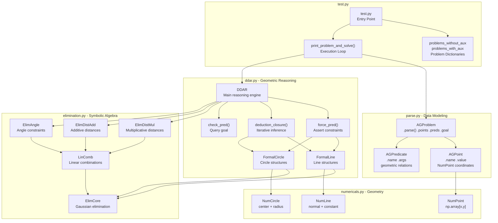

<!-- source: DeepWiki mcp.deepwiki.com · repo google-deepmind/alphageometry2 · page 1 Home · fetched 2026-10-26 -->

# Home

<details>
<summary>Relevant source files</summary>

The following files were used as context for generating this wiki page:

- [README.md](README.md)
- [test.py](test.py)

</details>


## Purpose and Scope

This wiki documents the **AlphaGeometry2 DDAR logical core** repository, which contains the symbolic reasoning component of the AlphaGeometry2 system. This repository provides code to reproduce geometry theorem proving on International Mathematical Olympiad (IMO) problems using deductive reasoning.

**What this repository contains:**
- The DDAR (Deductive Database with Angle Relations) logical engine
- Problem parsing and representation systems
- Symbolic elimination and numerical geometry modules
- Test suite with 26 IMO problems

**What this repository does NOT contain:**
- The language model for generating auxiliary construction points
- The complete AlphaGeometry2 system architecture
- Training code or model weights

For information on running the system, see [Getting Started](#2). For details on the DDAR engine, see [DDAR Logical Engine](#4).

**Sources:** [README.md:1-16](), [test.py:16-16]()

---

## System Overview

AlphaGeometry2 is a geometry theorem prover that achieved gold-medalist performance on IMO geometry problems. This repository contains only the **symbolic/logical core**, which performs deductive reasoning on formalized geometry problems. The full AlphaGeometry2 system includes a language model that generates auxiliary construction points, but that component is not included here.

The logical core operates on problems that have been:
1. Formalized into the AlphaGeometry2 problem language
2. Supplemented with point coordinates
3. Optionally supplemented with auxiliary points (for harder problems)

**Sources:** [README.md:3-16](), [test.py:481-488]()

---

## Core Components

The repository consists of five primary Python modules that implement distinct computational responsibilities:

| Module | Primary Classes | Responsibility |
|--------|----------------|----------------|
| `test.py` | N/A (script) | Test orchestration, problem execution, result reporting |
| `parse.py` | `AGPoint`, `AGPredicate`, `AGProblem` | Problem string parsing and data modeling |
| `ddar.py` | `DDAR`, `FormalLine`, `FormalCircle` | Geometric reasoning and deduction closure |
| `elimination.py` | `ElimCore`, `LinComb`, `ElimDistMul`, `ElimDistAdd`, `ElimAngle` | Symbolic algebra and constraint solving |
| `numericals.py` | `NumPoint`, `NumLine`, `NumCircle` | Numerical geometric computations |

**Sources:** [test.py:1-19](), [parse.py:1-50](), [ddar.py:1-50](), [elimination.py:1-50](), [numericals.py:1-50]()

---

## Component Architecture



**Diagram: Component Architecture and Class Relationships**

This diagram shows the actual classes and functions in the codebase and how they relate. Each box represents a real code entity that can be searched in the repository.

**Sources:** [test.py:16-19](), [test.py:491-507](), [parse.py:20-150](), [ddar.py:30-200](), [elimination.py:20-100](), [numericals.py:20-80]()

---

## Problem Execution Flow

```mermaid
flowchart LR
    Start["Problem String<br/>'a@0.0_0.0 = ; ...'"]
    
    subgraph "Parsing"
        ParseCall["AGProblem.parse()"]
        AGProbObj["AGProblem object<br/>.points: list[AGPoint]<br/>.preds: list[AGPredicate]<br/>.goal: AGPredicate"]
    end
    
    subgraph "DDAR Initialization"
        DDARInit["DDAR.__init__(points)"]
        DDARObj["DDAR instance<br/>- flines: dict<br/>- fcircles: dict<br/>- elim_dist_mul<br/>- elim_dist_add<br/>- elim_angle"]
    end
    
    subgraph "Constraint Assertion"
        ForceLoop["for pred in preds:<br/>ddar.force_pred(pred)"]
        ElimSys["Update elimination systems<br/>ElimDistMul, ElimDistAdd, ElimAngle"]
    end
    
    subgraph "Deductive Closure"
        ClosureCall["ddar.deduction_closure()"]
        InferLoop["Iterative inference:<br/>- search_similar<br/>- search_cyclic<br/>- search_circles<br/>- merge_points"]
    end
    
    subgraph "Goal Verification"
        CheckCall["ddar.check_pred(goal)"]
        QueryElim["Query elimination<br/>systems for goal"]
        Result{"Proven?"}
    end
    
    Start --> ParseCall
    ParseCall --> AGProbObj
    AGProbObj --> DDARInit
    DDARInit --> DDARObj
    DDARObj --> ForceLoop
    ForceLoop --> ElimSys
    ElimSys --> ClosureCall
    ClosureCall --> InferLoop
    InferLoop --> CheckCall
    CheckCall --> QueryElim
    QueryElim --> Result
```



**Diagram: Execution Flow Through Code Functions**

This shows the actual function calls that occur when solving a problem, using real method names from the codebase.

**Sources:** [test.py:491-507](), [parse.py:110-150](), [ddar.py:50-150]()

---

## File Structure

```
alphageometry2/
├── test.py                # Main test script with problem sets
├── parse.py               # AGProblem, AGPoint, AGPredicate parsing
├── ddar.py                # DDAR class with deduction engine
├── elimination.py         # Symbolic elimination systems
├── numericals.py          # Numerical geometry primitives
├── README.md              # Installation and usage instructions
└── LICENSE                # Apache 2.0 license
```

**Sources:** [README.md:1-163]()

---

## Problem Categories

The test suite in `test.py` contains two categories of IMO problems:

### Problems Solvable Without Auxiliary Points

The `problems_without_aux` dictionary contains 15 problems (2000-2022) that DDAR can solve using only deductive reasoning on the given points and constraints. These problems demonstrate DDAR's autonomous reasoning capabilities.

**Problems:** IMO 2000 P1, 2002 P2a/b, 2003 P4, 2004 P5, 2005 P5, 2007 P4, 2010 P4, 2012 P1, 2013 P4, 2014 P4, 2015 P4, 2016 P1, 2017 P4, 2022 P4

**Sources:** [test.py:22-234](), [README.md:42-88]()

### Problems Requiring Auxiliary Points

The `problems_with_aux` dictionary contains 11 challenging problems (2001-2021) that require strategic auxiliary construction points. These points are manually provided in the problem strings (marked by coordinates of constructed points beyond the original problem statement). In the full AlphaGeometry2 system, these would be generated by the language model.

**Problems:** IMO 2001 P5a, 2003 P4b, 2005 P1, 2008 P1b, 2008 P6, 2009 P4a/b, 2011 P6, 2013 P3, 2019 P2, 2021 P3

**Sources:** [test.py:236-479](), [README.md:90-125]()

---

## Key Data Structures

### Problem Representation

| Class | Location | Purpose |
|-------|----------|---------|
| `AGPoint` | [parse.py]() | Represents a geometric point with name and coordinates |
| `AGPredicate` | [parse.py]() | Represents a geometric relation (e.g., `collinear`, `congruent`) |
| `AGProblem` | [parse.py]() | Container for points, predicates (givens), and goal |

### Geometric Objects

| Class | Location | Purpose |
|-------|----------|---------|
| `FormalLine` | [ddar.py]() | Symbolic line representation with elimination variables |
| `FormalCircle` | [ddar.py]() | Symbolic circle representation with elimination variables |
| `NumPoint` | [numericals.py]() | Numerical point as numpy array `[x, y]` |
| `NumLine` | [numericals.py]() | Numerical line as normal vector + constant |
| `NumCircle` | [numericals.py]() | Numerical circle as center + radius |

### Constraint Systems

| Class | Location | Purpose |
|-------|----------|---------|
| `ElimCore` | [elimination.py]() | Gaussian elimination on linear combinations |
| `ElimDistMul` | [elimination.py]() | Multiplicative distance constraints (`ab * cd = ef * gh`) |
| `ElimDistAdd` | [elimination.py]() | Additive distance constraints (`ab + cd = ef + gh`) |
| `ElimAngle` | [elimination.py]() | Angle equality constraints |

**Sources:** [parse.py:20-150](), [ddar.py:30-250](), [elimination.py:20-200](), [numericals.py:20-120]()

---

## DDAR Reasoning Capabilities

The `DDAR` class in [ddar.py]() implements the following geometric reasoning algorithms:

| Method | Purpose |
|--------|---------|
| `force_pred()` | Translates predicates into constraints and updates elimination systems |
| `deduction_closure()` | Iteratively applies inference rules until no new facts are derived |
| `search_similar()` | Finds similar triangles and derives proportional relationships |
| `search_cyclic()` | Finds cyclic quadrilaterals and derives angle relationships |
| `search_circles()` | Identifies circles from cocyclic point sets |
| `merge_points()` | Merges points proven to be identical |
| `check_pred()` | Queries whether a predicate can be proven from the current knowledge base |

**Sources:** [ddar.py:50-400]()

---

## Running the System

To execute the test suite:

```bash
python -m test
```

This runs both problem categories and prints proving status for each problem. Each dot (`.`) represents one iteration of the deduction closure loop. For detailed instructions, see [Running the Test Suite](#2.1).

**Example output:**
```
Problem: 2000_p1
..... Proven :-)

Problem: 2005_p1
...... Proven :-)
```

**Sources:** [README.md:32-37](), [test.py:509-516]()

---

## Dependencies

The system requires only standard scientific Python libraries:

- Python 3.x
- `numpy` - for numerical array operations
- `fractions` - for exact rational arithmetic
- `collections` - for data structures (defaultdict, namedtuple)

**Sources:** [README.md:18-29]()

---

## Further Documentation

For detailed information on specific components:

- **Installation and Usage:** See [Getting Started](#2)
- **Problem Format:** See [Problem Format and Structure](#2.2)
- **Architecture Details:** See [System Architecture](#3)
- **DDAR Engine:** See [DDAR Logical Engine](#4)
- **Symbolic Algebra:** See [Symbolic Elimination System](#5)
- **Numerical Geometry:** See [Numerical Geometry Module](#6)
- **Problem Parsing:** See [Problem Parsing and Data Structures](#7)
- **Complete Pipeline:** See [Problem-Solving Pipeline](#9)
- **Contributing:** See [Developer Guide](#10)

---

## Citation and License

This code accompanies the paper:

> Chervonyi et al. (2025). "Gold-medalist performance in solving olympiad geometry with alphageometry2." *Journal of Machine Learning Research*, 26(241), 1-39.

The software is licensed under Apache License 2.0. This is not an official Google product.

**Sources:** [README.md:127-162]()

---

