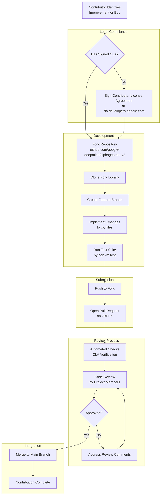
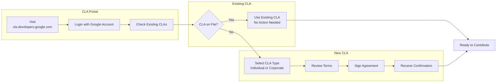
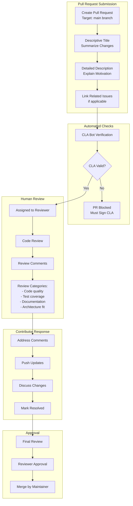
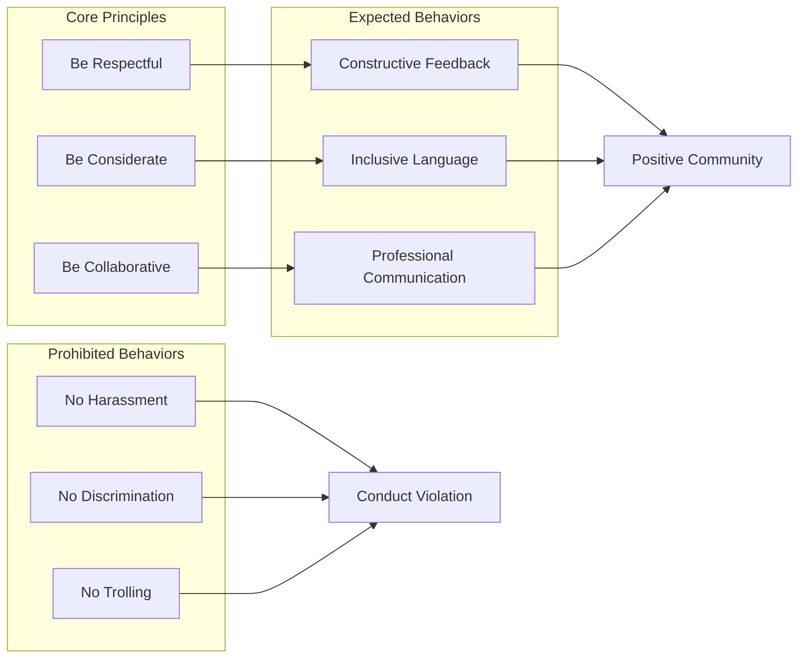
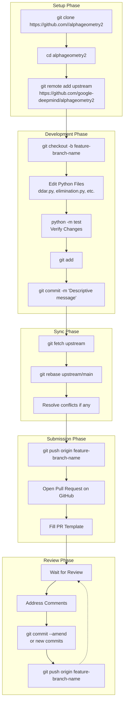
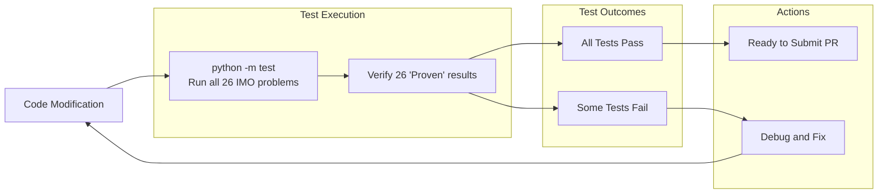

<!-- source: DeepWiki mcp.deepwiki.com · repo google-deepmind/alphageometry2 · page 10.1 Contributing Guidelines · fetched 2026-10-26 -->

# Contributing Guidelines

Relevant source files

The following files were used as context for generating this wiki page:

- [CONTRIBUTING.md](CONTRIBUTING.md)

## Purpose and Scope

This page documents the process for contributing code to the AlphaGeometry2 repository. It covers the required legal agreements, code review procedures, and community standards that all contributors must follow. 

For information about the repository structure and development setup, see [Repository Structure](#10.3). For licensing details, see [License Information](#10.2).

---

## Contribution Process Overview

All contributions to AlphaGeometry2 follow a standardized process managed through GitHub. The repository is maintained by Google DeepMind and requires specific legal and procedural compliance before code can be accepted.

### Contribution Workflow

**Sources:** [CONTRIBUTING.md:1-26]()

---

## Contributor License Agreement (CLA)

### CLA Requirements

All contributions, regardless of size, must be accompanied by a signed Contributor License Agreement. This legal requirement applies to:

- First-time contributors to any Google open source project
- Contributors submitting on behalf of their employer
- Individual contributors retaining copyright to their work

| CLA Type | Who Signs | When Required |
|----------|-----------|---------------|
| Individual CLA | Individual contributor | When contributing as an individual |
| Corporate CLA | Employer's authorized representative | When contributing as part of employment |

### CLA Signing Process

### CLA Key Facts

- **One-time requirement**: Once signed for any Google project, applies to all future Google projects
- **Copyright retention**: Contributors retain copyright to their contributions
- **Usage permission**: CLA grants Google permission to use and redistribute contributions
- **Automated verification**: GitHub automatically verifies CLA status on pull requests
- **Employer involvement**: Corporate CLAs required when contributing as part of employment duties

**Sources:** [CONTRIBUTING.md:3-13]()

---

## Code Review Process

### Pull Request Requirements

All submissions, including those by project members, require code review before merging. The review process uses GitHub's pull request mechanism.

### Review Focus Areas

Reviewers evaluate contributions based on several criteria:

| Review Criterion | Description | Relevant Files |
|-----------------|-------------|----------------|
| Correctness | Does the code work as intended? | All `.py` files |
| Test Coverage | Are changes tested appropriately? | `test.py` |
| Code Quality | Is the code readable and maintainable? | Modified modules |
| Documentation | Are changes documented? | Docstrings, comments |
| Architecture | Does it fit the system design? | Core modules (`ddar.py`, `elimination.py`, etc.) |
| Performance | Does it maintain or improve performance? | Algorithmic changes |

### Review Timeline Expectations

- **Initial response**: Reviewers typically respond within 1-2 weeks
- **Iteration**: May require multiple rounds of feedback
- **Final approval**: Once all comments addressed satisfactorily
- **Merge timing**: After approval, at maintainer discretion

**Sources:** [CONTRIBUTING.md:15-20]()

---

## Community Guidelines

### Code of Conduct

This project adheres to Google's Open Source Community Guidelines, which establish standards for respectful and productive collaboration.

### Community Guideline Reference

The complete community guidelines are maintained at:
- **URL**: `https://opensource.google/conduct/`
- **Scope**: Applies to all interactions (issues, pull requests, discussions)
- **Enforcement**: Maintainers enforce guidelines and may remove violating content

**Sources:** [CONTRIBUTING.md:22-25]()

---

## Practical Contribution Workflow

### Step-by-Step Process

This section provides concrete steps for making a contribution, mapping the abstract process to specific Git and GitHub commands.

### Contribution Checklist

Before submitting a pull request, verify:

- [ ] **CLA Signed**: Confirmed at `cla.developers.google.com`
- [ ] **Tests Pass**: `python -m test` runs successfully
- [ ] **Code Quality**: Follows existing code style in relevant modules
- [ ] **Documentation**: Updated docstrings for modified functions/classes
- [ ] **Commit Messages**: Clear, descriptive commit messages
- [ ] **Branch Updated**: Rebased on latest `upstream/main`
- [ ] **PR Description**: Explains what, why, and how of changes

### Common Contribution Scenarios

| Scenario | Typical Files Modified | Considerations |
|----------|----------------------|----------------|
| Bug fix in DDAR logic | `ddar.py` | Add test case demonstrating fix |
| New geometric predicate | `ddar.py`, `parse.py` | Update predicate system documentation |
| Optimization in elimination | `elimination.py` | Verify correctness on all 26 test problems |
| New numerical operation | `numericals.py` | Ensure numerical stability |
| Test problem addition | `test.py` | Include problem source and expected result |

**Sources:** [CONTRIBUTING.md:1-26]()

---

## Repository-Specific Guidelines

### Code Style Conventions

The repository uses standard Python conventions:

- **Imports**: Standard library, third-party, local modules (in that order)
- **Type hints**: Not extensively used but welcome in new code
- **Docstrings**: Present for public classes and methods
- **Naming**: 
  - Classes: `PascalCase` (e.g., `DDAR`, `ElimCore`, `AGPoint`)
  - Functions/methods: `snake_case` (e.g., `deduction_closure`, `force_pred`)
  - Constants: `UPPER_SNAKE_CASE`

### Testing Requirements

All code changes should be verified against the test suite:

### File Modification Guidelines

| File | Purpose | Contribution Guidance |
|------|---------|---------------------|
| `ddar.py` | Core geometric reasoning | High impact; ensure thorough testing |
| `elimination.py` | Symbolic constraint solving | Verify algebraic correctness |
| `numericals.py` | Numerical geometry | Test for numerical stability |
| `parse.py` | Problem parsing | Update if adding new predicate types |
| `test.py` | Test orchestration | Add problems with clear documentation |
| `CONTRIBUTING.md` | This document | Improve clarity or add missing information |

**Sources:** [CONTRIBUTING.md:1-26]()

---

## Summary Table: Contribution Requirements

| Requirement | Description | Verification | Blocking? |
|-------------|-------------|--------------|-----------|
| CLA Signed | Contributor License Agreement | Automated by GitHub bot | Yes |
| Code Review | Approval from project member | Manual review process | Yes |
| Tests Pass | All 26 IMO problems prove | Run `python -m test` | Yes |
| Community Guidelines | Respectful communication | Maintainer discretion | Yes |
| Code Quality | Readable, maintainable code | Reviewer judgment | No (but strongly recommended) |
| Documentation | Updated docstrings/comments | Reviewer judgment | No (but strongly recommended) |

**Sources:** [CONTRIBUTING.md:1-26]()

---

