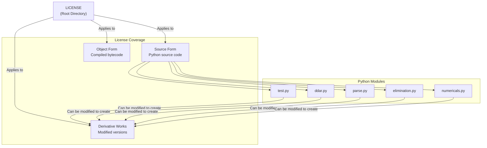
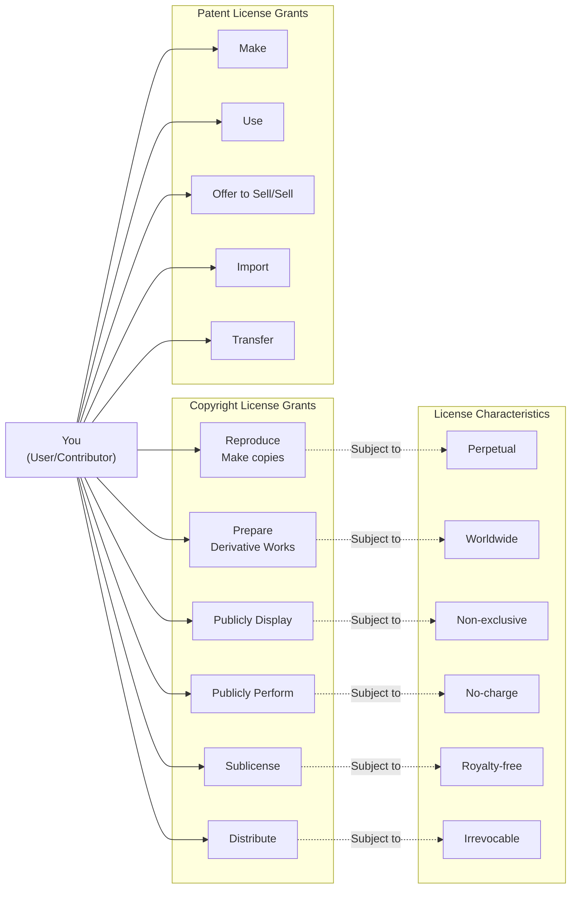
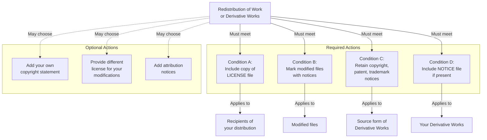
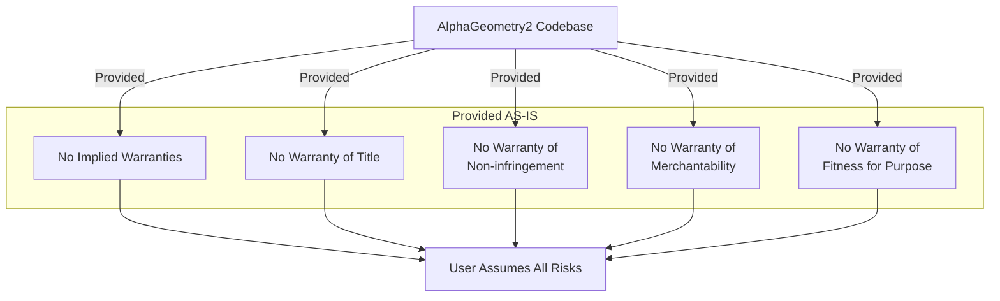
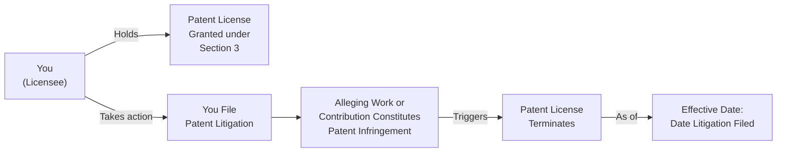
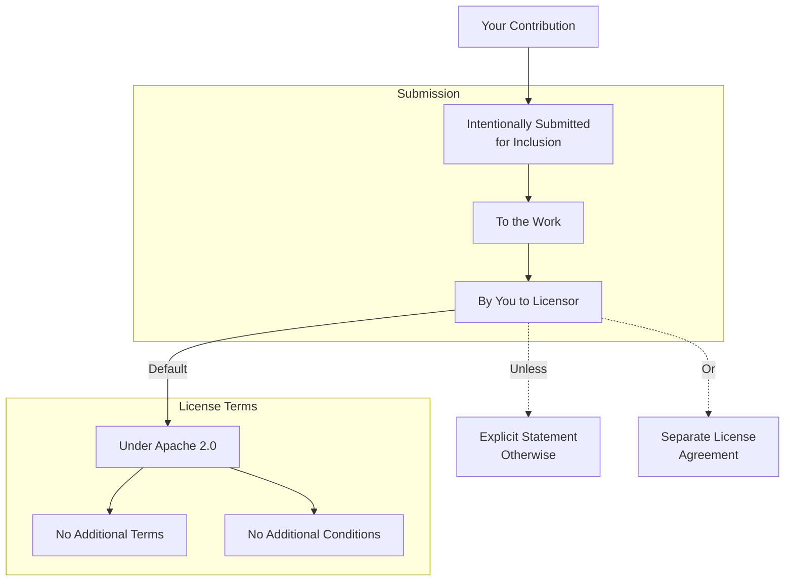
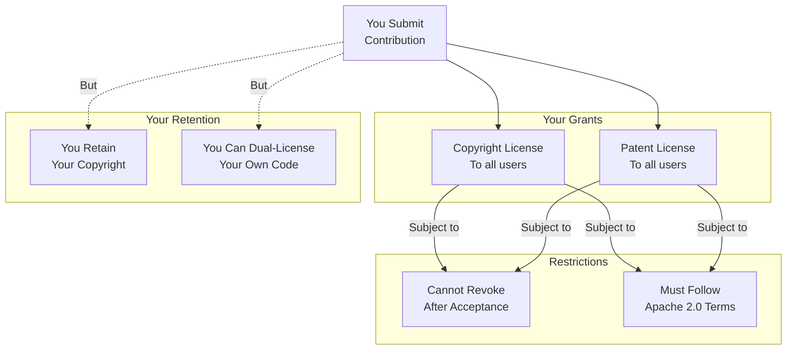

<!-- source: DeepWiki mcp.deepwiki.com · repo google-deepmind/alphageometry2 · page 10.2 License Information · fetched 2026-10-26 -->

# License Information

<details>
<summary>Relevant source files</summary>

The following files were used as context for generating this wiki page:

- [LICENSE](LICENSE)

</details>


## Purpose and Scope

This document provides comprehensive information about the licensing terms that govern the AlphaGeometry2 repository. It explains the Apache License Version 2.0, its implications for users and contributors, and how the license applies to the codebase.

For information about how to contribute code to this repository, see [Contributing Guidelines](#10.1). For general repository structure and organization, see [Repository Structure](#10.3).

**Sources:** [LICENSE:1-203]()

---

## License Overview

The AlphaGeometry2 repository is licensed under the **Apache License, Version 2.0** (January 2004). This is a permissive open-source license that allows broad freedom to use, modify, and distribute the software while providing explicit patent grants and requiring attribution.

| License Property | Value |
|-----------------|-------|
| License Type | Apache License 2.0 |
| License Version | January 2004 |
| Official URL | http://www.apache.org/licenses/ |
| SPDX Identifier | Apache-2.0 |
| OSI Approved | Yes |
| License File | [LICENSE:1-203]() |

**Sources:** [LICENSE:1-4]()

---

## License Application to Repository



**Diagram: License Coverage Across Repository Components**

The Apache License 2.0 applies to all files in the repository in both source and object form. This includes the core Python modules ([test.py](), [ddar.py](), [parse.py](), [elimination.py](), [numericals.py]()) and any derivative works created from them.

**Sources:** [LICENSE:27-47](), [LICENSE:90-130]()

---

## Key License Definitions

The Apache License 2.0 defines several critical terms that govern how the software can be used:

### Core Terms

| Term | Definition | License Reference |
|------|------------|-------------------|
| **License** | Terms and conditions for use, reproduction, and distribution | [LICENSE:10-11]() |
| **Licensor** | Copyright owner granting the License (Google DeepMind) | [LICENSE:13-14]() |
| **You** | Individual or Legal Entity exercising permissions | [LICENSE:24-25]() |
| **Source Form** | Preferred form for modifications (e.g., .py files) | [LICENSE:27-29]() |
| **Object Form** | Result of mechanical transformation (e.g., .pyc files) | [LICENSE:31-34]() |
| **Work** | Work of authorship made available under the License | [LICENSE:36-39]() |
| **Derivative Works** | Modified versions based on the Work | [LICENSE:41-47]() |
| **Contribution** | Work submitted for inclusion by copyright owner | [LICENSE:49-61]() |
| **Contributor** | Licensor or entity whose Contribution was incorporated | [LICENSE:63-65]() |

**Sources:** [LICENSE:8-66]()

---

## Granted Permissions



**Diagram: Permissions Granted by Apache License 2.0**

The Apache License 2.0 grants two primary types of licenses: **Copyright License** and **Patent License**. Both are perpetual, worldwide, non-exclusive, no-charge, royalty-free, and irrevocable (with patent litigation exception).

### Copyright License (Section 2)

The license grants permission to:
- **Reproduce** the Work in any medium
- **Prepare Derivative Works** based on the original code
- **Publicly display and perform** the Work
- **Sublicense** the Work to third parties
- **Distribute** the Work and Derivative Works in Source or Object form

**Sources:** [LICENSE:67-72]()

### Patent License (Section 3)

The license grants patent rights to:
- **Make, use, and sell** the Work
- **Import and transfer** the Work
- Coverage limited to patent claims necessarily infringed by Contributions
- **Termination clause**: Patent licenses terminate if you file patent litigation alleging infringement

**Sources:** [LICENSE:74-88]()

---

## License Conditions and Requirements



**Diagram: Conditions and Requirements for Redistribution**

### Mandatory Conditions (Section 4)

When redistributing the Work or Derivative Works, you **must**:

1. **Include License Copy** ([LICENSE:95-96]())
   - Provide recipients with a copy of the Apache License 2.0
   - Ensure `LICENSE` file is included in distributions

2. **Mark Modified Files** ([LICENSE:98-99]())
   - Add prominent notices to modified files stating changes made
   - Example: "Modified by [Your Name] on [Date]: [Description]"

3. **Retain Attribution Notices** ([LICENSE:101-105]())
   - Keep all copyright, patent, trademark, and attribution notices
   - Remove only notices that don't pertain to Derivative Works
   - Preserve original `LICENSE` text

4. **Include NOTICE File** ([LICENSE:107-122]())
   - If the Work includes a `NOTICE` file, include it in distributions
   - Place in NOTICE file, Source form, documentation, or generated display
   - May add your own attribution notices alongside original notices

**Sources:** [LICENSE:90-130]()

---

## Trademark Restrictions

The Apache License 2.0 does **not** grant permission to use:
- Trade names of the Licensor
- Trademarks
- Service marks
- Product names

**Exception**: Reasonable and customary use for describing the Work's origin and reproducing the NOTICE file content is permitted.

**Practical Implication**: You cannot use "AlphaGeometry2" or "Google DeepMind" as branding for your derivative work without permission, but you can state "Based on AlphaGeometry2 by Google DeepMind" in attribution.

**Sources:** [LICENSE:139-142]()

---

## Warranty Disclaimers and Liability Limitations

### No Warranty (Section 7)



**Diagram: Warranty Disclaimers**

The Work is provided **"AS IS"** without warranties or conditions of any kind, including:
- **Title**: No guarantee of ownership rights
- **Non-infringement**: No guarantee against third-party IP claims
- **Merchantability**: No guarantee of commercial quality
- **Fitness for Purpose**: No guarantee of suitability for any use

**User Responsibility**: You are solely responsible for determining appropriateness of use and assume all risks.

**Sources:** [LICENSE:144-152]()

### Limitation of Liability (Section 8)

Contributors are **not liable** for:
- Direct damages
- Indirect damages
- Special damages
- Incidental damages
- Consequential damages
- Loss of goodwill
- Work stoppage
- Computer failure or malfunction
- Commercial damages or losses

**Scope**: No liability under any legal theory (tort, contract, or otherwise), even if advised of possibility of such damages.

**Sources:** [LICENSE:154-164]()

---

## Patent License Termination Provision



**Diagram: Patent License Termination Clause**

**Critical Provision**: If you file patent litigation alleging that the Work or any Contribution constitutes direct or contributory patent infringement, your patent license under Section 3 automatically terminates on the date the litigation is filed.

**Scope**: Applies to:
- Claims against the Work itself
- Claims against Contributions incorporated in the Work
- Direct infringement allegations
- Contributory infringement allegations
- Cross-claims and counterclaims

**Sources:** [LICENSE:82-88]()

---

## Contribution Terms

### Default Contribution License (Section 5)



**Diagram: Contribution Licensing Flow**

**Default Rule**: Unless you explicitly state otherwise, any Contribution intentionally submitted for inclusion in the Work is licensed under Apache 2.0 terms **without any additional terms or conditions**.

**Exceptions**:
1. You explicitly state different terms
2. You have a separate license agreement with the Licensor

**Practical Implication**: When you submit a pull request or contribution, you are automatically licensing it under Apache 2.0 unless you specify otherwise. See [Contributing Guidelines](#10.1) for the Contributor License Agreement (CLA) requirements.

**Sources:** [LICENSE:131-137]()

---

## Accepting Additional Liability (Section 9)

When redistributing the Work or Derivative Works, you **may** choose to:
- Offer support, warranty, or indemnity
- Charge fees for such offerings
- Accept liability obligations

**Requirements if you do**:
1. Act only on your own behalf
2. Act on your sole responsibility
3. Not on behalf of other Contributors
4. Must indemnify, defend, and hold harmless other Contributors

**Practical Implication**: If you offer commercial support for a modified version of AlphaGeometry2, you must indemnify Google DeepMind and other contributors against any resulting liability.

**Sources:** [LICENSE:166-175]()

---

## Practical Implications for Users

### What You Can Do

| Activity | Permitted | Conditions |
|----------|-----------|------------|
| Use for research | ✓ Yes | None |
| Use for commercial purposes | ✓ Yes | None |
| Modify the code | ✓ Yes | Mark modified files |
| Distribute original | ✓ Yes | Include LICENSE |
| Distribute modifications | ✓ Yes | Include LICENSE, mark files, retain notices |
| Create derivative works | ✓ Yes | Include LICENSE, mark files |
| Sublicense | ✓ Yes | Include LICENSE |
| Use patent claims | ✓ Yes | Don't file patent litigation |
| Use trademarks | ✗ No | Except for attribution |

### What You Must Do

When distributing or modifying:
1. **Include** the `LICENSE` file from [LICENSE:1-203]()
2. **Mark** any files you modify with change notices
3. **Retain** all copyright and attribution notices
4. **Include** NOTICE file if present (currently not in repository)

### What You Cannot Do

1. **Use trademarks** without permission (except for attribution)
2. **Sue for patent infringement** and keep patent license
3. **Expect warranties** of any kind
4. **Hold contributors liable** for damages

**Sources:** [LICENSE:1-203]()

---

## Practical Implications for Contributors

### Before Contributing

Review and sign the Contributor License Agreement (CLA) as described in [Contributing Guidelines](#10.1).

### When Submitting Code

Your contribution will be licensed under Apache 2.0 by default ([LICENSE:131-137]()). This means:
- Your code becomes part of the Apache 2.0 licensed Work
- You grant copyright license to reproduce, modify, display, and distribute
- You grant patent license for patent claims covered by your contribution

### Contribution Licensing Summary



**Diagram: Contribution Rights and Obligations**

### Your Rights as Contributor

- **Retain copyright**: You keep ownership of your contribution
- **Dual licensing**: You can license your own code under other licenses elsewhere
- **Attribution**: Your contributions are tracked in version control

### Your Obligations as Contributor

- **Irrevocable grant**: Cannot revoke license after contribution is accepted
- **Patent grant**: Must grant patent license for claims in your contribution
- **No additional restrictions**: Cannot impose additional terms on your contribution

**Sources:** [LICENSE:49-66](), [LICENSE:131-137]()

---

## License File Location and Application

The license is stored in a single file at the repository root:

```
alphageometry2/
├── LICENSE          # Apache License 2.0 full text
├── test.py          # Licensed under Apache 2.0
├── ddar.py          # Licensed under Apache 2.0
├── parse.py         # Licensed under Apache 2.0
├── elimination.py   # Licensed under Apache 2.0
└── numericals.py    # Licensed under Apache 2.0
```

All Python modules and other files in the repository are covered by the Apache License 2.0 unless explicitly stated otherwise in the file header.

**Sources:** [LICENSE:1-203]()

---

## Summary of Key Points

| Aspect | Summary |
|--------|---------|
| **License Type** | Apache License 2.0 (January 2004) |
| **Permissions** | Use, modify, distribute, sublicense commercially or non-commercially |
| **Patent Grant** | Explicit patent license included; terminates if you sue for patent infringement |
| **Required Actions** | Include LICENSE, mark modified files, retain attribution notices |
| **Trademark** | No permission to use Licensor's trademarks except for attribution |
| **Warranty** | None - provided "AS IS" |
| **Liability** | Contributors have no liability for damages |
| **Contributions** | Automatically licensed under Apache 2.0 unless stated otherwise |
| **Compatibility** | Compatible with GPL v3, MIT, BSD licenses |

**Sources:** [LICENSE:1-203]()

---

