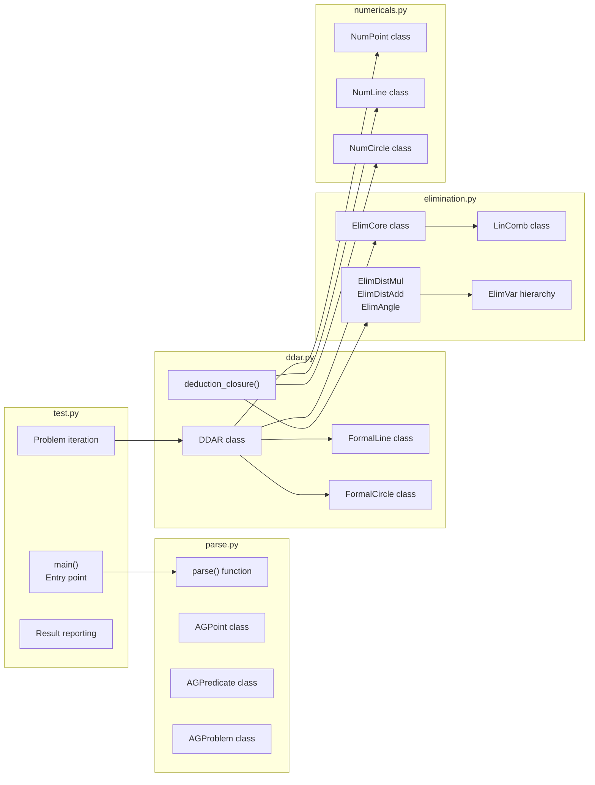
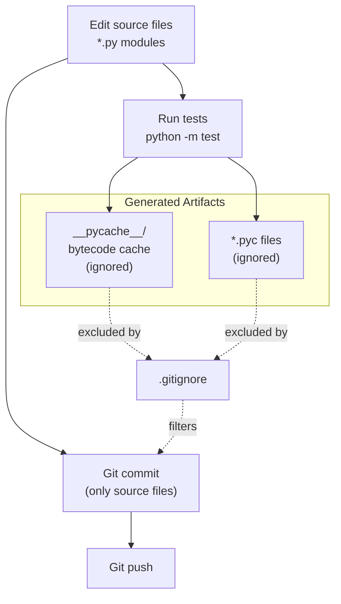

<!-- source: DeepWiki mcp.deepwiki.com · repo google-deepmind/alphageometry2 · page 10.3 Repository Structure · fetched 2026-10-26 -->

# Repository Structure

<details>
<summary>Relevant source files</summary>

The following files were used as context for generating this wiki page:

- [.gitignore](.gitignore)
- [CONTRIBUTING.md](CONTRIBUTING.md)

</details>


## Purpose and Scope

This document provides an overview of the AlphaGeometry2 repository organization, including the physical layout of files, development configuration, and ignored artifacts. For information about module dependencies and logical architecture, see [Module Dependencies](#3.1). For contributing guidelines and pull request workflows, see [Contributing Guidelines](#10.1).

## Repository Organization

The AlphaGeometry2 repository follows a flat structure with all core Python modules at the repository root. This design reflects the focused scope of the codebase—a self-contained implementation of the DDAR logical engine and its supporting systems.

### Physical File Structure

```mermaid
graph TB
    Root["/ (Repository Root)"]
    
    subgraph "Core Modules"
        Test["test.py<br/>Test orchestrator<br/>Entry point"]
        DDAR["ddar.py<br/>Geometric reasoning engine"]
        Parse["parse.py<br/>Problem parser"]
        Elim["elimination.py<br/>Symbolic constraint solver"]
        Num["numericals.py<br/>Numerical geometry"]
    end
    
    subgraph "Configuration Files"
        License["LICENSE<br/>Apache 2.0"]
        README["README.md<br/>Project documentation"]
        Contributing["CONTRIBUTING.md<br/>Contribution guidelines"]
        Gitignore[".gitignore<br/>Ignored files specification"]
    end
    
    subgraph "Generated Artifacts (Ignored)"
        Pycache["__pycache__/<br/>Bytecode cache"]
        PyFiles["*.pyc, *.pyo<br/>Compiled Python"]
        Dist["dist/, build/<br/>Distribution artifacts"]
        Eggs["*.egg-info/<br/>Package metadata"]
    end
    
    Root --> Test
    Root --> DDAR
    Root --> Parse
    Root --> Elim
    Root --> Num
    
    Root --> License
    Root --> README
    Root --> Contributing
    Root --> Gitignore
    
    Root -.->|generates| Pycache
    Root -.->|generates| PyFiles
    Root -.->|generates| Dist
    Root -.->|generates| Eggs
    
    style Test fill:#ffcccc
    style DDAR fill:#ccccff
    style Parse fill:#ccffcc
    style Elim fill:#ffffcc
    style Num fill:#ffccff
```



**Sources:** [.gitignore:1-25](), [CONTRIBUTING.md:1-26]()

### Module-to-File Mapping

The following table maps logical system components to their physical file locations:

| System Component | File Path | Primary Classes/Functions | Lines of Code (approx) |
|-----------------|-----------|---------------------------|------------------------|
| Test Orchestrator | `test.py` | `main()` | ~200 |
| DDAR Engine | `ddar.py` | `DDAR`, `FormalLine`, `FormalCircle` | ~1000+ |
| Problem Parser | `parse.py` | `AGPoint`, `AGPredicate`, `AGProblem`, `parse()` | ~200 |
| Elimination System | `elimination.py` | `ElimCore`, `LinComb`, `ElimVar`, `ElimDistMul`, `ElimDistAdd`, `ElimAngle` | ~600 |
| Numerical Geometry | `numericals.py` | `NumPoint`, `NumLine`, `NumCircle` | ~400 |

### Component Responsibility Diagram



**Sources:** [.gitignore:1-25]()

## Configuration Files

### License and Legal

The repository is distributed under the Apache License 2.0, as specified in the `LICENSE` file at the repository root. For details on licensing implications, see [License Information](#10.2).

### Contribution Guidelines

The `CONTRIBUTING.md` file specifies:
- Contributor License Agreement (CLA) requirements
- Code review process via GitHub pull requests
- Community conduct guidelines

All contributors must sign the Google CLA at https://cla.developers.google.com/ before their contributions can be accepted. The CLA only needs to be signed once across all Google projects.

**Sources:** [CONTRIBUTING.md:1-26]()

### Documentation

The `README.md` file at the repository root provides:
- High-level project overview
- Quick start instructions
- Link to original AlphaGeometry paper
- Basic usage examples

## Ignored Files and Development Artifacts

### Git Ignore Configuration

The `.gitignore` file specifies which files and directories should be excluded from version control. This prevents development artifacts and generated files from polluting the repository.

#### Ignored Categories

**Byte-compiled and Optimized Files:**
```
__pycache__/
*.py[cod]
*$py.class
```

These are Python bytecode files generated during execution. The `__pycache__/` directory contains `.pyc` (compiled Python) files that speed up module loading but are platform-specific and should not be committed.

**Sources:** [.gitignore:1-4]()

**Distribution and Packaging Artifacts:**
```
.Python
build/
develop-eggs/
dist/
downloads/
eggs/
.eggs/
lib/
lib64/
parts/
sdist/
var/
wheels/
share/python-wheels/
*.egg-info/
.installed.cfg
*.egg
MANIFEST
```

These directories and files are generated during Python package building and distribution processes. They include:
- `build/` - Temporary build outputs
- `dist/` - Distribution archives (wheels, tarballs)
- `*.egg-info/` - Package metadata
- `MANIFEST` - Package manifest files

**Sources:** [.gitignore:6-24]()

### Development Workflow



**Sources:** [.gitignore:1-25]()

## Module Import Structure

The flat repository structure results in straightforward import statements throughout the codebase:

| Importing Module | Import Statement | Purpose |
|-----------------|------------------|---------|
| `test.py` | `import ddar` | Access DDAR engine |
| `test.py` | `import parse` | Parse problem strings |
| `ddar.py` | `import elimination` | Constraint solving |
| `ddar.py` | `import numericals` | Geometric calculations |
| `ddar.py` | `import parse` | Access AGPoint, AGPredicate |
| All modules | `import numpy`, `import fractions` | Standard library dependencies |

This flat structure means:
- No complex package hierarchies
- Direct imports without relative paths
- All modules are first-class citizens at the same level
- No `__init__.py` files needed

**Sources:** [.gitignore:1-25]()

## Development Setup

### Prerequisites

The repository requires only standard Python dependencies:
- Python 3.7+
- NumPy (for numerical computations)
- Standard library: `fractions`, `collections`, `itertools`

### Execution Model

The codebase is designed to be executed as a Python module:

```bash
python -m test
```

This command:
1. Invokes Python's module execution mode
2. Runs `test.py`'s `main()` function
3. Generates `__pycache__/` during execution (ignored by git)
4. Outputs results to stdout

No build step, compilation, or packaging is required for development. The repository is ready to run immediately after cloning.

**Sources:** [.gitignore:1-25](), [CONTRIBUTING.md:1-26]()

## Repository Hygiene

### What to Commit

**Include in version control:**
- All `.py` source files
- `README.md`, `LICENSE`, `CONTRIBUTING.md`
- `.gitignore` itself

**Exclude from version control:**
- `__pycache__/` directories
- `*.pyc`, `*.pyo`, `*.pyd` bytecode files
- `build/`, `dist/`, `*.egg-info/` package artifacts
- IDE-specific configuration files (e.g., `.vscode/`, `.idea/`)
- Local test outputs or logs

### Clean Development Environment

To remove all ignored artifacts:

```bash
# Remove Python cache directories
find . -type d -name __pycache__ -exec rm -rf {} +

# Remove compiled Python files
find . -type f -name "*.pyc" -delete
find . -type f -name "*.pyo" -delete
```

This ensures a clean state equivalent to a fresh repository clone.

**Sources:** [.gitignore:1-25]()