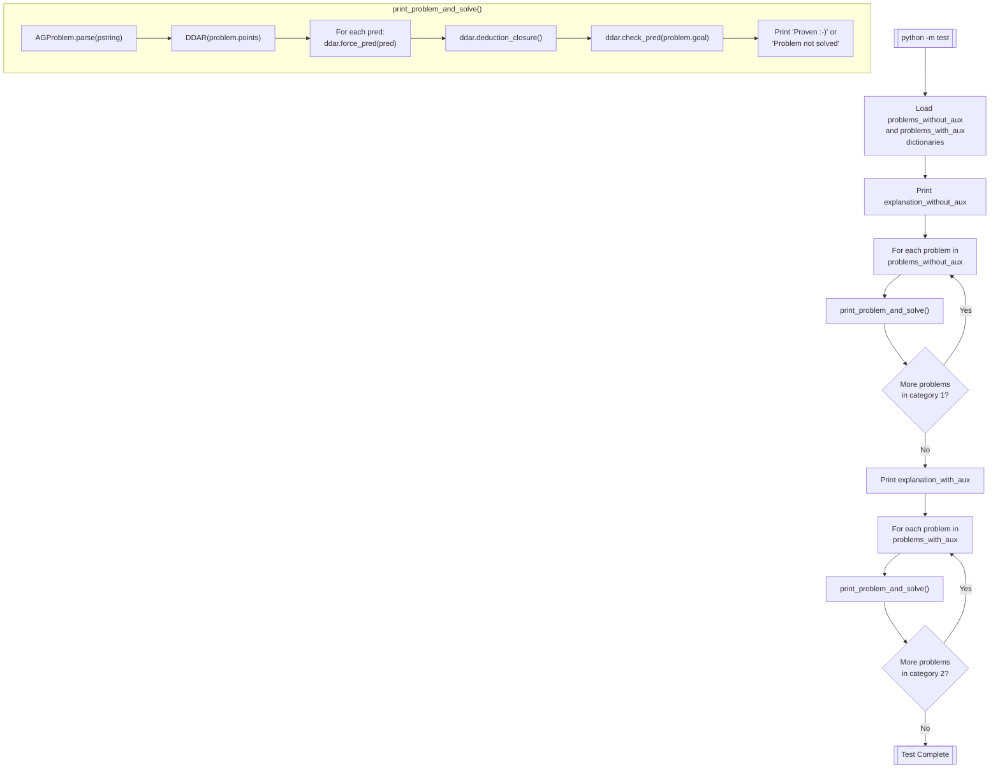
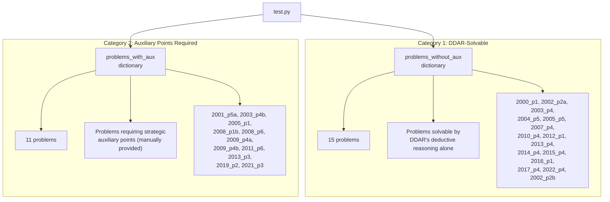
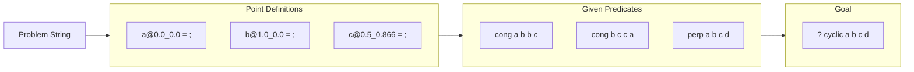
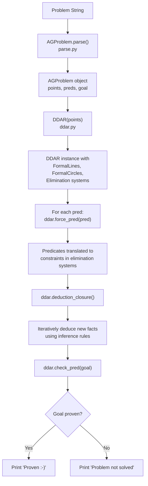

<!-- source: DeepWiki mcp.deepwiki.com · repo google-deepmind/alphageometry2 · page 2 Getting Started · fetched 2026-10-26 -->

# Getting Started

<details>
<summary>Relevant source files</summary>

The following files were used as context for generating this wiki page:

- [README.md](README.md)
- [parse.py](parse.py)
- [test.py](test.py)

</details>


This document provides an introduction to installing, running, and understanding the basic operation of the AlphaGeometry2 DDAR logical core test system. It covers the installation process, how to execute the test suite, and an overview of the problem format and execution flow.

For detailed instructions on running tests and interpreting results, see [Running the Test Suite](#2.1). For a comprehensive explanation of the problem format, see [Problem Format and Structure](#2.2). For understanding the overall system architecture, see [System Architecture](#3).

## Installation

The system requires Python 3 with NumPy. Installation is performed in a virtual environment:

```bash
$ sudo apt install python3
$ sudo apt install python3-pip
$ sudo apt install python3-venv
$ python3 -m venv ag2
$ source ag2/bin/activate
$ pip install numpy
```

**Sources:** [README.md:18-29]()

## Running the Test Suite

Execute the test suite using Python's module syntax:

```bash
$ python -m test
```

This command runs the `test.py` module, which serves as the test driver and orchestrator for the DDAR logical core. The test suite evaluates DDAR's performance on 26 IMO geometry problems divided into two categories.

**Sources:** [README.md:31-37](), [test.py:1-517]()

### Test Execution Flow



**Sources:** [test.py:490-516]()

## Output Format

The test suite produces output indicating which problems were tested and whether they were proven. Each problem execution generates a line of dots representing deduction iterations, followed by a success or failure message.

### Example Output Structure

| Output Component | Description | Example |
|-----------------|-------------|---------|
| Problem ID | IMO year and problem number | `Problem: 2005_p1` |
| Iteration Dots | Each dot represents one deduction cycle | `......` |
| Result | Proof status | `Proven :-)` |

**Example output:**
```
Problem: 2000_p1
..... Proven :-)

Problem: 2002_p2a
.... Proven :-)
```

Each dot in the output corresponds to one iteration of the deduction closure loop in `ddar.deduction_closure()`.

**Sources:** [README.md:39-125](), [test.py:490-507]()

## Problem Categories

The test suite contains two distinct problem categories that exercise different capabilities of the DDAR system:



### Category 1: Problems Without Auxiliary Points

The `problems_without_aux` dictionary contains 15 IMO problems that DDAR can solve using only the given points and predicates. These problems test DDAR's core deductive capabilities: triangle similarity detection, cyclic quadrilateral identification, and circle detection.

### Category 2: Problems With Auxiliary Points

The `problems_with_aux` dictionary contains 11 challenging IMO problems that require strategic auxiliary (helper) points. These auxiliary points are manually included in the problem strings. In a complete AlphaGeometry2 system, a language model would generate these points automatically, but this repository tests only the logical core with pre-provided auxiliary constructions.

**Sources:** [test.py:22-479](), [README.md:90-125]()

## Problem String Format Overview

Problems are encoded as single-line strings with a specific syntax. The format defines points, their coordinates, predicates (given conditions), and the goal.

### Problem String Structure



**Format syntax:**
- **Point definition:** `name@x_y = ;` where `name` is the point identifier and `x_y` are coordinates
- **Predicates:** Comma-separated predicates after the `=` sign
- **Goal:** Follows the `?` symbol

**Example:**
```
a@0.0_0.0 = ; b@1.0_0.0 = ; c@0.5_0.866 = cong a b b c ? cong b c c a
```

**Sources:** [test.py:23-479](), [parse.py:111-148]()

## Execution Pipeline Overview

When a problem is tested, it flows through several processing stages:



**Key processing stages:**

1. **Parsing:** The problem string is parsed into an `AGProblem` object containing `AGPoint` objects, `AGPredicate` objects, and a goal predicate
2. **DDAR Initialization:** A `DDAR` instance is created with the problem's points, initializing geometric structures
3. **Constraint Assertion:** Each given predicate is translated into constraints via `ddar.force_pred()`
4. **Deduction Closure:** The `ddar.deduction_closure()` method iteratively applies inference rules until no new facts can be derived
5. **Goal Verification:** The goal predicate is checked using `ddar.check_pred()` to determine if it can be proven from the closed database

**Sources:** [test.py:490-507](), [parse.py:111-148]()

## Next Steps

This overview provides the foundation for using the system. For deeper understanding:

- See [Running the Test Suite](#2.1) for detailed execution instructions and output interpretation
- See [Problem Format and Structure](#2.2) for complete problem format specification
- See [System Architecture](#3) for understanding how components interact
- See [Problem-Solving Pipeline](#9) for a detailed walkthrough of problem execution

**Sources:** [README.md:1-163](), [test.py:1-517](), [parse.py:1-149]()

---

