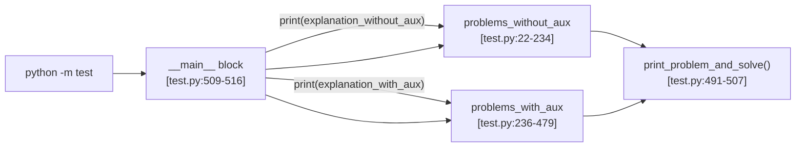
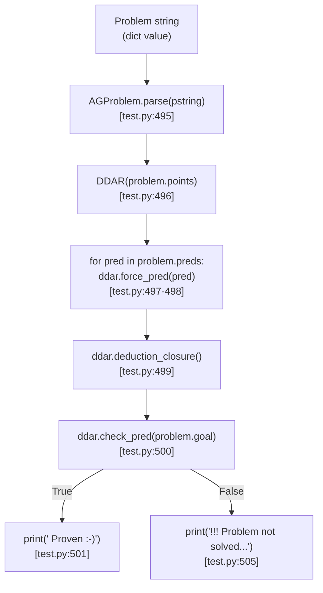
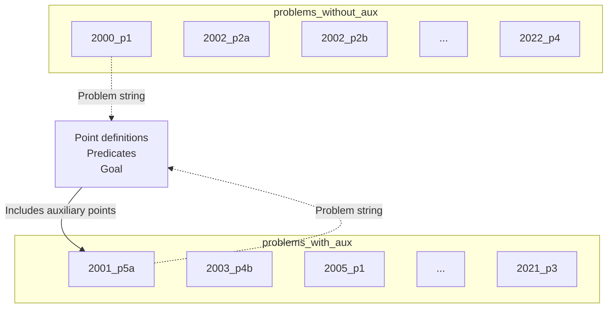
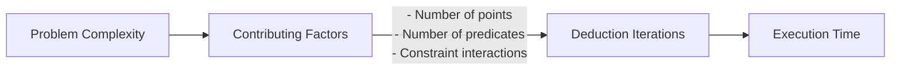

<!-- source: DeepWiki mcp.deepwiki.com · repo google-deepmind/alphageometry2 · page 2.1 Running the Test Suite · fetched 2026-10-26 -->

# Running the Test Suite

<details>
<summary>Relevant source files</summary>

The following files were used as context for generating this wiki page:

- [README.md](README.md)
- [test.py](test.py)

</details>


## Purpose and Scope

This page provides a detailed guide on executing the AlphaGeometry2 test suite and interpreting its output. It covers the command-line invocation, output format, execution flow, and result interpretation. For information about the problem format used in the test suite, see [Problem Format and Structure](#2.2). For a complete catalog of problems and their characteristics, see [IMO Problem Reference](#8.2). For a detailed walkthrough of the problem-solving pipeline, see [Problem-Solving Pipeline](#9).

**Sources:** [README.md:1-163](), [test.py:1-517]()

---

## Prerequisites

Before running the test suite, ensure you have completed the installation steps described in the repository README:

1. Python 3 installed
2. Virtual environment activated (`source ag2/bin/activate`)
3. NumPy installed (`pip install numpy`)

The test suite requires no additional configuration or external dependencies beyond these.

**Sources:** [README.md:18-29]()

---

## Executing the Test Command

The test suite is executed as a Python module from the repository root:

```bash
python -m test
```

This command runs [test.py]() as the main module, executing the `__main__` block at [test.py:509-516]().

### Command Execution Flow



**Sources:** [test.py:509-516]()

---

## Understanding the Output

### Output Structure

The test suite produces output in two distinct sections:

1. **15 easier problems** that DDAR can solve without auxiliary points
2. **11 challenging problems** that require manually provided auxiliary points

Each section begins with an explanatory message defined in [test.py:481-488]().

### Sample Output Format

```
Problem: 2000_p1
..... Proven :-)

Problem: 2002_p2a
.... Proven :-)
```

### Output Components

| Component | Meaning | Source |
|-----------|---------|--------|
| `Problem: YYYY_pN` | IMO year and problem number being solved | [test.py:494]() |
| `.` (dots) | Progress indicators during deduction | Emitted by `DDAR.deduction_closure()` |
| `Proven :-)` | Goal successfully verified | [test.py:501]() |
| `!!! Problem not solved...` | Goal not provable with given information | [test.py:505]() |

**Sources:** [test.py:491-507](), [README.md:39-125]()

---

## Internal Execution Flow

### Per-Problem Solving Process

The `print_problem_and_solve()` function at [test.py:491-507]() implements a five-step process for each problem:



**Sources:** [test.py:491-507]()

### Mapping to System Components

The execution flow maps to the following code entities:

| Step | Function/Method | Module | Purpose |
|------|----------------|--------|---------|
| 1. Parse | `AGProblem.parse()` | `parse.py` | Convert problem string to structured data |
| 2. Initialize | `DDAR.__init__()` | `ddar.py` | Create DDAR instance with geometric points |
| 3. Assert | `DDAR.force_pred()` | `ddar.py` | Translate predicates to constraints |
| 4. Deduce | `DDAR.deduction_closure()` | `ddar.py` | Apply inference rules iteratively |
| 5. Verify | `DDAR.check_pred()` | `ddar.py` | Query goal predicate in knowledge base |

**Sources:** [test.py:495-500]()

---

## Test Suite Organization

### Problem Dictionaries

The test suite maintains two problem dictionaries at the module level:



**Problem Set Details:**

| Dictionary | Line Range | Count | Characteristics |
|-----------|------------|-------|-----------------|
| `problems_without_aux` | [test.py:22-234]() | 15 | DDAR-solvable without auxiliary constructions |
| `problems_with_aux` | [test.py:236-479]() | 11 | Requires strategic auxiliary points |

**Sources:** [test.py:22-479]()

---

## Interpreting Test Results

### Success Indicators

When a problem is solved successfully, the output shows:

```
Problem: 2005_p1
...... Proven :-)
```

**Interpretation:**
- Each dot represents a deduction iteration
- `Proven :-)` indicates `ddar.check_pred(problem.goal)` returned `True`
- The goal predicate was successfully derived from the given predicates

**Sources:** [test.py:500-501]()

### Failure Indicators

If a problem cannot be solved, the output shows:

```
Problem: example_problem


!!! Problem not solved, missing an auxiliary point?
```

**Interpretation:**
- The deduction closure completed without deriving the goal
- This typically indicates missing auxiliary points or constructions
- In this repository, all problems should solve successfully

**Sources:** [test.py:502-505]()

### Progress Dots

The dots appearing during execution (e.g., `......`) indicate deduction iterations within `DDAR.deduction_closure()`. Each dot represents a complete pass through the inference rules:
- Similar triangle detection
- Cyclic quadrilateral detection
- Circle identification
- Point merging

The number of dots varies by problem complexity.

**Sources:** [test.py:499]()

---

## Execution Timing

### Typical Run Duration

The complete test suite typically completes in under a minute on standard hardware. Individual problem solving times vary:

- **Simpler problems** (fewer predicates): 1-3 deduction iterations
- **Complex problems** (many constraints): 5-10+ deduction iterations

### Performance Characteristics



**Sources:** [README.md:42-125]()

---

## Exit Status

The test script does not implement explicit exit codes. It runs to completion and prints all results. Success is determined by the presence of `Proven :-)` for each problem rather than a numerical exit code.

**Sources:** [test.py:509-516]()

---

## Troubleshooting

### Common Issues

| Issue | Symptom | Cause | Solution |
|-------|---------|-------|----------|
| Import error | `ModuleNotFoundError: No module named 'ddar'` | Running from wrong directory | Execute from repository root |
| Import error | `ModuleNotFoundError: No module named 'numpy'` | NumPy not installed | Run `pip install numpy` |
| Problem not solved | `!!! Problem not solved...` appears | Code modification or bug | Should not occur in unmodified repository |

### Verification Steps

To verify the test suite is functioning correctly:

1. All 15 problems in the first section should show `Proven :-)`
2. All 11 problems in the second section should show `Proven :-)`
3. No error messages or stack traces should appear
4. Total of 26 problems should be solved

**Sources:** [test.py:491-516](), [README.md:39-125]()

---

## Next Steps

After successfully running the test suite:
- To understand the problem format, see [Problem Format and Structure](#2.2)
- To explore specific problem characteristics, see [Problem Categories](#8.1)
- To understand the internal solving process, see [Problem-Solving Pipeline](#9)
- To examine the DDAR engine in detail, see [DDAR Logical Engine](#4)

**Sources:** [test.py:1-517]()

---

