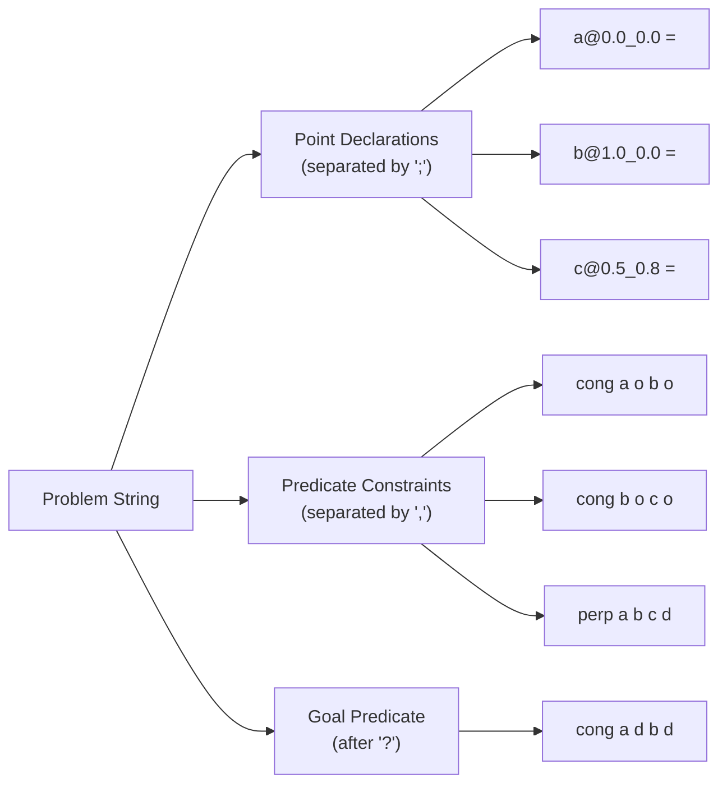
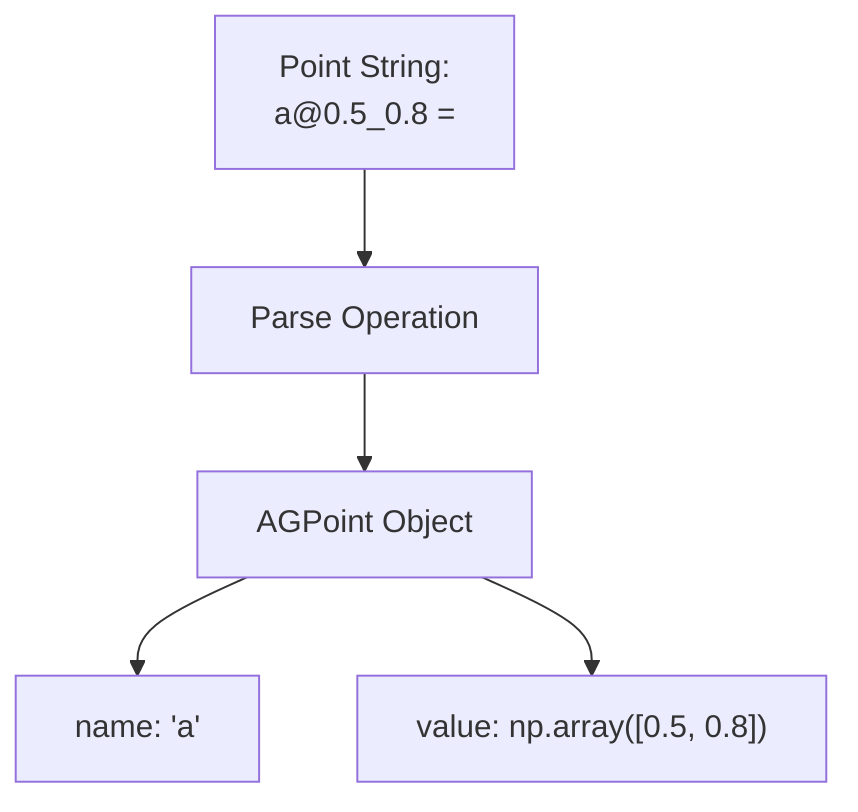
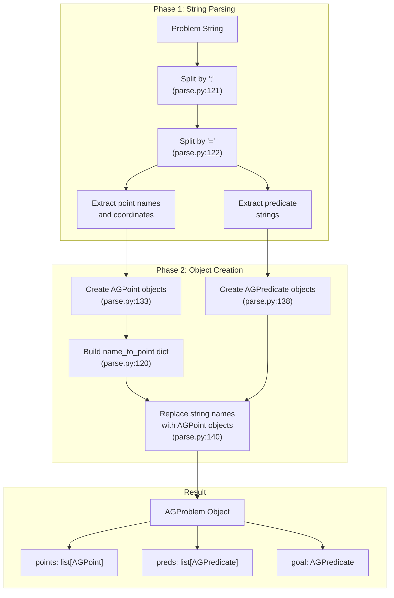
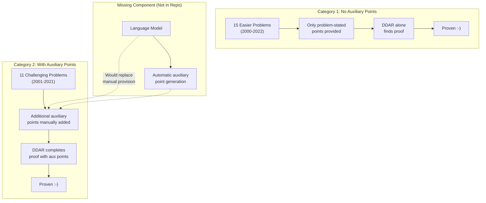

<!-- source: DeepWiki mcp.deepwiki.com · repo google-deepmind/alphageometry2 · page 2.2 Problem Format and Structure · fetched 2026-10-26 -->

# Problem Format and Structure

<details>
<summary>Relevant source files</summary>

The following files were used as context for generating this wiki page:

- [README.md](README.md)
- [parse.py](parse.py)
- [test.py](test.py)

</details>


## Purpose and Scope

This page documents the AlphaGeometry2 problem representation format—the structured string format used to encode geometry problems for the DDAR logical engine. This includes the syntax for defining points with coordinates, geometric predicates, and goal statements, as well as the distinction between problems solvable without auxiliary points and those requiring them.

For information about how these problems are parsed into structured data objects, see [Problem Parsing and Data Structures](#7). For information about the test suite that contains the problem strings, see [Test Suite and Problem Sets](#8).

---

## Problem String Format Overview

AlphaGeometry2 problems are encoded as single-line strings with three main components:

1. **Point declarations**: Define geometric points with names and numerical coordinates
2. **Predicate constraints**: Specify geometric relationships that are given as true
3. **Goal predicate**: The statement to be proven

**String Anatomy**



**Sources:** [test.py:22-234](), [parse.py:111-148]()

---

## Point Declaration Format

### Syntax

Each point is declared with the format:
```
<name>@<x-coordinate>_<y-coordinate> = 
```

- **Name**: Lowercase letter or alphanumeric identifier (e.g., `a`, `b`, `c`, `o1`, `g2`)
- **Coordinates**: Floating-point values separated by underscore
- **Separator**: Points are separated by semicolons (`;`)
- **Terminator**: Each point declaration ends with ` = ` (space-equals-space)

### Examples

```
a@0.0_0.0 = 
b@1.0_0.0 = 
c@0.4951025014191702_0.7048803388401101 = 
o@0.5_0.5653092857516873 = 
m@-0.316805061166676_-1.3543787340166435 = 
```

### Coordinate System

- Origin at `(0, 0)`
- Standard Cartesian coordinates
- Coordinates can be negative
- High precision (up to 16 decimal places typical)
- Values are converted to NumPy arrays internally ([parse.py:132]())

**Coordinate Assignment Diagram**



**Sources:** [parse.py:26-35](), [parse.py:121-133](), [test.py:23-233]()

---

## Predicate Format

### Syntax Structure

Predicates follow the format:
```
<predicate_name> <point1> <point2> ... <constant1> <constant2> ...
```

- **Predicate name**: Lowercase identifier indicating the geometric relationship
- **Points**: References to previously declared points (by name)
- **Constants**: Optional numerical values (integers, fractions, or special angle values)
- **Separator**: Predicates are separated by commas (`,`)

### Common Predicate Types

| Predicate | Arity | Constants | Meaning |
|-----------|-------|-----------|---------|
| `coll` | 3+ points | 0 | Points are collinear |
| `cyclic` | 4 points | 0 | Four points lie on a circle |
| `cong` | 4 points | 0 | Two segments are congruent: AB ≅ CD |
| `perp` | 4 points | 0 | Two lines are perpendicular: AB ⊥ CD |
| `para` | 4 points | 0 | Two lines are parallel: AB ∥ CD |
| `eqangle` | 8 points | 0 | Two angles are equal: ∠ABC = ∠DEF |
| `eqratio` | 8 points | 0 | Two ratios are equal: AB/CD = EF/GH |
| `aconst` | 3 points | 1 constant | Angle has constant value (degrees) |
| `distseq` | 4 points | 4 constants | Distance equation with coefficients |

### Examples with Analysis

```
# Congruence: segments AO and BO have equal length
cong a o b o

# Perpendicularity: line AB is perpendicular to line CD
perp a b c d

# Collinearity: points A, C, and M lie on the same line
coll a c m

# Angle equality: angle ABC equals angle DEF
eqangle a b a c d e d f

# Constant angle: angle ABC is 60 degrees
aconst a b a c 60
```

### Constant Formats

Constants can be specified in multiple formats ([parse.py:64-77]()):

- **Integer**: `60`, `-1`
- **Fraction**: `1/2`, `-3/4` (parsed to `fractions.Fraction`)
- **Pi fraction**: `pi/3`, `2pi/5` (parsed to degrees: `180°/3 = 60°`)

**Sources:** [parse.py:37-81](), [test.py:34-38]()

---

## Goal Specification

### Format

The goal predicate is separated from the given predicates by a question mark (`?`):

```
<point_declarations> <given_predicates> ? <goal_predicate>
```

### Example

```
a@0.0_0.0 = ; b@1.0_0.0 = ; c@0.5_0.8 = ; o@0.5_0.4 = 
cong a o b o, cong b o c o ? cong a c b c
```

**Interpretation:**
- **Given**: Points a, b, c, o with specified coordinates
- **Given**: AO ≅ BO and BO ≅ CO
- **Prove**: AC ≅ BC

### Special Goal Types

Some problems use special goal predicates:

- **`acompute`**: Compute a specific angle value ([test.py:251]())
  ```
  ? acompute b a b c
  ```
  (Prove that angle BAC has a specific value)

**Sources:** [parse.py:114-118](), [test.py:36-38]()

---

## Parsing Process

The problem string undergoes a two-phase parsing process to create structured objects.

**Two-Phase Parsing Diagram**



**Phase Details**

| Phase | Input | Operations | Output |
|-------|-------|------------|--------|
| **String Parsing** | Single problem string | Split by `;`, `=`, `,`, `?`<br/>Extract names and values | Lists of string tokens |
| **Object Creation** | String tokens | Create `AGPoint` with NumPy values<br/>Create `AGPredicate` objects<br/>Map names to point objects | `AGProblem` with structured data |

**Key Classes**

- **`AGPoint`** ([parse.py:26-35]()): Container for point name and coordinate value
- **`AGPredicate`** ([parse.py:37-81]()): Container for predicate name, point references, and constants
- **`AGProblem`** ([parse.py:83-148]()): Complete problem with points, constraints, and goal

**Sources:** [parse.py:111-148](), [parse.py:45-50](), [parse.py:96-101]()

---

## Problem Categories

The test suite contains two distinct categories of problems, reflecting different levels of difficulty and the role of auxiliary points.

### Category 1: Problems Without Auxiliary Points (15 problems)

These are "easier" IMO problems that can be solved by DDAR's deductive reasoning alone, using only the points explicitly given in the problem statement.

**Characteristics:**
- All necessary points are provided in the problem definition
- DDAR can find a proof through direct application of inference rules
- No strategic constructions required
- Years: 2000, 2002, 2003, 2004, 2005, 2007, 2010, 2012, 2013, 2014, 2015, 2016, 2017, 2022

**Example:** IMO 2004 P5
```python
"a@0.0_0.0 = ; b@1.0_0.0 = ; c@-0.249_0.654 = ; o@0.5_0.565 = ; 
 d@0.703_1.291 = ; p@1.960_1.121 = 
 cong a o b o, cong b o c o, cong a o o d, 
 eqangle b a b d b p b c, eqangle d a d b d p d c ? cong a p c p"
```

### Category 2: Problems With Auxiliary Points (11 problems)

These are "challenging" IMO problems that require auxiliary constructions—additional points not mentioned in the original problem statement but necessary for the proof.

**Characteristics:**
- Original problem requires strategic auxiliary point construction
- Auxiliary points are **manually provided** in the problem string
- DDAR can complete the proof once auxiliary points are given
- In the full AlphaGeometry system, a language model would generate these points
- Years: 2001, 2003, 2005, 2008, 2009, 2011, 2013, 2019, 2021

**Example:** IMO 2005 P1 (with auxiliary points `x` and `p`)
```python
"a@0.0_3.464 = ; b@-2.0_0.0 = ; c@2.0_0.0 = ; 
 a1@-0.435_0.0 = ; a2@0.946_0.0 = ; 
 b1@1.217_1.355 = ; b2@0.526_2.552 = ; 
 c1@-0.782_2.108 = ; c2@-1.473_0.911 = ; 
 x@-0.0_1.154 = ; p@-0.164_1.355 = 
 <predicates...> ? coll x c1 a2"
```

Note the auxiliary points `x` and `p` which are not part of the original problem statement.

**Problem Category Comparison Diagram**



**Sources:** [test.py:22-234](), [test.py:236-479](), [test.py:481-488](), [README.md:10-16]()

---

## Complete Problem Examples

### Example 1: IMO 2000 P1 (Without Auxiliary Points)

**Problem String (formatted for readability):**
```
a@-0.522_0.108 = ;
b@-0.186_0.190 = ;
g1@-0.484_-0.048 = ;
g2@-0.120_-0.082 = ;
m@-0.363_0.058 = ;
n@-0.385_-0.176 = ;
c@-0.641_-0.009 = ;
d@0.030_0.154 = ;
e@-0.403_0.226 = ;
p@-0.484_0.029 = ;
q@-0.242_0.087 = 
perp a b a g1,
perp a b b g2,
cong a g1 g1 m,
cong b g2 g2 m,
cong a g1 g1 n,
cong b g2 g2 n,
cong a g1 g1 c,
para a b m c,
cong b g2 g2 d,
para a b m d,
coll a c e,
coll b d e,
coll a n p,
coll c d p,
coll b n q,
coll c d q 
? cong e p e q
```

**Component Breakdown:**

| Component | Count | Details |
|-----------|-------|---------|
| Points | 11 | a, b, g1, g2, m, n, c, d, e, p, q |
| Given predicates | 16 | Various geometric constraints |
| Goal | 1 | Prove EP ≅ EQ |
| Auxiliary points | 0 | All points are from problem statement |

**Predicate Types Used:**
- `perp` (2): Perpendicularity constraints
- `cong` (6): Congruence constraints
- `para` (2): Parallel line constraints
- `coll` (6): Collinearity constraints

### Example 2: IMO 2005 P1 (With Auxiliary Points)

**Problem String (formatted for readability):**
```
a@0.0_3.464 = ;
b@-2.0_0.0 = ;
c@2.0_0.0 = ;
a1@-0.435_0.0 = ;
a2@0.946_0.0 = ;
b1@1.217_1.355 = ;
b2@0.526_2.552 = ;
c1@-0.782_2.108 = ;
c2@-1.473_0.911 = ;
x@-0.0_1.154 = ;
p@-0.164_1.355 = 
cong a b b c,
cong b c c a,
coll a1 b c,
coll a2 b c,
coll b1 c a,
cong a1 a2 a2 b1,
coll b2 c a,
cong a2 b1 b1 b2,
coll c1 a b,
cong b1 b2 b2 c1,
coll c2 a b,
cong b2 c1 c1 c2,
cong c1 c2 c2 a1,
coll x a1 b2,
coll x b1 c2,
para p a1 a2 b1,
para p b1 b c 
? coll x c1 a2
```

**Component Breakdown:**

| Component | Count | Details |
|-----------|-------|---------|
| Points | 11 | a, b, c (main), a1, a2, b1, b2, c1, c2 (constructions), **x, p (auxiliary)** |
| Given predicates | 17 | Complex constraint system |
| Goal | 1 | Prove X, C1, A2 are collinear |
| Auxiliary points | 2 | **x** and **p** (not in original problem) |

**Key Observation:**
- Points `x` and `p` are auxiliary constructions
- They are not part of the original IMO problem statement
- They are manually added to enable DDAR to find the proof
- In the full AlphaGeometry system, these would be generated by the language model

**Sources:** [test.py:23-39](), [test.py:268-281]()

---

## Auxiliary Points in Context

### What Are Auxiliary Points?

Auxiliary points are geometric constructions not mentioned in the original problem statement but necessary for certain proofs. They represent strategic insights—adding helper points that make relationships visible or enable key inference steps.

**Example Scenarios:**
- Intersection of two constructed lines
- Point satisfying multiple geometric constraints
- Strategic perpendicular or parallel constructions

### The Two-Component Architecture

```mermaid
graph TB
    subgraph "Full AlphaGeometry System"
        Problem["Original Problem<br/>(natural language)"]
        LM["Language Model<br/>(NOT IN REPO)"]
        FormProblem["Formalized Problem<br/>+ Auxiliary Points"]
        DDAR["DDAR Logical Core<br/>(THIS REPO)"]
        Proof["Complete Proof"]
    end
    
    subgraph "This Repository: Test Mode"
        TestProblem["Problem String<br/>(with manual aux points)"]
        TestDDAR["DDAR Engine<br/>(ddar.py)"]
        TestResult["Verification Result"]
    end
    
    Problem --> LM
    LM -->|"Generates<br/>aux points"| FormProblem
    FormProblem --> DDAR
    DDAR --> Proof
    
    TestProblem --> TestDDAR
    TestDDAR --> TestResult
    
    style LM fill:#f9f9f9,stroke-dasharray: 5 5
    style DDAR fill:#e8e8e8
    style TestDDAR fill:#e8e8e8
```



### Manual vs. Automatic Auxiliary Points

| Aspect | This Repository | Full AlphaGeometry System |
|--------|-----------------|---------------------------|
| Auxiliary point source | **Manually provided** in problem string | **Automatically generated** by language model |
| Problem format | Complete with all points pre-specified | Original problem + LM adds points iteratively |
| System tested | DDAR logical core only | Complete AI system (LM + DDAR) |
| Purpose | Verify DDAR correctness | Autonomous problem solving |

**Sources:** [README.md:10-16](), [test.py:481-488](), [test.py:236-479]()

---

## Parsing Code Entry Points

For developers working with the problem format:

**Main Parsing Method:**
- [`AGProblem.parse(line)`]() ([parse.py:111-148]()): Parses complete problem string

**Supporting Methods:**
- [`AGPredicate.parse(line)`]() ([parse.py:58-81]()): Parses single predicate
- [`AGPoint.__init__(name, value)`]() ([parse.py:29-31]()): Creates point with coordinates
- [`AGProblem.replace_points(ori_to_new)`]() ([parse.py:96-101]()): Replaces string names with objects

**Data Classes:**
- [`AGPoint`]() ([parse.py:26-35]()): Point representation
- [`AGPredicate`]() ([parse.py:37-81]()): Predicate representation  
- [`AGProblem`]() ([parse.py:83-148]()): Complete problem representation

**Sources:** [parse.py:1-149]()

---

