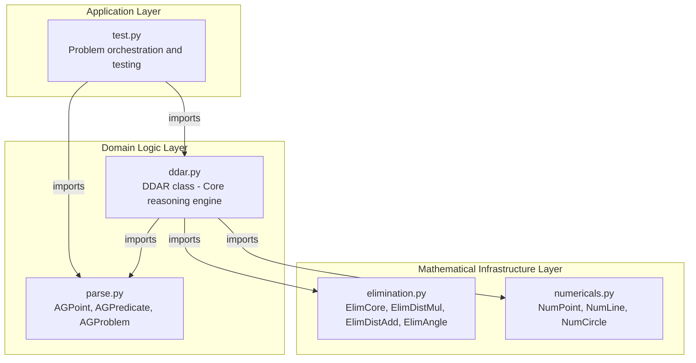
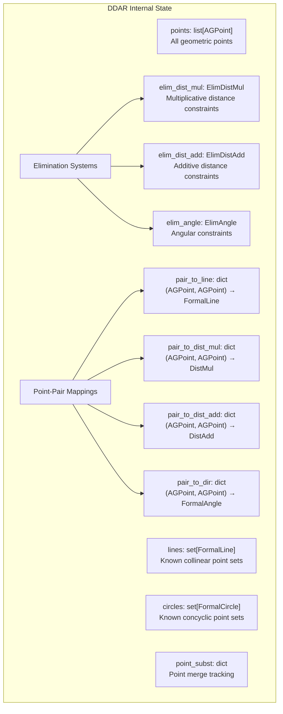
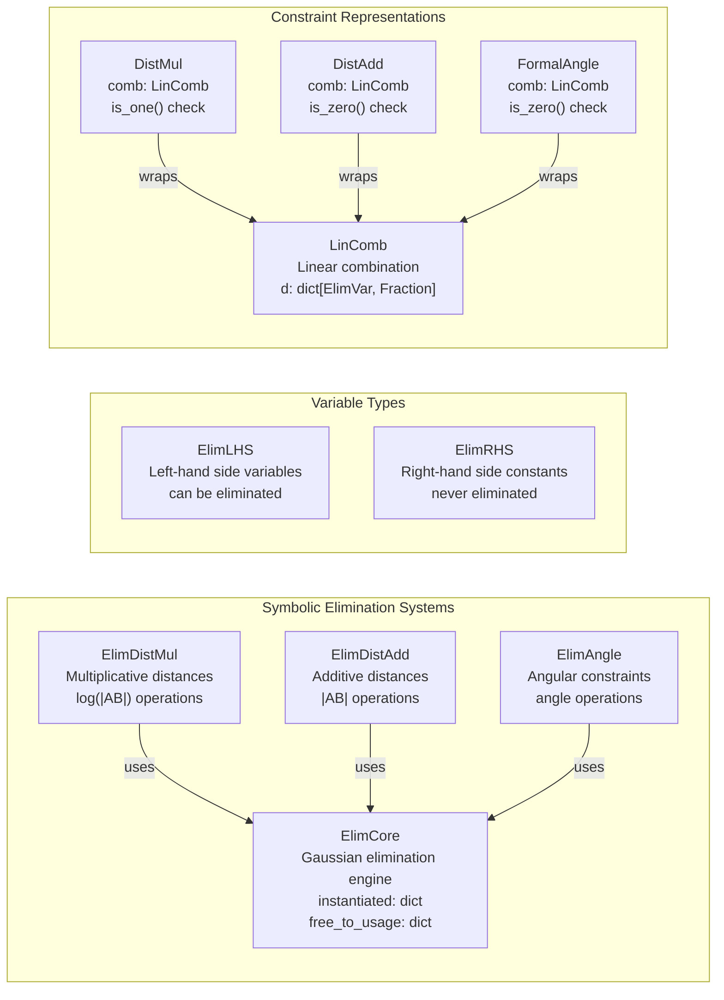
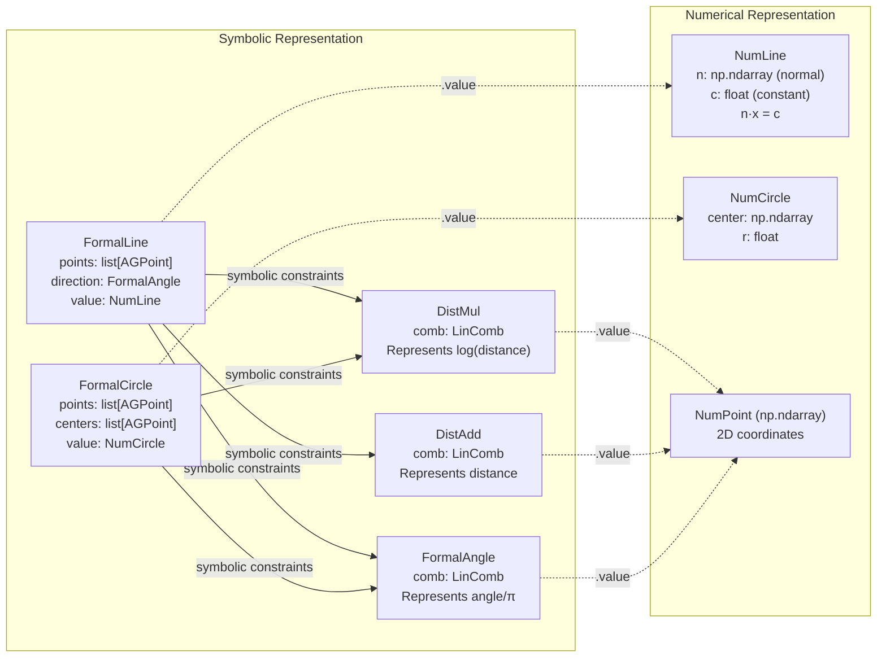

<!-- source: DeepWiki mcp.deepwiki.com · repo google-deepmind/alphageometry2 · page 3 System Architecture · fetched 2026-10-26 -->

# System Architecture

Relevant source files

The following files were used as context for generating this wiki page:

- [ddar.py](ddar.py)
- [elimination.py](elimination.py)
- [numericals.py](numericals.py)
- [parse.py](parse.py)
- [test.py](test.py)

This page provides a high-level overview of the AlphaGeometry2 DDAR logical core system architecture, including its component structure, data representations, and execution flow. It describes how the different modules interact to parse geometry problems, perform symbolic reasoning, and verify proofs.

For detailed information about specific components:
- For module dependency details, see [Module Dependencies](#3.1)
- For data representation specifics, see [Data Representations](#3.2)
- For the DDAR reasoning engine internals, see [DDAR Logical Engine](#4)
- For the complete problem-solving workflow, see [Problem-Solving Pipeline](#9)

## System Overview

The AlphaGeometry2 DDAR logical core is a symbolic geometry theorem prover implemented in Python. It consists of five primary modules organized in a three-layer architecture:

**Sources:** [test.py:1-20](), [ddar.py:1-25](), [parse.py:1-20](), [elimination.py:1-26](), [numericals.py:1-22]()

The system processes International Mathematical Olympiad (IMO) geometry problems through a pipeline that:
1. Parses problem strings into structured representations
2. Initializes symbolic and numerical reasoning systems
3. Asserts given conditions as constraints
4. Applies deductive inference rules iteratively
5. Verifies goal predicates against the knowledge base

## Core Components

### Application Layer: test.py

The `test.py` module serves as the entry point and orchestrator. It contains:

- **Problem dictionaries**: `problems_without_aux` and `problems_with_aux` storing 26 IMO geometry problems as strings
- **Execution function**: `print_problem_and_solve()` which loops through problems, parses them, runs DDAR, and reports results
- **Problem categories**: 15 problems solvable without auxiliary points, 11 requiring manually-provided auxiliary points

**Sources:** [test.py:22-234](), [test.py:236-479](), [test.py:491-507]()

### Domain Logic Layer

#### parse.py - Problem Representation

Defines three fundamental data structures:

| Class | Purpose | Key Attributes |
|-------|---------|----------------|
| `AGPoint` | Geometric point with name and coordinates | `name: str`, `value: np.ndarray` |
| `AGPredicate` | Geometric constraint or goal | `name: str`, `points: list`, `constants: list` |
| `AGProblem` | Complete problem specification | `points: list[AGPoint]`, `preds: list[AGPredicate]`, `goal: AGPredicate` |

The `AGProblem.parse()` method converts problem strings into structured objects through two-phase parsing: first extracting point coordinates, then resolving point references in predicates.

**Sources:** [parse.py:26-35](), [parse.py:37-56](), [parse.py:83-101](), [parse.py:111-148]()

#### ddar.py - Reasoning Engine

The `DDAR` class is the core reasoning engine maintaining:

**Sources:** [ddar.py:66-127]()

The `DDAR` class provides key methods:

- **Initialization**: `__init__(points)` creates elimination systems and initializes mappings for all point pairs
- **Predicate processing**: `force_pred(pred)` translates geometric predicates into constraints
- **Deductive closure**: `deduction_closure()` iteratively applies inference rules until no new facts are derived
- **Predicate checking**: `check_pred(pred)` queries whether a predicate is satisfied in the knowledge base

**Sources:** [ddar.py:69-127](), [ddar.py:131-173](), [ddar.py:259-298](), [ddar.py:301-357]()

### Mathematical Infrastructure Layer

#### elimination.py - Symbolic Constraint Solving

Implements Gaussian elimination for three constraint types:

**Sources:** [elimination.py:28-46](), [elimination.py:48-125](), [elimination.py:127-194](), [elimination.py:234-319](), [elimination.py:349-397](), [elimination.py:437-483]()

Key classes:

- `ElimCore`: Core Gaussian elimination implementation using pivoting strategy
- `ElimDistMul`, `ElimDistAdd`, `ElimAngle`: Type-specific elimination systems wrapping `ElimCore`
- `LinComb`: Linear combination of variables with rational coefficients
- `DistMul`, `DistAdd`, `FormalAngle`: High-level constraint representations

**Sources:** [elimination.py:127-194](), [elimination.py:321-347](), [elimination.py:400-426](), [elimination.py:486-523]()

#### numericals.py - Numerical Geometry

Provides concrete geometric calculations using NumPy:

| Class/Function | Purpose | Key Operations |
|----------------|---------|----------------|
| `NumPoint` | 2D coordinate (np.ndarray) | - |
| `NumLine` | Line as normal equation `n·x = c` | `through()`, `distance()`, `direction()`, `position()` |
| `NumCircle` | Circle with center and radius | `through()`, `distance()` |
| `distance()` | Euclidean distance | - |
| `orientation()` | Point orientation test | Returns +1, 0, or -1 |
| `direction()` | Angle in units of π | Returns float in [0, 1) |

**Sources:** [numericals.py:20-26](), [numericals.py:61-87](), [numericals.py:101-122](), [numericals.py:24-59]()

## Data Flow Architecture

The following diagram shows how data transforms through the system from input to output:

```mermaid
graph TB
    Input["Problem String<br/>'a@0.0_0.0 = ; ... ? goal'"]
    
    subgraph Parsing["Parsing Phase (parse.py)"]
        Tokenize["Tokenize string<br/>Split by ';' '=' ',' '?'"]
        CreatePoints["Create AGPoint objects<br/>name + np.array coordinates"]
        CreatePreds["Create AGPredicate objects<br/>name + points + constants"]
        AssembleProblem["Assemble AGProblem<br/>points, preds, goal"]
    end
    
    subgraph Initialization["DDAR Initialization (ddar.py)"]
        InitElim["Initialize elimination systems<br/>ElimDistMul, ElimDistAdd, ElimAngle"]
        CreatePairs["For each point pair (A,B)<br/>Create DistMul, DistAdd, FormalAngle variables"]
        CreateLines["Create FormalLine objects<br/>Initial lines through each pair"]
        InitMaps["Initialize pair_to_* mappings"]
    end
    
    subgraph Assertion["Constraint Assertion (ddar.py)"]
        ForEachPred["For each pred in problem.preds"]
        TranslatePred["Translate predicate to constraints<br/>pred_to_angle(), pred_to_dist_mul(), etc."]
        ForceConstr["Force constraint into elimination system<br/>force_zero(), force_one()"]
    end
    
    subgraph Deduction["Deduction Closure (ddar.py)"]
        UpdateCache["Update cached simplified values"]
        SearchSimilar["search_similar()<br/>Find similar triangles via SSS/AA/SAS/SSA"]
        SearchConcyclic["search_concyclic()<br/>Find cyclic quadrilaterals via inscribed angles"]
        SearchCircles["search_circles()<br/>Find circles via equal distances"]
        MergePoints["merge_points()<br/>Identify and merge equal points"]
        TransferDist["transfer_dist_add_mul()<br/>Sync additive/multiplicative distance systems"]
        TransferArc["transfer_dist_arc_mul()<br/>Sync distance/arc length on circles"]
        CheckConverge{Changed?}
    end
    
    subgraph Verification["Goal Verification (ddar.py)"]
        CheckGoal["check_pred(problem.goal)"]
        QueryElim["Query elimination systems<br/>simplify() and check is_zero()/is_one()"]
        Result{Proven?}
    end
    
    Output["Output: Proven :-) or Not proven"]
    
    Input --> Tokenize
    Tokenize --> CreatePoints
    CreatePoints --> CreatePreds
    CreatePreds --> AssembleProblem
    
    AssembleProblem --> InitElim
    InitElim --> CreatePairs
    CreatePairs --> CreateLines
    CreateLines --> InitMaps
    
    InitMaps --> ForEachPred
    ForEachPred --> TranslatePred
    TranslatePred --> ForceConstr
    ForceConstr --> ForEachPred
    
    ForceConstr --> UpdateCache
    UpdateCache --> SearchSimilar
    SearchSimilar --> SearchConcyclic
    SearchConcyclic --> SearchCircles
    SearchCircles --> MergePoints
    MergePoints --> TransferDist
    TransferDist --> TransferArc
    TransferArc --> CheckConverge
    CheckConverge -->|Yes| UpdateCache
    CheckConverge -->|No| CheckGoal
    
    CheckGoal --> QueryElim
    QueryElim --> Result
    Result -->|Yes| Output
    Result -->|No| Output
```

**Sources:** [test.py:491-507](), [parse.py:111-148](), [ddar.py:69-127](), [ddar.py:131-173](), [ddar.py:301-357](), [ddar.py:259-298]()

## Dual Representation System

DDAR maintains both symbolic and numerical representations of geometric objects:

**Sources:** [ddar.py:33-48](), [ddar.py:50-63](), [elimination.py:234-319](), [elimination.py:349-397](), [elimination.py:437-483](), [numericals.py:61-87](), [numericals.py:101-122]()

This dual representation enables:
- **Symbolic reasoning**: Exact constraint solving through Gaussian elimination
- **Numerical validation**: Approximate checking that constraints are satisfied within tolerance `ATOM = 1e-12`
- **Construction**: Numerical methods construct geometric objects (e.g., circle through three points)
- **Verification**: Symbolic methods verify algebraic relationships hold exactly

## Execution Control Flow

The `DDAR.deduction_closure()` method implements the main inference loop:

```mermaid
graph TD
    Start["deduction_closure() called"]
    Init["changed = True"]
    
    LoopCheck{changed?}
    SetFalse["changed = False"]
    
    Cache["update_cache()<br/>Simplify all cached pairs"]
    
    Similar["search_similar()<br/>Find similar triangles<br/>SSS, AA, SAS, SSA"]
    SimilarChanged{New facts?}
    SimilarUpdate["changed = True<br/>update_cache()"]
    
    Cyclic["search_concyclic()<br/>Find cyclic quadrilaterals<br/>Inscribed angle theorem"]
    CyclicChanged{New facts?}
    CyclicUpdate["changed = True<br/>update_cache()"]
    
    Circles["search_circles()<br/>Find circles via equal radii"]
    CirclesChanged{New facts?}
    
    Merge["merge_points()<br/>Identify equal points"]
    MergeChanged{New facts?}
    MergeUpdate["changed = True<br/>update_cache()"]
    
    TransferDist["transfer_dist_add_mul()<br/>Sync additive/multiplicative"]
    TransferDistChanged{New facts?}
    
    TransferArc["transfer_dist_arc_mul()<br/>Sync distance/arc on circles"]
    TransferArcChanged{New facts?}
    
    Done["Return"]
    
    Start --> Init
    Init --> LoopCheck
    LoopCheck -->|Yes| SetFalse
    LoopCheck -->|No| Done
    
    SetFalse --> Cache
    Cache --> Similar
    Similar --> SimilarChanged
    SimilarChanged -->|Yes| SimilarUpdate
    SimilarChanged -->|No| Cyclic
    SimilarUpdate --> Cyclic
    
    Cyclic --> CyclicChanged
    CyclicChanged -->|Yes| CyclicUpdate
    CyclicChanged -->|No| Circles
    CyclicUpdate --> Circles
    
    Circles --> CirclesChanged
    CirclesChanged -->|Yes| Merge
    CirclesChanged -->|No| Merge
    
    Merge --> MergeChanged
    MergeChanged -->|Yes| MergeUpdate
    MergeChanged -->|No| TransferDist
    MergeUpdate --> TransferDist
    
    TransferDist --> TransferDistChanged
    TransferDistChanged -->|Yes| TransferArc
    TransferDistChanged -->|No| TransferArc
    
    TransferArc --> TransferArcChanged
    TransferArcChanged -->|Yes| LoopCheck
    TransferArcChanged -->|No| LoopCheck
```

**Sources:** [ddar.py:301-357](), [ddar.py:359-438](), [ddar.py:440-481](), [ddar.py:483-524](), [ddar.py:526-580](), [ddar.py:582-620](), [ddar.py:622-649]()

Each search method returns `True` if new facts were discovered, causing the loop to continue. The loop terminates only when a complete iteration produces no new facts.

## Predicate Translation

The system supports multiple geometric predicate types, each translated to specific constraint forms:

```mermaid
graph TB
    subgraph Predicates["Geometric Predicates"]
        Coll["coll A B C<br/>Collinearity"]
        Cyclic["cyclic A B C D<br/>Concyclicity"]
        
        Cong["cong A B C D<br/>Congruent segments"]
        Eqratio["eqratio A B C D E F G H<br/>Equal ratios"]
        Rconst["rconst A B C D r<br/>Ratio constant"]
        
        Distseq["distseq A B C D ... c1 c2 ...<br/>Distance sum"]
        
        Eqangle["eqangle A B C D E F G H<br/>Equal angles"]
        Para["para A B C D<br/>Parallel"]
        Perp["perp A B C D<br/>Perpendicular"]
        Aconst["aconst A B C D θ<br/>Angle constant"]
        
        Overlap["overlap A B<br/>Point equality"]
    end
    
    subgraph Translation["Translation Methods"]
        ForceCollinear["force_collinear(points)<br/>Merge lines, add segment constraints"]
        ForceConcyclic["force_concyclic(points, centers)<br/>Merge circles, add angle/radius constraints"]
        
        PredToDistMul["pred_to_dist_mul(pred)<br/>→ DistMul constraint"]
        ForceOne["elim_dist_mul.force_one(constraint)"]
        
        PredToDistAdd["pred_to_dist_add(pred)<br/>→ DistAdd constraint"]
        ForceZero1["elim_dist_add.force_zero(constraint)"]
        
        PredToAngle["pred_to_angle(pred)<br/>→ FormalAngle constraint"]
        ForceZero2["elim_angle.force_zero(constraint)"]
        
        ForceEqualPoints["force_equal_points(A, B)<br/>Merge point substitution"]
    end
    
    Coll --> ForceCollinear
    Cyclic --> ForceConcyclic
    
    Cong --> PredToDistMul
    Eqratio --> PredToDistMul
    Rconst --> PredToDistMul
    PredToDistMul --> ForceOne
    
    Distseq --> PredToDistAdd
    PredToDistAdd --> ForceZero1
    
    Eqangle --> PredToAngle
    Para --> PredToAngle
    Perp --> PredToAngle
    Aconst --> PredToAngle
    PredToAngle --> ForceZero2
    
    Overlap --> ForceEqualPoints
```

**Sources:** [ddar.py:131-173](), [ddar.py:174-214](), [ddar.py:216-245](), [ddar.py:247-257](), [ddar.py:700-783](), [ddar.py:785-904](), [ddar.py:937-1033]()

The `force_pred()` method dispatches to appropriate handlers based on predicate name, translating high-level geometric statements into low-level constraint equations.

## System Characteristics

**Completeness**: The system is incomplete - it cannot prove all true geometric theorems. It lacks:
- Auxiliary point generation (provided manually in test suite)
- Advanced inference rules beyond similarity, concyclicity, and circle detection

**Soundness**: The system is designed to be sound - it should not prove false statements. This is ensured through:
- Numerical validation of all constraints within tolerance `ATOM = 1e-12`
- Consistent maintenance of symbolic and numerical representations

**Performance**: The deduction closure loop has polynomial time complexity per iteration but may require many iterations. Key bottlenecks:
- Triangle enumeration: O(n³) where n = number of points
- Gaussian elimination: Incremental updates avoid full matrix operations

**Sources:** [ddar.py:301-357](), [ddar.py:359-438](), [numericals.py:20]()

## Repository Scope

This repository contains **only the DDAR logical core**, not the complete AlphaGeometry2 system described in research papers. Missing components:
- Language model for auxiliary point generation
- Training infrastructure
- Proof search strategies beyond pure deduction

The test suite demonstrates DDAR's capabilities by providing pre-constructed problems with manually-specified auxiliary points where needed.

**Sources:** [test.py:481-488]()

---

