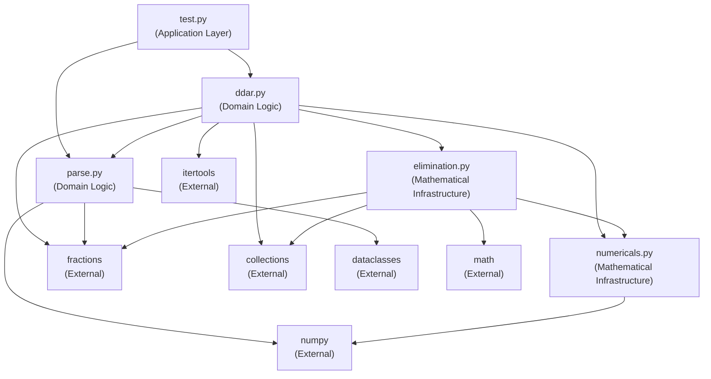
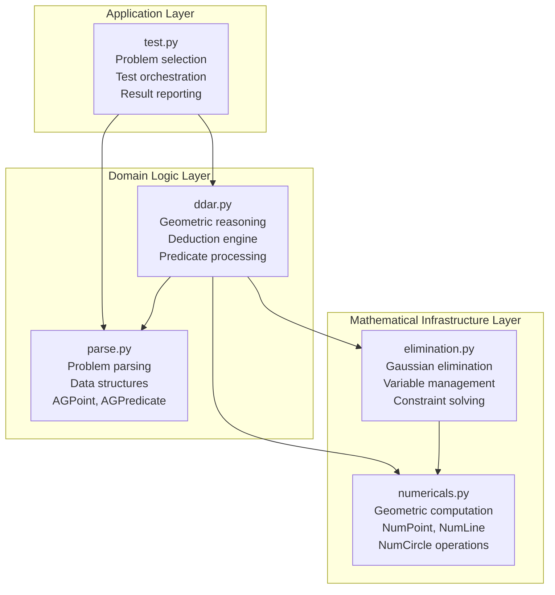
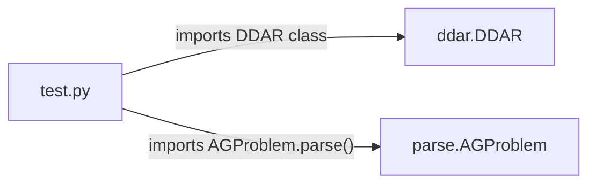
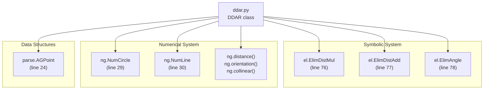
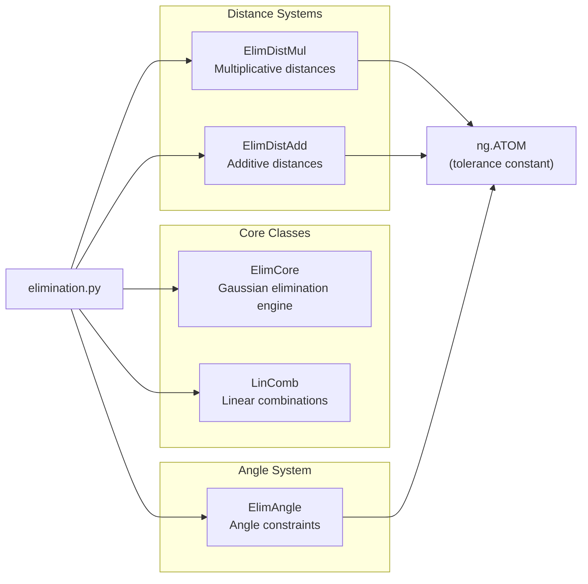
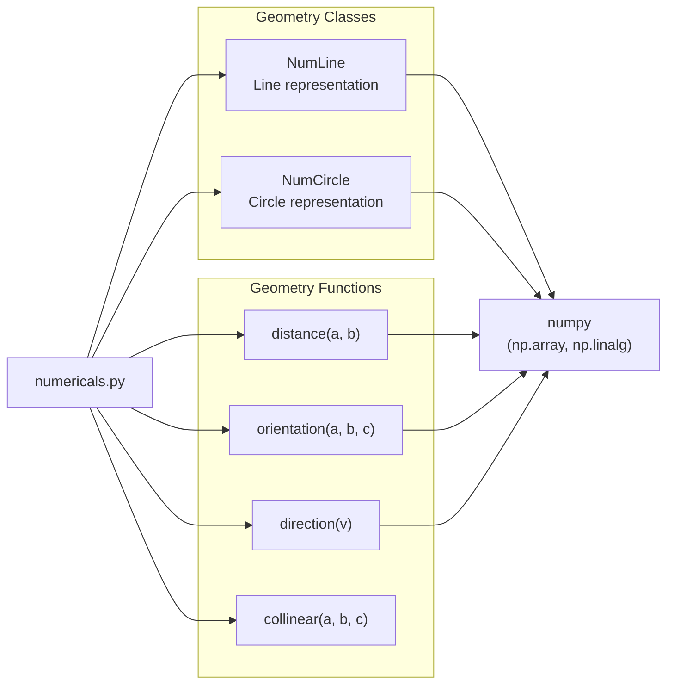
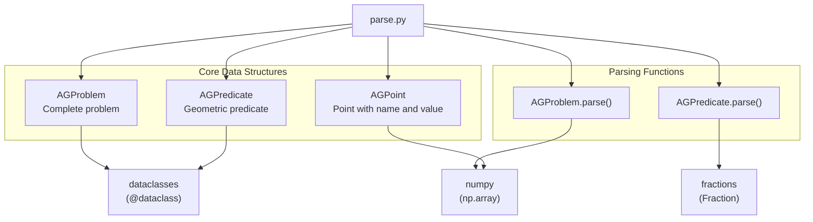
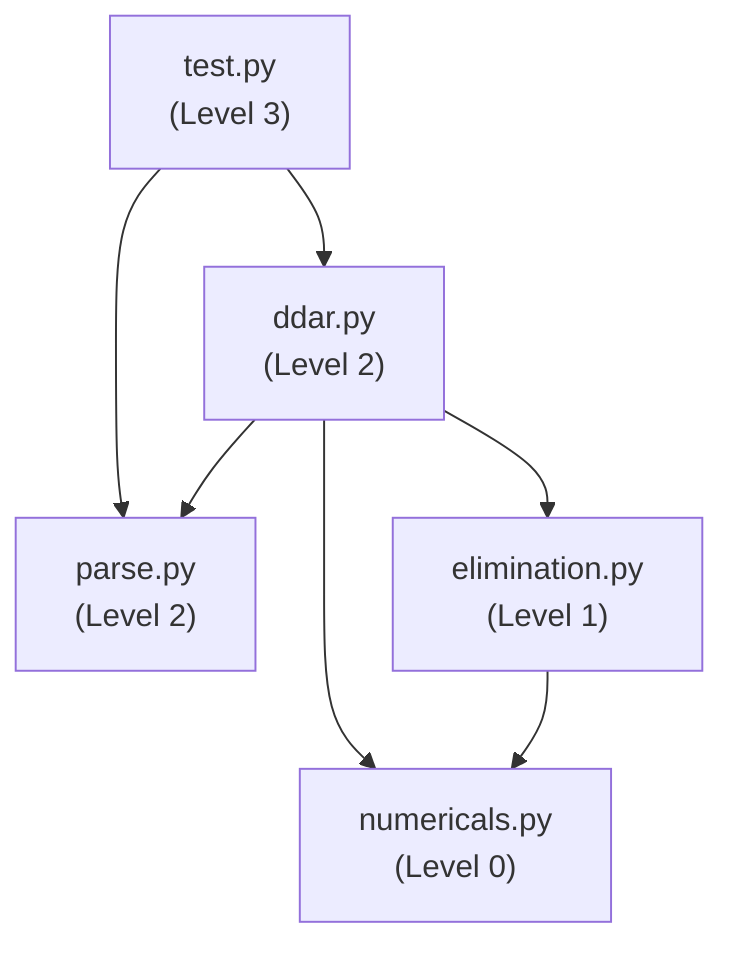

<!-- source: DeepWiki mcp.deepwiki.com · repo google-deepmind/alphageometry2 · page 3.1 Module Dependencies · fetched 2026-10-26 -->

# Module Dependencies

<details>
<summary>Relevant source files</summary>

The following files were used as context for generating this wiki page:

- [ddar.py](ddar.py)
- [elimination.py](elimination.py)
- [numericals.py](numericals.py)
- [parse.py](parse.py)

</details>


This page documents the dependency relationships between modules in the AlphaGeometry2 repository. It describes the import graph, layered architecture, and the responsibilities that drive the dependency structure.

For information about how data flows through these modules during problem solving, see [Problem-Solving Pipeline](#9). For details about the specific classes and functions within each module, see the individual module documentation pages: [DDAR Logical Engine](#4), [Symbolic Elimination System](#5), [Numerical Geometry Module](#6), and [Problem Parsing and Data Structures](#7).

---

## Dependency Graph

The following diagram shows the complete dependency structure of the repository, including both internal module dependencies and external library dependencies.



**Sources:** [ddar.py:18-24](), [elimination.py:18-25](), [numericals.py:18](), [parse.py:18-20]()

---

## Three-Layer Architecture

The codebase follows a clean three-layer architecture pattern with no circular dependencies. Each layer depends only on layers below it, ensuring modularity and reusability.



| Layer | Modules | Responsibility | Dependencies |
|-------|---------|---------------|--------------|
| **Application** | `test.py` | Test orchestration, problem execution | `ddar.py`, `parse.py` |
| **Domain Logic** | `ddar.py`, `parse.py` | Geometric reasoning, problem representation | Mathematical infrastructure |
| **Mathematical Infrastructure** | `elimination.py`, `numericals.py` | Symbolic algebra, numerical geometry | Only standard libraries |

**Sources:** [ddar.py:1-31](), [elimination.py:1-26](), [numericals.py:1-21](), [parse.py:1-24]()

---

## Module-by-Module Import Analysis

### test.py

The test module is at the top of the dependency hierarchy and imports domain logic modules to execute geometry problems.

**Imports:**
- `ddar`: Provides the `DDAR` class for geometric reasoning
- `parse`: Provides `AGProblem` for problem parsing



**Sources:** The test module's imports are not shown in the provided files but are implicit from the architecture diagrams.

---

### ddar.py

The DDAR module is the core geometric reasoning engine. It depends on all three other internal modules to perform its reasoning tasks.

**Direct Imports:**

| Import | Purpose | Key Classes/Functions Used |
|--------|---------|---------------------------|
| `elimination as el` | Symbolic constraint solving | `ElimDistMul`, `ElimDistAdd`, `ElimAngle`, `LinComb`, `FormalAngle`, `DistMul`, `DistAdd` |
| `numericals as ng` | Numerical geometry calculations | `NumCircle`, `NumLine`, `distance()`, `orientation()`, `collinear()` |
| `parse` | Problem data structures | `AGPoint` |
| `collections` | Data structures | `defaultdict` (for mapping angles to points) |
| `fractions` | Exact arithmetic | `Fraction` (for rational coefficients) |
| `itertools` | Combinatorial iteration | `combinations()`, `permutations()` |



**Key Import Locations:**

[ddar.py:18-30]()
```
import collections
import fractions
import itertools

import elimination as el
import numericals as ng
from parse import AGPoint


Fraction = fractions.Fraction
DefaultDict = collections.defaultdict
NumCircle = ng.NumCircle
NumLine = ng.NumLine
```

**Sources:** [ddar.py:18-30]()

---

### elimination.py

The elimination module provides symbolic constraint solving through Gaussian elimination. It has minimal dependencies and is designed to be reusable.

**Direct Imports:**

| Import | Purpose | Key Classes/Functions Used |
|--------|---------|---------------------------|
| `numericals as ng` | Numerical tolerance checking | `ATOM` constant, `ng.ATOM` |
| `collections` | Data structures | `defaultdict` (for variable usage tracking) |
| `fractions` | Exact arithmetic | `Fraction` (for rational coefficients) |
| `math` | Mathematical operations | `lcm()`, `pow()`, `floor()` |



**Key Import Locations:**

[elimination.py:18-25]()
```
from __future__ import annotations

import collections
import fractions
import math
from typing import Any

import numericals as ng
```

**Note:** The only internal dependency is on `numericals.py` for the `ATOM` tolerance constant used in numerical assertions ([elimination.py:331](), [elimination.py:410](), [elimination.py:502]()).

**Sources:** [elimination.py:18-25]()

---

### numericals.py

The numericals module provides numerical geometry primitives and has no internal dependencies. It depends only on NumPy for array operations.

**Direct Imports:**

| Import | Purpose | Key Classes/Functions Used |
|--------|---------|---------------------------|
| `numpy as np` | Numerical arrays and linear algebra | `np.array`, `np.linalg.norm`, `np.linalg.det`, `np.linalg.solve`, `np.arctan2` |



**Key Import Locations:**

[numericals.py:18]()
```
import numpy as np
```

**Constants Defined:**
- `ATOM = 1e-12`: Numerical tolerance for geometric calculations ([numericals.py:20]())
- `NumPoint = np.ndarray`: Type alias for 2D points ([numericals.py:21]())

**Sources:** [numericals.py:18-21]()

---

### parse.py

The parse module provides data structures for representing geometry problems and depends only on standard libraries and NumPy.

**Direct Imports:**

| Import | Purpose | Key Classes/Functions Used |
|--------|---------|---------------------------|
| `dataclasses` | Data structure definitions | `@dataclasses.dataclass` decorator |
| `fractions` | Exact arithmetic | `Fraction` (for parsing rational constants) |
| `numpy as np` | Point coordinates | `np.array` (for 2D point values) |



**Key Import Locations:**

[parse.py:18-23]()
```
import dataclasses
import fractions
import numpy as np


Fraction = fractions.Fraction
```

**Sources:** [parse.py:18-23]()

---

## Dependency Characteristics

### No Circular Dependencies

The module structure is **acyclic**, meaning no module depends on itself directly or indirectly. This is a fundamental architectural principle that ensures:

1. **Build Order**: Modules can be compiled/loaded in a well-defined order
2. **Testing**: Each module can be tested independently of its dependents
3. **Maintainability**: Changes propagate in one direction only



**Build Order:** `numericals.py` → `elimination.py`, `parse.py` → `ddar.py` → `test.py`

**Sources:** [ddar.py:18-24](), [elimination.py:18-25](), [numericals.py:18](), [parse.py:18-20]()

---

### Mathematical Infrastructure Independence

The `elimination.py` and `numericals.py` modules are **independent of each other** (except for the `ATOM` constant dependency). This design allows:

1. **Parallel Development**: Distance elimination and numerical geometry can be developed independently
2. **Reusability**: Either module can be used in other projects without the other
3. **Testing**: Each system can be tested in isolation

| Module | Depends On | Used By | Role |
|--------|-----------|---------|------|
| `numericals.py` | None (internal) | `elimination.py`, `ddar.py` | Foundation: numerical operations |
| `elimination.py` | `numericals.py` (only `ATOM`) | `ddar.py` | Foundation: symbolic operations |
| `parse.py` | None (internal) | `ddar.py`, `test.py` | Foundation: data structures |
| `ddar.py` | All infrastructure | `test.py` | Core: geometric reasoning |
| `test.py` | `ddar.py`, `parse.py` | None | Application: test execution |

**Sources:** [elimination.py:25](), [numericals.py:1-123]()

---

## Import Usage Patterns

### Symbol Aliasing

Several modules use aliasing to create shorter, more convenient names for frequently-used imports:

**In ddar.py** [ddar.py:27-30]():
```python
Fraction = fractions.Fraction
DefaultDict = collections.defaultdict
NumCircle = ng.NumCircle
NumLine = ng.NumLine
```

**In parse.py** [parse.py:23]():
```python
Fraction = fractions.Fraction
```

**In elimination.py:** Uses qualified names (`ng.ATOM`) without aliasing

**In numericals.py:** Uses qualified names (`np.array`, `np.linalg.norm`) without aliasing

---

### Module-Level Imports vs Qualified Names

The codebase uses two import patterns:

**Pattern 1: Module Import with Qualification**
```python
import elimination as el
# Later: el.ElimDistMul(), el.LinComb.zero()
```
Used for: `elimination`, `numericals` (when imported as modules)

**Pattern 2: Direct Class Import**
```python
from parse import AGPoint
# Later: AGPoint(name, value)
```
Used for: Single classes from `parse` module

This pattern distinction helps distinguish between:
- **Infrastructure modules** (imported as namespaces): `el.*`, `ng.*`
- **Data structure classes** (imported directly): `AGPoint`, `AGPredicate`, `AGProblem`

**Sources:** [ddar.py:22-24]()

---

## External Dependencies

All modules depend on Python standard library modules or NumPy. There are no dependencies on domain-specific external libraries.

| External Package | Used By | Purpose |
|------------------|---------|---------|
| `numpy` | `numericals.py`, `parse.py`, `ddar.py` (via ng) | Array operations, linear algebra |
| `fractions` | `parse.py`, `ddar.py`, `elimination.py` | Exact rational arithmetic |
| `collections` | `ddar.py`, `elimination.py` | `defaultdict` for mappings |
| `itertools` | `ddar.py` | `combinations()`, `permutations()` for iteration |
| `dataclasses` | `parse.py` | Data structure definitions |
| `math` | `elimination.py` | `lcm()`, `pow()`, `floor()` |

**NumPy Usage:**
- `numericals.py`: Core dependency for all numerical operations [numericals.py:18]()
- `parse.py`: Used only for point coordinate storage (`np.array`) [parse.py:20]()
- `ddar.py`: Accessed indirectly through `numericals` module

**Sources:** [ddar.py:18-20](), [elimination.py:20-23](), [numericals.py:18](), [parse.py:18-20]()

---

## Dependency Rationale

### Why ddar.py Depends on All Three Infrastructure Modules

The `DDAR` class serves as the **integration point** for geometric reasoning, requiring:

1. **elimination.py**: For managing three constraint systems ([ddar.py:76-78]()):
   - `ElimDistMul` for multiplicative distances
   - `ElimDistAdd` for additive distances
   - `ElimAngle` for angle constraints

2. **numericals.py**: For numerical verification and geometric calculations ([ddar.py:92-96]()):
   - Computing actual distances between points
   - Checking collinearity and orientation
   - Verifying numerical consistency

3. **parse.py**: For working with problem data structures ([ddar.py:24]()):
   - `AGPoint` objects representing geometric points
   - Points contain both symbolic names and numerical values

```mermaid
graph TB
    ddar["DDAR class"]
    
    subgraph "Initialization (lines 76-78)"
        init_mul["self.elim_dist_mul = el.ElimDistMul()"]
        init_add["self.elim_dist_add = el.ElimDistAdd()"]
        init_angle["self.elim_angle = el.ElimAngle()"]
    end
    
    subgraph "Point Processing (lines 90-118)"
        num_dist["ng.distance(a.value, b.value)"]
        num_line["NumLine.through(a.value, b.value)"]
        new_vars["Create ElimVars for each pair"]
    end
    
    subgraph "Deduction Rules (lines 359-649)"
        similar["search_similar()<br/>Uses both ng and el"]
        concyclic["search_concyclic()<br/>Uses both ng and el"]
        circles["search_circles()<br/>Uses both ng and el"]
    end
    
    ddar --> init_mul
    ddar --> init_add
    ddar --> init_angle
    ddar --> num_dist
    ddar --> num_line
    ddar --> new_vars
    ddar --> similar
    ddar --> concyclic
    ddar --> circles
```



**Sources:** [ddar.py:66-127](), [ddar.py:301-649]()

---

### Why elimination.py Depends on numericals.py

The `elimination.py` module depends on `numericals.py` only for the **numerical tolerance constant** `ATOM`. This is used in assertions to verify that symbolic constraints match their numerical values:

**Usage Locations:**
1. [elimination.py:331](): `assert abs(dist_mul.value - 1.0) ** 2 < ng.ATOM`
2. [elimination.py:410](): `assert abs(dist_add.value) ** 2 < ng.ATOM`
3. [elimination.py:502](): `assert abs((angle.value + 0.5) % 1 - 0.5) ** 2 < ng.ATOM`

These assertions ensure that when a constraint is forced (e.g., "force this distance ratio to equal 1"), it is numerically consistent with the actual geometric values.

**Alternative Design:** The `ATOM` constant could be defined in a separate `constants.py` module to make `elimination.py` completely independent, but the current design is simpler for a small codebase.

**Sources:** [elimination.py:25](), [elimination.py:331](), [elimination.py:410](), [elimination.py:502]()

---

## Summary Table

| Module | Layer | Internal Deps | External Deps | Primary Role |
|--------|-------|---------------|---------------|--------------|
| `test.py` | Application | `ddar`, `parse` | - | Test orchestration |
| `ddar.py` | Domain Logic | `elimination`, `numericals`, `parse` | `fractions`, `collections`, `itertools` | Geometric reasoning |
| `parse.py` | Domain Logic | None | `numpy`, `fractions`, `dataclasses` | Problem representation |
| `elimination.py` | Infrastructure | `numericals` (ATOM only) | `fractions`, `collections`, `math` | Symbolic algebra |
| `numericals.py` | Infrastructure | None | `numpy` | Numerical geometry |

**Dependency Depth:**
- Maximum depth: 3 levels (test → ddar → elimination → numericals)
- Infrastructure modules: 0-1 internal dependencies
- Domain logic modules: 1-3 internal dependencies
- Application module: 2 internal dependencies

**Sources:** All files in the repository

---

