<!-- source: DeepWiki mcp.deepwiki.com · repo google-deepmind/alphageometry2 · page 3.2 Data Representations · fetched 2026-10-26 -->

# Data Representations

<details>
<summary>Relevant source files</summary>

The following files were used as context for generating this wiki page:

- [ddar.py](ddar.py)
- [elimination.py](elimination.py)
- [numericals.py](numericals.py)
- [parse.py](parse.py)

</details>


## Purpose and Scope

This document describes the different data representations used throughout the AlphaGeometry2 system and how data transforms between these representations. The system employs multiple parallel representations to enable both exact symbolic reasoning and approximate numerical verification. 

For information about how modules depend on each other, see [Module Dependencies](#3.1). For details on the problem string format, see [Problem String Format](#7.1). For how DDAR uses these representations, see [DDAR Logical Engine](#4).

Sources: [ddar.py:1-1087](), [parse.py:1-149](), [elimination.py:1-523](), [numericals.py:1-123]()

## Overview of Representation Layers

The AlphaGeometry2 system uses five distinct representation layers, each serving a specific computational purpose. Data flows through these layers during problem solving, with transformations occurring at well-defined boundaries.

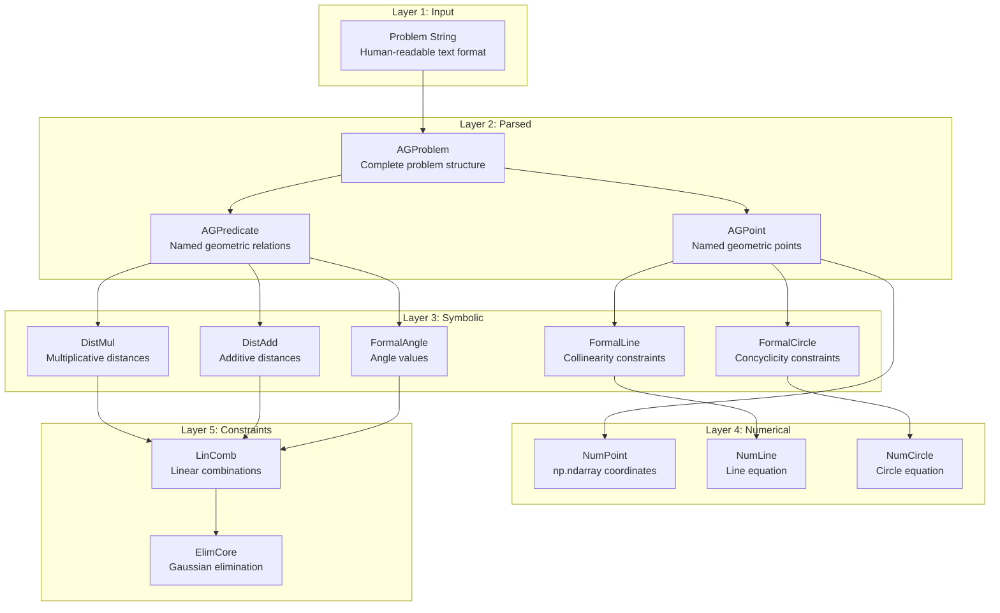

**Representation Layer Summary**

| Layer | Module | Purpose | Key Classes |
|-------|--------|---------|-------------|
| Input | N/A | Human-readable problem encoding | String format |
| Parsed | `parse.py` | Structured problem representation | `AGPoint`, `AGPredicate`, `AGProblem` |
| Symbolic | `ddar.py`, `elimination.py` | Algebraic constraint representation | `FormalLine`, `FormalCircle`, `DistMul`, `DistAdd`, `FormalAngle` |
| Numerical | `numericals.py` | Concrete geometric calculations | `NumPoint`, `NumLine`, `NumCircle` |
| Constraints | `elimination.py` | Linear algebra for solving | `LinComb`, `ElimVar`, `ElimCore` |

Sources: [parse.py:26-149](), [ddar.py:33-64](), [elimination.py:28-523](), [numericals.py:20-123]()

## Input Representation

The input layer consists of problem strings that encode geometric problems in a human-readable format. These strings contain point definitions with coordinates, geometric predicates describing relationships, and a goal predicate to prove.

**String Format Pattern:**
```
<point_defs> = <predicates> ? <goal>
```

Example:
```
a@0.0_0.0 = ; b@1.0_0.0 = ; c@0.5_0.866 = coll a b c ? perp a b c d
```

The input representation is stateless and immutable. It serves only as an entry point into the system, with all processing occurring in subsequent layers.

Sources: [parse.py:112-148]()

## Parsed Representation

The parsed representation transforms input strings into structured Python objects with type safety and attribute access. This layer is defined in `parse.py` and consists of three primary classes.

### AGPoint Class

`AGPoint` represents a geometric point with both a symbolic name and a numerical position.

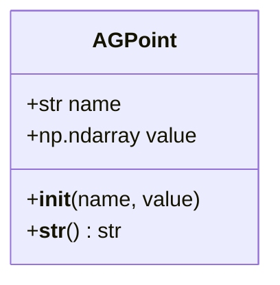

**Class Definition:**
[parse.py:26-35]()

**Attributes:**
- `name` (str): Symbolic identifier for the point (e.g., "a", "b", "x1")
- `value` (np.ndarray): 2D coordinate array `[x, y]`

The dual representation (symbolic name + numerical value) is central to AlphaGeometry2's architecture. The name enables symbolic reasoning, while the value enables numerical verification.

### AGPredicate Class

`AGPredicate` represents a geometric relationship between points, potentially with numerical constants.

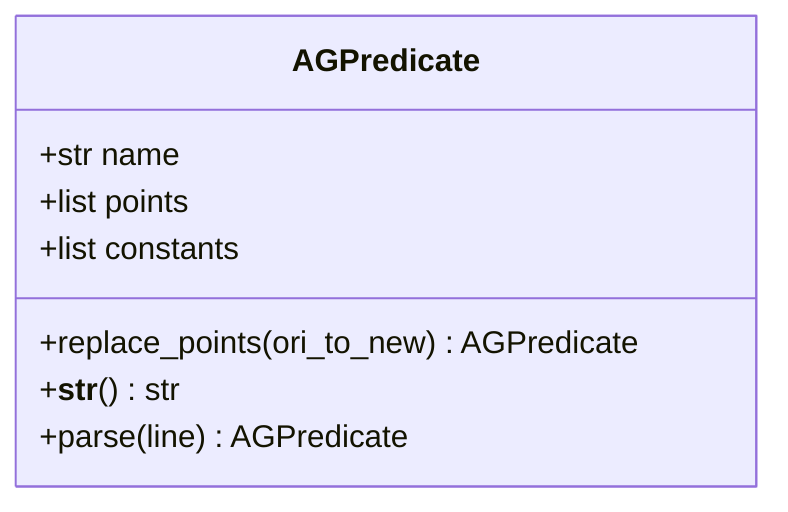

**Class Definition:**
[parse.py:37-81]()

**Attributes:**
- `name` (str): Predicate type (e.g., "coll", "cong", "cyclic", "eqangle")
- `points` (list[str | AGPoint]): Points involved in the relation
- `constants` (list[int | float | Fraction]): Numerical parameters (angles, ratios)

**Predicate Types:**

| Predicate | Points | Constants | Meaning |
|-----------|--------|-----------|---------|
| `coll` | n ≥ 3 | 0 | Points are collinear |
| `cyclic` | n ≥ 4 | 0 | Points are concyclic |
| `cong` | 4 | 0 | Two segments have equal length |
| `eqangle` | 8 | 0 | Two angle pairs are equal |
| `para` | 4 | 0 | Two lines are parallel |
| `perp` | 4 | 0 | Two lines are perpendicular |
| `eqratio` | 8 | 0 | Two distance ratios are equal |

**Key Method - replace_points:**
[parse.py:45-50]()

This method substitutes point references, enabling DDAR's point merging operation. When DDAR proves two points are equal, it updates all predicates to reference the canonical point.

### AGProblem Class

`AGProblem` encapsulates a complete geometry problem with all points, given predicates, and a goal.

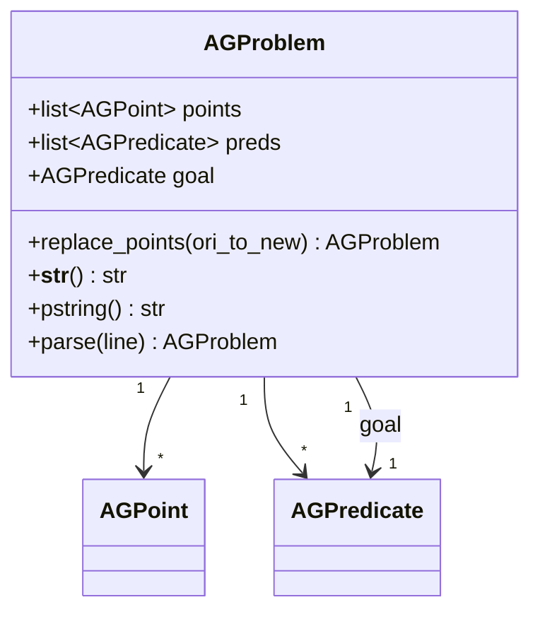

**Class Definition:**
[parse.py:83-149]()

**Attributes:**
- `points` (list[AGPoint]): All points in the problem
- `preds` (list[AGPredicate]): Given conditions
- `goal` (AGPredicate): Statement to prove

Sources: [parse.py:26-149]()

## Symbolic Representation

The symbolic representation layer maintains algebraic constraints that enable deductive reasoning. Unlike the numerical layer, symbolic operations are exact and preserve logical relationships.

### FormalLine Class

`FormalLine` represents a set of points known to be collinear, along with the line's direction as an algebraic variable.

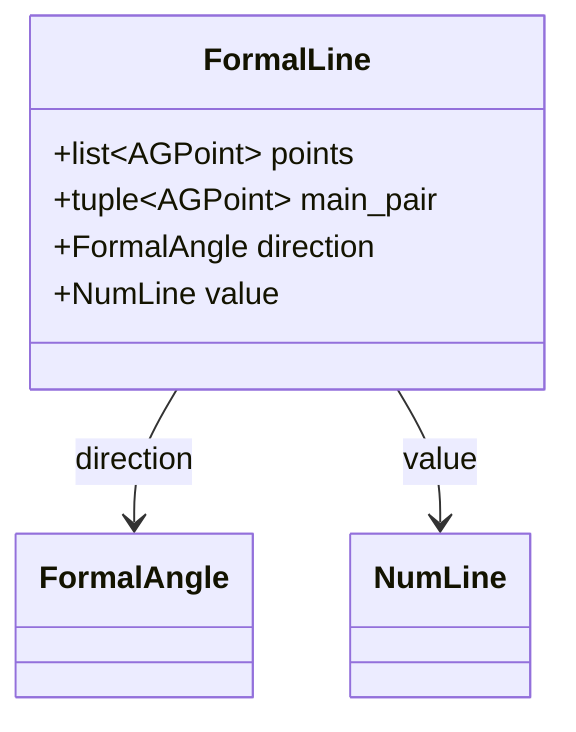

**Class Definition:**
[ddar.py:33-48]()

**Attributes:**
- `points` (list[AGPoint]): All collinear points, sorted by position on line
- `main_pair` (tuple[AGPoint, AGPoint]): Defining pair used to initialize the line
- `direction` (FormalAngle): Symbolic direction variable for angle constraints
- `value` (NumLine): Numerical line equation for verification

The `FormalLine` objects are immutable. When DDAR discovers new collinear points, it creates a new `FormalLine` merging all relevant points. See [force_collinear](#4.3) for details.

**Line Creation During Initialization:**
[ddar.py:90-108]()

During DDAR initialization, a `FormalLine` is created for every pair of distinct points. These lines are stored in `self.pair_to_line` dict.

### FormalCircle Class

`FormalCircle` represents a set of points known to be concyclic, potentially with one or more centers.

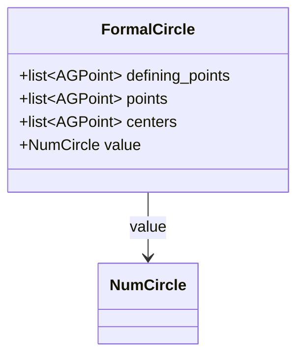

**Class Definition:**
[ddar.py:50-64]()

**Attributes:**
- `defining_points` (list[AGPoint]): Three points used to numerically define the circle
- `points` (list[AGPoint]): All concyclic points
- `centers` (list[AGPoint]): Known centers (empty if center unknown)
- `value` (NumCircle): Numerical circle equation for verification

Like `FormalLine`, `FormalCircle` objects are immutable. When DDAR discovers additional concyclic points, it creates a new merged circle.

**Circle Creation:**
[ddar.py:819-840]()

Circles are created lazily when at least 3 distinct points are proven concyclic, or when points are equidistant from a center.

### DistMul Class

`DistMul` represents multiplicative distance relationships. The system uses logarithmic representation: `log(|AB|)` is stored as a symbolic variable, enabling distance ratios to be expressed as linear combinations.

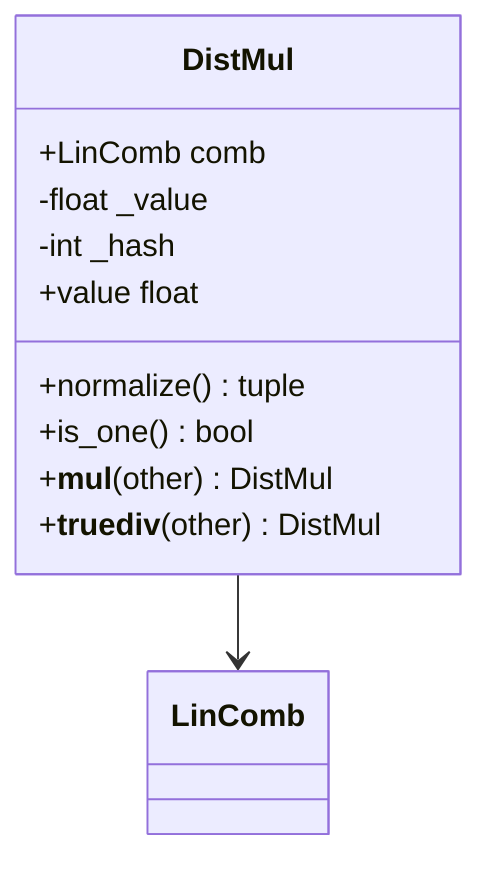

**Class Definition:**
[elimination.py:234-319]()

**Key Operations:**
- Multiplication: `d1 * d2` → `log(|AB|) + log(|CD|)` = `log(|AB| * |CD|)`
- Division: `d1 / d2` → `log(|AB|) - log(|CD|)` = `log(|AB| / |CD|)`
- Equality to 1: `d1.is_one()` → `log(ratio) = 0` → ratio = 1

**Normalization:**
[elimination.py:261-281]()

The `normalize()` method separates a `DistMul` into a normalized symbolic part (containing only variables) and a constant coefficient. This enables efficient comparison of distance expressions.

**Usage in DDAR:**
[ddar.py:112-114]() - Each point pair gets a `DistMul` variable stored in `self.pair_to_dist_mul`.

### DistAdd Class

`DistAdd` represents additive distance relationships. These are used for segment arithmetic on collinear points: `|AB| + |BC| = |AC|`.

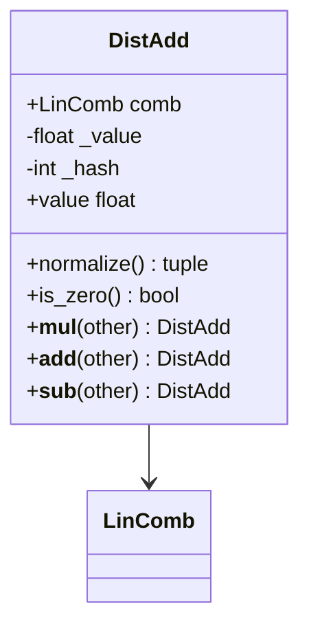

**Class Definition:**
[elimination.py:349-398]()

**Key Operations:**
- Addition: `d1 + d2` → `|AB| + |CD|`
- Subtraction: `d1 - d2` → `|AB| - |CD|`
- Equality to 0: `d1.is_zero()` → sum of signed distances = 0

**Usage in DDAR:**
[ddar.py:116-118]() - Each point pair gets a `DistAdd` variable stored in `self.pair_to_dist_add`.

**Collinearity Constraints:**
[ddar.py:755-768]()

When points are proven collinear, DDAR asserts constraints like `|AB| + |BC| = |AC|` using `DistAdd` arithmetic.

### FormalAngle Class

`FormalAngle` represents angle values in units of π. The angle 90° is represented as 0.5, and 180° as 1.0. Angles are normalized modulo 1.

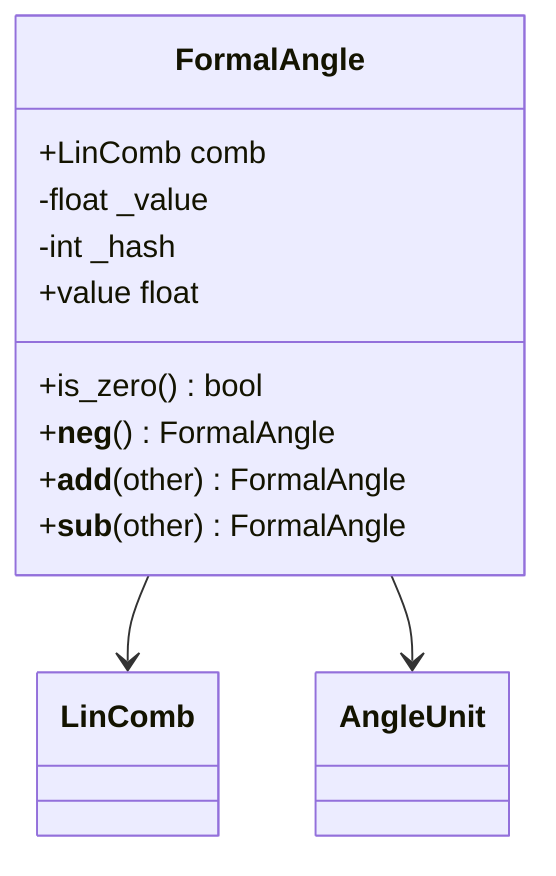

**Class Definition:**
[elimination.py:437-484]()

**Automatic Normalization:**
[elimination.py:442-448]()

The constructor automatically normalizes the constant term modulo 1, ensuring angles wrap around correctly.

**Usage in DDAR:**
[ddar.py:97-105]() - Each point pair gets a direction angle stored in `self.pair_to_dir`.

Sources: [ddar.py:33-64](), [ddar.py:90-118](), [elimination.py:234-523]()

## Numerical Representation

The numerical representation layer provides concrete geometric calculations using floating-point arithmetic. All numerical types use numpy arrays for efficient computation.

### NumPoint Type

`NumPoint` is a type alias for `np.ndarray` representing 2D coordinates.

```python
NumPoint = np.ndarray  # Shape: (2,)
```

**Type Definition:**
[numericals.py:21]()

**Point Operations:**

| Function | Signature | Purpose |
|----------|-----------|---------|
| `distance(a, b)` | `(NumPoint, NumPoint) → float` | Euclidean distance |
| `normalize(v)` | `(NumPoint) → NumPoint` | Unit vector |
| `direction(v)` | `(NumPoint) → float` | Angle in units of π |
| `midpoint(a, b)` | `(NumPoint, NumPoint) → NumPoint` | Average position |
| `orientation(a, b, c)` | `(NumPoint, NumPoint, NumPoint) → int` | Sign of determinant |

**Sources:**
[numericals.py:24-59]()

### NumLine Class

`NumLine` represents a line using the equation `n·x = c`, where `n` is a unit normal vector.

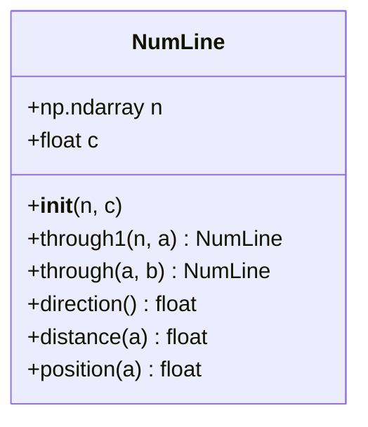

**Class Definition:**
[numericals.py:61-87]()

**Construction Methods:**
- `NumLine.through(a, b)` [numericals.py:75-76]() - Line through two points
- `NumLine.through1(n, a)` [numericals.py:70-72]() - Line through point with given normal

**Key Methods:**
- `direction()` [numericals.py:78-79]() - Returns line direction in [0, 1) normalized to π
- `distance(a)` [numericals.py:81-82]() - Perpendicular distance from point to line
- `position(a)` [numericals.py:84-86]() - Signed position along line (for ordering collinear points)

**Usage in DDAR:**
[ddar.py:95]() - Every `FormalLine` has a `.value` field containing the corresponding `NumLine`.

### NumCircle Class

`NumCircle` represents a circle with center and radius.

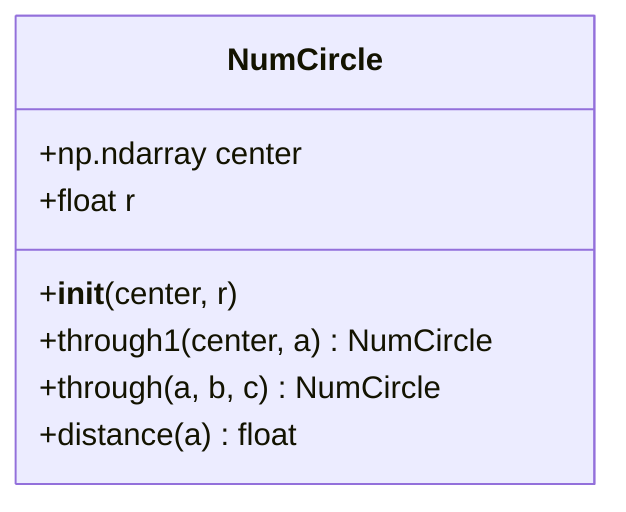

**Class Definition:**
[numericals.py:101-123]()

**Construction Methods:**
- `NumCircle.through1(center, a)` [numericals.py:109-111]() - Circle with given center through point
- `NumCircle.through(a, b, c)` [numericals.py:114-119]() - Circle through three points (computes center via perpendicular bisectors)

**Key Method:**
- `distance(a)` [numericals.py:121-122]() - Distance from point to circle (0 if on circle)

**Usage in DDAR:**
[ddar.py:63]() - Every `FormalCircle` has a `.value` field containing the corresponding `NumCircle`.

Sources: [numericals.py:20-123]()

## Constraint System Representation

The constraint system layer implements Gaussian elimination for solving systems of linear equations over symbolic variables.

### ElimVar Hierarchy

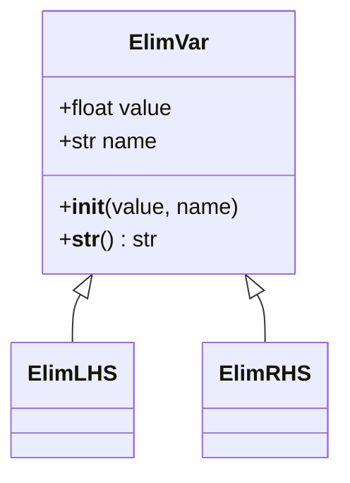

**Class Definitions:**
[elimination.py:28-46]()

**Variable Types:**
- `ElimLHS` (Left-Hand Side): Free variables that can be eliminated (e.g., unknown distances, angles)
- `ElimRHS` (Right-Hand Side): Constants and already-determined variables (e.g., π, known ratios)

The distinction enables the elimination algorithm to choose pivot variables correctly: only `ElimLHS` variables can be pivots.

### LinComb Class

`LinComb` represents a linear combination: `c₁·v₁ + c₂·v₂ + ... + cₙ·vₙ` where `vᵢ` are variables (of type `ElimVar`) and `cᵢ` are rational coefficients.

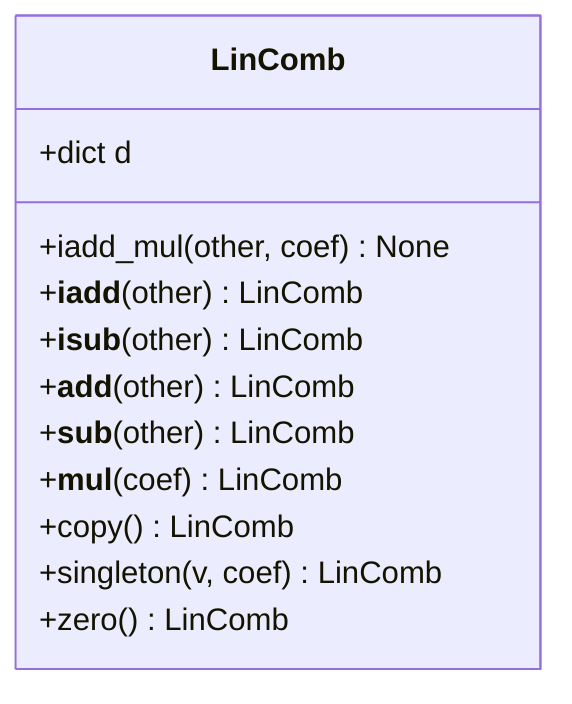

**Class Definition:**
[elimination.py:48-125]()

**Internal Representation:**
- `d` (dict[ElimVar, Fraction]): Maps variables to their coefficients
- Zero coefficients are automatically removed to maintain sparsity

**Key Operations:**
- `iadd_mul(other, coef)` [elimination.py:54-66]() - In-place addition: `self += other * coef`
- `copy()` [elimination.py:95-96]() - Deep copy (required due to mutable dict)

**Factory Methods:**
- `LinComb.singleton(v, coef=1)` [elimination.py:115-120]() - Create combination with single variable
- `LinComb.zero()` [elimination.py:123-124]() - Create zero combination (empty dict)

### ElimCore Class

`ElimCore` implements Gaussian elimination using pivoting on `ElimLHS` variables. It maintains a system of equations and can simplify linear combinations using known equalities.

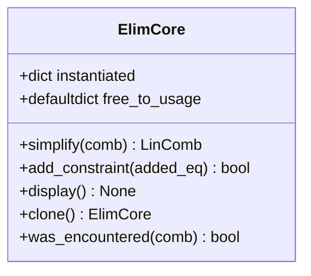

**Class Definition:**
[elimination.py:127-194]()

**Internal State:**
- `instantiated` (dict[ElimVar, LinComb]): Maps eliminated variables to their definitions
- `free_to_usage` (defaultdict[ElimVar, set]): Tracks which equations use each free variable

**Key Methods:**

**simplify(comb):**
[elimination.py:134-143]()

Substitutes all eliminated variables with their definitions, returning a simplified combination containing only free variables.

**add_constraint(added_eq):**
[elimination.py:145-169]()

Adds a new constraint equation to the system:
1. Simplify the equation using existing constraints
2. Choose a pivot variable (an `ElimLHS` with minimal usage)
3. Solve for the pivot: express it in terms of other variables
4. Update all equations that use the pivot
5. Return True if the constraint was non-trivial

The algorithm maintains the invariant that `instantiated[v]` never contains `v` itself, forming a directed acyclic graph of dependencies.

### Specialized Elimination Systems

Three specialized systems wrap `ElimCore` for different geometric constraint types:

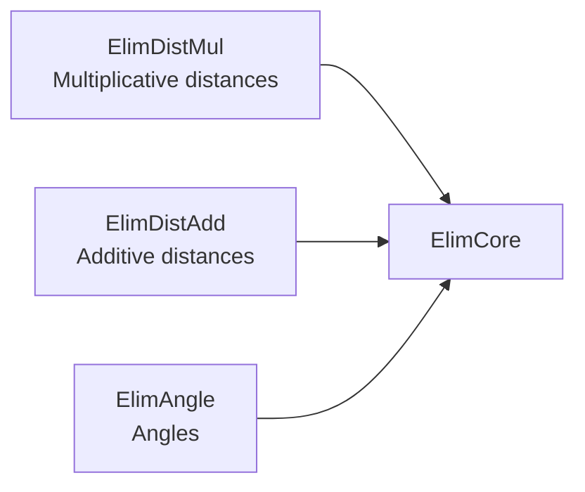

**ElimDistMul:**
[elimination.py:321-347]()
- Wraps `ElimCore` for multiplicative distance constraints
- `force_one(dist_mul)` asserts a ratio equals 1
- `new_var(value, name)` creates a new distance variable

**ElimDistAdd:**
[elimination.py:400-426]()
- Wraps `ElimCore` for additive distance constraints
- `force_zero(dist_add)` asserts a sum equals 0
- `new_var(value, name)` creates a new distance variable

**ElimAngle:**
[elimination.py:486-523]()
- Wraps `ElimCore` for angle constraints
- `force_zero(angle)` asserts an angle equals 0 (mod π)
- `new_var(value, name)` creates a new angle variable
- `const(num, den)` creates a constant angle (e.g., π/2)

Sources: [elimination.py:28-523]()

## Transformation Flow

Data transforms through multiple representation layers during problem solving. The transformations occur at specific points in the codebase.

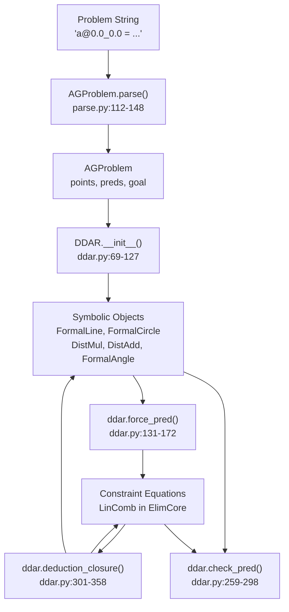

**Transformation Stages:**

| Stage | Input | Output | Code Reference |
|-------|-------|--------|----------------|
| Parse | Problem string | `AGProblem` | [parse.py:112-148]() |
| Initialize | `AGProblem.points` | `FormalLine`, distance/angle vars | [ddar.py:69-127]() |
| Assert | `AGPredicate` | Constraint equations in `ElimCore` | [ddar.py:131-172]() |
| Deduce | Current knowledge | New `FormalLine`, `FormalCircle`, constraints | [ddar.py:301-358]() |
| Check | `AGPredicate` (goal) | Boolean | [ddar.py:259-298]() |

**Predicate to Constraint Translation:**

The `force_pred` method [ddar.py:131-172]() translates predicates into constraints:

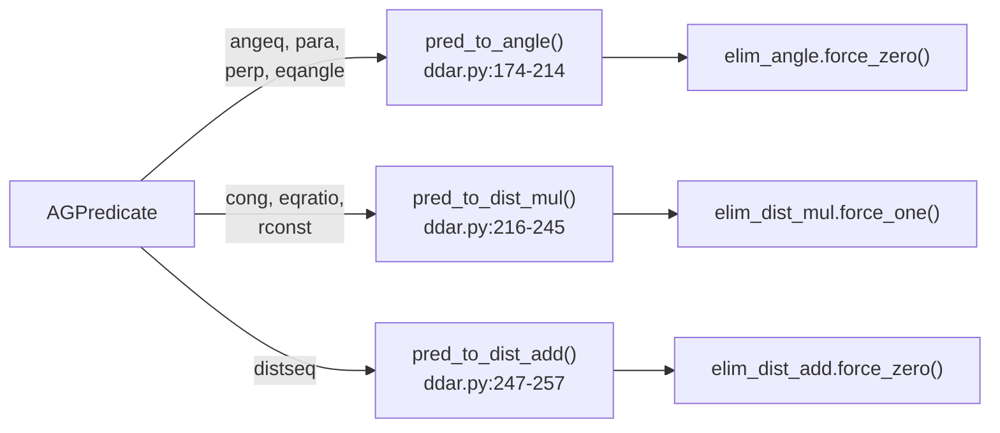

**Verification Translation:**

The `check_pred` method [ddar.py:259-298]() verifies predicates against current knowledge:

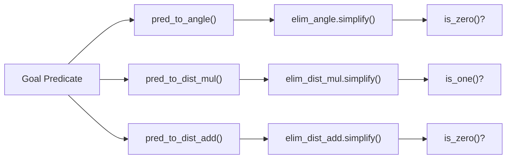

Sources: [ddar.py:131-298](), [parse.py:112-148]()

## Dual Representation Pattern

A key architectural pattern in AlphaGeometry2 is the dual representation of geometric objects: each symbolic object has a corresponding numerical value for verification.

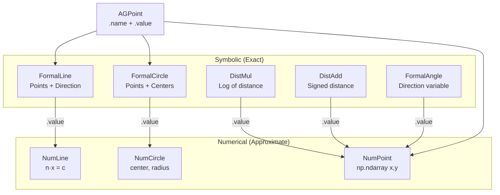

**Dual Representation Examples:**

**Point:**
- Symbolic: `AGPoint(name="a", value=...)`
- Name: `"a"` (for symbolic reasoning)
- Value: `np.array([0.0, 0.0])` (for numerical checks)

**Line:**
- Symbolic: `FormalLine` with `direction` as `FormalAngle` variable
- Numerical: `.value` field contains `NumLine` with concrete equation

**Circle:**
- Symbolic: `FormalCircle` with list of `AGPoint` objects
- Numerical: `.value` field contains `NumCircle` with concrete center/radius

**Distance:**
- Symbolic: `DistMul` or `DistAdd` as linear combination of variables
- Numerical: `.value` property computes concrete float value

**Purpose of Dual Representation:**

1. **Symbolic reasoning** enables exact logical deductions without floating-point error accumulation
2. **Numerical verification** ensures symbolic deductions are consistent with concrete geometry
3. **Validation** catches logical errors by asserting symbolic and numerical values match

**Validation Examples:**

[ddar.py:331]() - Assert distance ratio equals 1:
```python
assert abs(dist_mul.value - 1.0) ** 2 < ng.ATOM
```

[ddar.py:410]() - Assert distance sum equals 0:
```python
assert abs(dist_add.value) ** 2 < ng.ATOM
```

[ddar.py:712-715]() - Assert collinearity:
```python
if not all(line1.value.distance(point.value) < ng.ATOM for point in points):
    raise ValueError('Points not numerically collinear: ' + ...)
```

[ddar.py:841-850]() - Assert concyclicity:
```python
if not all(circle_value.distance(x.value) ** 2 < ng.ATOM for x in points):
    raise ValueError('Points not numerically concyclic: ' + ...)
```

The tolerance threshold `ng.ATOM = 1e-12` [numericals.py:20]() determines when numerical values are considered equal.

Sources: [ddar.py:33-64](), [ddar.py:331](), [ddar.py:410](), [ddar.py:712-715](), [ddar.py:841-850](), [numericals.py:20]()

## Data Flow in DDAR

The DDAR class maintains multiple dictionaries mapping geometric relationships to their symbolic and numerical representations. Understanding these data structures is crucial for understanding how DDAR operates.

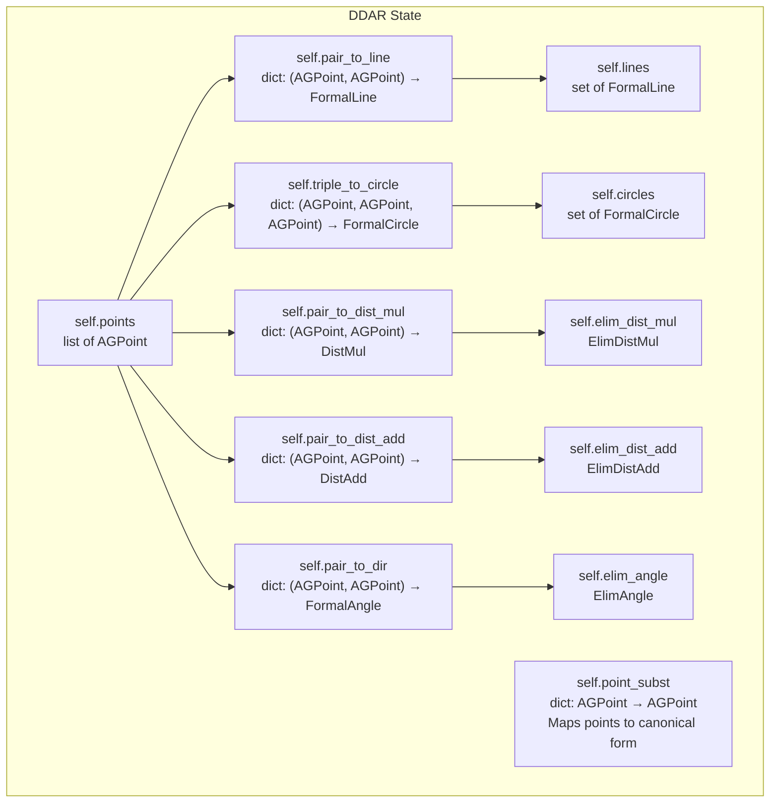

**DDAR State Summary:**

| Field | Type | Purpose | Initialized |
|-------|------|---------|-------------|
| `points` | `list[AGPoint]` | All points in the problem | [ddar.py:71]() |
| `lines` | `set[FormalLine]` | Known collinear point sets | [ddar.py:73]() |
| `circles` | `set[FormalCircle]` | Known concyclic point sets | [ddar.py:74]() |
| `pair_to_line` | `dict[(AGPoint, AGPoint), FormalLine]` | Line through each pair | [ddar.py:81, 106-107]() |
| `pair_to_dist_mul` | `dict[(AGPoint, AGPoint), DistMul]` | Multiplicative distance | [ddar.py:86, 113-114]() |
| `pair_to_dist_add` | `dict[(AGPoint, AGPoint), DistAdd]` | Additive distance | [ddar.py:87, 116-118]() |
| `pair_to_dir` | `dict[(AGPoint, AGPoint), FormalAngle]` | Line direction | [ddar.py:88, 104-105]() |
| `triple_to_circle` | `dict[(AGPoint, AGPoint, AGPoint), FormalCircle]` | Circle through triple | [ddar.py:121-123]() |
| `point_subst` | `dict[AGPoint, AGPoint]` | Point merge mapping | [ddar.py:80]() |
| `elim_dist_mul` | `ElimDistMul` | Distance ratio constraints | [ddar.py:76]() |
| `elim_dist_add` | `ElimDistAdd` | Distance sum constraints | [ddar.py:77]() |
| `elim_angle` | `ElimAngle` | Angle constraints | [ddar.py:78]() |

**Caching for Performance:**

DDAR maintains caches of simplified expressions to avoid redundant elimination operations:

[ddar.py:125-126]()
```python
self.dist_mul_cache = dict(self.pair_to_dist_mul)
self.direction_cache = dict(self.pair_to_dir)
```

[ddar.py:1036-1046]() - Cache update method:
```python
def update_cache(self):
    for a, b in itertools.combinations(self.points, 2):
        if self.num_identical(a, b):
            continue
        dist = self.get_dist_mul(a, b)
        self.dist_mul_cache[a, b] = dist
        self.dist_mul_cache[b, a] = dist
        direction = self.elim_angle.simplify(self.pair_to_dir[a, b])
        self.direction_cache[a, b] = direction
        self.direction_cache[b, a] = direction
```

The caches are updated after each deduction step to reflect newly discovered equalities.

Sources: [ddar.py:66-127](), [ddar.py:1036-1046]()

---

